# Exam Questions — Electrolysis
**4. Electrochemistry** · Cambridge (CIE) IGCSE chemistry (0620 & 0971)
> Source: [https://www.savemyexams.com/igcse/chemistry/cie/23/topic-questions/](https://www.savemyexams.com/igcse/chemistry/cie/23/topic-questions/) · 54 questions across 3 sets

## Alternative To Practical Questions (10 questions)

### Q1 — medium — 6 marks

**Q1** [1 mark]

Lead bromide was placed in a tube and connected to an electrical circuit as shown below.

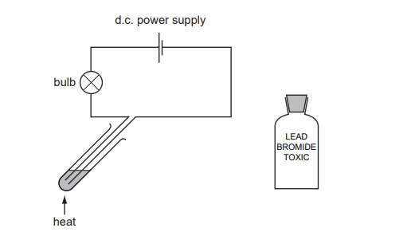

The lead bromide was heated until molten. A brown gas was given off.

State **one** other expected observation.

*Source: 2004 6 Q3*

**Q1** [2 marks]

**Extract:**

Lead bromide was placed in a tube and connected to an electrical circuit as shown below. ![SlygNODk_heating-lead-bromide] The lead bromide was heated until molten. A brown gas was given off.

i) Suggest a suitable material for the electrodes.

[1]

ii) Indicate on the diagram the negative electrode (cathode).

[1]

*Source: 2004 6 Q3*

**Q1** [2 marks]

**Extract:**

Lead bromide was placed in a tube and connected to an electrical circuit as shown below. The lead bromide was heated until molten. A brown gas was given off.

Name the brown gas. At what electrode will the gas be given off?

name ........................................................................

electrode ..................................................................

*Source: 2004 6 Q3*

**Q1** [1 mark]

**Extract:**

Lead bromide was placed in a tube and connected to an electrical circuit as shown below. The lead bromide was heated until molten. A brown gas was given off.

Why is this experiment carried out in a fume cupboard?

*Source: 2004 6 Q3*

### Q2 — medium — 6 marks

**Q2** [1 mark]

Electricity was passed through a concentrated solution of sodium chloride containing Universal Indicator.

Suggest a suitable material for the electrodes.

*Source: 2008 6 Q2*

**Q2** [2 marks]

**Extract:**

Electricity was passed through a concentrated solution of sodium chloride containing Universal Indicator.

Three observations were noted:

1. Bubbles of gas seen immediately at the negative electrode.
2. Bubbles of gas formed after some time at the positive electrode.
3. The solution turned blue around the negative electrode and colourless near the positive electrode.

Give a test to show that the gas observed in 1 is hydrogen.

test ........................................................................................

result .....................................................................................

*Source: 2008 6 Q2*

**Q2** [1 mark]

**Extract:**

Electricity was passed through a concentrated solution of sodium chloride containing Universal Indicator.

Three observations were noted:

1. Bubbles of gas seen immediately at the negative electrode.
2. Bubbles of gas formed after some time at the positive electrode.
3. The solution turned blue around the negative electrode and colourless near the positive electrode.

Suggest why bubbles of gas were not seen immediately in 2.

*Source: 2008 6 Q2*

**Q2** [2 marks]

**Extract:**

Electricity was passed through a concentrated solution of sodium chloride containing Universal Indicator.
Three observations were noted:
1. Bubbles of gas seen immediately at the negative electrode.
2. Bubbles of gas formed after some time at the positive electrode.
3. The solution turned blue around the negative electrode and colourless near the positive electrode.

What causes the colour change in 3 at:

the negative electrode ...........................................................................................

the positive electrode? ...........................................................................................

*Source: 2008 6 Q2*

### Q3 — medium — 8 marks

**Q3** [2 marks]

Electricity was passed through a solution of concentrated hydrochloric acid using the apparatus shown.

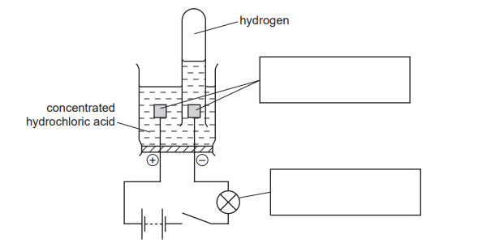

Complete the boxes to identify the parts of the apparatus labelled.

*Source: 2013 6 Q1*

**Q3** [2 marks]

Describe the test for hydrogen.

test ......................................................................................................... result  ....................................................................................................

*Source: 2013 6 Q1*

**Q3** [2 marks]

**Extract:**

Electricity was passed through a solution of concentrated hydrochloric acid using the apparatus shown. Complete the boxes to identify the parts of the apparatus labelled.

Describe how a sample of the gas given off at the positive electrode could be collected and its volume measured.

**Q3** [2 marks]

**Extract:**

Electricity was passed through a solution of concentrated hydrochloric acid using the apparatus shown. Complete the boxes to identify the parts of the apparatus labelled.

The experiment was repeated using a concentrated aqueous solution of sodium chloride instead of hydrochloric acid.

i) State the name of the solution formed.

[1]

ii) Give a test to show the presence of this product.

[1]

*Source: 2013 6 Q1*

### Q4 — medium — 8 marks

**Q4** [1 mark]

Electricity was used to break down dilute sulfuric acid using the apparatus shown.

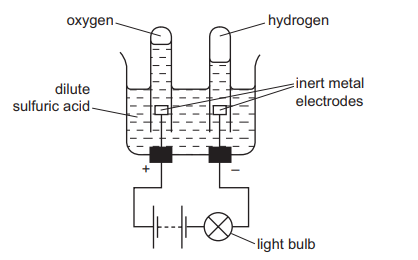

What name is given to this process?

*Source: 2015 6 Q3*

**Q4** [1 mark]

**Extract:**

Electricity was used to break down dilute sulfuric acid using the apparatus shown.

Give **one** observation which could be made during this experiment.

*Source: 2015 6 Q3*

**Q4** [1 mark]

**Extract:**

Electricity was used to break down dilute sulfuric acid using the apparatus shown.

Suggest a suitable metal for the inert metal electrodes.

*Source: 2015 6 Q3*

**Q4** [2 marks]

Give a test for oxygen gas.

test .............................................................................................. result ...........................................................................................

*Source: 2015 6 Q3*

**Q4** [1 mark]

**Extract:**

Electricity was used to break down dilute sulfuric acid using the apparatus shown. What name is given to this process? - Electrolysis

Why does hydrogen form at the negative electrode?

*Source: 2015 6 Q3*

**Q4** [2 marks]

**Extract:**

Electricity was used to break down dilute sulfuric acid using the apparatus shown.

The experiment was repeated using concentrated hydrochloric acid. Explain why this experiment was carried out in a fume cupboard.

### Q5 — medium — 6 marks

**Q5** [3 marks]

The diagram shows the effect of passing electricity through concentrated hydrochloric acid.

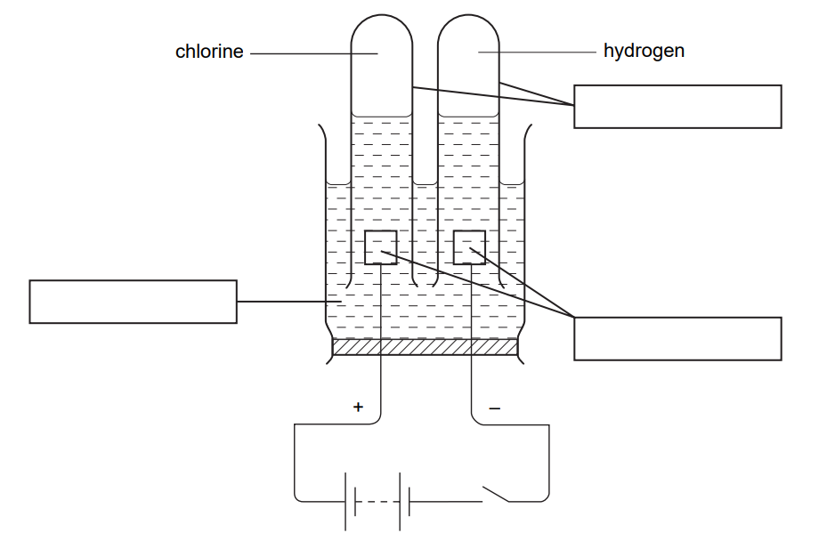

Label the diagram by completing the boxes.

*Source: 2006 6 Q1*

**Q5** [1 mark]

**Extract:**

The diagram shows the effect of passing electricity through concentrated hydrochloric acid.

Name this process.

*Source: 2006 6 Q1*

**Q5** [2 marks]

Give a test for chlorine.

| test | .................................................................................................. |
|---|---|
| result | .................................................................................................. |

*Source: 2006 6 Q1*

### Q6 — medium — 7 marks

**Q6** [1 mark]

The diagram shows the apparatus used to find out the effect of an electric current on a concentrated aqueous solution of sodium chloride.

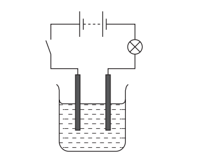

On the diagram label the electrodes.

*Source: 2005 6 Q2*

**Q6** [3 marks]

**Extract:**

The diagram shows the apparatus used to find out the effect of an electric current on a concentrated aqueous solution of sodium chloride.

Give **three **observations when the circuit is switched on.

*Source: 2005 6 Q2*

**Q6** [3 marks]

**Extract:**

The diagram shows the apparatus used to find out the effect of an electric current on a concentrated aqueous solution of sodium chloride.

i) Name the product at the positive electrode (anode).

[1]

ii) State a test for this product and the result of the test.

[2]

*Source: 2005 6 Q2*

### Q7 — medium — 6 marks

**Q7** [2 marks]

The diagram shows an experiment to pass electricity through lead bromide.

Electricity has no effect on solid lead bromide

i) Clearly label the electrodes on the diagram.

[1]

ii) Suggest a suitable material to make the electrodes.

[1]

*Source: 2008 6 Q2*

**Q7** [2 marks]

**Extract:**

The diagram shows an experiment to pass electricity through lead bromide. Electricity has no effect on solid lead bromide

Give **two** observations expected when the lead bromide is heated to melting point.

*Source: 2008 6 Q2*

**Q7** [2 marks]

**Extract:**

The diagram shows an experiment to pass electricity through lead bromide. Electricity has no effect on solid lead bromide.

State **two** different safety precautions when carrying out this experiment.

*Source: 2009 6 Q2*

### Q8 — medium — 7 marks

**Q8** [1 mark]

Electricity was passed through molten lead(II) bromide using the apparatus shown.

The formation of a brown gas was observed at the positive electrode.

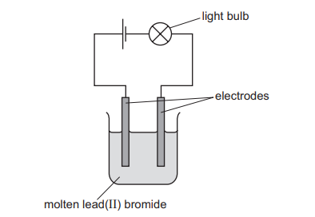

Give one other expected observation.

*Source: 2015 6 Q2*

**Q8** [2 marks]

**Extract:**

Electricity was passed through molten lead(II) bromide using the apparatus shown. The formation of a brown gas was observed at the positive electrode.

i) Name a non-metal that could be used for the electrodes.

[1]

ii) Suggest why iron is not used for the electrodes.

[1]

*Source: 2015 6 Q2*

**Q8** [2 marks]

**Extract:**

Electricity was passed through molten lead(II) bromide using the apparatus shown. The formation of a brown gas was observed at the positive electrode.

i) Name the brown gas formed

[1]

ii) Suggest the result of testing this gas with damp blue litmus paper.

[1]

*Source: 2015 6 Q2*

**Q8** [1 mark]

**Extract:**

Electricity was passed through molten lead(II) bromide using the apparatus shown. The formation of a brown gas was observed at the positive electrode.

Name the product formed at the negative electrode.

**Q8** [1 mark]

**Extract:**

Electricity was passed through molten lead(II) bromide using the apparatus shown. The formation of a brown gas was observed at the positive electrode.

State **one **safety precaution that should be used when doing this experiment.

### Q9 — medium — 4 marks

**Q9** [1 mark]

A concentrated solution of sodium chloride was electrolysed using the apparatus below.

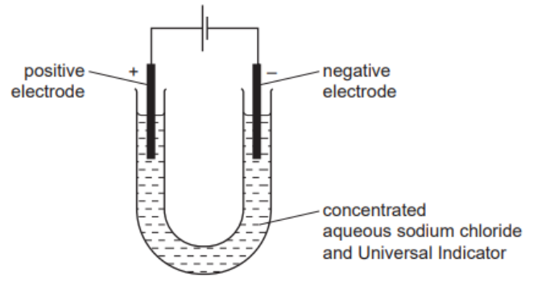

One observation noted was that the Universal Indicator turned purple at the negative electrode.

What observation would be made at both electrodes?

*Source: 2010 6 Q6*

**Q9** [1 mark]

**Extract:**

A concentrated solution of sodium chloride was electrolysed using the apparatus below. One observation noted was that the Universal Indicator turned purple at the negative electrode.

Why did the indicator turn purple at the negative electrode?

*Source: 2010 6 Q6*

**Q9** [2 marks]

**Extract:**

A concentrated solution of sodium chloride was electrolysed using the apparatus below. One observation noted was that the Universal Indicator turned purple at the negative electrode.

i) Name the product formed at the positive electrode.

[1]

ii) Suggest the effect of this product on the Universal Indicator.

[1]

*Source: 2010 6 Q6*

### Q10 — medium — 10 marks

**Q10** [1 mark]

Electricity was passed through aqueous copper(II) sulfate using inert electrodes as shown in the diagram below. Copper was deposited at one of the electrodes.

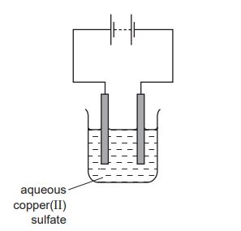

Name a suitable material for the electrodes.

*Source: 2012 6 Q2*

**Q10** [1 mark]

**Extract:**

Electricity was passed through aqueous copper(II) sulfate using inert electrodes as shown in the diagram below. Copper was deposited at one of the electrodes.

At which electrode was copper deposited?

*Source: 2012 6 Q2*

**Q10** [1 mark]

**Extract:**

Electricity was passed through aqueous copper(II) sulfate using inert electrodes as shown in the diagram below. Copper was deposited at one of the electrodes.

Give **one** other observation seen during the electrolysis.

*Source: 2012 6 Q2*

**Q10** [2 marks]

**Extract:**

Electricity was passed through aqueous copper(II) sulfate using inert electrodes as shown in the diagram below. Copper was deposited at one of the electrodes.

The electrode at which copper was deposited was removed at intervals, washed, dried and weighed. The results are shown below.

| time / min | mass of electrode / g | total increase in mass / g |
|---|---|---|
| 0 | 3.75 | 0.00 |
| 10 | 4.00 | 0.25 |
| 20 | 4.25 | 0.50 |
| 30 | 4.50 |   |
| 40 | 4.75 |   |
| 50 | 4.90 |   |
| 60 | 4.90 |   |
| 70 | 4.90 |   |

i) Suggest how the electrode was washed?

[1]

ii) How could the electrode be dried quickly?

[1]

*Source: 2012 6 Q2*

**Q10** [1 mark]

**Extract:**

The electrode at which copper was deposited was removed at intervals, washed, dried and weighed. The results are shown below.

| time / min | mass of electrode / g | total increase in mass / g |
| :---: | :---: | :---: |
| 0 | 3.75 | 0.00 |
| 10 | 4.00 | 0.25 |
| 20 | 4.25 | 0.50 |
| 30 | 4.50 |   |
| 40 | 4.75 |   |
| 50 | 4.90 |   |
| 60 | 4.90 |   |
| 70 | 4.90 |   |

Complete the table from part d) by calculating the total increase in mass for the remaining time intervals.

**Q10** [3 marks]

**Extract:**

| time / min | mass of electrode / g | total increase in mass / g |
| 0 | 3.75 | 0.00 |
| 10 | 4.00 | 0.25 |
| 20 | 4.25 | 0.50 |
| 30 | 4.50 | 0.75 |
| 40 | 4.75 | 1.00 |
| 50 | 4.90 | 1.15 |
| 60 | 4.90 | 1.15 |
| 70 | 4.90 | 1.15 |

Plot the points on the grid below. Draw a graph with two intersecting straight lines.

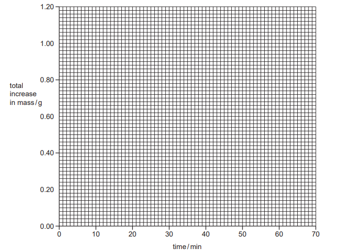

**Q10** [1 mark]

**Extract:**

The electrode at which copper was deposited was removed at intervals, washed, dried and weighed. The results are shown below.

| time / min | mass of electrode / g | total increase in mass / g |
| 0 | 3.75 | 0.00 |
| 10 | 4.00 | 0.25 |
| 20 | 4.25 | 0.50 |
| 30 | 4.50 | 0.75 |
| 40 | 4.75 | 1.00 |
| 50 | 4.90 | 1.15 |
| 60 | 4.90 | 1.15 |
| 70 | 4.90 | 1.15 |

Suggest why the last three readings were the same.

*Source: 2012 6 Q2*

## Multiple Choice Questions (25 questions)

### Q1 — medium — 1 marks

**Q1** [1 mark]

Concentrated aqueous magnesium chloride is electrolysed using inert graphite electrodes.

Which row shows the correct observations at the cathode and at the anode?

|   | observation at the cathode | observation at the anode |
|---|---|---|
| **A** | bubbles of a colourless gas | bubbles of a colourless gas |
| **B** | bubbles of a colourless gas | bubbles of a pale yellow-green gas |
| **C** | silvery solid deposited | bubbles of a colourless gas |
| **D** | silvery solid deposited | bubbles of a pale yellow-green gas |

### Q2 — easy — 1 marks

**Q2** [1 mark]

Three statements about the electrolysis of molten lead (II) bromide are listed.

1. A green gas is produced at the negative electrode.
2. Lead ions will gain electrons at the cathode.
3. The electrodes for the electrolysis must be from an inert material, such as graphite.

Which statements are correct?

### Q3 — easy — 1 marks

**Q3** [1 mark]

Concentrated aqueous sodium chloride can be electrolysed.

Which statement is correct?

### Q4 — easy — 1 marks

**Q4** [1 mark]

Solid lead(II) bromide is heated until it is molten. The molten lead (II) bromide then undergoes electrolysis.

Which substances are formed at each electrode?

|   | **anode** | **cathode** |
|---|---|---|
| **A** | bromine | lead |
| **B** | lead | bromine |
| **C** | bromine | hydrogen |
| **D** | hydrogen | lead |

### Q5 — easy — 1 marks

**Q5** [1 mark]

The electrolysis of concentrated hydrochloric acid is shown.

Which statement describes what happens to the electrons during the electrolysis?

### Q6 — easy — 1 marks

**Q6** [1 mark]

A student was investigating the electrolysis of zinc chloride.

What is the correct reason for electrolysis not working?

### Q7 — easy — 1 marks

**Q7** [1 mark]

The diagram shows the electrolysis of concentrated hydrochloric acid and concentrated aqueous sodium chloride using carbon electrodes.

At which electrode(s) is hydrogen produced?

### Q8 — hard — 1 marks

**Q8** [1 mark]

Concentrated aqueous sodium chloride, dilute sulfuric acid and molten lead bromide were electrolysed separately in experiments 1, 2 and 3.

Which statement about the electrode products is correct?

### Q9 — hard — 1 marks

**Q9** [1 mark]

The amount of gases P and Q are formed when substance X is electrolysed.

What is substance X?

### Q10 — hard — 1 marks

**Q10** [1 mark]

A student wants to identify the gas produced at the negative electrode during the electrolysis of aqueous sodium chloride.

What is the correct test for the gas produced?

### Q11 — hard — 1 marks

**Q11** [1 mark]

During electrolysis of brine, a gas is produced at the cathode. What is the half-equation for the reaction on the cathode?

### Q12 — hard — 1 marks

**Q12** [1 mark]

The diagram shows the electrolysis of concentrated aqueous sodium chloride.

What is the colour of the litmus at each electrode after five minutes?

|   | **colour at anode** | **colour at cathode** |
|---|---|---|
| **A** | blue | red |
| **B** | red | blue |
| **C** | red | colourless |
| **D** | colourless | blue |

### Q13 — hard — 1 marks

**Q13** [1 mark]

Four substances are electrolysed. The substances are concentrated aqueous sodium chloride, concentrated hydrochloric acid, molten lead(II) bromide and molten sodium oxide.

Which statement about these electrolysis reactions is correct?

### Q14 — hard — 1 marks

**Q14** [1 mark]

Four solutions are separately electrolysed.

| **experiment** | **solution** | **electrodes** |
|---|---|---|
| **1** | dilute aqueous sodium chloride | carbon |
| **2** | aqueous copper(II) sulfate | copper |
| **3** | concentrated hydrochloric acid | carbon |
| **4** | dilute sulfuric acid | carbon |

In which two experiments is a colourless gas evolved at the anode?

### Q15 — medium — 1 marks

**Q15** [1 mark]

Dilute sulfuric acid is electrolysed using inert electrodes.

What are the products of this electrolysis?

|   | **cathode** | **anode** |
|---|---|---|
| **A** | oxygen | sulfur |
| **B** | hydrogen | sulfur dioxide |
| **C** | oxygen | hydrogen |
| **D** | hydrogen | oxygen |

### Q16 — medium — 1 marks

**Q16** [1 mark]

Which is the correct equation for the formation of chlorine gas at the anode during the electrolysis of concentrated sodium chloride solution?

### Q17 — medium — 1 marks

**Q17** [1 mark]

The diagram shows the electrolysis of aqueous copper(II) sulfate.

Which statement is correct?

### Q18 — medium — 1 marks

**Q18** [1 mark]

Concentrated aqueous potassium bromide solution is electrolysed using inert electrodes. The ions present in the solution are K+, Br–, H+ and OH–.

To which electrodes are the ions attracted during this electrolysis?

|   | **attracted to anode** | **attracted to cathode** |
|---|---|---|
| **A** | Br– and K+ | H+ and OH– |
| **B** | Br– and OH– | H+ and K+ |
| **C** | H+ and K+ | Br– and OH– |
| **D** | H+ and OH– | Br– and K+ |

### Q19 — medium — 1 marks

**Q19** [1 mark]

Which statement about electrolysis is correct?

### Q20 — medium — 1 marks

**Q20** [1 mark]

Electricity is passed through concentrated aqueous sodium chloride. Inert electrodes are used.

Which products are formed at the electrodes?

|   | **cathode** | **anode** |
|---|---|---|
| **A** | hydrogen | chlorine |
| **B** | hydrogen | oxygen |
| **C** | sodium | chlorine |
| **D** | sodium | oxygen |

## Theory Questions (26 questions)

### Q1 — medium — 10 marks

**Q1** [1 mark]

Molten lead(II) iodide is an ionic compound. It can be electrolysed using graphite electrodes.

State the chemical formula of lead(II) iodide.

**Q1** [2 marks]

Complete Table 3.1 to show the number of protons and electrons in the ions present in lead(II) iodide.

**Table 3.1**

| Ion | Number of protons | Number of electrons |
|---|---|---|
| Pb2+ | 82 |   |
| I− |   | 54 |

**Q1** [2 marks]

State what is meant by the term **ionic bonding**.

**Q1** [1 mark]

**Extract:**

Molten lead(II) iodide is an ionic compound. It can be electrolysed using graphite electrodes.

Graphite is a suitable material for the electrodes. Tick (✓) the box that describes the property of graphite that allows it to act as an electrode.

| It has a high melting point |   |
|---|---|
| It has layers of atoms arranged in hexagons |   |
| It has mobile delocalised electrons |   |
| It is an ionic compound |   |

**Q1** [2 marks]

Ionic compounds conduct electricity when molten.

State **two** other physical properties of ionic compounds.

**Q1** [2 marks]

**Extract:**

Molten lead(II) iodide is an ionic compound. It can be electrolysed using graphite electrodes.

Fig 3.1 shows the electrolysis circuit. Electrode **X** and electrode **Y** are connected to a power source

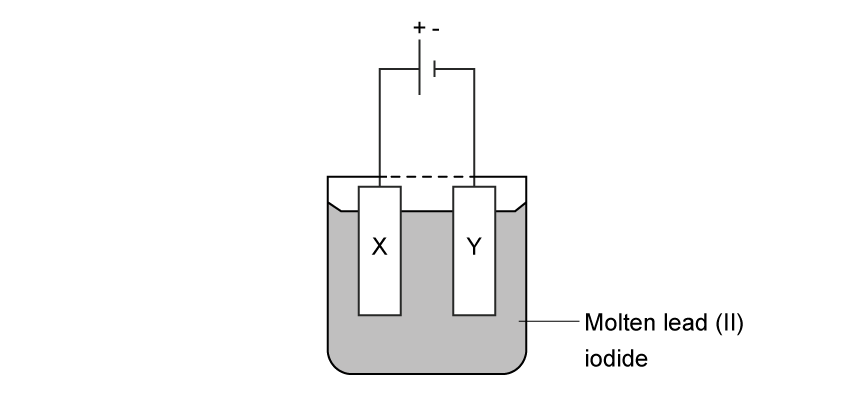

**Fig 3.1**

State the expected **observation** at each electrode.

**Observation at X**:

**Observation at Y**:

### Q2 — medium — 9 marks

**Q2** [3 marks]

Extended Tier Only

A student set up the following electrolysis of copper(II) sulfate using graphite electrodes.

State the products formed at both electrodes and one observation of the electrolyte made during this electrolysis.

**Q2** [2 marks]

**Extract:**

A student set up the following electrolysis of copper(II) sulfate using graphite electrodes.

Extended Tier Only

Describe the process by which copper ions form atoms at the cathode during electrolysis.

**Q2** [2 marks]

**Extract:**

The electrolysis of copper(II) sulfate using graphite electrodes is shown

State the products formed at both electrodes and one observation made during this electrolysis.

Balance the ionic half-equation for the formation of oxygen gas from hydroxide ions at the anode:

..... OH⁻ → ..... O2 + ..... H2O + ..... e⁻

**Q2** [2 marks]

**Extract:**

A student set up the following electrolysis of copper(II) sulfate using graphite electrodes.

A student swapped the graphite electrodes for copper electrodes.

After some time, the mass of the cathode has increased by 0.10 g and the mass of the anode has decreased by 0.10 g.

i) Explain why the mass of the cathode increases during electrolysis.

ii) Copper is transferred from the anode to the cathode during electrolysis. Explain why the concentration of Cu²⁺ ions in the solution does not change.

### Q3 — medium — 9 marks

**Q3** [2 marks]

Define the following terms:

i) Electrolyte

**[1]**

ii) Cathode

**[1]**

**Q3** [3 marks]

Extended Tier Only

During electrolysis, charged ions migrate to the cathode.

Explain how these ions become neutral atoms at the cathode.

**Q3** [2 marks]

Extended Tier Only

Write the balanced half-equation for the formation of bromine gas from molten lead(II) bromide at the anode.

**Q3** [2 marks]

Molten sodium fluoride was decomposed using electrolysis.

2NaF → 2Na + F2

(relative atomic masses: F = 19, Na = 23)
(relative formula mass NaF = 42)

Calculate the mass of sodium produced from the electrolysis of 8.4 g of sodium fluoride.

### Q4 — easy — 4 marks

**Q4** [1 mark]

Dilute sulfuric acid undergoes electrolysis in the apparatus shown.

Hydrogen is formed at the cathode during this process. State the gas produced at the anode.

**Q4** [1 mark]

**Extract:**

Dilute sulfuric acid undergoes electrolysis in the apparatus shown.

Figure X: Diagram of electrolysis apparatus indicating two gases produced.

State the gases produced at each electrode during this process.

Explain why platinum electrodes are used in the electrolysis of dilute sulfuric acid.

**Q4** [1 mark]

Describe how you would test for the presence of hydrogen gas using a splint.

**Q4** [1 mark]

Extended Tier Only

Balance the half-equation for the formation of hydrogen gas at the cathode:

..... H⁺ + ..... e⁻ → H2

### Q5 — easy — 11 marks

**Q5** [1 mark]

Complete the word equation for the electrolysis of molten sodium chloride:

Sodium chloride → ........ + ........

**Q5** [4 marks]

A chemist performs electrolysis on aqueous sodium chloride.

State the gases produced at the positive and negative electrodes, and describe the tests to ientify them.

**Q5** [2 marks]

Extended Tier Only

When an electric current passes through dilute sulfuric acid, hydrogen and oxygen gases are formed.

Balance the following half-equation for the production of oxygen during electrolysis of dilute sulfuric acid:

..... H2O → O2 + ..... H⁺ + ...... e⁻

**Q5** [4 marks]

Describe how you would obtain pure copper sulfate crystals using copper(II) oxide and dilute sulfuric acid.

### Q6 — easy — 7 marks

**Q6** [2 marks]

The electrolytic cell shown below contains molten lead(II) chloride.

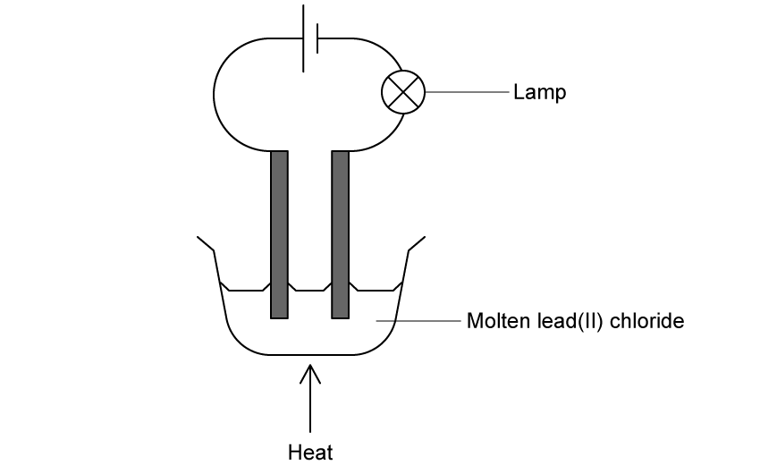

State the name of the products formed at each electrode.

**Q6** [2 marks]

Extended Tier Only

Explain why lead(II) chloride must be molten for electrolysis to occur.

**Q6** [1 mark]

**Extract:**

The electrolytic cell shown below contains molten lead(II) chloride. State the name of the products formed at each electrode. (Cathode: lead; Anode: chlorine)

Extended Tier Only

State the direction electrons flow in the external circuit during electrolysis.

**Q6** [2 marks]

Calculate the relative formula mass, *M*r, of lead(II) chloride, PbCl2.

### Q7 — medium — 9 marks

**Q7** [3 marks]

Copper has the structure of a typical metal. It has a lattice of positive ions and a “sea” of mobile electrons. The lattice can accommodate ions of a different metal.

Give a different use of copper that depends on each of the following.

i) The ability of the ions in the lattice to move past each other

[1]

ii) The presence of mobile electrons

[1]

iii) The ability to accommodate ions of a different metal in the lattice

[1]

*Source: 2004 Ju31 Q5*

**Q7** [3 marks]

Aqueous copper(II) sulphate solution can be electrolysed using carbon electrodes. The ions present in the solution are as follows.

Cu2+      SO42–      H+     OH–

i) Write an ionic equation for the reaction at the negative electrode (cathode).

[1]

ii) A colourless gas was given off at the positive electrode (anode) and the solution changes from blue to colourless. Explain these observations.

[2]

*Source: 2004 Ju31 Q5*

**Q7** [3 marks]

**Extract:**

Aqueous copper(II) sulphate solution can be electrolysed using carbon electrodes. The ions present in the solution are as follows: Cu^2+, SO4^2-, H^+, OH^-

i) Write an ionic equation for the reaction at the negative electrode (cathode). Answer: Cu^2+ + 2e^- → Cu

Aqueous copper(II) sulphate can be electrolysed using copper electrodes. The reaction at the negative electrode is the same but the positive electrode becomes smaller and the solution remains blue.

i) Write a word equation for the reaction at the positive electrode.

[1]

ii) Explain why the colour of the solution does not change.

[1]

iii) What is the large scale use of this electrolysis?

[1]

*Source: 2004 Ju31 Q5*

### Q8 — medium — 12 marks

**Q8** [1 mark]

Aluminium is obtained from purified alumina, Al2O3, by electrolysis.

Alumina is obtained from the main ore of aluminium.

State the name of this ore.

*Source: 2014 Ju33 Q7*

**Q8** [6 marks]

**Extract:**

Aluminium is obtained from purified alumina, Al~2~O~3~, by electrolysis. Alumina is obtained from the main ore of aluminium.

#### Separate: Chemistry and Extended Only

Describe the extraction of aluminium from alumina. Include the electrolyte, the electrodes and the reactions at the electrodes.

*Source: 2015 Ju33 Q7*

**Q8** [5 marks]

#### Extended Only

Aluminium is resistant to corrosion. It is protected by an oxide layer on its surface. The thickness of this oxide layer can be increased by anodising.

i) State a use of aluminium due to its resistance to corrosion.

[1]

ii) Anodising is an electrolytic process. Dilute sulfuric acid is electrolysed with an aluminium object as the anode. The thickness of the oxide layer is increased.

Complete the equations for the reactions at the aluminium anode.

.......OH– → O2 + 2H2O + ......e–

....Al + ......... → ......... Al2O3

[4]

*Source: 2015 Ju33 Q7*

### Q9 — easy — 9 marks

**Q9** [2 marks]

Sulfuric acid, H2SO4, undergoes electrolysis to form two gases.

Complete the following table

| **Electrode ** | **Product ** |
|---|---|
| Anode |   |
| Cathode |   |

**Q9** [4 marks]

**Extract:**

Sulfuric acid, H~2~SO~4~, undergoes electrolysis to form two gases.
Anode | Oxygen
Cathode | Hydrogen

Describe the test and positive result for the gases produced during the electrolysis of sulfuric acid, H2SO4.

**Q9** [2 marks]

#### Extended Only

A new electrolysis cell was set up containing copper sulfate solution. Copper is formed in this experiment.

Complete the table giving the observations at each electrode

| **Electrode** | **Observation ** |
|---|---|
| Anode |   |
| Cathode |   |

**Q9** [1 mark]

**Extract:**

A new electrolysis cell was set up containing copper sulfate solution. Copper is formed in this experiment.

#### Extended Only

Complete the ionic half equation for the formation of copper

Cu2+ (aq) +  ........... → ............. (s)

### Q10 — hard — 11 marks

**Q10** [4 marks]

The ore of aluminium is bauxite which is impure aluminium oxide. Alumina, pure aluminium oxide, is obtained from bauxite.

Aluminium is formed at the cathode when a molten mixture of alumina and cryolite, Na3AlF is electrolysed.

i) Name two products formed at the anode in this electrolysis.

[2]

ii) All the aluminium formed comes from the alumina not the cryolite. Suggest two reasons why the electrolyte must contain cryolite.

[2]

*Source: 2012 Ju32 Q4*

**Q10** [7 marks]

The purification of bauxite uses large amounts of sodium hydroxide.

i) Describe the chemistry of how sodium hydroxide is made from concentrated aqueous sodium chloride. The description must include at least one ionic equation.

[5]

ii) Making sodium hydroxide from sodium chloride produces two other chemicals. Name these two chemicals and state one use of each chemical.

chemical ..........................................................................................................

use ..........................................................................................................

chemical ..........................................................................................................

use ..........................................................................................................

[2]

*Source: 2012 Ju32 Q4*

### Q11 — hard — 17 marks

**Q11** [6 marks]

#### Extended Only

Zinc alloys have been used for over 2500 years.

i) Explain the phrase zinc alloy.

[1]

ii) Describe the bonding in a typical metal, such as zinc, and then explain why it is malleable. You may use a diagram to illustrate your answer.

[3]

iii) Suggest why the introduction of a different atom into the structure makes the alloy less malleable than the pure metal.

[2]

*Source: 2012 O33 Q4*

**Q11** [11 marks]

#### Extended Only

Zinc metal is made by the reduction of zinc oxide. The major ore of zinc is zinc blende, ZnS. Zinc blende contains silver and lead compounds as well as zinc sulfide. Zinc blende is converted into impure

2ZnS + 3O2 → 2ZnO + 2SO2

i) Describe how zinc oxide is reduced to zinc

[1]

ii) Some of the zinc oxide is dissolved in sulfuric acid to make aqueous zinc sulfate. Write a balanced symbol equation for this reaction.

[2]

iii) This impure solution of zinc sulfate contains zinc ions, silver(I) ions and lead ions. Explain why the addition of zinc powder produces pure zinc sulfate solution. Include at least one ionic equation in your explanation.

[4]

iv) Describe how zinc metal can be obtained from zinc sulfate solution by electrolysis.

A labelled diagram is acceptable. Include all the products of this electrolysis. The electrolysis is similar to that of copper(II) sulfate solution with inert electrodes.

[4]

*Source: 2012 O33 Q4*

### Q12 — easy — 6 marks

**Q12** [6 marks]

The diagram shows a cell. This is a device which produces electrical energy. The reaction in a cell is a redox reaction and involves electron transfer.

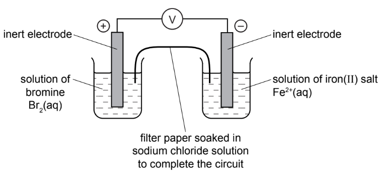

i) Complete the sentence. A cell will change ................................................ energy into electrical energy.

[1]

ii) In the left-hand beaker, the colour changes from brown to colourless. Complete the equation for the reaction.

Br2 + ............... → ...............

[2]

iii) Is the change in (ii) oxidation or reduction? Give a reason for your choice.

[1]

iv) Complete the following description of the reaction in the right-hand beaker. Fe2+ changes into ..........................

[1]

v) When a solution of bromine is replaced by a solution of chlorine, the voltage increases. When a solution of bromine is replaced by a solution of iodine, the voltage decreases. Suggest an explanation for this difference.

[1]

*Source: 2010 Oc31 Q3*

### Q13 — medium — 8 marks

**Q13** [8 marks]

#### Extended Only

The results of experiments on electrolysis using inert electrodes are given in the table.

Complete the table; the first line has been completed as an example.

| **electrolyte** | **change at negative electrode** | **change at positive electrode** | **change to electrolyte** |
|---|---|---|---|
| molten lead(II) bromide | lead formed | bromine formed | used up |
|   | potassium formed | iodine formed | used up |
| dilute aqueous sodium chloride |   |   |   |
| aqueous copper(II) sulfate |   |   |   |
|   | hydrogen formed | bromine formed | potassium hydroxide formed |

[8]

*Source: 2009 Ju31 Q2*

### Q14 — easy — 9 marks

**Q14** [5 marks]

#### Separate: Chemistry and Extended Only

Chemical reactions are always accompanied by an energy change.

Aluminium is extracted by the electrolysis of a molten mixture which contains aluminium oxide, Al2O3. This decomposes to form aluminium at the negative electrode and oxygen at the positive electrode.

i) Write an ionic equation for the reaction at the negative electrode.

[2]

ii) Complete the ionic equation for the reaction at the positive electrode.

2O2– → ....... + .......

[2]

iii) Is the reaction exothermic or endothermic? Explain your answer.

[1]

*Source: 2015 Ju33 Q6*

**Q14** [2 marks]

The combustion of propane, C3H8, is exothermic.

Give an equation for the complete combustion of propane.

*Source: 2016 Ju33 Q6*

**Q14** [2 marks]

#### Separate: Chemistry and Extended Only

Photosynthesis is an unusual endothermic reaction.

i) Where does the energy for photosynthesis come from?

[1]

ii) Give the word equation for photosynthesis.

[1]

*Source: 2015 Ju33 Q6*

### Q15 — medium — 10 marks

**Q15** [4 marks]

#### Separate: Chemistry and Extended Only

Zinc is extracted from zinc blende, ZnS.

Zinc blende is heated in air to give zinc oxide and sulfur dioxide. Most of the sulfur dioxide is used to make sulfur trioxide. This is used to manufacture sulfuric acid. Some of the acid is used in the plant, but most of it is used to make fertilisers.

i) Describe how sulfur dioxide is converted into sulfur trioxide.

[3]

ii) Name a fertiliser made from sulphuric acid.

[1]

*Source: 2007 O31 Q4*

**Q15** [4 marks]

**Extract:**

Zinc is extracted from zinc blende, ZnS. Zinc blende is heated in air to give zinc oxide and sulfur dioxide. Most of the sulfur dioxide is used to make sulfur trioxide. This is used to manufacture sulfuric acid.

#### Extended Only

The remaining zinc oxide reacts with sulfuric acid to give aqueous zinc sulfate. This is electrolysed with inert electrodes (the electrolysis is the same as that of copper(II) sulfate with inert electrodes). Ions present: Zn2+ (aq)    SO42- (aq)     H+ (aq)     OH- (aq)

i) Zinc forms at the negative electrode (cathode). Write the equation for this reaction.

[1]

ii) Write the equation for the reaction at the positive electrode (anode).

[2]

iii) The electrolyte changes from aqueous zinc sulfate to .............................. .

[1]

*Source: 2007 O31 Q4*

**Q15** [2 marks]

#### Extended Only

Give **two** uses of zinc.

*Source: 2005 Ju31 Q4*

### Q16 — medium — 12 marks

**Q16** [4 marks]

#### Extended Only

During electrolysis, ions move in the electrolyte and electrons move in the external circuit. Reactions occur at the electrodes.

The diagram shows the electrolysis of molten lithium iodide.

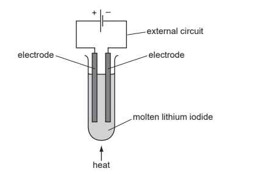

i) Draw an arrow on the diagram to show the direction of the electron flow in the external circuit.

[1]

ii) Electrons are supplied to the external circuit. How and where is this done?

[2]

iii) Explain why solid lithium iodide does not conduct electricity but when molten it is a good conductor.

[1]

*Source: 2012 O32 Q6*

**Q16** [4 marks]

#### Extended Only

The results of experiments on electrolysis are shown in the following table.

Complete the table. The first line has been done as an example.

| **electrolyte** | **electrodes** | **product at cathode** | **product at anode** | **change to electrolyte** |
|---|---|---|---|---|
| molten lithium iodide | carbon | lithium | iodine | used up |
| aqueous copper (II) sulfate | platinum |   | oxygen |   |
| concentrated aqueous potassium chloride | carbon |   | chlorine |   |

[4]

*Source: 2012 O32 Q6*

**Q16** [4 marks]

The diagram below shows the electrolysis of dilute sulfuric acid. Hydrogen is formed at the negative electrode (cathode) and oxygen at the positive electrode (anode) and the concentration of sulfuric acid increases.

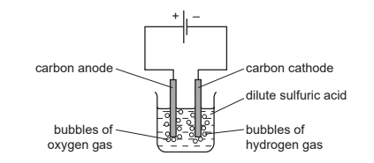

The ions present in the dilute acid are H+ (aq), OH– (aq) and SO42– (aq).

i) Write an equation for the reaction at the negative electrode (cathode).

[2]

ii) Complete the equation for the reaction at the positive electrode (anode).

4OH– (aq) → O2 (g) + .....H2O (l) + .......

[1]

iii) Suggest an explanation of why the concentration of the sulfuric acid increases.

[1]

*Source: 2012 O32 Q6*

### Q17 — hard — 14 marks

**Q17** [5 marks]

Lithium bromide is an ionic compound. It can be electrolysed when it is molten or in aqueous solution. It cannot be electrolysed as a solid.

Solid lithium bromide is a poor conductor of electricity. The ions cannot move to the electrodes, they are held in an ionic lattice by strong forces.

i) Describe the motion of the ions in the solid state.

[1]

ii) Define the term ionic bonding.

[2]

iii) What is meant by the term ionic lattice?

[2]

*Source: 2015 O33 Q3*

**Q17** [6 marks]

#### Extended Only

The diagram shows the electrolysis of molten lithium bromide.

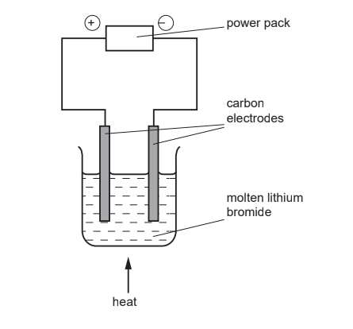

i) Mark on the diagram the direction of the electron flow.

[1]

ii) Write an ionic equation for the reaction at the negative electrode (cathode).

[1]

iii) Write an ionic equation for the reaction at the positive electrode (anode).

[2]

iv) Which ion is oxidised? Explain your answer.

[2]

*Source: 2015 O33 Q3*

**Q17** [3 marks]

**Extract:**

Lithium bromide is an ionic compound. It can be electrolysed when it is molten or in aqueous solution. It cannot be electrolysed as a solid.

#### Extended Only

When aqueous lithium bromide is electrolysed, a colourless gas is formed at the negative elctrode and the solution becomes alkaline.

Explain these observations and include an equation in your explanation.

*Source: 2015 O33 Q3*

### Q18 — medium — 8 marks

**Q18** [6 marks]

The electrolysis of concentrated aqueous sodium chloride, between inert electrodes, is used to make four important chemicals.

hydrogen chlorine sodium hydroxide sodium chlorate(I)

The ions present in the electrolyte are Na+, H+, Cl– and OH–

i) Hydrogen ions are discharged at the negative electrode (cathode). Write an equation for this reaction.

[2]

ii) The hydrogen ions are from the water.

H2O  $\rightleftharpoons$   H+ + OH–

Suggest an explanation why the concentration of hydroxide ions increases.

[2]

iii) When a dilute solution of sodium chloride is used, chlorine is not formed at the positive electrode (anode), a different gas is produced. Name this gas.

[1]

iv) State an example of an inert electrode.

[1]

*Source: 2010 O33 Q4*

**Q18** [2 marks]

**Extract:**

The electrolysis of concentrated aqueous sodium chloride, between inert electrodes, is used to make four important chemicals.

hydrogen chlorine sodium hydroxide sodium chlorate(I)

i) State a use of hydrogen.

[1]

ii) Why is chlorine used to treat the water supply?

[1]

*Source: 2010 O33 Q4*

### Q19 — easy — 18 marks

**Q19** [2 marks]

Hydrogen can be manufactured from methane by steam reforming.

CH4 (g) + H2O (g) $\rightleftharpoons$ CO (g) + 3H2 (g)

The reaction is carried out using a nickel catalyst at temperatures between 700 °C and 1100 °C and using a pressure of one atmosphere. The forward reaction is endothermic.

What is meant by the term *catalyst*?

*Source: 2016 Ju24 Q4*

**Q19** [2 marks]

**Extract:**

Hydrogen can be manufactured from methane by steam reforming. CH4 (g) + H2O (g) ⇌ CO (g) + 3H2 (g). The reaction is carried out using a nickel catalyst at temperatures between 700 °C and 1100 °C and using a pressure of one atmosphere. The forward reaction is endothermic.

#### Separate: Chemistry and Extended Only

Suggest two reasons why a temperature lower than 700 °C is not used.

*Source: 2016 Ju24 Q4*

**Q19** [1 mark]

**Extract:**

Hydrogen can be manufactured from methane by steam reforming. CH~4 ~(g) + H~2~O (g) \rightleftharpoons CO (g) + 3H~2 ~(g). The reaction is carried out using a nickel catalyst at temperatures between 700 °C and 1100 °C and using a pressure of one atmosphere. The forward reaction is endothermic.

Suggest **one** advantage of using a pressure greater than one atmosphere.

**Q19** [1 mark]

**Extract:**

Hydrogen can be manufactured from methane by steam reforming. CH~4 ~(g) + H~2~O (g) \rightleftharpoons CO (g) + 3H~2 ~(g). The reaction is carried out using a nickel catalyst at temperatures between 700 \u00b0C and 1100 \u00b0C and using a pressure of one atmosphere. The forward reaction is endothermic.

#### Separate: Chemistry and Extended Only

Suggest **one **disadvantage of using a pressure greater than one atmosphere.

**Q19** [7 marks]

Hydrogen can also be manufactured by electrolysis. The electrolyte is concentrated aqueous sodium chloride. The electrodes are inert.

The products of electrolysis are hydrogen, chlorine and sodium hydroxide.

i) Define electrolysis.

[2]

ii) Name a substance that can be used as the inert electrodes.

[1]

iii) Write an ionic half-equation for the reaction in which hydrogen is produced.

[1]

iv) Where is hydrogen produced in the electrolytic cell?

[1]

v) Describe a test for chlorine.

test ..........................................................................................................

result ..........................................................................................................

[2]

**Q19** [2 marks]

**Extract:**

Hydrogen can also be manufactured by electrolysis. The electrolyte is concentrated aqueous sodium chloride. The electrodes are inert.

The products of electrolysis are hydrogen, chlorine and sodium hydroxide.

#### Extended Only

The electrolysis of concentrated aqueous sodium chloride can be represented by the following word equation.

sodium chloride + water → sodium hydroxide + hydrogen + chlorine

Construct a chemical equation to represent this reaction. Do not include state symbols.

**Q19** [3 marks]

State **one** use of:

chlorine, ..........................................................................................................

sodium hydroxide, ..........................................................................................................

hydrogen. ..........................................................................................................

### Q20 — hard — 7 marks

**Q20** [2 marks]

#### Extended Only

The diagram shows a simple cell.

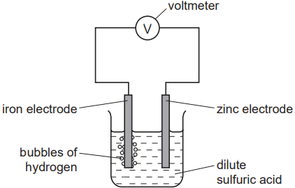

Write an equation for the overall reaction occurring in the cell.

*Source: 2011 Ju32 Q5*

**Q20** [3 marks]

#### Extended Only

Explain why all cell reactions are exothermic and redox.

*Source: 2011 Ju32 Q5*

**Q20** [2 marks]

**Extract:**

The diagram shows a simple cell. [7-2-electrochemical-cell diagram showing zinc and iron electrodes in sulfuric acid]

#### Extended Only

Which electrode, zinc or iron, is the negative electrode? Give a reason for your choice.

*Source: 2011 Ju32 Q5*

### Q21 — medium — 10 marks

**Q21** [2 marks]

**Extract:**

- Accept products listed in the order given in the question (anode then cathode) even without electrode labels, e.g. "bromine / potassium".
- Award M1 for bromine/Br2 at the anode and M2 for potassium/K at the cathode regardless of labelling, provided the order or labelling makes the pairing clear.

Molten potassium bromide can be electrolysed. Predict the products of this electrolysis at:

the anode the cathode

*Source: 2020 Ju0620/32 Q5A*

**Q21** [2 marks]

Electrolysis of concentrated aqueous sodium chloride using inert electrodes forms chlorine, hydrogen and sodium hydroxide.

What is meant by the term electrolysis?

*Source: 2020 Ju0620/32 Q5A*

**Q21** [1 mark]

**Extract:**

Electrolysis of concentrated aqueous sodium chloride using inert electrodes forms chlorine, hydrogen and sodium hydroxide.

Name a substance that can be used as the inert electrodes.

*Source: 2020 Ju0620/32 Q5B*

**Q21** [1 mark]

**Extract:**

Electrolysis of concentrated aqueous sodium chloride using inert electrodes forms chlorine, hydrogen and sodium hydroxide.

#### Extended Only

Write an ionic half-equation for the formation of hydrogen during this electrolysis.

*Source: 2020 Ju0620/32 Q5B*

**Q21** [2 marks]

**Extract:**

Electrolysis of concentrated aqueous sodium chloride using inert electrodes forms chlorine, hydrogen and sodium hydroxide.

#### Extended Only

Give the formulae of the **four **ions present in concentrated aqueous sodium chloride.

*Source: 2020 Ju0620/42/04 Q5A*

**Q21** [2 marks]

**Extract:**

Electrolysis of concentrated aqueous sodium chloride using inert electrodes forms chlorine, hydrogen and sodium hydroxide.

The four ions present in concentrated aqueous sodium chloride are: Na^+, H^+, Cl^– and OH^–

#### Extended Only

Explain how sodium hydroxide is formed during this electrolysis.

*Source: 2020 Ju0620/42/04 Q5B*

### Q22 — hard — 12 marks

**Q22** [2 marks]

Zinc is an important metal. Its uses include making alloys and the construction of dry cells (batteries).

Name an alloy which contains zinc. What is the other metal in this alloy?

*Source: 2014 O32 Q4*

**Q22** [3 marks]

The main ore of zinc is zinc blende, ZnS.

i) The ore is heated in the presence of air to form zinc oxide and sulfur dioxide.

Write the equation for this reaction.

[2]

ii) Give a major use of sulfur dioxide.

[1]

*Source: 2014 O32 Q4*

**Q22** [4 marks]

#### Extended Only

Zinc can be obtained from zinc oxide in a two step process. Aqueous zinc sulfate is made from zinc oxide and then this solution is electrolysed with inert electrodes. The electrolysis is similar to that of copper(II) sulfate with inert electrodes.

i) Name the reagent which will react with zinc oxide to form zinc sulfate.

[1]

ii) Complete the following for the electrolysis of aqueous zinc sulfate.

Write the equation for the reaction at the negative electrode. Name the product at the positive electrode. The electrolyte changes from zinc sulfate to .................................................................... .

[3]

*Source: 2014 O32 Q4*

**Q22** [3 marks]

#### Extended Only

A dry cell (battery) has a central rod, usually made of graphite. This is the positive electrode which is surrounded by the electrolyte, typically a paste of ammonium chloride and manganese(IV) oxide, all of which are in a zinc container which is the negative electrode.

i) Suggest why the electrolyte is a paste.

[1]

ii) The following changes occur in a dry cell. For each change, decide if it is oxidation or reduction and give a reason for your choice.

Zn to Zn2+

..........................................................................................................

manganese(IV) oxide to manganese(III) oxide

..........................................................................................................

[2]

*Source: 2014 O32 Q4*

### Q23 — medium — 10 marks

**Q23** [2 marks]

When concentrated hydrochloric acid is electrolysed, gases are produced at the electrodes. The incomplete apparatus is shown.

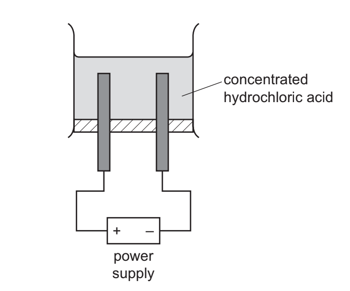

Complete the diagram by:

- labelling the anode and cathode
- showing how the gases are collected.

*Source: 2020 Ju0620/42/04 Q5C*

**Q23** [2 marks]

#### Extended Only

When concentrated hydrochloric acid is electrolysed, gases are produced at the electrodes. The incomplete apparatus is shown.

Predict the products of this electrolysis at the:

positive electrode:

negative electrode:

*Source: 2020 Ju0620/42/04 Q5D*

**Q23** [2 marks]

When concentrated hydrochloric acid is electrolysed, gases are produced at the electrodes. The incomplete apparatus is shown.

Graphite (carbon) electrodes are used in this electrolysis. Suggest one other element that can be used as an electrode and give a reason, other than that it can conduct electricity.

element:

reason:

*Source: 2020 Ju0620/42/04 Q5E*

**Q23** [2 marks]

#### Extended Only

When concentrated hydrochloric acid is electrolysed, gases are produced at the electrodes. The incomplete apparatus is shown.

Hydrogen chloride is produced when chlorine reacts with hydrogen. Complete the chemical equation for this reaction.

Cl2 + .......... → .....HCl

**Q23** [2 marks]

Predict the products of the electrolysis of molten aluminium oxide at:

the positive electrode ........................................

the negative electrode.......................................

### Q24 — easy — 6 marks

**Q24** [2 marks]

Molten magnesium bromide is electrolysed. The incomplete apparatus is shown.

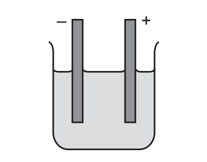

Complete the diagram by:

- labelling the anode and cathode
- adding the power supply and connecting wires.

*Source:  Specimen 0620/03 Q5E*

**Q24** [1 mark]

Name a suitable element that can be used as an electrode.

*Source: 2020 Ju0620/31 Q6C*

**Q24** [2 marks]

**Extract:**

Molten magnesium bromide is electrolysed. The incomplete apparatus is shown.

Predict the products of this electrolysis at the positive and negative electrodes.

*Source: 2020 Ju0620/31 Q6B*

**Q24** [1 mark]

**Extract:**

Molten magnesium bromide is electrolysed. The incomplete apparatus is shown.

The electrodes must be able to conduct electricity. Give one other property that the electrodes must have.

*Source: 2020 Ju0620/31 Q6B*

