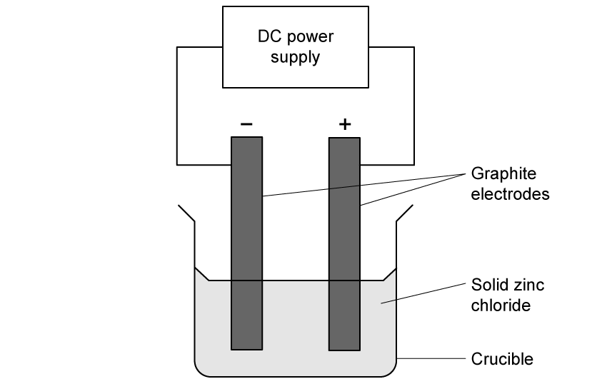
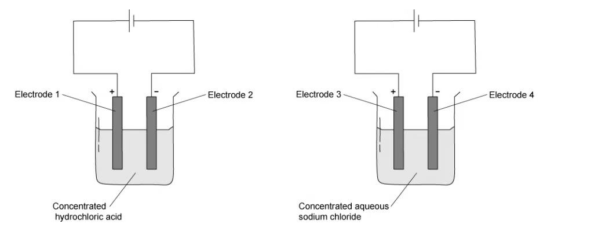
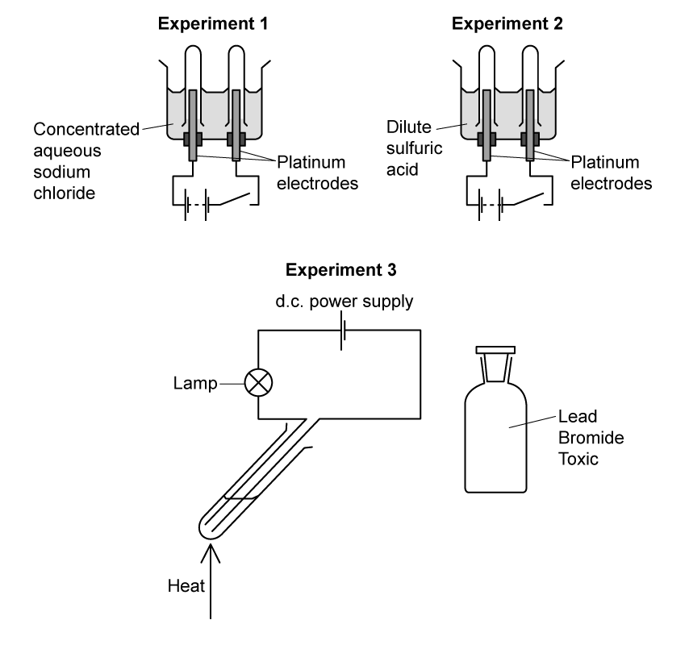
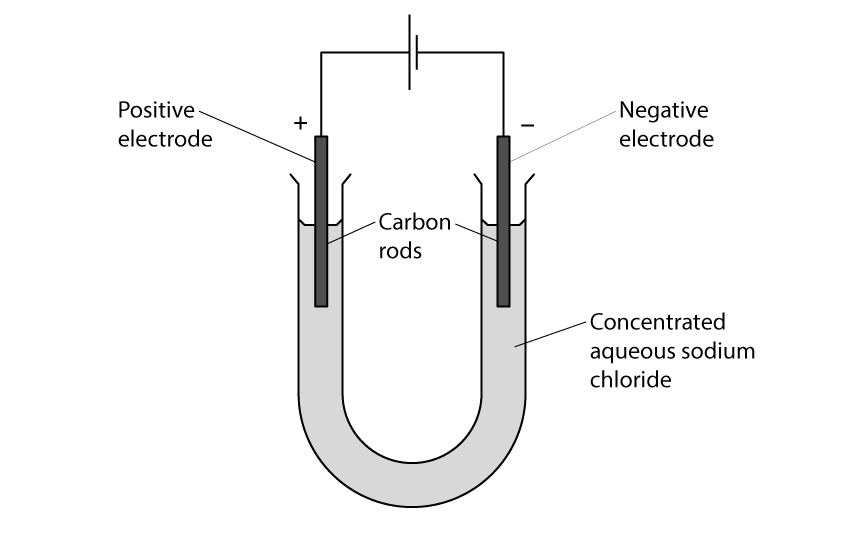
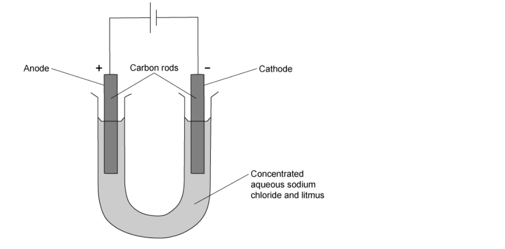
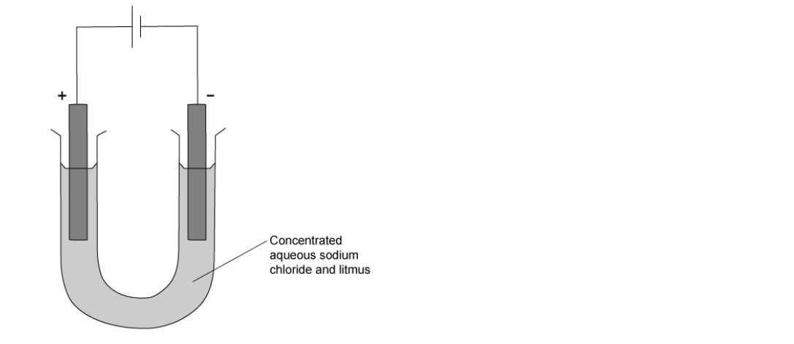

# Exam Questions — Electrolysis
**4. Electrochemistry** · Cambridge (CIE) IGCSE chemistry (0620 & 0971)
> Source: [https://www.savemyexams.com/igcse/chemistry/cie/23/topic-questions/](https://www.savemyexams.com/igcse/chemistry/cie/23/topic-questions/) · 20 questions across 1 sets

## Multiple Choice Questions (25 questions)

### Q1 — medium — 1 marks

**Q1** [1 mark]

Concentrated aqueous magnesium chloride is electrolysed using inert graphite electrodes.

Which row shows the correct observations at the cathode and at the anode?

|   | observation at the cathode | observation at the anode |
|---|---|---|
| **A** | bubbles of a colourless gas | bubbles of a colourless gas |
| **B** | bubbles of a colourless gas | bubbles of a pale yellow-green gas |
| **C** | silvery solid deposited | bubbles of a colourless gas |
| **D** | silvery solid deposited | bubbles of a pale yellow-green gas |

### Q2 — easy — 1 marks

**Q2** [1 mark]

Three statements about the electrolysis of molten lead (II) bromide are listed.

1. A green gas is produced at the negative electrode.
2. Lead ions will gain electrons at the cathode.
3. The electrodes for the electrolysis must be from an inert material, such as graphite.

Which statements are correct?

### Q3 — easy — 1 marks

**Q3** [1 mark]

Concentrated aqueous sodium chloride can be electrolysed.

Which statement is correct?

### Q4 — easy — 1 marks

**Q4** [1 mark]

Solid lead(II) bromide is heated until it is molten. The molten lead (II) bromide then undergoes electrolysis.

Which substances are formed at each electrode?

|   | **anode** | **cathode** |
|---|---|---|
| **A** | bromine | lead |
| **B** | lead | bromine |
| **C** | bromine | hydrogen |
| **D** | hydrogen | lead |

### Q5 — easy — 1 marks

**Q5** [1 mark]

The electrolysis of concentrated hydrochloric acid is shown.

Which statement describes what happens to the electrons during the electrolysis?

### Q6 — easy — 1 marks

**Q6** [1 mark]

A student was investigating the electrolysis of zinc chloride.

What is the correct reason for electrolysis not working?

### Q7 — easy — 1 marks

**Q7** [1 mark]

The diagram shows the electrolysis of concentrated hydrochloric acid and concentrated aqueous sodium chloride using carbon electrodes.

At which electrode(s) is hydrogen produced?

### Q8 — hard — 1 marks

**Q8** [1 mark]

Concentrated aqueous sodium chloride, dilute sulfuric acid and molten lead bromide were electrolysed separately in experiments 1, 2 and 3.

Which statement about the electrode products is correct?

### Q9 — hard — 1 marks

**Q9** [1 mark]

The amount of gases P and Q are formed when substance X is electrolysed.

What is substance X?

### Q10 — hard — 1 marks

**Q10** [1 mark]

A student wants to identify the gas produced at the negative electrode during the electrolysis of aqueous sodium chloride.

What is the correct test for the gas produced?

### Q11 — hard — 1 marks

**Q11** [1 mark]

During electrolysis of brine, a gas is produced at the cathode. What is the half-equation for the reaction on the cathode?

### Q12 — hard — 1 marks

**Q12** [1 mark]

The diagram shows the electrolysis of concentrated aqueous sodium chloride.

What is the colour of the litmus at each electrode after five minutes?

|   | **colour at anode** | **colour at cathode** |
|---|---|---|
| **A** | blue | red |
| **B** | red | blue |
| **C** | red | colourless |
| **D** | colourless | blue |

### Q13 — hard — 1 marks

**Q13** [1 mark]

Four substances are electrolysed. The substances are concentrated aqueous sodium chloride, concentrated hydrochloric acid, molten lead(II) bromide and molten sodium oxide.

Which statement about these electrolysis reactions is correct?

### Q14 — hard — 1 marks

**Q14** [1 mark]

Four solutions are separately electrolysed.

| **experiment** | **solution** | **electrodes** |
|---|---|---|
| **1** | dilute aqueous sodium chloride | carbon |
| **2** | aqueous copper(II) sulfate | copper |
| **3** | concentrated hydrochloric acid | carbon |
| **4** | dilute sulfuric acid | carbon |

In which two experiments is a colourless gas evolved at the anode?

### Q15 — medium — 1 marks

**Q15** [1 mark]

Dilute sulfuric acid is electrolysed using inert electrodes.

What are the products of this electrolysis?

|   | **cathode** | **anode** |
|---|---|---|
| **A** | oxygen | sulfur |
| **B** | hydrogen | sulfur dioxide |
| **C** | oxygen | hydrogen |
| **D** | hydrogen | oxygen |

### Q16 — medium — 1 marks

**Q16** [1 mark]

Which is the correct equation for the formation of chlorine gas at the anode during the electrolysis of concentrated sodium chloride solution?

### Q17 — medium — 1 marks

**Q17** [1 mark]

The diagram shows the electrolysis of aqueous copper(II) sulfate.

Which statement is correct?

### Q18 — medium — 1 marks

**Q18** [1 mark]

Concentrated aqueous potassium bromide solution is electrolysed using inert electrodes. The ions present in the solution are K+, Br–, H+ and OH–.

To which electrodes are the ions attracted during this electrolysis?

|   | **attracted to anode** | **attracted to cathode** |
|---|---|---|
| **A** | Br– and K+ | H+ and OH– |
| **B** | Br– and OH– | H+ and K+ |
| **C** | H+ and K+ | Br– and OH– |
| **D** | H+ and OH– | Br– and K+ |

### Q19 — medium — 1 marks

**Q19** [1 mark]

Which statement about electrolysis is correct?

### Q20 — medium — 1 marks

**Q20** [1 mark]

Electricity is passed through concentrated aqueous sodium chloride. Inert electrodes are used.

Which products are formed at the electrodes?

|   | **cathode** | **anode** |
|---|---|---|
| **A** | hydrogen | chlorine |
| **B** | hydrogen | oxygen |
| **C** | sodium | chlorine |
| **D** | sodium | oxygen |
