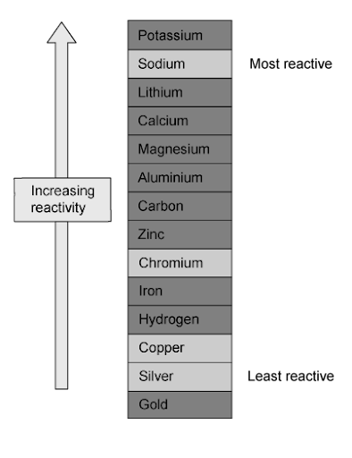

# Mark Schemes — Applications of Electrolysis
**4. Electrochemistry** · Cambridge (CIE) IGCSE chemistry (0620 & 0971)

## Multiple Choice Questions (21 questions)

### Q1
**Final answer:** **The correct answer is B**

- **Statement 1 is incorrect:**

  - While combustion and the formation of water are both  exothermic processes that releases energy, exothermic reactions always have a **negative** enthalpy change (Δ*H*)
- **Statement 2 is correct:**

  - Hydrogen-oxygen fuel cells use hydrogen and oxygen to produce electricity, with **water as the only chemical product**
  - In contrast, the incomplete combustion of carbon-containing fuels (like gasoline) releases particulates and carbon monoxide, which is a toxic gas
- **Statement 3 is incorrect:**

  - Hydrogen is a gas at room temperature and pressure
  - It requires heavy, high-pressure tanks or very low temperatures to store it as a liquid, making it significantly **more difficult and expensive to store** than liquid gasoline

### Q2
**Final answer:** **The correct answer is A**

- **Electrolyte Z:**

  - For electroplating, the electrolyte must be a soluble salt of the metal being plated onto the object
  - Since the tray is being plated with silver, the electrolyte must contain silver ions (Ag+)
  - Aqueous silver nitrate is a soluble silver salt.
- **At electrode X (negative electrode / cathode):**

  - The object to be plated (the iron tray) must always be placed at the cathode
  - Here, positive silver ions from the electrolyte are attracted to the negative electrode
  - They are reduced at the electrode where they gain electrons and deposit as solid silver
  - The half-equation is:
  
    - Ag+ + e− → Ag (Reduction)
- **At electrode Y (positive electrode / anode):**

  - The pure plating metal (silver) must be placed at the anode
  - The silver atoms lose electrons (oxidized) to continually replace the silver ions in the electrolyte
  - The half-equation is:
  
    - Ag → Ag++ e− (Oxidation).

**B **is incorrect as the half equations are swapped

**C **is incorrect as uses iron(II) nitrate as the electrolyte

**D** is incorrect as at X (cathode), silver ions should be reduced to form a silver coating, not  iron ions. The half-equation Fe²⁺ + 2e⁻ → Fe would deposit iron, not silver.

> **[exam-tip]**
> In electroplating questions, examiners often use a **3-column table** to test whether you understand the entire setup, not just half-equations.
> 
> A common trap is choosing an option that has correct half-equations but places the **object to be plated at the anode**.
> 
> Remember the fundamental rule: the object being coated must always be the **cathode (negative electrode)**.

### Q3
**Final answer:** **The correct answer is C**

- **Electrode X (Cathode):** This is connected to the **negative terminal**

  - In electroplating, the **object to be coated** (the iron tray) must be the cathode so that positive metal ions are attracted to it
- **Electrode Y (Anode):** This is connected to the **positive terminal**

  - The anode must be made of the **pure metal** you are using for the coating (silver)
  - As the reaction proceeds, the silver anode dissolves to replace the silver ions in the solution
- **Electrolyte Z:** This must be a **soluble salt** of the plating metal

  - **Silver nitrate** is the standard choice
  - Silver chloride (**Choice D**) is incorrect because it is insoluble and will not conduct electricity in this setup

### Q4
**Final answer:** **The correct answer is ****B**** because:**

- The cathode is the negative electrode, which is the copper rod
- Silver ions in solution are attracted to the cathode where they gain electrons, forming silver atoms:

  - Ag+ + e– → Ag
- These deposit on the surface of the copper rod, causing it to be coated in a layer of silver

**A** is incorrect as at the anode, silver atoms lose electrons to form silver ions

**C** is incorrect as at the cathode, silver atoms are deposited, not copper atoms

**D **is incorrect as the cathode becomes covered in a silver coating

### Q5
**Final answer:** **The correct answer is ****D**** because:**

- In electrolysis of aqueous solutions only one type of ion can be discharged at each electrode.
- The H+ and OH- ions produced by the dissociation of water in aqueous solutions compete with the other ions in solution.
- **At the cathode**, the** more reactive** a metal is the **more it tends to remain as ions** in solution.
- For electroplating to take place, the metal which is being used as the **coating** must be **unreactive.**
- Sodium could not be used for this purpose as it is too reactive.

**A, B** and **C **are incorrect as they could all be used as these metals are unreactive and are commonly used for electroplating.

### Q6
**Final answer:** **The correct answer is ****A**** because:**

- During electrolysis, the copper cathode gets thicker and the copper anode gets thinner
- Positive copper ions will be attracted to the negative electrode (cathode) and plate it
- Copper must therefore be the cathode product
- As the positive metal ions from the solution are discharged on the cathode, they are replaced by metal ions leaving the surface of the anode
- The anode product must therefore be copper(II) ions

**B** is incorrect as hydrogen gas is not a product of the electrolysis

**C** is incorrect as oxygen is not produced at the anode (it would be produced if carbon electrodes were used)

**D** is incorrect as neither hydrogen nor oxygen are products of the reaction

### Q7
**Final answer:** **The correct answer is ****B**** because:**

- Hydrogen and oxygen are the reactants in a fuel cell and contain energy locked up in chemical bonds so it is classed as chemical energy
- When the reaction takes place between hydrogen and oxygen that energy is released usually as heat and light
- However, in a fuel cell, the energy is converted into electrical energy and is more useful than heat and light

**A** is incorrect as electrical energy is produced not consumed in a fuel cell and heat is not produced

**C** is incorrect as potential energy is not consumed in a fuel cell and chemical energy is not produced

**D** is incorrect as heat is not produced in a fuel cell, only when hydrogen burns

- Sometimes people refer to chemical energy as a type of potential energy
- Potential energy just means stored energy and is usually a term that refers to the energy held by an object relative to others
- However, it should be clear from the context here it is the wrong conversion in option** C**

### Q8
**Final answer:** **The correct answer is ****C**** because:**

- In a hydrogen-oxygen fuel cell, hydrogen and oxygen react together to form water
- The unbalanced equation is:

  - H2 + O2 → H2O
- Balance the oxygen atoms by putting a 2 in front of H2O:

  - H2 + O2 → **2**H2O
- Now balance the hydrogen atoms:

  - **2**H2 + O2 → 2H2O

**A** is incorrect as water is not a reactant and hydrogen and oxygen are not products. The equation is also unbalanced

**B** is incorrect as the equation is unbalanced as there are not enough H atoms on the left-hand side

**D** is incorrect as the equation is the original unbalanced equation for the reaction

### Q9
**Final answer:** **The correct answer is ****B**** because:**

- The electrolyte is always an aqueous solution of a soluble salt of the metal being used to coat the other metal
- In this case we are coating a metal in copper so the electrolyte will be a copper salt, which eliminates A and D
- During electroplating, the anode is always the metal you are coating with and the cathode is the metal being coated
- This is because positive metal ions in the solution (in this case copper) will be attracted towards to cathode and coat the metal
- Metal Y is the cathode as it is connected to the negative terminal and so this is the one being coated

**A** and **D** are incorrect as this is not the correct electrolyte

**C** is incorrect as metal X would act as the copper anode and is the metal coating the other metal

### Q10
**Final answer:** **The correct answer is ****B**** because:**

- In electroplating, the **anode** is always the metal that is being used to coat the other metal.
- Coating occurs as the **positive** **metal** **ions** are attracted to the object to be coated which is the **negatively** **charged** **cathode**.
- The object to be coated is thus the cathode which attracts the positive metal ions.
- In the diagram terminal X is therefore negative.
- The carbon powder must be graphite as it conducts electricity due to the free  electrons in between the layers of carbon atoms.

**A **is incorrect as diamond is a hard substance which does not conduct electricity.

**C** and **D **are incorrect as terminal X is negative, not positive.

### Q11
**Final answer:** **The correct answer is ****C**** because:**

- Positive silver metal ions in the solution will be attracted to the cathode
- The metal being coated is therefore used as the cathode and connected to the negative terminal
- Silver would be used as the anode
- During electrolysis, the silver atoms at the anode will lose electrons to form ions which will go into the solution
- They will be attracted to the cathode where they will gain electrons to form silver atoms which are deposited on the spoon coating it

**A **is incorrect as 4 is also correct

**B** is incorrect as the metal electrode would be connected to the positive terminal

**D** is incorrect as the metal electrode would be connected to the positive terminal and at the cathode, silver ions gain, not lose electrons to form atoms

### Q12
**Final answer:** **The correct answer is ****D**** because:**

- In electroplating, the anode is always the metal that is being used to coat the other metal.
- Coating occurs as the **positive metal ions **are attracted to the object to be coated, which is the **negatively charged cathode**.
- The object to be coated is thus the **cathode** which attracts the **Cu****2+** ions.
- The electrolyte used is an aqueous solution of a soluble salt of the pure metal at the anode.
- In this case a solution of copper sulphate is suitable.

**A** and **B **are incorrect as the object to be coated is the cathode, not the anode.

**C **is incorrect as the oxide of the metal is not a suitable electrolyte.

### Q13
**Final answer:** **The correct answer is ****C**** because:**

- Hydrogen and oxygen are used in a hydrogen-oxygen fuel cell to produce a voltage
- The only product is water

**A **is incorrect as this is the reaction that occurs at the anode in a hydrogen-oxygen fuel cell

**B** is incorrect as this is the reaction that occurs at the cathode in a hydrogen-oxygen fuel cell

**D** is incorrect as this does not show the formation of water

### Q14
**Final answer:** **The correct answer is ****C**** because:**

- Zinc is a more reactive metal than copper, therefore, zinc is more likely to lose  electrons than copper.
- Zinc is at the anode and undergoes loss of electrons (oxidation), liberating two  electrons into solution.
- Copper ions in solution will gain two electrons at the cathode (reduction) to form  copper metal.

**A **is incorrect as Cu2+ ions are formed at the anode.

**B **is incorrect as electrons travel through the electrodes and the wires, ions travel through the solution.

**D **is incorrect as reduction (electron gain) occurs at the cathode, therefore the cathode increases in mass. In this case zinc is the anode, so this electrode decreases in mass.

### Q15
**Final answer:** **The correct answer is ****D**** because:**

- Copper is a metal and forms positive cations in solution.
- The cathode is the negative electrode and attracts the positive cations.
- Switching the pan to the cathode will attract the copper cations and plate the pan with copper.

**A, B** and **C **are incorrect as the problem is that the cathode and the anode are the wrong way around meaning there is no flow of ions. Changing the voltage or temperature of the solution would only change the rate of the reaction, if there were any.

### Q16
**Final answer:** **The correct answer is ****A**** because:**

- Hydrogen-oxygen fuel cells use hydrogen and oxygen to produce a voltage
- The overall equation for a hydrogen-oxygen fuel cells is:

hydrogen   +   oxygen   →   water

- Therefore the only product is water

### Q17
**Final answer:** **The correct answer is ****A**** because:**

- Silver is a metal so forms positive metal ions in solution
- Positive metal ions will be attracted to the negative electrode (cathode) and plate it
- The iron spoon must therefore be the cathode
- As the positive metal ions from the solution are discharged on the surface of the spoon, they are replaced by metal ions leaving the surface of the anode
- The anode must therefore be made from silver

**B** is incorrect as the iron spoon is used as the cathode not anode

**C** is incorrect as carbon is not used as the other electrode

**D** is incorrect as the iron spoon is used as the cathode, and carbon is not used as the other electrode

### Q18
**Final answer:** **The correct answer is**** A**** because:**

- Hydrogen fuel cells are much simpler devices than internal combustion engines which are designed to run off petrol or diesel.
- There are much less moving parts, so power loss is minimal.

**B** is incorrect as hydrogen fuel cells contain less moving parts.

**C **and** D** are incorrect as hydrogen fuel cells produce only water.
