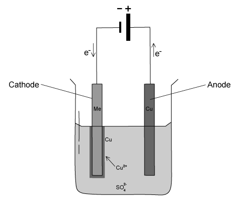
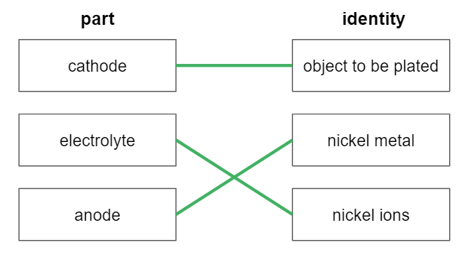
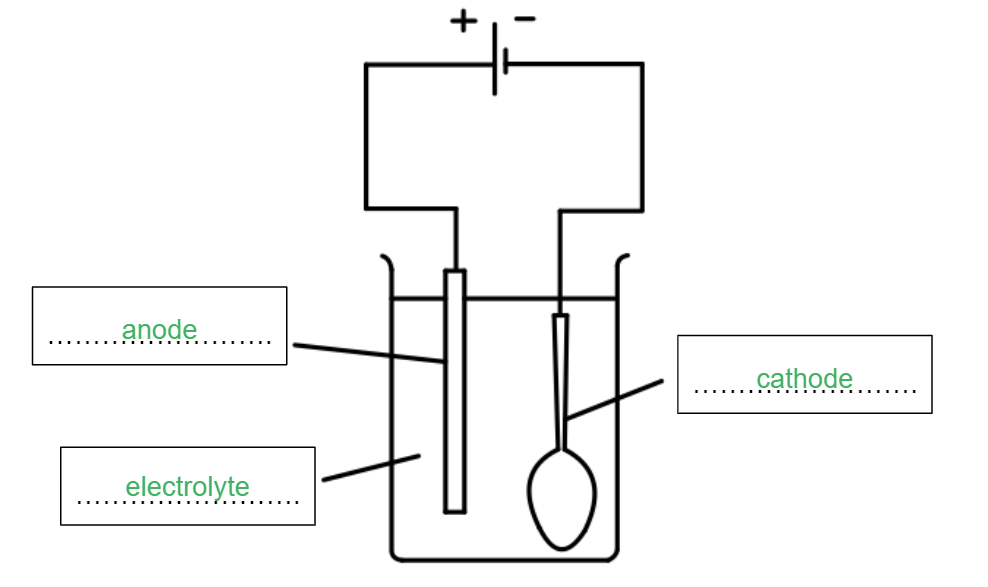
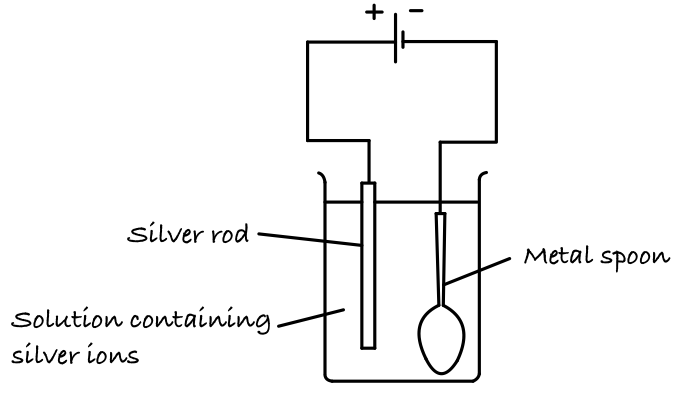
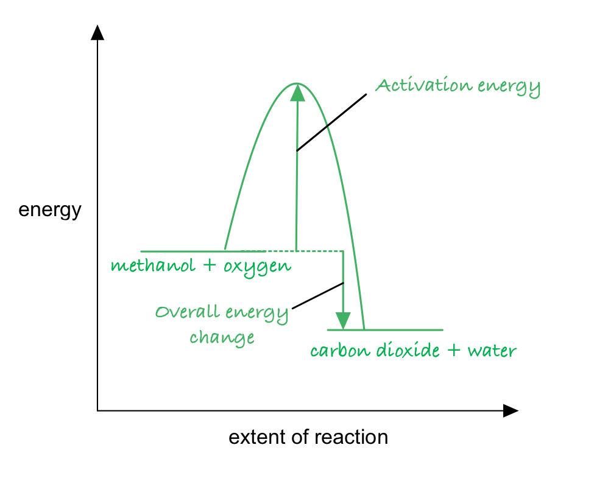

# Mark Schemes — Applications of Electrolysis
**4. Electrochemistry** · Cambridge (CIE) IGCSE chemistry (0620 & 0971)

## Alternative To Practical Questions (1 questions)

### Q1
a)

i) **One** advantage of putting a thin layer of silver on the spoon is:

- Prevent rusting 
**OR** 
corrosion / more attractive 
**OR** 
shiny / so it doesn’t oxidise; ** [1 mark]** 
*Not less reactive or answers about value *

ii) **One** disadvantage if the spoon is used frequently

- Silver wears off / will need re-coating; ** [1 mark]** 
*Ignore references to rusting*

iii) The spoon must be very clean and free of grease:

- So that silver can coat the spoon/stick to the spoon owtte; ** [1 mark]**

**[Total: 3 marks]**
b) The spoon should be the:

- Negative electrode / cathode; ** [1 mark]**

**[Total: 1 mark]**

- *The anode is made from the pure metal you want to coat your object with, in this case silver *
- *The cathode is the object to be plated, in this case the spoon*
- *The electrolyte is an aqueous solution of a soluble salt of the pure metal at the anode *
c) The other electrode should be made from:

- Silver; ** [1 mark]**

**[Total: 1 mark]**

- *The anode is made from the pure metal you want to coat your object with, in this case silver *

  - *Silver atoms at the anode will lose electrons to form silver ions in the solution*
- *The cathode is the object to be plated, in this case the spoon*

  - *The silver ions gain electrons at the cathode, forming silver atoms which deposit onto the spoon coating it with a layer of silver*

## Multiple Choice Questions (21 questions)

### Q1
**Final answer:** **The correct answer is B**

- **Statement 1 is incorrect:**

  - While combustion and the formation of water are both  exothermic processes that releases energy, exothermic reactions always have a **negative** enthalpy change (Δ*H*)
- **Statement 2 is correct:**

  - Hydrogen-oxygen fuel cells use hydrogen and oxygen to produce electricity, with **water as the only chemical product**
  - In contrast, the incomplete combustion of carbon-containing fuels (like gasoline) releases particulates and carbon monoxide, which is a toxic gas
- **Statement 3 is incorrect:**

  - Hydrogen is a gas at room temperature and pressure
  - It requires heavy, high-pressure tanks or very low temperatures to store it as a liquid, making it significantly **more difficult and expensive to store** than liquid gasoline

### Q2
**Final answer:** **The correct answer is A**

- **Electrolyte Z:**

  - For electroplating, the electrolyte must be a soluble salt of the metal being plated onto the object
  - Since the tray is being plated with silver, the electrolyte must contain silver ions (Ag+)
  - Aqueous silver nitrate is a soluble silver salt.
- **At electrode X (negative electrode / cathode):**

  - The object to be plated (the iron tray) must always be placed at the cathode
  - Here, positive silver ions from the electrolyte are attracted to the negative electrode
  - They are reduced at the electrode where they gain electrons and deposit as solid silver
  - The half-equation is:
  
    - Ag+ + e− → Ag (Reduction)
- **At electrode Y (positive electrode / anode):**

  - The pure plating metal (silver) must be placed at the anode
  - The silver atoms lose electrons (oxidized) to continually replace the silver ions in the electrolyte
  - The half-equation is:
  
    - Ag → Ag++ e− (Oxidation).

**B **is incorrect as the half equations are swapped

**C **is incorrect as uses iron(II) nitrate as the electrolyte

**D** is incorrect as at X (cathode), silver ions should be reduced to form a silver coating, not  iron ions. The half-equation Fe²⁺ + 2e⁻ → Fe would deposit iron, not silver.

> **[exam-tip]**
> In electroplating questions, examiners often use a **3-column table** to test whether you understand the entire setup, not just half-equations.
> 
> A common trap is choosing an option that has correct half-equations but places the **object to be plated at the anode**.
> 
> Remember the fundamental rule: the object being coated must always be the **cathode (negative electrode)**.

### Q3
**Final answer:** **The correct answer is C**

- **Electrode X (Cathode):** This is connected to the **negative terminal**

  - In electroplating, the **object to be coated** (the iron tray) must be the cathode so that positive metal ions are attracted to it
- **Electrode Y (Anode):** This is connected to the **positive terminal**

  - The anode must be made of the **pure metal** you are using for the coating (silver)
  - As the reaction proceeds, the silver anode dissolves to replace the silver ions in the solution
- **Electrolyte Z:** This must be a **soluble salt** of the plating metal

  - **Silver nitrate** is the standard choice
  - Silver chloride (**Choice D**) is incorrect because it is insoluble and will not conduct electricity in this setup

### Q4
**Final answer:** **The correct answer is ****B**** because:**

- The cathode is the negative electrode, which is the copper rod
- Silver ions in solution are attracted to the cathode where they gain electrons, forming silver atoms:

  - Ag+ + e– → Ag
- These deposit on the surface of the copper rod, causing it to be coated in a layer of silver

**A** is incorrect as at the anode, silver atoms lose electrons to form silver ions

**C** is incorrect as at the cathode, silver atoms are deposited, not copper atoms

**D **is incorrect as the cathode becomes covered in a silver coating

### Q5
**Final answer:** **The correct answer is ****D**** because:**

- In electrolysis of aqueous solutions only one type of ion can be discharged at each electrode.
- The H+ and OH- ions produced by the dissociation of water in aqueous solutions compete with the other ions in solution.
- **At the cathode**, the** more reactive** a metal is the **more it tends to remain as ions** in solution.
- For electroplating to take place, the metal which is being used as the **coating** must be **unreactive.**
- Sodium could not be used for this purpose as it is too reactive.

**A, B** and **C **are incorrect as they could all be used as these metals are unreactive and are commonly used for electroplating.

### Q6
**Final answer:** **The correct answer is ****A**** because:**

- During electrolysis, the copper cathode gets thicker and the copper anode gets thinner
- Positive copper ions will be attracted to the negative electrode (cathode) and plate it
- Copper must therefore be the cathode product
- As the positive metal ions from the solution are discharged on the cathode, they are replaced by metal ions leaving the surface of the anode
- The anode product must therefore be copper(II) ions

**B** is incorrect as hydrogen gas is not a product of the electrolysis

**C** is incorrect as oxygen is not produced at the anode (it would be produced if carbon electrodes were used)

**D** is incorrect as neither hydrogen nor oxygen are products of the reaction

### Q7
**Final answer:** **The correct answer is ****B**** because:**

- Hydrogen and oxygen are the reactants in a fuel cell and contain energy locked up in chemical bonds so it is classed as chemical energy
- When the reaction takes place between hydrogen and oxygen that energy is released usually as heat and light
- However, in a fuel cell, the energy is converted into electrical energy and is more useful than heat and light

**A** is incorrect as electrical energy is produced not consumed in a fuel cell and heat is not produced

**C** is incorrect as potential energy is not consumed in a fuel cell and chemical energy is not produced

**D** is incorrect as heat is not produced in a fuel cell, only when hydrogen burns

- Sometimes people refer to chemical energy as a type of potential energy
- Potential energy just means stored energy and is usually a term that refers to the energy held by an object relative to others
- However, it should be clear from the context here it is the wrong conversion in option** C**

### Q8
**Final answer:** **The correct answer is ****C**** because:**

- In a hydrogen-oxygen fuel cell, hydrogen and oxygen react together to form water
- The unbalanced equation is:

  - H2 + O2 → H2O
- Balance the oxygen atoms by putting a 2 in front of H2O:

  - H2 + O2 → **2**H2O
- Now balance the hydrogen atoms:

  - **2**H2 + O2 → 2H2O

**A** is incorrect as water is not a reactant and hydrogen and oxygen are not products. The equation is also unbalanced

**B** is incorrect as the equation is unbalanced as there are not enough H atoms on the left-hand side

**D** is incorrect as the equation is the original unbalanced equation for the reaction

### Q9
**Final answer:** **The correct answer is ****B**** because:**

- The electrolyte is always an aqueous solution of a soluble salt of the metal being used to coat the other metal
- In this case we are coating a metal in copper so the electrolyte will be a copper salt, which eliminates A and D
- During electroplating, the anode is always the metal you are coating with and the cathode is the metal being coated
- This is because positive metal ions in the solution (in this case copper) will be attracted towards to cathode and coat the metal
- Metal Y is the cathode as it is connected to the negative terminal and so this is the one being coated

**A** and **D** are incorrect as this is not the correct electrolyte

**C** is incorrect as metal X would act as the copper anode and is the metal coating the other metal

### Q10
**Final answer:** **The correct answer is ****B**** because:**

- In electroplating, the **anode** is always the metal that is being used to coat the other metal.
- Coating occurs as the **positive** **metal** **ions** are attracted to the object to be coated which is the **negatively** **charged** **cathode**.
- The object to be coated is thus the cathode which attracts the positive metal ions.
- In the diagram terminal X is therefore negative.
- The carbon powder must be graphite as it conducts electricity due to the free  electrons in between the layers of carbon atoms.

**A **is incorrect as diamond is a hard substance which does not conduct electricity.

**C** and **D **are incorrect as terminal X is negative, not positive.

### Q11
**Final answer:** **The correct answer is ****C**** because:**

- Positive silver metal ions in the solution will be attracted to the cathode
- The metal being coated is therefore used as the cathode and connected to the negative terminal
- Silver would be used as the anode
- During electrolysis, the silver atoms at the anode will lose electrons to form ions which will go into the solution
- They will be attracted to the cathode where they will gain electrons to form silver atoms which are deposited on the spoon coating it

**A **is incorrect as 4 is also correct

**B** is incorrect as the metal electrode would be connected to the positive terminal

**D** is incorrect as the metal electrode would be connected to the positive terminal and at the cathode, silver ions gain, not lose electrons to form atoms

### Q12
**Final answer:** **The correct answer is ****D**** because:**

- In electroplating, the anode is always the metal that is being used to coat the other metal.
- Coating occurs as the **positive metal ions **are attracted to the object to be coated, which is the **negatively charged cathode**.
- The object to be coated is thus the **cathode** which attracts the **Cu****2+** ions.
- The electrolyte used is an aqueous solution of a soluble salt of the pure metal at the anode.
- In this case a solution of copper sulphate is suitable.

**A** and **B **are incorrect as the object to be coated is the cathode, not the anode.

**C **is incorrect as the oxide of the metal is not a suitable electrolyte.

### Q13
**Final answer:** **The correct answer is ****C**** because:**

- Hydrogen and oxygen are used in a hydrogen-oxygen fuel cell to produce a voltage
- The only product is water

**A **is incorrect as this is the reaction that occurs at the anode in a hydrogen-oxygen fuel cell

**B** is incorrect as this is the reaction that occurs at the cathode in a hydrogen-oxygen fuel cell

**D** is incorrect as this does not show the formation of water

### Q14
**Final answer:** **The correct answer is ****C**** because:**

- Zinc is a more reactive metal than copper, therefore, zinc is more likely to lose  electrons than copper.
- Zinc is at the anode and undergoes loss of electrons (oxidation), liberating two  electrons into solution.
- Copper ions in solution will gain two electrons at the cathode (reduction) to form  copper metal.

**A **is incorrect as Cu2+ ions are formed at the anode.

**B **is incorrect as electrons travel through the electrodes and the wires, ions travel through the solution.

**D **is incorrect as reduction (electron gain) occurs at the cathode, therefore the cathode increases in mass. In this case zinc is the anode, so this electrode decreases in mass.

### Q15
**Final answer:** **The correct answer is ****D**** because:**

- Copper is a metal and forms positive cations in solution.
- The cathode is the negative electrode and attracts the positive cations.
- Switching the pan to the cathode will attract the copper cations and plate the pan with copper.

**A, B** and **C **are incorrect as the problem is that the cathode and the anode are the wrong way around meaning there is no flow of ions. Changing the voltage or temperature of the solution would only change the rate of the reaction, if there were any.

### Q16
**Final answer:** **The correct answer is ****A**** because:**

- Hydrogen-oxygen fuel cells use hydrogen and oxygen to produce a voltage
- The overall equation for a hydrogen-oxygen fuel cells is:

hydrogen   +   oxygen   →   water

- Therefore the only product is water

### Q17
**Final answer:** **The correct answer is ****A**** because:**

- Silver is a metal so forms positive metal ions in solution
- Positive metal ions will be attracted to the negative electrode (cathode) and plate it
- The iron spoon must therefore be the cathode
- As the positive metal ions from the solution are discharged on the surface of the spoon, they are replaced by metal ions leaving the surface of the anode
- The anode must therefore be made from silver

**B** is incorrect as the iron spoon is used as the cathode not anode

**C** is incorrect as carbon is not used as the other electrode

**D** is incorrect as the iron spoon is used as the cathode, and carbon is not used as the other electrode

### Q18
**Final answer:** **The correct answer is**** A**** because:**

- Hydrogen fuel cells are much simpler devices than internal combustion engines which are designed to run off petrol or diesel.
- There are much less moving parts, so power loss is minimal.

**B** is incorrect as hydrogen fuel cells contain less moving parts.

**C **and** D** are incorrect as hydrogen fuel cells produce only water.

## Theory Questions (15 questions)

### Q1
a) The balanced symbol equation is:

2H2   +   O2   →   2H2O

- 2H2   
**AND**
2H2O; **[1 mark]**

**[Total: 1 mark]**

- *To balance the equation, the same number of atoms of each element must be the same either side of the reaction*
- *Balance the oxygen atoms first, there are 2 oxygen atoms on the left-hand side of the unbalanced equation, but 1 on the right-hand side, to balance put a 2 in front of H**2**O:*

  - *H**2**   +   O**2**   →   **2**H**2**O*
- *Now there are 4 H atoms on the right, so to balance, put a 2 in front of H**2**:*

  - *2**H**2**   +   O**2**   →   2H**2**O*
- *Both numbers must be correct to gain the mark*
b) The label that represents hydrogen and oxygen is:

- V;** [1 mark]**

**[Total: 1 mark]**

- *Hydrogen and oxygen are the reactants in this reaction*
- *The reactants are shown by label **V*
c) The label that represents water is:

- Y; **[1 mark]**

**[Total: 1 mark]**

- *Water is the product of the reaction*
- *Label **Y** represents the products*
- *The remaining labels on the reaction profile are used to represent the following:*

  - *W** - activation energy of the reaction*
  - *X** - the overall enthalpy change of the reaction*
  - *Z** - the energy released when new bonds are formed *
d) A disadvantage of using hydrogen fuel cells in cars is:

**Final answer:** **Any ****two ****from the following:**

- Hydrogen filling stations are not widely available; **[1 mark]**
- Hydrogen takes up a lot of space 
**OR** 
It is difficult to store;** [1 mark]**
- Hydrogen can be highly flammable / explosive;** [1 mark]**
- Hydrogen is often made from fossil fuels so it is not renewable;** [1 mark]**
- Fuel cells are expensive to manufacture; **[1 mark]**
- Fuel cells are less efficient at low temperatures; **[1 mark]**

**[Total: 2 marks]**

- *The biggest disadvantages of hydrogen fuel cells come from the use of hydrogen as a fuel*
- *Hydrogen is more difficult and expensive to store compared to petrol as it is very flammable and easily explodes when under pressure *
- *Hydrogen is often obtained by methods that involve the combustion of fossil fuels, therefore releasing carbon dioxide and other pollutants into the atmosphere*

### Q2
a)

i) **Two **differences in the physical properties of chromium and sodium are:

Any **two** from:

- Chromium is harder; **[1 mark]**
- Chromium has a higher density; **[1 mark]**
- Chromium has a higher melting / boiling point; **[1 mark]**
- Chromium is stronger; **[1 mark]** *The answer must be a comparison*

ii) **Two **differences in the chemical properties of chromium and sodium are:

Any **two **from:

- Chromium is less reactive than sodium; **[1 mark]**
- Chromium forms coloured compounds 
**AND **
Sodium does not form coloured compounds; **[1 mark]**
- Chromium does not react with cold water 
**AND **
Sodium reacts with cold water; **[1 mark]**
- Chromium forms complex ions 
**AND **
Sodium does not form complex ions; **[1 mark]** *The answer must be a comparison*

**[Total: 4 marks]**

- *Make sure that you can identify which differences are chemical and which are physical *
- *It is a common question to ask how the properties of transition metals differ from other metals *
b)

i) **Two **reasons why steel objects are plated with chromium are:

Any **two** from:

- Improve appearance / shiny / more attractive / decoration;** [1 mark]**
- Resist corrosion / rusting; ** [1 mark]**
- Hard surface; ** [1 mark]**

ii)  The formula of chromium(III) sulfate is:

- Cr2(SO4)3; ** [1 mark] ***Ignore charges on ions*

iii) The equation for the reaction at the negative electrode (cathode) is:

Cr3+ + 3e- → Cr

- Correct species; **[1 mark]**
- Correctly balanced;** [1 mark]**

iv) A colourless gas, which relights a glowing splint is:

- Oxygen: **[1 mark]**

v) It is necessary to add more chromium(III) sulfate but during copper-plating using a copper anode, it is not necessary to add more copper(II) sulfate:

- To replace the chromium ions 
**OR** 
Because chromium sulfate is used up; **[1 mark]**
- Copper ions are replaced from copper anode  
**OR** 
The solution of copper sulfate does not change; **[1 mark]**

**[Total: 8 marks]**

- * To cancel out the charges, there needs to be two Cr**3+ **ions and three SO**4**2–** ions*
- *For part (v), you can extract the answer to this question from the information given to you*

  - *In the electrolysis of chromium sulfate, the diagram shows a lead anode as being used*
  - *In the question, in the electrolysis of copper (II) sulfate, you are told a copper anode is used *
  - *Therefore, you will not have the anode providing the chromium ions and need to replace them another way*

### Q3
a) The additional product would be:

- Carbon dioxide / CO2;** [1 mark]**

**[Total: 1 mark]**

- *Methane contains carbon atoms which would be oxidised during the oxidation of a fuel to form carbon dioxide *
- *The equation would be:*

  - *methane + oxygen → water + carbon dioxide*
  - *CH**4 **+  2O**2** →   2H**2**O +  CO**2*
- *Using methanol would also produce carbon dioxide and water*
b) The equation that takes place is:

- 2H2 + O2 → 2H2O;** [1 mark]**

**[Total: 1 mark]**

- *The only product from a hydrogen fuel cell is water and thus has no polluting effects when used *
c) Two advantages of fuel cells over a gasoline fuelled engine are:

Any **two** from:

- Lightweight; **[1 mark]**
- Quieter; **[1 mark]**
- Fewer working parts/less maintenance; **[1 mark]**
- More efficient or less energy wasted or more energy produced; **[1 mark]**
- Conserves a limited resource/petroleum/fossil fuels; **[1 mark]**
- Unlimited supplies of renewable resource(of hydrogen from water); **[1 mark]**
- No or less greenhouse effect; **[1 mark]**
- No or less acid rain; **[1 mark]**
- No or less toxic gases; **[1 mark]**
- No or less smog; **[1 mark]**
- No or less C/soot; **[1 mark]**
- No or less CO2; **[1 mark]**
- No or less CO; **[1 mark]**
- No or less SO2; **[1 mark]**
- No or less oxides of nitrogen/NO/NO2/N2O4/NOx; **[1 mark]**
- No or less (unburnt) hydrocarbons; **[1 mark]**
- No or less low level ozone; **[1 mark]**
- H2O is the only product; **[1 mark]**

**[Total: 2 marks]**

- *Gasoline fuelled engines will contain fuel that has elements such as carbon and sulfur in*
- *These elements will undergo combustion, forming carbon dioxide which causes global warming and sulfur dioxide  which causes acid rain*
- *The high temperatures in a combustion engine also cause nitrogen to react with oxygen, forming oxides of nitrogen which also causes acid rain*
- *Unburnt hydrocarbons can cause global dimming *
- *As seen in part b) the only product is water which has no harmful environmental effects *

### Q4
a) The correct pairs are:

- Cathode - object to be plated; **[1 mark]**
- Electrolyte - nickel ions; **[1 mark]**
- Anode - nickel metal; **[1 mark]**

**[Total: 3 marks]**

- *Make sure you know what is used for each part of the electroplating process*

  - *The cathode is always the object that is to be plated*
  - *The anode is always made of the metal that is used to coat the object with*
  - *The electrolyte always contains the metal ions of the metal that is used to coat the object with*
b) The correct half-equation for the reaction that occurs at the cathode is:

- Ni2+ + 2e–→ Ni ;** [1 mark]**

**[Total: 1 mark]**

- *The cathode is negative so positive nickel ions will be attracted to it and discharged *
- *As the nickel ion has a 2+ charge, they will gain 2 electrons to form nickel atoms which are then deposited on the surface of the object that is being electroplated*
- *Careful**: The half-equation Ni → Ni**2+** + 2e**– ** is the half-equation that occurs at the anode*
c) The process that occurs as the anode is:

- Oxidation;** [1 mark]**

**[Total: 1 mark]**

- *At the anode, metal atoms lose electrons to form metal ions in solution*
- *Loss of electrons is oxidation *
- *Remember**: **OIL RIG** - **O**xidation **I**s **L**oss, **R**eductions **I**s **G**ain of electrons*
d) The two reasons why objects are electroplated are:

- It improves the appearance of the object; **[1 mark]**
- It makes the object more resistance to corrosion;** [1 mark]**

**[Total: 2 marks]**

- *These are the two most common reasons for electroplating*
- *Electroplating can also reduce costs as it is cheaper to coat an object with an expensive metal, such as gold, than have the whole object made from gold*
- *Careful**: Electroplating does not change the properties of the object itself, but the coating offers protection from corrosion*

### Q5
a) The correct statement about electroplating is:

- It is used to coat the surface of one metal with a layer of a different metal;** [1 mark]**

**[Total: 1 mark]**
b) The correct labels are:

- Anode; **[1 mark]**
- Cathode; **[1 mark]**
- Electrolyte; **[1 mark]**

**[Total: 3 marks]**

- *In electroplating, the object to be plated is used as the cathode*
- *The anode is made from the metal that is used to coat the object*
- *The electrolyte is an aqueous solution of a soluble salt of the pure metal at the anode*
- *Remember**: The anode is the positive electrode and the cathode is the negative electrode*

  - *You can use the mnemonic **PANIC** to help remember this **P**ositive **A**node, **N**egative **I**s **C**athode)*
c) The substance that would be a suitable electrolyte when plating an iron spoon with silver is:

- Silver nitrate;** [1 mark]**

**[Total: 1 mark]**

- *An electrolyte needs to be an aqueous solution of a soluble salt of the metal which is used to coat the spoon with, in this case, a silver salt such as silver nitrate*
d) One change that is needed to the equipment in part (b) to coat the metal spoon with nickel is:

- Change the anode / negative electrode to nickel 
**OR** 
Change the electrolyte so it contains nickel ions / Ni2+ / a named soluble nickel salt, e.g. nickel nitrate;** [1 mark]**

**[Total: 1 mark]**

- *Both the electrolyte and the anode need changing, either is acceptable for the mark*
- *Make sure you say **how **it needs changing, just stating 'change the electrolyte' or 'change the anode' is insufficient*

### Q6
a) Aluminium food cans do not need to be electroplated because:

- They form a protective layer of aluminium oxide; **[1 mark]**

**[Total: 1 mark]**

- *Aluminium is a highly reactive metal*
- *It will readily react with oxygen to form aluminium oxide, which acts as a protective layer*
b)

i) The ionic equation forming the gaseous product during the reaction between the metal food can and the acidic food is:

- 2H+ + 2e– → H2;** [1 mark]**

ii) This shows that there is a break in the tin coating or chromium plating because:

- Tin and chromium are relatively unreactive / low in the reactivity series; **[1 mark]**
- A break in the tin coating or chromium plating exposes the steel to the acidic food 
**AND **
Steel contains iron which reacts with acids; **[1 mark]**

**[Total: 3 marks]**

- *The reaction that is taking place inside the food can is:*

  - *Metal + acid → (metal) salt + hydrogen*
  - *Therefore, the ionic equation forming the gaseous product uses the hydrogen ions / H**+** from the acidic food to form hydrogen gas*
  
    - *H**+** → H**2** *
  - *You need two hydrogen ions to form a molecule of hydrogen*
  
    - *2H**+** → H**2** *
  - *You need two electrons to balance the 2+ charge on the left-hand side of the equation*
  
    - *2H**+** + 2e**–** → H**2** *
- *Food cans are coated / plated in tin or chromium because they are relatively unreactive metals*

  - *This means that they should not react with any acids within the food that they contain*
  - *It is the iron / steel underneath the tin / chromium that provides the electrons for the reaction to form hydrogen*
c) The film must contain:

- Metal 
**AND **
To provide a conductive surface (for the electroplating); **[1 mark]**

**[Total: 1 mark]**

- *Remember:** Electroplating occurs best when the material that is being plated is able to conduct electricity*
d) Another reason for applying a thin layer of nickel is:

- To provide strength / structure to the rose; **[1 mark]**
- (Because,) gold is a soft metal **OR **(Because,) the rose will deteriorate / decompose; **[1 mark]**

**[Total: 2 marks]**

- *You should be aware that gold is a relatively soft metal*
- *If the rose was directly plated with gold, it would typically have a gold coating of around 0.01 mm.*

  - *This is a very thin layer and could result in the rose being very flexible*
- *Since the rose is organic, it will decompose over time*

  - *This will again mean that the gold-plated rose could lose its shape over time*
  - *It could also mean that over time, the gold plate on the rose could tarnish due to the moisture from the rose inside*

### Q7
a) The materials that would **not** be suitable for electroplating are:

- Glass; **[1 mark]**
- Poly(ethene); **[1 mark]**

**[Total: 2 marks]**

- *Only objects that conduct electricity can be electroplated, therefore only the metals, copper and iron, would be suitable*
- *Glass and poly(ethene) do not conduct electricity, so would not be suitable*
b) The error they made is:

- The strip of nickel and iron rod are connected to the wrong terminal of the power supply;** [1 mark]**

**[Total: 1 mark]**

- *When electroplating, the anode (the positive electrode) should be made of the pure metal that you want to coat the object  with, in this case, nickel*
- *The cathode (the negative terminal) should be made from the object that is to be electroplated, in this case, the iron rod*
- *The equipment used shows the iron rod and strip of nickel metal connected to the wrong terminal, i.e. the iron rod is the anode and the strip of nickel is the cathode*
c) This equation shows that copper is reduced because:

- Copper / Cu2+ / it has gained electrons / its oxidation number has decreased; **[1 mark]**

**[Total: 1 mark]**

- *There is no oxygen present so your answer should be in terms of electrons or oxidation number*
- *In terms of electrons, **O**xidation **I**s Loss,** R**eduction** I**s **G**ain (**OIL RIG**)*

  - *The electrons are added to the copper, therefore copper is reduced*
- *In terms of oxidation number, if the oxidation number decreases, reduction has occurred*

  - *The oxidation number of copper in Cu**2+** is +2 and in Cu it is 0, so its oxidation number has decreased*
d) The substance that could be used as the electrolyte when electroplating an iron spoon with copper is:

- Aqueous copper nitrate;** [1 mark]**

**[Total: 1 mark]**

- *An electrolyte needs to be able to carry charge from one electrode to the other, so needs to have mobile charge carriers*
- *An electrolyte is therefore an ionic compound in a molten or dissolve solution*

  - *This rules out the iron rod and copper rod*
- *When electroplating, the electrolyte needs to contain ions of the metal that is being used to coat the object with*

  - *In this case, the spoon is being coated with copper, so copper ions are needed*
  - *An aqueous solution of copper nitrate will provide copper ions*

### Q8
a) A metal spoon can be electroplated with silver by:

- Use the spoon as cathode; **[1 mark]**
- (Pure) silver as the anode; **[1 mark]**
- Aqueous silver nitrate as the electrolyte; **[1 mark]**
- Ag+ +  e-  →   Ag; **[1 mark]**

**[Total: 4 marks]**

- *The first 3 marks could have been awarded from a suitable labelled diagram*
- *When electroplating:*

  - *The anode is always made from the pure metal that you want to electroplate with*
  - *The cathode is the object that is to be electroplated*
  - *The electrolyte is an aqueous solution of a soluble salt of the pure metal at the anode - nitrate salts are soluble so often used as the electrolyte*
  
    - *Careful**: Many silver salts are insoluble, for example, the silver halides, so would not be acceptable*
- *The silver ions in solution are attracted to the object to be plated as it is negatively charged, where they gain an electron to form silver atoms which are deposited on the surface of the object*
- *Over time, this builds up a layer of silver on the object*
- *At the anode, the silver atoms lose an electron to form Ag**+*

  - *Ag  → Ag**+** +  e**-** *
b)

Metal spoons are electroplated with silver to:

**Final answer:** **Any ****one ****from the following:**

- Improve appearance;** [1 mark]**
- Prevent / resist corrosion / oxidation; **[1 mark]**
- Antibacterial; **[1 mark]**

**[Total: 1 mark]**

- *These are common reasons for electroplating, whatever the application*

### Q9
a) The additional product would be:

- Carbon dioxide / CO2;** [1 mark]**

**[Total: 1 mark]**

- *Methanol contains carbon, hydrogen and oxygen atoms which would be oxidised during the oxidation of a fuel to form carbon dioxide and water*
- *The equation is the same as for the complete combustion of methanol:*

  - *methanol + oxygen → water + carbon dioxide*
  - *CH**3**OH + 1½O**2** → 2H**2**O + CO**2*
- *The 'suggest' command word should indicate that you are not expected to know this but you should apply your knowledge*
- *You are told in the question hydrogen is oxidised to water and you should know the formula of methanol is CH**3**OH*
- *You can make a logical assumption that the carbon is oxidised as well as the hydrogen*
b) The equation for the reaction that takes place in a hydrogen fuel cell is:

- 2H2 + O2 → 2H2O;** [1 mark]**

**[Total: 1 mark]**

- *The only product from a hydrogen fuel cell is water and thus has no polluting effects when used *
c) The half equation to show the reaction at the anode is:

H2 → 2H+ + 2e–  **   **
**OR**    
H2 - 2e–→ 2H+

- Correct formulae;** [1 mark]**
- Correct balancing; **[1 mark]**

**[Total: 2 marks]**

- *When hydrogen loses electrons, it forms hydrogen ions, H**+*
- *Hydrogen has the formula H**2**, so 2 hydrogen ions will be formed, each losing one electron*
- *You do not need to know this equation, but you should be able to construct it from the information given in the question*
- *You will be familiar with writing half equations for electrolytic cells, where ions are attracted to the oppositely charged electrode and gain or lose electrons*
- *The fuel cell half equations are different as molecules (not ions) gain or lose electrons at the electrodes*
- *In a fuel cell, the anode is the electrode where electrons are removed and the cathode is the electrode where electrons are gained*
- *In a hydrogen-oxygen fuel cell, the half equation at the cathode is:*

  - *O**2** + 4H**+** + 4e**– **→ 2H**2**O*
- *Again, you do not need to know this half equation*
d) The mass of water vapour produced when 500 cm3 of hydrogen combusts in excess oxygen is:

- Moles of hydrogen = $\frac{500}{24000}=0.02083$ (mol); **[1 mark]**
- *M*r of water = 18; **[1 mark]**
- Mass of water = $0.02083 \times 18 = 0.375 ( \mathrm{g} )$;** [1 mark]**

**[Total: 3 marks]**

- *When asked to find the mass of a species in a reaction, you will be given enough information to calculate the moles of one reactant or product in the reaction*
- *You then need to use the stoichiometry of the reaction to find out the number of moles of the species asked about*
- *Then you can use this to find the mass*
- *You should be familiar with all of the equations that can be used to calculate moles*
- *In this case, you are dealing with gases, so you will need to use the equation involving molar gas volume to calculate the moles of hydrogen:*

  - *Volume (cm**3**) = moles x 24 000*
- *You need to work out the stoichiometry of the reaction: *

  - *2H**2** + O**2** → 2H**2**O*
- *2 moles of hydrogen produces 2 moles of water, so 0.02803 moles of hydrogen produces 0.02803 moles of water*
- *To calculate the mass of water, use the equation*

  - *Mass = moles x molar mass*
- *The molar mass is the same value as the **M**r**, but has the units g / mol, so you need to calculate the **M**r** of water to find the mass:*

  - *M**r** = (2 x 1) + 16 = 18*
- *Remember**: Show your working so that you can pick up marks, even if you make an error*

### Q10
a)

One advantage to the environment of using a hydrogen–oxygen fuel cell instead of a petrol engine is:

- Only water formed; **[1 mark]**
- Water is not a pollutant / no CO2 is formed; **[1 mark]**

**[Total: 2 marks]**

- *The overall equation for the reaction within a hydrogen fuel cell is:*

  - *hydrogen   +   oxygen   →   water *
- *When petrol is burnt in a combustion engine, carbon dioxide is one of the products formed*
- *As this question is worth 2 marks, it is not sufficient to state that water is formed, you need to explain why this makes it better for the environment than petrol*
b) An advantage of using methanol instead of hydrogen in a fuel cell to power vehicles is:

Any **one **of the following:

- Methanol / it is eas<u>ier</u> to store as it is a liquid; **[1 mark]**
- Methanol / it releases <u>more</u> energy per kilogram of fuel; **[1 mark]**
- Existing filing stations could be used to distribute it; **[1 mark]**
- Methanol / it is not as flammable; **[1 mark]**

**[Total: 1 mark]**

- *You must make sure that your suggestion has some comparison between methanol and hydrogen, just stating, for example, that methanol is easily stored is not sufficient*
- *The 'suggest' command word means that this is something you don't need to specifically know, but you do need to apply your knowledge to*
- *You should be aware of some of the disadvantages of using hydrogen, so think about how using methanol would be an improvement on these points*
c) The reaction pathway diagram for the reaction between methanol and oxygen is:

- Reactants  
**AND **
Products labelled; **[1 mark]**
- Reactants higher than the products; **[1 mark]**
- Overall energy change labelled;** [1 mark]**
- Activation energy labelled; **[1 mark]**

**[Total: 4 marks]**

- *The reaction profile should show an exothermic reaction, i.e. the reactants are higher than the products, as this is the reaction that accompanies the use of methanol as a fuel*
- *A fuel releases energy, therefore this will be an exothermic reaction*
- *The arrow for both the overall energy change and the activation energy should start from the reactants line*
- *The arrow for the overall energy change should point to the product line*
- *The arrow for the activation energy should point to the peak of the curve*
- *Use a ruler for this and make sure your arrow touches the reactant line and the curve or product line*
d) The balanced symbol equation for the reaction between methanol and oxygen in a methanol-oxygen fuel cell is:

2CH3OH + 3O2 → 2CO2 + 4H2O

- Correct formulae of all reactants and products; **[1 mark]**
- Correct balancing; **[1 mark]**

**[Total: 2 marks]**

- *Part (b) told you enough information to construct the unbalanced equation:*

  - *CH**3**OH + O**2** → CO**2** + H**2**O*
- *The carbon atoms are balanced so balance the hydrogen atoms:*

  - *CH**3**OH + O**2** → CO**2** + **2**H**2**O*
- *Then balance the oxygen atoms:*

  - *CH**3**OH + *$\frac{3}{2}$*O**2** → CO**2** + 2H**2**O*
- *You would get a mark for this, or you can multiply all of the balancing numbers by 2 to get a whole number ratio:*

  - *2**CH**3**OH +** 3**O**2** → **2**CO**2** + **4**H**2**O*

### Q11
The equations for the reaction occurring at the electrodes, and the overall equation, in the hydrogen-oxygen fuel cell are :

- H2 → 2H+ + 2e–; **[1 mark]**
- O2 + 4e– → 2O2–; **[1 mark]**
- (Overall) 2H2 + O2 → 2H2O ;** [1 mark]**

**[Total: 3 marks]**

- *Remember:** A hydrogen fuel cell is an electrochemical cell where the fuel donates electrons at one electrode and oxygen gains electrons at the other electrode*
- *The overall reaction can be determined without the ionic half equations and is marked independently so this mark can be awarded even if the ionic half equations are incorrect*
b) Fuel cells do not need to be recharged because:

- There is a constant supply of hydrogen **AND** oxygen  
**OR** 
Hydrogen **AND **oxygen are continuously fed into the cell;** [1 mark]**

**[Total: 1 mark]**

- *This question is much simpler than it appears*
- *The answer is almost given to you in the question when it says that '**a continuous supply of fuel is supplied to one electrode and a continuous supply of air is supplied to the other electrode**'*

  - *You have to use this information to state that there is a continuous feed of hydrogen and oxygen*
c) **Two **environmental advantages of using a hydrogen fuel cell rather than an internal combustion engine:

**Final answer:** **Any ****two**** from:**

- More energy is released per kilogram of hydrogen compared to either petrol or diesel 
**OR **
More / a greater proportion of the energy available from the hydrogen–oxygen reaction is converted into useful energy **OR** 
Less energy from the hydrogen–oxygen reaction is wasted;** [1 mark]**
- They do not produce oxides of nitrogen / carbon dioxide / sulfur dioxide; **[1 mark]**
- Hydrogen fuel cells are quieter so less noise pollution compared to an internal combustion engine; **[1 mark]**

**[Total: 2 marks]**

- *Since hydrogen fuel cells work at low temperatures, they do not produce oxides of nitrogen like internal combustion engines*
- *Hydrogen fuel cells do not lose power in the transmission as there are no moving parts, unlike an internal combustion engine*

  - *While this is an advantage, it is not an environmental advantage so it does not gain a mark*
d) Hydrogen fuel cells cannot be classed as carbon neutral because:

- Carbon dioxide / CO2 is released when the fuel cell is manufactured / made 
**OR **
Carbon dioxide / CO2 is released when the raw materials to make the fuel cell are transported to the factory / assembly plant 
**OR **
Carbon dioxide / CO2 is released when hydrogen is produced; **[1 mark]**

**[Total: 1 mark]**

- *Hydrogen is mainly produced by the reaction of steam with methane*

  - *CH**4** + H**2**O → CO + 3H**2** *
  - *The carbon monoxide products often oxidise to form carbon dioxide*
- *Most of the manufacturing processes used to make the hydrogen fuel cell are dependent on the use of fossil fuels to power the warehouses and to transport the raw materials*

### Q12
a) **Two **reasons why metal cutlery is sometimes silver-plated are:

Any **two **from:

- To improve appearance / make it look nice; **[1 mark]**
- To prevent corrosion; **[1 mark]**
- To make it more durable / last longer; **[1 mark]**
- It is cheaper / stronger than solid silver; **[1 mark]**

**[Total: 2 marks]**

- *You should know that the main reasons for electroplating any material are:*

  - *Aesthetics*
  - *Durablity*
  - *Strength*
  - *Corrosion resistance*
b) **Two **changes that should be made to this apparatus in order to be able to silver plate the metal spoon are:

**Change 1 with reason:**

- The solution should be silver nitrate 
**OR **
The solution should contain silver ions;** [1 mark]**
- Otherwise, copper will be deposited 
**OR **
Otherwise, silver will not be deposited; **[1 mark]**

**Change 2 with reason:**

- The spoon should be the negative electrode / cathode;** [1 mark]**
- Because silver ions have a positive charge 
**OR **
Because silver ions go to the negative electrode 
**OR **
Because silver ions are discharged at the negative electrode; **[1 mark]**

**[Total: 4 marks]**

- *The information in the question tells you that:*

  - *Copper is being deposited*
  
    - *The copper must come from the copper sulfate solution*
    - *Therefore, you need to change this solution to one that contains silver ions, e.g. silver nitrate*
  - *The metal spoon is eroding*
  
    - *This means that the metal from the spoon is going into the copper sulfate solution *
    - *This is the opposite to what you want to happen*
    - *Therefore, you need to switch the electrodes around, i.e. make the metal spoon the negative electrode*
c) It is difficult to electroplate a plastic object because:

- It / plastic is a poor conductor (of electricity) 
**OR **
It / plastic does not conduct electricity 
**OR **
It / plastic is an insulator 
**OR **
It / plastic does not contain electrons that are free to move / mobile;** [1 mark]**

**[Total: 1 mark]**

- *Electroplating works best when the material being plated conducts electricity, i.e. is a metal*

### Q13
a)

i) This process is:

- Reduction** **
**AND** 
(Because) the copper ions are gaining electrons / decreasing in oxidation number; **[1 mark]**

ii) The concentration of copper ions remains constant because:

- The formation of Cu2+ / copper ions at the anode happens at the same rate as; **[1 mark]**
- The removal of Cu2+ / copper ions at the cathode; **[1 mark]**

**[Total: 3 marks]**

- *Part i) asks you to explain and the question is only 1 mark which indicates you need to state whether it is reduction or oxidation with a reason for your answer *
- *Remember: **The copper ions in the electrolyte will migrate to the steel cathode, gain electrons and form a copper coating, but are replaced by copper ions forming at the anode and entering the solution *
b) Two changes needed to coat nickel onto the object are:

- Replace (anode of) copper with nickel;** [1 mark]**
- Replace electrolyte with nickel(II) sulfate / NiSO4; **[1 mark]**

**[Total: 2 marks]**

- *The anode should be made from the coating metal *
- *The electrolyte should contain ions of the coating metal *
- *The cathode should be the object being coated*
c) Three properties of transition metals, not typical of other metals are:

- (Good) catalysts; **[1 mark]**
- Variable oxidation numbers; **[1 mark]**
- Form coloured compounds / coloured ions;**[1 mark]**

**[Total: 3 marks]**

- *This is a common question so you need to learn these *

### Q14
a) The missing word is:

- Oxygen;** [1 mark]**

**[Total: 1 mark]**

- *The equation is:*

  - *hydrogen   +   oxygen   →   water*
b) The correct words are:

- (In a hydrogen fuel cell, water is produced when hydrogen undergoes) oxidation;** [1 mark]**
- (This causes the fuel cell to produce) electricity;** [1 mark]**

**[Total: 2 marks]**

- *The hydrogen gains oxygen to form water therefore it is oxidised*
- *Hydrogen donates electrons at one electrode and oxygen gains electrons at the other electrode which causes a flow of charge through the circuit, generating electricity*
c) The correct functions are:

- Potassium hydroxide solution - electrolyte; **[1 mark]**
- Hydrogen - fuel;** [1 mark]**
- Water - waste product; **[1 mark]**

**[Total: 3 marks]**
d) Advantages of hydrogen fuel cells are:

Any **two** from the following:

- Does not need to be recharged 
**OR** 
Continues to produce electricity as long as hydrogen is fed into the cell;** [1 mark]**
- It only produces water 
**OR** 
It doesn't produce harmful / polluting products;** [1 mark]**
- Hydrogen can be made renewable if hydrogen is obtained from electrolysis using renewable energy;** [1 mark]**
- It releases more energy per kilogram than petrol; **[1 mark]**
- No power is lost in transmission as there are no moving parts; **[1 mark]**
- Quieter / less noise pollution; **[1 mark]**

**[Total: 2 marks]**

- *You may be asked to evaluate the use of hydrogen fuel cells in comparison with gasoline or petrol engines in vehicles, so you need to be able to give the advantages and disadvantages of each*

### Q15
a) The name used to describe the electroplated base metal is:

- Alloy; **[1 mark]**

**[Total: 1 mark]**

- *Remember: **An alloy is a mixture of two or more metals or metal with a non-metal such as carbon*
- *Therefore, an electroplated piece of jewellery is technically an alloy as it contains a mixture of two (or more) metals*

  - *In this case, the atoms of the second metal are grouped together forming a layer on the surface of the base metal*
b)

i) The cross-sectional areas are:

- Average female, flat profile wedding ring = 2.8 (mm2); **[1 mark]**
- Average female, flat profile wedding ring with thick plating = 2.827 (mm2); **[1 mark]**

ii) The percentage of the ring that is plating is:

- 0.955% 
**OR **
0.96%; **[1 mark]**

**[Total: 3 marks]**

- *The width of an average female, flat profile wedding ring is 2 mm*
- *The depth of an average female, flat profile wedding ring is 1.4 mm*

  - *Therefore, the cross-sectional area of an average female, flat profile wedding ring is 2 x 1.4 = 2.8 mm**2**  *
- *The width of an average female, flat profile wedding ring with thick plating is 2.008 mm*
- *The depth of an average female, flat profile wedding ring with thick plating is 1.408 mm*

  - *Therefore, the cross-sectional area of an average female, flat profile wedding ring is 2.008 x 1.408 = 2.827264 mm**2**  *
- *This means that the plating accounts for 2.827264 - 2.8 = 0.027264 of the total ring with thick plating*

  - *Therefore, the percentage of an average female, flat profile wedding ring that is the plating is* $\frac{0.027264}{2.827264}\times100$ *= 0.96%*
  - *Depending on when and how you round your answers during the calculation, you may get an acceptable answer of 0.955%*
c) The number of moles required to gold plate an average wedding ring is:

Calculations using 0.955% from part (b):

- Average mass of a wedding ring = 5 (g) **AND **Mass of gold = 0.0358(125) (g); **[1 mark]**
- Moles of gold = 1.82 x 10-4  
**OR **
0.000182; **[1 mark]**

Calculations using 0.96% from part (b):

- Average mass of a wedding ring = 5 (g) **AND **Mass of gold = 0.036 (g); **[1 mark]**
- Moles of gold = 1.83 x 10-4  
**OR **
0.000183; **[1 mark]**

**[Total: 2 marks]**

- *The mass of an average wedding ring is *$\frac{4+6}{2}$* = 5 g*
- *The mass of gold in an average wedding ring, assuming that the plating is 100% gold, is 0.955% (or your answer from part (b))*

  - *This gives a mass of* $\frac{5}{100}\times0.955$ *= 0.04775 g *
- *But 750 parts per 1000 or 75% of this mass is actually gold*

  - *This means that the actual mass of gold is* $\frac{0.04775}{100}\times75$ *= 0.0358125 g*
- *Remember:** Moles = *$\frac{\mathrm{mass}}{A_{r}}$

  - *Therefore, the number of moles of gold required is* $\frac{0.0358125}{197}$* = 1.82 x 10**-4** rounded to 2 decimal places*
d) The diagram with the anode and cathode labelled is:

- Ring correctly identified as the cathode 
**AND **
Bar / other electrode identified as the anode; **[1 mark]**

Explanation:

- Gold ions are positive **AND **they are attracted to the negative electrode / cathode 
**OR **
Gold ions are positive **AND **they gain electrons at the negative electrode / cathode; **[1 mark]**

**[Total: 2 marks]**

- *Gold is a metal which means that it forms positive ions*
- *Positive ions are attracted to the negative electrode *

  - *Remember:** PANIC - Positive anode, negative is cathode*
- *The gold ions will gain an electron as they plate onto the ring*

  - *Au**+** + e**–** → Au*
