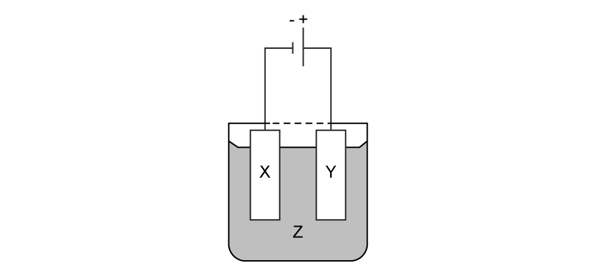
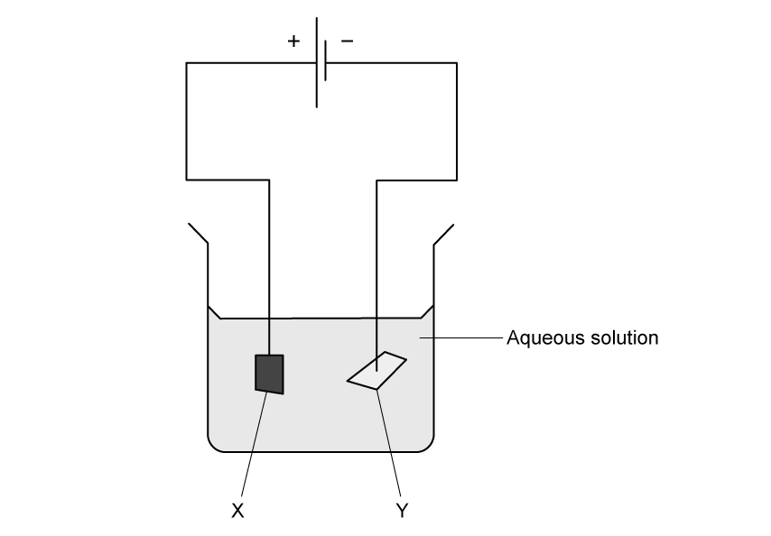

# Exam Questions — Applications of Electrolysis
**4. Electrochemistry** · Cambridge (CIE) IGCSE chemistry (0620 & 0971)
> Source: [https://www.savemyexams.com/igcse/chemistry/cie/23/topic-questions/](https://www.savemyexams.com/igcse/chemistry/cie/23/topic-questions/) · 18 questions across 1 sets

## Multiple Choice Questions (21 questions)

### Q1 — easy — 1 marks

**Q1** [1 mark]

Three statements comparing gasoline (petrol) combustion engines with hydrogen-oxygen fuel cells are shown

1. The combustion of gasoline and the formation of water are both exothermic processes with a positive enthalpy change, Δ*H.*
2. Combustion engines are more polluting than fuel cells because incomplete combustion produces carbon monoxide and particulates.
3. Gasoline is more difficult and expensive to store in a vehicle than hydrogen.

Which statements are correct?

### Q2 — hard — 1 marks

**Q2** [1 mark]

An iron tray is electroplated with pure silver to improve its appearance. The diagram shows the electrochemical cell with labels X, Y and Z.

Which row correctly identifies the half-equations occurring at electrodes X and Y, and the identity of electrolyte Z?

|   | half-equation at X | half-equation at Y | electrolyte Z |
|---|---|---|---|
| **A** | Ag+ + e− → Ag | Ag → Ag++ e− | aqueous silver nitrate |
| **B** | Ag → Ag++ e− | Ag+ + e− → Ag | aqueous silver nitrate |
| **C** | Ag+ + e− → Ag | Fe2+ + 2e− → Fe | aqueous iron(II) nitrate |
| **D** | Fe2+ + 2e− → Fe | Ag → Ag++ e− | aqueous silver nitrate |

### Q3 — easy — 1 marks

**Q3** [1 mark]

An iron tray is electroplated with pure silver to improve its appearance. The diagram shows the electrochemical cell with labels X, Y and Z.

Which row correctly identifies X, Y, and the electrolyte Z?

|   | Electrode X (at the negative terminal) | Electrode Y (at the positive terminal) | Electrolyte Z |
|---|---|---|---|
| **A** | Pure silver | Iron tray | Silver nitrate |
| **B** | Pure silver | Iron tray | Iron (II) chloride |
| **C** | Iron tray | Pure silver | Silver nitrate |
| **D** | Iron tray | Pure silver | Silver chloride |

### Q4 — easy — 1 marks

**Q4** [1 mark]

#### Separate: Chemistry Only

A student sets up the following equipment to investigate electroplating.

What would they see occur during the electroplating process?

### Q5 — easy — 1 marks

**Q5** [1 mark]

Which metal could **not** be used for electroplating by using an aqueous solution?

### Q6 — easy — 1 marks

**Q6** [1 mark]

During electroplating what are the correct anode (positive electrode) and cathode (negative electrode) products when aqueous copper(II) sulfate is electrolysed using copper electrodes?

|   | **Anode product** | **Cathode product** |
|---|---|---|
| **A** | copper(II) ions | copper metal |
| **B** | copper(II) ions | hydrogen gas |
| **C** | oxygen gas | copper metal |
| **D** | oxygen gas | hydrogen gas |

### Q7 — easy — 1 marks

**Q7** [1 mark]

In a fuel cell ............**1**........... energy is converted to ..................**2**................ energy.

|   | **1** | **2** |
|---|---|---|
| **A** | electrical | heat |
| **B** | chemical | electrical |
| **C** | potential | chemical |
| **D** | chemical | heat |

### Q8 — easy — 1 marks

**Q8** [1 mark]

Hydrogen-oxygen fuel cells can be used to power motor vehicles.

What is the correct balanced symbol equation for the reaction that occurs in a hydrogen-oxygen fuel cell?

### Q9 — hard — 1 marks

**Q9** [1 mark]

The diagram shows an electrolysis experiment using X and Y as electrodes.

Copper is used to coat the other metal.

Which metal becomes coated and which solution is used?

|   | **aqueous solution** | **metal** |
|---|---|---|
| **A** | CoCl3 | Y |
| **B** | CuCl2 | Y |
| **C** | CuCl2 | X |
| **D** | CoCl3 | X |

### Q10 — hard — 1 marks

**Q10** [1 mark]

Winston Churchill, a British Prime Minister, had his false teeth electroplated with gold.

The teeth were coated with a thin layer of carbon and were then placed in the apparatus shown.

|   | **terminal X is** | **the carbon powder could be** |
|---|---|---|
| **A** | negative | diamond |
| **B** | negative | graphite |
| **C** | positive | diamond |
| **D** | positive | graphite |

### Q11 — hard — 1 marks

**Q11** [1 mark]

The following apparatus for plating a spoon with silver is shown.

Which statements are correct?

1  The metal electrode would be connected to the negative terminal of the power supply

2  The spoon would be connected to the negative terminal of the power supply

3  At the cathode, silver ions lose electrons to form silver atoms

4  At the anode, silver atoms lose electrons to form silver ions

### Q12 — hard — 1 marks

**Q12** [1 mark]

A student wishes to electroplate an object with copper.

Which row is correct?

|   | **object is made at the** | **a suitable electrolyte is** |
|---|---|---|
| **A** | anode | CuO(s) |
| **B** | anode | CuSO4(aq) |
| **C** | cathode | CuO(s) |
| **D** | cathode | CuSO4(aq) |

### Q13 — hard — 1 marks

**Q13** [1 mark]

What is the correct balanced symbol equation for the overall reaction in a hydrogen-oxygen fuel cell?

### Q14 — medium — 1 marks

**Q14** [1 mark]

The diagram shows a simple cell.

Which statement about the process occurring when the cell is in operation is correct?

### Q15 — medium — 1 marks

**Q15** [1 mark]

The diagram shows a failed attempt to copper-plate a pan.

Which can be done to plate the pan with copper?

### Q16 — medium — 1 marks

**Q16** [1 mark]

What are the products made by a hydrogen-oxygen fuel cell?

1    Water

2    Oxygen

3    Hydrogen

### Q17 — medium — 1 marks

**Q17** [1 mark]

A students wants to electroplate an iron spoon with silver using an aqueous silver salt as the electrolyte.

Which set of conditions is used?

|   | **Iron spoon** | **Other electrode ** |
|---|---|---|
| **A** | cathode | silver |
| **B** | anode | silver |
| **C** | cathode | carbon |
| **D** | anode | carbon |

### Q18 — medium — 1 marks

**Q18** [1 mark]

Which of the following are advantages of a hydrogen fuel cell to power a car?
