# Exam Questions — Applications of Electrolysis
**4. Electrochemistry** · Cambridge (CIE) IGCSE chemistry (0620 & 0971)
> Source: [https://www.savemyexams.com/igcse/chemistry/cie/23/topic-questions/](https://www.savemyexams.com/igcse/chemistry/cie/23/topic-questions/) · 34 questions across 3 sets

## Alternative To Practical Questions (1 questions)

### Q1 — medium — 5 marks

**Q1** [3 marks]

A steel spoon can be coated in silver using electrolysis. The spoon must be very clean and free of grease.

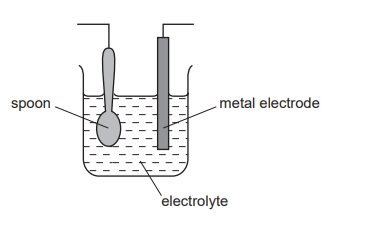

Suggest

i) **one** advantage of putting a thin layer of silver on the spoon,

[1]

ii) **one** disadvantage if the spoon is used frequently,

[1]

iii) why the spoon must be very clean and free of grease?

[1]

*Source: 2009 6 Q2*

**Q1** [1 mark]

**Extract:**

A steel spoon can be coated in silver using electrolysis. The spoon must be very clean and free of grease.

Which electrode should be the spoon?

*Source: 2009 6 Q2*

**Q1** [1 mark]

**Extract:**

A steel spoon can be coated in silver using electrolysis. The spoon must be very clean and free of grease.

Identify the metal from which the other electrode is made.

*Source: 2009 6 Q2*

## Multiple Choice Questions (21 questions)

### Q1 — easy — 1 marks

**Q1** [1 mark]

Three statements comparing gasoline (petrol) combustion engines with hydrogen-oxygen fuel cells are shown

1. The combustion of gasoline and the formation of water are both exothermic processes with a positive enthalpy change, Δ*H.*
2. Combustion engines are more polluting than fuel cells because incomplete combustion produces carbon monoxide and particulates.
3. Gasoline is more difficult and expensive to store in a vehicle than hydrogen.

Which statements are correct?

### Q2 — hard — 1 marks

**Q2** [1 mark]

An iron tray is electroplated with pure silver to improve its appearance. The diagram shows the electrochemical cell with labels X, Y and Z.

Which row correctly identifies the half-equations occurring at electrodes X and Y, and the identity of electrolyte Z?

|   | half-equation at X | half-equation at Y | electrolyte Z |
|---|---|---|---|
| **A** | Ag+ + e− → Ag | Ag → Ag++ e− | aqueous silver nitrate |
| **B** | Ag → Ag++ e− | Ag+ + e− → Ag | aqueous silver nitrate |
| **C** | Ag+ + e− → Ag | Fe2+ + 2e− → Fe | aqueous iron(II) nitrate |
| **D** | Fe2+ + 2e− → Fe | Ag → Ag++ e− | aqueous silver nitrate |

### Q3 — easy — 1 marks

**Q3** [1 mark]

An iron tray is electroplated with pure silver to improve its appearance. The diagram shows the electrochemical cell with labels X, Y and Z.

Which row correctly identifies X, Y, and the electrolyte Z?

|   | Electrode X (at the negative terminal) | Electrode Y (at the positive terminal) | Electrolyte Z |
|---|---|---|---|
| **A** | Pure silver | Iron tray | Silver nitrate |
| **B** | Pure silver | Iron tray | Iron (II) chloride |
| **C** | Iron tray | Pure silver | Silver nitrate |
| **D** | Iron tray | Pure silver | Silver chloride |

### Q4 — easy — 1 marks

**Q4** [1 mark]

#### Separate: Chemistry Only

A student sets up the following equipment to investigate electroplating.

What would they see occur during the electroplating process?

### Q5 — easy — 1 marks

**Q5** [1 mark]

Which metal could **not** be used for electroplating by using an aqueous solution?

### Q6 — easy — 1 marks

**Q6** [1 mark]

During electroplating what are the correct anode (positive electrode) and cathode (negative electrode) products when aqueous copper(II) sulfate is electrolysed using copper electrodes?

|   | **Anode product** | **Cathode product** |
|---|---|---|
| **A** | copper(II) ions | copper metal |
| **B** | copper(II) ions | hydrogen gas |
| **C** | oxygen gas | copper metal |
| **D** | oxygen gas | hydrogen gas |

### Q7 — easy — 1 marks

**Q7** [1 mark]

In a fuel cell ............**1**........... energy is converted to ..................**2**................ energy.

|   | **1** | **2** |
|---|---|---|
| **A** | electrical | heat |
| **B** | chemical | electrical |
| **C** | potential | chemical |
| **D** | chemical | heat |

### Q8 — easy — 1 marks

**Q8** [1 mark]

Hydrogen-oxygen fuel cells can be used to power motor vehicles.

What is the correct balanced symbol equation for the reaction that occurs in a hydrogen-oxygen fuel cell?

### Q9 — hard — 1 marks

**Q9** [1 mark]

The diagram shows an electrolysis experiment using X and Y as electrodes.

Copper is used to coat the other metal.

Which metal becomes coated and which solution is used?

|   | **aqueous solution** | **metal** |
|---|---|---|
| **A** | CoCl3 | Y |
| **B** | CuCl2 | Y |
| **C** | CuCl2 | X |
| **D** | CoCl3 | X |

### Q10 — hard — 1 marks

**Q10** [1 mark]

Winston Churchill, a British Prime Minister, had his false teeth electroplated with gold.

The teeth were coated with a thin layer of carbon and were then placed in the apparatus shown.

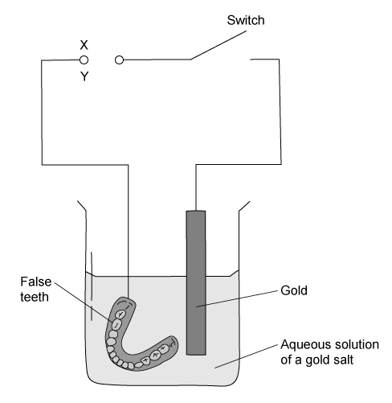

|   | **terminal X is** | **the carbon powder could be** |
|---|---|---|
| **A** | negative | diamond |
| **B** | negative | graphite |
| **C** | positive | diamond |
| **D** | positive | graphite |

### Q11 — hard — 1 marks

**Q11** [1 mark]

The following apparatus for plating a spoon with silver is shown.

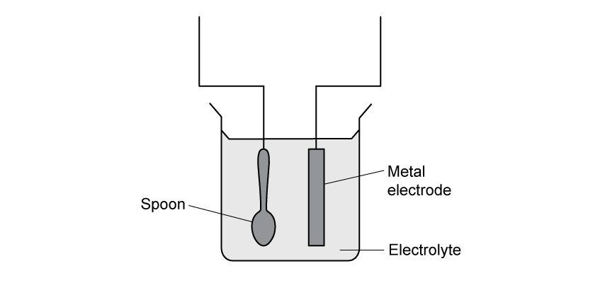

Which statements are correct?

1  The metal electrode would be connected to the negative terminal of the power supply

2  The spoon would be connected to the negative terminal of the power supply

3  At the cathode, silver ions lose electrons to form silver atoms

4  At the anode, silver atoms lose electrons to form silver ions

### Q12 — hard — 1 marks

**Q12** [1 mark]

A student wishes to electroplate an object with copper.

Which row is correct?

|   | **object is made at the** | **a suitable electrolyte is** |
|---|---|---|
| **A** | anode | CuO(s) |
| **B** | anode | CuSO4(aq) |
| **C** | cathode | CuO(s) |
| **D** | cathode | CuSO4(aq) |

### Q13 — hard — 1 marks

**Q13** [1 mark]

What is the correct balanced symbol equation for the overall reaction in a hydrogen-oxygen fuel cell?

### Q14 — medium — 1 marks

**Q14** [1 mark]

The diagram shows a simple cell.

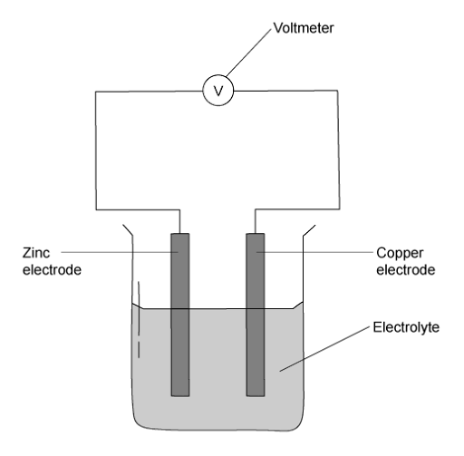

Which statement about the process occurring when the cell is in operation is correct?

### Q15 — medium — 1 marks

**Q15** [1 mark]

The diagram shows a failed attempt to copper-plate a pan.

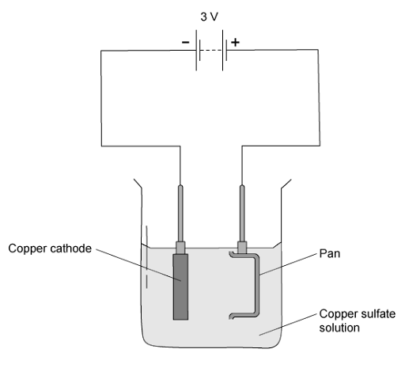

Which can be done to plate the pan with copper?

### Q16 — medium — 1 marks

**Q16** [1 mark]

What are the products made by a hydrogen-oxygen fuel cell?

1    Water

2    Oxygen

3    Hydrogen

### Q17 — medium — 1 marks

**Q17** [1 mark]

A students wants to electroplate an iron spoon with silver using an aqueous silver salt as the electrolyte.

Which set of conditions is used?

|   | **Iron spoon** | **Other electrode ** |
|---|---|---|
| **A** | cathode | silver |
| **B** | anode | silver |
| **C** | cathode | carbon |
| **D** | anode | carbon |

### Q18 — medium — 1 marks

**Q18** [1 mark]

Which of the following are advantages of a hydrogen fuel cell to power a car?

## Theory Questions (15 questions)

### Q1 — easy — 5 marks

**Q1** [1 mark]

The diagram below shows a fuel cell.

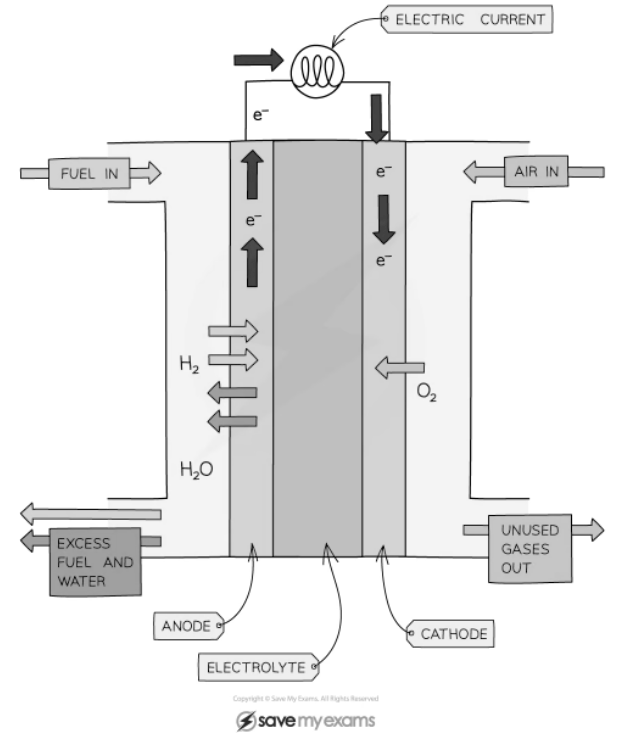

Hydrogen can be used as the fuel.

Complete the balanced symbol equation for the reaction that occurs in a hydrogen fuel cell.

___ H2   +   O2   →   ___ H2O

**Q1** [1 mark]

#### Extended Only

The graph below shows the reaction pathway diagram for the reaction of hydrogen and water in a hydrogen fuel cell.

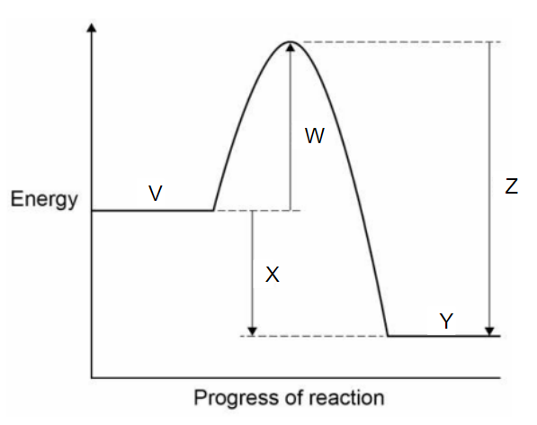

Which of the labels represents hydrogen and oxygen?  Tick **one **box.

| **V** |   |
|---|---|
|   |   |
| **W** |   |
|   |   |
| **X** |   |
|   |   |
| **Y** |   |
|   |   |
| **Z** |   |

**Q1** [1 mark]

**Extract:**

The graph below shows the reaction pathway diagram for the reaction of hydrogen and water in a hydrogen fuel cell. Which of the labels represents hydrogen and oxygen? Tick one box. V, W, X, Y, Z

#### Extended Only

Which of the labels in the reaction pathway diagram in part (b) represents water?  Tick **one **box.

| **V** |   |
|---|---|
|   |   |
| **W** |   |
|   |   |
| **X** |   |
|   |   |
| **Y** |   |
|   |   |
| **Z** |   |

**Q1** [2 marks]

#### Extended Only

The first vehicle powered by a hydrogen fuel cell was built in 1966 by General Motors. It could travel at up to 70 mph in 30 seconds.

Suggest **two** disadvantages of using a hydrogen fuel cell in a car.

### Q2 — medium — 12 marks

**Q2** [4 marks]

Chromium is a transition element.

i) Predict **two **differences in the physical properties of chromium and sodium.

[2]

ii) Predict **two **differences in the chemical properties of chromium and sodium.

[2]

*Source: 2010 O23 Q4*

**Q2** [8 marks]

Chromium is used to electroplate steel objects. The diagram shows how this could be done.

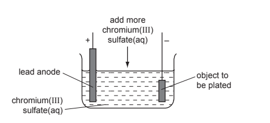

i) Give **two **reasons why steel objects are plated with chromium.

[2]

ii) The formula of the chromium(III) ion is Cr3+ and of the sulfate ion is SO42–. Give the formula of chromium(III) sulfate.

[1]

iii) Write the equation for the reaction at the negative electrode (cathode).

[2]

iv) A colourless gas, which relights a glowing splint, is formed at the positive electrode (anode). Name this gas.

[1]

v) During electrolysis, it is necessary to add more chromium(III) sulfate but during copper-plating using a copper anode, it is not necessary to add more copper(II) sulfate. Explain.

[2]

*Source: 2010 O23 Q4*

### Q3 — medium — 4 marks

**Q3** [1 mark]

A fuel cell produces electrical energy by the oxidation of a fuel by oxygen. The fuel is usually hydrogen but methane and methanol are two other fuels which may be used. A diagram of a hydrogen fuel cell is given below.

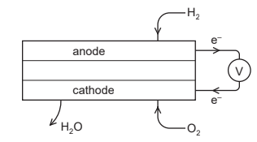

When the fuel is hydrogen, the only product is water.

What additional product would be formed if methane was used?

*Source: 2015 O33 Q4*

**Q3** [1 mark]

**Extract:**

A fuel cell produces electrical energy by the oxidation of a fuel by oxygen. The fuel is usually hydrogen but methane and methanol are two other fuels which may be used. When the fuel is hydrogen, the only product is water.

Write the symbol equation for the chemical reaction that takes place in a hydrogen fuel cell.

*Source: 2014 O33 Q4*

**Q3** [2 marks]

**Extract:**

A fuel cell produces electrical energy by the oxidation of a fuel by oxygen. The fuel is usually hydrogen but methane and methanol are two other fuels which may be used. When the fuel is hydrogen, the only product is water.
2H~2 ~+ O~2~ → 2H~2~O

#### Extended Only

Fuel cells are used to propel cars. Give **two **advantages of a fuel cell over a gasoline-fuelled engine.

*Source: 2014 O33 Q4*

### Q4 — easy — 7 marks

**Q4** [3 marks]

#### Chemistry Only

A student wanted to use electrolysis to electroplate an object with nickel.

Match the part of the apparatus used for electroplating on the left with its correct identity on the right.

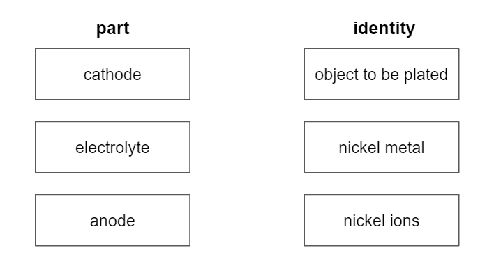

**Q4** [1 mark]

**Extract:**

A student wanted to use electrolysis to electroplate an object with nickel.

#### Chemistry Only

Which of the following equations shows the correct half-equation for the reaction that occurs at the cathode? Tick **one** box.

| Ni2+ → Ni + e– |   |
|---|---|
|   |   |
| Ni + e– → Ni2+ |   |
|   |   |
| Ni2+ + 2e– → Ni |   |
|   |   |
| Ni + 2e– → Ni2+ |   |

**Q4** [1 mark]

**Extract:**

A student wanted to use electrolysis to electroplate an object with nickel.
Anode - nickel metal

#### Chemistry Only

What occurs at the anode, oxidation or reduction?

**Q4** [2 marks]

#### Chemistry Only

Which **two** of the reasons about why objects are electroplated are correct. Tick **two **boxes.

| It improves the appearance of the object |   |
|---|---|
|   |   |
| It is more expensive |   |
|   |   |
| It increases the melting point of the object |   |
|   |   |
| It makes the object more resistance to corrosion |   |
|   |   |
| It makes the object harder |   |

### Q5 — easy — 6 marks

**Q5** [1 mark]

#### Separate: Chemistry Only

An application of electrolysis is electroplating.

Which of the these statements about electroplating is correct? Tick **one **box.

| It is used to extract metals from their ores |   |
|---|---|
|   |   |
| It is a process used to break down a substance using heat |   |
|   |   |
| It is used to coat the surface of one metal with a layer of a different metal |   |
|   |   |
| It is a method of sacrificial protection |   |

**Q5** [3 marks]

#### Separate: Chemistry Only

The diagram shows the equipment needed to electroplate a metal spoon with silver.  Complete the labels in the boxes using words from the list.

| **anode** | **power supply** | **electrolyte** |
|---|---|---|
|   |   |   |
| **electrolysis** | **cathode** |   |

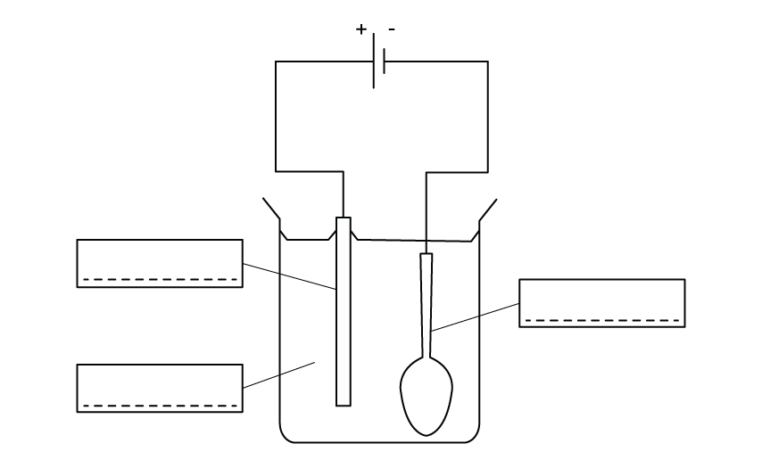

**Q5** [1 mark]

**Extract:**

The electrolyte is an aqueous solution of a soluble salt of the pure metal at the anode.
An electrolyte needs to be an aqueous solution of a soluble salt of the metal which is used to coat the spoon with, in this case, a silver salt such as silver nitrate.

#### Separate: Chemistry Only

Which **one** of these substances would be a suitable electrolyte when plating an iron spoon with silver? Tick **one** box.

| Silver |   |
|---|---|
|   |   |
| Iron |   |
|   |   |
| Silver nitrate |   |
|   |   |
| Iron(II) nitrate |   |

**Q5** [1 mark]

**Extract:**

The diagram shows the equipment needed to electroplate a metal spoon with silver. Complete the labels in the boxes using words from the list: anode, power supply, electrolyte, electrolysis, cathode.

The correct labels are: Anode; Cathode; Electrolyte. In electroplating, the object to be plated is used as the cathode. The anode is made from the metal that is used to coat the object. The electrolyte is an aqueous solution of a soluble salt of the pure metal at the anode.

#### Separate: Chemistry Only

Give **one** change that would need to be made to the equipment in part (b) to coat the metal spoon with nickel instead of silver.

### Q6 — hard — 7 marks

**Q6** [1 mark]

#### Extended Only

Electroplating is generally done for decorative purposes or for protection.

Food cans are generally made from three different materials:

- aluminium
- tin-coated steel / tinplate
- electrolytic chromium coated steel

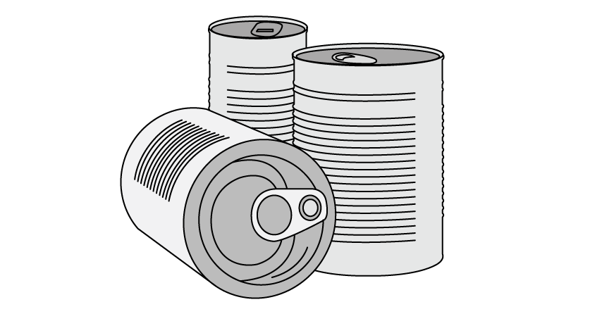

Explain why aluminium food cans do not need to be electroplated.

**Q6** [3 marks]

#### Extended Only

Tin-coated steel food cans and electrolytic chromium coated steel food cans that contain acidic foods can bulge as shown. The bulging is a result of a redox reaction inside the can forming a gas.

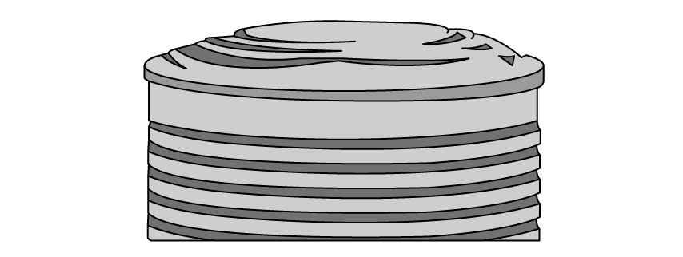

i) Give the ionic equation forming the gaseous product during the reaction between the metal food can and the acidic food.

[1]

ii) Explain how this shows that there is a break in the tin coating or chromium plating.

[2]

**Q6** [1 mark]

#### Separate: Chemistry Only

Common electroplated gifts used to include items such as jewellery, jewellery boxes, shaving kits, cutlery, hip flasks, candlesticks and other ornamental pieces.

More recent developments in electroplating mean that plastic and organic items, such as the rose shown, can be metal plated.

Plastic and organic items are sprayed or coated with a fine film to allow electroplating to occur.

Name a material that the film must contain. Explain your answer.

**Q6** [2 marks]

**Extract:**

Common electroplated gifts used to include items such as jewellery, jewellery boxes, shaving kits, cutlery, hip flasks, candlesticks and other ornamental pieces. More recent developments in electroplating mean that plastic and organic items, such as the rose shown, can be metal plated. Plastic and organic items are sprayed or coated with a fine film to allow electroplating to occur.

There are a number of steps in the process of gold-plating a rose.

- Surface Cleaning
- Surface Preparation
- Electro Cleaning and Steam Cleaning
- Water Rinse
- Flashing / Striking
- Applying Base Coat
- Electroplating
- Final Rinse and Drying
- Final Polish

During the flashing / striking step, a thin layer of high-quality nickel is plated on to the rose. This step improves the bonding between the rose and the gold-plating due to the electrical conductivity of the nickel.

Suggest another reason for applying a thin layer of nickel. Explain your answer.

### Q7 — easy — 5 marks

**Q7** [2 marks]

#### Separate: Chemistry Only

A student wants to electroplate objects made out of different materials.

Which of the following materials would **not** be suitable for electroplating? You may tick more than one box.

| Glass |   |
|---|---|
| Copper |   |
| Poly(ethene) |   |
| Iron |   |

**Q7** [1 mark]

#### Separate: Chemistry Only

The student sets up the following equipment to electroplate an iron rod with nickel.

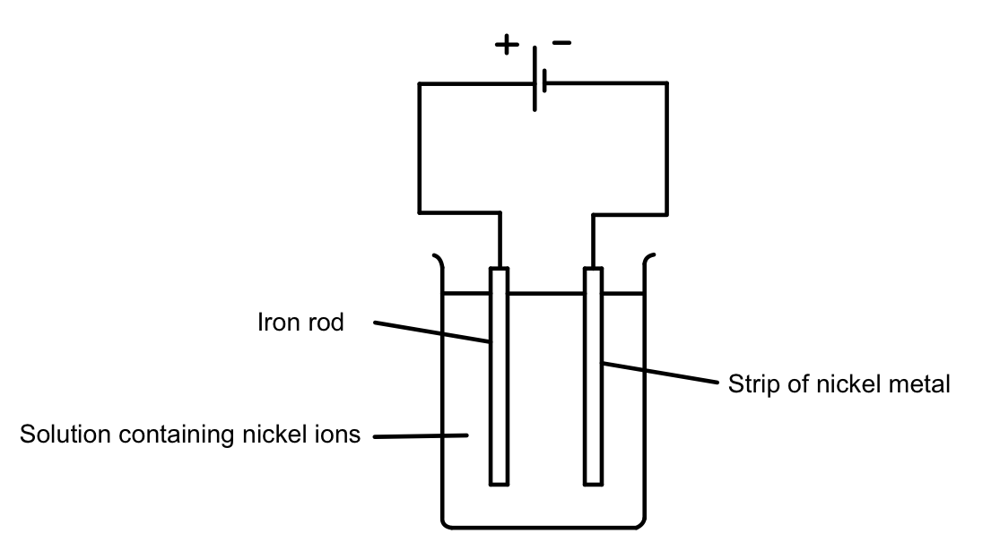

What error did they make when setting up the equipment? Tick **one** box.

| The solution should contain iron ions |   |
|---|---|
| The circuit should contain a switch |   |
| Both electrodes should be made from iron |   |
| The strip of nickel and iron rod are connected to the wrong terminal of the power supply |   |

**Q7** [1 mark]

#### Extended Only

In a different experiment, copper was used to electroplate a metal spoon. This was the half-equation on the surface of the spoon.

Cu2+ + 2e– → Cu

Explain how this equation shows that copper is reduced.

**Q7** [1 mark]

#### Separate: Chemistry Only

Which of the following substances could be used as the electrolyte when electroplating an iron spoon with copper? Tick **one** box.

| an iron rod |   |
|---|---|
| aqueous iron nitrate |   |
| a copper rod |   |
| aqueous copper nitrate |   |

### Q8 — medium — 5 marks

**Q8** [4 marks]

#### Separate: Chemistry Only

Metal objects can be electroplated with silver.

Describe how a metal spoon can be electroplated with silver. Include:

- what to use as the positive electrode and as the negative electrode
- what to use as the electrolyte
- an ionic half-equation to show the formation of silver.

You may include a diagram in your answer.

*Source: Specimen 03 Q8B*

**Q8** [1 mark]

#### Separate: Chemistry Only

Give one reason why metal spoons are electroplated with silver.

*Source: 2019 Ju43/04 Q4B*

### Q9 — hard — 7 marks

**Q9** [1 mark]

A fuel cell produces electrical energy by the oxidation of a fuel by oxygen. The fuel is usually hydrogen but methane and methanol are two other fuels which may be used. A diagram of a hydrogen fuel cell is given below in Figure 1.

**Figure 1**

When the fuel is hydrogen, the hydrogen is oxidised to form water, which is the only product.

Suggest what additional product would be formed if methanol was used.

*Source: 2015 O33 Q4*

**Q9** [1 mark]

**Extract:**

A fuel cell produces electrical energy by the oxidation of a fuel by oxygen. The fuel is usually hydrogen but methane and methanol are two other fuels which may be used. When the fuel is hydrogen, the hydrogen is oxidised to form water, which is the only product.

Give the chemical equation for the reaction that takes place in a hydrogen fuel cell.

*Source: 2014 O33 Q4*

**Q9** [2 marks]

#### Extended Only

In a hydrogen fuel cell, hydrogen loses electrons at the anode. Write the half equation to show the reaction at the anode.

*Source: 2014 O33 Q4*

**Q9** [3 marks]

**Extract:**

b) The equation for the reaction that takes place in a hydrogen fuel cell is: 2H~2 ~+ O~2~ → 2H~2~O

#### Extended Only

Hydrogen and oxygen can also react in a combustion reaction forming water vapour. Calculate the mass of water vapour produced when 500 cm3 of hydrogen combusts in excess oxygen.

Mass of water vapour ...................................... (g)

### Q10 — medium — 9 marks

**Q10** [2 marks]

#### Extended Only

Some cars use hydrogen–oxygen fuel cells as a source of energy. Explain one advantage to the environment of using a hydrogen–oxygen fuel cell instead of a petrol engine.

*Source: 2019 Ju43/04 Q*

**Q10** [1 mark]

#### Extended Only

Fuel cells can be used with alternative fuels. One alternative fuel is the liquid fuel, methanol, CH3OH.

Suggest an advantage of using methanol instead of hydrogen in a fuel cell to power vehicles.

**Q10** [4 marks]

**Extract:**

Fuel cells can be used with alternative fuels. One alternative fuel is the liquid fuel, methanol, CH~3~OH.

#### Extended Only

When methanol reacts with oxygen in a methanol-oxygen fuel cell, carbon dioxide and water are produced. Draw the reaction pathway diagram for the reaction on the axes below. Label the following:

- reactants
- products
- activation energy
- overall energy change

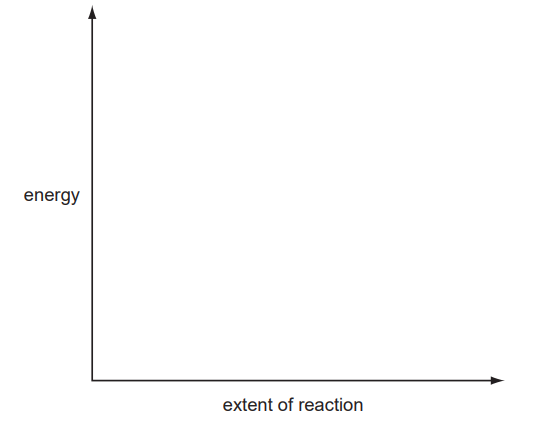

**Q10** [2 marks]

**Extract:**

Fuel cells can be used with alternative fuels. One alternative fuel is the liquid fuel, methanol, CH~3~OH.
When methanol reacts with oxygen in a methanol-oxygen fuel cell, carbon dioxide and water are produced.

Write the balanced symbol equation for the reaction between methanol and oxygen in a methanol-oxygen fuel cell.

### Q11 — hard — 7 marks

**Q11** [3 marks]

#### Extended Only

The Gemini and Apollo moon probes use hydrogen fuel cells to generate an electric current and do not need to be electrically recharged. The product of this reaction can be used to supplement the drinking water for astronauts.

Deduce the half equations for the reactions at each electrode in a hydrogen fuel cell, and then the overall equation for the hydrogen-oxygen fuel cell, to show the product used to supplement drinking water.

**Q11** [1 mark]

A hydrogen fuel cell is an electrochemical device that converts chemical energy into electrical energy. A continuous supply of fuel is supplied to one electrode and a continuous supply of air is supplied to the other electrode.

Suggest why a fuel cell does not need to be recharged.

**Q11** [2 marks]

#### Extended Only

The General Motors Electrovan was built in 1966. It was the first vehicle powered by a hydrogen fuel cell and could travel at up to 70 mph for 30 seconds.

Suggest **two **environmental advantages of using a hydrogen fuel cell rather than an internal combustion engine.

**Q11** [1 mark]

#### Extended Only

Hydrogen fuel cells are commonly considered to be carbon neutral by the general public because they do not release any carbon dioxide or other greenhouse gases when they are used. This is not technically correct.

Suggest why hydrogen fuel cells cannot be classed as carbon neutral.

### Q12 — hard — 7 marks

**Q12** [2 marks]

#### Separate: Chemistry Only

Electrolysis can be used to silver-plate metal cutlery.

Give **two **reasons why metal cutlery is sometimes silver-plated.

**Q12** [4 marks]

#### Separate: Chemistry Only

The apparatus used to electroplate a metal spoon with silver is shown. The apparatus has not been set up correctly.

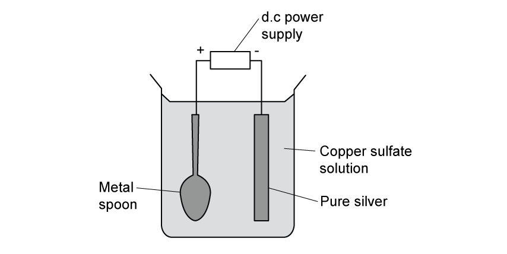

The metal spoon erodes and a thin layer of copper forms on the pure silver electrode.

Explain **two **changes that should be made to this apparatus in order to be able to silver plate the metal spoon.

**Q12** [1 mark]

#### Separate: Chemistry Only

Suggest why it is difficult to electroplate a plastic object.

### Q13 — medium — 8 marks

**Q13** [3 marks]

#### Separate: Chemistry Only

Electroplating steel objects with silver involves a three-step process.

**step 1**   A coating of copper is applied to the object. **step 2**   A coating of nickel is applied to the object. **step 3   **The coating of silver is applied to the object.

A diagram of the apparatus used for step 1 is shown.

The chemical process taking place on the surface of the object is

Cu2+ (aq) + 2e– → Cu (s)

i) Explain whether this process is oxidation or reduction.

[1]

ii) Explain why the concentration of copper ions in the electrolyte remains constant throughout step 1.

[2]

*Source: 2016 Ju41 Q4*

**Q13** [2 marks]

**Extract:**

Electroplating steel objects with silver involves a three-step process. step 1 A coating of copper is applied to the object. step 2 A coating of nickel is applied to the object. step 3 The coating of silver is applied to the object. A diagram of the apparatus used for step 1 is shown. The chemical process taking place on the surface of the object is Cu^2+ (aq) + 2e^– → Cu (s)

#### Separate: Chemistry Only

Give **two** changes which would be needed in order to coat nickel onto the object in **step 2.**

*Source: 2016 Ju41 Q4*

**Q13** [3 marks]

Copper, nickel and silver are transition elements.

Typical physical properties of transition elements are a high density and a high melting point.

Give** three** different properties of transition metals which are not typical of other metals.

*Source: 2016 Ju41 Q4*

### Q14 — easy — 8 marks

**Q14** [1 mark]

Hydrogen and oxygen react together to form water.

Complete the word equation for this reaction:

hydrogen   +   ____________________   →   water

**Q14** [2 marks]

The reaction between hydrogen and oxygen is used in hydrogen fuel cells.

Complete these sentences about hydrogen fuel cells using words from the list.

| **reduction** | **combustion** | **electricity** |
|---|---|---|
|   |   |   |
| **temperature change** | **gas** | **oxidation** |

Water is produced when hydrogen undergoes ....................................................... This causes the fuel cell to produce  ..................................................

**Q14** [3 marks]

The diagram below shows a hydrogen fuel cell.

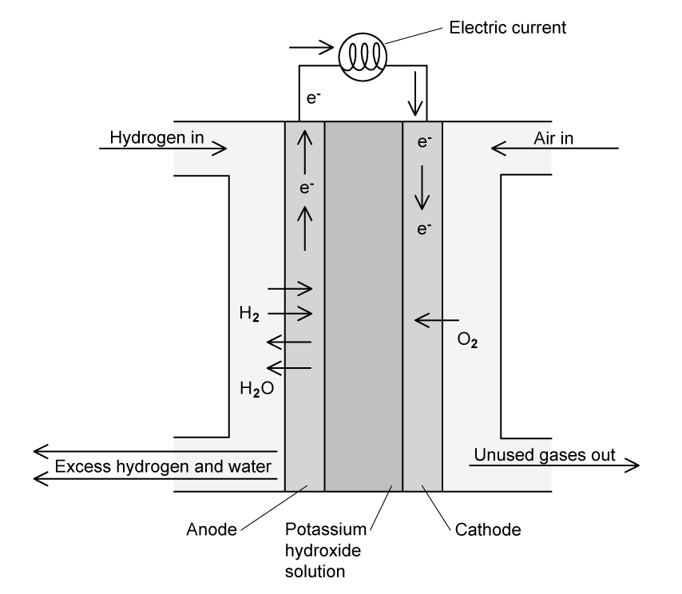

Complete the table to show the functions each of the substances perform in a hydrogen fuel cell using words from the list.

| **electrolyte** | **electrode** | **waste product** |
|---|---|---|
|   |   |   |
| **source of oxygen** | **fuel** | **anode** |

| **Substance** | **Function** |
|---|---|
| Potassium hydroxide solution |   |
| Hydrogen |   |
| Water |   |

**Q14** [2 marks]

#### Extended Only

Give **two** advantages of using hydrogen fuel cells compared with using petrol engines to power motor vehicles.

### Q15 — hard — 8 marks

**Q15** [1 mark]

Hallmarked precious metals such as gold, silver, platinum and palladium are often plated on jewellery. It is usually cheaper to have plated jewellery than solid pieces made from these heavy, expensive and precious metals.

A base metal, often copper or nickel, is manipulated into the desired shape for the piece of jewellery. The precious metal is then plated onto the piece of jewellery.

Give the name used to describe the electroplated base metal.

**Q15** [3 marks]

Around 85% of female wedding rings are 1.5 - 2.5 mm wide. The depth of a female wedding ring depends on the shape of the ring. The dimensions of a flat profile ring are shown.

With wedding rings, electroplating to a depth of 8 microns (0.008 mm) is considered thick plating.

i) Calculate the cross-sectional area of:

- an average female, flat profile wedding ring.
- an average female, flat profile wedding ring with thick plating.

[2]

ii) Calculate the percentage of the ring that is plating.

[1]

**Q15** [2 marks]

**Extract:**

ii) The percentage of the ring that is plating is: 0.955% OR 0.96%

#### Extended Only

Most wedding rings contain between 4 and 6 g of metal. Wedding rings that are 18-carat gold are plated with gold that contains 750 parts per 1000 of gold.

Using your answer to part (b), calculate the number of moles of gold that is required to plate an average wedding ring with 18-carat gold.

**Q15** [2 marks]

#### Separate: Chemistry Only

The wedding ring can be electroplated using the apparatus shown.

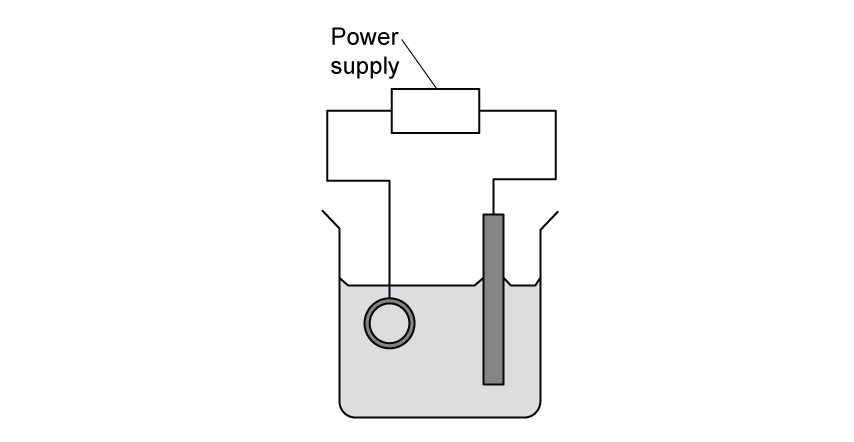

Label the anode and the cathode on the diagram. Explain your answer in terms of gold ions.
