# Mark Schemes — Exothermic & Endothermic Reactions
**5. Chemical Energetics** · Cambridge (CIE) IGCSE chemistry (0620 & 0971)

## Alternative To Practical Questions (5 questions)

### Q1
a) The correct temperatures are:

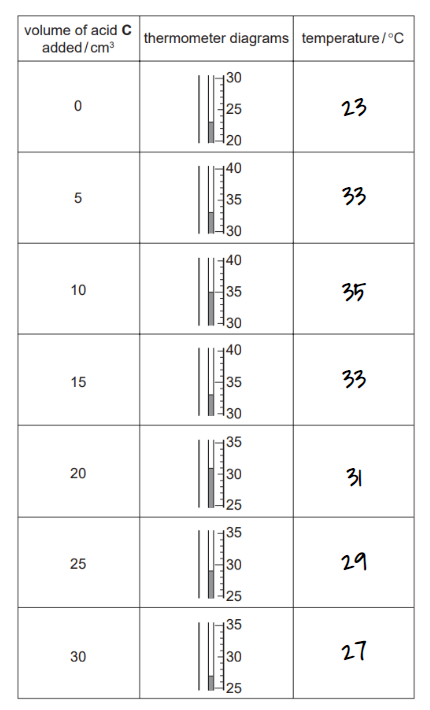

- Temperature boxes completed correctly; **[2 marks]** 
*–1 for each incorrect reading*

**[Total: 2 marks]**
b) The correct readings are:

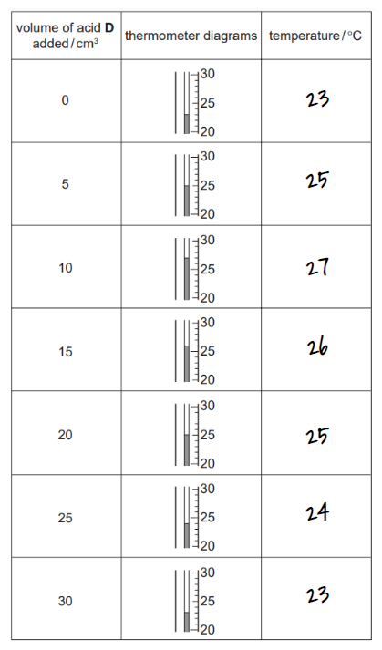

- Temperature boxes completed correctly; **[2 marks]** 
*–1 for each incorrect reading*

**[Total: 2 marks]**
c) The plotted graph:

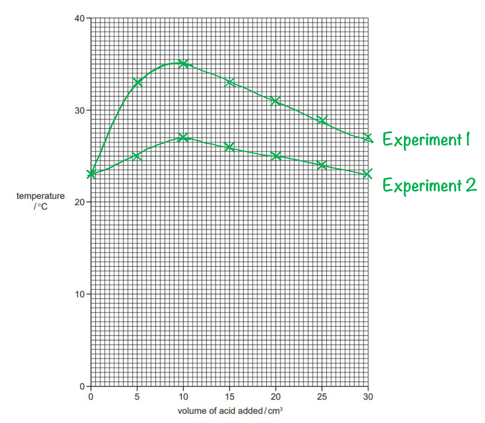

- All points correctly plotted; **[3 marks]** 
*–1 for any incorrect points*
- Smooth line graphs; **[2 marks]** 
*Allow 1 mark for each correct line* 
*Allow two intersecting straight lines*
- Labels; **[1 mark]**

**[Total: 6 marks]**

- *The most common mistake when drawing graphs is to use the scale incorrectly*
- *Make sure that you find what the intervals on both axes are*

  - *In this case, on the x-axis, each square represents 0.5 cm**3*
  - *On the y-axis, each square represents 0.5 °C*
- *When drawing a line of best fit:*

  - *Ignore any anomalous points, if any*
  - *Try to get as many points on the line as possible, and, for those that don't fit on the line, an equal number of points above and below the line*
  - *Use a ruler for a straight line*
  - *For curves, try to make the line as smooth as possible*
d) The temperature of the mixture when 3 cm3 of acid **C** reacted with sodium hydroxide in Experiment 1 is:

- 30 ±0.5 °C; [1 mark]
- Shown clearly;

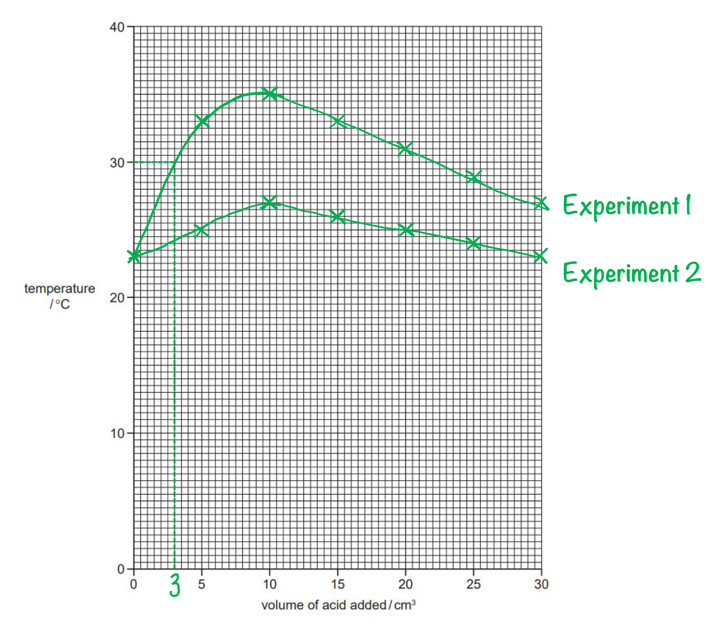

**[Total: 2 marks]**

- *You should use the graph to draw a line from 3 cm**3** of acid on the x-axis to where it intersects your line of best fit for Experiment 1*
- *Then, draw a line from this intersection to meet the y-axis and read off the temperature this corresponds to*
- *Remember to use a ruler *
e)

i) The experiment that produced the larger temperature change was:

- Experiment 1;** [1 mark]**

ii) A possible reason why the temperature change is greater in this experiment is:

Any **two** from:

- Acid **C** is more concentrated; **[1 mark]**
- Acid **C** is stronger; **[1 mark]**
- There are more frequent collisions; **[1 mark]**

**[Total: 3 marks]**

- *The reaction is exothermic so gives out energy*
- *If acid **C** is more concentrated, more energy will be released*
f) The burette was rinsed with water in Experiment 2 to:

- Clean it / remove acid **C** owtte;** [1 mark]**

**[Total: 1 mark]**

- *If it is not cleaned, then subsequent readings will not be accurate*
g) The temperature of the reaction mixture in Experiment 2 after 1 hour would be:

- Room temperature 
**OR **
23 °C; **[1 mark]** 
*Allow their initial temperature from table in (a) or (b)*
- Because the reaction has finished owtte; **[1 mark]**

**[Total: 2 marks]**

- *Once the reaction has completed, the reaction mixture will cool down until it reaches the same temperature as its surroundings*
- *You can assume the acid was at room temperature at the start of the reaction, i.e. 23 °C*

### Q2
a) The correct readings from the thermometer are:

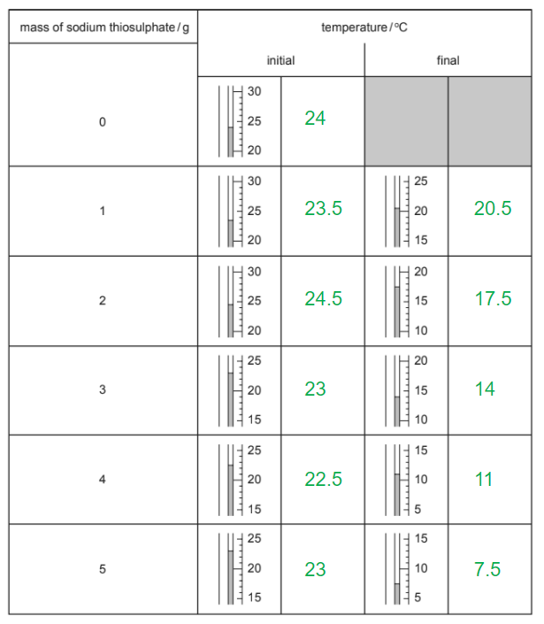

- All 11 temperatures recorded correctly; **[5 marks]** 
*-1 for each incorrect reading*

**[Total: 5 marks]**

- *Each interval on the thermometer represents 1 °C so when the reading is level with an interval, the temperature will be a whole number*
- *When the reading is between 2 intervals, it will end in .5*
b) The plotted graph and straight line line of best fit will be as follows:

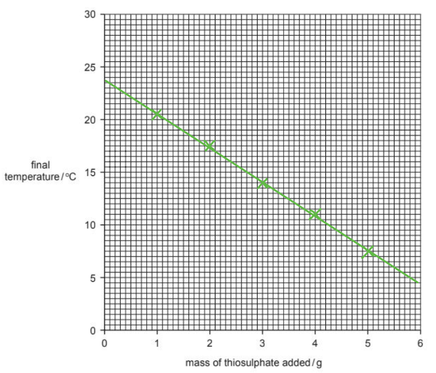

- Points plotted correctly; **[3 marks]** -1 for each incorrect point
- Straight line of best fit; **[1 mark]**

**[Total: 4 marks]**

- *The most common mistake when drawing graphs is to use the scale incorrectly*
- *Make sure that you find what the intervals on both axes are*

  - *In this case, on the x-axis, each square represents 0.1 g*
  - *On the y-axis, each square represents 0.5 °C*
- *When drawing a line of best fit, try to get as many points on the line as possible, and, for those that don't fit on the line, an equal number of points above and below the line*
c)

i) An estimate of  the temperature of the reaction mixture if 3.5 g of powdered sodium thiosulphate were added to 20 cm3 of water is:

- 12.5 °C ± 0.5; **[1 mark]**
- Indication of workings on graph; **[1 mark]**

ii) The temperature of the reaction mixture if 6 g of powdered sodium thiosulphate were added to 20 cm3 of water is:

- 4 °C ± 0.5; **[1 mark]**
- Extrapolation of line to 6 g; **[1 mark]**

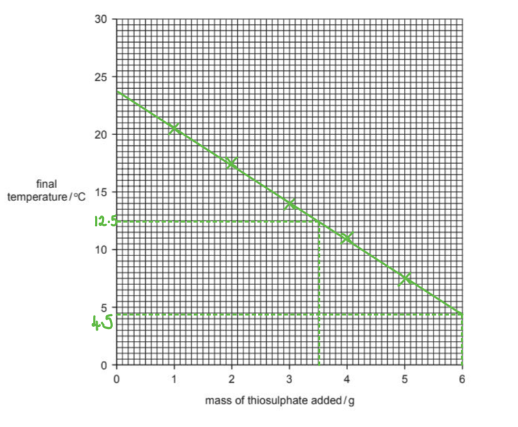

**[Total: 4 marks]**

- *For part i), use the graph to draw a line from 3.5 g on the x-axis to where it intersects your line of best fit*
- *Then, draw a line from this intersection to meet the y-axis and read off the final temperature this corresponds to*
- *Remember to use a ruler *
- *For part ii), repeat but starting from 6 g*
- *If your line of best fit from part b) does not extend to 6 g you will need to extrapolate it so that it reaches 6 g*
d) The type of chemical reaction that occurs when sodium thiosulphate dissolves in water is:

- Endothermic;** [1 mark]**

**[Total: 1 mark]**

- *As more mass is added, the final temperature decreases*
- *In endothermic reactions, thermal energy is taken in from the surroundings so the temperature of the surroundings decreases*
e) The temperature changes would differ in the experiments if 40 cm3 of water were used:

- The temperature changes would be smaller;** [1 mark]**
- (Because there is) more water; **[1 mark]**

**[Total: 2 marks]**

- *The energy taken in to dissolve a given mass of solid, whether it is dissolved in 20 cm**3** or 40 cm**3**, remains the same*
- *As the energy is taken from the water, the temperature decrease will be greater if 20 cm**3** is used as the energy is being taken from a smaller volume than if 40 cm**3** of water is used*
f) The sodium thiosulphate was powdered before being used because:

- It has a larger surface area; **[1 mark]**
- So reacts / dissolves faster / easier; **[1 mark]**

**[Total: 2 marks]**

- *The greater the surface area, the quicker the rate of reaction*
g) The temperature of the reaction mixture in Experiment 5 after 1 hour would be:

- 22 to 24 °C / room temerature; **[1 mark]**
- (Because) the reaction has finished; **[1 mark]**

**[Total: 2 marks]**

- *When the reaction has finished, no more energy is taken in from the water*
- *The resulting solution will then begin to gain energy from the surroundings until it reaches the same temperature*
- *From the initial readings of the temperature recorded in part a), the starting temperature was found to be between 22.5 and 24 °C so the solution will increase in temperature until it returns to a temperature within this range*
h) One** **change that could be made to the apparatus used in the experiments to obtain more accurate results is:

- Use a burette / pipette instead of measuring cylinder 
**OR** 
Use insulation / a lid; **[1 mark]**

**[Total: 1 mark]**

- *Measuring cylinders are appropriate for measuring approximate volumes and readings from them will have a larger uncertainty than using a pipette or burette*
- *Using a lid or insulating the reaction vessel will reduce heat losses, so that the temperature change will be closer to the true value, making it more accurate*

### Q3
a) The apparatus are:

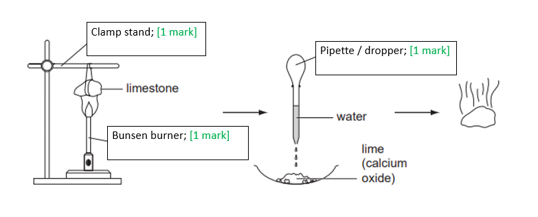

**[Total: 3 marks]**

- *These are all pieces of equipment you should be familiar with *
b) This type of reaction is:

- Exothermic / hydration; **[1 mark]**

**[Total: 1 mark]**

- *The question tells you that when cold water is added to the solid it gives off steam indicating heat energy has been released*
- *Exothermic reactions release energy *
- *You could also have said hydration as this refers to any reaction where water is added*

### Q4
a) The completed table is:

| **experiment** | **temperature / °C** | **final temperature / °C** | **difference / °C** |
|---|---|---|---|
| 1 | 24 | 27 | +3 |
| 2 | 26 | 22 | -4 |
| 3 | 21 | 11 | -10 |
| 4 | 29 | 23 | -6 |

- Initial boxes correctly completed; **[1 mark] **
- Final boxes correctly completed; **[1 mark] **
- Differences correctly completed;** [1 mark] **
- Signs correct; **[1 mark]**

**[Total: 4 marks]**

- *You have been asked for the temperature difference so make sure to include the + and - signs*
b) The correct bar chart is:

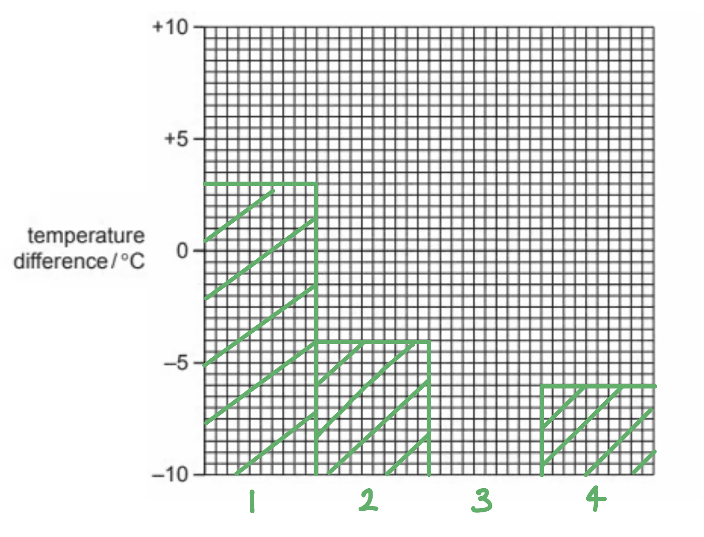

- All 4 bars correctly drawn; **[3 marks]** 
*–1 for each incorrect*
- Labelled; **[1 mark] **

**[Total: 4 marks] **

> *Make sure you label the bars on the x-axis, it is an easy step to miss*
c)

i) The solid that dissolves to give an exothermic reaction is:

- Solid **A** / Experiment 1; **[1 mark] **

ii) The reason for the choice is:

- Temperature increased / heat given out; **[1 mark] **

**[Total: 2 marks]**** **

- *Exothermic reactions are shown by an increase in temperature as they release heat to the surroundings*
- *The only experiment in which the temperature increases is experiment 1 which contains salt **A*
d) The experiment with the largest temperature change is:

- Experiment 3; **[1 mark] **

**[Total: 1 mark]**** **

- *Experiment 3 has a temperature change of -10, the question asks for the temperature change not the largest temperature increase*
e)

i) If 8 g of solid B were used in Experiment 2,

- Double the value or (–)8°C e.c.f. ; **[1 mark] **

ii) If 60 cm3 of water was used in Experiment 4.

- Half the value or (–)3°C e.c.f. **[1 mark] **

iii) The explanation is:

- More / larger volume of water; **[1 mark] **
- Twice as much for solid to dissolve in; **[1 mark] **

**[Total: 4 marks]**** **

- *If twice as much solid is used in the same volume the temperature change will also increase *
- *60 cm**3** is double the amount of water used in the experiments therefore the concentration has halved*
f) The explanation for the observations in Experiment 5 are:

Any **two** of the following:

- Acid present; **[1 mark] **
- Carbonate present; **[1 mark]**
- Carbon dioxide; **[1 mark]**

**[Total: 2 marks]**** **

- *Experiment 5 is the mixing of two solutions*
- *Two solutions that will cause fizzing are potentially an acid and a carbonate *
- *Acid + carbonate → salt + water + carbon dioxide *
- *Carbonates can be in solution e.g. sodium carbonate *
- *The reaction between an acid and a metal will also release hydrogen gas and we would see fizzing, but the metal would be a solid so this is not possible in experiment 5*

### Q5
a) The solutions were left to stand for about 30 minutes before the experiments to:

- Reach room temperature / be at the same temperature owtte;** [1 mark]**

**[Total: 1 mark]**
b) A polystyrene beaker is used instead of a glass beaker because:

- (Polystyrene is a better) insulator / to minimise heat loss; **[1 mark]**

**[Total: 1 mark]**

- *The biggest source of error in experiments monitoring temperature changes is heat loss*
- *Polystyrene cups are better insulators than glass beakers which will help to reduce the heat loss leading to more accurate results*
- *A lid is another common method of reducing heat loss*
c) The type of chemical reaction that occurs when sodium hydroxide is neutralised by hydrochloric acid is:

- Exothermic; **[1 mark]**

**[Total: 1 mark]**

- *From the graph, the temperature of the reaction mixture initially increases*
- *This shows that the reaction releases energy into its surrounding so is therefore exothermic*
d)

i) The point that appears to be inaccurate is:

- 40 cm3 volume of acid; **[1 mark]**

ii) Drawing the straight lines until they cross:

- Two straight lines, missing error point; **[1 mark]**
- Extended to intersect; **[1 mark]**

iii) The volume of hydrochloric acid that was needed to neutralise 25 cm3 of the sodium hydroxide solution is:

- 22.5 +/- 0.5 **OR **read from graph; **[1 mark]**
- cm3; **[1 mark]**

**[Total: 5 marks]**

- *The graph can be used to find the volume of hydrochloric acid needed to neutralise 25 cm**3** of the sodium hydroxide as this will occur when the temperature change reaches its maximum *
- *The 2 straight lines drawn in part (ii) will show the maximum temperature reached by extrapolation of the experimental data*
- *The volume of hydrochloric acid that this occurred at can be read from the graph:*

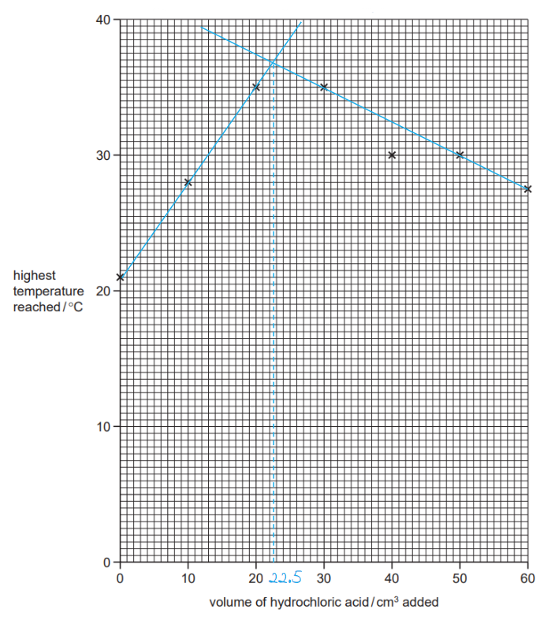

## Multiple Choice Questions (23 questions)

### Q1
**Final answer:** **The correct answer is B**

- A catalyst provides an alternative reaction pathway with a lower activation energy
- Arrow B correctly shows the minimum energy required to start the reaction
- This is shown by an arrow from **the reactants to the lower peak** when a catalyst is present

**A **is incorrect asit represents the initial energy of the reactants

**C **is incorrect as it represents the final energy of the products

**D **is incorrect** **as it represents the activation energy for the **uncatalysed** reaction (from the reactants to the higher peak).

### Q2
**Final answer:** **The correct answer is A**

There is an **increase in temperature **in **exothermic **reactions, while there is a **decrease in temperature **in **endothermic **reactions

- Work out the change in temperature for each reaction $c h a n g e i n t e m p e r a t u r e ( \Delta T ) = f i n a l t e m p e r a t u r e - i n i t i a l t e m p e r a t u r e$
- Temperature change for W $c h a n g e i n t e m p e r a t u r e ( \Delta T ) = 20 - 10 = 10^{\circ} C$
- Temperature change for X $c h a n g e i n t e m p e r a t u r e ( \Delta T ) = 25 - 23 = 2^{\circ} C$
- Temperature change for Y $c h a n g e i n t e m p e r a t u r e ( \Delta T ) = 13 - 15 = - 2^{\circ} C$
- Temperature change for Z $c h a n g e i n t e m p e r a t u r e ( \Delta T ) = 12 - 22 = - 10^{\circ} C$
- W has the **largest positive temperature increase** (**+10 °C**), so it releases the most amount of energy to the surroundings
- Therefore, **W is the most exothermic reaction**

**B** is incorrect because both W and X increase in temperature, so they are exothermic, not endothermic

**C **is incorrect because Z has a temperature decrease (−10°C), so it is endothermic

**D **is incorrect because both Y and Z decrease in temperature, so they are endothermic, not exothermic

### Q3
**Final answer:** **The correct answer is**** B**** because:**

- In **exothermic** reactions the energy of the products is less than that of the reactants as **energy** has been **lost** to the surroundings.
- On an energy level diagram this is shown by having the line representing the energy level of the products **below** that of the reactants, as is the case in the diagram.

**A**,** C** and **D** are incorrect as these options describe exothermic reactions, matching the energy level diagram in the question.

### Q4
**Final answer:** **The correct answer is**** D**** because:**

- The temperature has decreased which means that heat energy has been **taken in** from the surroundings.
- This indicates that the reaction is **endothermic**.

**A** and **B** are incorrect as heat energy is released during exothermic reactions.

**C** is incorrect as heat is absorbed during endothermic reactions.

### Q5
**Final answer:** **The correct answer is ****A**** because:**

- Activation energy is the energy hill that must be overcome for a reaction to take place
- It is the difference between the starting level (reactants) and the top of the 'hill'
- The location of the other answer options is shown below

### Q6
**Final answer:** **The correct answer is**** C**** because:**

- In **exothermic** reactions the energy level of the reactants is **higher** than the products.
- In an energy profile diagram, this is seen as a **drop** in energy from the reactants to the products.
- This occurs because some of the reactant´s enthalpy is released into the surroundings, usually in the form of heat.

**A** and** B** are incorrect as the energy level diagram represents an exothermic reaction.

**D **is incorrect as heat energy is released in exothermic processes, not absorbed.

### Q7
**Final answer:** **The correct answer is**** B**** because:**

- Each small division is 0.2 so the level reads to 0.6, making the reading 28.6

### Q8
**Final answer:** **The correct answer is**** C**** because:**

- The reaction is exothermic hence the energy change must be **negative**.
- Energy required to break bonds: 945 + (3 x 436) = 2253 kJ / mol.
- Energy released during bond formation: 6 x 390 = 2340 kJ / mol.
- *ΔH* = energy needed to break bonds - energy given out when bonds form.
- *ΔH* = 2253 -2340 = -87 kJ / mol.

**A**,** B **and **D** are incorrect as these options do not produce the correct result.

### Q9
**Final answer:** **The correct answer is**** A**** because:**

- The reaction is exothermic hence the energy change must be **negative**.
- Bonds broken:

  - One C-H bond in ethane (410 kJ / mol)
  - One Cl-Cl in chlorine (240 kJ / mol)
- Total energy required to break bonds:

  - 410 + 240 = 650 kJ / mol.
- Bonds formed:

  - One C-Cl bond in chloroethane (340 kJ / mol)
  - One H-Cl in hydrogen chloride (430 kJ / mol)
- Total energy released during bond formation:

  - 340 + 430 = 770 kJ / mol.
- *ΔH* = energy needed to break bonds - energy given out when bonds form.
- ΔH = 650 - 770 = -120 kJ / mol.

**B**,** C **and **D** are incorrect as these options do not produce the correct result.

### Q10
**Final answer:** **The correct answer is**** B**** because:**

- *ΔH* = energy needed to break bonds - energy given out when bonds form.
- Substitute the values into the equation and let *X* be the energy of the Cl─Cl bond:
- -184 = (436 + *X*) - (2 x 430) kJ / mol.
- Rearrange and solve for *X *:
- *X* = (-184) + (2 x 430) - (436) = +240 kJ / mol

**A**,** C **and **D** are incorrect as these options do not produce the correct result.

### Q11
**Final answer:** **The correct answer is**** D**** because:**

- Point 1 represents the **activation energy **which is the minimum energy that the reactant particles must have** **to be able to react.
- Point 2 represents the **overall energy change** between the reactants and the products.
- Point 3 represents the energy of the products. The energy level diagram represents an **endothermic reaction** as the products have **more energy** than the reactants.

**A**,** B** and **C **are incorrect as these options do not correctly label the diagram.

### Q12
**Final answer:** **The correct answer is**** D**** because:**

- Calculate the energy needed to break bonds:

bonds broken** = **4 x C-H and 2 x O=O

bonds broken** = **(4 x 410) + (2 x 496)

bonds broken** = **2632

- Calculate the energy given out when bonds form:

bonds formed = 2X + (4 x O-H)

bonds formed = 2X + (4 x 460)

bonds formed = 2X + 1840

- *ΔH* = energy needed to break bonds - energy given out when bonds form.

- Substitute the values into the equation and let *X* be the energy of the C＝O bond:

*ΔH* = bonds broken - bonds formed

-890 = 2632 - [2*X* + 1840]

-890 = 2632 - 2*X *- 1840

-890 = (2632 - 1840) - 2*X*

- Rearrange and solve for *X*:

2*X* = 792 + 890

2*X = *1682

*X* = +841 kJ / mol

**A**,** B** and **C** are incorrect as these options do not produce the correct result.

### Q13
**Final answer:** **The correct answer is**** B**** because:**

- Energy is **required** to break a chemical bond
- The energy is **absorbed** from the surroundings, hence it is an **endothermic** process.

**A **is incorrect as exothermic processes release energy into the surroundings.

**C **and** D **are incorrect as bond breaking requires energy as it is an endothermic process.

### Q14
**Final answer:** **The correct answer is**** A**** because:**

- In an exothermic reaction the energy transferred from the reacting chemicals heats up the surroundings and results in a rise in temperature

**B **is incorrect as the energy flow and temperature change are the wrong way around for an exothermic reaction

**C** is incorrect as the energy flow is the wrong way around for an endothermic reaction

**D** is incorrect as the temperature change is the wrong away around

### Q15
**Final answer:** **The correct answer is ****C ****because:**

- Most sports injury cold packs contain ammonium nitrate and water which react endothermically when mixed

**A** is incorrect as these are endothermic reactions and absorb energy from the injury to reduce swelling

**B** is incorrect as the reactions are not reversible so the packs can only be used once

**D** is incorrect as the temperature of the surroundings will decrease when the pack is activated

### Q16
**Final answer:** **The correct answer is ****C**** because:**

- The activation energy is the distance from the reactants, N2 + O2, to the top of the energy 'hill'
- This distance is 180 + 140  = 320 kJ
- The energy arrows point upwards so energy is increasing which corresponds to a positive sign

### Q17
**Final answer:** **The correct answer is**** C**** because:**

- The distillation of crude oil **requires energy** as the oil must first be heated up to vaporise the molecules.
- Energy is taken into the system from the surroundings so the process is **endothermic**.

**A, B** and **D** are incorrect as these processes all give out energy hence they are exothermic.

## Theory Questions (18 questions)

### Q1
During this reaction, you would observe that:

- The temperature of the solution increases
**OR**
The magnesium (ribbon) gets smaller / dissolves / disappears **[1 mark]**

**[Total: 1 mark]**

> *A common mistake for this answer is to talk about gases being released*

> *This will not gain a mark because that idea is already given in the question*

> *The hydrogen gas / squeaky pop test is not an accepted answer as this is a test, not an observation*
(i) Enthalpy change (∆*H*) is:

- The amount of thermal energy transferred during a chemical reaction; **[1 mark]**

(ii) A negative ∆*H* value means:

- That energy is released to the surroundings
**AND**
The reaction is exothermic; **[1 mark]**

**[Total: 2 marks]**

> *A negative ∆**H** means energy is leaving the system*

> * You will get the mark, if you remember that **ex**othermic = energy out (**ex**it)*
The rate of reaction increases because:

- The reaction is slow at the start because only a few particles have enough energy to overcome the activation energy barrier; **[1 mark]**
- As the reaction continues, more energy is released, helping more particles to react, so the rate increases; **[1 mark]**

**[Total: 2 marks]**

> *Think about how particle energy affects reaction rate*

> *Activation energy is like a barrier:*

- *At first, only a few particles have sufficient energy to clear this barrier and react *
- *As the reaction proceeds, the temperature increases*

  - *This means that energy is released*
- *The released energy is passed to other particles *

  - *This means that more particles have sufficient energy to react*
- *Therefore, the rate of reaction increases*
A reaction can be endothermic because:

- Breaking chemical bonds is endothermic because it requires energy; **[1 mark]**
- Forming new bonds is exothermic because it releases energy; **[1 mark]**
- Less energy is released by forming bonds than is absorbed to break them; **[1 mark]**

**[Total: 3 marks]**

> *Make sure to describe each process in terms of energy:*

- *Bond breaking = absorbing / endothermic*
- *Bond making = releasing / exothermic*

> *Then, think of the overall process as a balance:*

- *If bond making gives out **more **energy than bond breaking takes in, the result is an exothermic reaction*
- *If bond making gives out **less **energy than bond breaking takes in, the result is an endothermic reaction*

### Q2
The temperature increases because:

- The reaction is exothermic **[1 mark]**
- Thermal energy transferred to surroundings **[1 mark]**

**[Total: 2 marks]**

> *Exothermic reactions release energy to the surroundings. This causes the temperature to increase*

> *Endothermic reactions take energy in from the surroundings. This causes the temperature to decrease*
Enthalpy change, ∆*H*, is:

- The amount of thermal energy transferred during a chemical reaction; **[1 mark]**

**[Total: 1 mark]**
Activation energy is:

- The minimum energy that colliding particles must have to react; **[1 mark]**

**[Total: 1 mark]**
This temperature change occurs because:

- Bond breaking absorbs energy (endothermic) **[1 mark]**
- Bond making releases energy (exothermic) **[1 mark]**
- Overall more energy is released than absorbed **[1 mark]**

**[Total: 3 marks]**

> *Make sure to describe each process in terms of energy:*

- *Bond breaking = absorbing / endothermic*
- *Bond making = releasing / exothermic*

> *Then, think of the overall process as a balance:*

- *If bond making gives out **more **energy than bond breaking takes in, the result is an exothermic reaction*
- *If bond making gives out **less **energy than bond breaking takes in, the result is an endothermic reaction*

### Q3
a) How many more protons, electrons and neutrons are there in one atom of lanthanum than in one atom of caesium?

- Protons = 2; **[1 mark]**
- Electrons = 2; **[1 mark]**
- Neutrons = 4; **[1 mark]**

**[Total: 3 marks]**

- *Caesium / *$Cs_{55}^{133}$* has 55 protons, 55 electrons and 133 - 55 = 78 neutrons*
- *Lanthanum / *$La_{57}^{139}$* has 57 protons, 57 electrons and 139 - 57 = 82 neutrons*
- *Therefore, lanthanum has 2 more protons, 2 more electrons and 4 more neutrons*
b)

i) The completed equation for the reduction of lanthanum ions at the negative electrode (cathode) is:

- La3+ + 3e– → La;** [1 mark]**

ii) The three products formed by the electrolysis of aqueous caesium bromide are:

- Hydrogen;** [1 mark]**
- Bromine;** [1 mark]** *Bromide is not accepted*
- Caesium hydroxide;** [1 mark]**

**[Total: 4 marks] **

- *In part (i), reduction is the gain of electrons so the lanthanum ion will gain 3 electrons to form lanthanum metal*
- *In part (ii), the caesium bromide solution will contain caesium ions and bromide ions along with hydrogen ions and hydroxide ions from the water of the solution*

  - *Caesium is more reactive than hydrogen*
  
    - *This means that the caesium ion will remain in the solution and hydrogen will be discharged*
  - *The halide ion is present and will result in the discharge of the halogen*
  - *This leaves the caesium ion and hydroxide ion in solution to form the caesium hydroxide product*
c) The completed general word equation for the reactions of caesium, barium and lanthanum will be:

Metal + water → metal hydroxide + hydrogen

- Metal hydroxide;** [1 mark]** 
*Hydroxide ions is an acceptable answer *
- Hydrogen;** [1 mark]**

**[Total: 2 marks]**

- *Caesium is in group I and will behave like the other elements in the group*

  - *Metal + water → metal hydroxide + hydrogen*
- *You can then assume that the same reaction will occur for the other period 6 metals given in the overall question*
d) The bonding diagram to show the formula of the compound, the charges on the ions and gives the arrangement of the valency electrons around the negative ion is:

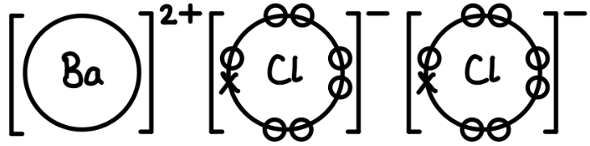

Marking point: Correct formula of 1 barium ion to two chloride ions

Marking point: Charges correct

Marking point: 8 electrons around the chloride anion

- All three marking points; **[2 marks]**
- Two marking points;** [1 mark]**

**[Total: 2 marks]**

- *Barium is a group 2 metal *

  - *This means that it will lose 2 electrons to form the 2+ ion*
- *Chlorine is a group 7 non-metal*

  - *This means that it will gain one electron to form the  1- ion*
  - *Therefore, there will be two chloride ions as each one will gain one of the two electrons from barium*
e) The lattice structure of an ionic compound, such as caesium chloride, is:

- Alternating (positive and negative) ions; **[1 mark]**
- (Regular) pattern; **[1 mark] **
*Ignore the size of the ions*

**[Total: 2 marks]**

- *Ionic compounds, such as caesium chloride / CsCl with a 1 : 1 ratio of ions, form lattices with alternating positive and negative ions*
f)

i) An example of bond forming in this reaction is:

- (The formation of the) barium-oxygen / Ba-O / ionic bond; **[1 mark] **

ii) This reaction is exothermic because:

- Bond forming releases energy / is exothermic; **[1 mark] **
- Bond breaking takes in energy / absorbs energy / is endothermic; **[1 mark]**
- More energy is released (than taken in);** [1 mark]**

**[Total: 4 marks]**** **

- *Although this question appears to be specific to the oxidation of barium, it can be correctly answered with a general statement about why a reaction is exothermic in terms of bond making and breaking*

  - *Bond forming releases energy / is exothermic*
  - *Bond breaking takes in energy / is endothermic*
  - *Since you are told that the reaction is exothermic, this means that more energy must be released than absorbed / taken in*

### Q4
a) The products and observations are:

- Forms magnesium chloride; **[1 mark] **
- Forms hydrogen; **[1 mark] **

Any **two **of the following:

- Reaction is exothermic / (reaction mixture) gets warm; **[1 mark] **
- Bubbles / effervesces / fizzes;** [1 mark] **
- Magnesium disappears (or gets smaller); **[1 mark] **

**[Total: 4 marks]**

- *Acids react with metals to form a salt and hydrogen gas*
- *You can remember this by thinking of **MASH*

  - *M**etal + **A**cid → **S**alt + **H**ydrogen*
- *As hydrochloric acid is used in the reaction, the salt produced will be a chloride salt*
- *You have been asked for **observations*

  - *So if you said hydrogen is produced as an observation you would not gain the mark*
  - *You should say bubbles / fizzing / effervesces instead *
b) To calculate the energy change:

- Energy needed to break bonds = 436 + 243 = 679; **[1 mark] **
- Energy released when bonds formed = 2 × 432 = 864; **[1 mark] **
- Energy change = 679 – 864 = – **AND **185; **[1 mark] **

**[Total: 3 marks]**

- *It can help to write the values underneath the molecules*
- *Careful: **You need to take account of the 2 H-Cl as there are 2 molecules of HCl formed*

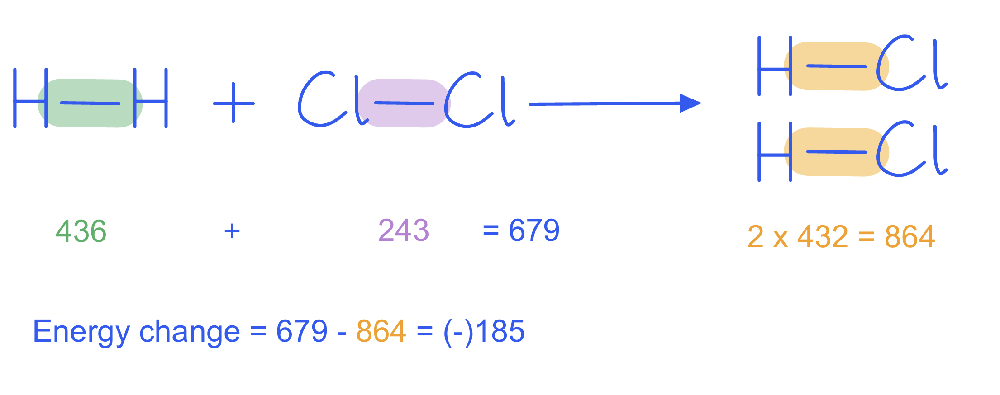

### Q5
a)

i) The ionic equation for the reaction at the negative electrode is:

Al3+ + 3e– → Al

- Al3+; **[1 mark]**
- Remainder of the ionic equation;** [1 mark]**

ii) The ionic equation for the reaction at the positive electrode is:

2O2– → O2 + 4e–  **   **
**OR **   
2O2– - 4e– → O2

- Correct products, i.e. O2 with / without e– dependent on the equation given; **[1 mark]**
- Correct balancing, i.e 4e–; **[1 mark]**

iii) The reaction is:

- Endothermic 
**AND **
Because (electrical) energy is supplied / given / taken in; **[1 mark]**

**[Total: 5 marks]**

- *The reaction at the negative electrode will involve the positive ion because opposites attract *

  - *The aluminium ion is 3+ since aluminium is in group 3*
  - *This means that it will gain 3 electrons to form aluminium*
- * At the positive electrode, the oxide ions will lose electrons to form oxygen gas, O**2** *

  - *Since there are two oxide ions with a 2- charge, there will be four electrons lost*
- *Although the terms exothermic and endothermic commonly talk about heat energy, the principle can be applied to electrical energy as well*

  - *Since electrical energy is being supplied, the reaction must be endothermic*
b)

i) The reaction in the cell is

- Exothermic 
**AND **
Because (electrical) energy is released; **[1 mark]**

ii) The mass of the magnesium electrode decreases and the mass of the copper electrode increases because:

- Magnesium forms ions (in solution) 
**OR **
Magnesium loses electrons  
**OR **
Magnesium is oxidised 
**OR **
Magnesium dissolves / goes into solution / Mg → Mg2+ + 2e–; **[1 mark]**
- Copper is deposited (on the electrode) 
**OR **
Copper ions become copper atoms 
**OR **
Copper ions gain electrons / are reduced / Cu2+ + 2e– → Cu; **[1 mark]**

iii) You could use this cell to determine whether magnesium or manganese is the more reactive metal by:

Alternative 1:

- Set up a magnesium / manganese cell; **[1 mark]**
- The negative electrode / the electrode that loses mass (is more reactive);** [1 mark]**

Alternative 2:

- Replace the magnesium with manganese in the current cell;** [1 mark]**
- If  the voltage is less (positive) then manganese is less reactive 
**OR **
If the voltage is more (positive) then manganese is more reactive; **[1 mark]**

**[Total: 5 marks] **
c) The equation for the complete combustion of propane is:

C3H8 + 5O2 → 3CO2 + 4H2O

- Correct species in the equation; **[1 mark]**
- Correct balancing; **[1 mark]**

**[Total: 2 marks]**

- *Combustion equations are quite common questions in most GCSE exams so make sure you know that:*

  - *Complete combustion forms carbon dioxide and water*
  - *Incomplete combustion forms water with either carbon monoxide or carbon*
- *This question shows the more recent style of mark scheme where one mark is for the equation and one mark is for balancing the equation*
- *Tip: **When balancing these questions, leave balancing the oxygen to last*

  - *Unbalanced starting equation C**3**H**8** + O**2** → CO**2** + H**2**O*
  - *3 carbons will make 3CO**2** and 8 hydrogens will make 4H**2**O C**3**H**8** + O**2** → 3CO**2** + 4H**2**O*
  - *This gives a total of 10 oxygen atoms on the products side, which will require 5O**2**  C**3**H**8** + 5O**2** → 3CO**2** + 4H**2**O*
d)

i) The energy for photosynthesis comes from:

- The sun / sunlight;** [1 mark]**

ii) The word equation for photosynthesis is:

- Carbon dioxide + water → glucose + oxygen;** [1 mark]**

**[Total: 2 marks]**

- *This question is a good example of the crossover between Biology and Chemistry*
- *You are expected to know the photosynthesis equation as well as the energy source for the reaction*
- *The reaction is endothermic because it takes the energy in from the Sun*

### Q6
a)

i) The reaction between the particles of flour and oxygen is very fast because:

- The flour has a large surface area; **[1 mark]**
- This leads to a high / faster collision rate 
**OR **
This leads to more / faster collisions; **[1 mark]**

ii) The word equation for this reaction is:

- Carbohydrate + oxygen → carbon dioxide + water 
**OR **
Flour + oxygen → carbon dioxide + water; **[1 mark]**

**[Total: 3 marks]**

- *As soon as a chemical is talked about in terms of powder / dust, your mind should be automatically be thinking increased surface area*
- *More recent questions would be expecting an answer talking about the increased surface area causing more frequent successful collisions or more collisions per unit time*
- *Although part (ii) is only asking for a word equation, there will be some students that don't know what the products are because they will:*

  - *Miss the information that flour is a carbohydrate*
  - *Not associate this reaction as a combustion reaction producing carbon dioxide and water*
b) Explanation of the results:

- The rate (of reaction) depends on light; **[1 mark]**
- More light gives a darker / black / silver colour 
**OR **
Less light gives a lighter / white / grey colour;** [1 mark]**
- Thick card allows less light through; **[1 mark]**

**[Total: 3 marks]**

- *This question is a combination of the theory of photochemical reactions and investigating rates of reaction, which produces a data handling question with an unfamiliar context*
- *This unfamiliar context will put several students off but all you have to do is make simple statements using the information given*

  - *"This reaction is photochemical" - you need to talk about light and the results should suggest relating light to the rate of reaction*
  - *Not covered / thin paper / thick paper giving black / grey / white results respectively - talk about them and link them with an explanation*
c)

i) An enzyme is:

- A <u>biological / protein catalyst</u>;** [1 mark]**

ii) A definition of respiration is:

- Production of energy (from food);** [1 mark]**
- By living things / cells / organisms; **[1 mark]**

iii) The reaction mixture is cooled to:

- Stop the yeast being killed 
**OR **
Stop the enzyme being denatured; **[1 mark]**

iv) The fermentation stops because:

- All of the <u>glucose</u> is used up;** [1 mark]**
- The yeast is killed / the enzyme is denatured by the <u>ethanol / alcohol</u>;** [1 mark]**

v) A technique which could be used to remove the cloudiness due to the yeast is:

- Filtration / use of a centrifuge; **[1 mark]**

vi) A technique which will separate the ethanol from the ethanol/water mixture is:

- <u>Fractional</u> distillation; **[1 mark]**

**[Total: 8 marks]**

- *This question is not truly aligned to the 2023 Chemistry specification as there are several questions that are more appropriate to Biology*
- *However, it serves to highlight the links between the Sciences*

### Q7
d) To calculate the bond enthalpy of the N-H bond:

- Energy change = sum of bonds broken - sum of bonds made; **[1 mark]**
- -789 = [(4 x N-H) + (1 x 158) + (4 x 463) + (2 x 144)] - [(1 x 945) + (8 x 463)]** **
**OR** 
4 x N-H = -789 - [(1 x 158) + (4 x 463) + (2 x 144)] + [(1 x 945) + (8 x 463)]; **[1 mark]**
- 4 x N-H = -789 - 2298 + 4649; **[1 mark]**
- N-H bond enthalpy = 1562 ÷ 4 = (+)391 (kJ / mol); **[1 mark]**

**[Total: 4 marks]**

- *This bond energy calculation is very challenging however if you set out the question step by step you can gain 3 out of 4 marks just by showing logical working*
- *Careful:** A lot of students lose the last mark in this question because they forget that there are 4 N-H bonds in hydrazine, so the final answer needs to be divided by 4 to get the individual bond enthalpy for each N-H bond *
- *Remember: **Always write out the equation - often you can gain a mark for this *
b) The dot cross diagram is:

- Correct N-H bonding electrons; **[1 mark] **
- Correct N-N bonding electrons; **[1 mark] **
- Correct lone pairs; **[1 mark] **

**[Total: 3 marks] **

- *Each nitrogen atom has five electrons in its outermost shell, therefore they require three more electrons to have a full outer shell*
- *Each hydrogen atom has one electron in its shell, therefore they require one more electron to have a full outer shell*
- *The nitrogen atoms overlap and share one electron each to create a single bond*
- *The nitrogen and hydrogen atoms overlap to share one electron each to create a single bond*
- *Finally, there will be one lone pair on each nitrogen atom*

  - *Students often miss adding in lone pairs so remember to check the whole of the molecule*
c) The completed reaction pathway diagram is:

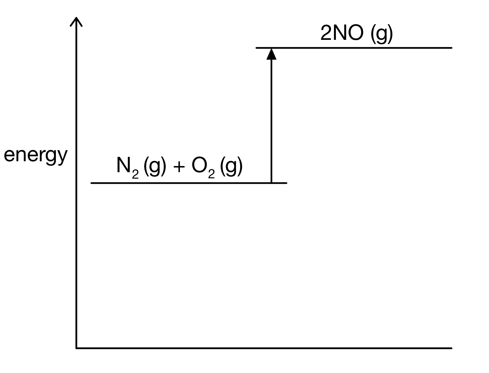

- (Horizontal) energy level line for products <u>above</u> the level of the reactants; **[1 mark]**
- N2 (g) + O2 (g) labelled on the energy level line for the reactants; **[1 mark]**
- 2NO (g) labelled on the energy level line for the products; **[1 mark] **
- Correct arrow pointing downwards from the reactants to the products; **[1 mark]**

**[Total: 4 marks]**

- *You are told in the question that a lot of energy is absorbed in this reaction*
- *You also are given the structure of nitrogen in part (a) so you can see the triple bond which would take a lot of energy to break *
- *The formation of nitrogen monoxide from nitrogen and oxygen is therefore endothermic*

  - *The product line should therefore be above the reactant line*
- *You need to give reactants and products in a balanced equation for each line *

  - *N**2** (g) + O**2** (g) → 2NO (g)*

### Q8
a)

i) An example of bond breaking in the given reaction is:

- Oxygen bond / oxygen-oxygen / O=O 
**OR **
Hydrogen bond / hydrogen-hydrogen/ H-H; **[1 mark]**

ii) An example of bond forming in the given reaction is:

- The bond between oxygen and hydrogen / oxygen-hydrogen / O-H; **[1 mark]** *Do not accept water or H-O-H*

iii) The given reaction is:

- Endothermic; **[1 mark]**

**[Total: 3 marks]**

- *The bonds within the reactants must be broken in order to have the materials to form the new water product*

  - *This is an endothermic process because energy is required to break the bonds*
- *The bonds within the water must be formed*
b)

i) **Two **reasons why hydrogen may be considered to be the ideal fuel for the future are:

- **One **from the following:

  - No pollution;** [1 mark]**
  - No CO; **[1 mark]**
  - No CO2;** [1 mark]**
  - No oxides of nitrogen;** [1 mark]**
  - Only produces steam or water; **[1 mark]**
  - No greenhouse gases; **[1 mark]**
  - No global warming; **[1 mark]**
- **One **from the following:

  - Does not use up fossil fuels;** [1 mark] **
  - Water is not a finite resource / is renewable;** [1 mark]**
  - Hydrogen is renewable / available from the electrolysis of water; **[1 mark]**

ii) A reason why hydrogen is not widely used is:

Any **one** of the following:

- Getting hydrogen from water requires / uses fossil fuels;** [1 mark] **
- Storage / transport problems;** [1 mark] **
- Limited range of vehicles available;** [1 mark] **
- As hydrogen is a gas it only produces small amount of energy per unit volume;** [1 mark] **
- Methane as a source of steam reforming is finite;** [1 mark] **
- Lack of distribution network;** [1 mark] **

**[Total: 3 marks]**

- *This is an example of an older question about the use of hydrogen as a fuel*
- *The same positives and negatives still apply to more up-to-date questions*

### Q9
a) The name of the reaction that transfers heat to the surroundings is:

- Exothermic; **[1 mark] **

**[Total: 1 mark]**** **

- *Exothermic reactions will increase the temperature of the surroundings *
b) To calculate the energy change:

- (Energy required to break bonds =) 854; **[1 mark] **
- (Energy given out when bonds form =) 1025;** [1 mark] **
- Overall energy change 854 – 1025 = –171; **[1 mark] **

**[Total: 3 marks]**

- *There are lots of different types of bonds in this calculation so it is helpful to list these underneath the reactants and products*
- *There are 6 C–H bonds and 1 C–C bond each side of the reaction, so these can be taken out of the calculation *
- *The energy change can be calculated as either*

  - *Including all the bonds: 3679 - 3850 = -171 *
  *OR** *
  *Excluding 1 x C-C bond and 6 x C-H bonds: 854 - 1025 = -171*

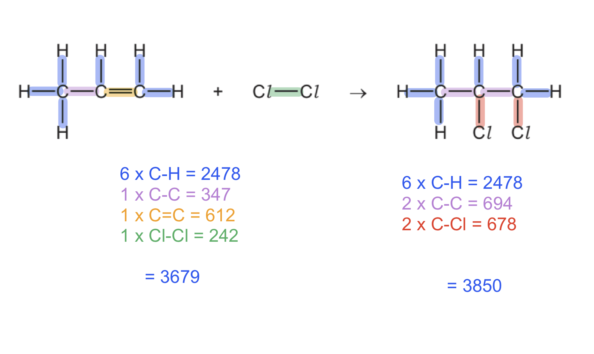
c) The energy diagram is:

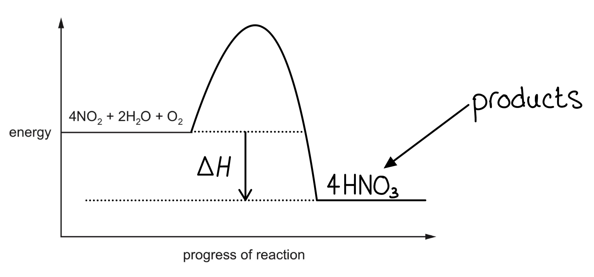

- Horizontal product energy line at lower energy level than reactant; **[1 mark] **
- Label of product; **[1 mark] **
- Correct direction of vertical arrow – arrow must start level with reactant energy and finish level with product level and one arrow head; **[1 mark] **

**[Total: 3 marks] **

- *The change in energy is negative since the products have less energy than the reactants*

  - *Therefore the product line must be lower than the reactants*
  - *You must include the products as well which can be taken from the question *
- *An exothermic reaction has a negative Δ**H** value so the vertical arrow must point downwards*

  - *This is why the arrow must only have one arrow head*
- *Careful**: you have been asked for the energy change, not the activation energy which is the minimum amount of energy required for the reaction to start*

### Q10
a)

i) Energy required to break the bonds

4 x E (C-H) = 4 x 414 = 1656

1 x E (C=C) = 1 x 614 = 614

3 x E (O=O) = 3 x 498  = 1494

- Total = 3764 (kJ / mol); **[1 mark]**

ii) Energy released when bonds are made

4 x E (C=O) = 4 x 804  = 3216

4 x E (O-H) = 4 x 463  = 1852

- Total = 5068 (kJ / mol); **[1 mark]**

iii) Energy change:

- Energy change =  3764 - 5068 = -1304 (kJ / mol); **[1 mark]**

**[Total: 3 marks] **

- *To work out the energy change you can use*
- *Energy change = sum of bonds broken - sum of bonds made*
- *You may find it easier to draw out the structures of the reactants and products so you can identify all the bonds broken and formed* 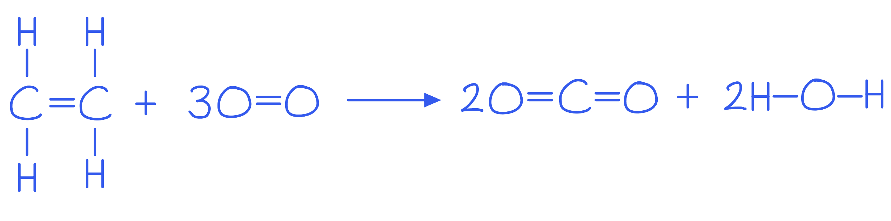
b) The completed reaction pathway diagram is:

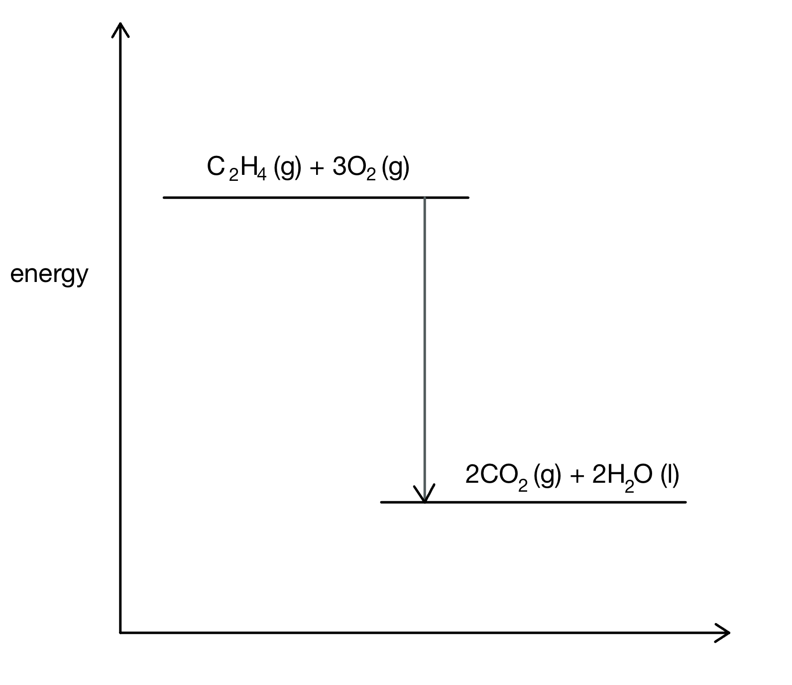

- (Horizontal) energy level line for products <u>below</u> the level of the reactants; **[1 mark]**
- 2CO2 (g) + 2H2O (l) labelled on the energy level line for the products; **[1 mark]**
- Correct arrow pointing downwards from the reactants to the products; **[1 mark]**

**[Total: 3 marks]**

- *The question tells you that the reaction is exothermic*

  - *This means that heat energy is given out *
  - *Therefore, the products should be at a lower energy level than the reactants*
- *The question also gives you the formulae and states of the reactants in the chemical equation as well as the reactants including state symbols in the energy level diagram*

  - *Therefore, you should write the products with their state symbol on the products line*
c) The conditions that would give an economically viable yield are:

- The forward reaction is exothermic so it is favoured by low temperatures; **[1 mark] **
- There are more molecules of gas on left-hand side so the forward reaction is favoured by high pressure; **[1 mark] **
- The rate is slowed by low temperature 
**AND **
So, the temperature is increased (to 300 °C); **[1 mark] **
- High pressure is unsafe / expensive / could result in polymerisation of ethene 
**AND **
So, the pressure is reduced; **[1 mark] **
- Addition of a catalyst;** [1 mark] **

**[Total: 5 marks]**

- *This question asks for the conditions to give an 'economically viable' yield which does not necessarily mean as high a yield as possible*
- *A high yield will be favoured by a low temperature and high pressure *
- *The issue with a low temperature is that the rate of reaction would be very slow, so even though there would be a high percentage yield formed it would take too long*
- *A manufacturer is trying to produce as much ethanol as possible per day*

  - *It makes no sense to try to achieve an equilibrium mixture which contains a very high proportion of ethanol if it takes several years for the reaction to reach that equilibrium*
- *The issue with high pressure is that it is expensive to maintain and also potentially unsafe*

  - *In this reaction, high pressure could also form poly(ethene) as well*
- *A catalyst will speed up the reaction in both directions*

  - *They are economic to use as they can be used again*

### Q11
a) The completed calculations are:

- Number of moles of NaNO3 used:

  - $\frac{3.40}{85}$ = 0.04 moles; **[1 mark]**
- Number of moles of O2 formed:

  - $\frac{0.04}{2}$ = 0.02 moles; **[1 mark]**
- Volume of O2 formed, in dm3:

  - 0.02 x 24 = 0.48 dm3; **[1 mark]**

**[Total: 3 marks]**

- *To calculate the number of moles of NaNO**3**, you first have to calculate the **M**r** of NaNO**3*

  - *23 + 14 + (16 x 3) = 85*
- *Using the equation moles =*$\frac{\mathrm{mass}}{M_{r}}$* , you calculate that there are 0.04 moles of NaNO**3*
- *From the overall chemical equation, there is a ratio of 2 NaNO**3** to 1 O**2*
- *Therefore, there are half the number of moles of oxygen, i.e.  *$\frac{0.04}{2}$*= 0.02 moles*
- *You then use the number of moles of oxygen to calculate the volume of oxygen, using the relationship that 1 mole of any gas occupies 24 dm**3** at room temperature and pressure*

  - *0.02 x 24 = 0.48 dm**3** *
b)

i) A base is:

- A substance that accepts a proton / H+ / hydrogen ion;** [1 mark]**

ii) The chemical equation for the reaction between magnesium and warm water is:

Mg (s) + 2H2O (l) → Mg(OH)2 (aq) + H2 (g) *   Accept 2H**2**O (g)*

- Correct formula of magnesium hydroxide product / Mg(OH)2; **[1 mark]**
- Other chemicals correct 
**AND **
Correct balancing 
**AND **
Correct state symbols;** [1 mark]**

**[Total: 3 marks]**

- *Definitions are common 1 and 2 mark questions, so it is useful to learn them*
- *Writing and balancing chemical equations is considered an expected skill *
- *Magnesium will react with water although it does usually require the reaction to be heated*

  - *It reacts in a similar way to the alkali metals sodium, lithium and potassium forming the metal hydroxide and hydrogen*
  - *Magnesium + water → magnesium hydroxide + hydrogen*
  
    - *Careful: **Magnesium is a group 2 metal which forms the 2+ ion, which means that it will require 2 hydroxide / OH**–** ions to form the magnesium hydroxide ion*
  - *Adding the chemical symbols / formulae, you get:*
  
    - *Mg + H**2**O → Mg(OH)**2** + H**2 **This equation requires balancing:*
    - *Mg + **2**H**2**O → Mg(OH)**2** + H**2**  The equation now requires the state symbols - the "warm water" in the question should suggest that state symbols are important for this answer*
    - *Mg **(s) **+ 2H**2**O **(l or g) **→ Mg(OH)**2** **(aq) **+ H**2** **(g)*
c) Experiments to show that aluminium oxide is amphoteric are:

- Add a named acid, e.g. hydrochloric acid / HCl 
**AND **
Add a named alkali, e.g. sodium hydroxide / NaOH;** [1 mark]**
- (The aluminium oxide / Al2O3) will react with / neutralise the acid and the alkali; **[1 mark]**
- (The aluminium oxide / Al2O3) will dissolve into the acid / alkali 
**OR **
(The aluminium oxide / Al2O3) will form a solution with the acid / alkali; **[1 mark]**

**[Total: 3 marks]**

- *Remember:** Amphoteric means that a chemical can behave as an acid or an alkali*
- *This means that it can react with an acid or an alkali to form a (salt) solution*

  - *Aluminium oxide + hydrochloric acid → aluminium chloride + water*
  - *Aluminium oxide + sodium hydroxide → sodium aluminate + water*
d)

i) The type of bonding in silicon(IV) oxide is:

- Covalent;** [1 mark]**

ii) **Two** physical properties of silicon(IV) oxide are:

Any **two** from the following:

- high melting / boiling point;** [1 mark]**
- poor conductor (of electricity); **[1 mark]**
- hard;** [1 mark]**
- insoluble; **[1 mark]**

**[Total: 3 marks]**

- *You are expected to know the types of bonding and physical properties for a range of chemicals, including:*

  - *Silicon(IV) oxide / silicon dioxide / silica*
  - *Diamond*
  - *Graphite and other graphite related chemicals such as graphene*
  - *Metals*
  - *Ionic salts, e.g. sodium chloride*
e)

i) Ionic bonding is:

- the (electrostatic force of) attraction; **[1 mark]**
- between <u>oppositely charged particles</u>;** [1 mark]**

ii) The formula of calcium phosphate is:

- Ca3(PO4)2; **[1 mark]**

**[Total: 3 marks]**

- *The definition of ionic bonding is:*

  - *The electrostatic force of attraction between oppositely charged particles*
  - *Careful: **Although we talk about ionic bonding, you should be aware that it actually a **force of attraction** between oppositely charged particles unlike covalent bonding*
- *Calcium is a 2+ ion while the phosphate ion is a 3– ion*

  - *They both have the number 6 as a common multiple*
  - *This means that you would require 3 calcium ions and 2 phosphate ions, which gives the chemical formula Ca**3**(PO**4**)**2** *
  - *You can also use the charges of the ions to determine the chemical formula, e.g.:*

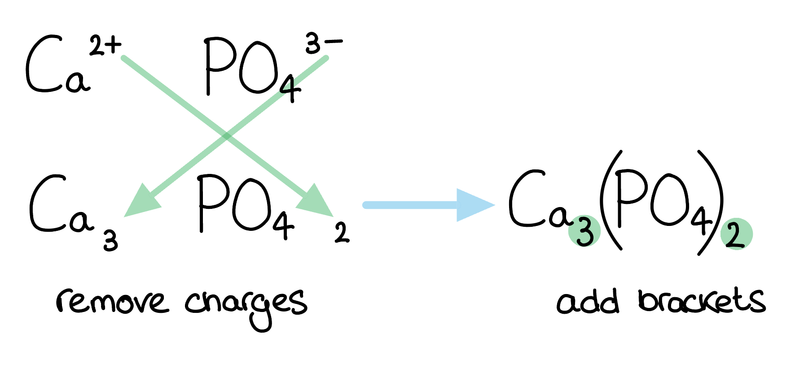
f)

i) The completed energy level diagram is:

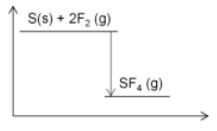

- (Horizontal) energy level line for products <u>below</u> the level of the reactants; **[1 mark]**
- SF4 (g) labelled on the energy level line for the products; **[1 mark]**
- Correct arrow pointing downwards from the reactants to the products; **[1 mark]**

ii) The bond energy of one S-F bond is:

- Bond energy of 2F2 = 2 x 160 = 320 (kJ / mol); **[1 mark]**
- Bond energy of all bonds in SF4 = 780 + 320 = 1100 (kJ / mol); **[1 mark]**
- Bond energy of one bond in SF4 = $\frac{1100}{4}$ = 275; (kJ / mol); **[1 mark]**

**[Total: 6 marks]**

- *The question tells you that the reaction is exothermic*

  - *This means that heat energy is given out *
  - *Therefore, the products should be at a lower energy level than the reactants*
- *The question also gives you the formulae and states of the reactants in the chemical equation as well as the reactants including state symbols in the energy level diagram*

  - *Therefore, you should write the products with its state symbol on the products line*
- *The energy change that you are being asked to draw is from the reactants to the products*

  - *Many incorrect answers will include an activation energy "hump" going up from the reactants, reaching a peak and then dropping to the products - this is **not** what the question asks for *
- *The calculation is a little more complex than usual as the sulfur reactant does not have a bond energy associated with it because it is elemental with no bonds *

  - *You can work out the total bond energy for the 2 fluorine molecules*
  - *You then add this to the overall energy given out to calculate the total energy of the reactants*
  - *This is the value for all 4 S-F bonds, which means that you have to divide that answer by 4 to get the individual bond energy for an S-F bond*
g)

i) Chlorine is added to water to:

- Kill bacteria / microbes; **[1 mark]**

ii) The compound of chlorine used to test for the presence of water is:

- Name of compound = cobalt chloride / cobalt(II) chloride;** [1 mark]**
- Colour change from <u>blue</u>; **[1 mark]**
- To <u>pink</u>; **[1 mark]**

**[Total: 4 marks]**** **

- *The test for water is the addition of cobalt(II) chloride which changes from blue to pink*

  - *This is sometimes done by soaking cobalt chloride solution on to filter paper, which is then dried to remove the water*
h) Argon is unreactive because:

- It has a complete / full outer shell 
**OR **
It has 8 electrons in its outer shell;** [1 mark]**

**[Total: 1 mark]**

### Q12
a) An exothermic reaction:

- Gives out heat / reaction mixture gets warmer; **[1 mark]**

**[Total: 1 mark]**

- *Remember:** In an **EX**othermic reaction, heat **EX**its the reaction mixture so is released into the surroundings causing them to get warmer*
b) Two conditions needed for iron to rust are:

- Water; **[1 mark]**
- Oxygen / air; **[1 mark]**

**[Total: 2 marks]**

- *Sometimes this question is only worth one mark so you must state both conditions *

### Q13
a) An exothermic reaction is:

- (Reaction) gives out heat / reaction mixture gets warmer; **[1 mark] **

**[Total: 1 mark] **

- *Exothermic reactions will increase the temperature of the surroundings *
b) The completed diagram is:

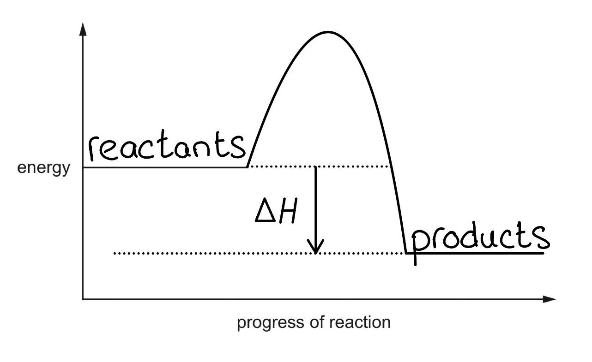

- Right hand energy level lower than left hand side energy level; **[1 mark]**
- Reactants and product positions identified;** [1 mark]**
- Energy change shown as approximately vertical line indicating gap between reactants and products with arrow head pointing from reactant to products. Arrow needs to be labelled; **[1 mark] **

**[Total: 3 marks]**** **

- *The change in energy is negative since the products have less energy than the reactants*

  - *Therefore the product line must be lower than the reactants*
  - *Don't forget to label the reactants and products*
  - *If you are given the balanced equation, you should include the correct reactants and products*
- *An exothermic reaction has a negative Δ**H** value so the vertical arrow must point downwards*

  - *This is why the arrow must only have one arrow head*
- *Careful**: You have been asked for the energy change, not the activation energy which is the minimum amount of energy required for the reaction to start*

### Q14
a) The completed equation is:

**Br****2** + H2S →  **2**HBr  +  S

- Br2 on the left hand side; **[1 mark]**
- 2HBr on the right hand side; **[1 mark] **

**[Total: 2 marks] **

- *To complete the equation:*
- *You know that bromine is a reactant which has the formula Br**2** (halogens are diatomic molecules)  *

  - *Br**2** + H**2**S →  ......HBr  +  S*
- *Finally there are now two atoms of bromine and hydrogen on the left hand side and only one of each on the right hand side, therefore you now need 2HBr*

  - *Br**2** + H**2**S → ** 2**HBr  +  S*
b) The reaction is exothermic because:

- The energy of the reactants is more than the energy of the products 
**OR** 
Energy of the products is less than the energy of the reactants 
**OR** 
The reactants lose energy when they form products; **[1 mark] **

**[Total: 1 mark] **

- *If more energy is released than is absorbed, then the reaction is exothermic*
- *Therefore the products will have less energy than the reactants*

### Q15
a) For an equilibrium reaction, the term equilibrium means that:

- The rate of the forwards reaction equals the rate of the backwards reaction; **[1 mark]**
- The concentrations of all the chemicals remain constant 
**OR **
The macroscopic properties remain constant; **[1 mark]** 
*The concentrations of the chemicals are equal is not accepted*

**[Total: 2 marks]**

- *The definition of an equilibrium is a relatively common question, so you need to know this and add it to your list of definitions to learn*
- *The main mistake for this question is saying that the rates and concentrations are equal*

  - *The rates of the forwards and backwards reactions are equal at equilibrium*
  - *The concentrations are **not **necessarily equal but they are constant *
b) The reverse reaction is:

- Endothermic 
**AND **
This is the direction that is favoured by high temperatures **OR **high temperature favours the endothermic reaction / direction; **[1 mark]**

**[Total: 1 mark]**

- *Careful: **This question asks about the **reverse **reaction*
- *Increasing the temperature favours the endothermic reaction*
- *In this question, increasing the temperature produces a darker brown colour*

  - *This suggests that reaction is going backwards, i.e. making more reactant*
  - *Therefore, the backwards reaction is endothermic*
c)

i) Decreasing the pressure will:

- Move / shift the equilibrium to the left-hand side / reactants  
**AND **
There are more moles / is a bigger volume on the left-hand side; **[1 mark]**

ii) Possible observations with decreasing pressure:

Any **one** of the following:

- Less (yellow) solid; **[1 mark]**
- More (dark brown) liquid; **[1 mark]**
- (Pale) green gas visible; **[1 mark]**
- Reaction mixture turns darker brown; **[1 mark]**
- Smell of chlorine; **[1 mark]**

**[Total: 2 marks]**

- *Le Chatelier’s principle suggests that increasing / high pressure favours the side with the fewest moles while decreasing / low pressure favours the side with the most moles*
- *There are 2 moles of reactant and one mole of product*

  - *Therefore, a decrease in pressure favours the reactants side *
- *The reactants are iodine chloride which is a dark brown liquid and chlorine which is a pale green gas*
- *The product is iodine trichloride which is a bright yellow solid*

  - *Since decreasing the pressure shifts the equilibrium to the left / reactants, you will see the associated observations as listed in the answer*
d) The overall energy change is:

- Bonds broken: 
151 + 242 = 393 (kJ / mol); **[1 mark]**
- Bonds formed: 
2 x 208 = –416 (kJ / mol); **[1 mark]** 
*Answer for bonds formed must be negative*
- Overall energy change: 393 - 416 = –23 (kJ / mol); **[1 mark]** 
*Answer must be negative*

**[Total: 3 marks]**

- *Remember: **Overall energy change = energy in - energy out*
- *Careful: **The equation uses the value for energy out without the sign*
e) The labelled energy level diagram for the reaction between iodine and chlorine is:

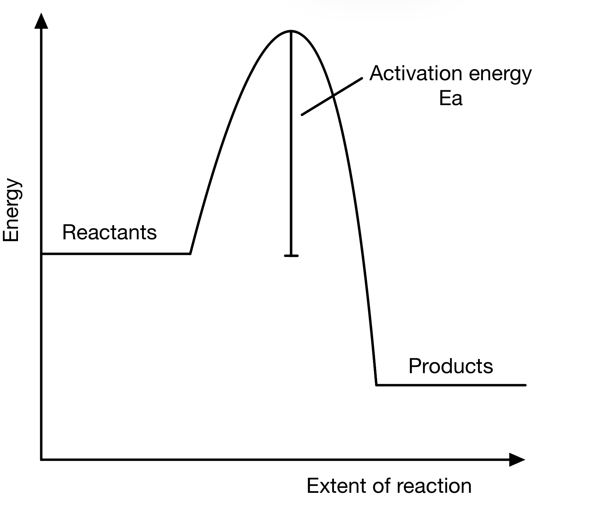

Any **two **of the following:

- <u>Exothermic</u> energy level diagram; **[1 mark]**
- Activation energy shown; **[1 mark]**
- Reactants and products labelled 
**AND **
Axes labelled; **[1 mark] **
*Allow error carried forward from part (d) if the reaction is identified as endothermic*

**[Total: 2 marks]**

- *Careful: **The most common error on energy level diagrams is to jumble the activation energy and energy change *

### Q16
a) The balanced equation is:

**2**Na2S2O3 + I2 → Na2S4O6 + **2**NaI

- 2Na2S2O3; **[1 mark] **
- 2NaI;** [1 mark] **

**[Total: 2 marks]**** **

- *These compounds may seem unfamiliar, though the process of balancing an equation is the same*
- *There are two atoms of iodine on the left hand side and only one on the right so a 2 must be placed in front of NaI*

  - *Na**2**S**2**O**3 **+ I**2** →Na**2**S**4**O**6** + **2**NaI*
- *There are now four sodium atoms on the right hand side and only two on the left so a 2 must be placed in front of Na**2**S**2**O**3*

  - *2**Na**2**S**2**O**3 **+ I**2** →Na**2**S**4**O**6** + 2NaI*
b) This diagram shows the reaction is exothermic because:

- The energy of the reactants is more than the energy of the products 
**OR** 
The energy of the products is less than the energy of the reactants 
**OR** 
The reactants lose energy when they form products; **[1 mark] **

**[Total: 1 mark]**** **

- *If more energy is released than is absorbed, then the reaction is exothermic*
- *Therefore the products will have less energy than the reactants*
c) The term describes a reaction which gives out heat is:

- Exothermic;** [1 mark] **

**[Total: 1 mark]**** **

- *Exothermic reactions will increase the temperature of the surroundings*

### Q17
a)

i) A substitution reaction is a reaction where:

- Hydrogen (atoms) are replaced by (atoms) of a different element e.g. chlorine; **[1 mark]** 
*Do not accept the word substitute in answers*

ii) Photochemical reactions differ from other reactions because:

- They require light; **[1 mark]**

**[Total: 2 marks]**

- *The definition of a  substitution reaction is not a common exam question but like all definitions it is worth knowing because it can help you score easy marks*
- *Questions about photochemical reactions are more common *

  - *You can use the language of the word to help you answer as the prefix "photo" relates to light in greek *
b) The difference between an exothermic reaction and an endothermic reaction is:

- Exothermic reactions give out / release (heat) energy; **[1 mark]**
- Endothermic reactions take in / absorb (heat) energy; **[1 mark]**

**[Total: 2 marks]**** **

- *The wording of this question makes it appear harder than it is*
- *You are actually being asked what exothermic and endothermic mean*
c) To show that the reaction is exothermic:

- Bonds broken: 4 x C-H = 4 x 412 = 1648 kJ / mol 
**AND **
1 x Cl-Cl = 242 kJ / mol 
**AND **Total energy = 1648 + 242 = <u>1890</u> kJ / mol; **[1 mark]**
- Bonds formed: 3 x C-H = 3 x 412 = 1236kJ / mol 
**AND **
1 x C-Cl = 338 kJ / mol 
**AND** 
1 x H-Cl = 431 
**AND **
Total energy = 1236 + 338 + 431 = <u>2005</u> kJ / mol; **[1 mark]**
- Energy change = 1890 - 2005 = <u>–115</u> kJ / mol; **[1 mark]**
- The negative sign shows that the reaction is exothermic; **[1 mark]**

**[Total: 4 marks]**

- *This question is a straightforward application of the energy change = energy in - energy out equation*

  - *This can also be shown as energy change = bonds broken - bonds formed*
- *The little twist of this question is that you are told that the reaction is exothermic and have to prove this is the case*

  - *This means that you should be getting a negative value for your final answer*
  - *The final mark for saying about the negative value showing that the reaction is exothermic is missed by many students, presumably because they assume it is known / obvious*
- *Careful: **Make sure that you include all of the bonds in your calculation*

  - *If it helps, you can tick them off as you add them up*

### Q18
a)

i) A photochemical reaction is:

- A reaction whose rate is influenced by light 
**OR **
A reaction that occurs in presence of light; **[1 mark]**

ii) The structural formula of the other isomer is:

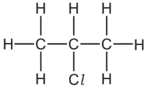

- ; **[1 mark]**

iii) These two different compounds are isomers because:

- They have the same molecular formula;** [1 mark]**
- (But,) a different structural formula / structure;** [1 mark]**

**[Total: 4 marks]**

- *The prefix "photo" in the word photochemical derives from the Greek for light*

  - *Therefore, a photochemical reaction is one that is influenced by light / requires light*
- *Using the structural formula given, the chlorine atom appears to be on carbon 3 (counting from left to right)*

  - *If the chlorine was on carbon 1, then you would have the reflection of the structural formula given*
  - *Therefore, the only place that the chlorine atom can go to produce a different chemical is carbon 2 / the middle carbon*
- *Both chemicals have the same molecular formula because they contain the same atoms in the same ratios*

  - *3 carbons, 7 hydrogens and 1 chlorine giving a molecular formula of C**3**H**7**Cl*
  - *The position of the chlorine atom on different carbon atoms means that the compounds are isomers as they have a different structural formula*
  - *The structure given in the question has the structural formula CH**3**CH**2**CH**2**Cl*
  - *The structure in the answer for part (ii) has the structural formula CH**3**CHClCH**3*
  - *At A-level, these are called position isomers *
b) To determine if the reaction is exothermic or endothermic:

- Bonds broken: (8 x C-H) + (2 x C-C) + (Cl-Cl) = (8 x 412) + (2 x 348) + 242 = 4234 (kJ / mol); **[1 mark]**
- Bonds formed: (7 x C-H) + (2 x C-C) + (C-Cl) + (H-Cl) = (7 x 412) + (2 x 348) + 338 + 431 = 4349 (kJ / mol); **[1 mark]**
- 4234 - 4349 = -115 (kJ / mol) 
**AND **
The reaction is exothermic; **[1 mark]**

**[Total: 3 marks]**

- *Remember: **The overall energy / enthalpy change for the reaction is based on the calculation of energy in - energy out*

  - *This can sometimes be shown as bonds broken - bonds formed*
- *Careful: **The most common mistake in this type of calculation is to miss one of the bonds so it is worth ticking the bonds off on the equation to ensure you don't miss any*
- *When these questions are for 3 marks, you will find:*

  - *1 mark for the bonds broken / energy in*
  - *1 mark for the bonds formed / energy out*
  - *1 mark for the final answer and conclusion of exothermic or endothermic*
  - *Remember: **Exothermic reactions will have a negative value and endothermic reactions will have a positive value*
c)

i) The equation for the hydrolysis of chloropropane to propanol, CH3CH2CH2OH, by sodium hydroxide is:

CH3CH2CH2Cl + NaOH → CH3CH2CH2OH + NaCl

- Correct identification of NaCl as product; **[1 mark]**
- Remainder of chemical equation correct; **[1 mark]**

ii) The name and structural formula of this hydrocarbon are:

- Name: Propene; **[1 mark]**
- Structural formula: CH2=CHCH3 **OR** CH3CH=CH2; **[1 mark]**

iii) The name of the acid formed when propanol is oxidised by acidified potassium manganate(VII) is:

- Propanoic acid; **[1 mark]**

**[Total: 5 marks]**

- *The question for part (i) gives you most of the information that you require to write the chemical equation*

  - *"chloropropane **(reactant)** to propanol, CH**3**CH**2**CH**2**OH **(product)**, by sodium hydroxide **(reactant)**"*
  - *Chloropropane + sodium hydroxide → propanol + ?*
  - *CH**3**CH**2**CH**2**Cl + NaOH → CH**3**CH**2**CH**2**OH + ?*
  - *By looking at the atoms on either side, you should be able to see that Na and Cl have not been used*
  - *This would make common salt*
  - *CH**3**CH**2**CH**2**Cl + NaOH → CH**3**CH**2**CH**2**OH + NaCl*
- *In part (ii) you are told that propanol is dehydrated / loses a water molecule*

  - *Propanol: CH**3**CH**2**CH**2**OH *
  - *Water: H**2**O or H-OH*
  - *Careful: **Do not remove the H and OH from the same carbon of propanol, they are removed from neighbouring carbons*
  - *Incomplete product: CH**3**CHCH**2** *
  - *The bonding is then adjusted to make the molecule complete with all hydrogens having one bond and all carbons having 4 bonds*
  - *Complete product: CH**3**-CH=CH**2** *
- *In part (iii), you are told that propanol is being oxidised to form a carboxylic acid*

  - *This means that the acid must be propane-based, just like propanol*
  - *Therefore, the carboxylic acid is propanoic acid*
d) CH3CH2CH2OH + HCOOH → HCOOCH2CH2CH3 + H2O

i) The *M*r of methanoic acid is:

- H + C + O + O + H = 1 + 12 + 16 + 16 + 1 = <u>46</u>; **[1 mark]**

ii) The *M*r of propanol is

- C + (3 x H) + C + (2 x H) + C + (2 x H) + O + H = 12 + 3 + 12 + 2 + 12 + 2 + 16 + 1 = <u>60</u>; **[1 mark]**

iii) To determine the limiting reagent:

- Moles of propanol = $=\frac{6.0}{60}=$0.1; **[1 mark]**
- Moles of methanoic acid $=\frac{4.0}{46}=$0.087 
**AND **
The limiting reagent is methanoic acid; **[1 mark]**

iv) The maximum yield in grams of propyl methanoate is:

- 88 x 0.087 = <u>7.65</u> (g); **[1 mark]** 
*Allow error carried forward from part (iii) using the lowest number of moles, i.e. 88 x lowest number of moles*

**[Total: 5 marks]**

- *To calculate the **M**r** of a chemical, add up all of the atomic masses for **ALL** of the atoms in the chemical*

  - *Careful: **Make sure that you don't miss any atoms as this will lead to an incorrect answer*
- *Remember: **In this reaction, the limiting reagent is the reactant with the fewest number of moles involved in the reaction as the reactants react in a 1:1 ratio*

  - *For this question, you calculate the number of moles using the equation moles = *$\frac{\mathrm{mass}}{M_{r}}$
- *The limiting reagent will determine the maximum amount of a product that can be formed*

  - *This is because once the limiting reagent is used up, you cannot form any more product*
- *The **M**r** of propyl methanoate, HCOOCH**2**CH**2**CH**3**, is 88 g / mol*

  - *The chemical equation shows that there is a 1 : 1 ratio between the either reactant and the propyl methanoate product*
  - *Therefore, the maximum yield will be the **M**r** of propyl methanoate multiplied by the number of moles of limiting reagent, e.g. 88 x 0.087 = 7.65 g*
