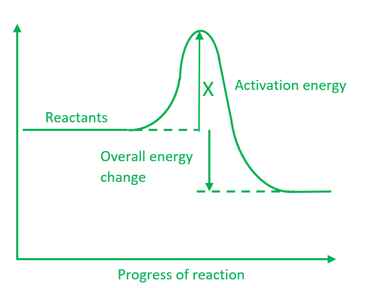

# Mark Schemes — Exothermic & Endothermic Reactions
**5. Chemical Energetics** · Cambridge (CIE) IGCSE chemistry (0620 & 0971)

## Multiple Choice Questions (23 questions)

### Q1
**Final answer:** **The correct answer is B**

- A catalyst provides an alternative reaction pathway with a lower activation energy
- Arrow B correctly shows the minimum energy required to start the reaction
- This is shown by an arrow from **the reactants to the lower peak** when a catalyst is present

**A **is incorrect asit represents the initial energy of the reactants

**C **is incorrect as it represents the final energy of the products

**D **is incorrect** **as it represents the activation energy for the **uncatalysed** reaction (from the reactants to the higher peak).

### Q2
**Final answer:** **The correct answer is A**

There is an **increase in temperature **in **exothermic **reactions, while there is a **decrease in temperature **in **endothermic **reactions

- Work out the change in temperature for each reaction `c h a n g e space i n space t e m p e r a t u r e space open parentheses increment T close parentheses space equals space f i n a l space t e m p e r a t u r e space minus space i n i t i a l space t e m p e r a t u r e`
- Temperature change for W `c h a n g e space i n space t e m p e r a t u r e space open parentheses increment T close parentheses space equals 20 space minus space 10 space equals space 10 space degree C`
- Temperature change for X `c h a n g e space i n space t e m p e r a t u r e space open parentheses increment T close parentheses space equals 25 space minus space 23 space equals space 2 space degree C`
- Temperature change for Y `c h a n g e space i n space t e m p e r a t u r e space open parentheses increment T close parentheses space equals 13 space minus space 15 space equals space minus 2 space degree C`
- Temperature change for Z `c h a n g e space i n space t e m p e r a t u r e space open parentheses increment T close parentheses space equals 12 space minus 22 space equals space minus 10 space degree C`
- W has the **largest positive temperature increase** (**+10 °C**), so it releases the most amount of energy to the surroundings
- Therefore, **W is the most exothermic reaction**

**B** is incorrect because both W and X increase in temperature, so they are exothermic, not endothermic

**C **is incorrect because Z has a temperature decrease (−10°C), so it is endothermic

**D **is incorrect because both Y and Z decrease in temperature, so they are endothermic, not exothermic

### Q3
**Final answer:** **The correct answer is**** B**** because:**

- In **exothermic** reactions the energy of the products is less than that of the reactants as **energy** has been **lost** to the surroundings.
- On an energy level diagram this is shown by having the line representing the energy level of the products **below** that of the reactants, as is the case in the diagram.

**A**,** C** and **D** are incorrect as these options describe exothermic reactions, matching the energy level diagram in the question.

### Q4
**Final answer:** **The correct answer is**** D**** because:**

- The temperature has decreased which means that heat energy has been **taken in** from the surroundings.
- This indicates that the reaction is **endothermic**.

**A** and **B** are incorrect as heat energy is released during exothermic reactions.

**C** is incorrect as heat is absorbed during endothermic reactions.

### Q5
**Final answer:** **The correct answer is ****A**** because:**

- Activation energy is the energy hill that must be overcome for a reaction to take place
- It is the difference between the starting level (reactants) and the top of the 'hill'
- The location of the other answer options is shown below

### Q6
**Final answer:** **The correct answer is**** C**** because:**

- In **exothermic** reactions the energy level of the reactants is **higher** than the products.
- In an energy profile diagram, this is seen as a **drop** in energy from the reactants to the products.
- This occurs because some of the reactant´s enthalpy is released into the surroundings, usually in the form of heat.

**A** and** B** are incorrect as the energy level diagram represents an exothermic reaction.

**D **is incorrect as heat energy is released in exothermic processes, not absorbed.

### Q7
**Final answer:** **The correct answer is**** B**** because:**

- Each small division is 0.2 so the level reads to 0.6, making the reading 28.6

### Q8
**Final answer:** **The correct answer is**** C**** because:**

- The reaction is exothermic hence the energy change must be **negative**.
- Energy required to break bonds: 945 + (3 x 436) = 2253 kJ / mol.
- Energy released during bond formation: 6 x 390 = 2340 kJ / mol.
- *ΔH* = energy needed to break bonds - energy given out when bonds form.
- *ΔH* = 2253 -2340 = -87 kJ / mol.

**A**,** B **and **D** are incorrect as these options do not produce the correct result.

### Q9
**Final answer:** **The correct answer is**** A**** because:**

- The reaction is exothermic hence the energy change must be **negative**.
- Bonds broken:

  - One C-H bond in ethane (410 kJ / mol)
  - One Cl-Cl in chlorine (240 kJ / mol)
- Total energy required to break bonds:

  - 410 + 240 = 650 kJ / mol.
- Bonds formed:

  - One C-Cl bond in chloroethane (340 kJ / mol)
  - One H-Cl in hydrogen chloride (430 kJ / mol)
- Total energy released during bond formation:

  - 340 + 430 = 770 kJ / mol.
- *ΔH* = energy needed to break bonds - energy given out when bonds form.
- ΔH = 650 - 770 = -120 kJ / mol.

**B**,** C **and **D** are incorrect as these options do not produce the correct result.

### Q10
**Final answer:** **The correct answer is**** B**** because:**

- *ΔH* = energy needed to break bonds - energy given out when bonds form.
- Substitute the values into the equation and let *X* be the energy of the Cl─Cl bond:
- -184 = (436 + *X*) - (2 x 430) kJ / mol.
- Rearrange and solve for *X *:
- *X* = (-184) + (2 x 430) - (436) = +240 kJ / mol

**A**,** C **and **D** are incorrect as these options do not produce the correct result.

### Q11
**Final answer:** **The correct answer is**** D**** because:**

- Point 1 represents the **activation energy **which is the minimum energy that the reactant particles must have** **to be able to react.
- Point 2 represents the **overall energy change** between the reactants and the products.
- Point 3 represents the energy of the products. The energy level diagram represents an **endothermic reaction** as the products have **more energy** than the reactants.

**A**,** B** and **C **are incorrect as these options do not correctly label the diagram.

### Q12
**Final answer:** **The correct answer is**** D**** because:**

- Calculate the energy needed to break bonds:

bonds broken** = **4 x C-H and 2 x O=O

bonds broken** = **(4 x 410) + (2 x 496)

bonds broken** = **2632

- Calculate the energy given out when bonds form:

bonds formed = 2X + (4 x O-H)

bonds formed = 2X + (4 x 460)

bonds formed = 2X + 1840

- *ΔH* = energy needed to break bonds - energy given out when bonds form.

- Substitute the values into the equation and let *X* be the energy of the C＝O bond:

*ΔH* = bonds broken - bonds formed

-890 = 2632 - [2*X* + 1840]

-890 = 2632 - 2*X *- 1840

-890 = (2632 - 1840) - 2*X*

- Rearrange and solve for *X*:

2*X* = 792 + 890

2*X = *1682

*X* = +841 kJ / mol

**A**,** B** and **C** are incorrect as these options do not produce the correct result.

### Q13
**Final answer:** **The correct answer is**** B**** because:**

- Energy is **required** to break a chemical bond
- The energy is **absorbed** from the surroundings, hence it is an **endothermic** process.

**A **is incorrect as exothermic processes release energy into the surroundings.

**C **and** D **are incorrect as bond breaking requires energy as it is an endothermic process.

### Q14
**Final answer:** **The correct answer is**** A**** because:**

- In an exothermic reaction the energy transferred from the reacting chemicals heats up the surroundings and results in a rise in temperature

**B **is incorrect as the energy flow and temperature change are the wrong way around for an exothermic reaction

**C** is incorrect as the energy flow is the wrong way around for an endothermic reaction

**D** is incorrect as the temperature change is the wrong away around

### Q15
**Final answer:** **The correct answer is ****C ****because:**

- Most sports injury cold packs contain ammonium nitrate and water which react endothermically when mixed

**A** is incorrect as these are endothermic reactions and absorb energy from the injury to reduce swelling

**B** is incorrect as the reactions are not reversible so the packs can only be used once

**D** is incorrect as the temperature of the surroundings will decrease when the pack is activated

### Q16
**Final answer:** **The correct answer is ****C**** because:**

- The activation energy is the distance from the reactants, N2 + O2, to the top of the energy 'hill'
- This distance is 180 + 140  = 320 kJ
- The energy arrows point upwards so energy is increasing which corresponds to a positive sign

### Q17
**Final answer:** **The correct answer is**** C**** because:**

- The distillation of crude oil **requires energy** as the oil must first be heated up to vaporise the molecules.
- Energy is taken into the system from the surroundings so the process is **endothermic**.

**A, B** and **D** are incorrect as these processes all give out energy hence they are exothermic.
