# Exam Questions — Exothermic & Endothermic Reactions
**5. Chemical Energetics** · Cambridge (CIE) IGCSE chemistry (0620 & 0971)
> Source: [https://www.savemyexams.com/igcse/chemistry/cie/23/topic-questions/](https://www.savemyexams.com/igcse/chemistry/cie/23/topic-questions/) · 40 questions across 3 sets

## Alternative To Practical Questions (5 questions)

### Q1 — medium — 18 marks

**Q1** [2 marks]

A student investigated the reaction of aqueous sodium hydroxide with two different acids, acid **C** and acid **D**. Two experiments were carried out.

*Experiment 1*

By using a measuring cylinder, 20 cm3 of aqueous sodium hydroxide was poured into a conical flask and the initial temperature of the solution was measured.

A burette was filled with acid **C** up to the 0.0 cm3 mark.

5 cm3 of acid **C** was added to the sodium hydroxide in the flask. The temperature of the mixture was measured.

Further 5 cm3 portions of acid **C** were added to the mixture in the flask, stirring with the thermometer until a total volume of 30 cm3 of acid **C** had been added. The temperatures after each 5 cm3 portion had been added were measured.

Use the thermometer diagrams to record the temperatures in the table of results.

**Table of results**

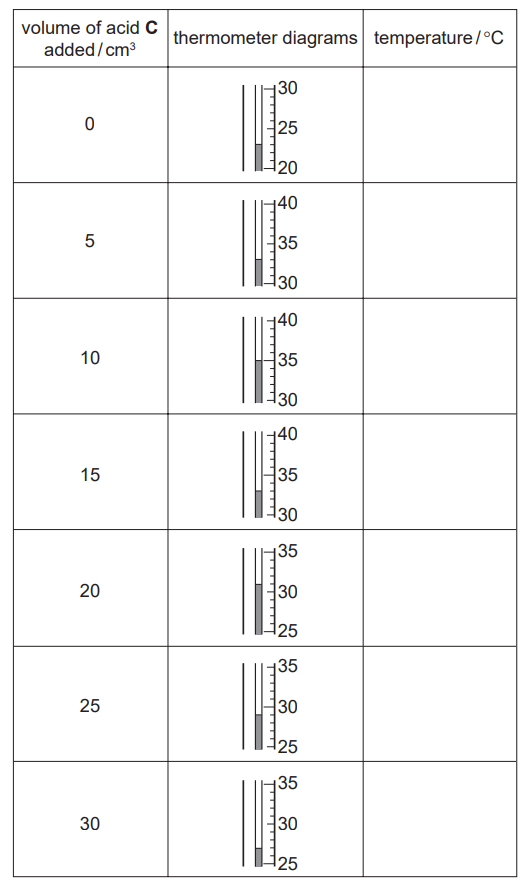

*Source: 2010 61 Q4*

**Q1** [2 marks]

**Extract:**

A student investigated the reaction of aqueous sodium hydroxide with two different acids, acid C and acid D. Two experiments were carried out. Experiment 1: By using a measuring cylinder, 20 cm^3 of aqueous sodium hydroxide was poured into a conical flask and the initial temperature of the solution was measured. A burette was filled with acid C up to the 0.0 cm^3 mark. 5 cm^3 of acid C was added to the sodium hydroxide in the flask. The temperature of the mixture was measured. Further 5 cm^3 portions of acid C were added to the mixture in the flask, stirring with the thermometer until a total volume of 30 cm^3 of acid C had been added. The temperatures after each 5 cm^3 portion had been added were measured.

*Experiment 2 *The burette was emptied and rinsed with water. Experiment 1 was repeated using acid **D**.

Use the thermometer diagrams to record the temperatures in the table of results.

**Table of results**

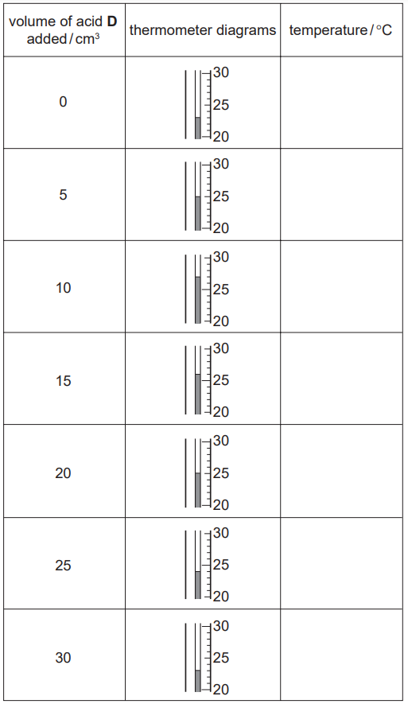

*Source: 2010 61 Q4*

**Q1** [6 marks]

**Extract:**

A student investigated the reaction of aqueous sodium hydroxide with two different acids, acid C and acid D. Two experiments were carried out.

Experiment 1: By using a measuring cylinder, 20 cm^3 of aqueous sodium hydroxide was poured into a conical flask and the initial temperature of the solution was measured. A burette was filled with acid C up to the 0.0 cm^3 mark. 5 cm^3 of acid C was added to the sodium hydroxide in the flask. The temperature of the mixture was measured. Further 5 cm^3 portions of acid C were added to the mixture in the flask, stirring with the thermometer until a total volume of 30 cm^3 of acid C had been added. The temperatures after each 5 cm^3 portion had been added were measured.

Experiment 2: The burette was emptied and rinsed with water. Experiment 1 was repeated using acid D. Temperatures were recorded in the table of results.

Plot the results for Experiments 1 and 2 on the grid and draw two smooth line graphs. Clearly label your graphs.

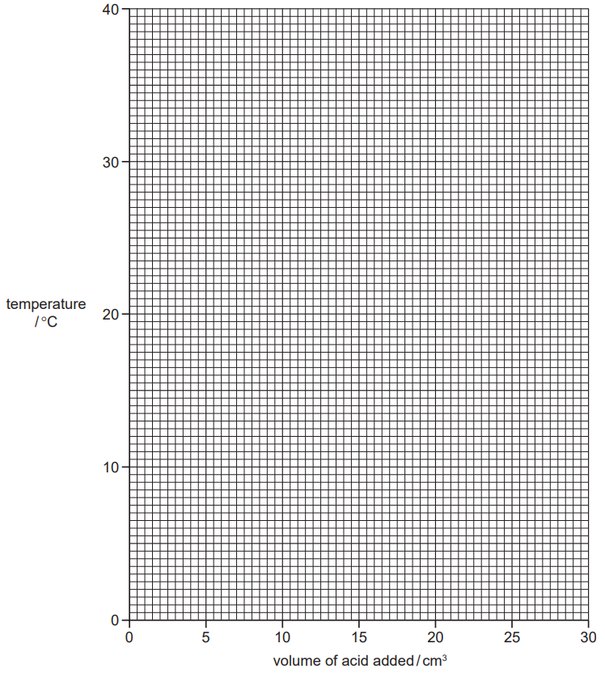

*Source: 2010 61 Q4*

**Q1** [2 marks]

**Extract:**

A student investigated the reaction of aqueous sodium hydroxide with two different acids, acid C and acid D. Two experiments were carried out. Experiment 1: By using a measuring cylinder, 20 cm^3 of aqueous sodium hydroxide was poured into a conical flask and the initial temperature of the solution was measured. A burette was filled with acid C up to the 0.0 cm^3 mark. 5 cm^3 of acid C was added to the sodium hydroxide in the flask. The temperature of the mixture was measured. Further 5 cm^3 portions of acid C were added to the mixture in the flask, stirring with the thermometer until a total volume of 30 cm^3 of acid C had been added. The temperatures after each 5 cm^3 portion had been added were measured.
Plot the results for Experiments 1 and 2 on the grid and draw two smooth line graphs. Clearly label your graphs.

From your graph, deduce the temperature of the mixture when 3 cm3 of acid **C** reacted with sodium hydroxide in Experiment 1.

Show clearly **on the graph** how you worked out your answer.

*Source: 2010 61 Q4*

**Q1** [3 marks]

**Extract:**

A student investigated the reaction of aqueous sodium hydroxide with two different acids, acid **C** and acid **D**. Two experiments were carried out.

*Experiment 1*
By using a measuring cylinder, 20 cm^3^ of aqueous sodium hydroxide was poured into a conical flask and the initial temperature of the solution was measured. A burette was filled with acid **C** up to the 0.0 cm^3^ mark. 5 cm^3^ of acid **C** was added to the sodium hydroxide in the flask. The temperature of the mixture was measured. Further 5 cm^3^ portions of acid **C** were added to the mixture in the flask, stirring with the thermometer until a total volume of 30 cm^3^ of acid **C** had been added. The temperatures after each 5 cm^3^ portion had been added were measured.

*Experiment 2* The burette was emptied and rinsed with water. Experiment 1 was repeated using acid **D**.

i) Which experiment produced the larger temperature change?

[1]

ii) Suggest why the temperature change is greater in this experiment.

[2]

*Source: 2010 61 Q4*

**Q1** [1 mark]

**Extract:**

A student investigated the reaction of aqueous sodium hydroxide with two different acids, acid C and acid D. Two experiments were carried out. Experiment 1: A burette was filled with acid C up to the 0.0 cm^3 mark. 5 cm^3 of acid C was added to the sodium hydroxide in the flask... until a total volume of 30 cm^3 of acid C had been added.
Experiment 2: The burette was emptied and rinsed with water. Experiment 1 was repeated using acid D.

Why was the burette rinsed with water in Experiment 2?

*Source: 2010 61 Q4*

**Q1** [2 marks]

**Extract:**

A student investigated the reaction of aqueous sodium hydroxide with two different acids, acid C and acid D. Two experiments were carried out. Experiment 1: By using a measuring cylinder, 20 cm^3 of aqueous sodium hydroxide was poured into a conical flask and the initial temperature of the solution was measured. A burette was filled with acid C up to the 0.0 cm^3 mark. 5 cm^3 of acid C was added to the sodium hydroxide in the flask. The temperature of the mixture was measured. Further 5 cm^3 portions of acid C were added to the mixture in the flask, stirring with the thermometer until a total volume of 30 cm^3 of acid C had been added. The temperatures after each 5 cm^3 portion had been added were measured.
Experiment 2: The burette was emptied and rinsed with water. Experiment 1 was repeated using acid D.

Predict the temperature of the reaction mixture in Experiment 2 after 1 hour. Explain your answer.

*Source: 2010 61 Q4*

### Q2 — medium — 21 marks

**Q2** [5 marks]

A student investigated what happened when sodium thiosulphate dissolved in water.

*Experiment 1 *

By using a measuring cylinder, 20 cm3 of distilled water was poured into a polystyrene cup. Use the thermometer diagram to record the temperature of the water in the table.

1 g of powdered sodium thiosulphate was added to the cup and the mixture stirred with a thermometer. Use the thermometer diagram to record the temperature of the solution.

*Experiment 2 *

*Experiment 1* was repeated using 2 g of powdered sodium thiosulphate. Record the temperature in the table.

*Experiments 3, 4 and 5 *

*Experiment* *1* was repeated using 3 g, 4 g and 5 g of powdered sodium thiosulphate respectively. Record the temperatures in the table.

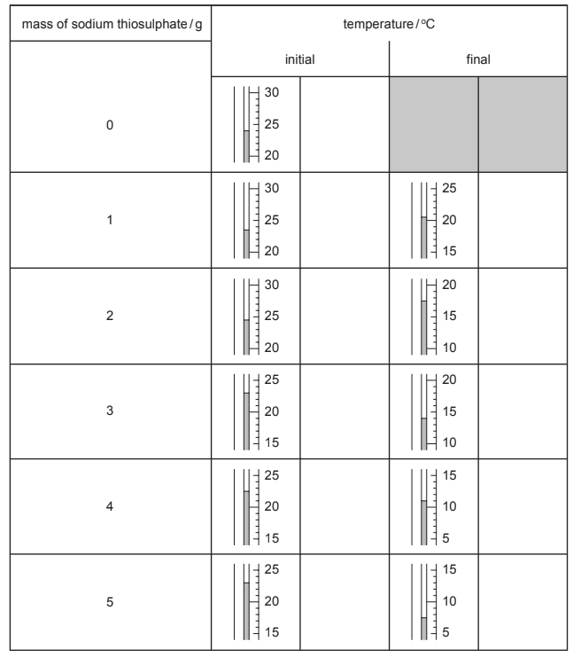

*Source: 2004 O6 Q4*

**Q2** [4 marks]

**Extract:**

A student investigated what happened when sodium thiosulphate dissolved in water. Experiment 1: By using a measuring cylinder, 20 cm^3 of distilled water was poured into a polystyrene cup. Record the temperature of the water. 1 g of powdered sodium thiosulphate was added to the cup and the mixture stirred with a thermometer. Record the temperature of the solution. Experiment 2: Experiment 1 was repeated using 2 g of powdered sodium thiosulphate. Experiments 3, 4 and 5: Experiment 1 was repeated using 3 g, 4 g and 5 g of powdered sodium thiosulphate respectively.

Plot the results of the experiments on the grid below. Draw a straight line graph.

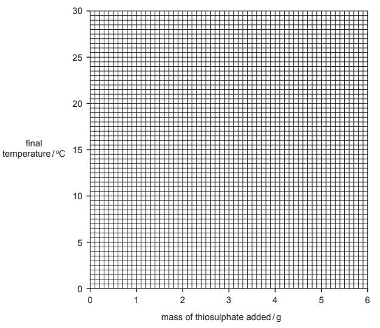

*Source: 2004 O6 Q4*

**Q2** [4 marks]

**Extract:**

A student investigated what happened when sodium thiosulphate dissolved in water. By using a measuring cylinder, 20 cm^3 of distilled water was poured into a polystyrene cup... 1 g of powdered sodium thiosulphate was added to the cup and the mixture stirred with a thermometer... Experiment 1 was repeated using 2 g, 3 g, 4 g and 5 g of powdered sodium thiosulphate respectively.
Plot the results of the experiments on the grid below. Draw a straight line graph.

i) **Use your graph** to estimate the temperature of the reaction mixture if 3.5 g of powdered sodium thiosulphate were added to 20 cm3 of water.

Indicate **clearly **on the graph how you obtained your answer.

[2]

ii) From your graph work out the temperature of the reaction mixture if 6 g of powdered sodium thiosulphate were added to 20 cm3 of water.

Indicate **clearly **how you used your graph.

[2]

*Source: 2004 O6 Q4*

**Q2** [1 mark]

**Extract:**

A student investigated what happened when sodium thiosulphate dissolved in water. Experiment 1: By using a measuring cylinder, 20 cm^3 of distilled water was poured into a polystyrene cup. The temperature of the water was recorded. 1 g of powdered sodium thiosulphate was added to the cup and the mixture stirred with a thermometer. The temperature of the solution was recorded. Experiments were repeated using 2 g, 3 g, 4 g and 5 g of powdered sodium thiosulphate.

What type of chemical reaction occurs when sodium thiosulphate dissolves in water?

*Source: 2004 O6 Q4*

**Q2** [2 marks]

**Extract:**

A student investigated what happened when sodium thiosulphate dissolved in water. Experiment 1: By using a measuring cylinder, 20 cm^3 of distilled water was poured into a polystyrene cup. Record the temperature of the water. 1 g of powdered sodium thiosulphate was added to the cup and the mixture stirred with a thermometer. Record the temperature of the solution. Experiment 2: Experiment 1 was repeated using 2 g of powdered sodium thiosulphate. Experiments 3, 4 and 5: Experiment 1 was repeated using 3 g, 4 g and 5 g of powdered sodium thiosulphate respectively.

Explain how the temperature changes would differ in the experiments if 40 cm3 of water were used.

*Source: 2006 O6 Q4*

**Q2** [2 marks]

**Extract:**

A student investigated what happened when sodium thiosulphate dissolved in water. Experiment 1: By using a measuring cylinder, 20 cm^3 of distilled water was poured into a polystyrene cup. 1 g of powdered sodium thiosulphate was added to the cup and the mixture stirred with a thermometer.

Explain why the sodium thiosulphate was powdered before being used.

*Source: 2004 O6 Q4*

**Q2** [2 marks]

**Extract:**

Experiment 1: By using a measuring cylinder, 20 cm^3 of distilled water was poured into a polystyrene cup. Record the temperature of the water. 1 g of powdered sodium thiosulphate was added to the cup and the mixture stirred with a thermometer. Record the temperature of the solution.
Experiments 3, 4 and 5: Experiment 1 was repeated using 3 g, 4 g and 5 g of powdered sodium thiosulphate respectively. Record the temperatures.

Predict what the temperature of the reaction mixture in Experiment 5 would be after 1 hour. Explain your answer.

*Source: 2004 O6 Q4*

**Q2** [1 mark]

**Extract:**

By using a measuring cylinder, 20 cm^3 of distilled water was poured into a polystyrene cup. Use the thermometer diagram to record the temperature of the water in the table. 1 g of powdered sodium thiosulphate was added to the cup and the mixture stirred with a thermometer.

Suggest **one **change you could make to the apparatus used in the experiments to obtain more **accurate **results.

*Source: 2004 O6 Q4*

### Q3 — medium — 4 marks

**Q3** [3 marks]

A small piece of limestone was heated strongly and left to cool. A few drops of cold water were added. The solid expanded and gave off steam.

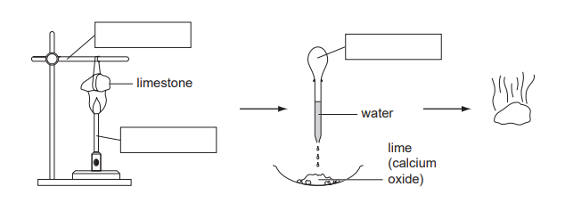

Complete the empty boxes to identify the pieces of apparatus labelled.

**Q3** [1 mark]

**Extract:**

A small piece of limestone was heated strongly and left to cool. A few drops of cold water were added. The solid expanded and gave off steam.

What type of chemical reaction takes place when water is added?

*Source: 2005 6 Q1*

### Q4 — medium — 17 marks

**Q4** [4 marks]

A student investigated the addition of four different solids, A, B, C and D, to water. Five experiments were carried out.

*Experiment 1*

By using a measuring cylinder, 30 cm3 of distilled water was poured into a polystyrene cup and the initial temperature of the water was measured. 4 g of solid **A** was added to the cup and the mixture stirred with a thermometer. The temperature of the solution was measured after 2 minutes.

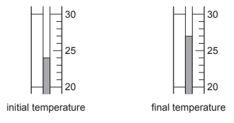

*Experiment 2 *

Experiment 1 was repeated using 4 g of solid **B**.

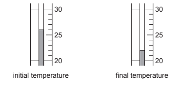

*Experiment 3*

Experiment 1 was repeated using 4 g of solid **C**.

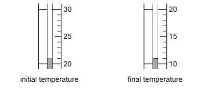

*Experiment 4*

Experiment 1 was repeated using 4 g of solid **D**.

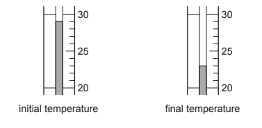

*Experiment 5*

A little of the solution from Experiment 4 was added to a little of the solution from Experiment 2 in a test-tube. The observations were recorded.

**Observations:** *A fast reaction. Vigorous effervescence and bubbles produced.*

Use the thermometer diagrams for Experiments 1-4 to record the initial and final temperatures in Table 4.1. Calculate and record the temperature difference in Table 4.1.

**Table 4.1 **

| **experiment** | **temperature / °C** | **final temperature / °C** | **difference / °C** |
|---|---|---|---|
| 1 |   |   |   |
| 2 |   |   |   |
| 3 |   |   |   |
| 4 |   |   |   |

*Source: 2008 6 Q4*

**Q4** [4 marks]

**Extract:**

The completed table is:

| experiment | temperature / °C | final temperature / °C | difference / °C |
| 1 | 24 | 27 | +3 |
| 2 | 26 | 22 | -4 |
| 3 | 21 | 11 | -10 |
| 4 | 29 | 23 | -6 |

Draw a labelled bar chart of the results to Experiments 1, 2, 3 and 4 on the grid below.

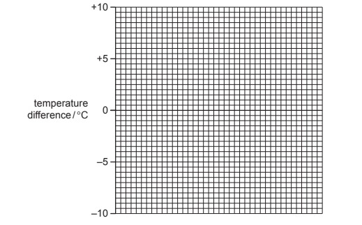

*Source: 2008 6 Q4*

**Q4** [2 marks]

**Extract:**

A student investigated the addition of four different solids, A, B, C and D, to water. Five experiments were carried out.

Experiment 1: 30 cm^3 of distilled water was poured into a polystyrene cup and the initial temperature measured. 4 g of solid A was added and the mixture stirred. The temperature was measured after 2 minutes.
Experiment 2: repeated using 4 g of solid B.
Experiment 3: repeated using 4 g of solid C.
Experiment 4: repeated using 4 g of solid D.
Experiment 5: solution from Experiment 4 added to solution from Experiment 2. Observations: A fast reaction. Vigorous effervescence and bubbles produced.

Completed Table 4.1:
| experiment | temperature / °C | final temperature / °C | difference / °C |
| 1 | 24 | 27 | +3 |
| 2 | 26 | 22 | -4 |
| 3 | 21 | 11 | -10 |
| 4 | 29 | 23 | -6 |

Use the results and observations from Experiments 1-5 to answer the following questions.

i) Which solid dissolves in water to produce an exothermic reaction?

[1]

ii) Give a reason why you chose this solid.

[1]

*Source: 2008 6 Q4*

**Q4** [1 mark]

**Extract:**

| **experiment** | **temperature / °C** | **final temperature / °C** | **difference / °C** |
| :---: | :---: | :---: | :---: |
| 1 | 24 | 27 | +3 |
| 2 | 26 | 22 | -4 |
| 3 | 21 | 11 | -10 |
| 4 | 29 | 23 | -6 |

Which Experiment produced the largest temperature change?

*Source: 2008 6 Q4*

**Q4** [4 marks]

**Extract:**

A student investigated the addition of four different solids, A, B, C and D, to water.

Experiment 1: By using a measuring cylinder, 30 cm^3 of distilled water was poured into a polystyrene cup and the initial temperature of the water was measured. 4 g of solid A was added to the cup and the mixture stirred with a thermometer. The temperature of the solution was measured after 2 minutes.
Experiment 2: Experiment 1 was repeated using 4 g of solid B.
Experiment 4: Experiment 1 was repeated using 4 g of solid D.

Table 4.1 results:
Experiment 1: initial 24, final 27, difference +3
Experiment 2: initial 26, final 22, difference -4
Experiment 3: initial 21, final 11, difference -10
Experiment 4: initial 29, final 23, difference -6

Predict the temperature change that would happen if

i) 8 g of solid B were used in Experiment 2

[1]

ii) 60 cm3 of water was used in Experiment 4

[1]

iii) Explain your answer to (e)(ii)

[2]

*Source: 2008 6 Q4*

**Q4** [2 marks]

**Extract:**

Experiment 5: A little of the solution from Experiment 4 was added to a little of the solution from Experiment 2 in a test-tube. The observations were recorded. Observations: A fast reaction. Vigorous effervescence and bubbles produced.

Suggest an explanation for the observations in Experiment 5.

*Source: 2008 6 Q4*

### Q5 — medium — 8 marks

**Q5** [1 mark]

An experiment was carried out to measure the temperature changes during the neutralisation of sodium hydroxide solution with dilute hydrochloric acid. Both solutions were allowed to stand in the laboratory for about 30 minutes.

25 cm3 of sodium hydroxide solution was added to a polystyrene beaker and the temperature was measured. 10 cm3 of hydrochloric acid was added to the beaker and the highest temperature reached measured.

The experiment was repeated using different volumes of acid.

Why were the solutions left to stand for about 30 minutes before the experiments?

*Source: 2009 61 Q2*

**Q5** [1 mark]

**Extract:**

An experiment was carried out to measure the temperature changes during the neutralisation of sodium hydroxide solution with dilute hydrochloric acid. Both solutions were allowed to stand in the laboratory for about 30 minutes. 25 cm^3^ of sodium hydroxide solution was added to a polystyrene beaker and the temperature was measured. 10 cm^3^ of hydrochloric acid was added to the beaker and the highest temperature reached measured. The experiment was repeated using different volumes of acid.

Why was a polystyrene beaker used instead of a glass beaker?

*Source: 2009 61 Q2*

**Q5** [1 mark]

**Extract:**

An experiment was carried out to measure the temperature changes during the neutralisation of sodium hydroxide solution with dilute hydrochloric acid. Both solutions were allowed to stand in the laboratory for about 30 minutes.

25 cm^3 of sodium hydroxide solution was added to a polystyrene beaker and the temperature was measured. 10 cm^3 of hydrochloric acid was added to the beaker and the highest temperature reached measured.

The experiment was repeated using different volumes of acid.

The results of the experiments are shown plotted on the grid below.

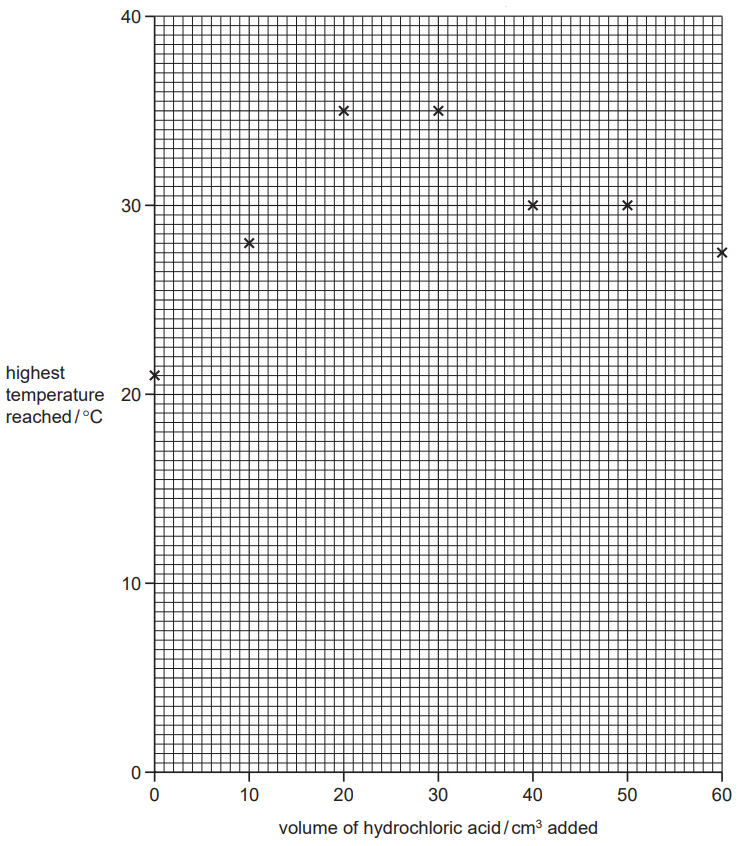

What type of chemical reaction occurs when sodium hydroxide is neutralised by hydrochloric acid?

*Source: 2009 61 Q2*

**Q5** [5 marks]

**Extract:**

An experiment was carried out to measure the temperature changes during the neutralisation of sodium hydroxide solution with dilute hydrochloric acid. 25 cm^3^ of sodium hydroxide solution was added to a polystyrene beaker and the temperature was measured. 10 cm^3^ of hydrochloric acid was added to the beaker and the highest temperature reached measured. The experiment was repeated using different volumes of acid.
The results of the experiments are shown plotted on the grid below.

i) Which point appears to be inaccurate?

[1]

ii) Draw two straight lines through the points and extend them until they cross.

[2]

iii) What volume of hydrochloric acid was needed to neutralise 25 cm3 of the sodium hydroxide solution?

[2]

*Source: 2009 61 Q2*

## Multiple Choice Questions (23 questions)

### Q1 — easy — 1 marks

**Q1** [1 mark]

The reaction pathway diagram for a reaction, with and without a catalyst, is shown.

Which letter represents the activation energy of the catalysed reaction?

### Q2 — medium — 1 marks

**Q2** [1 mark]

The table shows the change in temperature of four different reactions W, X, Y and Z.

|   | initial  temperature / ** **°C | final  temperature / ** **°C |
|---|---|---|
| **W** | 10 | 20 |
| **X** | 23 | 25 |
| **Y** | 15 | 13 |
| **Z** | 22 | 12 |

Which row  is correct?

### Q3 — easy — 1 marks

**Q3** [1 mark]

Calcium and hydrochloric acid react to produce calcium chloride and hydrogen gas. The energy level diagram for the reaction is shown below.

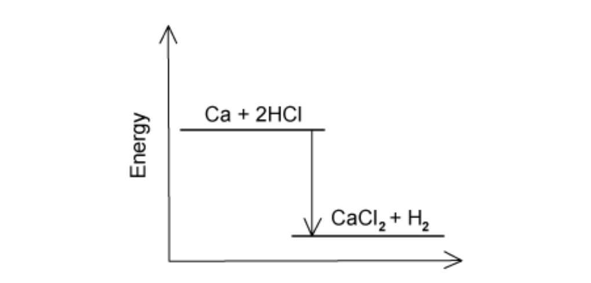

Which statement about this reaction is **not **correct?

### Q4 — easy — 1 marks

**Q4** [1 mark]

A student adds a small amount of ammonium chloride to a beaker of water. The temperature of the water decreases from 21 oC to 17 oC.

Which type of reaction has occurred and why?

|   | **type of reaction** | **reason** |
|---|---|---|
| **A** | exothermic | heat is released |
| **B** | exothermic | heat is absorbed |
| **C** | endothermic | heat is released |
| **D** | endothermic | heat is absorbed |

### Q5 — easy — 1 marks

**Q5** [1 mark]

The graph below shows a reaction profile for the reaction between methane and oxygen.

What does the label X represent?

### Q6 — easy — 1 marks

**Q6** [1 mark]

The energy level diagram below shows the relative energies of the reactants and products in a reaction.

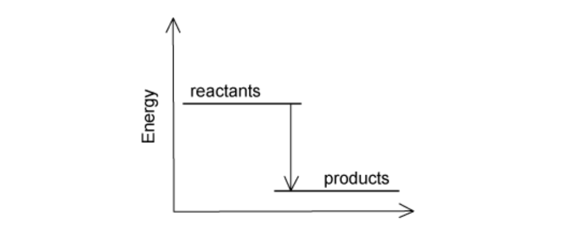

Which row correctly describes the type of reaction and corresponding energy change?

|   | **type of reaction** | **energy change** |
|---|---|---|
| **A** | endothermic | heat is released |
| **B** | endothermic | heat is absorbed |
| **C** | exothermic | heat is released |
| **D** | exothermic | heat is absorbed |

### Q7 — easy — 1 marks

**Q7** [1 mark]

What is the reading on the following thermometer?

### Q8 — hard — 1 marks

**Q8** [1 mark]

The production of ammonia involves the exothermic reaction between nitrogen and hydrogen. The equation for the reaction is shown.

N2 + 3 H2 → 2 NH3

The table shows the bond energies.

| **bond** | **bond energy / (kJ / mol)** |
|---|---|
| NーH | +390 |
| HーH | +436 |
| N☰N | +945 |

What is the energy change during the reaction?

### Q9 — hard — 1 marks

**Q9** [1 mark]

Chlorine and ethane react together in an exothermic reaction to produce chloroethane and hydrogen chloride. The equation for the reaction is shown below.

C2H6 + Cl2 → C2H5Cl + HCl

The table below shows the relevant bond energies.

| **bond** | **bond energy / (kJ / mol)** |
|---|---|
| CーCl | + 340 |
| CーC | + 350 |
| CーH | + 410 |
| ClーCl | + 240 |
| HーCl | + 430 |

What is the energy change for the reaction between chlorine and ethane?

### Q10 — hard — 1 marks

**Q10** [1 mark]

Chlorine and hydrogen react in an exothermic reaction producing hydrogen chloride. The equation for the reaction is shown.

Cl2 + H2 → 2 HCl

The table shows some of the bond energies involved. The total energy change for this reaction is -184 kJ / mol.

| **bond** | **bond energy / (kJ / mol)** |
|---|---|
| HーCl | +430 |
| HーH | +436 |
| ClーCl | - |

What is the energy of the Cl─Cl bond?

### Q11 — hard — 1 marks

**Q11** [1 mark]

An energy level diagram is shown below.

Which row is correct for the points labelled 1, 2 and 3?

|   | **1** | **2** | **3** |
|---|---|---|---|
| **A** | activation energy | energy change | reactants |
| **B** | energy change | activation energy | products |
| **C** | energy change | activation energy | reactants |
| **D** | activation energy | energy change | products |

### Q12 — hard — 1 marks

**Q12** [1 mark]

Methane combusts in oxygen as shown producing an energy change of -890 kJ / mol.

CH4 + 2O2 → CO2 + 2H2O

The table shows some of the bond energies involved.

| **bond** | **bond energy / (kJ / mol)** |
|---|---|
| HーO | +460 |
| O＝O | +496 |
| CーH | +410 |
| C＝O | - |

What is the energy of the C＝O bond?

### Q13 — medium — 1 marks

**Q13** [1 mark]

In all chemical reactions, bonds in the reactant species are broken and new bonds are formed in the products. Which statement is correct?

### Q14 — medium — 1 marks

**Q14** [1 mark]

Which is true about chemical energy changes?

|   | ** Reaction type** | **Energy flows** | **Temperature of surroundings** |
|---|---|---|---|
| **A** | exothermic | to the surroundings | increases |
| **B** | exothermic | from the surroundings | decreases |
| **C** | endothermic | to the surroundings | decreases |
| **D** | endothermic | from the surroundings | increases |

### Q15 — medium — 1 marks

**Q15** [1 mark]

Endothermic reactions can be used in emergency sports injury treatment packs.

What is true about these packs?

### Q16 — medium — 1 marks

**Q16** [1 mark]

The reaction profile for making nitrogen monoxide, NO, is shown below:

What is the activation energy for this reaction?

### Q17 — medium — 1 marks

**Q17** [1 mark]

Which of the following processes is endothermic?

## Theory Questions (18 questions)

### Q1 — medium — 8 marks

**Q1** [1 mark]

Magnesium reacts with dilute hydrochloric acid in a school laboratory experiment. Bubbles of gas are produced during the reaction.

Describe one other observation that could be made during this reaction.

**Q1** [2 marks]

**Extract:**

Magnesium reacts with dilute hydrochloric acid in a school laboratory experiment. Bubbles of gas are produced during the reaction.

#### Extended Only

The reaction has a negative enthalpy change.

(i) What is meant by the term enthalpy change.

[1]

(ii) Explain how this value helps to classify the type of energy change in the reaction.

[1]

**Q1** [2 marks]

#### Extended Only

When magnesium ribbon is added to dilute hydrochloric acid, bubbles form slowly at first but then more quickly. The rate of reaction increases.

Explain why the rate of reaction increases, in terms of activation energy.

**Q1** [3 marks]

#### Extended Only

During a chemical reaction, bonds in the reactants are broken and new bonds are formed in the products.

Use this idea to explain how a reaction can be endothermic overall.

### Q2 — medium — 7 marks

**Q2** [2 marks]

A student observes that the temperature of a reaction mixture increases when magnesium reacts with dilute hydrochloric acid. Explain why this temperature increase occurs.

**Q2** [1 mark]

**Extract:**

This question explores the energy changes involved in a simple metal–acid reaction, using magnesium and dilute hydrochloric acid as a familiar laboratory example. The focus is on helping students understand exothermic processes through temperature observations, enthalpy change (∆H), . The question then builds toward a qualitative explanation of overall energy change by applying the principles of bond breaking and bond forming. All parts are thematically linked to the reaction context, encouraging students to reason about energy flow at both the macroscopic (temperature rise) and microscopic (particle interactions) levels.

#### Extended Only

Define enthalpy change, ∆*H*.

**Q2** [1 mark]

**Extract:**

This question explores the energy changes involved in a simple metal–acid reaction, using magnesium and dilute hydrochloric acid as a familiar laboratory example. The focus is on helping students understand exothermic processes through temperature observations, enthalpy change (∆H), and activation energy (Ea). The question then builds toward a qualitative explanation of overall energy change by applying the principles of bond breaking and bond forming. All parts are thematically linked to the reaction context, encouraging students to reason about energy flow at both the macroscopic (temperature rise) and microscopic (particle interactions) levels.

#### Extended Only

Define activation energy, *E*a.

**Q2** [3 marks]

**Extract:**

A student observes that the temperature of a reaction mixture increases when magnesium reacts with dilute hydrochloric acid.

#### Extended Only

Magnesium reacts with dilute hydrochloric acid, resulting in a temperature increase. Explain this temperature change in terms of bond breaking and bond making.

### Q3 — medium — 17 marks

**Q3** [3 marks]

The first three elements in Period 6 of the Periodic Table of the Elements are caesium, barium and lanthanum.

How many more protons, electrons and neutrons are there in one atom of lanthanum than in one atom of caesium. Use your copy of the Periodic Table of the Elements to help you.

number of protons ................................................

number of electrons ................................................

number of neutrons ................................................

*Source: 2003 Ju31 Q5*

**Q3** [4 marks]

**Extract:**

The first three elements in Period 6 of the Periodic Table of the Elements are caesium, barium and lanthanum.

#### Extended Only

All three metals can be obtained by the electrolysis of a molten halide. The electrolysis of the aqueous halides does not produce the metal.

i) Complete the equation for the reduction of lanthanum ions at the negative electrode (cathode).

La3+ + ................ → ................

ii) Name the three products formed by the electrolysis of aqueous caesium bromide.

*Source: 2003 Ju31 Q5*

**Q3** [2 marks]

**Extract:**

The first three elements in Period 6 of the Periodic Table of the Elements are caesium, barium and lanthanum.

#### Extended Only

All three metals react with cold water. Complete the word equation for these reactions.

metal + water → ................................. + .............................

*Source: 2003 Ju31 Q5*

**Q3** [2 marks]

Barium chloride is an ionic compound. Draw a diagram that shows the formula of the compound, the charges on the ions and gives the arrangement of the valency electrons around the negative ion.

The electron distribution of a barium atom is 2.8.18.18.8.2

Use x to represent an electron from a barium atom. Use o to represent an electron from a chlorine atom.

*Source: 2003 Ju31 Q5*

**Q3** [2 marks]

#### Extended Only

Describe, by means of a simple diagram, the lattice structure of an ionic compound, such as caesium chloride.

*Source: 2003 Ju31 Q5*

**Q3** [4 marks]

#### Extended Only

The reactions of these metals with oxygen are exothermic.

2Ba (s) + O2 (g) → 2BaO (s)

i) Give an example of bond forming in this reaction.

[1]

ii) Explain using the idea of bond breaking and forming why this reaction is exothermic.

[3]

*Source: 2003 Ju31 Q5*

### Q4 — easy — 7 marks

**Q4** [4 marks]

Acids have characteristic properties.

Hydrochloric acid reacts with magnesium.

Name the products of this reaction and give the observations.

*Source: 2020 Ju0620/31 Q6A*

**Q4** [3 marks]

#### Separate: Chemistry and Extended Only

Hydrogen and chlorine react to form hydrogen chloride gas, as shown in the equation.

H2 + Cl2 → 2HCl

This equation can be represented as shown.

$H-H+\mathrm{Cl}-\mathrm{Cl}\rightarrow2H-\mathrm{Cl}$

Some bond energies are shown in the table.

| bond | bond energy in kJ/mol |
|---|---|
| H–H | 436 |
| Cl–Cl | 243 |
| H–Cl | 432 |

Calculate the energy change for the reaction between hydrogen and chlorine, using the following steps.

- Calculate the energy needed to break the bonds.
- Calculate the energy released when bonds are formed.
- Calculate the energy change for the reaction.

*Source: 2020 Ju0620/43/04 Q3D*

### Q5 — hard — 14 marks

**Q5** [5 marks]

#### Extended Only

Chemical reactions are always accompanied by an energy change.

Aluminium is extracted by the electrolysis of a molten mixture which contains aluminium oxide, Al2O3. This decomposes to form aluminium at the negative electrode and oxygen at the positive electrode.

i) Write an ionic equation for the reaction at the negative electrode.

[2]

ii) Complete the ionic equation for the reaction at the positive electrode.

2O2– → ....... + .......

[2]

iii) Is the reaction exothermic or endothermic? Explain your answer.

[1]

*Source: 2015 Ju33 Q6*

**Q5** [5 marks]

#### Extended Only

The cell shown below can be used to determine the order of reactivity of metals.

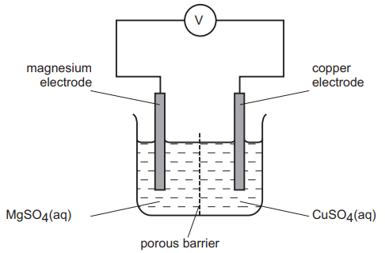

i) Is the reaction in the cell exothermic or endothermic? Explain your answer.

[1]

ii) Explain why the mass of the magnesium electrode decreases and the mass of the copper electrode increases.

[2]

iii) How could you use this cell to determine which is the more reactive metal, magnesium or manganese?

[2]

*Source: 2015 Ju33 Q6*

**Q5** [2 marks]

#### Extended Only

The combustion of propane, C3H8, is exothermic.

Give an equation for the complete combustion of propane.

*Source: 2015 Ju33 Q6*

**Q5** [2 marks]

#### Separate: Chemistry Only

Photosynthesis is an unusual endothermic reaction.

i) Where does the energy for photosynthesis come from?

[1]

ii) Give the word equation for photosynthesis.

[1]

*Source: 2015 Ju33 Q6*

### Q6 — hard — 14 marks

**Q6** [3 marks]

#### Extended Only

Three of the factors that can influence the rate of a chemical reaction are:

- physical state of the reactants
- light
- the presence of a catalyst

The first recorded dust explosion was in a flour mill in Italy in 1785. Flour contains carbohydrates. Explosions are very fast exothermic reactions.

i) Use the collision theory to explain why the reaction between the particles of flour and the oxygen in the air is very fast.

[2]

ii) Write a word equation for this exothermic reaction.

[1]

*Source: 2008 Ju31 Q6*

**Q6** [3 marks]

The decomposition of silver(I) bromide is the basis of film photography. The equation for this decomposition is:

| 2AgBr → | 2Ag + Br2 |
|---|---|
| white | black |

This reaction is photochemical.

A piece of white paper was coated with silver(I) bromide and the following experiment was carried out.

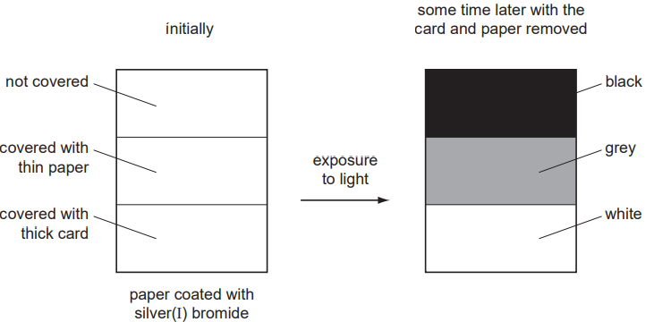

Explain the results.

*Source: 2008 Ju31 Q6*

**Q6** [8 marks]

The fermentation of glucose is catalysed by enzymes from yeast. Yeast is added to aqueous glucose, the solution starts to bubble and becomes cloudy as more yeast cells are formed.

C6H12O6 (aq) → 2C2H5OH (aq) + 2CO2 (g)

The reaction is exothermic.

Eventually the fermentation stops when the concentration of ethanol is about 12%.

i) What is an enzyme?

[1]

ii) Pasteur said that fermentation was respiration in the absence of air. Suggest a definition of respiration.

[2]

iii) On a large scale, the reaction mixture is cooled. Suggest a reason why this is necessary.

[1]

iv) Why does the fermentation stop? Suggest **two **reasons.

[2]

v) When the fermentation stops, there is a mixture of dilute aqueous ethanol and yeast. Suggest a technique which could be used to remove the cloudiness due to the yeast.

[1]

vi) Name a technique which will separate the ethanol from the ethanol/water mixture.

[1]

*Source: 2008 Ju31 Q6*

### Q7 — hard — 11 marks

**Q7** [4 marks]

#### Separate: Chemistry and Extended Only

The table below has some enthalpy data for a different chemical reaction. Hydrazine, N2H4 can react with hydrogen peroxide in an exothermic reaction, as shown below.

N2H4 + 2H2O2 → N2 + 4H2O   Δ*H* = -789 kJ / mol

| **Bond** | **Bond Energy kJ / mol** |
|---|---|
| N-N | +158 |
| N$\equiv$N | +945 |
| O-H | +463 |
| O-O | +144 |

The structures of the reactants and products are shown.

Using the reaction equation and the data in the table above, calculate the value of the N-H bond in hydrazine.

Bond energy of N-H bond = .......... kJ / mol

**Q7** [3 marks]

**Extract:**

Hydrazine, N~2~H~4 ~can react with hydrogen peroxide in an exothermic reaction, as shown below. N~2~H~4~ + 2H~2~O~2~ → N~2~ + 4H~2~O

Draw a dot cross diagram for hydrazine.

Use x to represent electrons from nitrogen atoms

Use o to represent electrons from hydrogen atoms

**Q7** [4 marks]

#### Extended Only

When nitrogen and oxygen are heated to very high temperatures, they combine to form nitrogen monoxide and a lot of heat is absorbed in this reaction.

Complete the reaction pathway diagram to show the formation of nitrogen monoxide from nitrogen and oxygen.

### Q8 — easy — 6 marks

**Q8** [3 marks]

#### Extended Only

Fuel cells are used in spacecraft to produce electrical energy.

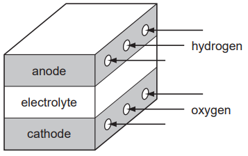

Hydrogen and oxygen react to form water.

2H2 + O2 → 2H2O

i) Give an example of bond breaking in the above reaction.

[1]

ii) Give an example of bond forming in the above reaction.

[1]

iii) Is the change given in (i) exothermic or endothermic?

[1]

*Source: 2010 Ju32 Q5*

**Q8** [3 marks]

#### Extended Only

i) Give **two **reasons why hydrogen may be considered to be the ideal fuel for the future.

[2]

ii) Suggest a reason why hydrogen is not widely used at the moment.

[1]

*Source: 2010 Ju32 Q5*

### Q9 — medium — 7 marks

**Q9** [1 mark]

Thermal energy is released to the surroundings when hydrogen is burnt.

State the name of the type of reaction which transfers heat to the surroundings.

*Source:  Specimen0620/03 Q8A*

**Q9** [3 marks]

#### Separate: Chemistry and Extended Only

The structures of the reactants and products of this reaction are shown.

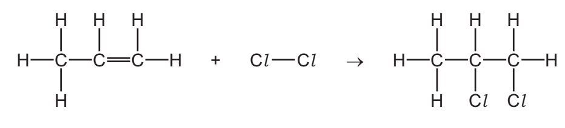

Some bond energies are shown in the table.

| bond | bond energy in kJ/mol |
|---|---|
| C–C | 347 |
| C=C | 612 |
| C–H | 413 |
| C–Cl | 339 |
| Cl–Cl | 242 |

Calculate the energy change for the reaction between propene and chlorine using the following steps.

- Calculate the energy needed to break the bonds.
- Calculate the energy released when bonds are formed.
- Calculate the energy change for the reaction between propene and chlorine.

*Source: 2020 Ju0620/42/04 Q6B*

**Q9** [3 marks]

#### Extended Only

Ammonia, NH3, is used to produce nitric acid, HNO3. This happens in a three-stage process.

The reaction in stage 3 is exothermic.

4NO2 + 2H2O + O2 → 4HNO3

Complete the energy level diagram for this reaction. Include an arrow that clearly shows the energy change during the reaction.

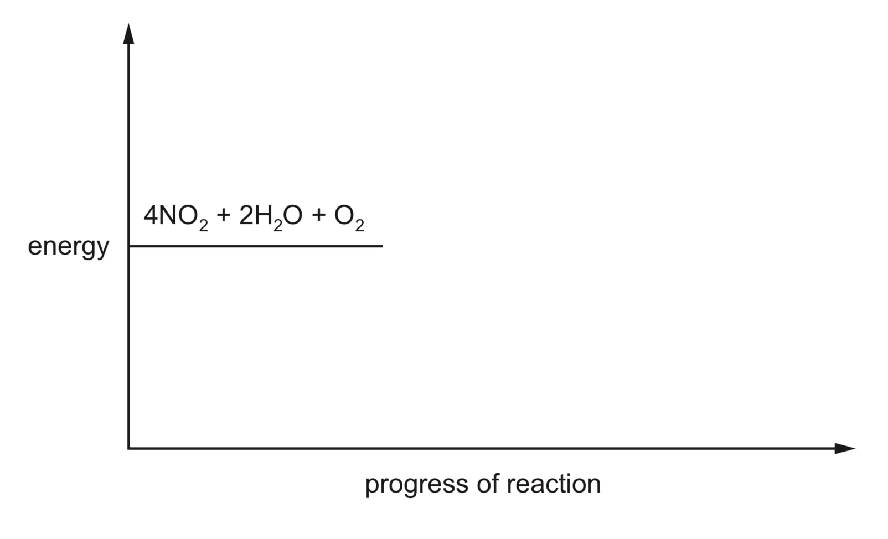

*Source: 2020 Ju0620/43/04 Q2E*

### Q10 — hard — 11 marks

**Q10** [3 marks]

#### Separate: Chemistry and Extended Only

The balanced equation for the combustion of ethene is

C2H4 (g) + 3O2 (g) → 2CO2 (g) + 2H2O (l)

| **Bond** | **Bond energy (kJ / mol) ** |
|---|---|
| C=C | 614 |
| C-H | 414 |
| O-H | 463 |
| C=O | 804 |
| O=O | 498 |

Use the information in the table to calculate the following:

i) Energy required to break the bonds

[1]

ii) Energy released when bonds are made

[1]

iii) Energy change for the reaction

[1]

**Q10** [3 marks]

**Extract:**

The balanced equation for the combustion of ethene is C2H4 (g) + 3O2 (g) → 2CO2 (g) + 2H2O (l)
iii) Energy change = 3764 - 5068 = -1304 (kJ / mol)

#### Extended Only

Complete the reaction pathway diagram for the reaction in part (a). Include an arrow which clearly shows the energy change during the reaction.

**Q10** [5 marks]

#### Separate: Chemistry and Extended Only

The forward reaction for the production of ethanol from ethene is shown below.

** C****2****H****4**** (g) + H****2****O (g) **$\rightleftharpoons$** CH****3****CH****2****OH (g)   **$\Delta$*H* = -45 kJ / mol

In terms of temperature and pressure, explain which conditions would give an economically viable yield.

### Q11 — hard — 26 marks

**Q11** [3 marks]

#### Extended Only

Period 3 contains the elements sodium to argon. This question asks about the chemistry of each of the Period 3 elements or their compounds.

Sodium nitrate is a white crystalline solid. When heated it melts and the following reaction occurs.

2NaNO3 (l) → 2NaNO2 (l) + O2 (g)

A 3.40 g sample of sodium nitrate is heated.

Calculate the

• number of moles of NaNO3 used,

.................................. mol

• number of moles of O2 formed,

.................................. mol

• volume of O2 formed, in dm3 (measured at r.t.p.).

.................................. dm3

*Source: 2016 Ju41 Q2*

**Q11** [3 marks]

Magnesium reacts slowly with warm water to form a base, magnesium hydroxide.

i) Explain what is meant by the term *base*.

[1]

ii) Write a chemical equation for the reaction between magnesium and warm water.

[2]

*Source: 2016 Ju41 Q2*

**Q11** [3 marks]

#### Extended Only

Aluminium oxide is amphoteric. It is insoluble in water.

Describe experiments to show that aluminium oxide is amphoteric.

*Source: 2016 Ju41 Q2*

**Q11** [3 marks]

#### Separate: Chemistry and Extended Only

Silicon(IV) oxide has a giant structure.

i) Name the type of bonding in silicon(IV) oxide.

[1]

ii) Give two physical properties of silicon(IV) oxide.

[2]

*Source: 2016 Ju41 Q2*

**Q11** [3 marks]

#### Extended Only

Calcium phosphate is used in fertilisers. The bonding in calcium phosphate is ionic. Calcium phosphate contains the phosphate ion, PO43–.

i) What is ionic bonding?

[2]

ii) Deduce the formula of calcium phosphate.

[1]

*Source: 2016 Ju41 Q2*

**Q11** [6 marks]

#### Separate: Chemistry and Extended Only

Sulfur tetrafluoride, SF4, can be made by combining gaseous sulfur with fluorine.

S (g) + 2F2 (g) → SF4 (g)

The reaction is exothermic.

i) Complete the energy level diagram for this reaction. Include an arrow which clearly shows the energy change during the reaction.

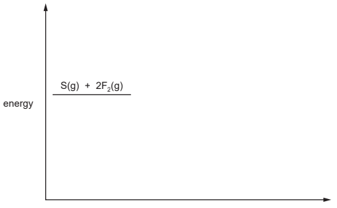

[3]

ii) During the reaction the amount of energy given out is 780 kJ / mol.

The F–F bond energy is 160 kJ / mol.

Use this information to determine the bond energy, in kJ / mol, of one S–F bond in SF4

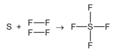

.................................. kJ / mol [3]

*Source: 2016 Ju41 Q2*

**Q11** [4 marks]

Chlorine and compounds of chlorine are important in water treatment and in laboratory testing for water.

i) Chlorine is added to water to make the water safe to drink.

Explain why adding chlorine makes water safe to drink.

[1]

ii) A compound of chlorine is used in the laboratory to test for the presence of water.

Name the compound of chlorine used in this test and describe the colour change seen in a positive result of this test.

name of compound ..................................................

colour change from .............................. to ..............................

[3]

*Source: 2016 Ju41 Q2*

**Q11** [1 mark]

Argon is an unreactive noble gas. Explain why argon is unreactive.

*Source: 2016 Ju41 Q2*

### Q12 — easy — 3 marks

**Q12** [1 mark]

The reaction of iron(II) carbonate with hydrochloric acid is exothermic. What is meant by the term exothermic?

*Source: June 2020 0620/31 Q6D*

**Q12** [2 marks]

Rust contains compounds of iron. State two conditions needed for iron to rust.

*Source: June 2020 0620/31 Q6E*

### Q13 — medium — 4 marks

**Q13** [1 mark]

The reaction of iron(II) carbonate with hydrochloric acid is exothermic.

What is meant by the term exothermic?

*Source: 2019 Ju0620/43/04 Q5B*

**Q13** [3 marks]

#### Extended Only

The reaction between ethanoic acid and ethanol is exothermic. Draw an energy level diagram for this reaction. On your diagram label:

- the reactants and products
- the energy change of the reaction, ∆H.

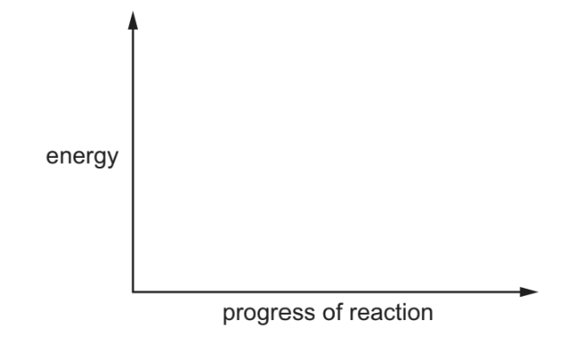

### Q14 — easy — 3 marks

**Q14** [2 marks]

Bromine reacts with hydrogen sulfide, H2S.

Complete the chemical equation for this reaction.

....... + H2S →  ......HBr  +  S

*Source: 2019 Ju0620/32/03 Q4D*

**Q14** [1 mark]

**Extract:**

Bromine reacts with hydrogen sulfide, H~2~S.

Complete the chemical equation for this reaction.

Br~2~ + H~2~S → 2HBr + S

#### Extended Only

The energy level diagram for this reaction is shown.

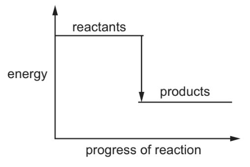

Explain how this diagram shows that the reaction is exothermic.

*Source: 2019 Ju0620/32/03 Q4D*

### Q15 — medium — 10 marks

**Q15** [2 marks]

#### Separate: Chemistry and Extended Only

Iodine reacts with chlorine to form dark brown iodine monochloride.

I2 + Cl2 → 2ICl

This reacts with more chlorine to give yellow iodine trichloride.

An equilibrium forms between these iodine chlorides.

| ICl (l) + | Cl2 (g) ⇌ | ICl3 (s) |
|---|---|---|
| dark brown |   | yellow |

What do you understand by the term *equilibrium*?

*Source: 2016 Sp4 Q7*

**Q15** [1 mark]

**Extract:**

Iodine reacts with chlorine to form dark brown iodine monochloride. I~2~ + Cl~2~ → 2ICl. This reacts with more chlorine to give yellow iodine trichloride. An equilibrium forms between these iodine chlorides. ICl (l) + Cl~2~ (g) ⇌ ICl~3~ (s); dark brown ⇌ yellow.

#### Separate: Chemistry and Extended Only

When the equilibrium mixture is heated, it becomes a darker brown colour.

Suggest if the reverse reaction is endothermic or exothermic. Give a reason for your choice.

*Source: 2016 Sp4 Q7*

**Q15** [2 marks]

**Extract:**

Iodine reacts with chlorine to form dark brown iodine monochloride. I~2~ + Cl~2~ → 2ICl. This reacts with more chlorine to give yellow iodine trichloride. An equilibrium forms between these iodine chlorides. ICl (l) + Cl~2~ (g) ⇌ ICl~3~ (s); ICl (l) is dark brown, ICl~3~ (s) is yellow.

#### Separate: Chemistry and Extended Only

The pressure on the equilibrium mixture is decreased.

i) How would this affect the position of equilibrium? Give a reason for your choice.

It would move to the ................................................

reason ................................................

[1]

ii) Describe what you would observe.

[1]

*Source: 2016 Sp4 Q7*

**Q15** [3 marks]

#### Separate: Chemistry and Extended Only

Calculate the overall energy change for the reaction between iodine and chlorine using the bond energy values shown.

I2 + Cl2 → 2ICl

| Bond | Energy / kJ per mol |
|---|---|
| I–I | 151 |
| Cl–Cl | 242 |
| I–Cl | 208 |

Show your working.

*Source: 2016 Sp4 Q7*

**Q15** [2 marks]

**Extract:**

Calculate the overall energy change for the reaction between iodine and chlorine using the bond energy values shown. I~2~ + Cl~2~ → 2ICl. Bond energies: I–I = 151, Cl–Cl = 242, I–Cl = 208 kJ per mol. Bonds broken: 151 + 242 = 393 (kJ/mol); Bonds formed: 2 x 208 = –416 (kJ/mol); Overall energy change: 393 - 416 = –23 (kJ/mol) (exothermic).

Draw a labelled energy level diagram for the reaction between iodine and chlorine using the information in (d).

*Source: 2016 Sp4 Q7*

### Q16 — medium — 4 marks

**Q16** [2 marks]

Iodine reacts with aqueous sodium thiosulfate, Na2S2O3.

Balance the chemical equation for this reaction.

$.....\mathrm{Na}_{2}S_{2}O_{3}+I_{2}\rightarrow\mathrm{Na}_{2}S_{4}O_{6}+.....\mathrm{NaI}$

*Source: 2019 Ju0620/31/03 Q4D*

**Q16** [1 mark]

#### Extended Only

The energy level diagram for this reaction is shown.

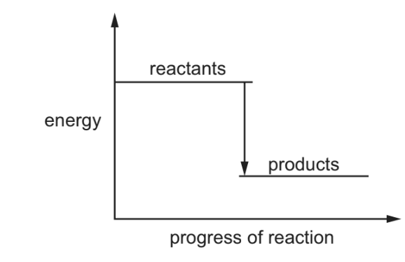

Explain how this diagram shows that the reaction is exothermic.

*Source: 2019 Ju0620/31/03 Q4D*

**Q16** [1 mark]

Heat is given out when iron reacts with sulfuric acid.

What term describes a reaction which gives out heat?

*Source: 2020 Ju0620/32 Q6C*

### Q17 — easy — 8 marks

**Q17** [2 marks]

#### Separate: Chemistry and Extended Only

The following are two examples of substitution reactions. Only the reaction involving chlorine is a photochemical reaction.

CH4 + Cl2 → CH3Cl + HCl

CH4 + Br2 → CH3Br + HBr

i) Explain the phrase substitution reaction.

[1]

ii) How do photochemical reactions differ from other reactions?

[1]

*Source: 2013 O31 Q7*

**Q17** [2 marks]

#### Extended Only

Bond forming is exothermic, bond breaking is endothermic.

Explain the difference between an exothermic reaction and an endothermic reaction.

*Source: 2013 O31 Q7*

**Q17** [4 marks]

**Extract:**

CH4 + Cl2 → CH3Cl + HCl

Bond energy is the amount of energy (kJ / mol) which must be supplied to break one mole of the bond.

|   | Bond energies in kJ /mol |
| Cl–Cl | +242 |
| C–Cl | +338 |
| C–H | +412 |
| H–Cl | +431 |

bonds broken   energy in kJ /mol 

......................       ............................. 

......................       ............................. 

total energy = ............................. 

bonds formed    energy in kJ /mol 

......................       ............................. 

......................       ............................. 

total energy = .............................

#### Separate: Chemistry and Extended Only

Use the bond energies to show that the following reaction is exothermic.

Bond energy is the amount of energy (kJ / mol) which must be supplied to break one mole of the bond.

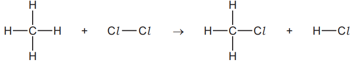

|   | Bond energies in kJ /mol |
|---|---|
| Cl–Cl | +242 |
| C–Cl | +338 |
| C–H | +412 |
| H–Cl | +431 |

bonds broken   energy in kJ /mol

......................        .............................

......................        .............................

total energy = .............................

bonds formed    energy in kJ /mol

......................        .............................

......................        .............................

total energy = .............................

*Source: 2013 O31 Q7*

### Q18 — medium — 17 marks

**Q18** [4 marks]

#### Separate: Chemistry and Extended Only

Propane reacts with chlorine to form a mixture of chloropropanes. This is a photochemical reaction.

i) What is meant by the phrase *photochemical reaction*?

[1]

ii) The products of this reaction include two isomers, one of which has the following structural formula.

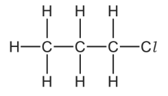

Draw the structural formula of the other isomer.

[1]

iii) Explain why these two different compounds are isomers.

[2]

*Source: 2015 O32 Q4*

**Q18** [3 marks]

#### Separate: Chemistry and Extended Only

Bond breaking is an endothermic change and bond forming is an exothermic change.

Bond energy is the amount of energy in kJ / mol needed to break one mole of the specified bond.

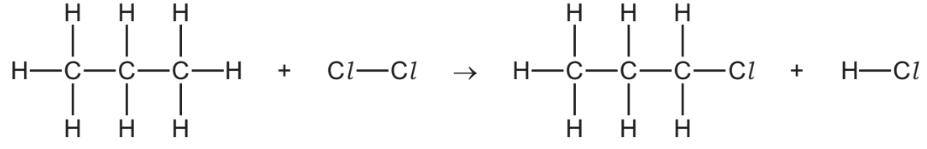

Use the following bond energies to determine whether this reaction is exothermic or endothermic. You must show your reasoning.

| bond | bond energies in kJ / mol |
|---|---|
| C-Cl | 338 |
| C-H | 412 |
| Cl-Cl | 242 |
| H-Cl | 431 |
| C-C | 348 |

*Source: 2015 O32 Q4*

**Q18** [5 marks]

#### Separate: Chemistry and Extended Only

i) Chloropropane can be hydrolysed to propanol, CH3CH2CH2OH, by sodium hydroxide.

Write the equation for this reaction.

[2]

ii) Propanol can be dehydrated. It loses a water molecule to form a hydrocarbon.

Give the name and structural formula of this hydrocarbon.

name .................................................

structural formula

[2]

iii) Propanol is oxidised to a carboxylic acid by acidified potassium manganate(VII).

Deduce the name of this acid.

[1]

*Source: 2015 O32 Q4*

**Q18** [5 marks]

#### Extended Only

Propanol reacts with methanoic acid to form the ester propyl methanoate.

CH3CH2CH2OH + HCOOH → HCOOCH2CH2CH3 + H2O

4.0 g of methanoic acid was reacted with 6.0 g of propanol.

i) Calculate the *M*r of methanoic acid = ........................................

[1]

ii) Calculate the *M*r of propanol = ........................................

[1]

iii) Determine which one is the limiting reagent. Show your reasoning.

[2]

iv) Calculate the maximum yield in grams of propyl methanoate, *M*r = 88.

[1]

*Source: 2015 O32 Q4*

