# Mark Schemes — Chemical Change & Rate of Reaction
**6. Chemical Reactions** · Cambridge (CIE) IGCSE chemistry (0620 & 0971)

## Alternative To Practical Questions (28 questions)

### Q1
> **[mark-scheme]**
> **A:** Conical flask **[1 mark]**
> 
> **B:** Balance / top-pan balance / digital balance **[1 mark]**

> **[exam-tip]**
> Do not write “scale” or “weight scale”, since these are not standard laboratory terms and will not gain credit.
> 
> Using precise scientific vocabulary secures easy marks.
i)

- The initial rate is the gradient from the tangent when t = 0 min

  - A tangent is a line that touches the curve at a single point
  
    - The tangent must be slightly above the second point of your graph to mimic the initial rate of change
  - The gradient of the tangent indicates the instantaneous rate of change at that exact point
- The first step is drawing the tangent at t = 0, as shown in the diagram below

![Graph of mass loss (g) against time (min), 0–10 min.

Points plotted: (0.0, 0.00), (0.5, 0.32), (1.0, 0.58), (1.5, 0.79), (2.0, 0.97), (2.5, 1.12), (3.0, 1.25), (3.5, 1.36), (4.0, 1.46), (4.5, 1.54), (5.0, 1.61), (5.5, 1.67), (6.0, 1.72), (6.5, 1.76), (7.0, 1.79), (7.5, 1.81), (8.0, 1.82), (8.5, 1.83), (9.0, 1.83), (9.5, 1.83), (10.0, 1.83).

The curve increases rapidly at first, then more slowly, and becomes constant at 1.83 g from 8.5 min onwards.
 A straight tangent is drawn at the start of the curve, passing through (0, 0) and marked point (2, 1.25).](assets/003-graph-of-mass-loss-g-against-time-min-0-10-min-p.png)

**[1 mark]**

- Identify two points from the tangent (ideally they need to be as far as possible), and use them to calculate the gradient using:

$\text{gradient} = \frac{change \text{in} \mathrm{y} }{change \text{in} \mathrm{x} } = \frac{( 1.25 \mathrm{g} - 0.00 \mathrm{g} ) }{( 2 \min - 0 \min ) }$

$\mathrm{gradient}=0.63\frac{g}{\mathrm{min}}$

**[1 mark]**

- The initial rate of reaction is **0.63 g/min ****[1 mark]**

> **[mark-scheme]**
> 1 mark is awarded for drawing a correct tangent at t = 0
> 
> - The line must touch the curve at that point and not cut across it
> 
> 1 mark is awarded for correctly calculating the gradient of the tangent.
> 
> - Use: **gradient = change in y ÷ change in x**
> - Show clear working using two points on your tangent
> 
> 1 mark is awarded for giving the final answer with correct units
> 
> - Missing units will lose this mark
> - A negative answer will lose this mark** **
> 
> Accept values between 0.53 g/min and 0.73  g/min

> **[exam-tip]**
> Each step earns a separate mark, so clear method and correct units can still make you gain marks even if the final value is slightly inaccurate.

ii)

- The time taken for the reaction to finish is the value read from the x-axis where the line first becomes horizontal
- Therefore, t = **8.5 min ****[1 mark]**
> **[mark-scheme]**
> Any** pair **from (1 mark for variable, 1 mark for explanation ):
> 
> - **Variable: **Temperature
> - **Explanation: **Changing the temperature changes the **kinetic energy** of the particles / changes the **frequency of collisions / **decreasing temperature decreases the kinetic energy of particles / decreases collision frequency / increasing temperature increase the rate of reaction / decreasing temperature decrease the rate of reaction
> 
> **OR**
> 
> - **Variable: **Concentration of the acid
> - **Explanation: **Changing concentration changes the **number of particles per unit volume** / changes the **frequency of collisions** / increasing concentration increases the number of particles per unit volume / increases collision frequency / increase in concentration increase the rate of reaction / decrease in concentration decrease in rate of reaction
> 
> **OR**
> 
> - **Variable:** Volume of hydrochloric acid
> - **Explanation:** Changing the volume changes the total volume of gas produced / ensures the final volume of gas is the same so the results/graphs are comparable
> 
> **OR**
> 
> - **Variable:** Mass of calcium carbonate
> - **Explanation:** Changing the mass changes the total volume of gas produced / ensures the final volume of gas is the same so the results/graphs are comparable
> 
> **[2 marks]**
> 
> 1 mark awarded for the correct variable
> 
> 1 mark awarded for the correct explanation **specific to the variable**
> 
> **Reject** vague terms like "amount of hydrochloric acid" (must specify volume or concentration)
> 
> **Reject** "presence of catalyst" as this is an acid-carbonate reaction with no catalyst available

> **[exam-tip]**
> Be precise with your variable. Do not write vague answers like “amount of hydrochloric acid” or “amount of calcium carbonate”
> 
> Your explanation must link the variable to **rate of reaction or collision frequency.**

### Q2
a) The completed table is:

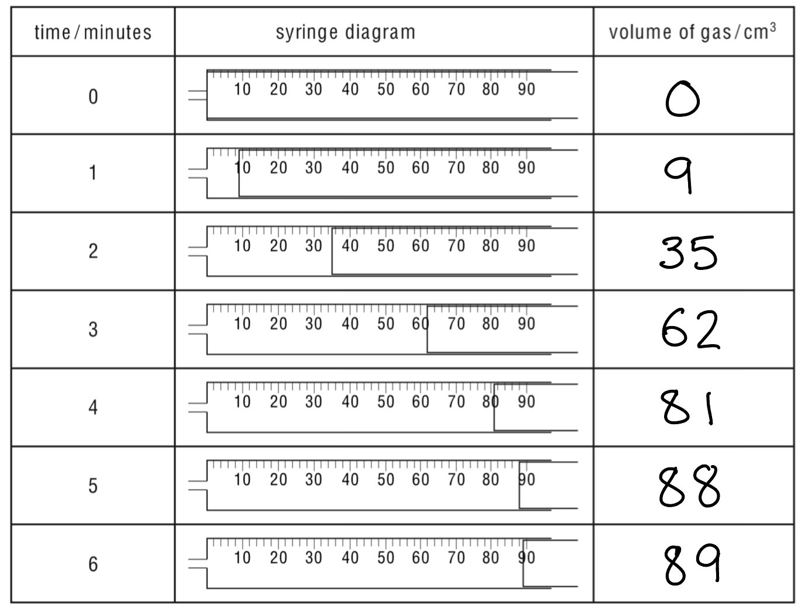

- All volumes correct; **[2 marks] **
*-1 for each incorrect answer*

**Final answer:** **[Total: 2 marks] **
b) The completed graph is:

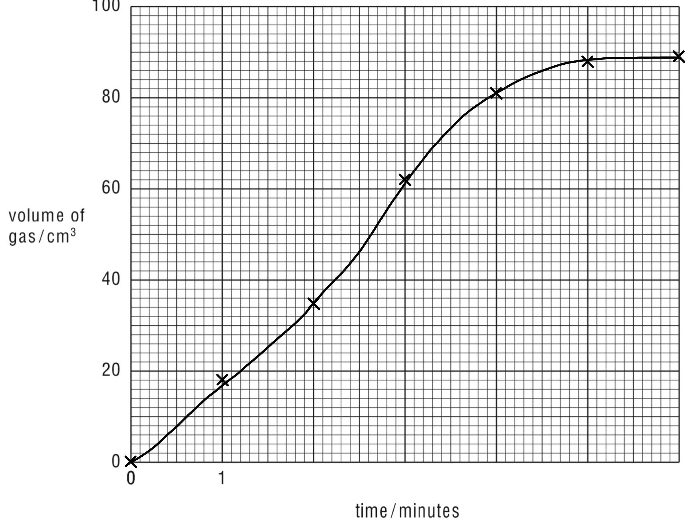

- Correctly plotted points; **[2 marks]**
- S-shaped curve joining all points; **[1 mark] **

**Final answer:** **[Total: 3 marks] **
c) The type of reaction is:

- Exothermic 
**OR** 
Displacement 
**OR** 
Oxidation 
**OR** 
Redox; **[1 mark] **

**Final answer:** **[Total: 1 mark] **

- *There are a variety of acceptable answers for this question *
- *Calcium reacts vigorously with cold water and the metal sinks to the bottom of the reaction vessel (unlike group 1 metals where they float)*
- *The reaction is:*

  - *Calcium + Water → Calcium hydroxide + Hydrogen *
  - *Ca + 2H**2**O → Ca(OH)**2** + H**2*
  - *Heat produced in this reaction*
d)

i) The changes in the speed of this reaction during the six minutes are:

Any** two **of the following:

- Slow at the start; **[1 mark] **
- Speeds up;** [1 mark] **
- Slows down at the end;** [1 mark] **

ii) Possible reasons for the changes are:

Any** two **of the following:

- Surface dirty at the start;** [1 mark] **
- Then clean; **[1 mark] **
- Calcium being used up; **[1 mark] **
- Reaction warms up; **[1 mark] **

**Final answer:** **[Total: 4 marks] **

- *The gradient of the line tells us how fast the reaction is, if it is steep then the reaction is fast, if it is shallow, the reaction is slower*
- *If the metal surface is dirty then the reaction will initially be slow as these impurities have to dissolve first before the water can reach the reacting surface*
- *As the reaction is exothermic, the reaction will speed up due to the increased kinetic energy of the practicals*

  - *There will then be more frequent successful collisions due to the increase in temperature*

### Q3
a) The volume of hydrogen from the syringe diagrams are;

0, 15, 45, 61, 73, 74, 80 and 80

- All correct;** [4 marks]**
 (-**1 mark **for each incorrect answer)

**[Total: 4 marks]**

- *Look to see what each interval represents on the scale*
- *The gas syringe has an interval every 2 cm**3** so if the plunger lines up with an interval, the volume will be an even number, if the plunger lies between 2 intervals, the volume will be an odd number*
b) The results plotted on the graph:

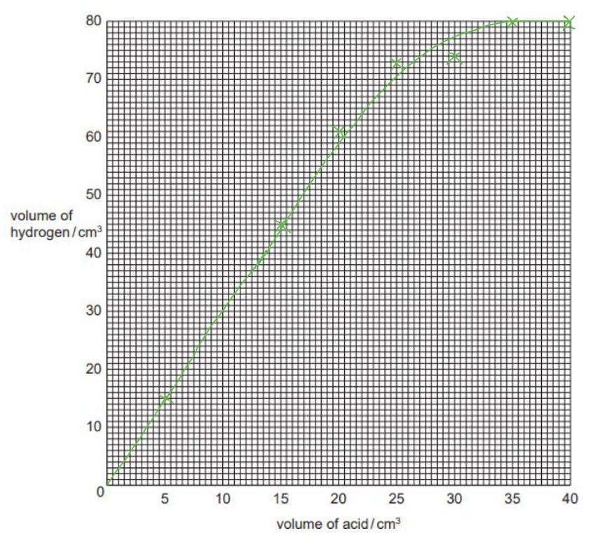

- All points plotted correctly; **[3 marks]**
 (-**1 mark** for each incorrect point)
- Smooth curve; **[1 mark]**

**[Total: 4 marks]**

- *The most common mistake when drawing graphs is to use the scale incorrectly*
- *Make sure that you find what the intervals on both axes are*

  - *In this case, on the x-axis, each square represents 0.5 cm**3*
  - *On the y-axis, each square represents 1 cm**3*
- *When drawing a line of best fit, try to get as many points on the line as possible, and, for those that don't fit on the line, an equal number of points above and below the line*
c) The volume of sulphuric acid that will produce 33 cm3  of gas is:

- Volume of acid from graph, 10.5 → 11.5 cm3;** [1 mark]**

**[Total: 1 mark]**

- *You should use the graph to draw a line from 33 cm**3** of gas on the y-axis to where it intersects your line of best fit*
- *Then, draw a line from this intersection to meet the x-axis and read off the volume of acid this corresponds to*
- *Remember to use a ruler *

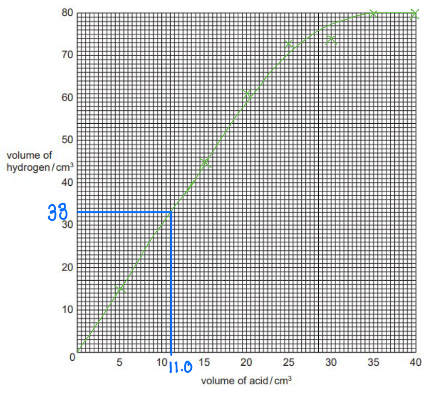
d) The volume of gas is produced if 10 cm3 of acid is used is:

- Volume of hydrogen from graph, 29.5 → 30.5;** [1 mark]**

**[Total: 1 mark]**

- *You should use the graph to draw a line from 10 cm**3** of acid on the x-axis to where it intersects your line of best fit*
- *Then, draw a line from this intersection to meet the y-axis and read off the volume of hydrogen this corresponds to*
- *Remember to use a ruler *

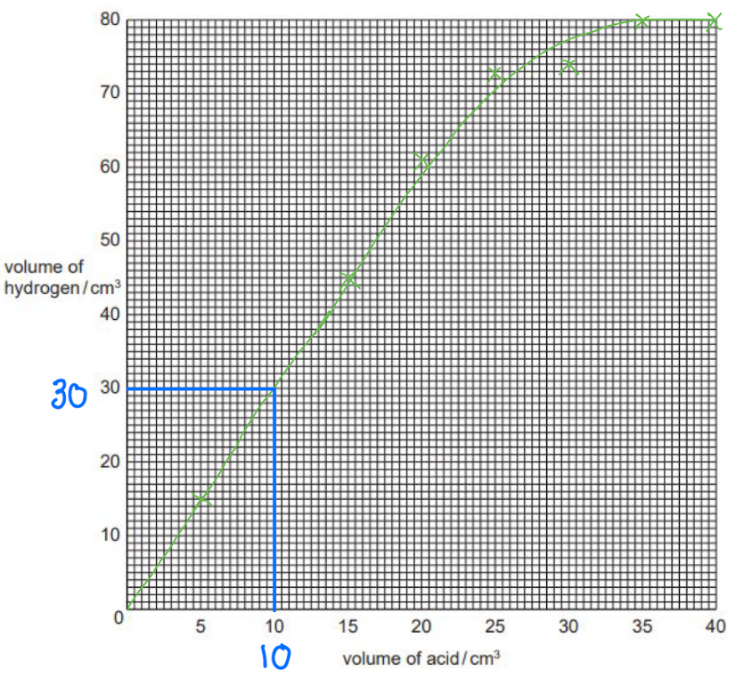

### Q4
a)

i) The smooth line is:

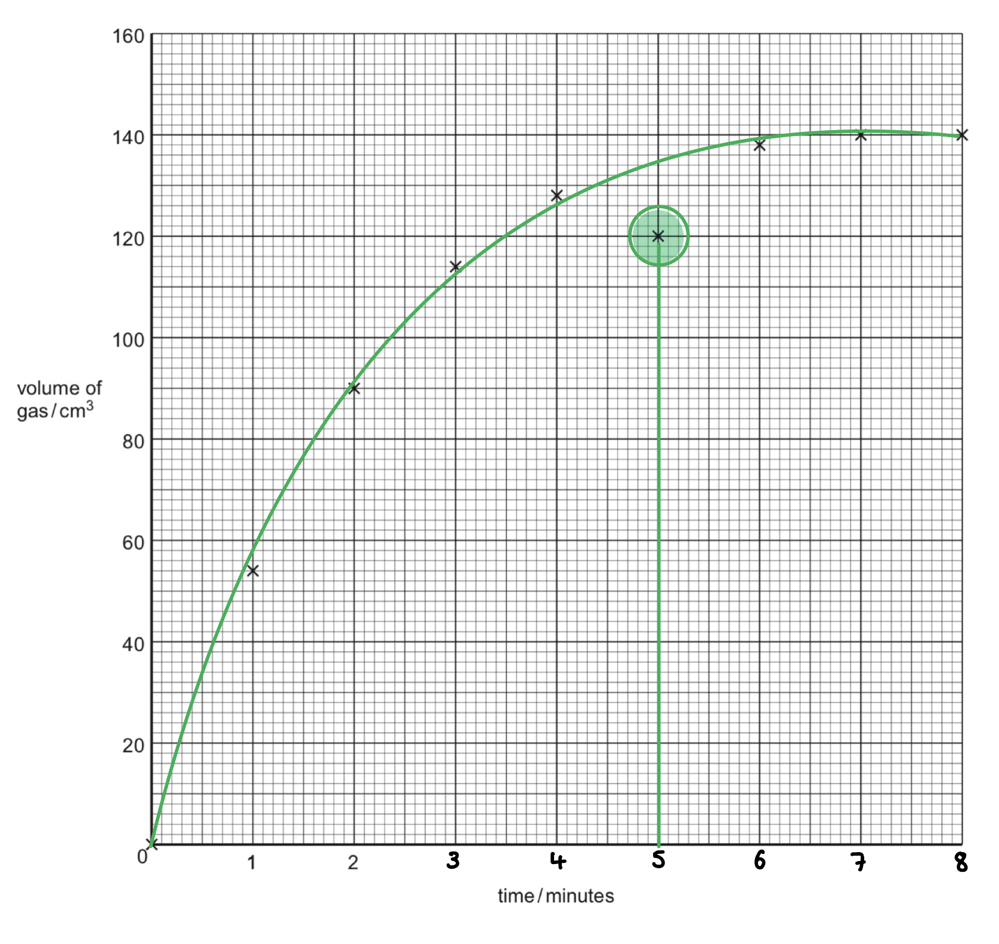

- Smooth curve of best fit; **[1 mark]**

ii) The inaccurate result is:

- Result at 5 minutes; **[1 mark]**
- Not on curve / gas escapes, gone down; **[1 mark] **

**[Total: 3 marks] **

- *For this result to occur, the rubber bung may not have been placed into the conical flask quickly enough once the catalyst had been added*
- *Therefore some gas could have escaped and the result / volume of gas would be lower than expected*
b) The mass of manganese(IV) oxide at the end of the experiment is:

- 0.8 g; **[1 mark] **

**[Total: 1 mark] **

- Catalysts are substances which speed up the rate of a reaction without themselves being altered or consumed in the reaction
- The mass of a catalyst at the beginning and end of a reaction is the same and they do not form part of the equation
c) Using a rubber connector with a hole in it would be:

- Reference to leak / loss of gas;** [1 mark] **

**[Total: 1 mark] **

- *The point of the gas syringe is to collect the gas formed *
- *If the gas can escape then the volume collected and recorded every minute will be lower than it should be*

### Q5
a) The completed table is:

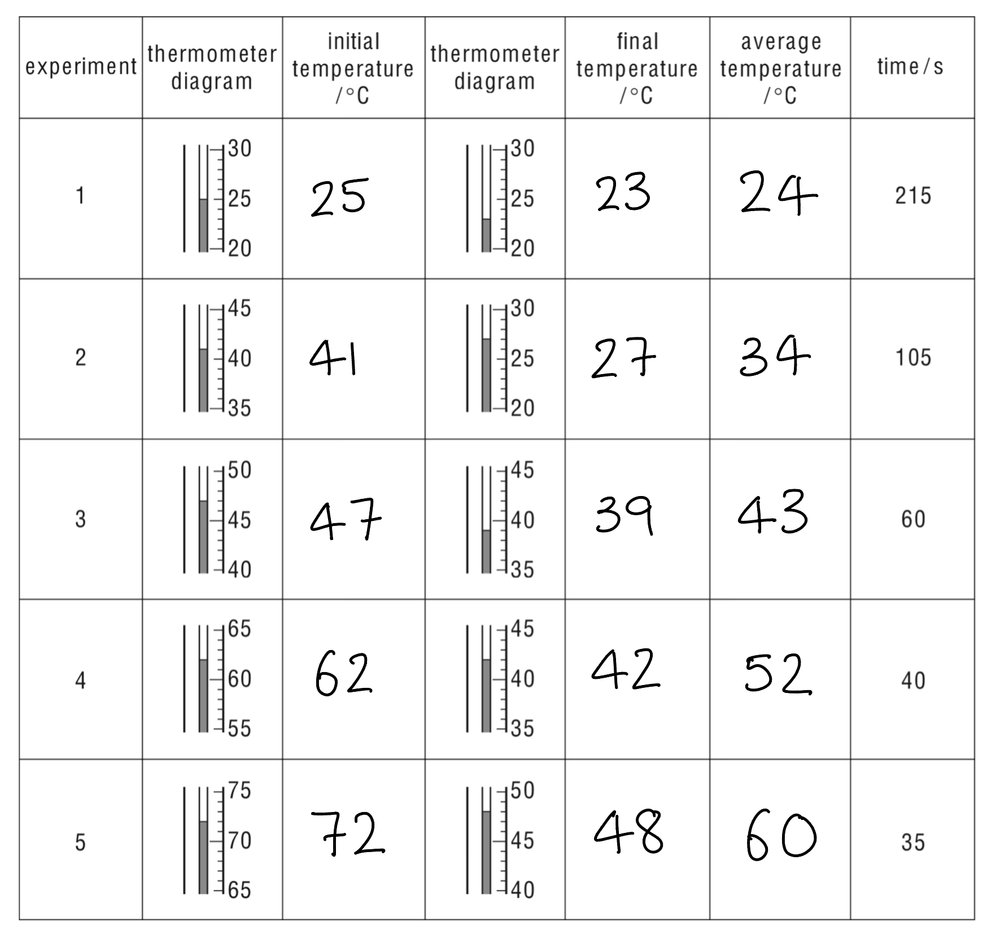

- All initial temperature boxes completed correctly; **[2 marks] **
- All final temperature boxes completed correctly; **[2 marks] **
- Average temperatures completed correctly; **[1 mark] **

**Final answer:** **[Total: 5 marks] **
b) The completed graph is:

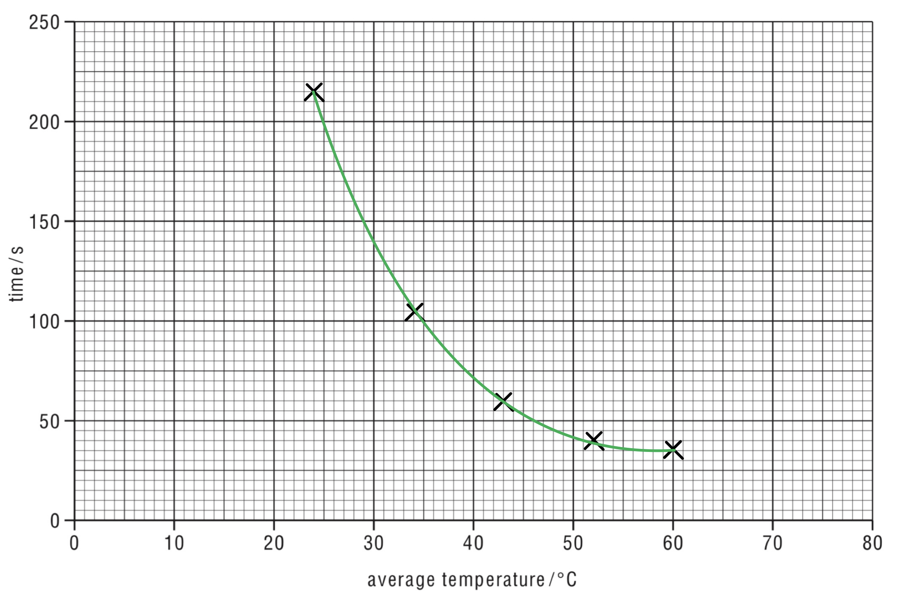

- Points plotted correctly; **[4 marks] **

*-1 for each incorrect point*

- Smooth line graph; **[1 mark] **

**Final answer:** **[Total: 5 marks] **
c) The time taken for the blue colour to appear if solution **L** was heated to 80 °C was:

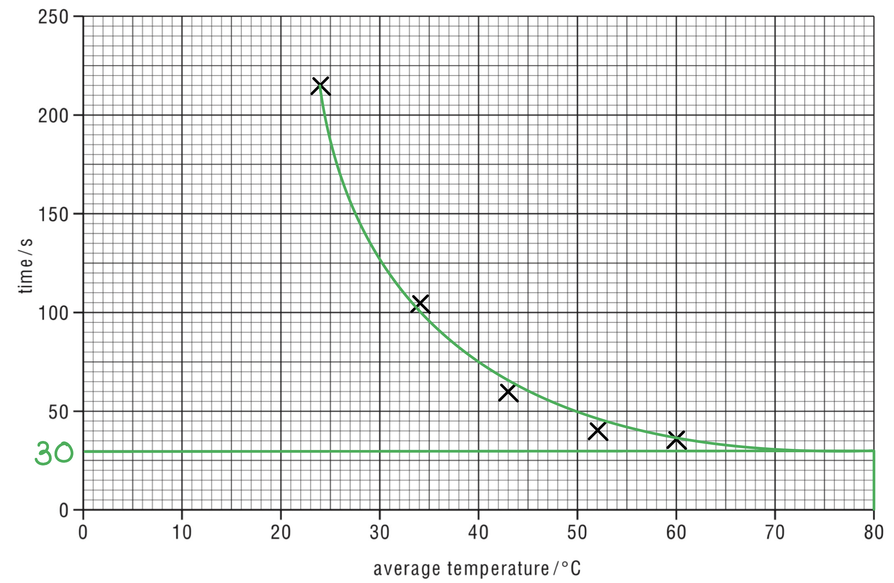

- Value from graph at 80°C ≈ 30–35 s; **[1 mark] **
- Extrapolation shown on grid; **[1 mark] **

**[Total: 2 marks] **

- *Following the smooth curve to 80 °C we arrive at a time of 30 s*
- *Extending your line of best fit is credited and you are asked to clearly show your working*
d) The purpose of the starch solution in the experiments is:

- To act as an indicator / check iodine present; **[1 mark] **

**Final answer:** **[Total: 1 mark] **

- *Starch turns from brown to a deep blue / black when iodine is present, so is useful as an indicator for the presence of iodine in a solution *
e)

i) The experiment that the reaction speed was the fastest is:

- Experiment 5; **[1 mark] **

ii) This experiment was the fastest because:

- Highest temperature;** [1 mark]**
- Particles have more energy / more collisions / move faster; **[1 mark]**

**Final answer:** **[Total: 3 marks] **

- *The higher the temperature, the faster the rate of reaction *
- *This is because the particles will have more kinetic energy than the required activation energy*
- *Therefore there will be more frequent collisions **and **a higher proportion of particles have energy greater than the activation energy*
- *This causes more successful collisions per second, increasing the rate of reaction*

  - *Make sure you state successful collisions per unit time when explaining this relationship *
f) Reducing the concentration for Experiment 5 would:

- Time longer / more / increase; **[1 mark] **
- Speed slower / decrease;** [1 mark] **

**Final answer:** **[Total: 2 marks] **

- *Decreasing the concentration of a solution will decrease the rate of reaction *
- *This is because there will be fewer reactant particles in a given volume meaning fewer frequent and successful collisions per second, reducing the rate of reaction*
- *The number of collisions is proportional to the number of particles present*
g) A burette used to measure solution **L** instead of a measuring cylinder as it is:

- More accurate; **[1 mark]**

**Final answer:** **[Total: 1 mark] **

- *A burette is a piece of equipment used to deliver controlled more precise amounts of a liquid than a measuring cylinder as there is a smaller uncertainty associated with each measurement, and the scale is more finely divided*

  - *Therefore it is more accurate *

### Q6
a) The smooth curve should be:

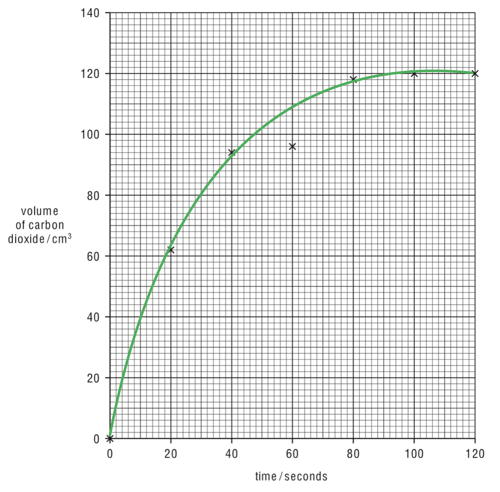

**[Total: 1 mark] **
b) The result that appears to be incorrect is:

- Result at 60 s; **[1 mark]**
- Not on curve or similar;** [1 mark] **

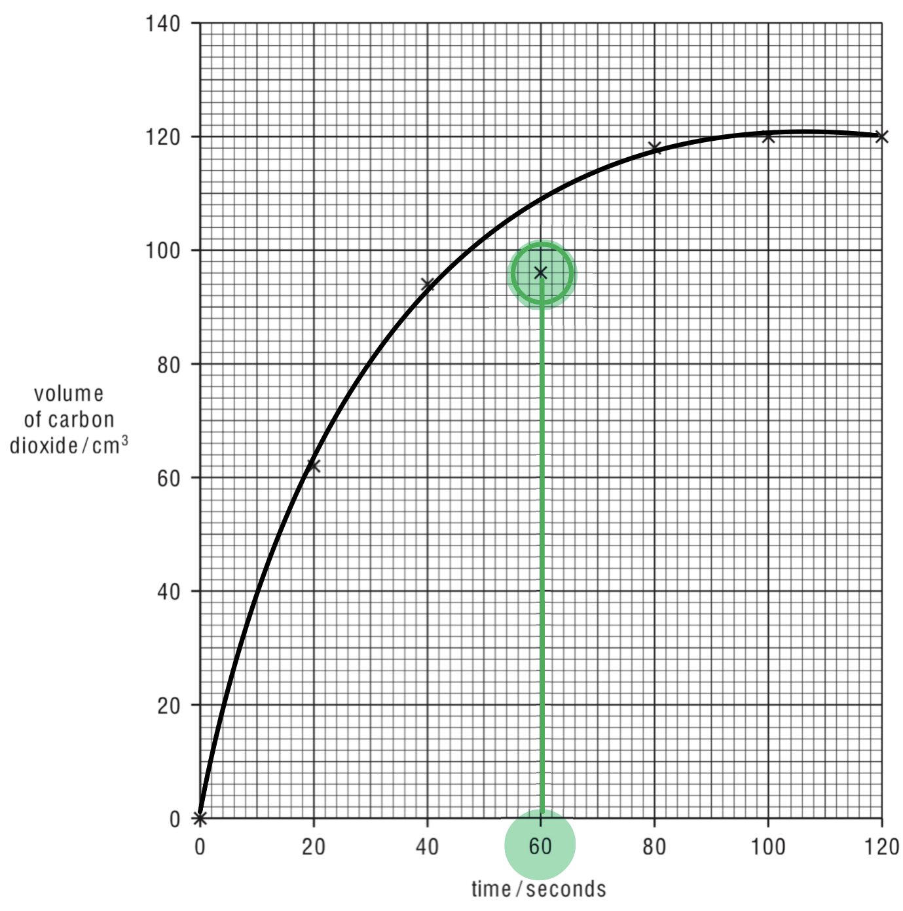

**[Total: 2 marks] **

> *The plot that appears incorrect does not fit into the line of best fit  *
c) The reaction slows down because:

- Calcium carbonate is being used up / acid gets more dilute; **[1 mark] **

**[Total: 1 mark] **

- *During the course of the reaction, reactant molecules begin to form products *
- *Therefore the concentration decreases as time passes *

### Q7
a) The completed table is:

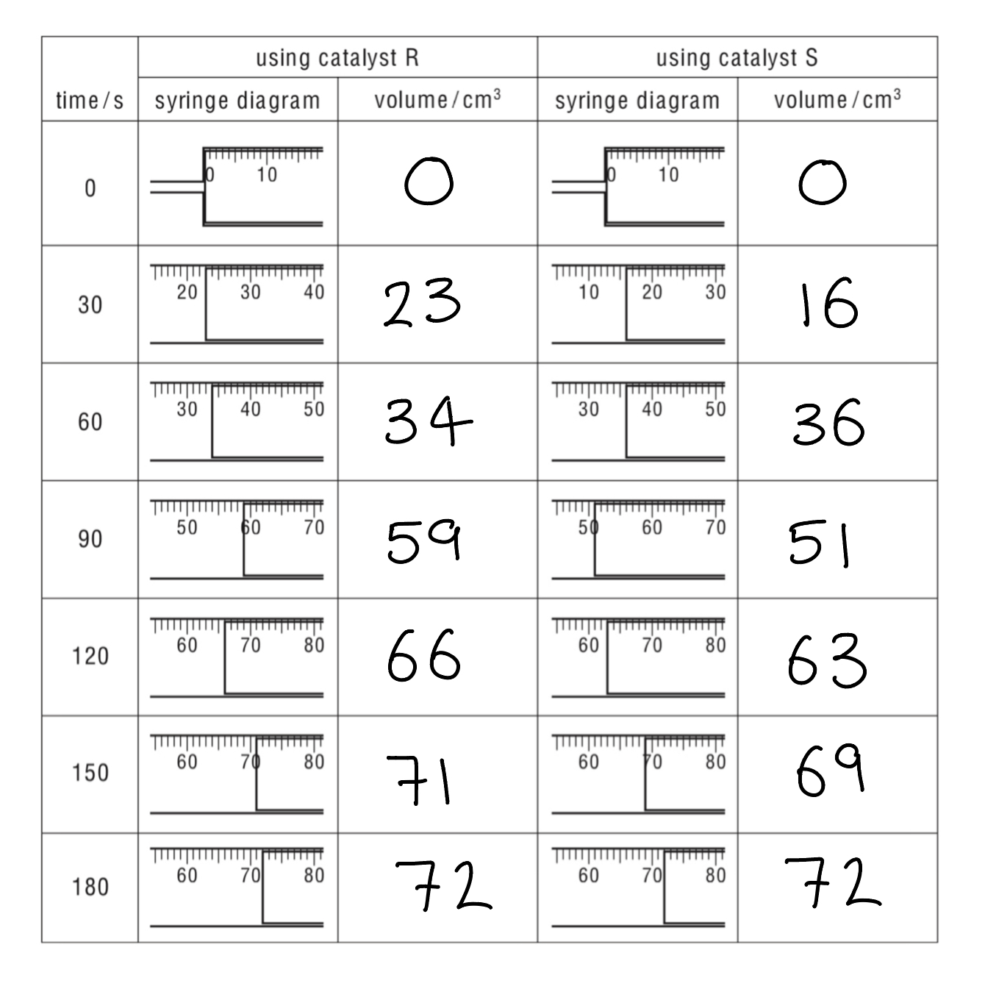

- Volumes completed correctly; **[4 marks] **

*-1 mark for each incorrect reading*

**Final answer:** **[Total: 4 marks] **

- I*n these diagrams the plunger is travelling from left to right during the course of the reaction *
b) The completed graph is:

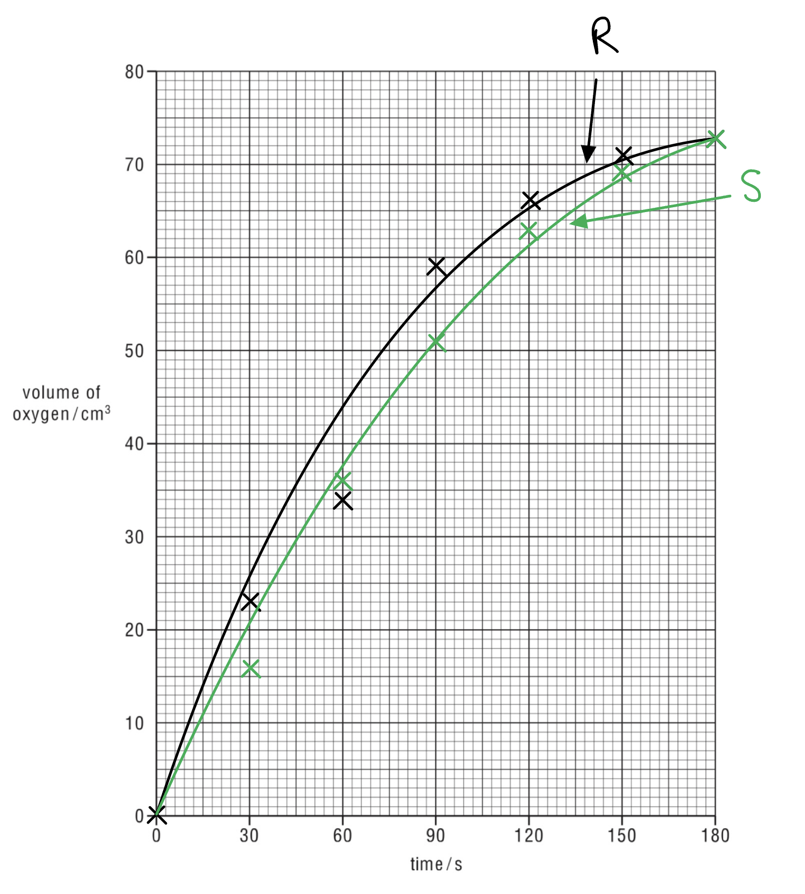

- Points plotted correctly;** [3 marks] **
- Smooth curves; **[2 marks] **
- Labels;** [1 mark] **

**Final answer:** **[Total: 6 marks] **

- *Take your time plotting graphs as it is easy to make a mistake*
- *You can use a ruler to help read from the axes much more easily*
- *Also makes sure you use x's as they will be much easier for the examiner to see and will not be covered up by the line of best fit*
c) The result using catalyst **R** that is inaccurate:

- Result at 60 s / volume 34 / third result;** [1 mark] **

**Final answer:** **[Total: 1 mark] **

- *This results does not fit in with the line of best fit therefore it is an anomaly *
d) The better catalyst is:

- R; **[1 mark]**
- Rate faster; **[1 mark]  **

**Final answer:** **[Total: 2 marks] **

- *The gradient for the curve using catalyst **R** is steeper, therefore it is the faster reaction *
- *'Better' is a very general word but as catalysts are used to increase the rate of a reaction then a catalyst would universally be described as better if the rate increases the most, it is not subjective!*
e) If the reaction using catalyst **R** is repeated the graph would look like:

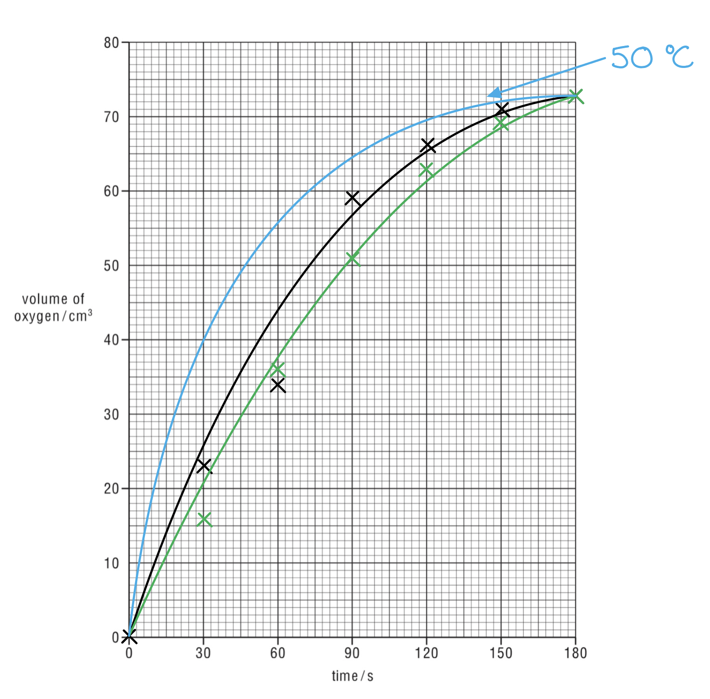

- Sketch to left of R graph / steeper; **[1 mark] **
- To same level; **[1 mark] **

**Final answer:** **[Total: 2 marks] **

- *50 °C is a higher temperature than was used in the original experiment *
- *As temperature increases, the rate of reaction increases *
- *Therefore the gradient of the line must be steeper*
- *The volume of hydrogen peroxide and mass of catalyst **R** are the same, therefore the same volume of oxygen is formed at the end of the reaction*

### Q8
a) The completed graph is:

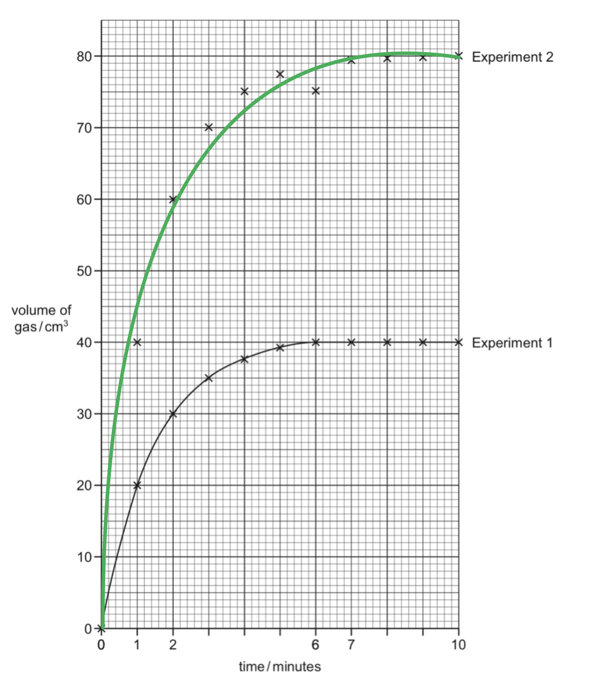

- Smooth curve missing anomalous point; **[1 mark] **

**Final answer:** **[Total: 1 mark] **

- *Completing the graph means drawing in the line of best fit, however there is an anomalous result which must be missed out*
- *The line of best fit is a smooth curve - the dots should not be joined up together *
b)  The composition of the mixture used in Experiment 2 is:

Composition of mixture:

- Double volume / 100 cm3 of hydrogen peroxide; **[1 mark] **
- More than 1 g of manganese(IV) oxide / powdered; **[1 mark] **

*   Ignore: references to water* *   Double the concentration is valid for (2)*

Explanation:

- Double volume of gas; **[1 mark]**
- Faster reaction;** [1 mark] **

**Final answer:** **[Total: 4 marks] **

- *The volume of oxygen gas formed in experiment 1 is 40 cm**3 **and the volume formed in experiment 2 is 80 cm**3*
- *Therefore the reaction mixture must contain double the volume of hydrogen peroxide *
- *Doubling the concentration of hydrogen peroxide will also have the same effect as there will be twice the number of particles in the same volume *
- *As the gradient of the curve is steeper, the mixture must also contain more manganese dioxide *
- *This will cause a faster rate of reaction*
c) The function of the manganese(IV) oxide is:

- Catalyst / increase the rate of the reaction; **[1 mark] **

**Final answer:** **[Total: 1 mark] **

- *The overall reaction that is occurring is:*

  - *2H**2**O**2** → 2H**2**O + O**2*
  - *This happens very slowly at room temperature *
  - *Manganese(IV) oxide is a common catalyst for this reaction*
d) The curve that you would expect if Experiment 1 was repeated at 10 °C is:

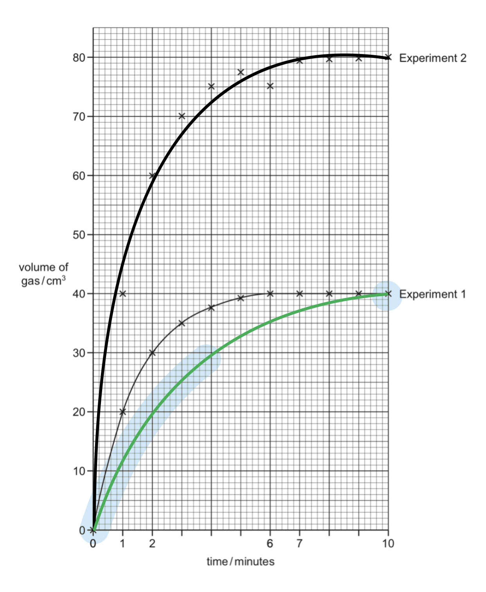

- Sketch graph less steep than original for Experiment 1; **[1 mark] **
- To same level; **[1 mark]**

**Final answer:** **[Total: 2 marks] **

- *There are two points to consider when sketching this new curve:*

  - *The reaction takes place at a lower temperature *
  
    - *Therefore the rate will be slower, meaning the graph is less steep*
  - *The reaction contains the same volume of hydrogen peroxide and the same mass of manganese dioxide *
  
    - *Therefore the reaction will form the same volume of oxygen gas, meaning the graph ends at the same point*

### Q9
An investigation to show that copper(II) oxide is a suitable catalyst for this reaction is:

Step 1: Proving catalysis & measuring the rate

Any **five** from: (1 mark per point and 5 marks maximum)

- Measure a specific volume of hydrogen peroxide solution using a measuring cylinder / pipette / burette; **[1 mark]**
- Weigh a specific mass of copper(II) oxide using a balance / electronic balance; **[1 mark]**
- Place the hydrogen peroxide in a conical flask and connect it to a gas syringe / an inverted measuring cylinder over a trough of water; **[1 mark]**
- Start a stopwatch/timer and measure the volume of gas collected at regular intervals / measure the time taken to collect a specific volume of gas; **[1 mark]**
- Test the gas produced using a glowing splint which relights to confirm the gas is oxygen; **[1 mark]**
- Describe running a control experiment under identical conditions without copper(II) oxide to show that little or no gas is produced; **[1 mark]**

Step 2: Showing the catalyst is chemically unchanged

- Filter the mixture at the end of the reaction to collect the copper(II) oxide as the residue; **[1 mark]**
- Wash the residue with distilled water 
**AND **
Dry the solid to constant mass between filter papers / in a warm place / in a drying oven; **[1 mark]**
- Reweigh the dry residue to show that the final mass is identical to the starting mass (and remains a black powder; **[1 mark]**

**[Total: 8 marks]**

> **[exam-tip]**
> Use precise measurement language: "volume" for liquids and "mass" for solids. Writing "amount" for either may lose you the mark.
> 
> You must include a control experiment (hydrogen peroxide without copper(II) oxide) to prove the catalyst made a difference. Without this comparison, you have not shown catalysis.
> 
> Measure the volume of gas produced at regular time intervals, not just the total time for the reaction to finish.
> 
> Do not forget the glowing splint test to confirm the gas is oxygen.
> 
> For Step 2, you must describe a practical method: filter, wash, dry, and reweigh. Simply stating the catalyst is "unchanged" or describing its appearance earns no marks.
> 
> Wash and dry the filtered copper(II) oxide before reweighing. Wet residue will weigh more than the original mass and will not prove the catalyst is unchanged.

### Q10
a)  The table of results:

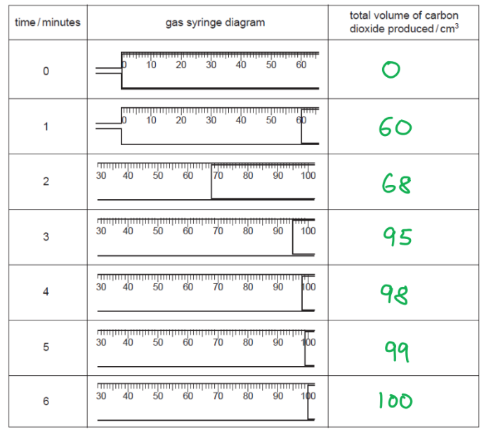

- All values correct; **[4 marks]**
- –1 for each incorrect value

**[Total: 4 marks]**
b)  The results plotted on the graph:

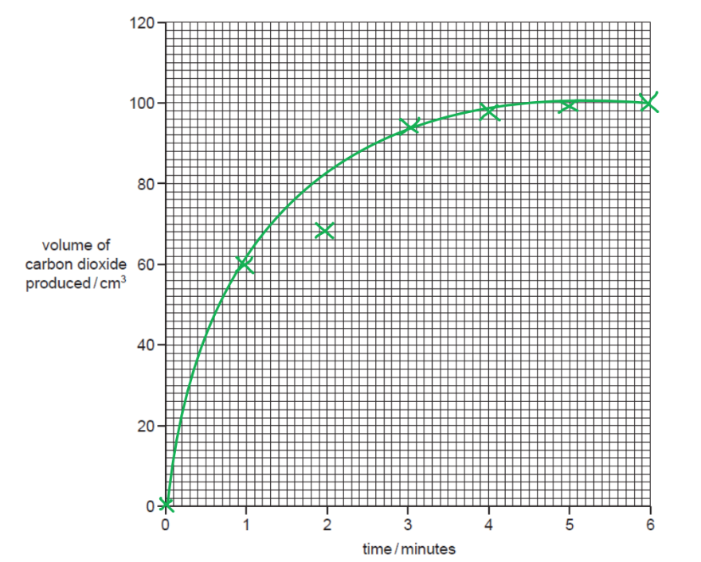

- All the points plotted correctly; **[3 marks]**
- A smooth curve; **[1 mark]**

**[Total: 4 marks]**
c)  The point which appears to be inaccurate:

- 2 minutes; **[1 mark]**
- It does not fit the curve;** [1 mark]**

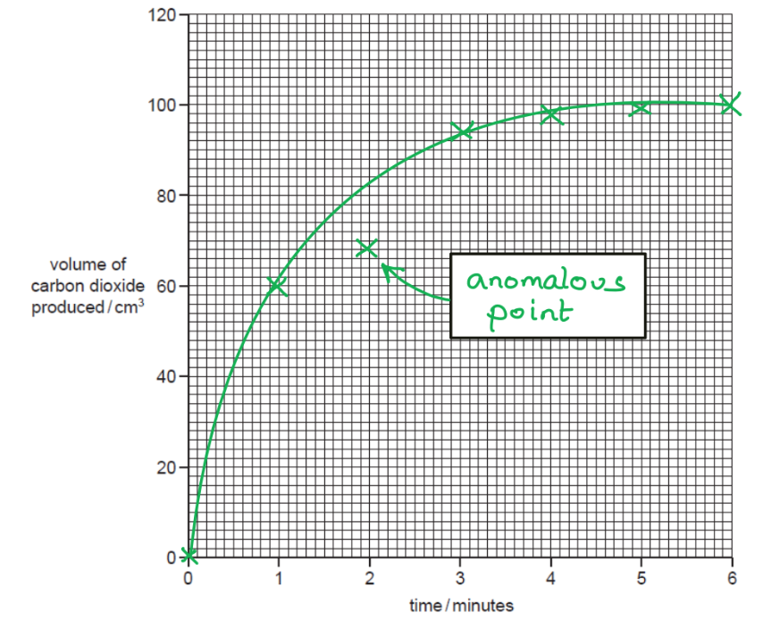

**[Total: 2 marks]**
d)  The graph you would expect if the experiment was repeated using nitric acid at a temperature of 60°C:

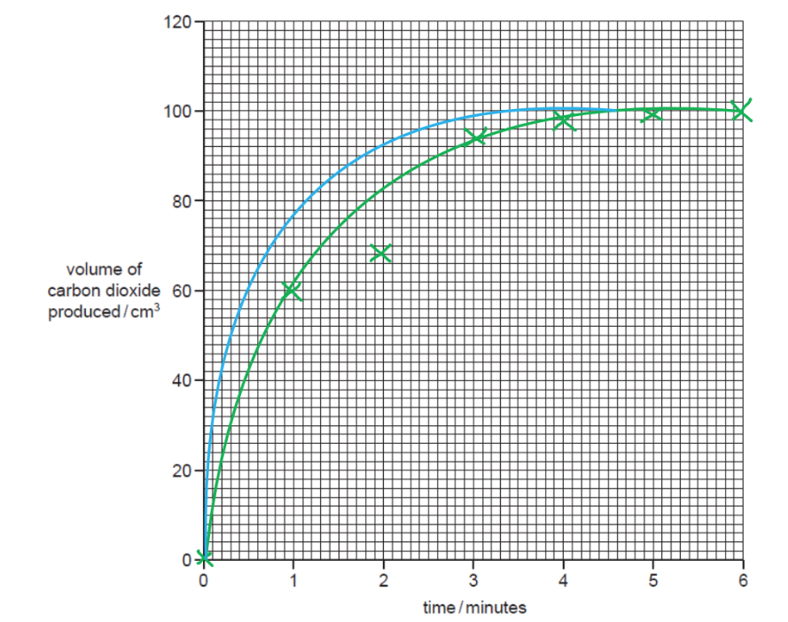

- The curve is steeper;** [1 mark]**
- The curve levels out at same volume; **[1 mark]**

**[Total: 2 marks]**

- *The reaction temperature is higher so the rate of reaction will be faster*
- *A faster rate of reaction means a steeper gradient on the curve*
- *However, the total volume of hydrogen will not change as the same amount of reactants are present, so the graph must level out at the same volume*

### Q11
a) The completed table is:

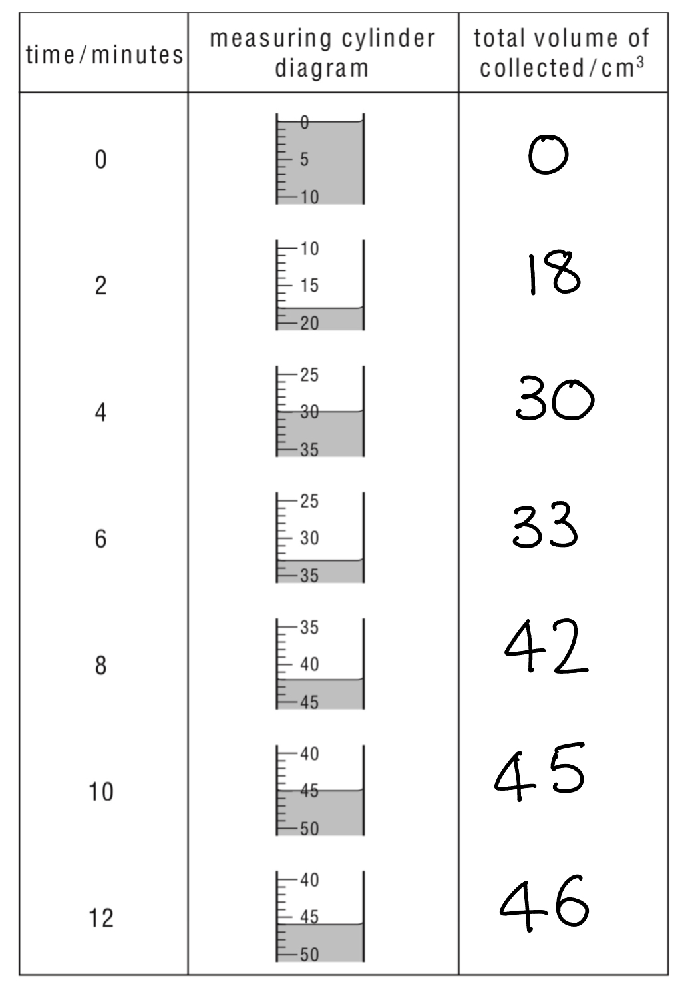

**Final answer:** **[Total: 3 marks] **

- *You are giving the reading for the amount of gas that has been added to the cylinder, not the water that is remaining *
- *Note that the measuring cylinder numbers are counting down from top to bottom*
b) The completed graph is:

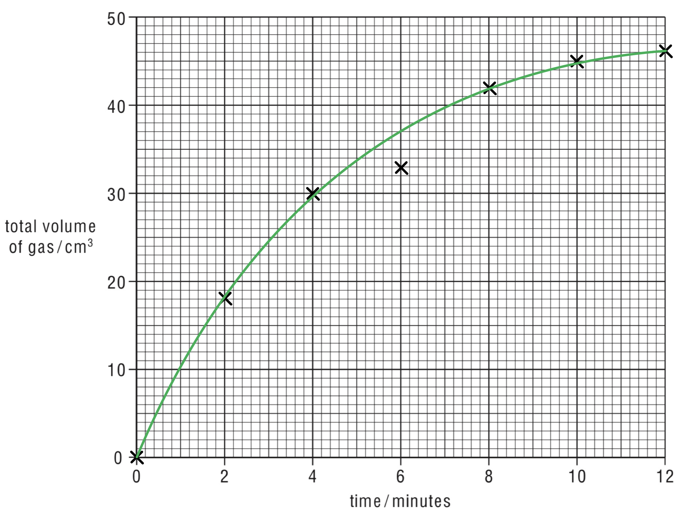

- All points plotted correctly: **[2 marks]  ***––1 for any incorrect*
- **Smooth line graph; [1 mark]**

**Final answer:** **[Total: 3 marks] **

- *The line of best fit should not include any anomalous results even if it is a curve*
- *It should just have one smooth curve which will only contain one bend*
c)

i) The result appears to be inaccurate at:

- 6 minutes; **[1 mark] **

ii)  The correct volume at 6 minutes should be:

- 37-38 cm3; **[1 mark] **

**Final answer:** **[Total: 2 marks] **

- *You are not asked to show how you arrived at your answer for part c) ii) but it is always good practice doing so*
- *Often you are asked to show your working out on the graph*
- *This also allows the examiner to see if there are any errors that can be carried forward and given credit *

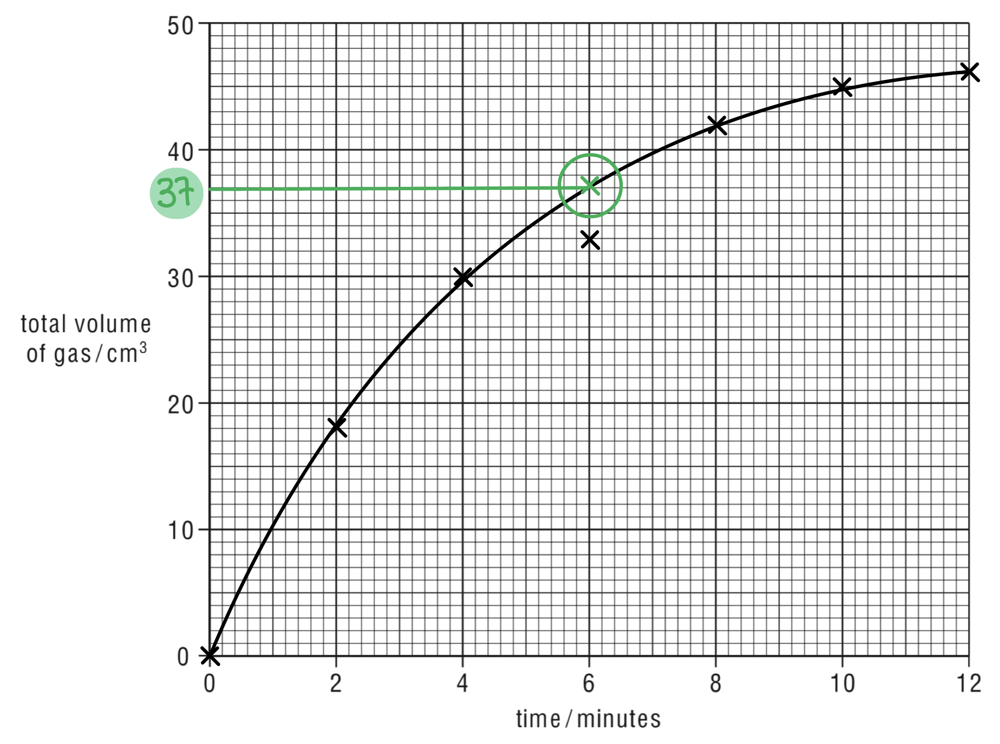

### Q12
a) **Two **variables which were kept the same in the investigation are:

Any **two** from:

- Volume;** [1 mark]**
- Concentration of acid; **[1 mark]** *Allow amount*
- Volume of sodium thiosulfate / total volume of solution;** [1 mark]**
- Temperature;** [1 mark]**
- Printed sheet;** [1 mark]**
- Same size flask;** [1 mark]** *Ignore reference to pressure / catalyst / surface area / light*

**[Total: 2 marks]**

- *This experiment is to investigate the effect of changing concentration of sodium thiosulfate solution on the speed of the reaction*
- *The independent variable is the variable that you alter - in this case, the concentration of sodium thiosulfate solution*
- *The dependent variable is the variable that you measure - in this case, the speed of the reaction*
- *Everything else in the experiment should be kept the same so that the test is fair*
- *It is not uncommon for students to name either the independent or dependent variable in this type of question, so be clear what they are and don't say you should control them!*
b) A suitable line of best fit is:

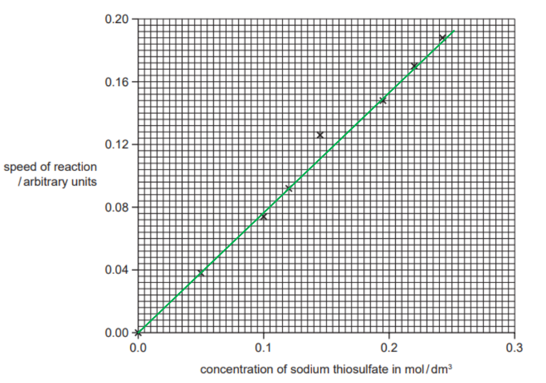

- A straight line drawn with a ruler, missing anomalous point but touching all other points;** [1 mark]** Not multiple lines

**[Total: 1 mark]**

- *When drawing a line of best fit:*

  - *ignore any anomalous points*
  - *try to get as many points on the line as possible, and, for those that don't fit on the line, an equal number of points above and below the line*
c) Two reasons why not all of the points lie on the line of best fit are:

Any **two **sensible errors from

- Qualified measurement error e.g. volume; **[1 mark]**
- Qualified timing error; **[1 mark]**
- Recording error; **[1 mark]**
- Plotting error; **[1 mark]**
- Temperature variation; **[1 mark]**
- Contamination from previous experiment; **[1 mark]** *Not systematic error*

**[Total: 2 marks]**

- *Anomalous errors occur due to random errors*
- *Systematic errors are those errors that are repeated for every reading so all of the readings would be out by a consistent value, not just give rise to one anomalous result*
d) The speed of reaction when the concentration of sodium thiosulfate is 0.075 mol/dm3 is:

- 0.056–0.064 range; **[1 mark]**
- Indication on graph; **[1 mark]**

**[Total: 2 marks]**

- *You should use the graph to draw a line from 0.75 mol/dm**3** on the x-axis to where it intersects your line of best fit*
- *Then, draw a line from this intersection to meet the y-axis and read off the speed of reaction this corresponds to*
- *Remember to use a ruler and to take care with the scale on the graph:*

  - *Each square on the x-axis represents 0.005 mol/dm**3*
  - *Each square on the y-axis represents 0.004 arbitrary units for speed of reaction*
- *An example of how to use the graph is:*

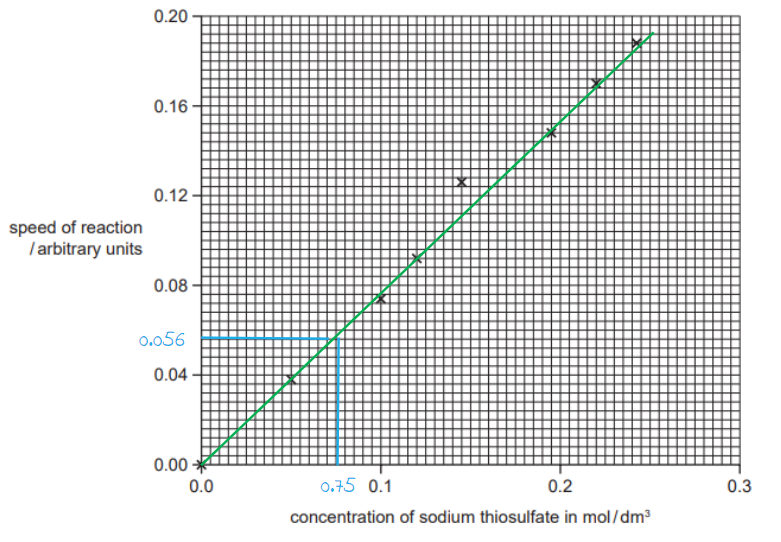
e) The speed of reaction increases when the concentration of sodium thiosulfate is increased because:

- More particles / particles closer together; **[1 mark]**
- More frequent collisions / more collisions per unit time; **[1 mark]**

**[Total: 2 marks]**

- *When explaining why the speed of reaction increases using collision theory, you must not just state 'more collisions'*
- *You need to indicate a time frame by stating the collisions happen more frequently or there are more collisions per second is also an acceptable response*
f) If the experiments were repeated at a higher temperature the line would be shown on the graph by:

- A sketched straight line to the LEFT of the original; **[1 mark]**

**[Total: 1 mark]**

- *At higher temperatures the speed / rate of the reaction would be greater which would be shown as:*

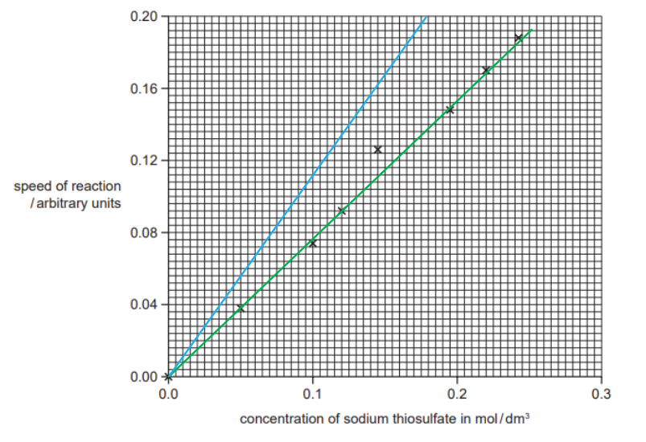

### Q13
a) The completed table is:

| **Experiment ** | **Solution of hydrochloric acid** | **Volume of gas collected / cm****3** |
|---|---|---|
| 1 | **P** | 21 |
| 2 | **Q** | 24 |
| 3 | **R** | 39 |
| 4 | **S** | 47 |
| 5 | **T** | 56 |

- Volumes of gas correctly completed; **[3 marks] **
*- 1 for each incorrect*

> *[Total: 3 marks] *
b) The completed graph is:

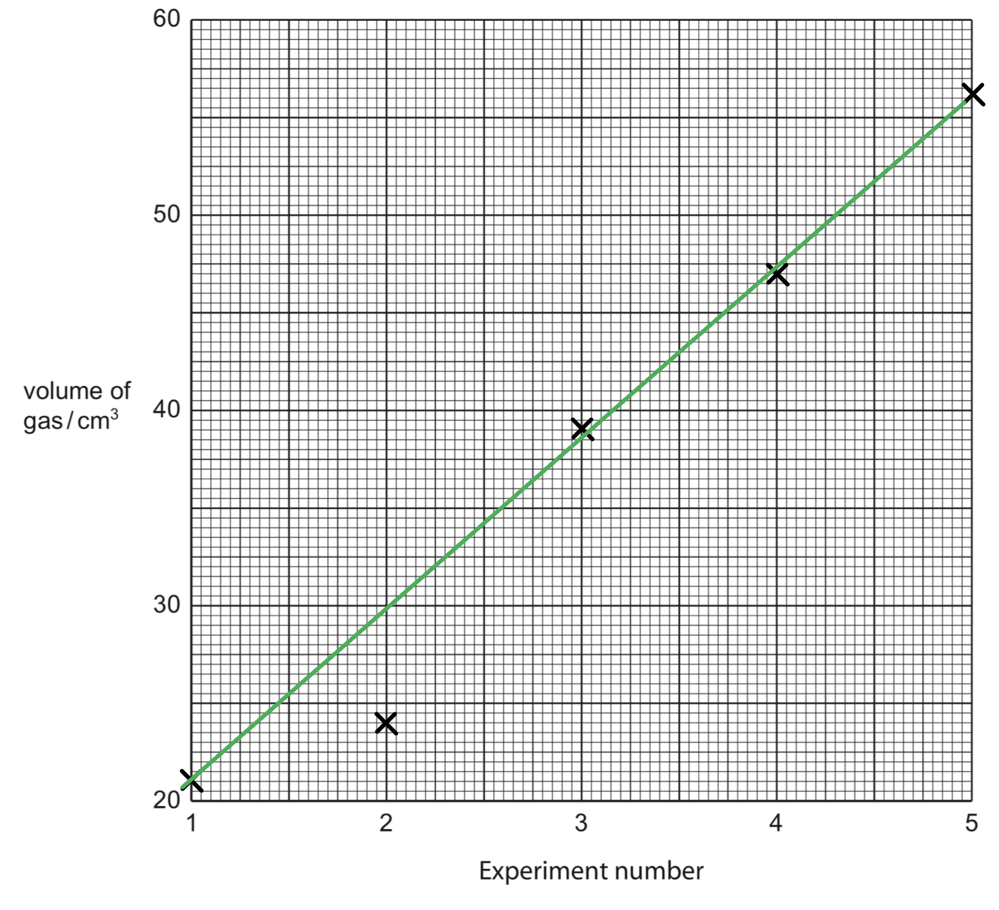

- Points correctly plotted in graph; **[3 marks]** 
*- 1 for each incorrect*
- Straight line; **[1 mark] **

**Final answer:** **[Total: 4 marks] **

- *The most common mistake when drawing graphs is to use the scale incorrectly*
- *Make sure that you find what the intervals on both axis are*

  - *In this case, on the x-axis is the experiment number set out on each bold line *
  - *On the y-axis, each square represents 0.5 cm**3*
- *When drawing a line of best fit, try to get as many points on the line as possible, and, for those that don't fit on the line, an equal number of points above and below the line*
- *If a value is clearly anomalous do not try to compensate for it, ignore it when drawing the line*
c) The inaccurate result is:

- Experiment 2; **[1 mark] **
- Not on line;** [1 mark] **

**Final answer:** **[Total: 2 marks] **

- *The inaccurate result in Experiment 2 is described as an anomaly as it does not follow the pattern / trend in results demonstrated by the line of best fit*
d)

i) The experiment that had the fastest rate of reaction is:

- Experiment 5; **[1 mark] **

ii) This reaction is the fastest because:

- Strongest / more concentrated acid; **[1 mark] **
- More (frequent) collisions; **[1 mark] **

**Final answer:** **[Total: 3 marks] **

- *Increasing the concentration of a solution will increase the rate of reaction*
- *This is because there will be more reactant particles in a given volume, allowing more frequent and successful collisions per second, increasing the rate of reaction*
e) The student would know which of the reactants in the experiment was in excess by:

- Marble chip visible; **[1 mark] **
- Acid used up;** [1 mark] **

**Final answer:** **[Total: 2 marks] **

- *If a reactant is in excess there will be some 'left over' at the end of the reaction *
- *If the marble chip is in excess it will be visible at the end of the reaction*

  - *There will be lumps left over*
- *If the acid was in excess, the marble chip will completely dissolve *
f)

i) One possible source of error is:

- Size of chips different / starting the timer; **[1 mark] **

ii) One improvement is:

- Measure the mass of chips / time individual experiments; **[1 mark] **

**Final answer:** **[Total: 2 marks] **

- *The size of each marble chip varies*
- *The marble chips could also be ground to a powder and then weighed out - this would increase the rate of reaction for all of the experiments and make it easier to measure out consistent masses*

### Q14
a) The completed table is:

- All correct; **[3 marks]**
 -1 for each incorrect answer

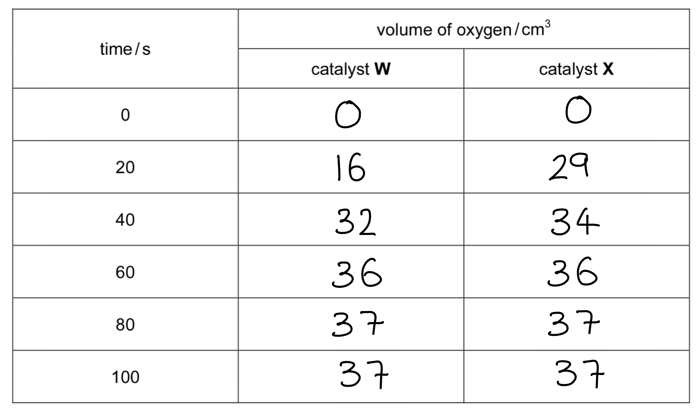

**Final answer:** **[Total: 3 marks] **
b) The completed graph is:

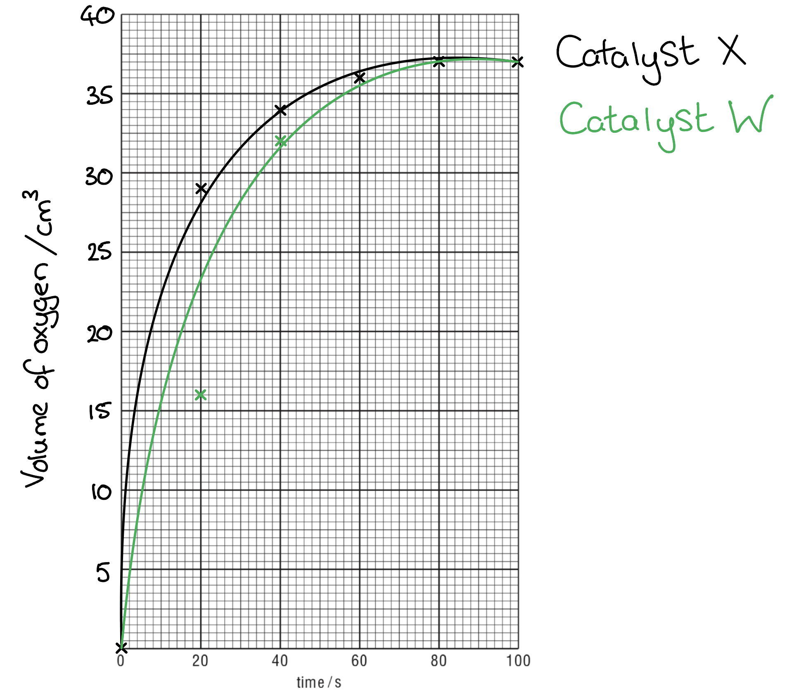

- Choice of suitable scale for y-axis;** [1 mark] **
- All points correctly plotted;** [3 mark] **
- Smooth curves; **[1 mark] **
- Labelled; **[1 mark] **

**Final answer:** **[Total: 6 marks] **

- *Some of the plotted points from catalysts **W** and **X** overlap one another so it can be difficult to distinguish between both lines of best fit*

  - *Therefore it is often easier to plot one line completely before adding the second points and line in*
- *Make sure your lines of best fit are clearly labelled*
c) The better catalyst is:

- Solid **X**; **[1 mark] **
- Faster reaction / more gas given off at 20 / 40 s; **[1 mark] **

**Final answer:** **[Total: 2 marks]  **
d)

The final volume of oxygen was the same in each experiment because:

- Same volume of hydrogen peroxide used in both experiments; **[1 mark] **

**Final answer:** **[Total: 1 mark] **

- *Hydrogen peroxide breaks down into water and oxygen*

  - *2H**2**O**2** → 2H**2**O + O**2*
- *If the volume and concentration of hydrogen peroxide are the same for each experiment, the volume of oxygen produced will also be the same, even if a different catalyst is used *
e) The shape of the graph you would expect if the reaction with catalyst **X **was repeated at 40 °C.

- Line sketched on the grid with a steeper slope than for catalyst **X** at 25 °C; **[1 mark]**
- Levelling out at same level; **[1 mark] **

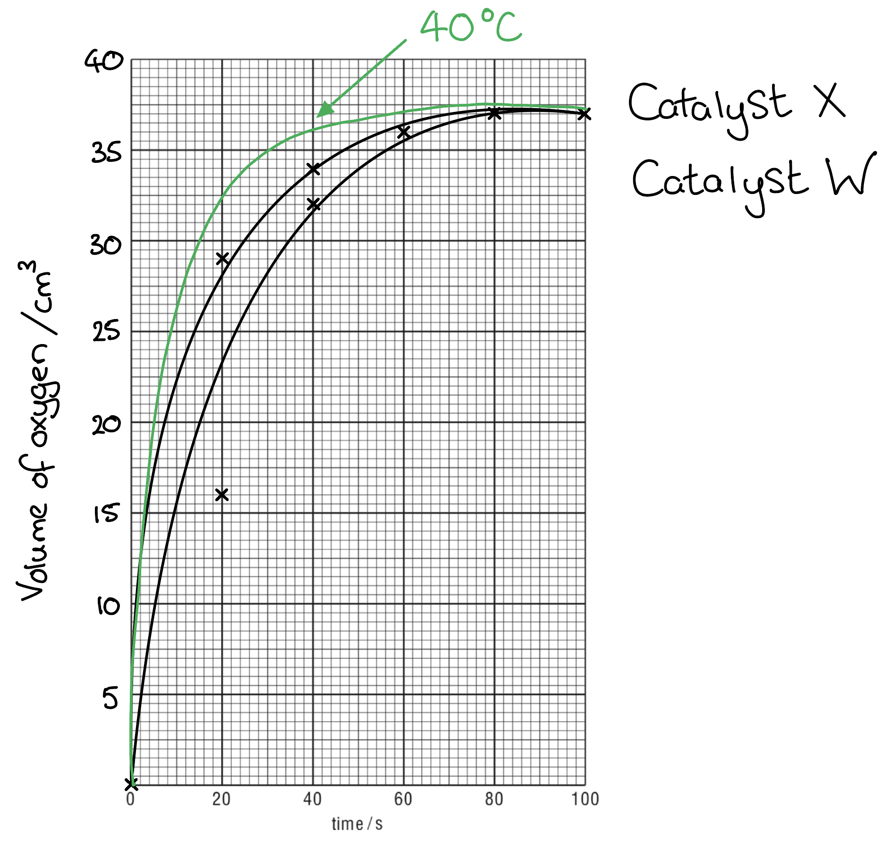

**Final answer:** **[Total: 2 marks] **

- *The higher the temperature the faster the rate of reaction *
- *This is because the particles will have more kinetic energy than the required activation energy*
- *Therefore there will be more frequent collisions **and **a higher proportion of particles have energy greater than the activation energy*
- *This causes more successful collisions per second, increasing the rate of reaction*

  - *Make sure you state successful collisions per unit time when explaining this relationship *
  - *This is now expected in more up-to-date mark schemes *

### Q15
a) The completed table is:

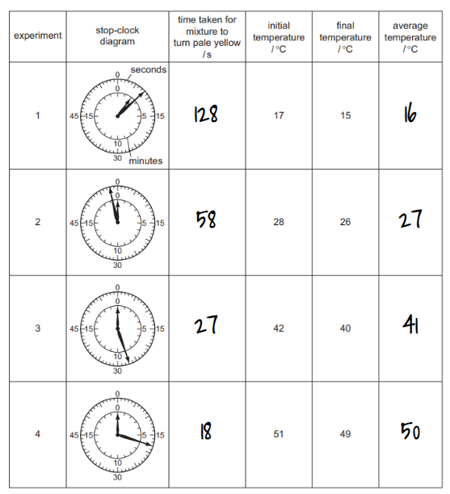

- Average temperature boxes completed correctly: 16, 27, 41, 50; **[2 marks]**
- Times completed in seconds correctly: 128, 58, 27, 18; **[2 marks]** 
*In each column, 4 correct = ***[2 marks]***, 3 correct = ***[1 mark]**

**[Total: 4 marks]**

- *You have to consider both hands on the stopwatch as one shows the minutes and the other the seconds*
- *Don't forget the time taken needs to be given seconds, so you need to convert the minutes to seconds*
- *The average temperature is calculated by adding the initial and final temperature together and dividing by 2*
b) The completed graph with points and a smooth line is:

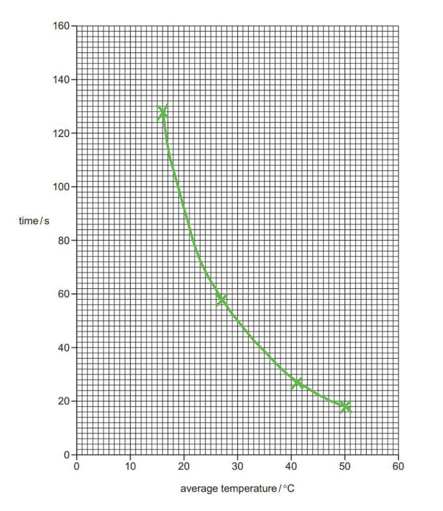

- All points plotted correctly;** [3 marks]** 
*-1 mark for each incorrect point*
- Smooth line graph; **[1 mark]**

**[Total: 4 marks]**

- *The most common mistake when drawing graphs is to use the scale incorrectly*
- *Make sure that you find what the intervals on both axes are*

  - *In this case, on the x-axis, each square represents 1 °C*
  - *On the y-axis, each square represents 2 s*
- *This line of best fit is a smooth curve, do not join the dots together with straight lines!*
c) FInding the time taken for the mixture to turn pale yellow if Experiment 1 was repeated at an average temperature of 60 °C from the graph:

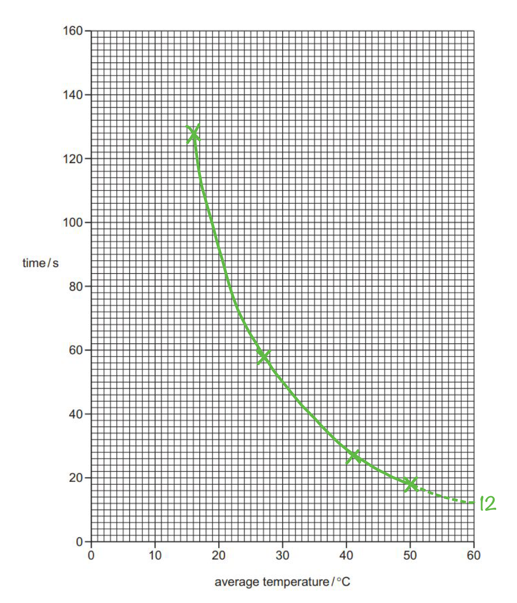

- Value from graph: 12 -13 s; **[1 mark]**
- Extrapolation; **[1 mark]**

**[Total: 2 marks]**

- *To find the time taken at 60 °C, you need to continue your line of best fit until it reaches 60 °C and then read the corresponding value of time taken*
- *You need to show your extrapolation on the graph, otherwise, you will lose a mark - this is made clear in the question by stating to show **clearly **on the graph how you worked out your answer*
d)

i) The experiment in which the rate of reaction was greatest is:

- Experiment 4; **[1 mark]**

ii) This is because:

Any **two **from:

- It was carried out at the highest temperature; **[1 mark]**
- More energy; **[1 mark] **
- More frequent collisions / more collisions per unit time; **[1 mark]**

**[Total: 3 marks]**

- *The temperature changes in each experiment but everything else remains the same, so the rate must alter because of the temperature*
- *When explaining why this has the quickest rate using collision theory, remember not to just state 'more' collisions; this will not get you the mark*
- *Your answer needs to have some reference to a time frame to be awarded the mark - another suitable response in addition to those already given is more collisions per second*
e)

i) The results using a burette to measure the volume of solution **J ** would be:

- More accurate; **[1 mark]**
- Than a measuring cylinder; **[1 mark]**

ii) One other improvement is:

- Use insulation / use a lid; **[1 mark]**
- To reduce heat losses; **[1 mark]** 
**OR**
- Repeat; **[1 mark]**
- Average the results; **[1 mark]** 
**OR**
- Measure the water / sulfuric acid / methyl orange using a burette / use a 2 d.p. stopwatch / digital thermometer; **[1 mark]**
- Reference to accuracy; **[1 mark]**

**[Total: 4 marks]**

- *These are common methods to improve experiments so make sure you know them!*

### Q16
a) The completed table is:

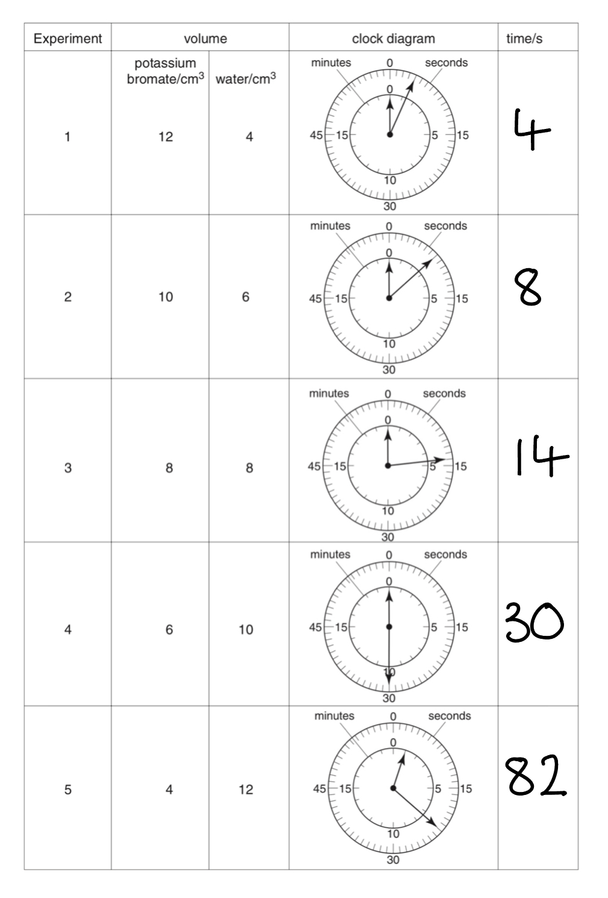

- **1 mark** for each correct reading

**[Total: 5 marks] **

- *You have to consider both hands on the stopwatch as one shows the minutes and the other the seconds*
- *Don't forget the time taken needs to be given seconds, so you need to convert the minutes to seconds*
b) The completed graph is:

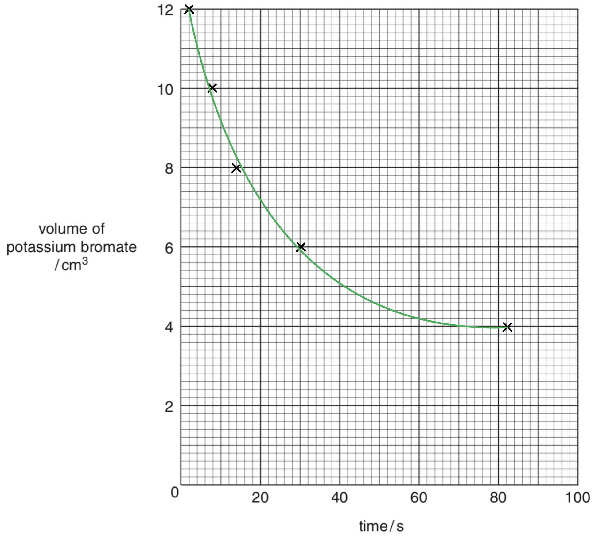

- Points plotted correctly; **[3 marks] **
- Smooth curve;** [1 mark] **

**[Total: 4 marks] **

- *The most common mistake when drawing graphs is to use the scale incorrectly*
- *Make sure that you find what the intervals on both axes are*

  - *In this case, on the x-axis, each square represents 2 cm**3*
  - *On the y-axis, each square represents 0.2 cm**3*
- *When drawing a line of best fit, try to get as many points on the line as possible, and, for those that don't fit on the line, an equal number of points above and below the line*
c)  If Experiment 1 was repeated using 5 cm3 of potassium bromate and 11 cm3 of water the time taken would be:

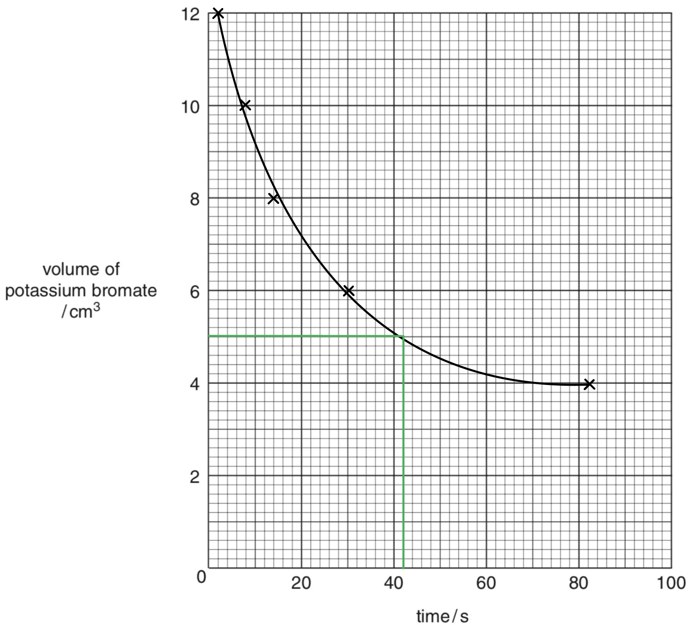

- Time ≅ 41 s indicated;** [1 mark] **
- Shown on graph on both axis; **[2 marks] **

**[Total: 3 marks] **

- *You must show your working and how you came to your answer by drawing two lines on the graph*
d)

i) The experiment that is the quickest is:

- Experiment 1; **[1 mark] **

ii) The reason why it is the quickest is:

- Concentration is the highest; **[1 mark] **
- Therefore more collisions; **[1 mark] **

**[Total: 3 marks] **

- *Increasing the concentration of a solution will increase the rate of reaction*
- *This is because there will be more reactant particles in a given volume, allowing more frequent and successful collisions per second, increasing the rate of reaction*
e)

i) **Two** errors are:

Any **two **of the following:

- Use of measuring cylinder inaccurate; **[1 mark] **
- Use of the timer; **[1 mark] **
- Determining when the cross disappeared; **[1 mark] **

ii) **Two** improvements are:

Any **two **of the following

- Use a burette; **[1 mark] **
- Use a colorimeter; **[1 mark]**
- Use a data logger;** [1 mark] **
- Repeat and average; **[1 mark] **

**[Total: 4 marks]**

- *It is common to be asked for errors and improvements to experiments*
- *Be specific with your answer so talk about measuring the volume using a more precise piece of equipment*

  - *A measuring cylinder is less precise than a burette or pipette *
  - *Data logging is always a good way of improving the accuracy of readings an experiment *
- *For this experiment using a gas syringe would also be more accurate *

### Q17
An experiment to show that manganese(IV) oxide is a catalyst for breakdown of hydrogen peroxide is:

Any** six **of the following

- Add known mass of manganese oxide;** [1 mark] **
- To (measured volume of) hydrogen peroxide; **[1 mark] **
- Bubbles; **[1 mark] **
- Test gas with glowing splint; **[1 mark] **
- Result; **[1 mark] **
- Filter; **[1 mark] **
- Dry solid;** [1 mark] **
- Reweigh and compare; **[1 mark] **

**Final answer:** **[Total: 6 marks] **

- *A catalyst will speed up the rate of reaction and is regenerated at the end*
- *Therefore the mass of the catalyst put into the reaction should be the same as at the end*
- *However, it must be extracted and also dried before weighing *

### Q18
a) The completed table is:

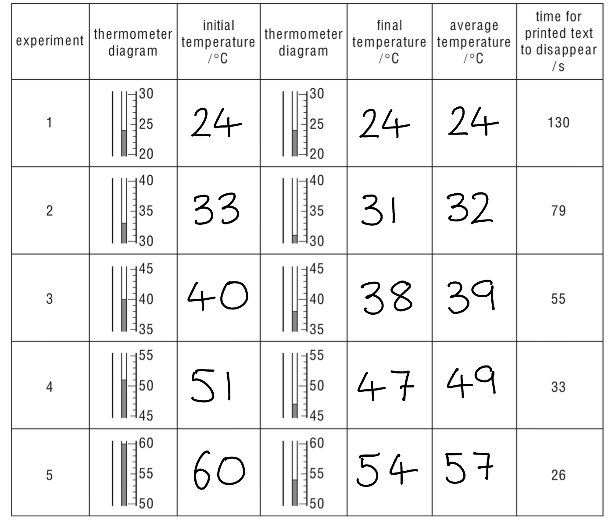

- Initial temperature boxes completed correctly; **[2 marks]**
- Final temperature boxes correctly completed; **[2 marks]**
- Average temperature boxes correctly completed; **[1 mark] **

**Final answer:** **[Total: 5 marks] **
b) The completed graph is:

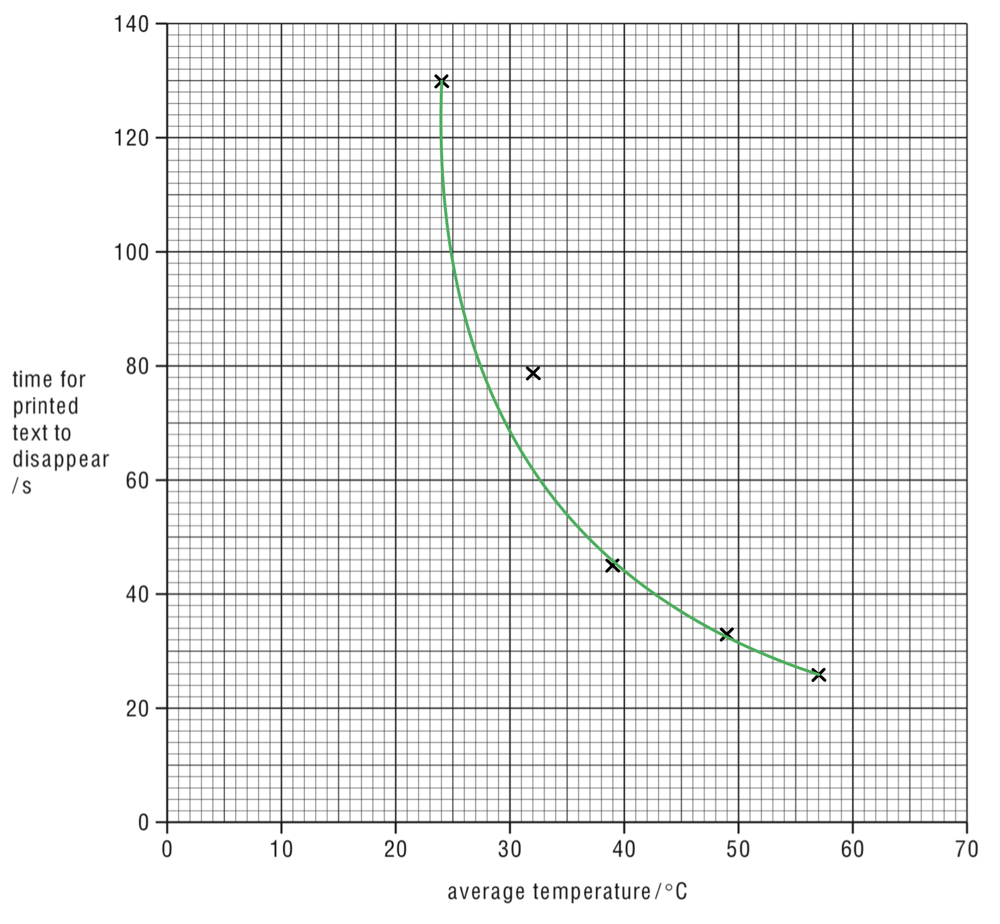

- 5 points correctly plotted; **[3 marks]  ** 
*–1 for any incorrect*
- Smooth line graph; **[1 mark] **

**Final answer:** **[Total: 4 marks] **

- *When plotting a graph, make sure you use x’s instead of "•"*
- *"•" will be covered up by your line of best fit *
c)

i) The experiment in which was the speed of reaction greatest is:

- Experiment 5; **[1 mark] **

ii) The speed was greatest in this experiment because:

- More energy; **[1 mark] **
- Particles move faster;** [1 mark] ** 
*Allow more kinetic energy = ***[2 marks] **
- More collisions;** [1 mark] **

**Final answer:** **[Total: 4 marks] **

- *The higher the temperature the faster the rate of reaction *
- *This is because the particles will have more kinetic energy than the required activation energy*
- *Therefore there will be more frequent collisions **and **a higher proportion of particles have energy greater than the activation energy*
- *This causes more successful collisions per second, increasing the rate of reaction*

  - *Make sure you state successful collisions per unit time when explaining this relationship *
  - *This is now expected in more up to date mark schemes *
d)  The same volume of sodium thiosulfate solution and the same volume of hydrochloric acid used in each experiment:

- To compare the effect of changing the temperature; **[1 mark] **

**Final answer:** **[Total: 1 mark] **

- *During an investigation only one variable should be changed, this is known as the independent variable*
- *Other variables, such as volume of solution, must be kept the same, these are known as control variables*
e)

i) If the experiment was repeated at 70 °C:

- Approximately 20; **[1 mark] **
- s (unit); **[1 mark] **
- Extrapolation shown;** [1 mark] **

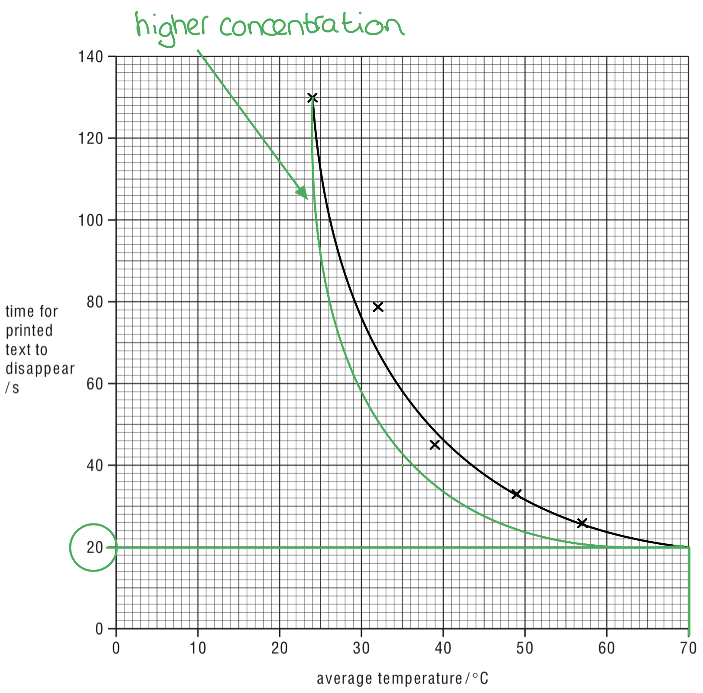

ii) If a higher concentration of sodium thiosulfate was used:

- Curve sketched on grid below original curve; **[1 mark] **

**Final answer:** **[Total: 4 marks] **

- *The higher concentration would increase the rate of reaction *
- *This is because there will be more reactant particles in a given volume, allowing more frequent and successful collisions per second, increasing the rate of reaction*
f) One change that could be made to the experimental method to obtain more accurate results:

Change:

- Use of data logger / colourimeter / use of lagging / insulation / repeat experiments or more values / use a burette or pipette;** [1 mark] **

Explanation:

- Timing of reaction more accurate to reduce heat losses / average readings for times / volumes more accurate; **[1 mark] **

**Final answer:** **[Total: 2 marks] **

- *Using a data logger will give digital readings which are more precise and also easier to read, reducing potential errors*

### Q19
a) The correctly plotted graph is:

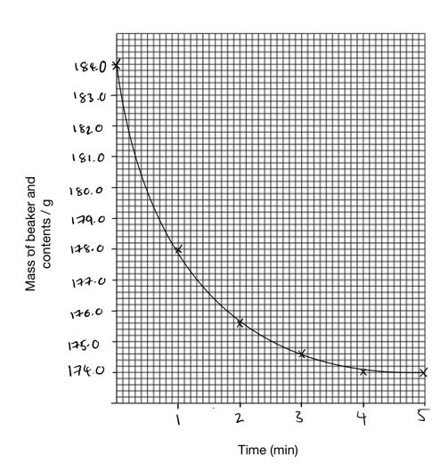

- Points plotted correctly; **[2 marks]** -1 mark for any incorrect
- Smooth curve; **[1 mark]**
- Suitable scale; **[1 mark]**
- Axes labelled (units not essential); **[1 mark]** Accept plot of loss in mass against time

**[Total: 5 marks]**

- *Graphs should be easy marks to pick up *
- *Make sure you have an accurate scale with equal divisions between each number *
- *Although in this case units are not required, they often are, so include them just in case *
- *Lines of best fit for rates of reaction graphs are always curves*
- *In this case there are no anomalous results but be sure to check, and don't adjust your line of best fit to go through them*
b) The mass of the beaker and contents after 30 seconds is:

- Approximately 180 g;** [1 mark]**
- Evidence from graph;** [1 mark]**

**Final answer:** **[Total 2 marks]**

- *Use your scale to determine where 30 seconds is and draw a vertical line up until it reaches the curve*
- *Draw a horizontal line from the curve to the y axis and read off the mass of the beaker and contents*
- *Usually a small range of answers can be given as it often depends on your line of best fit *
- *The example below shows the mass as being 179.8 g which would be accepted *

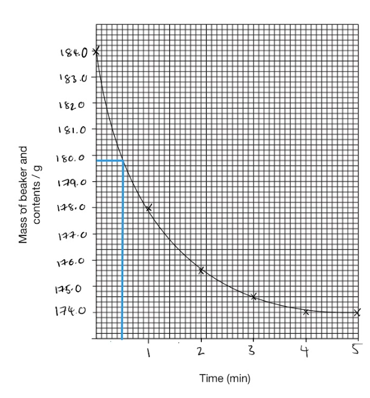
c) The mass of the beaker and contents decreases because:

- A gas is given off; **[1 mark]**

**[Total: 1 mark]**

- *Calcium carbonate and hydrochloric acid react to produce calcium chloride, water and carbon dioxide*
- *Carbon dioxide is released causing the mass to decrease*
- *Sometimes there is an equation given in the question to help you with this, and you may be asked to name it from its formula *
d) The purpose of the cotton wool is:

- To prevent loss of acid; **[1 mark]** *Not loss of water or steam *

**[Total: 1 mark]**

- *This is a common question and it is always to prevent any loss of reactant*
e) The reaction finished after:

- 4 minutes; **[1 mark]**

**[Total: 1 mark]**

- *The reaction has finished when the mass of the beaker and contents stops decreasing *
- *Do not automatically just look at the last value in the table but at the value where the mass does not change any further after it*
f) The expected curve on the graph for results at a lower temperature is:

- Sketched curve above original; **[1 mark]**
- Levelling out at 174 s / heading towards is; **[1 mark]**

**[Total: 2 mark]**

- *At lower temperatures the rate of reaction will be slower*
- *The rate at which the calcium carbonate and hydrochloric acid produce carbon dioxide will decrease, making the curve on the graph less steep*
- *The concentration of acid has not been altered and so the same volume of gas will produced, and the graph should level off at the same point*

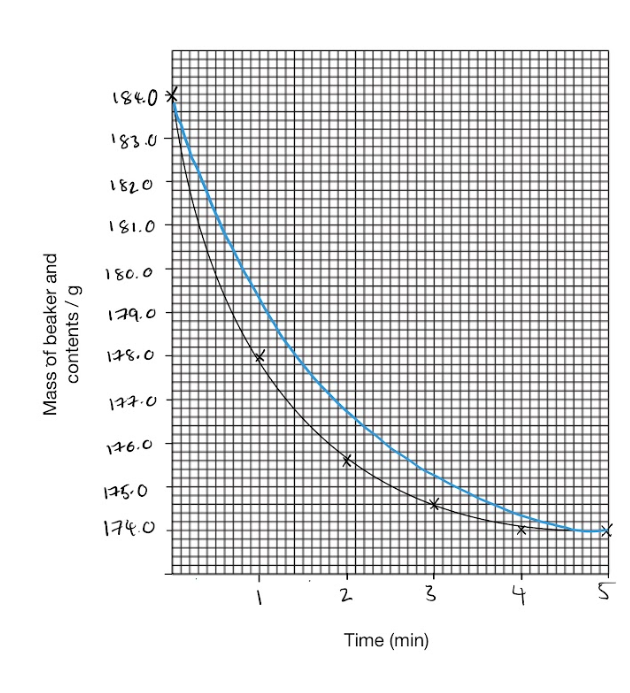

### Q20
a) The completed table is:

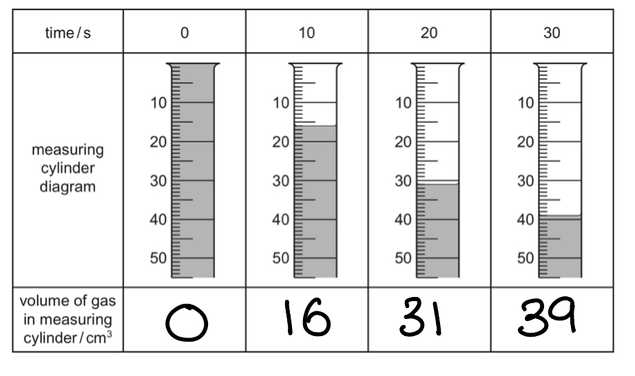

- **[2 marks]** for all correct
 *-1 for each incorrect answer*

**Final answer:** **[Total: 2 marks] **

- *You are being asked for the volume of gas*

  - *The shaded area is the volume of water *
  - *The scale is also going from top to bottom*
b) The completed table is:

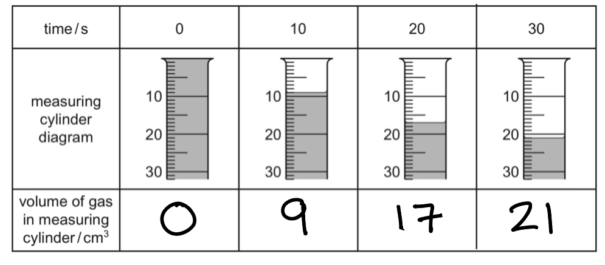

- **[2 marks]** for all correct 
-1 for each incorrect answer

**Final answer:** **[Total: 2 marks] **
c) The completed table is:

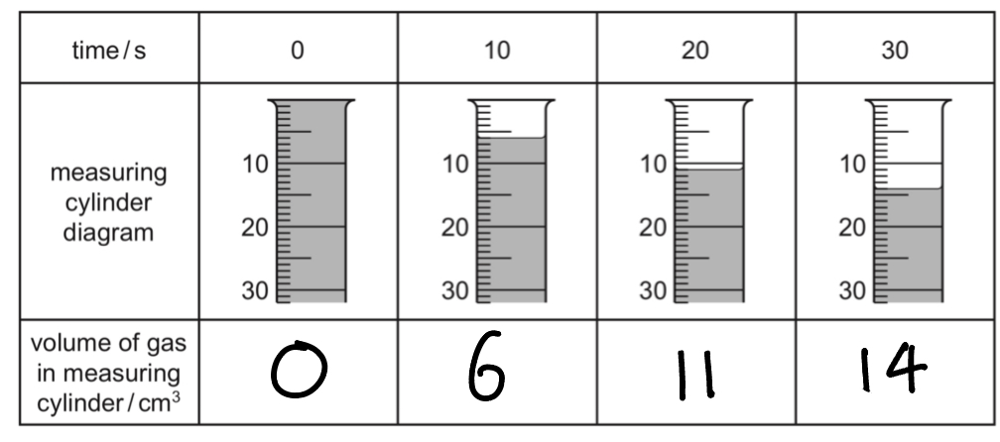

- **[2 marks]** for all correct
 *-1 for each incorrect answer*

**Final answer:** **[Total: 2 marks] **
d) The completed graph is:

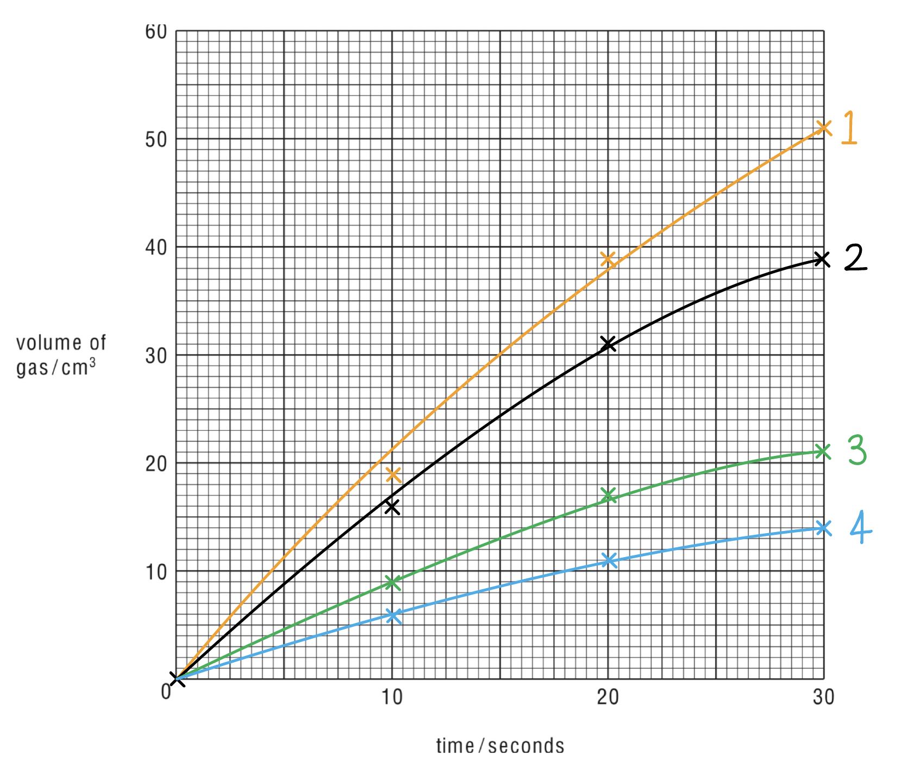

- All points plotted correctly; **[3 marks]  **
 *-1 for each incorrect*
- Smooth curves; **[1 mark] **
- Labels are correct;** [1 mark] **

**Final answer:** **[Total: 5 marks] **

- *If you are asked to plot multiple experiments on the same graph take your time and make sure you clearly label each line of best fit so the examiner can easily make out which line belongs to which experiment *
e)

i) The fastest rate of reaction is:

- Experiment 1;** [1 mark] **

ii) This experiment has the fastest rate because:

- Most concentrated solution; **[1 mark]**
- More collisions; **[1 mark] **

**[Total: 3 marks]**

- *From the graph you can see that Experiment 1 has the fastest rate as the line of best fit has the steepest gradient *
- *Increasing the concentration of a solution will increase the rate of reaction*
- *This is because there will be more reactant particles in a given volume, allowing more frequent and successful collisions per second, increasing the rate of reaction*
f)

i) Errors are:

Any **two** from:

- Amount of catalyst; **[1 mark]**
- Timing; **[1 mark]**
- Volume of solution; **[1 mark]**

ii) Improvements are:

Any **two** from:

- Measure mass of catalyst; **[1 mark]**
- Use burette or pipette; **[1 mark]**
- Data logging; **[1 mark]**

**Final answer:** **[Total: 4 marks] **

- *It is common to be asked for errors and improvements to experiments*
- *Be specific with your answer so talk about the mass of solid measured rather than just saying 'amount' of solid*
- *Data logging is always a good way of improving an experiment's accuracy*
- *For this experiment using a gas syringe would also be more accurate *
g) A practical method to prove that manganese(IV) oxide is a catalyst is:

- Filter;** [1 mark] **
- Same mass of catalyst before and after 
**OR** 
Repeat experiment and compare volumes of gas collected; **[1 mark] **

**Final answer:** **[Total: 2 marks] **

- *Catalysts are substances which **speed up **the **rate** of a reaction without themselves being **altered** or **consumed** in the reaction*
- *The mass of a catalyst at the beginning and end of a reaction is the **same** and they do not form part of the equation*
- *Manganese(IV) oxide is an insoluble black solid so can easily be obtained after the reaction has finished by filtration *
- *Before weighing it should be dried to ensure that no solution remains*

### Q21
a) The correct readings from the stop clocks are:

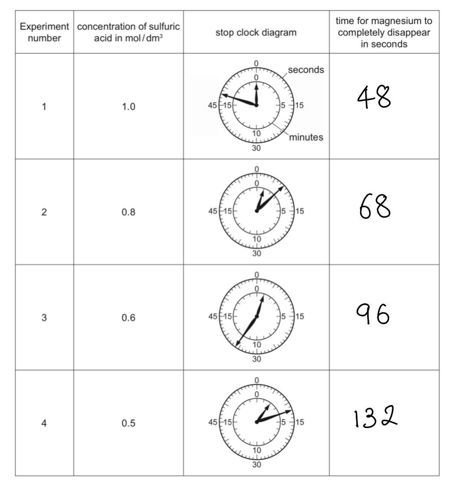

- 4 correct; **[3 marks]**
- 3 correct; **[2 marks]**
- 2 correct; **[1 mark] **
- Given in seconds; **[1 mark] **

*0 or 1 correct scores 0 marks*

**Final answer:** **[Total: 4 marks] **

- *The table indicates that you must give the time in seconds*
- *You will miss the final mark if you don’t do this and use minutes instead *
b) The correctly plotted graph is:

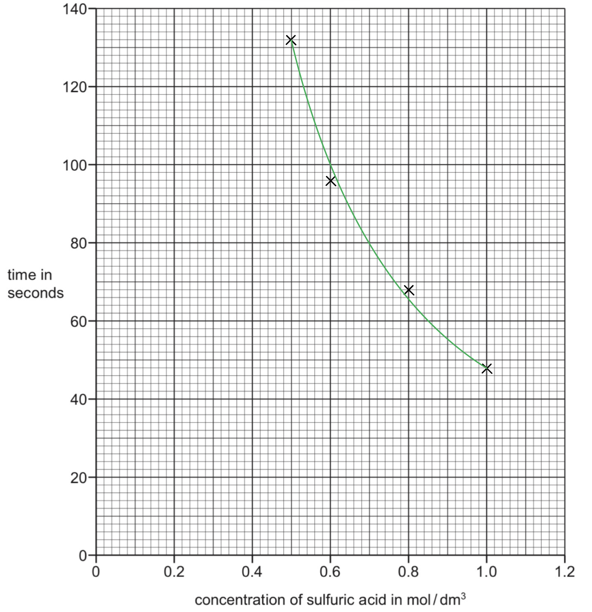

- 4 correct; **[3 marks]**
- 3 correct; **[2 marks]**
- 2 correct; **[1 mark] **
- Given in seconds; **[1 mark] **

**Final answer:** **[Total: 4 marks] **

- *The concentrations are 1.0, 0.8 then 0.6 so you may assume the next concentration is 0.4 mol/dm**3*
- *However, the final reading is for 0.5 mol/dm**3** so be careful when reading from the table *
c)

i) The concentration of the sulfuric acid if the time for the reaction was 80 s:

- Value from the graph, 0.7 (mol/dm3); **[1 mark] **
- Shown clearly on the graph;** [1 mark] **

ii) If a solution of sulfuric acid of concentration 1.2 mol / dm3 was used the reaction would take:

- Value from the graph, e.g. 32 s; **[1 mark] **
- Extrapolation shown clearly;** [1 mark] **

Readings from graph

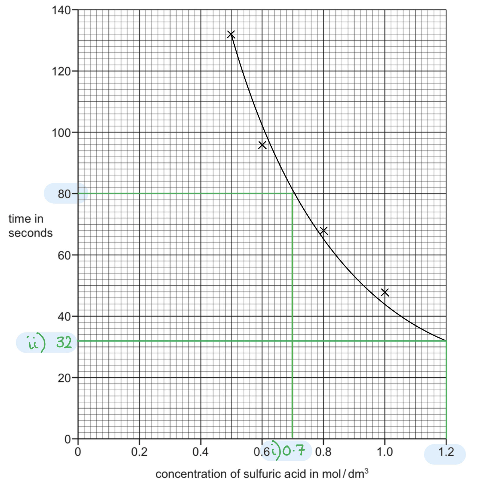

**Final answer:** **[Total: 4 marks] **

- *Extrapolate means extending the line of best fit, which you need to do for part ii)*
- *Use a ruler to clearly draw a line from the given reading to the line of best fit*

  - *You will gain a mark for showing your working clearly *
d) The same amount of magnesium used in Experiments 1, 2, 3 and 4 because:

- Idea of comparability between experiments;** [1 mark] **

**Final answer:** **[Total: 1 mark] **

- *If a different mass of magnesium was used in each experiment this would mean a variable would be changed*
- *The only variable that should be changed is the concentration of acid, everything else should remain the same*
- *Note that you must steer clear of mentioning 'fair test'*

  - *This phrase would have been accepted in older papers, though this in now not expected in mark schemes*
e) The correct readings are:

- Before adding Mg = 21 °C; **[1 mark] **
- After adding Mg = 49 °C; **[1 mark] **

**Final answer:** **[Total: 2 marks] **

- *Reading from thermometers and other equipment is a common question in practical papers - take your time and remember the shaded area shows where the liquid in the thermometer is*
f)

i) The type of reaction is:

- Exothermic / redox / displacement; **[1 mark] ****Ignore neutralisation **

ii) The gas given off is:

- Hydrogen / H2; **[1 mark] **

iii) The effect on the temperature change, if this experiment was repeated using 2 cm of magnesium ribbon, will be:

- Temperature change will decrease;** [1 mark]**
- By half;** [1 mark] **

**[Total: 4 marks] **

- *The reaction is between an acid and a metal*

  - *Acid + metal → salt + hydrogen *
  - *Sulfuric acid + magnesium → magnesium sulfate + hydrogen *
- *The length of magnesium ribbon used was 4 cm, the change is to 2 cm*

  - *Therefore there is half the amount of magnesium so the temperature change will decrease accordingly*
  - *To gain both marks, you need to state the temperature change decreases by half *
g) The differences in the apparatus used and measurements to be taken could be:

Apparatus:

- Gas syringe / thermometer;** [1 mark] **Measurements:
- Volume of gas / temperature of reaction; **[1 mark] **
- Over time; **[1 mark] **

**Final answer:** **[Total: 3 marks] **

- *As the reaction produces hydrogen the volume of gas per unit time could be measured*
- *The important part is the volume of gas per unit time*

  - *If a larger volume of gas is formed in 60 s than in the previous experiment, then the rate is faster*
- *This can also be done using temperature *

  - *The greater the temperature change per unit time, the faster the rate*

### Q22
An investigation to find out which of these two oxides is the better catalyst for this decomposition could be:

- Same amount / measured volume of peroxide; **[1 mark]  **
- Add known mass of metal oxide;** [1 mark] **
- Time; **[1 mark] **
- Measure volume of oxygen;** [1 mark]**
- Repeat with other oxide; **[1 mark] **
- Compare / conclusion; **[1 mark]  **

**Final answer:** **[Total: 6 marks] **

- *A diagram to investigate this reaction could be*

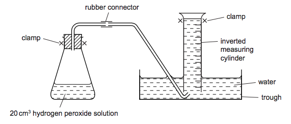

- *The catalyst will also be added to the conical flask*
- *Alternatively a gas syringe could be used*

- *Make sure your diagram is a 'working' diagrams so gases can flow from one piece of apparatus to another *

### Q23
a) A similarity in the change in mass in steel is:

- Both lose mass; **[1 mark]**

*Not: change mass*

**[Total: 1 mark]**

- *Change is already given in the question, and a change can mean an increase or decrease. Make sure you are specific!*
b) Two ways in which the mass loss shown in graph **A** is different from that shown in graph **B **are:

- Mass loss increases constantly in graph **A**; **[1 mark]**
- Becomes constant in graph **B **(after about 7–9 hours); **[1 mark]**
- Mass loss or change is greater in acid / less in alkali; **[1 mark]**

**[Total: 3 marks]**

- *This is where you can include finer detail that references to the shape and slope of the graph*
- *Where there is a change in the shape of a graph, try to note the value of this change. In this case, it is the time at which this occurs*
c) **Two** different safety precautions that would need to be taken:

Any **two** from:

- Goggles; **[1 mark]**
- Lab coat; **[1 mark]**
- Tongs; **[1 mark]**
- Fume cupboard; **[1 mark]**
- Well-ventilated area; **[1 mark]**

*Ignore: reference to hair*

**[Total: 2 marks]**

- *You could be asked to suggest a number of safety precautions*
- *Hair does not count (although long hair should be tied back) as it doesn't apply to all students, whilst the other safety precautions apply to all students*

### Q24
a) The total volume of solution was kept constant because:

- Only one variable should be changed; **[1 mark] **

**Final answer:** **[Total: 1 mark] **

- *During an investigation only one variable should be changed, this is known as the independent variable*
- *Other variables, such as volume of solution, must be kept the same, these are known as control variables*
- *Avoid general statements like 'to make it a fair test', which will not get credit as it does not explain what is actually needed*
b) The last liquid to be added is:

- Nitric acid; **[1 mark] **

**Final answer:** **[Total: 1 mark] **

- *Experiment 2 contains 80 cm**3** of sodium thiosulfate solution and 20 cm**3** of water which is made up first*
- *The final solution to be added needs to be one of the reactants, the acid or the thiosulfate, as adding water last would mean that the reaction had already started*
- *Then, the smaller volume of 20 cm**3** nitric acid is added*
- *The smaller volume is added last as it will take the shortest amount of time to pour in to start the reaction*
c)

i) The completed graph is:

- Points plotted;** [3 marks] ** 
*–1 for each incorrect*
- Smooth curve;** [1 mark]**

ii) The time taken for the cross to disappear when 55 cm3 of sodium thiosulfate solution was:

- 18 s; **[1 mark] **
- **Indication on graph; [1 mark] **

**Final answer:** **[Total: 6 marks] **

- *You must show your working and how you came to your answer by drawing two lines on the graph*
- *Careful: the information in the questions states 45 cm**3** of water and 55 cm**3** of sodium thiosulfate so don't get these muddled! *
d) If the temperature was 40 °C:

- Times would be less / reaction quicker;** [1 mark]**
- Particles have more energy / increased collisions;** [1 mark]**

**Final answer:** **[Total: 2 marks] **

- *The higher the temperature the faster the rate of reaction *
- *This is because the particles will have more kinetic energy than the required activation energy*
- *Therefore there will be more frequent collisions **and **a higher proportion of particles have energy greater than the activation energy*
- *This causes more successful collisions per second, increasing the rate of reaction*

  - *Make sure you state successful collisions per unit time when explaining this relationship *

### Q25
a) The cross disappears because:

- Because a precipitate is formed / goes cloudy; **[1 mark] **
- Of sulfur; **[1 mark] **

**[Total: 2 marks] **
b) The same volume is used because:

- To ensure the same depth of solution / comparison; **[1 mark] **

**[Total: 1 mark] **

- *This experiment relies upon the student recognising when the cross appears to 'disappear' *
- *If the depth of the solution varies then it will become more dilute and the cross will take longer to no longer be visible *
c) The correct order is:

- Sodium thiosulfate / water 1st / 2nd 
**AND**  
Acid last; **[1 mark] **

**[Total: 1 mark] **

- *The diagram in part shows the aqueous sodium thiosulfate solution in the beaker, and then the addition of 10 cm**3** and hydrochloric acid to be added*
- *This is because the acid and thiosulfate will start to react as soon as they are mixed, so one of these must be the last solution to go in*
- *The last one should be the acid rather than the thiosulfate as this is a smaller volume so is faster to add, and therefore the recording of the results will be more accurate*
d)

i) The completed graph is:

**   50 °C line shown in green **

- All points correct; **[3 marks]  **
*-1 for any incorrect*
- Smooth line; **[1 mark] **
- Label: **[1 mark] **

ii) The graph that would be expected if the experiment was repeated at 50 °C is:

- Line lower down;** [1 mark] **
- Does not touch other line;** [1 mark] **

> *[Total: 7 marks] *

- *Increasing the temperature will increase the rate of reaction*
- *This is because the particles will have more kinetic energy than the required activation energy*
- *Therefore there will be more frequent collisions and a higher proportion of particles have energy greater than the activation energy*
- *If the reaction is faster the time taken for the cross to disappear will be reduced as the sulfur precipitate is formed more quickly*
e) The results would differ with a 250 cm3 beaker by:

- Time taken would be longer;** [1 mark] **
- Solution would be more spread out / reduced depth; **[1 mark] **

> *[Total: 2 marks] *

- *A 250 cm**3** beaker is wider than a 100 cm**3** beaker, so the solution will be spread out more*
- *This means the depth will be less *
- *With a reduced depth, more precipitate would be required to obscure the cross*
- *This will take longer to form*

### Q26
a) The completed table is:

[4]

- Volumes correctly completed; **[4 marks] **-1 for each incorrect answer

**Final answer:** **[Total: 4 marks] **
b) The completed graph is:

- Points plotted correctly; **[3 marks] **-1 for each incorrect
- Smooth line curve; **[1 mark] **

**Final answer:** **[Total: 4 marks] **

- *The most common mistake when drawing graphs is to use the scale incorrectly*
- *Make sure that you find what the intervals on both axes are*

  - *In this case, on the x-axis, you are plotting every bold line which indicates 1 minute *
  - *On the y-axis, each square represents 1 cm**3*
- *When drawing a line of best fit, try to get as many points on the line as possible, and, for those that don't fit on the line, an equal number of points above and below the line*

  - *Here the line of best fit is a smooth curve*
c) The volume is the same at 5 and 6 minutes because:

- Reaction finished / all acid used up; **[1 mark] **

**[Total: 1 mark] **

- The gas does not escape from the gas syringe so 63 cm3 will remain the volume produced
d) The point that appears to be inaccurate is:

- Point at 3 minutes / at 42 cm3;** [1 mark]  **
- Does not fit curve; **[1 mark] **

**Final answer:** **[Total: 2 marks] **

- *This point is called an anomaly as it does not fit the pattern / trend of results *
e) The graph you would expect if the experiment were repeated using the same volume of acid which was half as concentrated would be:

- Sketch line below plotted curve; **[1 mark]**
- Levels off around 30 cm3;** [1 mark] **

**Final answer:** **[Total: 2 marks] **

- *If the concentration decreases, the rate of reaction also decreases *
- *This is because there will be fewer reactant particles in a given volume, meaning less frequent and successful collisions per second*
- *As the concentration has halved, the volume of hydrogen gas will also halve*

## Multiple Choice Questions (26 questions)

### Q1
**Final answer:** **The correct answer is A**

- **Concentration (C)**

  - The graph for Experiment 2 is steeper and levels off earlier, meaning the rate of reaction is faster
  - Because the temperature and solid surface area (granules) were kept constant, the faster rate must be due to a higher concentration of acid in Experiment 2 (C2 > C1)
- **Average Kinetic Energy (KE)**

  - The average kinetic energy of particles is determined **only by the temperature **
  - Since the temperature remains exactly the same in both experiments, the average kinetic energy of the particles does not change (KE1 = KE2)
- **Frequency of successful collisions**

  - A higher concentration means there are more acid particles per unit volume
  - This leads to a higher frequency of collisions between the reacting particles
  - Therefore a greater frequency of successful collisions in Experiment 2

**B **is incorrectas higher concentration does not affect the average kinetic energy of particles

**C **& **D **are incorrect as Experiment 2 has a faster rate according to the graph, therefore the C1  cannot be greater than C2

### Q2
**Final answer:** **The correct answer is C**

- Fractional distillation separates a mixture of hydrocarbons into fractions based on their different boiling points
- The molecules themselves are not changed, and no new chemical bonds are made or broken, making it a purely physical change

**A **is incorrect as cracking breaks down larger alkane molecules into smaller, more useful molecules such as alkenes and hydrogen

**B **is incorrect as hydration of ethene (the catalytic addition of steam) reacts ethene and water to form a brand new chemical product, ethanol. This is a chemical change

**D **is incorrect as thermal decomposition breaks down a single compound into two or more new substances using heat (e.g., calcium carbonate breaking down into calcium oxide and carbon dioxide)

### Q3
**Final answer:** **The correct answer is B**

- Increasing the temperature from **10 °C to 20 °C** increases the **rate of reaction** because particles have more kinetic energy
- A higher temperature means **more frequent successful collisions**, so gas is produced **faster** at the start
- The** total amount of gas produced depends on the amount of reactants**, which is the same in both experiments
- Therefore, **both experiments must level off at the same final volume of gas**
- The curve for **Experiment 2 (20 °C)** should have a **steeper initial gradient** and lie **above Experiment 1** at early times
- **Graph B** shows a faster initial rate for Experiment 2 and the same final volume for both experiments
- Therefore, **Graph B is correct**

**A **is incorrect because the graph shows Experiment 1 (10 °C) is reacting faster, which is incorrect because a higher temperature increases the rate

**C **& **D **are incorrect because it shows different final volumes of gas, but the amount of reactants is the same, so the final volume should be the same

### Q4
**Final answer:** **The correct answer is D**

- Adding concentrated hydrochloric acid increases the concentration of acid particles
- This leads to **more frequent collisions**, the **rate of reaction is faster**, so the **yellow precipitate forms faster**

**A **is incorrect because **ice lowers the temperature**, which slows down particle movement and **reduces the rate of reaction**

**B **is incorrect because adding water dilutes the sodium thiosulphate,** lowering the concentration, reducing the rate of reaction**

**C **is incorrect because a **catalyst increase the rate of reaction **by finding an alternate pathway with lower *E**A *(Activation Energy)

### Q5
**Final answer:** **The correct answer is**** C**

- The diagram shows that the reactants are a** liquid **and a **solid**.
- The flask is **sealed** and a gas syringe is connected to the flask, hence one of the products must be a **gas**.
- **C** is the only option that includes a solid (Fe) and liquid (H2SO4) reactants, and a gaseous product (H2).

**A, B **and** D **are incorrect as there are not any gaseous products formed in these reactions.

### Q6
**Final answer:** **The correct answer is**** D**

- Chemical change is brought about by **chemical reactions**.
- These produce new substances called products which have **very** **different** physical and chemical **properties** to the substances used to make them.

**A** and **B **are incorrect as chemical change involves the production of a new substance.

**C **is incorrect as electron transfer is involved in chemical processes but not in physical changes.

### Q7
**Final answer:** **The correct answer is**** C**** **

- A physical change involves a change in a **physical property**.
- Ethanol boils at 78 oC so at this temperature or higher it changes its physical state from a **liquid** to a **gas**.

**A**,** B** and **D** are incorrect as these processes involve **chemical changes** where substances react together chemically, breaking and forming bonds.

### Q8
**Final answer:** **The correct answer is ****C**

- The mean rate of reaction is calculated by
- Mean rate of reaction = $\frac{\mathrm{quantity} \mathrm{of} \mathrm{product} \mathrm{formed}}{\mathrm{time} \mathrm{taken}}=\frac{35\mathrm{cm}^{3}}{10s}=3.5\mathrm{cm}^{3}/s$

### Q9
**Final answer:** **The correct answer is**** A**** **

- The **steeper** curve in **P** indicates that this reaction has occurred **faster** than **Q** as a higher volume of hydrogen gas is produced in a **shorter** period of time.
- The addition of a **catalyst** would **speed** up the rate of a reaction and explain why the product is formed faster in **P** than in **Q**.

**B** and** C **are incorrect as using larger pieces of Fe and a less concentrated acid would **slow** the reaction down so curve **P** would be **below curve** **Q**, not above it.

**D **is incorrect as both curves level off at the **same height**, indicating the same amount of product is formed in both reactions.

### Q10
**Final answer:** **The correct answer is**** C**** **

- The curve for the experiment 2 indicates that it produced a **higher volume** of gas in a shorter period of time.
- This indicates that the rate of reaction was **faster** in experiment 2 than in experiment 1.
- As the reaction rate was quicker and the volume of product was greater, then there must have been **more** **acid** used since the calcium carbonate was in excess.

**A **is incorrect as a higher temperature would produce a **steeper **curve.

**B **is incorrect as both reactions were allowed **sufficient** time to react.

**D **is incorrect as the calcium carbonate was in **excess** in **both** experiments.

### Q11
**Final answer:** **The correct answer is**** A**** **

- Test tubes **A** and **B** contain **concentrated** acid.
- Iron in test tube **A** is **more** **reactive** than copper in **B**, so **A **is the test tube which will react the fastest.

**B** is incorrect as the relative reactivity of the metals outweighs the greater surface area of the metal in B, compared to A.

**C **and **D** are incorrect as the acid used in these test tubes is dilute hence the rate of reaction will be slower.

### Q12
**Final answer:** **The correct answer is**** B**** **

- Particles require a minimum amount of energy to react when they collide in a reaction vessel.

- If they collide with insufficient energy they will bounce off of each other and no new product molecule is formed.

**A, C **and** D** are incorrect as these statements do not not correctly describe the activation energy.

### Q13
**Final answer:** **The correct answer is**** D**** **

- For a chemical reaction to proceed, a **successful collision** must occur where the reactant particles collide with one another with **sufficient** energy.
- The reaction rate depends on the **number** of successful collisions between reactant  particles.
- Increasing the reaction temperature increases the **kinetic** **energy** of the particles hence the rate of reaction increases.

**A**,** B** and **C **are incorrect as these options incorrectly describe the effect of increasing temperature on the kinetic energy of the particles and number of successful collisions in a reaction.

### Q14
**Final answer:** **The correct answer is**** C**** **

A higher reactant concentration increases the number of reactant particles per unit volume, thus increasing the **number of collisions **and therefore the rate of reaction.

**A** is incorrect as increasing concentration has no effect on the **kinetic energy **of the particles and therefore doesn’t affect the ability of successful reactions to occur - remember for a collision to be successful particles must collide with sufficient energy to react.

**B** is incorrect as increasing the concentration increases the number of particles per unit volume, hence the space between particles decreases.

**D** is incorrect as the rate of reaction would be higher throughout the entire reaction and not just at the beginning of the reaction.

### Q15
**Final answer:** **The correct answer is ****D**** **

- Hydrochloric acid is already in excess in this reaction, so increasing the volume of the solution will not increase the rate of the reaction

### Q16
**Final answer:** **The correct answer is**** C**** **

- The line of the graph is at its **steepest** between 4 and 6 minutes.
- This indicates that a **larger volume of gas **was being produced in a **shorter time **than at any other point during the reaction.

**A**,** B** and **D **are incorrect as these sections of the graph are not as steep as the section between 4 and 6 minutes.

### Q17
**Final answer:** **The correct answer is**** B**** **

- The **steeper** curve in **T** indicates that this reaction has occurred **faster** than** S** as the decrease in mass occurs in a **shorter** period of time.
- Using **more** **concentrated** sulfuric acid in **T** than in **S** would result in **T** having a **steeper** curve.

**A **is incorrect as a less concentrated acid would cause curve **T** to be **shallower**, not steeper.

**C **is incorrect as a higher temperature would cause curve **S** to be **steeper**, not shallower.

**D **is incorrect as larger sized particles would decrease the **surface** **area** and thus decrease the rate, so curve** T** would be  **shallower**.

### Q18
**Final answer:** **The correct answer is ****B**

- Catalysts

  - Provide alternative pathways for reactions
  - These pathways have a lower activation energy
  - They are not used up in the reaction
  - They make industrial processes cheaper by allowing for a greater hourly yield
  - Are often expensive to buy
  - Occur in biological systems as enzymes

**A** is incorrect as catalysts allow the same amount of product to be made in total, but faster

**C **is incorrect as metal catalysts are expensive

**D** is incorrect as the overall energy change of the reaction remains the same even if a catalyst is used

### Q19
**Final answer:** **The correct answer is**** A**** **

- Increasing the reaction temperature increases the rate of reaction so the correct graph should show a **continuous** **increase** in rate which is directly related to an increasing temperature.

**B** is incorrect as it shows a levelling off of the rate even though the temperature continues to increase.

**C **is incorrect as the shape of the graph indicates that the rate has decreased dramatically with an increasing temperature.

**D **is incorrect as it shows a decrease in rate as the temperature increases.

## Theory Questions (35 questions)

### Q1
a)

i) The slope decreases with time as:

- Rate decreases;** [1 mark]**
- Concentration of sodium chlorate(I) / reactant decreases; **[1 mark]**

ii) The line for the cobalt(II) catalyst should have:

- An (initial) gradient greater / steeper (must start at origin);** [1 mark]**
- The same final volume of oxygen; **[1 mark]**

iii) Shielding from light is needed:

- (To prevent a) photochemical reaction / (to prevent) reaction catalysed by light / light breaks down or decomposes sodium chlorate((I)); **[1 mark]**

iv) The initial gradient would be steeper at a higher temperature as:

- Particles have more energy / particles move faster; **[1 mark]**
- More collisions;** [1 mark]**
- Collisions are more frequent or more often / greater chance of collision / collision rate increases / more particles have enough energy to react / more collisions are successful or effective;** [1 mark]**

**[Total: 8 marks]**

- *All reactions decrease in rate over time as the reactants are used up and therefore the concentration of reactants decreases*
- *Better catalysts make the reaction faster, but do not affect the amount of product made*
- *Shielding a chemical from light is usually to prevent a reaction from occurring, known as a photochemical reaction*
- *Temperature has an effect on the collision rate and the collision energy, make sure you mention both*
b)

i) The three products are formed by:

- 2Cl– → Cl2 + 2e– / 2Cl– – 2e– → Cl2; **[1 mark]**
- 2H+ + 2e– → H2 / 2H+ → H2 – 2e–; **[1 mark]**
- Hydrogen is formed at the cathode / –ve electrode and chlorine is formed at the anode / +ve electrode; **[1 mark]**
- Na+ and OH– or sodium ions and hydroxide ions left in solution / form / become sodium hydroxide;** [1 mark]**

ii) The equation is:

Cl2 + 2NaOH → **NaClO / NaOCl** + **NaCl** +** H****2****O**;

- Species correct; **[1 mark]**
- Balancing correct; **[1 mark]**

**[Total: 6 marks]**

- *Reduction always happens at the cathode, where a species gains electrons*
- *Oxidation always happens at the anode, where a species loses electrons*
- *The final equation is one you need to work out from the information given rather than recall*

### Q2
a) A catalyst is used because it:

- Increases the rate of reaction; **[1 mark]**

**[Total: 1 mark]**

- *A catalyst increases the rate of reaction by providing an alternative pathway with a lower activation energy *
b) A high temperature increases the rate of this reaction because:

- Particles have more energy (*E*); **[1 mark]**
- Rate / frequency of collisions increases; **[1 mark]**
- A higher proportion of particles have energy greater than activation energy (*E* > *E*a); **[1 mark]**

**[Total: 3 marks]**

- *Remember:** For questions on temperature there is the fact that particles have more energy so move faster increasing the frequency of successful collisions as well as more of them having greater than the activation energy*
- *You should mention both in your answer *

### Q3
A catalyst is a :

- Substance which speeds up a reaction / substance which increases the rate of reaction; **[1 mark]**

**[Total: 1 mark]**

- *This question can be 1 or 2 marks *
- *If the question is 1 mark the answer is that it speeds up the rate of reaction *
- *If the question is 2 marks your second point can be achieved by saying one of the following:*

  - *A catalyst is not used up *
  - *It provides an alternative pathway for the reaction*
  - *It lowers the activation energy *

### Q4
a)

i) The completed table is:

| concentration of acid in mol / dm3 | 4 | 2 | 2 | **1**; **[1 mark]** |
|---|---|---|---|---|
| number of pieces of carbonate | 1 | 1 | 2 | 1 |
| time in s | **40**; **[1 mark]** | 80 | **40** ** OR ** **80**; **[1 mark]** | 160 |

ii) The reaction rate would increase if the temperature was increased because:

- The particles have more (kinetic) energy / move faster; **[1 mark]**
- The particles collide more frequently / more collisions per unit time;** [1 mark]**

iii) The rate of this reaction increases if the piece of carbonate is crushed to a powder because:

- It has a greater / larger surface area; **[1 mark]**

**[Total: 6 marks]**

- *In part (i):*

  - *When the concentration is doubled from 2 mol / dm**3** to 4 mol / dm**3**, there will be twice as many as acid particles which means that the reaction should be twice as fast / take half the time*
  - *There are two possible answers / arguments when the number of pieces increases from 1 to 2:*
  
    1. *The amount / mass of carbonate is the same so the time for the reaction will be the same*
    2. *Although the amount / mass of carbonate is the same, it has been split into 2 pieces and should therefore react twice as fast / take half the time*
  - *When the number of pieces of carbonate (mass / amount) remains the same but the time for the reaction doubles from 80 s to 160 s*
  
    - *This can only happen if the concentration of the acid has halved*
- *In part (ii), when the temperature increases the particles have more kinetic energy which will lead to more frequent, successful collisions and, therefore, a faster rate / quicker reaction / lower time*

  - *Careful: **Make sure you talk about the frequency of collisions or number of collisions per unit time; just more collisions has not been sufficient for the mark for a while now*
- *In part (iii) your mind should automatically be thinking about surface area as soon as the solid is being broken into smaller pieces / powder*
b)

i) The rate of this reaction could be measured by:

- Collect and measure the <u>volume</u> of oxygen produced 
**OR **
Measure the mass lost 
**OR **
Count bubbles; **[1 mark]**
- (Over) time;** [1 mark] **

ii) You could show that this reaction is photochemical by:

- Measuring the rate of reaction in different light levels 
**OR **
Checking that there is no reaction when there is no light / it is dark;** [1 mark]**

**[Total: 3 marks]**

- *Since this reaction is producing (oxygen) gas, you can measure:*

  - *The amount of gas released, which can be done by counting bubbles or using equipment such as a gas syringe*
  - *The mass lost from the reaction vessel*
  - *Careful: **It is easy to miss a mark for this question by not mentioning the idea of time, which is required to be able to calculate a rate*
- *A photochemical reaction is one that depends on light*

  - *Therefore, changing the amount of light should affect the rate of the reaction*
c) The completed equation is:

6CO2 + 6H2O → C6H12O6 + **6O****2**

- O2 product;** [1 mark]**
- Correct balancing of <u>**6**</u>O2; **[1 mark]**

**[Total: 2 marks]**

- *The photosynthesis equation is an equation that most students can balance well because all of the numbers to complete the balancing are 6*

### Q5
a)

i) The biological catalysts are:

- Enzymes; **[1 mark]**

ii) Freezing is still effective in preserving food as:

- It reduces the growth of microbes / rate of reproduction of microbes is lower / microbes are dormant; **[1 mark]**
- Fewer (enzymes) to decay food; **[1 mark]**

**OR**

- Enzymes are less efficient at lower temperatures; **[1 mark]**
- So there is a slower reaction rate; **[1 mark]**

**[Total: 3 marks]**

- *Enzymes as biological catalysts are a common piece of knowledge that can help explain enzymes' action; they speed up the rate of a reaction without being used up. Without them, many biological processes would require too much energy to occur and life would not be viable in its current format*
- *Like any reaction, rate decreases with temperature, so both the growth of microbes and the action of enzymes are affected*
b) The pea plant makes a sugar by:

**Final answer:** **Any ****three**** from:**

- Photosynthesis; **[1 mark]**
- Light / photochemical; **[1 mark]**
- By chlorophyll / in chloroplasts;** [1 mark]**
- Carbon dioxide and water are needed;** [1 mark]**
- Produces glucose and oxygen; **[1 mark]**

**[Total: 3 marks]**

- *Sugars are the base for starch, and plants use sugars for respiration in the same way that animals do; the process of making food is called photosynthesis*
- *The marks can be gained from recalling a variety of facts about what is needed for photosynthesis to successfully occur*

### Q6
a) Three other properties of transition elements are:

Any three from:

- High densities;** [1 mark]**
- High melting point / boiling point; **[1 mark]**
- Form coloured compounds; **[1 mark]**
- Hardness; **[1 mark]**
- Form complex ions; **[1 mark]**

**[Total: 3 marks]**

- *There are other properties that many metals share, but this is asking you for the properties that are typical of transition elements*
- *Stating that they are good electrical conductors would not gain you the mark, as this is a property applicable to all metals*
b)

i) The completed word equation is

manganese(II) oxide + hydrochloric acid → **manganese chloride** + **water**

- Manganese chloride; **[1 mark]**
- Water;** [1 mark]**

ii) The oxide that will react with sodium hydroxide is:

- Manganese(III) oxide 
**AND** 
Manganese(IV) oxide; **[1 mark]**

**[Total: 3 marks]**

- *Manganese(II) oxide is a basic oxide so will act as a base, reacting with hydrochloric acid to form a salt (magnesium chloride) and water*
- *Sodium hydroxide is a base so will react with an acid*
- *Manganese(IV) oxide is acidic so will react with sodium hydroxide*
- *Manganese(III) oxide is amphoteric so can behave as an acid or as a base, so is able to react with sodium hydroxide*
c)

i) The way the rate of reaction varies with time is:

- The rate decreases 
**OR **
Becomes zero; **[1 mark]** *Do NOT accept rate increases then decreases*
- (Because) the concentration decreases;** [1 mark]** *This mark is conditional on the 1st mark being awarded*
- Hydrogen peroxide used up ONLY; **[1 mark]**

ii) The curve for the experiment would be:

- Steeper initial gradient; **[1 mark]**
- Double final volume; **[1 mark]**

iii) The shape of the graph would differ if only half the mass of catalyst had been used in these experiments by:

- The initial gradient is less; **[1 mark]**
- The final volume is the same; **[1 mark]** 
*Answer must relate to shape of graph*

**[Total: 7 marks]**

- *Part (i) asks you to describe the graph and then go into detail about why the shape of the graph changes*

  - *Description = As the reaction progresses, the rate (volume of oxygen produced over time) decreases until it reaches zero*
  - *Explanation = As the reaction progresses, there are less hydrogen peroxide particles to react, i.e. the concentration is decreasing*
- *Part (ii) uses a concentration of hydrogen perosixde that is double the original*

  - *Therefore, it contains twice the number of particles and will be able to produce twice the volume of oxygen*
- *Part (iii) is using the same volume / concentration of hydrogen peroxide so it will produce the same volume of oxygen*

  - *A catalyst speeds up the rate of reaction*
  - *Using less catalyst means that the reaction will continue to same final volume of oxygen but be slower*
  - *This would be shown by having a gradient that is shallower / less steep*

### Q7
a) The  volume of hydrogen gas stays the same after 10 minutes because:

- The reaction is complete / finished / 
**OR **
There is no more sulfuric acid left; **[1 mark]**

**[Total: 1 mark]**

- *The graph of a reaction usually levels out because:*

  - *The reaction is complete*
  - *The reaction has used up all of one of the chemicals*
b) The time taken from the start of the experiment to collect 20 cm3 of hydrogen gas is:

- 3 min / 180 s (unit needed); **[1 mark]**

**[Total: 1 mark]**

- *To deduce this answer:* 

- *Careful: **An answer in either minutes or seconds is fine but you must have the correct unit as well*
c) The line to show how the volume of hydrogen gas changes with time when the reaction is carried out at 30 °C is:

- Curve with a steeper gradient 
**AND **
Starting at (0,0); **[1 mark]**
- Curve ends at the same volume 
**AND **
Before the curve already drawn; **[1 mark]**

**[Total: 2 marks]**

- *Increasing the temperature increases the rate of reaction *
- *The hydrogen gas will be produced in a shorter amount of time, so the curve needs to be steeper at the start*
- *The concentration of the reactants remains unchanged so the same volume of gas will be made, just in a shorter space of time*
d) Describe how the rate of reaction differs when zinc powder is used.:

- The reaction is faster / speeds up 
**OR  **
The rate increases; **[1 mark]**
- (Zinc) powder has a larger surface area; **[1 mark]**

**[Total: 2 marks]**

- *Increasing the surface area of the reactants increases the frequency of successful collisions between reactants resulting in a faster rate of reaction*

### Q8
A catalyst is a :

- Substance which speeds up a reaction / substance which increases the rate of reaction; **[1 mark]**

**[Total: 1 mark]**

- *This question can be 1 or 2 marks *
- *If the question is 1 mark the answer is that it speeds up the rate of reaction *
- *If the question is 2 marks your second point can be achieved by saying one of the following:*

  - *A catalyst is not used up *
  - *It provides an alternative pathway for the reaction*
  - *It lowers the activation energy *

### Q9
a) The average rate is calculated by:

- Volume given off (in that 20s interval); **[1 mark]**
- Divided by 20; **[1 mark] ***Accept 48/20 for 2 marks*

**[Total: 2 marks]**

- *The key here is the average rate; to get an exact rate at any given point a tangent needs to be drawn, to get an average rate you just use the volume and time elapsed*
b) The missing value in the table is:

- 0.6 (cm3/s); **[1 mark]**

**[Total: 1 mark]**

- *The average rate for the interval between 40 to 60 seconds is calculated by *$\frac{82-70}{60-40}$* =  0.6*
c) The average rate of reaction decreases with time as:

- Concentration; **[1 mark]**
- of hydrogen peroxide decreases; **[1 mark] **
*Allow 1 mark only for hydrogen peroxide used up *
*Do not allow reagent / reactant*

**[Total: 2 marks]**

- *You could go into more detail about the frequency of successful collisions, but this question is looking for the basic reason only!*
d)

i) The effect of adding the catalyst on rate:

- Rate increases / doubles; **[1 mark]**

ii) Reason:

- Catalyst has bigger surface area / more catalyst particles exposed; **[1 mark]**
- More collisions per unit time;** [1 mark] ***Do not allow more catalyst / higher concentration of catalyst / more molecules of catalyst*

iii) The effect on the final volume of oxygen:

- Volume of oxygen the same;** [1 mark]**

iv) Reason:

- Oxygen from hydrogen peroxide (not catalyst); **[1 mark]**
- Amount / number of moles the same; **[1 mark]** 
**OR**
- Amount / mass / volume / number of moles of hydrogen peroxide;** [1 mark]**
- Remains the same; **[1 mark] **

*Allow catalyst chemically unchanged for 1 mark only *
*Reactants have not changed (only the catalyst) for 1 mark only *
*Accept catalyst does not react for 1 mark only*

**[Total: 6 marks]**

- *Manganese(IV) oxide is a common catalyst; many catalysts contain transition metals*
- *Having a greater mass of the catalyst will increase the rate (up to a point) as there will be more available sites for reactions to occur, a bit like opening more checkout points in a supermarket*
- *The volume of oxygen, the product in this reaction, will remain unchanged as it depends on the moles of the reactant and not the catalyst*

### Q10
a) Describe how the rate of reaction changes with the concentration of sulfuric acid.:

- As the concentration increases, the rate of reaction increases; **[1 mark]**

**[Total: 1 mark]**

- *All you need to do is look at the table of results:*

  - *As the concentration of sulfuric acid increases, the time taken to produce 20 cm**3** of hydrogen gas decreases*
  - *If the gas is being produced more quickly, the reaction must be going faster *
- *Make sure your answer indicates the relationship between concentration and rate of reaction*
- *You will not score the mark for just saying that the rate of reaction increases without specifying whether concentration is going up or down*
b) The effect of each of the following on the rate of this reaction with 0.5 mol / dm3 of sulfuric acid is:

- Larger pieces: decreases rate; **[1 mark]**
- Increasing temperature: increases rate; **[1 mark]**

**[Total: 2 marks]**

- *Using larger pieces of iron means you are decreasing the surface area of the iron *

  - *A smaller surface area results in the frequency of successful collisions decreasing and as a result a slower rate of reaction *
- *Increasing the temperature increases the frequency of successful collisions as a greater proportion will have the activation energy*

### Q11
a)

i) Speed increases with temperature as:

Any **three** from:

- Particles have more kinetic energy; **[1 mark]**
- Particles move faster;** [1 mark]**
- Particles collide more frequently; **[1 mark]**
- Particles have more successful collisions; **[1 mark] **
*Allow atoms or molecules for particles *
*Do not allow electrons or vibrate more*

ii) Reasons why the rate of an enzyme-catalysed reaction increases then decreases with increasing temperature:

- Reaction faster with initial temperature increase; **[1 mark]**
- Reaction slows as enzymes are denatured / destroyed; **[1 mark] **
*Do not allow killed*

**[Total: 5 marks]**

- *Temperature affects rate in two ways; by providing particles with more kinetic energy so they move faster and collide more frequently as well as meaning that more particles have sufficient energy to react*
- *Enzymes work in the same manner up to a point, but this second part draws on a cross-curricular link with biology to bring in denaturing, which is when the structure of the enzyme is broken down*
- *The question says suggest, which is the clue that the answer is not something that you are expected to recall from the specification but something that requires thinking outside the box a bit*
b)

i) The graph of the catalysed reaction should have:

- A bigger / steeper initial gradient; **[1 mark]**
- The same final volume of nitrogen; **[1 mark]**

ii) The speed will vary with time as:

- It will decrease / slow down; **[1 mark]**

iii) The speed varies with time as:

- The concentration of the organic compound decreases; **[1 mark]**
- The compound is used up; **OR** There are fewer particles as the reaction goes on;** [1 mark]**
- The collision rate decreases;** [1 mark]**

**[Total: 6 marks]**

- *A catalysed reaction will occur faster than an uncatalysed one, but the catalyst does not make more products so the final volume is the same. The effect is similar to increasing the temperature*
- *Asking about speed varying with time is just a different way of asking for an explanation of the shape of the graph or asking about why the rate decreases during a reaction*
c)

i) Carbon monoxide, carbon and oxides of nitrogen are formed by:

- Carbon monoxide - incomplete combustion;** [1 mark]**
- Carbon - containing fuel / fossil fuel / petrol; **[1 mark]**
- Oxides of nitrogen - oxygen and nitrogen react; **[1 mark]**
- At high temperatures / inside the engine; **[1 mark] **
*Do not allow in the exhaust*

ii) The reactions inside the catalytic converter are:

- Carbon monoxide to carbon dioxide; **[1 mark]**
- Oxides of nitrogen to nitrogen; **[1 mark]**
- 2CO + O2 → 2CO2 
**OR **
2NO → N2 + O2 
**OR **
2NO2 → N2 + 2O2 
**OR** 
2NO + 2CO → N2 + 2CO; **[1 mark]**

**[Total: 7 marks]**

- *Make sure that you check that you have answered each part of the question fully; tick off that you have explained the formation of each of the chemicals mentioned and that you have written an equation for the second part so you don't miss any potential marks*
- *The aim of the catalytic converter is to reduce the level of harmful products; it may seem strange to deliberately produce carbon dioxide but it is much better than producing the toxic carbon monoxide, particularly at street level!*

### Q12
a) The correct ionic equation is:

Zn + I2 $\rightarrow$ Zn2+ + 2I-

- Correct reactants; **[1 mark]**
- Correct products; **[1 mark]**

**[Total: 2 marks]**

- *Ionic equations should contain ions and not contain electrons*
b)

Result with sodium hydroxide:

- White precipitate; **[1 mark]**

In excess sodium hydroxide:

- Dissolves in excess (only if precipitate mentioned);** [1 mark]**

Result with aqueous ammonia:

- Same results; **[1 mark] **

*Mark either first (sodium hydroxide or aqueous ammonia), if completely correct, then an additional [1] can be awarded for stating that the other has the same results.*

**[Total: 3 marks]**

- *There reactions of common cations, like zinc, with sodium hydroxide and ammonia are required knowledge in the course*
c)

i)  The reagent iodine or zinc in excess is:

- Zinc **AND** A reason such as the mass does not go to zero / there is still zinc at the point that the reaction stops;** [1 mark] **
*Do not mark conseq to iodine in excess*

ii) The shape of graph 1 would change if 100 cm3 of 0.05 mol/dm3 iodine had been used would be:

- Final mass of zinc bigger / the levelled section is higher / less zinc is used up;** [1 mark]**
- Gradient less steep / longer time / falls more slowly; **[1 mark]**

iii) The sketch of the shape of the graph if the reaction had been carried out using 100 cm3 of 0.1 mol/dm3 iodine at 35 °C instead of at 25 °C needs to show:

- Steeper gradient;** [1 mark]**
- Same loss of mass of zinc;** [1 mark]**

**[Total: 5 marks]**

- *The graphs should have the following curves:*

- *Most questions that ask for an excess reagent are calculation based, so this is an unusual question as you need to pick up from the graph that there is still zinc metal present at the end of the reaction (as mass does not go to zero)*
- *Make sure that you consider the effect of any changes to the volumes / masses / concentrations, in this example there are two changes, both of which need a comment*

### Q13
a)

i) It is important that the pieces of marble are the same size and the same shape so:

- The pieces have (same) surface area; **[1 mark]**
- Same amount / mass / quantity / volume / number of moles of carbonate; **[1 mark]**

ii) You would know when the reaction had stopped because:

- There would be no more bubbles / carbon dioxide **OR **The pieces (of marble) have disappeared / dissolved; **[1 mark]**

**[Total: 3 marks]**

- *If the size and shape of the marble chips are not kept the same then it would not be a fair test*
b) The missing products in the ionic equation are:

- Ca2+ + CO2 + H2O; **[1 mark]** 
*All need to be correct to gain the mark*

**[Total: 1 mark]**

- *To write the ionic equation, rewrite the equation but write down the ions separately in any ionic substances:*

  - *CaCO**3 **(s) + 2H**+** (aq) + 2Cl**-** (aq) → Ca**2+** (aq) + 2Cl**-** (aq) + CO**2 **(g) + H**2**O (l)*
- *Rewrite the equation eliminating the ions which appear on both sides of the equation (spectator ions ) which in this case are the Cl**-** ions:*

  - *CaCO**3 **(s) + 2H**+** (aq)  → Ca**2+** (aq) + CO**2 **(g) + H**2**O (l)*
c)

i) The reaction in experiment 1 is faster than the reaction in experiment 2 because:

- The acid is more concentrated / higher concentration (in experiment 1); **[1 mark]** 
*Accept arguments based on collision theory for concentration*

ii) Experiment 3 is slower than experiment 1 because:

- Ethanoic acid is a weak acid / hydrochloric acid is a strong acid; **[1 mark]** 
*Accept stronger or weaker*
- Ethanoic acid is less ionised / dissociated 
**OR **
Ethanoic acid has a lower / smaller concentration of hydrogen ions; **[1 mark]** 
*Accept less hydrogen ions and vice versa argument but not dissociation of ions*

iii) Experiment 4 is slower than experiment 1 because:

- At a lower temperature (particles) have less energy; **[1 mark]**
- (Particles are) moving more slowly; **[1 mark]**
- Fewer collisions per second / lower collision rate / less frequent collisions; **[1 mark]**

**OR**

- At a lower temperature (particles) have less energy; **[1 mark]**
- Fewer particles collide per second; **[1 mark]**
- With the necessary energy to react; **[1 mark]** *Note less energy and fewer successful collisions per second gains all 3 marks*

**[Total: 6 marks]**

- *When using collision theory to explain differences in the rate of reaction, don't just say 'fewer collisions'*
- *As rate is a measure of how many successful collisions there are every second, you need to imply some time frame in your explanation, e.g. fewer collisions per second or per unit time*

### Q14
a) A catalyst:

- (Is a substance that) speeds up a reaction / increases the rate of a reaction; **[1 mark]**
- Is unchanged (chemically at the end) / is not used up;** [1 mark]**
- Lowers activation energy; **[1 mark]**

**[Total: 3 marks]**

- *You need to be able to recall these three facts about catalysts! They are commonly asked for in exams*
b)

i) The rate is fastest:

- At the start / initially / t = 0;** [1 mark]**

ii) A method of increasing the rate without changing the reactants is:

- The catalyst should be powdered / increase surface area (of catalyst) / decrease the particle size (of catalyst) 
**OR** 
Increase temperature / heat / warm; **[1 mark]**

**[Total: 2 marks]**

- *The start of a reaction is when there is the highest concentration of reactants present, and therefore the frequency of successful collisions at this point is the highest assuming that no other factors change during the course of the experiment*
c)

i) The moles of hydrogen peroxide used are:

- 0.002 (mol); **[1 mark]**

ii)The moles of oxygen gas produced are:

- 0.001 (mol);** [1 mark]**

iii) The volume of oxygen gas produced is:

- 0.024 (dm3); **[1 mark]**

iv) The effect of changing the mass of the catalyst is:

- no change/ no effect; **[1 mark]**

v) The volume of oxygen produced if the concentration of hydrogen peroxide was doubled is:

- 0.048 (dm3 ); **[1 mark]**

**[Total: 5 marks]**

- *The number of moles of hydrogen peroxide is calculated by:*

  - *moles = concentration x volume (dm**3**) = 0.1 x 0.02 = 0.002 (mol)*
- *The moles of O**2** are half of the moles of H**2**O**2** due to the 2:1 ratio in the equation given. Always check the stoichiometry!*
- *1 mole of any gas takes up 24 dm**3** at RTP, which is a value you are provided with at the bottom of your Periodic Table. This means that 0.01 mol of a gas takes up 0.024 dm**3*
- *The mass of the catalyst does not affect the amount of any product*
- *If the concentration of the hydrogen peroxide doubles, the number of moles doubles and therefore the moles and volume of oxygen doubles too*
d) The second experiment is carried out by using the:

- same mass / amount of / moles /1.0 g of catalyst / copper (II) oxide;** [1 mark]**
- same temperature; **[1 mark]**
- same volume and concentration of hydrogen peroxide / 20 cm3 of 0.1 mol/dm3 of hydrogen peroxide or reactant; **[1 mark]**

**[Total: 3 marks]**

- *In order for the results to be comparable, the masses / volumes / concentrations of all aspects should remain the same, as well as external factors such as the temperature*
- *Try to avoid using the word ' amount' and instead think of what the specific quantity is and give the value if known; this will always mean you can access the marks on offer*

### Q15
a)

i) You could determine the mass of carbon dioxide given off in the first five minutes by:

- (Mass at t = 0) – (mass at t = 5); **[1 mark]** **NOTE**: must have mass at t = 5 not final mass

ii) The shape of the graph shows where the rate is fastest, where it is slowing down and where the rate is zero by:

- Fastest at origin
- Slowing down between origin and flat section / where the gradient = 0
- Zero where gradient = 0

- 3 correct comments about gradient; **[2 marks]**
- 2 correct comments about gradient; **[1 mark]**
- 1 correct comment about gradient;** [0 marks]**

**[Total: 3 marks]**

- *The gradient gives the rate of the reaction*
- *The steeper the curve, the faster the rate of the reaction*
- *The curve is steepest initially so the rate is quickest at the beginning of the reaction*
- *As the reaction progresses, the rate decreases shown by the curve becoming less steep*
- *When one of the reactants is used up, the reaction stops, the rate becomes zero and the curve levels off to a horizontal line*
b) The line which would have been obtained if 20.0 g of small lumps of calcium carbonate and 80 cm3 of hydrochloric acid, concentration 1.0 mol / dm3, had been used would look like:

- Start at origin and smaller gradient;** [1 mark]**
- Same final mass; **[1 mark]** *Allow just an approximate rather than exact*

**[Total: 2 marks]**

- *The concentration of acid has decreased in the second experiment, therefore the rate of reaction will be slower*
- *This is shown on the graph by a curve which is not as steep as the curve from the initial experiment*
- *In the initial experiment, the number of moles of HCl present = concentration x volume in dm**3** = 2 x 0.04 = 0.08 moles*
- *In the second experiment, the number of moles of HCl present = concentration x volume in dm**3** = 1 x 0.08 = 0.08 moles*
- *So the same number of moles of HCl in both experiments are produced and as the limiting reactant is HCl, the volume of carbon dioxide produced will be the same*
c)

i) The reaction rate would be slower if 20.0 g of larger lumps of calcium carbonate and 40 cm3 of hydrochloric acid, concentration 2.0 mol / dm3, were used because:

- Smaller surface area; **[1 mark]**
- Lower collision rate / less frequent collisions / less collisions per unit time; **[1 mark]**

ii) The reaction rate would be faster if the experiment was carried out at a higher temperature because:

- Molecules have more energy; **[1 mark]**
- Collide more frequently / more collisions per unit time / more molecules have enough energy to react; **[1 mark]**

**[Total: 4 marks]**

- *Remember**: Do not just say 'more or less collisions' as this is insufficient to gain the mark*
- *You need to have an indication of time in your response as rate is a measure of how many successful collisions there are in a given amount of time*
d) The maximum mass of carbon dioxide given off when 20.0 g of small lumps of calcium carbonate react with 40 cm3 of hydrochloric acid, concentration 2.0 mol / dm3 is calculated by:

- Number of moles of HCl in 40 cm3 of hydrochloric acid, concentration 2.0 mol / dm3 (= volume in dm3 x concentration = 0.04 × 2.0) = 0.08; **[1 mark]**
- Maximum number of moles of CO2 formed (= 0.08 / 2 ) = 0.04; **[1 mark]**
- Mass of one mole of CO2 (= 12 + 2 x 16 ) = 44 g; **[1 mark]**
- Maximum mass of CO2 lost (= moles x molar mass) = 0.04 × 44 = 1.76 g; **[1 mark]**

**[Total: 4 marks]**

- *Always remember to use the balanced symbol equation when approaching these kinds of calculations*

  - *In this reaction, 2 moles of HCl produce 1 mole of CO**2*
  - *Therefore, 0.08 moles of HCl will produce 0.08 / 2 = 0.04 moles of CO**2** *
- *You need to ensure you are confident in calculating moles of solutions, solids and gases and using the balanced symbol equation to work the number of moles of each substance present to tackle these types of questions*
- *Plenty of practice of similar calculations will help*

### Q16
a)

i) A reason why magnesium, which is denser than water, floated to the surface is:

- Bubbles / effervescence / hydrogen / gas pushes up / lifts metal; **[1 mark]**

ii) Copper is a better choice than iron or zinc to weigh down the magnesium as:

- Copper does not react with acid **OR** Zinc and iron both react with acid; **[1 mark]**
*Do not allow just 'unreactive'*

**[Total: 2 marks]**

- *The floating is not due to density but due to a hovercraft effect, where the bubbles produced from the reaction form a cushion underneath the metal to keep it from sinking*
- *The most appropriate metal is not the one that is most dense, as all are denser than water, but the one that is least reactive*
b)

i) The magnesium reacted faster in the reaction:

- With copper / first experiment;** [1 mark]**

ii) A reason why the experiment chosen in part i) had the faster rate is:

- Copper acts as a catalyst; **[1 mark]**

**[Total: 2 marks]**

- *The steeper graph shows a faster rate*
- *The graphs level out at the same point, and no factor has changed except the material used, so the copper much be acting as a catalyst since temperature, surface area and concentration all remain the same*
c)

i) The graph for propanoic acid differs from the graph for hydrochloric acid by:

- A smaller gradient;** [1 mark] **
*Not rate is slower*

ii) The graph for propanoic acid is the same as the graph for hydrochloric acid as:

- It has the same final volume of hydrogen / same level (on the graph); **[1 mark]**

**[Total: 2 marks]**

- *This question focuses on the two graph factors again: how steep the graph is and where it levels off*
d) Factors that can alter the rate of this reaction and explanations:

- Factor: Temperature / heat; **[1 mark]**
- Explanation: Increase temperature – reaction faster particles have more energy / particles move faster / particles collide more frequently / more particles have enough energy to react; **[1 mark] **
*Do not allow 'more excited' *
*Allow arguments for a decrease in temperature*

- Factor: powdered; **[1 mark]**
- Explanation: greater surface area and so greater collision rate / more particles exposed (to acid);** [1 mark] **
*Do not allow concentration / light / catalyst / pressure*

**[Total: 4 marks]**

- *The temperature is the more obvious option, as it is the most commonly asked for factor affecting rate*
- *Surface area only applies when one of the reactants is solid, so is one to watch out for!*

### Q17
a)

i) An explanation for the shape of the graph is:

- The rate of reaction decreases / gradient decreases; **[1 mark]**
- Because the concentration of bromine decreases; **[1 mark]**
- The reaction stops because all bromine is used up; **[1 mark]**

ii)  If a similar piece of iron with a much rougher surface had been used:

- The initial rate would be greater / gradient greater; **[1 mark]**
- Because bigger surface area / more particles of iron exposed; **[1 mark]**

**OR**

- The final mass is the same;** [1 mark]**
- Because the mass of bromine is the same so the same mass of iron is used;** [1 mark]**

iii) You could find out if the rate of this reaction depended on the speed of stirring by:

- Increasing / decreasing / change the rate of stirring / not stirring; **[1 mark]**
- Measure the new rate / compare results; **[1 mark]**

**[Total: 7 marks]**

- *Most rate of reaction graphs are showing the volume of a product being made, so this is essentially an upside-down version that looks different from usual, but can be treated the same*

  - *The steepest part of the slope is downwards rather than upwards*
  - *The graph still levels out when the reaction has stopped*
- *A rougher surface means a larger surface area; the question is again centred on the graph, so the two points you can make reference to either the speed of the reaction or the extent of the reaction*
b)

i) The change which is oxidation is:

- Fe to Fe2+; **[1 mark]**
- Because oxidation is electron loss / increase in oxidation number; **[1 mark]**

ii) The reductant / reducing agent is:

- Fe; **[1 mark]**

**[Total: 3 marks]**

- *Whenever a metal is going from its elemental form to an ion then it is being oxidised (as metal ions are all cations and involve the loss of electrons*
- *The reducing agent is the species that gets oxidised, thereby allowing another species to be reduced by transferring electrons to it*
c) You could test the solution to find out which ion, Fe2+ or Fe3+, is present by:

- Adding sodium hydroxide solution / ammonia (aq);** [1 mark]**
- Fe2+ gives a green precipitate; **[1 mark]**
- Fe3+ gives a brown precipitate; **[1 mark]**

**[Total: 3 marks]**

- *This is one of the cation tests that you need to be aware of and is a really easy way to tell between the two iron ions as the colours are very different*
- *Fe**3+** is responsible for rust and the colour is a rust-coloured brown if you need to find a way to remember which way around they are*

### Q18
a)

i) The order of reaction speed is:

- A C D B; **[1 mark] **

ii) Reasons for the order are:

Any **five** of the following:

- Speed (or rate) increases as concentration increases / time decreases as concentration increases; **[1 mark]**
- Rate or speed or time depends on (concentration) of H+ or hydrogen ions;** [1 mark]**
- B is slow because propanoic acid is weak or doesn’t dissociate or weakly ionises; 
**OR** 
B is slow because HCl and H2SO4 are stronger or ionise or dissociate more than propanoic; **[1 mark]**
- D slower than C because C is more concentrated than D / OR A; **[1 mark]**
- A is fast because H+ concentration high (note: this would also score second mark if not already awarded) / H2SO4 is diprotic or dibasic or 2H+ ; **[1 mark]**
- Time is inversely proportional to rate / owtte / OR A; **[1 mark]**

**[Total: 6 marks] **

- *The higher the concentration of hydrogen ions, the faster the rate of reaction*
- *This is why stronger acids such as hydrochloric acid react faster than weak acids, such as propanoic acid*
- *Strong acids fully ionise, weak acids only partially ionise *

  - *HCl → H**+** + Cl**+*
  - *CH**3**CH**2**COOH  *$\rightleftharpoons$* CH**3**CH**2**COO**– **+ H**+*
b) The changes that could be made are:

Maximum of** 5 marks**

Change 1:

- Increase temperature / heat (the mixture); **[1 mark] **
- Particles/molecules/ions have more energy or move faster; **[1 mark]**
- More (successful) collisions per unit time / more particles with *E*a;** [1 mark]**

Change 2:

- Increase surface area / decrease particle size / use powdered (magnesium) / use smaller pieces / crush the magnesium; **[1 mark]**
- More collisions per unit time / more particles exposed to reaction each second; **[1 mark]**

**OR**

- Catalyst; **[1 mark]**
- More (successful) collisions;
- Lowers *E*a;** [1 mark]**

**[Total: 5 marks] **

- *Make sure you give a reason for each change and think about the key words that will gain you the marks*

  - *Activation energy / **E**a*
  - *Frequent and successful collisions*

### Q19
When the temperature is increased:

- (Particles) have more energy  
**OR**  
(particles) move faster; **[1 mark]**
- More collisions per second   
**OR**  
greater collision rate; **[1 mark]**
- More (of the) particles /** **collisions have sufficient energy / activation energy to react  
**OR**  
A greater percentage / proportion / fraction of collisions are successful; **[1 mark]**

**[Total: 3 marks]**

- *Remember:** For questions on temperature there is the fact that particles have more energy so move faster increasing the frequency of successful collisions AND more of them having energy which is greater than the activation energy*
- *You should mention both in your answer*

### Q20
a)

i) It is necessary to keep the total volume the same in all the experiments as:

- The concentration of thiosulfate is proportional to the volume of thiosulfate solution added; **[1 mark]**
- The concentration of acid is always the same as the total volume is the same in all experiments; **[1 mark] ***For comments based on amount / to make experiments fair / comparable allow 1 mark*

ii) The value needed to complete the table is:

- 240 s;** [1 mark]**

iii) The speed of the reaction varies from experiment 1 to 4 as:

- It decreases / the reaction gets slower; **[1 mark]**
- Because the concentration of thiosulfate decreases; **[1 mark]**
- Frequency / chances / rate of collisions decreases;** [1 mark] ***Allow one mark can be scored for less / smaller amount / smaller volume of thiosulfate / fewer collisions*

**[Total: 6 marks]**

- *This reaction is known as the disappearing cross, and the measurement of rate comes from the time it takes for the cross to disappear as solid sulfur forms and means that the solution gradually clouds over*
- *The reaction has not stopped at the point that the timer is stopped, but the same mass of sulfur should have formed in each experiment, meaning that the same number of moles should have reacted, making the results comparable*
- *All of the usual rules around concentration and frequency of collisions still apply*
- *Experiment 4 takes 240 seconds because the concentration of thiosulfate is four times less than in experiment 2, so it will take 4 times as long: 4 x 60 = 240 s*
b) The difference in the results is because:

- Rate increases with temperature (or at 42 °C) / ORA; **[1 mark]**
- Particles / molecules / ions move faster or gain kinetic energy / ORA; **[1 mark]** *(don’t accept reactants or atoms)*
- More collisions / ORA; **[1 mark]**
- A qualification of the collisions i.e. at a higher temperature there is a greater collision frequency / more per unit time / more often / greater chance / more likely / more collision rate / more effective / more successful / more with activation energy / ORA;** [1 mark]**

**[Total: 4 marks]**

- *The key here is to talk about the frequency of collisions and the increased kinetic energy of those collisions, leading to more of them being successful*

### Q21
a) Explaining the rate of reaction change with time:

- Rate decreases as reaction proceeds; **[1 mark]**
- Gradient of graph decreases as time increases / gradient of graph is steep at first and less steep later; **[1 mark]**

**[Total: 2 marks]**

- *Rate of reaction graphs showing volume of product over time all follow the same pattern for the rate of reaction*
- *It can be broken down into three parts:*

  - *Beginning**: The gradient of the line is the steepest*
  
    - *The product is made quickly (in this case hydrogen)*
    - *The rate of reaction is fastest here because there is a high concentration of reactant molecules and a high frequency of successful collisions*
  - *Middle:** The gradient of the line is decreasing*
  
    - *The rate at which the product is made decreases*
    - *The rate of reaction starts to decrease as the reactant molecules get used up *
    - *The frequency of successful collisions begins to decrease*
  - *End:** The line has levelled out*
  
    - *No more product is being made indicating the reaction is over*
b) To collect the first 25 cm3 of hydrogen it took:

- 34 s; **[1 mark]**

**[Total: 1 mark]**

- *This is found by:*

c) A line **on the grid** for the experiment using a higher temperature is:

- Line steeper than original and starting from 0; **[1 mark]**
- Line ends up at same final volume 
**AND** 
Levels off at or before 100 s; **[1 mark]**

**[Total: 2 marks]**

- *Using a higher temperature will increase the rate of reaction *
- *The gas will be produced more quickly so the line should be steeper*
- *The concentration / mass of the reactants remains unchanged so the same volume of gas will be produced *
d) The mass of magnesium needed to produce 0.8 g of hydrogen using an excess of dilute hydrochloric acid is:

- 9.6 (g); **[1 mark]**

**[Total: 1 mark]**

- *0.8 g of hydrogen gas being made is four times that of a reaction producing 0.2 g*
- *Four times the amount of magnesium must have been used: 2.4 x 4 = 9.6 g*

### Q22
a) The salt formed when magnesium carbonate reacts with dilute nitric acid is:

- Magnesium nitrate; **[1 mark]**

**[Total: 1 mark]**

- *To name a salt, the first part of the name is taken from the metal in the metal / metal oxide / metal hydroxide / metal carbonate *
- *The second part of the name comes from the acid:*

  - *Nitric = nitrate*
  - *Sulfuric = sulfate*
  - *Hydrochloric = chloride*
b)  The reaction finished after:

- Any value between and including 92 – 102 s; **[1 mark]**

**[Total: 1 mark]**

- *The reaction has finished when no more carbon dioxide gas is given off, indicated by the line levelling out *
- *In this case, a range of answers between 92 and 102 seconds are accepted as the line gradually levels out*
c) The volume of carbon dioxide produced during the first 50 seconds of the experiment is:

- 34 (cm3); **[1 mark]**

**[Total: 1 mark]**

- *This is determined by:*

d) A line **on the grid** for the experiment using smaller pieces of magnesium carbonate is:

- Line steeper than original 
**AND **
Line starts from 0; **[1 mark]**
- Line ends up at same final volume 
**AND** 
Levels off at or before 90 s; **[1 mark]**

**[Total: 2 marks]**

- *Smaller pieces of magnesium carbonate have a larger surface area than larger pieces*
- *There will be more frequent successful collisions resulting in a faster rate of reaction *
- *The gas will be produced more quickly so the line should be steeper*
- *The concentration / mass of the reactants remains unchanged so the same volume of gas will be produced *
e) Increasing the temperature:

- Increases the rate / makes the reaction go faster; **[1 mark]**

**[Total: 1 mark]**

- *You should know the four factors which increase the rate of a reaction:*

  - *Increasing temperature*
  - *Increasing concentration / pressure*
  - *Increasing surface area *
  - *Using a catalyst*
f) Decreasing the concentration of nitric acid:

- Decreases the rate / makes reaction go slower; **[1 mark]**

**[Total: 1 mark]**

- *Decreasing the concentration of nitric acid means there are less particles in the same volume *
- *They will be further apart so the frequency of successful collisions decreases*
- *This leads to a slower reaction / a decrease in the rate of reaction*

### Q23
a)

i) The change that is oxidation is:

- Zn to Zn2+;** [1 mark]**
- Zinc loses electrons / the oxidation number increases; **[1 mark]**

ii) The oxidising agent is:

- H+ / hydrogen ion(s); **[1 mark]**
- As it accepts electrons or takes electrons (from zinc atoms);** [1 mark]**
** ***Allow because it is reduced or because it decreases in oxidation number / it causes zinc to lose electrons*

**[Total: 4 marks]**

- *The easiest way to remember this is OILRIG; Oxidation Is Loss, Reduction Is Gain (of electrons)*
- *The oxidising agent is what allows another species to get oxidised, so the oxidising agent is what itself gets reduced*
b)

i) There is copper metal in the second experiment as:

- Zinc displaces copper or zinc more reactive than copper / copper is less reactive than zinc; **[1 mark]**
- Zn + CuCl2 → ZnCl2 + Cu 
**OR** 
Zn + Cu2+ → Cu + Zn2+;** [1 mark]**

ii) Graph 2 shows that copper catalyses the reaction as:

- There is a steeper (line) / higher gradient / less time to complete the reaction; **[1 mark]**
- (means an) increased rate / amount of gas in less time / faster reaction / more gas in the same time period; **[1 mark]**
- With the same (final) volume (of hydrogen) / amount; **[1 mark]**

**[Total: 5 marks]**

- *You should know that zinc is more reactive than copper, as well as be able to deduce it from the question*
- *A catalyst changes the rate of a reaction but does not impact the amount (mass or volume) of product made, so the faster rate with the same final volume indicates a catalyst as no other factors had changed*
c) If ethanoic acid was used, the graph would be different as:

- The increase would be less steep / shallower or lower gradient 
**OR** 
More time to complete the reaction 
**OR** 
Same volume of gas in a longer time / slower reaction;** [1 mark]**
- Due to a decreased rate; **[1 mark]**
- As ethanoic is a weak(er) acid; **[1 mark]**
- So it is only partially ionised or dissociated / not fully ionised or dissociated 
**OR** 
Has a lower concentration of hydrogen ions;** [1 mark]**

**[Total: 4 marks]**

- *This is a trickier question and relies on you recognising that ethanoic acid is a weak acid and hydrochloric acid is a strong acid*
- *The rate depends on the concentration of hydrogen ions, and weak acids do not have as many present even when the concentration on the bottle is the same, as most are not separate from the rest of the molecule (dissociated)*
d) The maximum mass of zinc can be calculated by:

- Moles of HCl = 0.10 (mol);** [1 mark]**
- Moles of Zn = 0.05 (mol); **[1 mark]**
- Mass of Zn = 3.25 g; **[1 mark]**

**[Total: 3 marks]**

- *Moles of HCl = conc x volume (dm**3**) = 2.0 x 0.05 = 0.10 mol*
- *Moles of Zn = half the moles of HCl from the ratio in the balanced equation (stoichiometry)*
- *Mass of Zn = moles x **M**r** = 0.05 x 65.0 = 3.25 g*

### Q24
a)

i) The structure of an isomer of 1-chloropropane is:

-  ; **[1 mark]**

ii) 1-chloropropane could be made from propane by:

- Using chlorine; **[1 mark]**
- With light / UV / sunlight 
**OR **
Heat 
**OR **
Lead tetraethyl; **[1 mark]**

iii) The method does not produce a pure sample of 1-chloropropane because:

- It produces 2-chloropropane; **[1 mark]**
- It produces HCl / hydrogen chloride 
**AND **
It produces dichloropropane;** [1 mark] **

**[Total: 5 marks]**

- *Propane is an alkane which means that UV light is required to react it with chlorine in a free radical substitution / chlorination reaction*
- *It is hard to control which hydrogen on the propane chain is substituted and whether one or more hydrogens are substituted, which causes possible isomers and other products*
b)

i) You could show that the reaction mixture contained an iodide ion by:

- Adding silver nitrate; **[1 mark]** *Lead nitrate is also accepted*
- To form a yellow precipitate; **[1 mark]**

ii) The alcohol formed when 1-chloropropane reacts with water is:

- Propanol / propan-1-ol; **[1 mark]**

**[Total: 3 marks]**

- *You need to know the silver nitrate test for halide ions*

  - *You can remember the halide ions with their correct colour precipitates by arranging them alphabetically:*
  
    - *Halide ions: Bromide, chloride, iodide*
    - *Precipitate colours: Cream, white, yellow*
    - *Combined: Bromide =  cream precipitate, chloride = white precipitate, iodide = yellow precipitate*
- *When 1-chloropropane reacts with alcohol, the chlorine and the alcohol (OH) group will swap places*
c)

i) It takes longer to produce a precipitate in experiment **A** than in **B **because:

Any **two** of the following:

- The reaction in **A** is slower; **[1 mark]**
- There is a decreased collision rate / there are less collisions per unit time / there are less frequent collisions;** [1 mark]**
- There is less bromobutane present / less reacting particles; **[1 mark]**
- The concentration of bromobutane is less; **[1 mark]** *Accept the reverse arguments for ****B***

ii) Comparison of the order of reactivity of the organic halides and the order of reactivity of the halogens:

- Reactivity of the halogens decreases as you move down the group 
**OR **
Cl > Br > I;** [1 mark]**
- Reactivity of the organic halides increases as you move down the group 
**OR **
I > Br > Cl;** [1 mark]**

iii) The time taken to produce a precipitate would increase if the experiments were repeated at 50 °C because:

Any **three** of the following:

- The particles have less energy;** [1 mark]**
- The particles move slower;** [1 mark]**
- There are less frequent collisions  / less collisions per unit time;** [1 mark]**
- Fewer particles have enough energy to react;** [1 mark]**
- The reaction rate is slower; **[1 mark]**

**[Total: 7 marks]**

- *For part (i), reaction **B** has more bromobutane and reacts faster*

  - *This is a clear effect of an increased concentration*
  - *This means that there are more particles in the same volume *
  - *This results in more frequent, successful collisions and, therefore, a faster rate of reaction*
- *For part (ii), although it is mixed up, the results table clearly shows that chlorobutane reacts the slowest and iodobutane reacts the quickest*
- *For part (iii), it is easy to answer incorrectly because you think 50 **o**C is a higher temperature*

  - *However, the original experiment was performed at 60 **o**C so the experiment is now colder*
  - *This means that the particles have less (kinetic) energy and are moving slower*
  - *This results in less frequent successful collisions and, therefore, a slower reaction rate*

### Q25
a) The salt formed when calcium carbonate reacts with hydrochloric acid is:

- Calcium chloride; **[1 mark]**

**[Total: 1 mark]**

- *To name a salt, the first part of the name is taken from the metal in the metal / metal oxide / metal hydroxide / metal carbonate *
- *The second part of the name comes from the acid:*

  - *Nitric = nitrate*
  - *Sulfuric = sulfate*
  - *Hydrochloric = chloride*
b) The reaction mixture decreases in mass because:

- Gas released / gas escapes / gas lost; **[1 mark]**

**[Total: 1 mark]**
c) The loss in mass during the first 40 seconds of the experiment is:

- 0.7 (g); **[1 mark]**

**[Total: 1 mark]**

- *The loss of mass at 40 seconds is:*

- *The total loss of mass in the first 40 seconds is therefore 200 - 199.3 = 0.7 g*
d) A line **on the grid **for the experiment using hydrochloric acid of concentration 2 mol/dm3 is:

- Line steeper than original and starting from 0 and 200.0 g; **[1 mark]**
- Line ends up at same final mass AND levels off at or before 104 s; **[1 mark]**

**[Total: 2 marks]**
e) The loss in mass when 0.50 g of calcium carbonate is used is:

- 0.22 (g); **[1 mark]**

**[Total: 1 mark]**

- *When 2 g of calcium carbonate is used, 0.88 g of mass is lost *
- *When 0.5 g of calcium carbonate is used *$\frac{0.88}{4}$* = 0.22 g is lost *
f) The completed table is:

| size of pieces of calcium carbonate | initial rate of loss in mass in g/ s |
|---|---|
| **large pieces** | 0.005 |
| **small pieces** | 0.030 |
| **powder** | 0.100 |

- All three correct; **[1 mark]**

**[Total: 1 mark]**

- *The greater the initial rate of loss in mass, the faster the rate of reaction*

  - *Powder has the largest surface area of the three pieces of calcium carbonate so there will be a greater frequency of successful collisions and the rate of reaction will be the fastest *
  - *Small pieces of calcium carbonate have a larger surface area than large pieces but smaller surface area than powder *
  - *Large pieces have the smallest surface area so the rate of reaction will be the slowest *

### Q26
a)

i) The rate in experiment 2 is slower than in experiment 1 because:

- Lower <u>concentration</u>; **[1 mark]** 
*ACCEPT without a reference to experiment 2 but higher concentration must be referred to expt 1*
- So there are fewer collisions per second / lower rate of collisions / less frequent collisions; **[1 mark]**

ii) The rate in experiment 3 is faster than in experiment 1 because:

- It is powdered so there is a <u>larger surface area</u>; **[1 mark]**
- So there are more collisions per second / higher rate of collisions / more frequent collisions; **[1 mark]**

iii) The rate in experiment 4 is faster than in experiment 1 because:

- Higher temperature particles move faster 
**OR** 
More particles have enough energy to react or have more energy 
**OR **
More particles have *E*a; **[1 mark]**
- They collide more frequently 
**OR **
More particles have energy to react 
**OR **
More collisions result in a reaction; **[1 mark]**

**[Total: 6 marks]**

- *Whenever explaining why the rate of reaction increases, always refer to the **frequency **of collisions or the amount of collisions **per second**, not just the amount of collisions*
b)

i) A graph showing the volume of carbon dioxide against time would look like:

- <u>Curve</u> starting from the origin; **[1 mark]**
- Gradient decreases until = 0 (horizontal); **[1 mark]**

ii) The reagent in excess, with a reason why,  is:

- Number of moles of CaCO3 = mass/molar mass = 0.3 / 100 = 0.003 moles; **[1 mark]**
- Number of moles of HCl = concentration x volume in dm3 = 1 x 5 / 1000 = 0.005 moles; **[1 mark]**
- Reagent in excess is: CaCO3; **[1 mark]**
- Reason: there would need to be 0.006 moles of HCl (to react with 0.03 moles of CaCO3) 
**OR** 
Hydrochloric acid only reacts with 0.0025 moles of CaCO3; **[1 mark]** 
***NOTE**** this mark needs to show recognition of the 1 : 2 ratio*

iii) The maximum volume of carbon dioxide produced measured at r.t.p. is:

- Moles of CO2 = 0.005 x 0.5 x 24 = 0.06 dm3; **[1 mark]** 
*Mark ecf to (ii), that is from moles of limiting reagent in (ii)* 
*Do not accept 0.06 cm**3* 
*Accept 60 cm**3* 
*Ignore other units* 
*NOTE: If both number of moles are integers then no ecf for (ii) and (iii)*

**[Total: 7 marks]**

- *The limiting reactant (reagent) determines how much of the products are made as it is used up first*
- *As CaCO**3** is in excess, HCl is the limiting reactant*
- *From the equation, 2 moles of HCl produce 1 mole of CO**2*
- *Therefore 0.005 moles of HCl produces 0.005 / 2 = 0.0025 moles of CO**2*

### Q27
a) The shape of the graph shows that the rate of reaction decreases as the reaction progresses because the:

- Gradient decreases;** [1 mark]**

**[Total: 1 mark]**

- *The steeper the line, the faster the rate of reaction *
- *A steeper line indicates that gas is being produced more quickly so the rate of reaction is higher *
- *If the gradient of the line starts to decrease, the speed at which the hydrogen gas is being produced is decreasing indicating the rate of reaction is decreasing *
b) The rate of reaction decreases as the reaction progresses because:

- Concentration of HC$l$ is decreasing 
**OR** 
The numbers of reactant molecules decreases; **[1 mark]**

**[Total: 1 mark]**

- *The rate of reaction is always the fastest at the beginning due to there being a high concentration of reactant molecules *
- *The reactant molecules react to form product and the number of reactant molecules will decrease*
- *There will be less frequent collisions as a result of less reactant molecules causing the rate of reaction to slow down*
- *Eventually all the reactant molecules will be used up and the reaction will be over*
c) The  time at which the reaction finishes is:

- 200 seconds; **[1 mark]**

**[Total: 1 mark]**

- *The reaction finishes when no more gas is produced *

  - *This is shown on the graph where the line levels off *
d) A line on the grid in Fig. 5.2 to show the progress of the reaction using the smaller pieces of marble is:

- New line steeper than printed line, starts at origin and levels before 200 seconds; **[1 mark]**
- New line reaches same final volume as printed line; **[1 mark]**

**[Total: 2 mark]**

- *Smaller pieces of marble have a larger surface area than larger pieces*
- *There will be more frequent successful collisions resulting in a faster rate of reaction *
- *The gas will be produced more quickly so the line should be steeper*
- *The concentration / mass of the reactants remains unchanged so the same volume of gas will be produced *
e) The term activation energy means:

- Minimum energy that colliding particles; **[1 mark]**
- Must have to react; **[1 mark]**

**[Total: 2 marks]**

- *This is a key definition to learn for the rate of reaction topic*
- *A reaction will not occur when particles collide unless the particles have the activation energy *
f) The rate of a reaction increases when temperature increases, in terms of activation energy and collisions between particles because:

- (Particles) have more energy and so move faster; **[1 mark]**
- More frequent collisions between particles; **[1 mark]**
- A greater percentage of collisions / particles have energy greater than the activation energy, *E*a; **[1 mark]**

**[Total: 3 marks]**

- *Remember:** For questions on temperature there is the fact that particles have more energy so move faster increasing the frequency of successful collisions AND more of them having energy which is greater than the activation energy*
- *You should mention both in your answer *

### Q28
a) A catalyst is a :

- Substance that speeds up a reaction / increases rate; **[1 mark]**
- Unchanged (chemically) at the end  
**OR** Not used up  
**OR** Lowers activation energy  
**OR** Provides alternative pathway; **[1 mark]**

**[Total: 2 marks]**
b) As time increases:

- Rate decreases; **[1 mark]**
- (Because) particles further apart / less particles per unit volume; **[1 mark]**
- Fewer collisions per unit time / lower collision frequency; **[1 mark]**
- Reaction stops because all hydrogen peroxide is used up; **[1 mark]**

**[Total: 4 marks]**
c) A graph on the axes in (b) to show how the volume of oxygen changes with time is:

- Steeper gradient; **[1 mark]**
- Reaches same volume of oxygen; **[1 mark]**

**[Total: 2 marks]**

- *Powdered manganese(IV) oxide will have a larger surface area than large lumps*
- *There will be more frequent successful collisions resulting in a faster rate of reaction *
- *The gas will be produced more quickly so the line should be steeper*
- *The concentration / mass of the reactants remains unchanged so the same volume of gas will be produced *
d) When the temperature is increased:

- Particles gain kinetic energy / particles move faster; **[1 mark]**
- Greater number of collisions with activation energy (or more) / greater number of particles with activation energy (or more) / greater number of particles with energy required for reaction; **[1 mark]**
- A higher frequency of collisions are successful / more collisions are fruitful / more collisions lead to reaction; **[1 mark]**

**[Total: 3 marks]**

- *Remember:** For questions on temperature there is the fact that particles have more energy so move faster increasing the frequency of successful collisions AND more of them having energy which is greater than the activation energy*
- *You should mention both in your answer *

### Q29
a)

i) The sketch of the graph should be:

- Greater initial slope or levels off later; **[1 mark]**
- Twice final volume; **[1 mark]**

ii) The shape of this graph would differ from the one given on the grid by:

- A smaller slope; **[1 mark]**
- Same final volume; **[1 mark]**

**[Total: 4 marks]**

- *This is another question where there are two marks available, one for drawing or describing the rate of the reaction (the slope) and one for drawing or describing the finishing point (final volume for this reaction)*
b)

i) Increasing concentration increases the reaction rate because:

- More particles in the same volume/particles closer together; **[1 mark]**
- Greater collision rate / more frequent collisions / more collisions per unit time; **[1 mark]**

ii) Increasing temperature increases reaction rate because:

- Molecules move faster; **[1 mark]**
- Greater collision rate / more frequent collisions / more collisions per unit time; **[1 mark]**

**OR**

- Molecules have more energy**; [1 mark]**
- So more will have sufficient energy to react;** [1 mark]**

**[Total: 4 marks]**

- *The command words in this question are 'explain why', so reasons are needed in the answer*
- *Each answer is two marks, so make two points*
- *Remember that it is collision rate and not just the number of collisions; you can say the number of collisions per unit of time (like per second or per minute) but not just 'more collisions'*
c)

i) The two products of this reaction are:

- Glucose;** [1 mark]**
- Oxygen; **[1 mark]**

ii) This reaction will only occur in the presence of light as well as:

- Chlorophyll; **[1 mark]**

**[Total: 3 marks]**

- *The reaction referred to is photosynthesis, which is a reaction you need to recall as part of the chemistry course and not just the biology course*

### Q30
a) The state symbols mean:

- Dissolved 
**OR** 
Solution in water; [**1 mark]**
- liquid  
**AND** 
gas; **1 mark]**

**[Total: 2 marks]**

- *Careful:** You must **provide detail about **the term aqueous, not just say that is what aq stands for *

  - *This is why aqueous or soluble in water is not an accepted answer *
- *You must give both liquid and gas to gain the second mark*
b) The dot and cross diagram is:

- 6 electrons in the bond between the two nitrogen atoms; **[1 mark]**
- 2 electrons on each nitrogen atom; **[1 mark]**

**[Total: 2 marks]**

- *Nitrogen is in Group V so each nitrogen has 5 electrons on its outer shell*
- *Each nitrogen atom shares 3 electrons with the other one so they form a triple covalent bond*
- *Each nitrogen has 2 electrons not participating in the covalent bonds *
- *Each nitrogen should now have 8 electrons to complete its outer shell*
c)

i) The rate of this reaction vary with time as it:

- Decreases 
**OR** Reaction stops 
**OR** Rate becomes zero; **[1 mark]**

ii) The rate of reaction varies because:

- The concentration of the reactant; **[1 mark]**
- Decreases; **[1 mark]**

Alternative answers:

- The number of effective collisions decreases; **[2 marks]**
- The reactant is used up / there is less chemical; **[1 mark]**
- There are fewer collisions; **[1 mark]**

iii) The graph for the catalysed reaction should be:

- Greater /steeper initial slope; **[1 mark]**
- Same final point / curve touches the original curve near the top; **[1 mark**

iv) Copper powder is more effective as a catalyst than a single piece of copper because:

- It has a greater surface area; **[1 mark]**

**[Total: 6 marks]**

- *The rate of reaction is always faster at the start due to a high concentration of reactant particles and a high frequency of successful collisions*
- *As the reactant gets used up the frequency of successful collisions will decrease, as will the rate of reaction*
- *This is shown by the gradient of the slope decreasing until eventually the slope levels out indicating the reaction has stopped *
- *Catalysts speed up the rate of reaction and have no effect on the yield*

  - *The line is therefore initially steeper to show that the product is achieved faster but levels out at the same point as the same amount of product would be made*

### Q31
a)

i) The differences in the rates at t1, t2 and t3 are:

- The rate at t2 is less than that at t1 / the rate decreases;** [1 mark]**
- The rate at t3 is zero / the reaction has stopped;** [1 mark]**

ii) The reason for this trend is:

- The rate at t2 less than at t1 because the concentration of hydrogen peroxide is less at t2 / the concentration of hydrogen peroxide is decreasing; **[1 mark]**
- The rate at t3 is zero / reaction stopped because hydrogen peroxide is used up; **[1 mark]**

**[Total: 4 marks]**

- *This is an easier part with a lead-in to make sure you can identify what is happening with rate during a reaction and the reason behind it*
b)

i) The line for the powdered MnO2 should be:

- Steeper and must come from the origin; **[1 mark]**
- Final volumes must be the same;** [1 mark]**

ii) Explaining the shape of this graph:

Any **two** from:

- It is a steeper curve because of a faster rate; **[1 mark]**
- There is a faster rate because of increased surface area; **[1 mark]**
- It flattens / ends at the same volume as the same amount / volume / mass / number of moles of hydrogen peroxide are made; **[1 mark] **

*Allow ECF for M1 only for a shallower curve because of a slower rate.*

**[Total: 4 marks]**

- *There are almost always two marks available for the drawing of a new reaction line on a graph, as one will be for how steep it is and one will be for what the final volume is. Most students get the first mark, but the second is harder unless you understand the concept of what factors affect the final volume of the product*
c) You could show that the catalyst was not used up by performing the following steps:

- Filter (and rinse / wash); **[1 mark]**
- Dry manganese (IV) oxide; **[1 mark]**
- Weigh / measure mass manganese(IV) oxide after the reaction; **[1 mark]**
- The mass should still be 0.1 g / be unchanged; **[1 mark]**

**[Total: 4 marks]**

- *You should describe these steps in the correct order so they make sense*
- *It is acceptable to do this as steps in a method, or as bullet points*
- *Remember to say what the expected outcome is that would prove that the manganese(IV) oxide is the catalyst!*
d)

i) The number of moles of O2 formed is:

- $\frac{0.096}{24}$ = 0.004;  **[1 mark]**

ii) The number of moles of H2O2 in 40 cm3 of solution is:

- 0.004 × 2 = 0.008; **[1 mark]**

iii) The concentration of the hydrogen peroxide in mol/dm3 is:

- $\frac{0.008}{0.04}$ = 0.20; **[1 mark]**

**[Total: 3 marks]**

- *1 mole of gas takes up 24 dm**3** of space, so volume = moles x 24 and therefore moles = *$\frac{\mathrm{volume}(\mathrm{dm}^{3})}{24}$
- *1 dm**3** = 1000 cm**3** so 96 cm**3** is 0.096 dm**3*
- *The balanced equation/ stoichiometry shows that the number of moles of hydrogen peroxide is double the number of moles of oxygen*
- *Concentration = *$\frac{\mathrm{moles}}{\mathrm{volume}(\mathrm{dm}^{3})}$*, and it is the volume of the solution that is important here (40 cm**3** = 0.04 dm**3**)*
