# Exam Questions — Chemical Change & Rate of Reaction
**6. Chemical Reactions** · Cambridge (CIE) IGCSE chemistry (0620 & 0971)
> Source: [https://www.savemyexams.com/igcse/chemistry/cie/23/topic-questions/](https://www.savemyexams.com/igcse/chemistry/cie/23/topic-questions/) · 76 questions across 3 sets

## Alternative To Practical Questions (28 questions)

### Q1 — medium — 8 marks

**Q1** [2 marks]

A student investigates the rate of reaction between solid calcium carbonate and a concentrated solution of hydrochloric acid (HCl).

CaCO3 (s) + 2HCl (aq) → CaCl2(aq) + H2O (l) + CO2 (g)

The apparatus used is shown in Fig. 1.1.

**Fig. 1.1**

Identify the items of apparatus labelled **A** and **B**

**A:**

**B:**

**Q1** [4 marks]

**Extract:**

A student investigates the rate of reaction between solid calcium carbonate and a concentrated solution of hydrochloric acid (HCl).

CaCO~3~ (s) + 2HCl (aq) → CaCl~2~(aq) + H~2~O (l) + CO~2~ (g)

The mass loss of the flask and its contents was recorded every half minute. Fig. 1.2 shows the results.

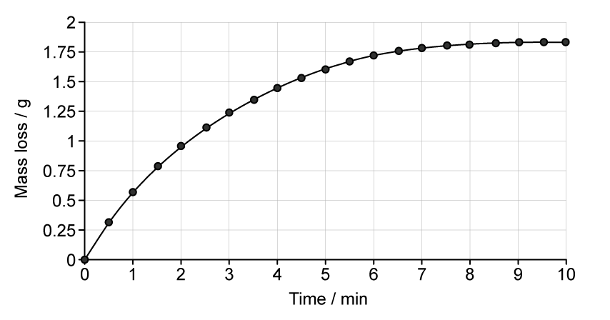

**Fig. 1.2**

i) Determine the **initial** rate of reaction with **the correct units**. Show clearly on the graph how you obtained your answer.

[3]

ii) Determine the time taken for the reaction to finish.

........... min [1]

**Q1** [2 marks]

**Extract:**

A student investigates the rate of reaction between solid calcium carbonate and a concentrated solution of hydrochloric acid (HCl). CaCO3 (s) + 2HCl (aq) → CaCl2(aq) + H2O (l) + CO2 (g)

The student repeats the experiment using powder of calcium carbonate instead of chips.

Suggest **one** variable that the student **must** keep constant to make the experiment fair. Explain your answer.

**Variable:**

**Explanation:**

### Q2 — medium — 10 marks

**Q2** [2 marks]

An investigation into the reaction of calcium with water was carried out using the apparatus below. The temperature of the water increased during the experiment.

The volume of hydrogen collected at one minute intervals was measured.

Use the diagrams to record the volumes in the table.

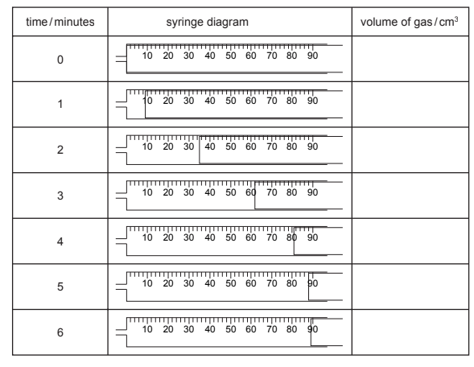

*Source: 2006 6 Q3*

**Q2** [3 marks]

**Extract:**

An investigation into the reaction of calcium with water was carried out using the apparatus below. The temperature of the water increased during the experiment. The volume of hydrogen collected at one minute intervals was measured. Use the diagrams to record the volumes in the table.

Plot the results on the grid. Join all of the results with a smooth curve.

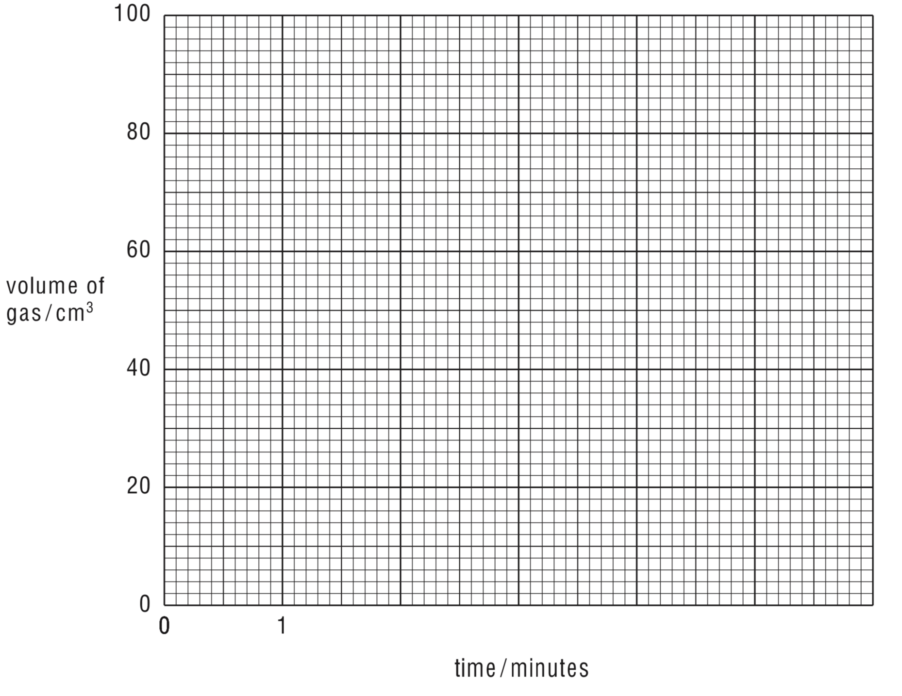

*Source: 2006 6 Q3*

**Q2** [1 mark]

**Extract:**

An investigation into the reaction of calcium with water was carried out using the apparatus below. The temperature of the water increased during the experiment.

The volume of hydrogen collected at one minute intervals was measured.

What type of chemical reaction occurs when calcium reacts with cold water?

*Source: 2006 6 Q3*

**Q2** [4 marks]

**Extract:**

An investigation into the reaction of calcium with water was carried out using the apparatus below. The temperature of the water increased during the experiment. The volume of hydrogen collected at one minute intervals was measured. Use the diagrams to record the volumes in the table.
Plot the results on the grid. Join all of the results with a smooth curve.
What type of chemical reaction occurs when calcium reacts with cold water? Exothermic OR Displacement OR Oxidation OR Redox

i)  Use the graph to describe how the speed of this reaction changes during the six minutes.

[2]

ii) Explain possible reasons for the changes in (d)(i).

[2]

*Source: 2006 6 Q3*

### Q3 — medium — 10 marks

**Q3** [4 marks]

In a set of experiments zinc was reacted with suphuric acid to form hydrogen. The apparatus below was used.

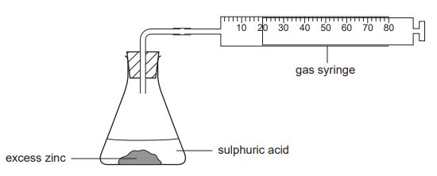

The same mass of zinc was used each time. The volume of acid used was different each time. Use the syringe diagrams to record the volume of hydrogen produced each time in the table. Table of results

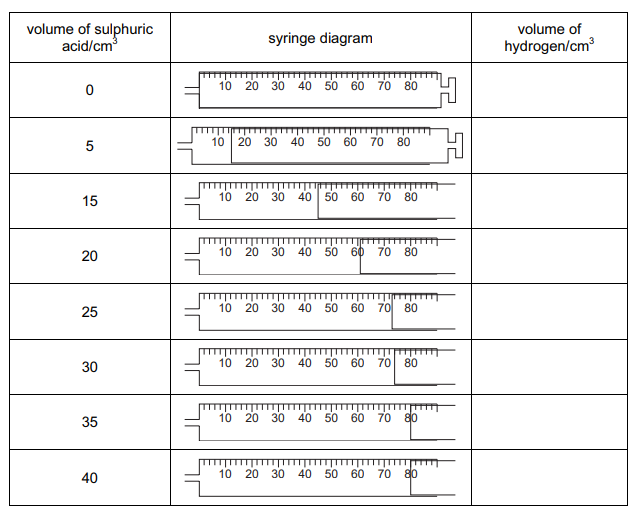

*Source: 2005 Ju6 Q3*

**Q3** [4 marks]

**Extract:**

In a set of experiments zinc was reacted with suphuric acid to form hydrogen. The same mass of zinc was used each time. The volume of acid used was different each time. The volume of hydrogen from the syringe diagrams are; 0, 15, 45, 61, 73, 74, 80 and 80

Plot the results on the grid below. Draw a smooth line graph.

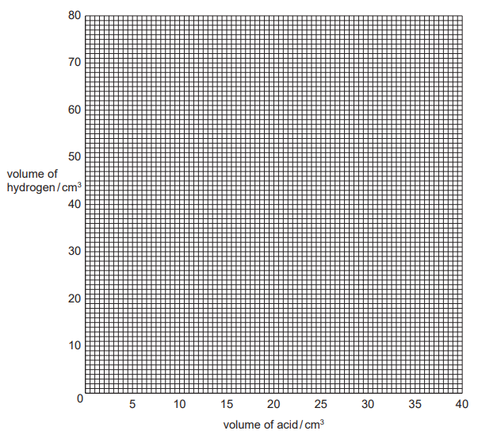

*Source: 2005 Ju6 Q3*

**Q3** [1 mark]

**Extract:**

In a set of experiments zinc was reacted with suphuric acid to form hydrogen. The same mass of zinc was used each time. The volume of acid used was different each time.
Plot the results on the grid below. Draw a smooth line graph. On the x-axis, each square represents 0.5 cm^3. On the y-axis, each square represents 1 cm^3. Volume of hydrogen values: 0, 15, 45, 61, 73, 74, 80 and 80.

Use the graph to find the volume of sulphuric acid that will produce 33 cm3 of gas.

*Source: 2005 Ju6 Q3*

**Q3** [1 mark]

**Extract:**

In a set of experiments zinc was reacted with suphuric acid to form hydrogen. The same mass of zinc was used each time. The volume of acid used was different each time. The volume of hydrogen from the syringe diagrams are; 0, 15, 45, 61, 73, 74, 80 and 80
Plot the results on the grid below. Draw a smooth line graph. On the x-axis, each square represents 0.5 cm^3. On the y-axis, each square represents 1 cm^3.

What volume of gas is produced if 10 cm3 of sulphuric acid is used?

*Source: 2005 Ju6 Q3*

### Q4 — medium — 5 marks

**Q4** [3 marks]

An experiment was carried out using the apparatus below

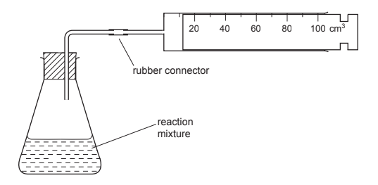

By using a measuring cylinder, 20 cm3 of hydrogen peroxide was placed was placed in the flask and 0.8 g of the catalyst, managnese(IV) oxide was added. The bung was replaced and the gas collected was measured at 1 minute intervals. The results were placed on the grid.

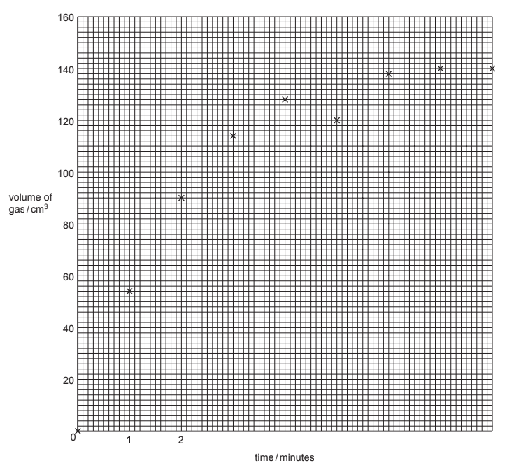

i) Draw a smooth line on the grid.

[1]

ii) Which of the results is inaccurate? Why have you chosen this result?

[2]

*Source: 2003 6 Q5*

**Q4** [1 mark]

**Extract:**

By using a measuring cylinder, 20 cm^3^ of hydrogen peroxide was placed was placed in the flask and 0.8 g of the catalyst, managnese(IV) oxide was added.

What mass of manganese(IV) oxide would remain at the end of the experiment?

*Source: 2003 6 Q5*

**Q4** [1 mark]

**Extract:**

An experiment was carried out using the apparatus below. By using a measuring cylinder, 20 cm^3 of hydrogen peroxide was placed in the flask and 0.8 g of the catalyst, manganese(IV) oxide was added. The bung was replaced and the gas collected was measured at 1 minute intervals.

What would be the effect of using a rubber connector with a hole in it.

*Source: 2003 6 Q5*

### Q5 — medium — 19 marks

**Q5** [5 marks]

A student investigated the speed of reaction when iodine was produced by the reaction of solution **L** with potassium iodide at different temperatures. Five experiments were carried out.

*Experiment 1*

A burette was filled with the aqueous solution **L** to the 0.0 cm3 mark.

10.0 cm3 of solution **L** was added from the burette into a boiling tube and the initial temperature of the solution was measured. Using a measuring cylinder, 5 cm3 of aqueous potassium iodide and 3 cm3 of aqueous sodium thiosulfate were poured into a second boiling tube. Starch solution was added to this boiling tube and the mixture shaken.

The mixture in the second boiling tube was added to the solution **L**, shaken and the clock started. These chemicals reacted to form iodine which reacted with the starch. When a blue colour appeared, the clock was stopped and the time measured and recorded in the table. The final temperature of the mixture was measured.

*Experiment 2*

Experiment 1 was repeated but solution **L** was heated to about 40 °C. The temperature of the solution was measured before adding the mixture in the second boiling tube. When a blue colour appeared, the clock was stopped and the time measured and recorded in the table. The final temperature of the mixture was measured.

*Experiment 3*

Experiment 2 was repeated, heating solution **L** to about 50 °C.

*Experiment 4*

Experiment 2 was repeated, heating solution **L** to about 60 °C.

*Experiment 5*

Experiment 2 was repeated, heating solution **L** to about 70 °C.

Use the thermometer diagrams in the table to record the temperatures and complete the table.

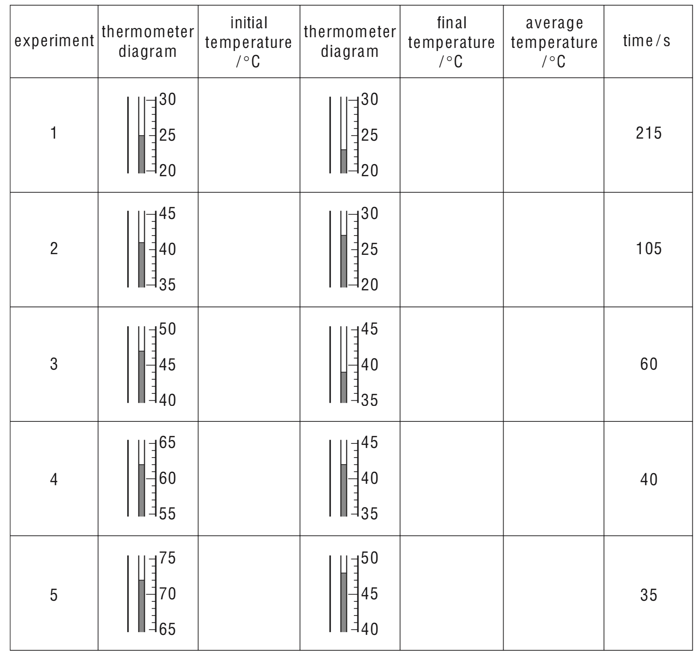

*Source: 2012 61 Q4*

**Q5** [5 marks]

**Extract:**

A student investigated the speed of reaction when iodine was produced by the reaction of solution L with potassium iodide at different temperatures. Five experiments were carried out. The mixture reacted to form iodine which reacted with the starch. When a blue colour appeared, the clock was stopped and the time measured and recorded in the table. Experiments were repeated heating solution L to about 40 °C, 50 °C, 60 °C and 70 °C. The completed table records the initial temperature, final temperature, average temperature and time for each experiment.

Plot the results on the grid below and draw a smooth line graph.

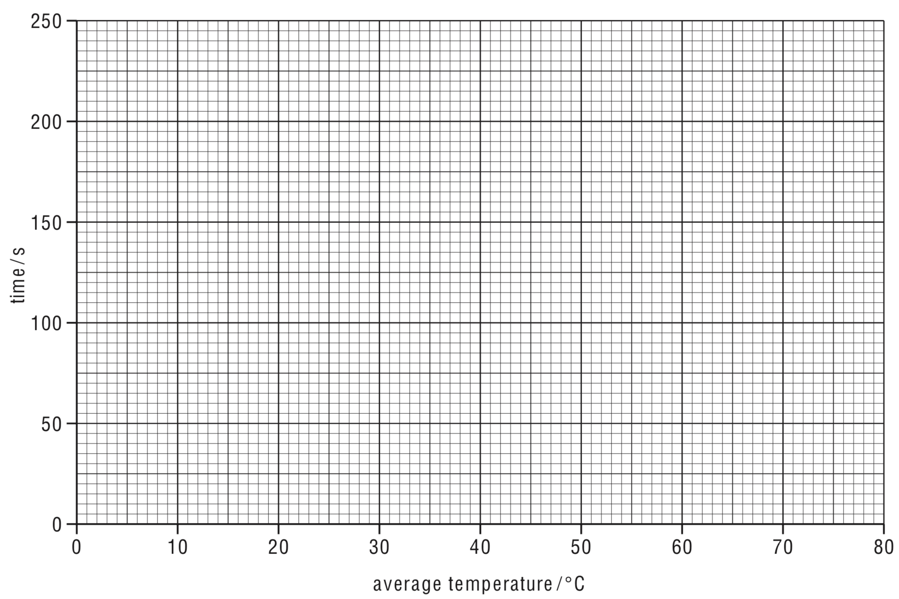

*Source: 2012 61 Q4*

**Q5** [2 marks]

**Extract:**

A student investigated the speed of reaction when iodine was produced by the reaction of solution L with potassium iodide at different temperatures. Five experiments were carried out. ... The mixture in the second boiling tube was added to the solution L, shaken and the clock started. These chemicals reacted to form iodine which reacted with the starch. When a blue colour appeared, the clock was stopped and the time measured and recorded in the table. The final temperature of the mixture was measured. Experiment 2 was repeated but solution L was heated to about 40 °C ... 50 °C ... 60 °C ... 70 °C.
Plot the results on the grid below and draw a smooth line graph. (graph of time/s against average temperature/°C)

From your graph, work out the time taken for the blue colour to appear if solution **L** was heated to 80 °C. The final temperature of the reaction mixture was 64 °C. Show clearly on the grid how you obtained your answer.

*Source: 2012 61 Q4*

**Q5** [1 mark]

**Extract:**

A student investigated the speed of reaction when iodine was produced by the reaction of solution **L** with potassium iodide at different temperatures. Five experiments were carried out.

*Experiment 1*

A burette was filled with the aqueous solution **L** to the 0.0 cm^3 ^mark.

10.0 cm^3 ^of solution **L** was added from the burette into a boiling tube and the initial temperature of the solution was measured. Using a measuring cylinder, 5 cm^3^ of aqueous potassium iodide and 3 cm^3^ of aqueous sodium thiosulfate were poured into a second boiling tube. Starch solution was added to this boiling tube and the mixture shaken.

The mixture in the second boiling tube was added to the solution **L**, shaken and the clock started. These chemicals reacted to form iodine which reacted with the starch. When a blue colour appeared, the clock was stopped and the time measured and recorded in the table.

Suggest the purpose of the starch solution in the experiments.

*Source: 2012 61 Q4*

**Q5** [3 marks]

**Extract:**

A student investigated the speed of reaction when iodine was produced by the reaction of solution L with potassium iodide at different temperatures. Five experiments were carried out.
Experiment 1: 10.0 cm^3 of solution L was added into a boiling tube and initial temperature measured. 5 cm^3 of aqueous potassium iodide and 3 cm^3 of aqueous sodium thiosulfate were poured into a second boiling tube. Starch solution added. When a blue colour appeared, the clock was stopped and time recorded.
Experiment 2: Experiment 1 repeated but solution L was heated to about 40 °C.
Experiment 3: Experiment 2 repeated, heating solution L to about 50 °C.
Experiment 4: Experiment 2 repeated, heating solution L to about 60 °C.
Experiment 5: Experiment 2 repeated, heating solution L to about 70 °C.

i) In which experiment was the reaction speed fastest?

[1]

ii) Explain, using ideas about particles, why this experiment was the fastest.

[2]

*Source: 2012 61 Q4*

**Q5** [2 marks]

**Extract:**

A student investigated the speed of reaction when iodine was produced by the reaction of solution L with potassium iodide at different temperatures. Five experiments were carried out. Experiment 1: A burette was filled with the aqueous solution L to the 0.0 cm3 mark. 10.0 cm3 of solution L was added from the burette into a boiling tube and the initial temperature of the solution was measured. Using a measuring cylinder, 5 cm3 of aqueous potassium iodide and 3 cm3 of aqueous sodium thiosulfate were poured into a second boiling tube. Starch solution was added to this boiling tube and the mixture shaken. The mixture in the second boiling tube was added to the solution L, shaken and the clock started. These chemicals reacted to form iodine which reacted with the starch. When a blue colour appeared, the clock was stopped and the time measured and recorded in the table. Experiment 2: Experiment 1 was repeated but solution L was heated to about 40 °C. Experiment 5: Experiment 2 was repeated, heating solution L to about 70 °C.

Predict the effect on the time and speed of the reaction in Experiment 5 if it was repeated using a less concentrated solution of **L**.

Time: ..............................................................

Speed: ..............................................................

*Source: 2012 61 Q4*

**Q5** [1 mark]

**Extract:**

A burette was filled with the aqueous solution **L** to the 0.0 cm^3 mark. 10.0 cm^3 of solution **L** was added from the burette into a boiling tube and the initial temperature of the solution was measured. Using a measuring cylinder, 5 cm^3 of aqueous potassium iodide and 3 cm^3 of aqueous sodium thiosulfate were poured into a second boiling tube.

Why was a burette used to measure solution **L** instead of a measuring cylinder?

*Source: 2012 61 Q4*

### Q6 — medium — 4 marks

**Q6** [1 mark]

The addition of calcium carbonate to excess dilute nitric acid produces carbon dioxide. The volume of carbon dioxide given off at 20 second intervals was recorded and plotted on the grid.

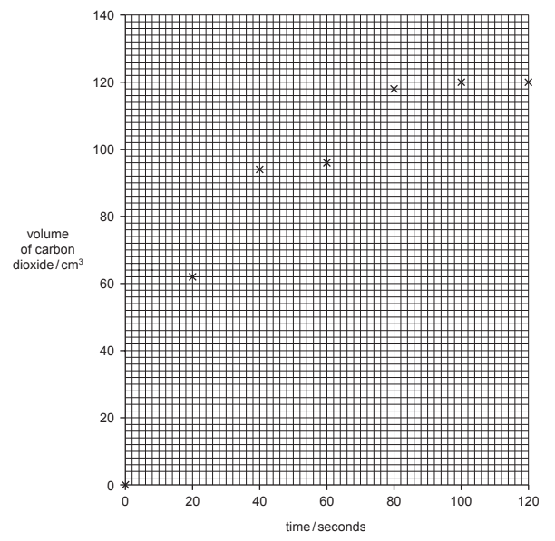

Draw a smooth line graph on the grid.

*Source: 2004 6 Q2*

**Q6** [2 marks]

**Extract:**

The addition of calcium carbonate to excess dilute nitric acid produces carbon dioxide. The volume of carbon dioxide given off at 20 second intervals was recorded and plotted on the grid. Draw a smooth line graph on the grid.

Circle the result which appears to be incorrect? Why have you selected this result?

*Source: 2004 6 Q2*

**Q6** [1 mark]

**Extract:**

The addition of calcium carbonate to excess dilute nitric acid produces carbon dioxide. The volume of carbon dioxide given off at 20 second intervals was recorded and plotted on the grid.

Why does the reaction slow down?

*Source: 2004 6 Q2*

### Q7 — medium — 15 marks

**Q7** [4 marks]

Two experiments using catalysts were carried out. Catalysts **R** and** S** were used to break down 50 cm3 of aqueous hydrogen peroxide at a temperature of 20 °C. The volume of oxygen given off was measured using the apparatus shown.

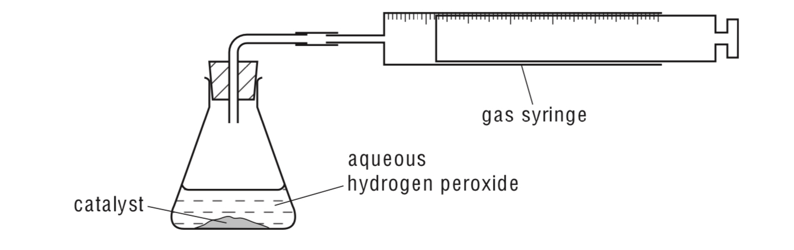

Complete the table to show the volumes of gas measured in each experiment at the times shown in the table below.

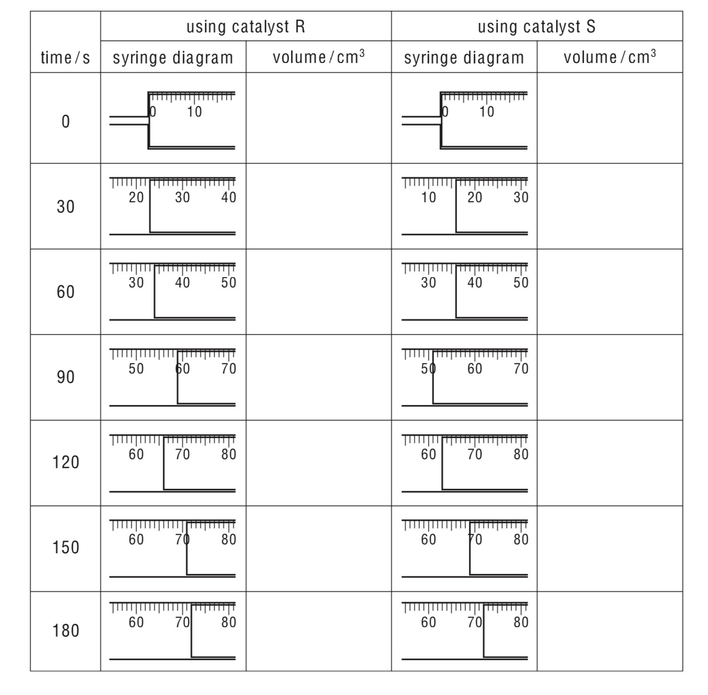

*Source: 2013 61 Q5*

**Q7** [6 marks]

**Extract:**

Two experiments using catalysts were carried out. Catalysts R and S were used to break down 50 cm^3 of aqueous hydrogen peroxide at a temperature of 20 °C. The volume of oxygen given off was measured using the apparatus shown. Complete the table to show the volumes of gas measured in each experiment at the times shown in the table below.

Plot a graph to show each set of results. Clearly label the graphs** R** and **S**.

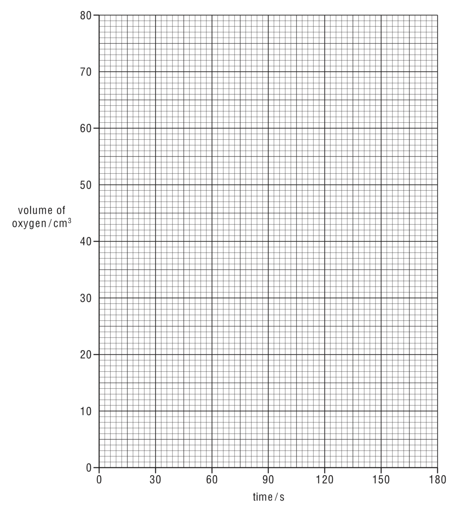

*Source: 2013 61 Q5*

**Q7** [1 mark]

**Extract:**

Two experiments using catalysts were carried out. Catalysts R and S were used to break down 50 cm^3 of aqueous hydrogen peroxide at a temperature of 20 °C. The volume of oxygen given off was measured using the apparatus shown. Complete the table to show the volumes of gas measured in each experiment at the times shown in the table below.
Plot a graph to show each set of results. Clearly label the graphs R and S.

Which result using catalyst **R** was inaccurate?

*Source: 2013 61 Q5*

**Q7** [2 marks]

**Extract:**

Two experiments using catalysts were carried out. Catalysts R and S were used to break down 50 cm^3 of aqueous hydrogen peroxide at a temperature of 20 °C. The volume of oxygen given off was measured using the apparatus shown.

Which is the better catalyst in this reaction? Explain your answer.

*Source: 2013 61 Q5*

**Q7** [2 marks]

**Extract:**

Two experiments using catalysts were carried out. Catalysts R and S were used to break down 50 cm^3 of aqueous hydrogen peroxide at a temperature of 20 °C. The volume of oxygen given off was measured using the apparatus shown.

Plot a graph to show each set of results. Clearly label the graphs R and S.

Sketch a line on the grid to show the graph you would expect if the reaction with catalyst **R** was repeated at 50°C.

*Source: 2013 61 Q5*

### Q8 — medium — 8 marks

**Q8** [1 mark]

Two experiments were carried out to show what factors affect the rate of decomposition of hydrogen peroxide, H2O2. 
In each experiment the volume of gas produced was measured every minute for ten minutes.

*Experiment 1*

The student used a mixture of 50 cm3 of hydrogen peroxide, 50 cm3 of water and 1 g of manganese(IV) oxide at a room temperature of 20 °C. The results were plotted to obtain the graph shown.

*Experiment 2 *

The student repeated Experiment 1 but did not record how much of each substance was used. The points were plotted on the grid.

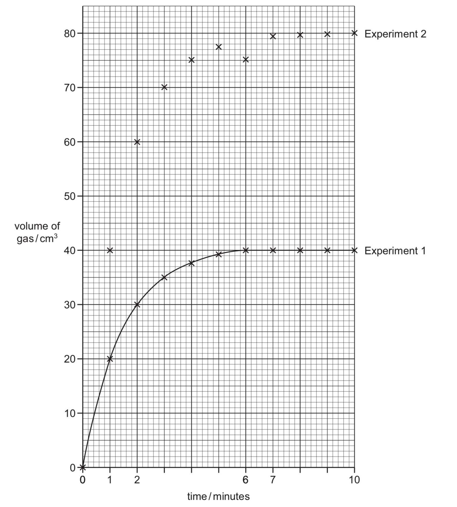

Complete the graph for Experiment 2.

*Source: 2014 61 Q2*

**Q8** [4 marks]

**Extract:**

Two experiments were carried out to show what factors affect the rate of decomposition of hydrogen peroxide, H~2~O~2~. In each experiment the volume of gas produced was measured every minute for ten minutes. Experiment 1: The student used a mixture of 50 cm^3 of hydrogen peroxide, 50 cm^3 of water and 1 g of manganese(IV) oxide at a room temperature of 20 °C. The results were plotted to obtain the graph shown. Experiment 2: The student repeated Experiment 1 but did not record how much of each substance was used. The points were plotted on the grid.

Suggest the composition of the mixture used in Experiment 2. Explain your suggestion.

Composition: ................................................................... Explanation: ....................................................................

*Source: 2014 61 Q2*

**Q8** [1 mark]

**Extract:**

Two experiments were carried out to show what factors affect the rate of decomposition of hydrogen peroxide, H~2~O~2~. In each experiment the volume of gas produced was measured every minute for ten minutes. Experiment 1: The student used a mixture of 50 cm^3 of hydrogen peroxide, 50 cm^3 of water and 1 g of manganese(IV) oxide at a room temperature of 20 °C.

What is the function of the manganese(IV) oxide?

*Source: 2014 61 Q2*

**Q8** [2 marks]

**Extract:**

Two experiments were carried out to show what factors affect the rate of decomposition of hydrogen peroxide, H2O2. In each experiment the volume of gas produced was measured every minute for ten minutes. Experiment 1: The student used a mixture of 50 cm3 of hydrogen peroxide, 50 cm3 of water and 1 g of manganese(IV) oxide at a room temperature of 20 °C. The results were plotted to obtain the graph shown. Experiment 1 reaches a volume of 40 cm3 of oxygen gas.

Sketch on the grid the curve that you would expect if Experiment 1 was repeated at 10 °C.

*Source: 2014 61 Q2*

### Q9 — medium — 8 marks

**Q9** [8 marks]

A catalyst is a substance that speeds up the rate of a chemical reaction and remains unchanged at the end of the reaction. Hydrogen peroxide solution, H2O2, breaks down to form oxygen. This decomposition is very slow if a catalyst is not used.

Plan an investigation to show that copper(II) oxide is a suitable catalyst for this reaction.

You can use aqueous hydrogen peroxide and common laboratory apparatus.

Step 1 Show that copper(II) oxide catalyses the decomposition of hydrogen peroxide and measure the rate of the reaction.

Step 2 Show that the copper(II) oxide is unchanged at the end of the decomposition.

*Source: 2015 6 Q6*

### Q10 — medium — 12 marks

**Q10** [4 marks]

The speed of reaction between excess copper carbonate and dilute nitric acid was investigated using the apparatus below.

The temperature of the nitric acid was 20 °C.

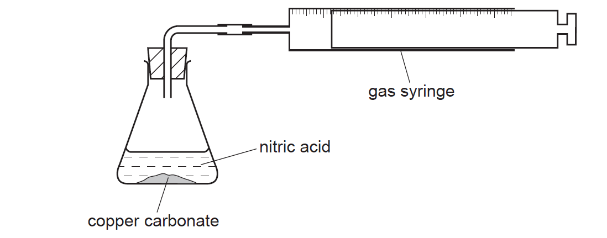

The volume of carbon dioxide produced was measured every minute for six minutes.

Use the gas syringe diagrams to complete the table of results.

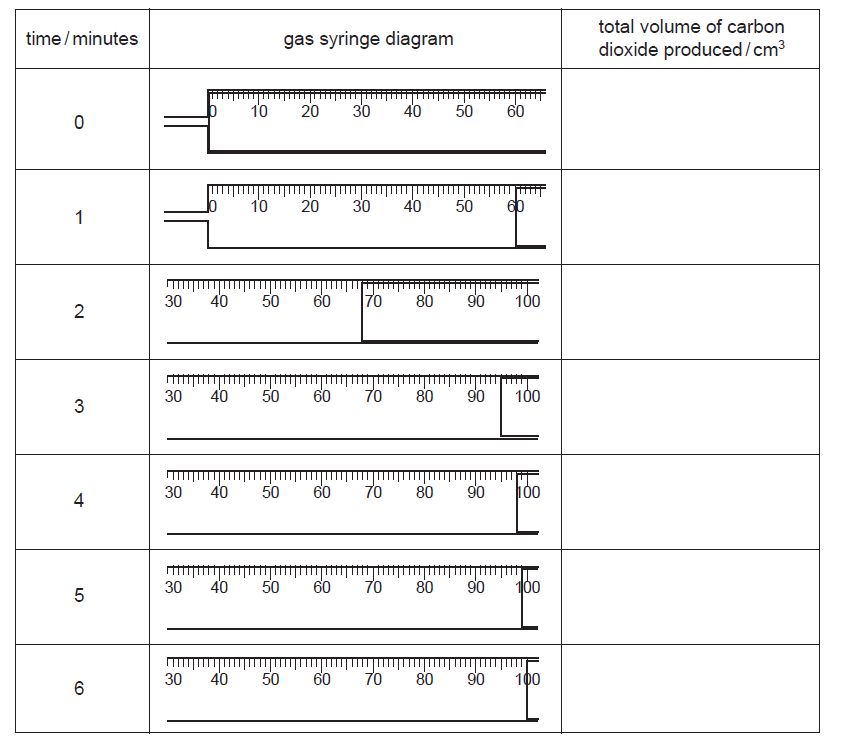

*Source: 2010 61 Q3*

**Q10** [4 marks]

**Extract:**

The speed of reaction between excess copper carbonate and dilute nitric acid was investigated using the apparatus below. The temperature of the nitric acid was 20 °C. The volume of carbon dioxide produced was measured every minute for six minutes. Use the gas syringe diagrams to complete the table of results. (Table of results from part a giving volume of carbon dioxide produced against time.)

Plot the results on the grid below and draw a smooth line graph.

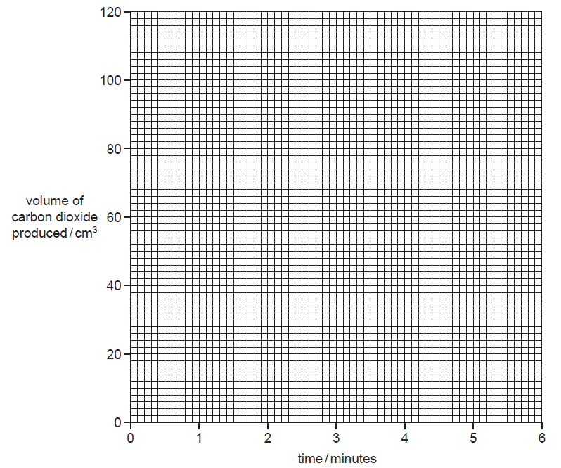

**Q10** [2 marks]

**Extract:**

The speed of reaction between excess copper carbonate and dilute nitric acid was investigated. The temperature of the nitric acid was 20 °C. The volume of carbon dioxide produced was measured every minute for six minutes.

Plot the results on the grid below and draw a smooth line graph. [Graph showing volume of carbon dioxide produced/cm³ against time/minutes, with the 2 minute point not fitting the curve.]

Which point appears to be inaccurate? Explain why.

**Q10** [2 marks]

**Extract:**

The speed of reaction between excess copper carbonate and dilute nitric acid was investigated using the apparatus below. The temperature of the nitric acid was 20 °C. The volume of carbon dioxide produced was measured every minute for six minutes.
Plot the results on the grid below and draw a smooth line graph.

Sketch on the grid, the graph you would expect if the experiment was repeated using nitric acid at a temperature of 60°C.

*Source: 2010 61 Q3D*

### Q11 — medium — 8 marks

**Q11** [3 marks]

Magnesium reacts with dilute sulphuric acid to form hydrogen gas. The speed of the reaction was investigated using the apparatus below.

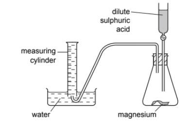

In an experiment 50 cm3 of dilute sulphuric acid was added to a large piece of magnesium. A student measured the total volume of gas produced at 2 minute intervals. Use the measuring cylinder diagrams to complete the table.

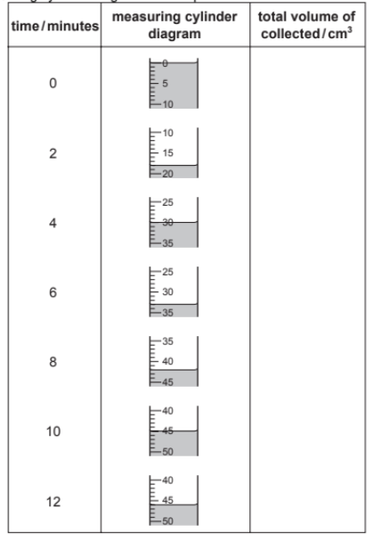

*Source: 2007 O6 Q6*

**Q11** [3 marks]

**Extract:**

Magnesium reacts with dilute sulphuric acid to form hydrogen gas. In an experiment 50 cm^3 of dilute sulphuric acid was added to a large piece of magnesium. A student measured the total volume of gas produced at 2 minute intervals. The completed table gives the total volume of gas / cm^3 at time / minutes intervals (0, 2, 4, 6, 8, 10, 12 minutes).

Plot the student’s results on the grid. Use the points to draw a smooth line graph.

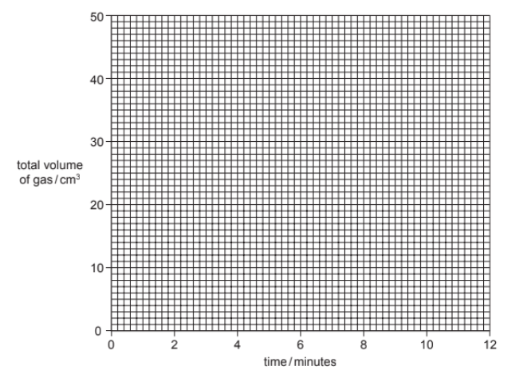

*Source: 2007 O6 Q6*

**Q11** [2 marks]

**Extract:**

Magnesium reacts with dilute sulphuric acid to form hydrogen gas. The speed of the reaction was investigated using the apparatus below. In an experiment 50 cm^3 of dilute sulphuric acid was added to a large piece of magnesium. A student measured the total volume of gas produced at 2 minute intervals.
Plot the student's results on the grid. Use the points to draw a smooth line graph.

i) At which time does the result appear to be inaccurate?

[1]

ii) Use the graph to deduce what the correct volume should be at this time.

[1]

*Source: 2007 O6 Q6*

### Q12 — medium — 10 marks

**Q12** [2 marks]

Hydrochloric acid reacts with aqueous sodium thiosulfate to form a precipitate, which makes the solution turn cloudy. The formation of the precipitate can be used to show how fast the reaction proceeds, using the apparatus shown below.

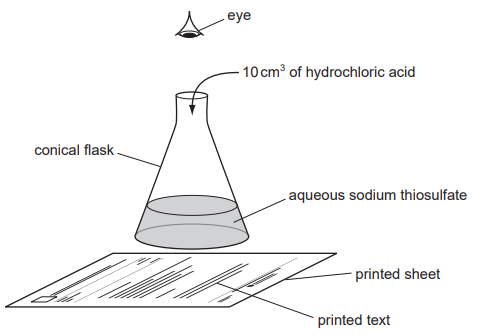

A student used this method to investigate the effect of changing the concentration of the sodium thiosulfate solution on the speed of the reaction. The student used different concentrations of sodium thiosulfate solution. All other variables were kept the same.

Give **two **variables which were kept the same in the investigation.

*Source: 2015 61 Q2*

**Q12** [1 mark]

**Extract:**

Hydrochloric acid reacts with aqueous sodium thiosulfate to form a precipitate, which makes the solution turn cloudy. The formation of the precipitate can be used to show how fast the reaction proceeds. A student used this method to investigate the effect of changing the concentration of the sodium thiosulfate solution on the speed of the reaction. The student used different concentrations of sodium thiosulfate solution. All other variables were kept the same.

The results of the experiments are shown plotted on the grid below

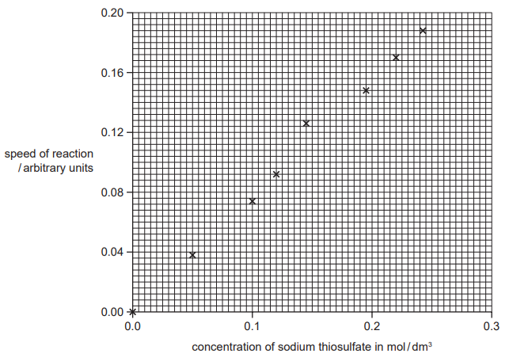

Draw a line of best fit on the grid.

*Source: 2011 61 Q2*

**Q12** [2 marks]

**Extract:**

Hydrochloric acid reacts with aqueous sodium thiosulfate to form a precipitate, which makes the solution turn cloudy. The formation of the precipitate can be used to show how fast the reaction proceeds. A student used this method to investigate the effect of changing the concentration of the sodium thiosulfate solution on the speed of the reaction. The student used different concentrations of sodium thiosulfate solution. All other variables were kept the same.
The results of the experiments are shown plotted on the grid below. Draw a line of best fit on the grid.

Suggest **two **reasons why not all of the points lie on the line of best fit.

*Source: 2011 61 Q2*

**Q12** [2 marks]

**Extract:**

Hydrochloric acid reacts with aqueous sodium thiosulfate to form a precipitate, which makes the solution turn cloudy. The formation of the precipitate can be used to show how fast the reaction proceeds. A student used this method to investigate the effect of changing the concentration of the sodium thiosulfate solution on the speed of the reaction.
The results of the experiments are shown plotted on the grid below. Draw a line of best fit on the grid. (Graph: speed of reaction / arbitrary units on y-axis, concentration of sodium thiosulfate in mol/dm^3 on x-axis, with a straight line of best fit through the points.)

From your graph, deduce the speed of reaction when the concentration of sodium thiosulfate is 0.075 mol/dm3. Show clearly **on the graph** how you worked out your answer.

*Source: 2011 61 Q2*

**Q12** [2 marks]

Explain why the speed of reaction increases when the concentration of sodium thiosulfate is increased.

*Source: 2011 61 Q2*

**Q12** [1 mark]

**Extract:**

Hydrochloric acid reacts with aqueous sodium thiosulfate to form a precipitate, which makes the solution turn cloudy. The formation of the precipitate can be used to show how fast the reaction proceeds. A student used this method to investigate the effect of changing the concentration of the sodium thiosulfate solution on the speed of the reaction.
The results of the experiments are shown plotted on the grid below (graph of speed of reaction / arbitrary units against concentration of sodium thiosulfate in mol/dm^3, with a straight line of best fit passing through the origin).

Sketch on the grid the line you would expect if the experiments were repeated at a higher temperature

*Source: 2011 61 Q2*

### Q13 — medium — 16 marks

**Q13** [3 marks]

A student investigated the speed of reaction between aqueous hydrochloric acid and marble chips (calcium carbonate). The apparatus below was used.

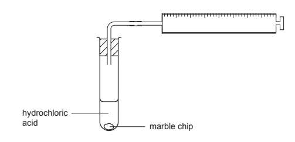

5 test-tubes were put in a rack. To each test-tube was added 10 cm3 of different solutions of aqueous hydrochloric acid and a marble chip. The marble chips were the same size.

<u>Experiment 1</u>

By using a measuring cylinder 10 cm3 of the solution **P** of aqueous hydrochloric acid was placed in the first test-tube.

A marble chip was added and the volume of gas collected after two minutes was measured. Use the gas syringe diagram to record the volume.

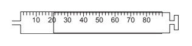

<u>Experiment 2</u>

Experiment 1 was repeated using solution **Q** of aqueous hydrochloric acid. Use the diagram to record the volume of gas collected in the table.

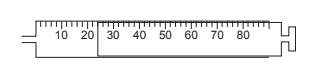

<u>Experiments 3, 4 and 5</u>

Experiment 1 was repeated using the solutions **R**, **S** and** T** of aqueous hydrochloric acid in the third, fourth and fifth test-tubes.

Use the diagrams to record the volumes in the table.

<u>Experiment 3</u>

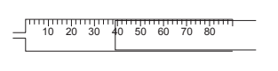

<u>Experiment 4</u>

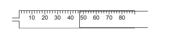

<u>Experiment 5</u>

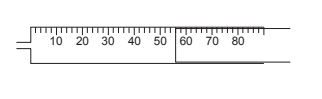

<u>Table of results</u>

| **Experiment ** | **Solution of hydrochloric acid** | **Volume of gas collected / cm****3** |
|---|---|---|
| 1 | **P** |   |
| 2 | **Q** |   |
| 3 | **R** |   |
| 4 | **S** |   |
| 5 | **T** |   |

*Source: 2005 6 Q4*

**Q13** [4 marks]

**Extract:**

Table of results:
| Experiment | Solution of hydrochloric acid | Volume of gas collected / cm^3 |
| 1 | P | 21 |
| 2 | Q | 24 |
| 3 | R | 39 |
| 4 | S | 47 |
| 5 | T | 56 |

Plot your results on the grid. Draw a straight line graph.

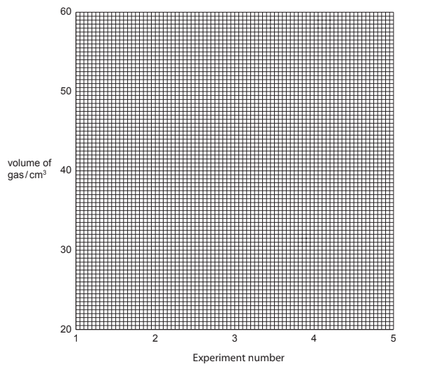

*Source: 2006 6 Q4*

**Q13** [2 marks]

**Extract:**

A student investigated the speed of reaction between aqueous hydrochloric acid and marble chips (calcium carbonate). 5 test-tubes were put in a rack. To each test-tube was added 10 cm^3 of different solutions of aqueous hydrochloric acid and a marble chip. Experiments 1-5 used solutions P, Q, R, S and T.

Completed table of results:
| Experiment | Solution of hydrochloric acid | Volume of gas collected / cm^3 |
| 1 | P | 21 |
| 2 | Q | 24 |
| 3 | R | 39 |
| 4 | S | 47 |
| 5 | T | 56 |

Plot your results on the grid. Draw a straight line graph (line of best fit).

Which result appears inaccurate? Give a reason for your choice.

Experiment: ..................................................................................

Reason: ..........................................................................................

*Source: 2005 6 Q4*

**Q13** [3 marks]

**Extract:**

A student investigated the speed of reaction between aqueous hydrochloric acid and marble chips (calcium carbonate). 5 test-tubes were put in a rack. To each test-tube was added 10 cm^3 of different solutions of aqueous hydrochloric acid and a marble chip. The marble chips were the same size. Experiment 1 used solution P, Experiment 2 used solution Q, Experiments 3, 4 and 5 used solutions R, S and T. A marble chip was added and the volume of gas collected after two minutes was measured.

Table of results:
| Experiment | Solution of hydrochloric acid | Volume of gas collected / cm^3 |
| 1 | P | 21 |
| 2 | Q | 24 |
| 3 | R | 39 |
| 4 | S | 47 |
| 5 | T | 56 |

i) Which experiment had the fastest rate of reaction?

[1]

ii) Suggest why this experiment was the fastest.

[2]

*Source: 2005 6 Q4*

**Q13** [2 marks]

**Extract:**

A student investigated the speed of reaction between aqueous hydrochloric acid and marble chips (calcium carbonate). The apparatus below was used. 5 test-tubes were put in a rack. To each test-tube was added 10 cm^3 of different solutions of aqueous hydrochloric acid and a marble chip. The marble chips were the same size. A marble chip was added and the volume of gas collected after two minutes was measured.

How would the student know which of the reactants in the experiment was in excess?

*Source: 2005 6 Q4*

**Q13** [2 marks]

**Extract:**

A student investigated the speed of reaction between aqueous hydrochloric acid and marble chips (calcium carbonate). 5 test-tubes were put in a rack. To each test-tube was added 10 cm^3 of different solutions of aqueous hydrochloric acid and a marble chip. The marble chips were the same size. By using a measuring cylinder 10 cm^3 of the solution P of aqueous hydrochloric acid was placed in the first test-tube. A marble chip was added and the volume of gas collected after two minutes was measured.

i) State one possible source of error in the experiments.

[1]

ii) Suggest one improvement to reduce this source of error in the experiments.

[1]

*Source: 2005 6 Q4*

### Q14 — medium — 14 marks

**Q14** [3 marks]

Hydrogen peroxide breaks down to form oxygen. The volume of oxygen given off can be measured using the apparatus below.

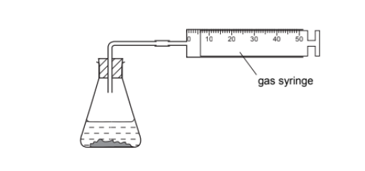

Solids **W** and **X** both catalyse the breakdown of hydrogen peroxide. The syringe diagrams show the volume of oxygen formed every 20 seconds using these catalysts at 25 °C.

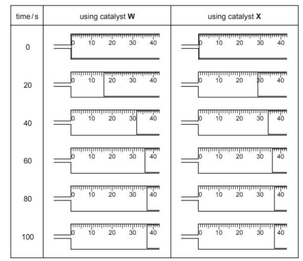

Use the gas syringe diagrams to complete the table.

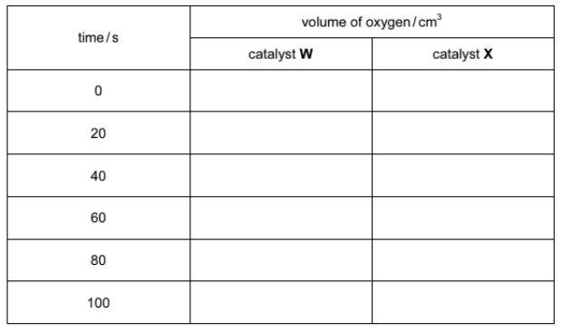

*Source: 2007 Ju6 Q6*

**Q14** [6 marks]

**Extract:**

Hydrogen peroxide breaks down to form oxygen. The volume of oxygen given off can be measured using the apparatus below. Solids W and X both catalyse the breakdown of hydrogen peroxide. The syringe diagrams show the volume of oxygen formed every 20 seconds using these catalysts at 25 °C. Use the gas syringe diagrams to complete the table.

Plot a graph to show each set of results. Clearly label the curves.

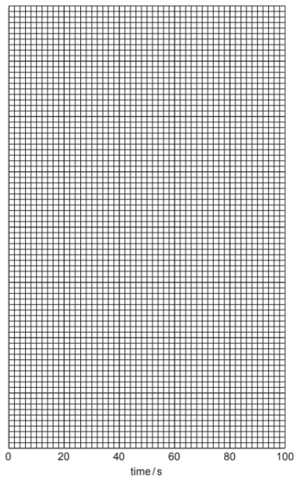

*Source: 2007 Ju6 Q6*

**Q14** [2 marks]

**Extract:**

Hydrogen peroxide breaks down to form oxygen. The volume of oxygen given off can be measured using the apparatus below. Solids **W** and **X** both catalyse the breakdown of hydrogen peroxide. The syringe diagrams show the volume of oxygen formed every 20 seconds using these catalysts at 25 °C.

Which solid is the better catalyst in this reaction? Give a reason for your choice.

Solid: .......................................................

Reason: .................................................

*Source: 2007 Ju6 Q6*

**Q14** [1 mark]

**Extract:**

Hydrogen peroxide breaks down to form oxygen. The volume of oxygen given off can be measured using the apparatus below. Solids **W** and **X** both catalyse the breakdown of hydrogen peroxide. The syringe diagrams show the volume of oxygen formed every 20 seconds using these catalysts at 25 °C.

Why is the final volume of oxygen the same in each experiment?

*Source: 2007 Ju6 Q6*

**Q14** [2 marks]

**Extract:**

Solids W and X both catalyse the breakdown of hydrogen peroxide. The syringe diagrams show the volume of oxygen formed every 20 seconds using these catalysts at 25 °C.
Plot a graph to show each set of results. Clearly label the curves.

Sketch a line on the grid to show the shape of the graph you would expect if the reaction with catalyst **X** was repeated at 40 °C.

*Source: 2007 Ju6 Q6*

### Q15 — medium — 17 marks

**Q15** [4 marks]

A teacher investigated the rate of a reaction between two solutions, **J** and **K**, and sulfuric acid at different temperatures.

Four experiments were carried out.

*Experiment 1 *A large measuring cylinder was used to pour 50 cm3 of distilled water and 40 cm3  of sulfuric acid into a 250 cm3 conical flask. 
A small measuring cylinder was used to add 2 cm3  of methyl orange and 5 cm3  of solution **J** to the mixture in the conical flask. The temperature of the mixture was measured. 
The reaction was started by adding 5 cm3 of solution **K** to the conical flask, immediately starting the timer and swirling the mixture. The time taken for the mixture to turn pale yellow was measured. The final temperature of the mixture was measured.

*Experiment 2 *

*Experiment 1* was repeated but the mixture in the conical flask was heated to about 30 °C **before **adding the  solution **K**. The temperature of the mixture was measured. 5 cm3 of solution **K** was added to the conical flask. The timer was started and the mixture swirled. The time taken for the mixture to turn pale yellow was measured. The final temperature of the mixture was measured.

*Experiment 3*

*Experiment 1* was repeated but the mixture in the conical flask was heated to about 40 °C before adding the  solution **K** to the flask. The same measurements were taken.

*Experiment 4*

*Experiment 1* was repeated but the mixture in the conical flask was heated to about 50 °C before adding the solution **K** to the flask. The same measurements were taken.

Use the stop-clock diagrams to record the times in the table.

Work out the average temperatures to complete the table.

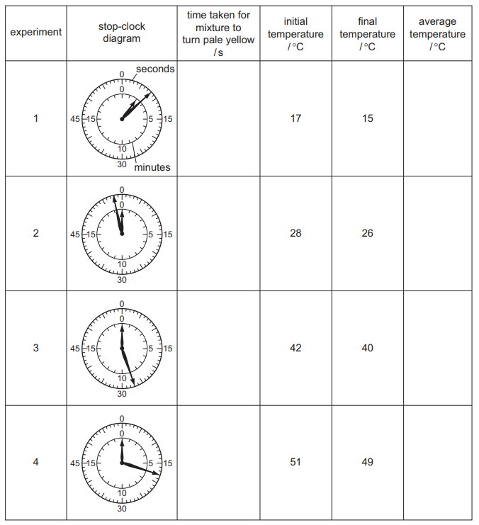

*Source: 2015 61 Q5*

**Q15** [4 marks]

**Extract:**

Average temperature boxes completed correctly: 16, 27, 41, 50
Times completed in seconds correctly: 128, 58, 27, 18

Plot the results on the grid and draw a smooth line graph.

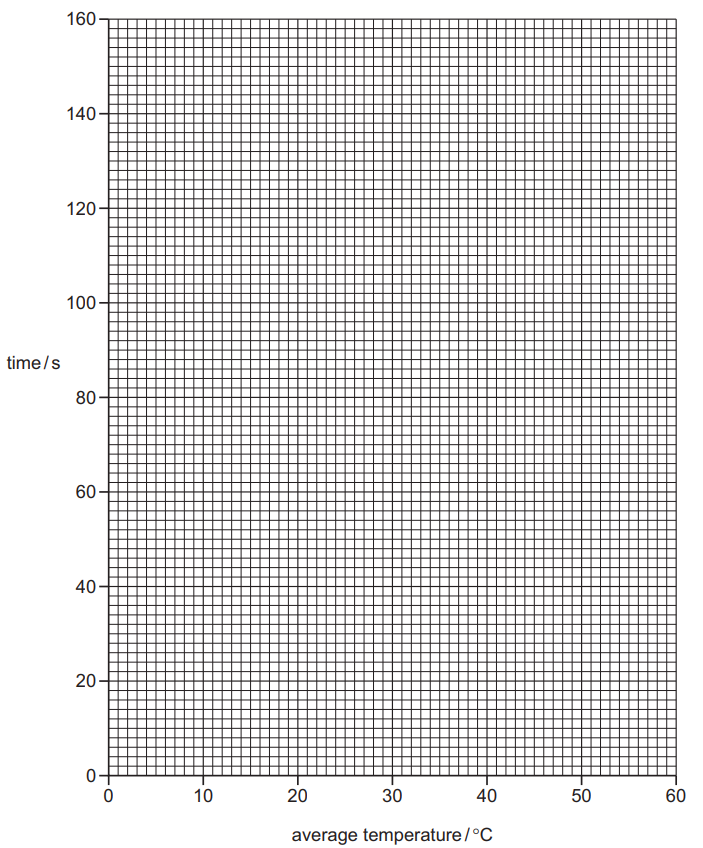

*Source: 2016 62 Q2*

**Q15** [2 marks]

**Extract:**

Average temperature boxes completed correctly: 16, 27, 41, 50; Times completed in seconds correctly: 128, 58, 27, 18

**From your graph** deduce the time taken for the mixture to turn pale yellow if Experiment 1 was repeated at an average temperature of 60 °C. Show **clearly **on the grid how you worked out your answer

*Source: 2016 62 Q2*

**Q15** [3 marks]

**Extract:**

A teacher investigated the rate of a reaction between two solutions, J and K, and sulfuric acid at different temperatures. Four experiments were carried out. Experiment 1: 50 cm^3 of distilled water and 40 cm^3 of sulfuric acid into a 250 cm^3 conical flask, 2 cm^3 of methyl orange and 5 cm^3 of solution J added. Reaction started by adding 5 cm^3 of solution K; time taken for the mixture to turn pale yellow was measured. Experiment 2: as Experiment 1 but heated to about 30 °C before adding solution K. Experiment 3: as Experiment 1 but heated to about 40 °C. Experiment 4: as Experiment 1 but heated to about 50 °C.
Average temperatures: 16, 27, 41, 50; Times in seconds: 128, 58, 27, 18.

i) In which experiment was the rate of reaction greatest?

[1]

ii) Explain why the rate of reaction was greatest in this experiment.

[2]

*Source: 2016 62 Q2*

**Q15** [4 marks]

**Extract:**

A teacher investigated the rate of a reaction between two solutions, J and K, and sulfuric acid at different temperatures. Four experiments were carried out.

Experiment 1: A large measuring cylinder was used to pour 50 cm^3 of distilled water and 40 cm^3 of sulfuric acid into a 250 cm^3 conical flask. A small measuring cylinder was used to add 2 cm^3 of methyl orange and 5 cm^3 of solution J to the mixture in the conical flask. The temperature of the mixture was measured. The reaction was started by adding 5 cm^3 of solution K to the conical flask, immediately starting the timer and swirling the mixture. The time taken for the mixture to turn pale yellow was measured. The final temperature of the mixture was measured.

i) Suggest and explain the effect **on the results** of using a burette to measure the volume of solution **J**.

[2]

ii) Suggest and explain one other improvement to these experiments.

[2]

*Source: 2016 62 Q2*

### Q16 — medium — 19 marks

**Q16** [5 marks]

A student investigated the speed of reaction between aqueous potassium bromate and potassium iodide solution. A burette was filled up to the 0.00 cm3 mark with aqueous potassium iodide. To each of 5 test-tubes was added 6 cm3 of aqueous potassium iodide to be used in the 5 following experiments.

*Experiment 1*

By using a measuring cylinder 12 cm3 of aqueous potassium bromate was poured into a small beaker. To this solution was added 4 cm3 of water, 2 cm3 of hydrochloric acid, 5 cm3 of starch solution and 1 cm3 of sodium thiosulphate solution.

The beaker was placed on a cross drawn on a piece of paper. From one of the test-tubes 6 cm3 of aqueous potassium iodide was added to the mixture in the beaker and the timer started. A dark blue colour formed. The timer was stopped when the cross on the paper could not be seen. Use the stop clock diagram to record the time in the table.

*Experiment 2*

By using a measuring cylinder 10 cm3 of potassium bromate solution was poured into a beaker. The instructions were repeated exactly as given for Experiment 1, but 6 cm3 of water was added to the beaker. Use the diagram to record the time in the table.

*Experiments 3, 4 and 5*

Experiment 1 was repeated using the volumes of aqueous potassium bromate and water specified in the table of results.

Record the times in the table.

*Table of results *

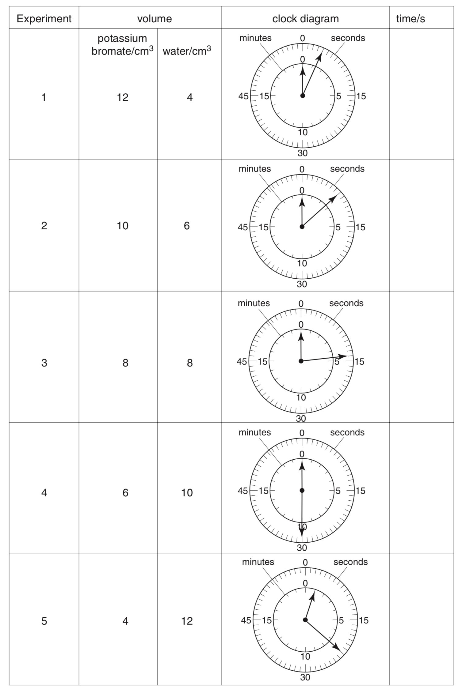

*Source: 2003 6 Q3*

**Q16** [4 marks]

**Extract:**

A student investigated the speed of reaction between aqueous potassium bromate and potassium iodide solution. Experiments were carried out using different volumes of aqueous potassium bromate and water, and the times taken for the cross to disappear were recorded in the table of results. (Part a): Record the times in the table.

Plot the results on the grid. Draw a smooth line graph.

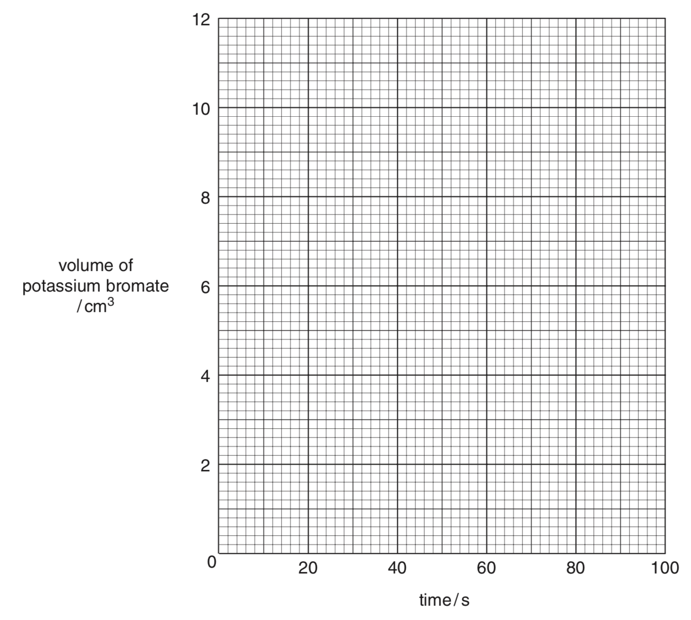

*Source: 2003 6 Q3*

**Q16** [3 marks]

**Extract:**

Plot the results on the grid. Draw a smooth line graph. The completed graph is: a curve of volume of potassium bromate /cm^3 (y-axis) against time /s (x-axis), passing through points (approx 3s, 12cm3), (8s, 10cm3), (14s, 8cm3), (30s, 6cm3), (82s, 4cm3).
A student investigated the speed of reaction between aqueous potassium bromate and potassium iodide solution. Experiment 1: 12 cm^3 of aqueous potassium bromate with 4 cm^3 of water, 2 cm^3 hydrochloric acid, 5 cm^3 starch solution, 1 cm^3 sodium thiosulphate solution, and 6 cm^3 of aqueous potassium iodide. The timer was stopped when the cross on the paper could not be seen.

From your graph estimate the time of the reaction if Experiment 1 was repeated using 5 cm3 of potassium bromate and 11 cm3 of water.

Show clearly on your graph how you worked out your answers.

*Source: 2003 6 Q3*

**Q16** [3 marks]

**Extract:**

A student investigated the speed of reaction between aqueous potassium bromate and potassium iodide solution.

Experiment 1: By using a measuring cylinder 12 cm^3 of aqueous potassium bromate was poured into a small beaker. To this solution was added 4 cm^3 of water, 2 cm^3 of hydrochloric acid, 5 cm^3 of starch solution and 1 cm^3 of sodium thiosulphate solution. The beaker was placed on a cross drawn on a piece of paper. From one of the test-tubes 6 cm^3 of aqueous potassium iodide was added to the mixture in the beaker and the timer started. A dark blue colour formed. The timer was stopped when the cross on the paper could not be seen.

Experiment 2: By using a measuring cylinder 10 cm^3 of potassium bromate solution was poured into a beaker. The instructions were repeated exactly as given for Experiment 1, but 6 cm^3 of water was added to the beaker.

Experiments 3, 4 and 5: Experiment 1 was repeated using the volumes of aqueous potassium bromate and water specified in the table of results.

i) Which experiment is the quickest?

ii) Explain why this experiment is the quickest.

*Source: 2003 6 Q3*

**Q16** [4 marks]

**Extract:**

A student investigated the speed of reaction between aqueous potassium bromate and potassium iodide solution. A burette was filled up to the 0.00 cm^3^ mark with aqueous potassium iodide. To each of 5 test-tubes was added 6 cm^3^ of aqueous potassium iodide to be used in the 5 following experiments.

Experiment 1

By using a measuring cylinder 12 cm^3^ of aqueous potassium bromate was poured into a small beaker. To this solution was added 4 cm^3 of water, 2 cm^3^ of hydrochloric acid, 5 cm^3^ of starch solution and 1 cm^3^ of sodium thiosulphate solution.

The beaker was placed on a cross drawn on a piece of paper. From one of the test-tubes 6 cm^3^ of aqueous potassium iodide was added to the mixture in the beaker and the timer started. A dark blue colour formed. The timer was stopped when the cross on the paper could not be seen. Use the stop clock diagram to record the time in the table.

i) State **two **possible sources of error in the experiments.

1:  ..............................................................................

....................................................................................

2: ...............................................................................

....................................................................................

ii) Suggest** two** improvements to reduce the sources of error in the experiments.

1: ................................................................................

....................................................................................

2: ...............................................................................

....................................................................................

*Source: 2003 6 Q3*

### Q17 — medium — 6 marks

**Q17** [6 marks]

**Is manganese(IV) oxide a catalyst?**

A catalyst is a substance that speeds up a chemical reaction and remains unchanged.

Hydrogen peroxide, H2O2 breaks down to form oxygen. This reaction is very slow without a catalyst. Describe an experiment to show that manganese(IV) oxide is a catalyst for this reaction.

You are provided with the following items.

Hydrogen peroxide solution

Manganese(IV) oxide

Measuring cylinder

Balance

Beaker

Filtration apparatus

Splints / Bunsen burner

Distilled water

*Source: 2004 6 Q8*

### Q18 — medium — 20 marks

**Q18** [5 marks]

A student investigated the effect of temperature on the speed of reaction between hydrochloric acid and aqueous sodium thiosulfate. When these chemicals react they form a precipitate, which makes the solution go cloudy. The formation of this precipitate can be used to show how fast the reaction proceeds, using the set up shown below.

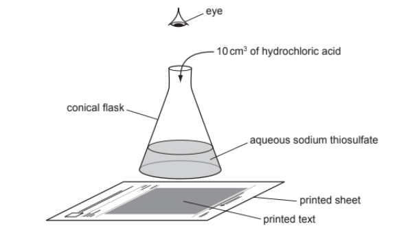

Five experiments were carried out.

*Experiment 1*

By using a measuring cylinder 50 cm3 of aqueous sodium thiosulfate was poured into a flask. The temperature of the solution was measured. The conical flask was placed on the printed text. 10 cm3 of hydrochloric acid was added to the flask and the timer started. The time taken for the printed text to disappear from view was recorded in the table. The final temperature of the mixture was measured.

*Experiment 2*

50 cm3 of aqueous sodium thiosulfate was poured into a conical flask. The solution was heated until the temperature was about 30 °C. The temperature of the solution was measured. 10 cm3 of hydrochloric acid was added to the flask and Experiment 1 was repeated.

The final temperature of the liquid was measured.

*Experiment 3*

Experiment 2 was repeated but the sodium thiosulfate solution was heated to about 40 °C before adding the hydrochloric acid.

The initial and final temperatures were measured.

*Experiment 4*

Experiment 2 was repeated but the sodium thiosulfate solution was heated to about 50 °C before adding the hydrochloric acid.

The initial and final temperatures were measured.

*Experiment 5*

Experiment 2 was repeated but the sodium thiosulfate solution was heated to about 60 °C before adding the hydrochloric acid.

The initial and final temperatures were measured. Use the thermometer diagrams to record all of the initial and final temperatures in the table.

Complete the table of results to show the average temperatures.

**Table 1**

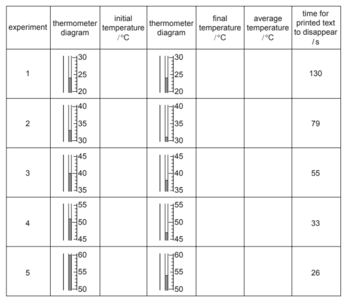

*Source: 2009 61 Q4*

**Q18** [4 marks]

**Extract:**

A student investigated the effect of temperature on the speed of reaction between hydrochloric acid and aqueous sodium thiosulfate. When these chemicals react they form a precipitate, which makes the solution go cloudy. The formation of this precipitate can be used to show how fast the reaction proceeds. Five experiments were carried out at increasing temperatures, and the time taken for the printed text to disappear from view was recorded, along with initial and final temperatures used to calculate average temperatures. Complete the table of results to show the average temperatures. Table 1 (average temperature vs time for printed text to disappear).

Plot the results obtained on the grid and draw a smooth line graph.

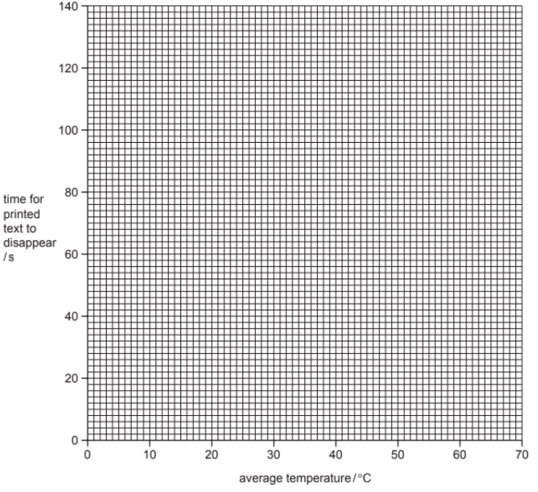

*Source: 2009 61 Q4*

**Q18** [4 marks]

**Extract:**

A student investigated the effect of temperature on the speed of reaction between hydrochloric acid and aqueous sodium thiosulfate. When these chemicals react they form a precipitate, which makes the solution go cloudy. The formation of this precipitate can be used to show how fast the reaction proceeds.

Five experiments were carried out. Experiment 1 was at room temperature; Experiment 2 was heated until the temperature was about 30 °C; Experiment 3 was heated to about 40 °C; Experiment 4 was heated to about 50 °C; Experiment 5 was heated to about 60 °C before adding the hydrochloric acid. In each case the time taken for the printed text to disappear from view was recorded.

i) In which experiment was the speed of reaction greatest?

[1]

ii) Explain why the speed was greatest in this experiment.

[3]

*Source: 2009 61 Q4*

**Q18** [1 mark]

**Extract:**

A student investigated the effect of temperature on the speed of reaction between hydrochloric acid and aqueous sodium thiosulfate. When these chemicals react they form a precipitate, which makes the solution go cloudy. The formation of this precipitate can be used to show how fast the reaction proceeds.

Five experiments were carried out. In Experiment 1, 50 cm^3 of aqueous sodium thiosulfate was poured into a flask, the temperature measured, and 10 cm^3 of hydrochloric acid was added. Subsequent experiments repeated this but the sodium thiosulfate solution was heated to about 30, 40, 50 and 60 °C before adding the hydrochloric acid.

Why was the same volume of sodium thiosulfate solution and the same volume of hydrochloric acid used in each experiment?

*Source: 2009 61 Q4*

**Q18** [4 marks]

**Extract:**

A student investigated the effect of temperature on the speed of reaction between hydrochloric acid and aqueous sodium thiosulfate. When these chemicals react they form a precipitate, which makes the solution go cloudy. The formation of this precipitate can be used to show how fast the reaction proceeds.

Experiment 2: 50 cm^3 of aqueous sodium thiosulfate was poured into a conical flask. The solution was heated until the temperature was about 30 °C. The temperature of the solution was measured. 10 cm^3 of hydrochloric acid was added to the flask and Experiment 1 was repeated.

Plot the results obtained on the grid and draw a smooth line graph.

i) From your graph, deduce the time for the printed text to disappear if Experiment 2 was to be repeated at 70 °C. Show clearly on the grid how you worked out your answer.

[3]

ii) Sketch on the grid the curve you would expect if all the experiments were repeated using 50 cm3 of more concentrated sodium thiosulfate solution.

[1]

*Source: 2009 61 Q4*

**Q18** [2 marks]

**Extract:**

A student investigated the effect of temperature on the speed of reaction between hydrochloric acid and aqueous sodium thiosulfate. When these chemicals react they form a precipitate, which makes the solution go cloudy. The formation of this precipitate can be used to show how fast the reaction proceeds.

Experiment 1: By using a measuring cylinder 50 cm^3 of aqueous sodium thiosulfate was poured into a flask. The temperature of the solution was measured. The conical flask was placed on the printed text. 10 cm^3 of hydrochloric acid was added to the flask and the timer started. The time taken for the printed text to disappear from view was recorded in the table. The final temperature of the mixture was measured.

Experiments 2-5 repeated with the sodium thiosulfate solution heated to about 30, 40, 50 and 60 °C before adding the hydrochloric acid.

Explain one change that could be made to the experimental method to obtain more accurate results.

Change: ................................................................

Explanation: .......................................................

*Source: 2009 61 Q4*

### Q19 — medium — 12 marks

**Q19** [5 marks]

Dilute hydrochloric acid was added to excess calcium carbonate in a beaker as shown.

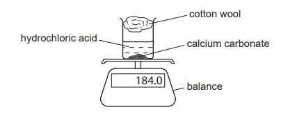

The beaker was placed on a balance and the mass of the beaker and contents recorded every minute. The results are shown in the table.

| mass of beaker and contents / g | 184.0 | 178.0 | 175.6 | 174.6 | 174.0 | 174.0 |
|---|---|---|---|---|---|---|
| time / min | 0 | 1 | 2 | 3 | 4 | 5 |

Plot the results on the grid and draw a smooth line graph.

*Source: 2009 6 Q6*

**Q19** [2 marks]

**Extract:**

Dilute hydrochloric acid was added to excess calcium carbonate in a beaker. The beaker was placed on a balance and the mass of the beaker and contents recorded every minute. The results are shown in the table.

| mass of beaker and contents / g | 184.0 | 178.0 | 175.6 | 174.6 | 174.0 | 174.0 |
| time / min | 0 | 1 | 2 | 3 | 4 | 5 |

Plot the results on the grid and draw a smooth line graph.

Use your graph to determine the mass of the beaker and contents after 30 seconds.

Show clearly on your graph how you worked out your answer.

*Source: 2009 6 Q6*

**Q19** [1 mark]

**Extract:**

Dilute hydrochloric acid was added to excess calcium carbonate in a beaker as shown. The beaker was placed on a balance and the mass of the beaker and contents recorded every minute.

Why does the mass of the beaker and contents decrease?

*Source: 2009 6 Q6*

**Q19** [1 mark]

**Extract:**

Dilute hydrochloric acid was added to excess calcium carbonate in a beaker as shown. The beaker was placed on a balance and the mass of the beaker and contents recorded every minute.

Suggest the purpose of the cotton wool.

*Source: 2009 6 Q6*

**Q19** [1 mark]

**Extract:**

Dilute hydrochloric acid was added to excess calcium carbonate in a beaker as shown. The beaker was placed on a balance and the mass of the beaker and contents recorded every minute. The results are shown in the table. | mass of beaker and contents / g | 184.0 | 178.0 | 175.6 | 174.6 | 174.0 | 174.0 | | time / min | 0 | 1 | 2 | 3 | 4 | 5 |

After how long did the reaction finish?

*Source: 2009 6 Q6*

**Q19** [2 marks]

**Extract:**

Dilute hydrochloric acid was added to excess calcium carbonate in a beaker as shown. The beaker was placed on a balance and the mass of the beaker and contents recorded every minute. The results are shown in the table.

| mass of beaker and contents / g | 184.0 | 178.0 | 175.6 | 174.6 | 174.0 | 174.0 |
| time / min | 0 | 1 | 2 | 3 | 4 | 5 |

Plot the results on the grid and draw a smooth line graph.

A second experiment was carried out using hydrochloric acid at a lower temperature.

On the grid sketch a curve to show the expected results for this experiment.

Label this curve C.

*Source: 2009 6 Q6*

### Q20 — medium — 20 marks

**Q20** [2 marks]

A student investigates the speed of reaction when aqueous hydrogen peroxide breaks down using a catalyst, manganese(IV) oxide. The catalyst remains unchanged at the end of the reaction. The apparatus was set up as shown in the diagram.

<u>Experiment 1</u> 
By using a measuring cylinder, 20 cm3 of hydrogen peroxide solution was poured into a conical flask. One spatula measure of manganese(IV) oxide was added to the flask, the bung was quickly put in the flask and the timer started.

The volume of gas collected in the measuring cylinder at 10 seconds, 20 seconds and 30 seconds was measured. The results are shown in the table below.

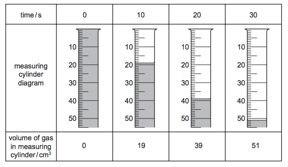

<u>Experiment 2</u>

By using a measuring cylinder, 15 cm3 of hydrogen peroxide was poured into the conical flask. The instructions were repeated exactly as given for Experiment 1, but 5 cm3 of distilled water was also added to the flask.

Use the diagrams to record your results in the table below.

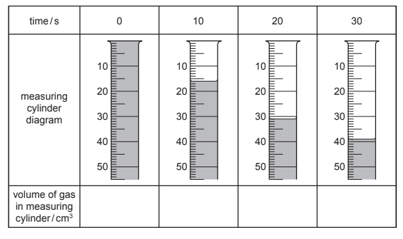

*Source: 2006 6 Q4*

**Q20** [2 marks]

**Extract:**

A student investigates the speed of reaction when aqueous hydrogen peroxide breaks down using a catalyst, manganese(IV) oxide. The catalyst remains unchanged at the end of the reaction. The apparatus was set up as shown in the diagram.

_Experiment 1_ 

By using a measuring cylinder, 20 cm^3^ of hydrogen peroxide solution was poured into a conical flask. One spatula measure of manganese(IV) oxide was added to the flask, the bung was quickly put in the flask and the timer started.

The volume of gas collected in the measuring cylinder at 10 seconds, 20 seconds and 30 seconds was measured.

<u>Experiment 3</u>

Experiment 1 was repeated using 10 cm3 of hydrogen peroxide and 10 cm3 of distilled water. Record your results in the table.

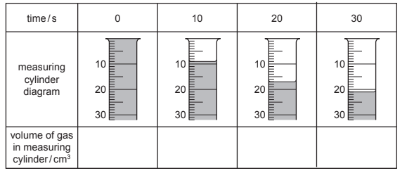

*Source: 2006 6 Q4*

**Q20** [2 marks]

**Extract:**

A student investigates the speed of reaction when aqueous hydrogen peroxide breaks down using a catalyst, manganese(IV) oxide. The catalyst remains unchanged at the end of the reaction.

Experiment 1: By using a measuring cylinder, 20 cm^3 of hydrogen peroxide solution was poured into a conical flask. One spatula measure of manganese(IV) oxide was added to the flask, the bung was quickly put in the flask and the timer started. The volume of gas collected in the measuring cylinder at 10 seconds, 20 seconds and 30 seconds was measured.

You are being asked for the volume of gas. The shaded area is the volume of water. The scale is also going from top to bottom.

<u>Experiment 4</u>

Experiment 1 was repeated using 5 cm3 of hydrogen peroxide and 15 cm3 of distilled water. Record your results in the table.

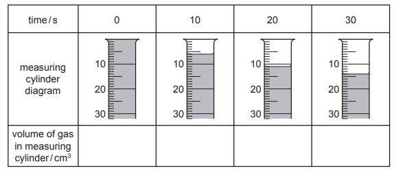

*Source: 2006 6 Q4*

**Q20** [5 marks]

**Extract:**

A student investigates the speed of reaction when aqueous hydrogen peroxide breaks down using a catalyst, manganese(IV) oxide. Experiment 1: By using a measuring cylinder, 20 cm^3 of hydrogen peroxide solution was poured into a conical flask. One spatula measure of manganese(IV) oxide was added to the flask, the bung was quickly put in the flask and the timer started. The volume of gas collected in the measuring cylinder at 10 seconds, 20 seconds and 30 seconds was measured. Experiment 2: 15 cm^3 of hydrogen peroxide and 5 cm^3 of distilled water. Experiment 3: 10 cm^3 of hydrogen peroxide and 10 cm^3 of distilled water. Experiment 4: 5 cm^3 of hydrogen peroxide and 15 cm^3 of distilled water. (Volume of gas results for each experiment recorded in the tables in parts a, b and c.)

Plot your results on the grid for each Experiment. Draw 4 graphs and label each clearly with the number of the Experiment.

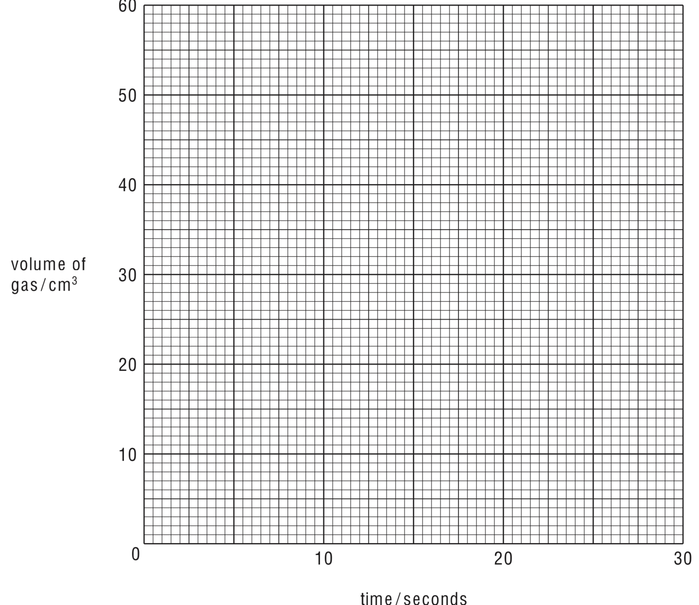

*Source: 2006 6 Q4*

**Q20** [3 marks]

**Extract:**

A student investigates the speed of reaction when aqueous hydrogen peroxide breaks down using a catalyst, manganese(IV) oxide. Experiment 1: By using a measuring cylinder, 20 cm^3 of hydrogen peroxide solution was poured into a conical flask. One spatula measure of manganese(IV) oxide was added to the flask, the bung was quickly put in the flask and the timer started. Experiment 2: By using a measuring cylinder, 15 cm^3 of hydrogen peroxide was poured into the conical flask... but 5 cm^3 of distilled water was also added to the flask. Experiment 3: Experiment 1 was repeated using 10 cm^3 of hydrogen peroxide and 10 cm^3 of distilled water. Experiment 4: Experiment 1 was repeated using 5 cm^3 of hydrogen peroxide and 15 cm^3 of distilled water.

i) Which experiment has the fastest rate of reaction?

[1]

ii) Explain, in terms of particles, why this experiment has the fastest rate.

[2]

*Source: 2006 6 Q4*

**Q20** [4 marks]

**Extract:**

A student investigates the speed of reaction when aqueous hydrogen peroxide breaks down using a catalyst, manganese(IV) oxide. The catalyst remains unchanged at the end of the reaction.

Experiment 1: By using a measuring cylinder, 20 cm^3 of hydrogen peroxide solution was poured into a conical flask. One spatula measure of manganese(IV) oxide was added to the flask, the bung was quickly put in the flask and the timer started. The volume of gas collected in the measuring cylinder at 10 seconds, 20 seconds and 30 seconds was measured.

i) State **two** sources of error in the experiments.

1: .................................................................................................

2: .................................................................................................

[2]

ii) Suggest **two** improvements to reduce the sources of error in the experiments.

1: ..................................................................................................

2: ..................................................................................................

[2]

*Source: 2006 6 Q4*

**Q20** [2 marks]

**Extract:**

A student investigates the speed of reaction when aqueous hydrogen peroxide breaks down using a catalyst, manganese(IV) oxide. The catalyst remains unchanged at the end of the reaction.

_Experiment 1_

By using a measuring cylinder, 20 cm^3^ of hydrogen peroxide solution was poured into a conical flask. One spatula measure of manganese(IV) oxide was added to the flask, the bung was quickly put in the flask and the timer started. The volume of gas collected in the measuring cylinder at 10 seconds, 20 seconds and 30 seconds was measured.

State a practical method you could use to prove that manganese(IV) oxide was a catalyst in Experiment 1.

*Source: 2006 6 Q4*

### Q21 — medium — 22 marks

**Q21** [4 marks]

A student investigated the rate of reaction between magnesium ribbon and four different solutions of dilute sulfuric acid, **A**, **B**, **C** and **D**. The sulfuric acid was in excess in all experiments. Four experiments were carried out.

*Experiment 1*

Using a measuring cylinder, 30 cm3 of aqueous sulfuric acid **A** was poured into a beaker.

The stop clock was started and a 4 cm length of magnesium was added to the sulfuric acid in the beaker. The mixture was stirred constantly.

The time taken for all of the magnesium to react and disappear was measured. The beaker was rinsed out with distilled water.

*Experiment 2*

Experiment 1 was repeated using solution **B** of sulfuric acid.

*Experiments 3 and 4*

Experiment 1 was repeated, using solutions **C** and **D** of sulfuric acid.

Use the stop clock diagrams to record the times in the table.

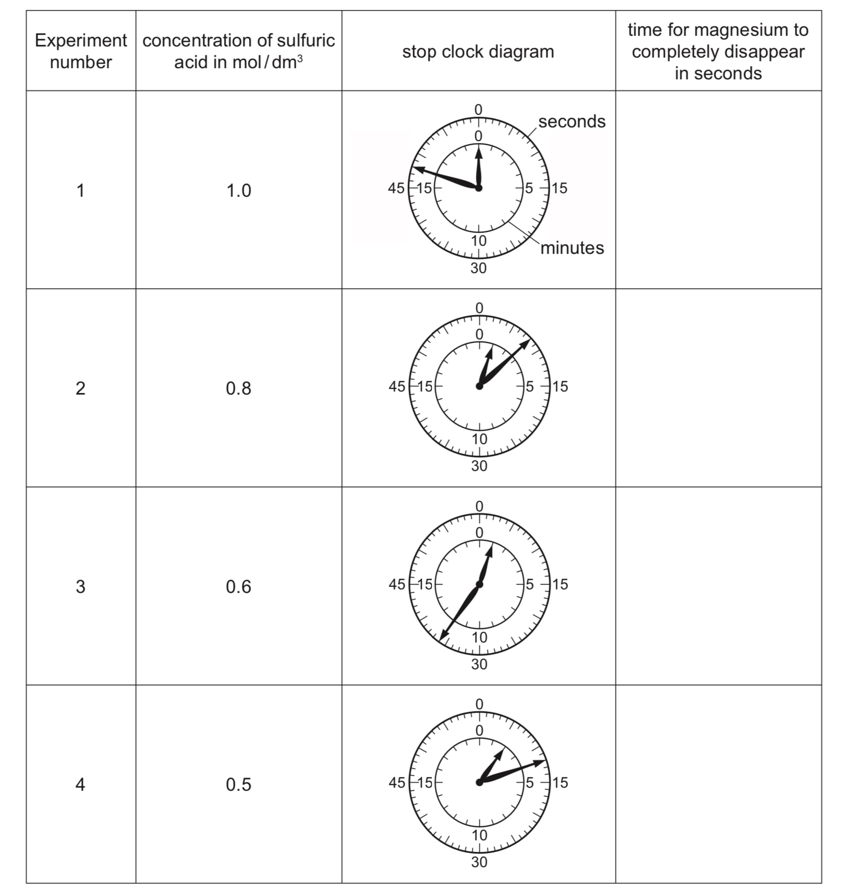

*Source: 2015 61 Q4*

**Q21** [4 marks]

**Extract:**

A student investigated the rate of reaction between magnesium ribbon and four different solutions of dilute sulfuric acid, A, B, C and D. The sulfuric acid was in excess in all experiments. Four experiments were carried out.

Experiment 1: Using a measuring cylinder, 30 cm^3 of aqueous sulfuric acid A was poured into a beaker. The stop clock was started and a 4 cm length of magnesium was added to the sulfuric acid in the beaker. The mixture was stirred constantly. The time taken for all of the magnesium to react and disappear was measured. The beaker was rinsed out with distilled water.

Experiment 2: Experiment 1 was repeated using solution B of sulfuric acid.

Experiments 3 and 4: Experiment 1 was repeated, using solutions C and D of sulfuric acid.

Use the stop clock diagrams to record the times in the table.

Plot the results for Experiments 1, 2, 3 and 4 on the grid and draw a smooth line graph.

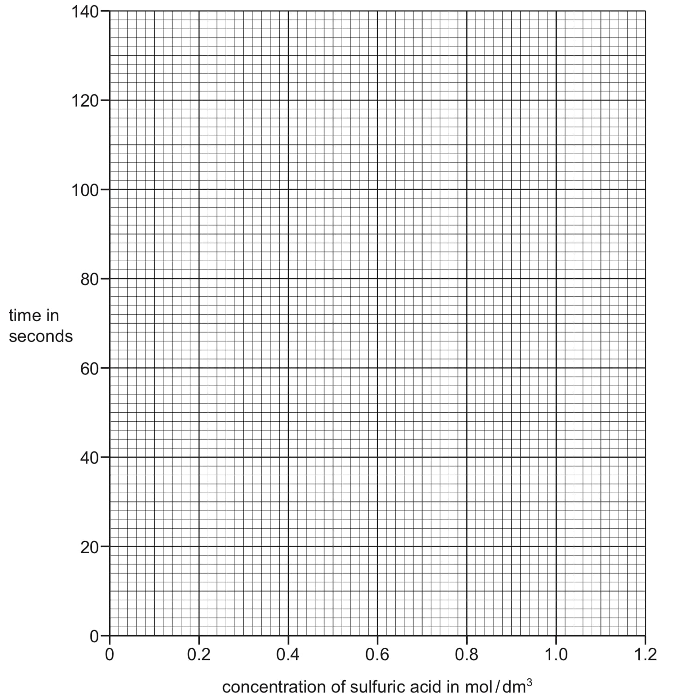

*Source: 2015 61 Q4*

**Q21** [4 marks]

**Extract:**

A student investigated the rate of reaction between magnesium ribbon and four different solutions of dilute sulfuric acid, A, B, C and D. The sulfuric acid was in excess in all experiments. Four experiments were carried out. Using a measuring cylinder, 30 cm^3 of aqueous sulfuric acid was poured into a beaker. The stop clock was started and a 4 cm length of magnesium was added to the sulfuric acid in the beaker. The mixture was stirred constantly. The time taken for all of the magnesium to react and disappear was measured.
Plot the results for Experiments 1, 2, 3 and 4 on the grid and draw a smooth line graph. (Graph of time in seconds against concentration of sulfuric acid in mol/dm^3.)

i) From your graph, deduce the concentration of the sulfuric acid if the time for the reaction was 80 s. Show clearly on the graph how you worked out your answer.

.......................... mol/dm3

[2]

ii) From your graph, deduce how long the reaction would take if a solution of sulfuric acid of concentration 1.2 mol/dm3 was used. Show clearly on the graph how you worked out your answer.

.......................... s

[2]

*Source: 2015 O61 Q4*

**Q21** [1 mark]

**Extract:**

A student investigated the rate of reaction between magnesium ribbon and four different solutions of dilute sulfuric acid, **A**, **B**, **C** and **D**. The sulfuric acid was in excess in all experiments. Four experiments were carried out.

*Experiment 1*

Using a measuring cylinder, 30 cm^3^ of aqueous sulfuric acid **A** was poured into a beaker.

The stop clock was started and a 4 cm length of magnesium was added to the sulfuric acid in the beaker. The mixture was stirred constantly.

The time taken for all of the magnesium to react and disappear was measured. The beaker was rinsed out with distilled water.

*Experiment 2*

Experiment 1 was repeated using solution **B** of sulfuric acid.

*Experiments 3 and 4*

Experiment 1 was repeated, using solutions **C** and **D** of sulfuric acid.

Why was the same amount of magnesium used in Experiments 1, 2, 3 and 4?

*Source: 2015 O61 Q4*

**Q21** [2 marks]

Another experiment was carried out.

A 4 cm length of magnesium ribbon was added to dilute sulfuric acid. The temperature of the solution was measured before and after the reaction. The observations were recorded and the gas given off tested.

*Observations*: Rapid effervescence and the tube felt hot. A lighted splint popped. Use the thermometer diagrams to record the temperatures.

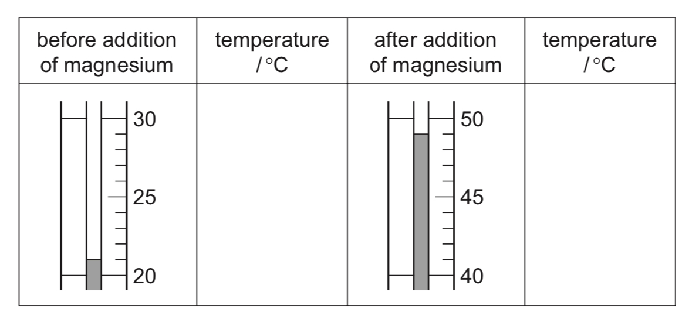

*Source: 2015 O61 Q4*

**Q21** [4 marks]

**Extract:**

Another experiment was carried out. A 4 cm length of magnesium ribbon was added to dilute sulfuric acid. The temperature of the solution was measured before and after the reaction. The observations were recorded and the gas given off tested. Observations: Rapid effervescence and the tube felt hot. A lighted splint popped.
Before adding Mg = 21 °C; After adding Mg = 49 °C

i) What type of chemical reaction occurred when magnesium reacted with sulfuric acid?

..........................................................................

[1]

ii) Identify the gas given off. ..........................................................................

[1]

iii) Suggest the effect on the temperature change if this experiment was repeated using 2 cm of magnesium ribbon.

[2]

*Source: 2015 O61 Q4*

**Q21** [3 marks]

**Extract:**

A student investigated the rate of reaction between magnesium ribbon and four different solutions of dilute sulfuric acid, A, B, C and D. The sulfuric acid was in excess in all experiments.

Experiment 1: Using a measuring cylinder, 30 cm^3 of aqueous sulfuric acid A was poured into a beaker. The stop clock was started and a 4 cm length of magnesium was added to the sulfuric acid in the beaker. The mixture was stirred constantly. The time taken for all of the magnesium to react and disappear was measured.

Suggest a different method which could be used to investigate the rate of the reaction between magnesium and sulfuric acid.

State the difference in the apparatus used and measurements to be taken.

Apparatus: ...................................................................................................................................

Measurements: ..........................................................................................................................

*Source: 2015 O61 Q4*

### Q22 — medium — 6 marks

**Q22** [6 marks]

An aqueous solution of hydrogen peroxide decomposes very slowly to form oxygen. The speed of decomposition can be increased by using a catalyst. Two possible catalysts are the solids copper(II) oxide and chromium(III) oxide. Plan an investigation to find out which of these two oxides is the better catalyst for this decomposition. The space below can be used for a diagram.

*Source: 2005 6 Q8*

### Q23 — medium — 6 marks

**Q23** [1 mark]

Identical pieces of steel were placed in two different boiling liquids for 12 hours. The graphs show how the mass of each piece of steel changed.

Give one similarity in the change in mass of the steel in both liquids.

*Source: 2013 61 Q5*

**Q23** [3 marks]

**Extract:**

Identical pieces of steel were placed in two different boiling liquids for 12 hours. The graphs show how the mass of each piece of steel changed.
![cie-rates-graphs]

Describe two ways in which the mass loss shown in graph **A** is different from that shown in graph **B**.

1. ............................................................................................................................... ...............................................................................................................................

2. ............................................................................................................................... ...............................................................................................................................

*Source: 2013 61 Q5*

**Q23** [2 marks]

**Extract:**

Identical pieces of steel were placed in two different boiling liquids for 12 hours. The graphs show how the mass of each piece of steel changed.

State **two** different safety precautions that would need to be taken when carrying out this investigation.

1. .......................................................................................................................................

2. .......................................................................................................................................

*Source: 2013 61 Q5*

### Q24 — medium — 10 marks

**Q24** [1 mark]

A student carried out an experiment to investigate the speed of reaction between sodium thiosulfate solution and dilute nitric acid. Sulfur is formed during this reaction and the mixture turns cloudy.

*Experiment 1 method*

Using a measuring cylinder, 100 cm3 of sodium thiosulfate solution was poured into a 250 cm3 beaker. The beaker was placed on a cross drawn on a piece of paper.

20 cm3 of dilute nitric acid was added to the beaker and the timer started.

The time until the cross could not be seen was taken. The time was recorded in the table.

Experiment 1 was repeated using different volumes of sodium thiosulfate as shown in the table. All experiments were carried out at 20 °C.

**Table of results**

Why was the total volume of solution kept constant?

*Source: 2010 61 Q3*

**Q24** [1 mark]

**Extract:**

A student carried out an experiment to investigate the speed of reaction between sodium thiosulfate solution and dilute nitric acid. Sulfur is formed during this reaction and the mixture turns cloudy.

Experiment 1 method

Using a measuring cylinder, 100 cm^3^ of sodium thiosulfate solution was poured into a 250 cm^3^ beaker. The beaker was placed on a cross drawn on a piece of paper.

20 cm^3^ of dilute nitric acid was added to the beaker and the timer started.

The time until the cross could not be seen was taken. The time was recorded in the table.

Experiment 1 was repeated using different volumes of sodium thiosulfate as shown in the table. All experiments were carried out at 20 °C.

In Experiment 2, which is the last liquid to be added to the beaker?

*Source: 2010 61 Q3*

**Q24** [6 marks]

**Extract:**

A student carried out an experiment to investigate the speed of reaction between sodium thiosulfate solution and dilute nitric acid. Sulfur is formed during this reaction and the mixture turns cloudy. Experiment 1 method: Using a measuring cylinder, 100 cm^3 of sodium thiosulfate solution was poured into a 250 cm^3 beaker. The beaker was placed on a cross drawn on a piece of paper. 20 cm^3 of dilute nitric acid was added to the beaker and the timer started. The time until the cross could not be seen was taken. The time was recorded in the table. Experiment 1 was repeated using different volumes of sodium thiosulfate as shown in the table. All experiments were carried out at 20 °C. Table of results (contains volume of sodium thiosulfate solution vs time for the cross to disappear).

i) Plot the results on the grid below. Draw a smooth line graph.

[4]

ii) Use your graph to work out the time taken for the cross to disappear when 55 cm3 of sodium thiosulfate solution and 45 cm3 of water were used. Indicate on the graph how you worked out your answer.

[2]

*Source: 2010 61 Q3*

**Q24** [2 marks]

**Extract:**

A student carried out an experiment to investigate the speed of reaction between sodium thiosulfate solution and dilute nitric acid. Sulfur is formed during this reaction and the mixture turns cloudy. Using a measuring cylinder, 100 cm^3 of sodium thiosulfate solution was poured into a 250 cm^3 beaker. The beaker was placed on a cross drawn on a piece of paper. 20 cm^3 of dilute nitric acid was added to the beaker and the timer started. The time until the cross could not be seen was taken. All experiments were carried out at 20 °C.

The experiments were repeated at 40 °C. Suggest how the results would differ. Explain your answer.

*Source: 2012 61 Q3*

### Q25 — medium — 13 marks

**Q25** [2 marks]

A student carried out an experiment to investigate the speed of a reaction between sodium thiosulfate and dilute hydrochloric acid.

Na2S2O3 + 2HCl → 2NaCl + H2O + S + SO2

*Experiment 1*

By using a measuring cylinder, 50 cm3 of sodium thiosulfate solution was poured into a 100 cm3 beaker. The was placed on a cross drawn on a piece of paper. 10 cm3 of hydrochloric acid was added to the beaker and the timer started.

The time was taken until the cross could not be seen. The time was recorded in the table.

*Experiments 2, 3, 4 and 5*

Experiment 1 was repeated using different volumes of sodium thiosulfate as shown in the table. All experiments were carried out at 25 °C

*Table of results *

Why does the cross on the paper disappear?

*Source: 2003 6 Q2*

**Q25** [1 mark]

**Extract:**

A student carried out an experiment to investigate the speed of a reaction between sodium thiosulfate and dilute hydrochloric acid. Na~2~S~2~O~3~ + 2HCl → 2NaCl + H~2~O + S + SO~2~ Experiment 1: By using a measuring cylinder, 50 cm^3^ of sodium thiosulfate solution was poured into a 100 cm^3^ beaker. The was placed on a cross drawn on a piece of paper. 10 cm^3^ of hydrochloric acid was added to the beaker and the timer started. The time was taken until the cross could not be seen. The time was recorded in the table. Experiments 2, 3, 4 and 5: Experiment 1 was repeated using different volumes of sodium thiosulfate as shown in the table. All experiments were carried out at 25 °C.

Why was the total volume kept constant?

*Source: 2003 6 Q2*

**Q25** [1 mark]

**Extract:**

A student carried out an experiment to investigate the speed of a reaction between sodium thiosulfate and dilute hydrochloric acid. Na~2~S~2~O~3~ + 2HCl → 2NaCl + H~2~O + S + SO~2~ Experiment 1: By using a measuring cylinder, 50 cm^3^ of sodium thiosulfate solution was poured into a 100 cm^3^ beaker. The was placed on a cross drawn on a piece of paper. 10 cm^3^ of hydrochloric acid was added to the beaker and the timer started. The time was taken until the cross could not be seen. The time was recorded in the table. Experiments 2, 3, 4 and 5: Experiment 1 was repeated using different volumes of sodium thiosulfate as shown in the table. All experiments were carried out at 25 °C

In which order should the water, hydrochloric acid and sodium thiosulfate solution be added to the beaker

First: ................................................

Second: ................................................

Last: ................................................

*Source: 2003 6 Q2*

**Q25** [7 marks]

**Extract:**

A student carried out an experiment to investigate the speed of a reaction between sodium thiosulfate and dilute hydrochloric acid. Na~2~S~2~O~3~ + 2HCl → 2NaCl + H~2~O + S + SO~2~. Experiment 1: By using a measuring cylinder, 50 cm^3 of sodium thiosulfate solution was poured into a 100 cm^3 beaker. This was placed on a cross drawn on a piece of paper. 10 cm^3 of hydrochloric acid was added to the beaker and the timer started. The time was taken until the cross could not be seen. The time was recorded in the table. Experiments 2, 3, 4 and 5: Experiment 1 was repeated using different volumes of sodium thiosulfate as shown in the table. All experiments were carried out at 25 °C. Table of results (screen-shot-2022-10-03-at-20-08-11).

i)

Plot the results o the grid below. Draw a smooth line graph and label it 25 °C.

[5]

ii) Sketch on the grid the graph you would expect if the experiments were repeated at 50 °C. Label this graph.

[2]

*Source: 2003 6 Q2*

**Q25** [2 marks]

**Extract:**

A student carried out an experiment to investigate the speed of a reaction between sodium thiosulfate and dilute hydrochloric acid. By using a measuring cylinder, 50 cm^3^ of sodium thiosulfate solution was poured into a 100 cm^3^ beaker. The was placed on a cross drawn on a piece of paper. 10 cm^3^ of hydrochloric acid was added to the beaker and the timer started. The time was taken until the cross could not be seen. The time was recorded in the table.

The experiments were repeated using a 250 cm3 beaker instead of a 100 cm3 beaker. Suggest how the results would differ. Explain your answer.

*Source: 2003 6 Q2*

### Q26 — medium — 13 marks

**Q26** [4 marks]

The speed of reaction between excess magnesium and dilute hydrochloric acid was investigated using the apparatus below.

The volume of hydrogen produced was measured every minute for six minutes.

Use the gas syringe diagrams to complete the table.

**Table of results**

*Source: 2008 6 Q6*

**Q26** [4 marks]

**Extract:**

The speed of reaction between excess magnesium and dilute hydrochloric acid was investigated. The volume of hydrogen produced was measured every minute for six minutes. The table of results (from the gas syringe diagrams) gives the volume of hydrogen in cm^3 at each time in minutes.

Plot the results on the grid below. Draw a smooth line graph.

*Source: 2009 6 Q6*

**Q26** [1 mark]

**Extract:**

The speed of reaction between excess magnesium and dilute hydrochloric acid was investigated using the apparatus below. The volume of hydrogen produced was measured every minute for six minutes.

Why is the volume of gas given off the same at 5 minutes and 6 minutes?

*Source: 2009 6 Q6*

**Q26** [2 marks]

**Extract:**

The speed of reaction between excess magnesium and dilute hydrochloric acid was investigated using the apparatus below. The volume of hydrogen produced was measured every minute for six minutes.

Plot the results on the grid below. Draw a smooth line graph.

Which point appears to be inaccurate? Explain why.

*Source: 2009 6 Q6*

**Q26** [2 marks]

**Extract:**

The speed of reaction between excess magnesium and dilute hydrochloric acid was investigated using the apparatus below. The volume of hydrogen produced was measured every minute for six minutes.

Plot the results on the grid below. Draw a smooth line graph.

Sketch on the grid the graph you would expect if the experiment were repeated using the same volume of acid which was half as concentrated.

*Source: 2008 6 Q6*

## Multiple Choice Questions (26 questions)

### Q1 — hard — 1 marks

**Q1** [1 mark]

A student investigates the rate of reaction between sodium carbonate granules and dilute hydrochloric acid.

The investigation is carried out twice, as Experiment 1 and Experiment 2. The volume of acid, the temperature, and the mass of the sodium carbonate granules are kept the same in both experiments.

Which row correctly compares the concentration of the acid (C), the average kinetic energy of the particles (KE), and the frequency of successful collisions in the two experiments?

|   | concentration of acid | average kinetic energy of particles | frequency of successful collisions |
|---|---|---|---|
| **A** | C2 > C1 | KE1 = KE2 | greater in experiment 2 |
| **B** | C2 > C1 | KE2 > KE1 | greater in experiment 2 |
| **C** | C1 > C2 | KE1 = KE2 | greater in experiment 1 |
| **D** | C1 > C2 | KE2 > KE1 | greater in experiment 1 |

### Q2 — easy — 1 marks

**Q2** [1 mark]

Which process is a physical change?

### Q3 — easy — 1 marks

**Q3** [1 mark]

A student investigates the effect of temperature on the rate of a reaction.

In Experiment 1, the reaction is performed at 10 °C. In Experiment 2, the reaction is repeated at 20 °C. All other conditions stay the same.

Which graph shows the results for the volume of gas produced against time?

### Q4 — easy — 1 marks

**Q4** [1 mark]

A student investigates the rate of reaction between aqueous sodium thiosulphate and aqueous hydrochloric acid by measuring the time taken for a precipitate to obscure a cross underneath the beaker.

Which statement is correct for the reaction?

### Q5 — easy — 1 marks

**Q5** [1 mark]

A student was measuring the rate of reaction using the apparatus in the diagram.

What reaction is the student studying?

### Q6 — easy — 1 marks

**Q6** [1 mark]

Physical and chemical changes are different processes. Which of the following rows correctly identifies characteristics of each one?

### Q7 — easy — 1 marks

**Q7** [1 mark]

Which of the following processes represents a physical change?

### Q8 — easy — 1 marks

**Q8** [1 mark]

The rate of a reaction was monitored by recording the volume of gas produced every 5 seconds.

What is the mean rate of reaction in the first 10 seconds of the reaction, in cm3/s?

### Q9 — easy — 1 marks

**Q9** [1 mark]

A student was investigating the rate of reaction between iron and a solution of sulfuric acid. Two experiments were performed, P and Q, in which the volume of hydrogen was recorded at regular intervals.

Which change could explain the difference in results between P and Q?

### Q10 — hard — 1 marks

**Q10** [1 mark]

The graph shows the results of two separate reaction rate investigations using excess calcium carbonate and sulfuric acid.

Which statement explains the difference between the results?

### Q11 — hard — 1 marks

**Q11** [1 mark]

A student was investigating the rate of reaction between acid and metals. The experimental set-up is shown below.

Which test tube would give the quickest reaction?

### Q12 — hard — 1 marks

**Q12** [1 mark]

Which of the following statements best describes the activation energy of a reaction?

### Q13 — hard — 1 marks

**Q13** [1 mark]

Which of the following statements explains how increasing temperature increases the rate of a reaction?

### Q14 — hard — 1 marks

**Q14** [1 mark]

Which of the following statements correctly describes the effects of increasing concentration on the rate of a reaction?

### Q15 — medium — 1 marks

**Q15** [1 mark]

Magnesium metal reacts with an excess of hydrochloric acid solution to form magnesium chloride and hydrogen:

**Mg (s) + 2HCl (aq) → MgCl****2**** (aq) + H****2**** (g)**

Which of the following will **not** increase the rate of this reaction?

### Q16 — medium — 1 marks

**Q16** [1 mark]

A student reacts a metal carbonate with nitric acid and measures the volume of carbon dioxide gas released at regular intervals. The results of the experiment are shown in the graph.

Between which two measurements was the reaction the fastest?

### Q17 — medium — 1 marks

**Q17** [1 mark]

A student was investigating the rate of reaction between a solid base and a solution of sulfuric acid. Two experiments were performed, S and T, in which the mass of the reaction flask was recorded as shown in the graph.

Which of the following changes could explain the difference in results between S and T?

### Q18 — medium — 1 marks

**Q18** [1 mark]

Catalysts are often used in chemical reactions.

Which letter represents **two** correct features of catalysts?

### Q19 — medium — 1 marks

**Q19** [1 mark]

Which graph correctly shows the effect of increasing the temperature on the rate of reaction between magnesium and sulfuric acid in which neither reactant runs out?

## Theory Questions (35 questions)

### Q1 — hard — 14 marks

**Q1** [8 marks]

Sodium chlorate(I) decomposes to form sodium chloride and oxygen. The rate of this reaction is very slow at room temperature provided the sodium chlorate(I) is stored in a dark bottle to prevent exposure to light.

2NaClO → 2NaCl + O2

The rate of this decomposition can be studied using the following experiment.

Sodium chlorate(I) is placed in the flask and 0.2 g of copper(II) oxide is added. This catalyses the decomposition of the sodium chlorate(I) and the volume of oxygen collected is measured every minute. The results are plotted to give a graph of the type shown below.

i) Explain why the gradient (slope) of this graph decreases with time.

[2]

ii) Cobalt(II) oxide is a more efficient catalyst for this reaction than copper(II) oxide.

Sketch, on the grid, the graph for the reaction catalysed by cobalt(II) oxide.

[2]

iii) All other conditions were kept constant.

What can you deduce from the comment that sodium chlorate(I) has to be shielded from light?

[1]

iv) Explain, in terms of collisions between particles, why the initial gradient would be steeper if the experiment was repeated at a higher temperature.

[3]

*Source: 2014 Oc33 Q5*

**Q1** [6 marks]

The ions present in aqueous sodium chloride are Na+ (aq), Cl– (aq), H+(aq) and OH– (aq). The electrolysis of concentrated aqueous sodium chloride forms three products. They are hydrogen, chlorine and sodium hydroxide.

i) Explain how these three products are formed. Give ionic equations for the reactions at the electrodes.

[4]

ii) If the solution of the electrolyte is stirred, chlorine reacts with sodium hydroxide to form sodium chlorate(I), sodium chloride and water. Complete the equation for this reaction.

Cl2 + ...NaOH → ..................... + ..................... + .....................

[2]

*Source: 2014 Oc33 Q5*

### Q2 — medium — 4 marks

**Q2** [1 mark]

Sulfur dioxide, SO2 , is used in the manufacture of sulfuric acid.

Why is a catalyst used?

*Source: 2020 0620/41 Q3B*

**Q2** [3 marks]

**Extract:**

Sulfur dioxide, SO~2~ , is used in the manufacture of sulfuric acid.

#### Extended Only

Explain, in terms of particles, why a high temperature increases the rate of this reaction.

*Source: 2020 0620/41 Q3B*

### Q3 — easy — 1 marks

**Q3** [1 mark]

Sulfur dioxide is a pollutant in the air.

Sulfur dioxide is oxidised to sulfur trioxide in the air. Oxides of nitrogen act as catalysts for this reaction.

What is meant by the term catalyst?

*Source: June 2019 0620/31/03 Q8A*

### Q4 — medium — 11 marks

**Q4** [6 marks]

Some of the factors that can determine the rate of a reaction are concentration, temperature and light intensity.

A small piece of calcium carbonate was added to an excess of hydrochloric acid. The time taken for the carbonate to react completely was measured.

CaCO3 (s) + 2HCl (aq) → CaCl2 (aq) + CO2 (g) + H2O (l)

The experiment was repeated at the same temperature, using pieces of calcium carbonate of the same size but with acid of a different concentration. In all the experiments an excess of acid was used.

| concentration of acid in mol / dm3 | 4 | 2 | 2 | .......... |
|---|---|---|---|---|
| number of pieces of carbonate | 1 | 1 | 2 | 1 |
| time in s | .......... | 80 | .......... | 160 |

i) Complete the table (assume the rate is proportional to both the acid concentration and the number of pieces of calcium carbonate).

[3]

ii) Explain why the reaction rate would increase if the temperature was increased.

[2]

iii) Explain why the rate of this reaction increases if the piece of carbonate is crushed to a powder.

[1]

*Source: 2003 O31 Q2A*

**Q4** [3 marks]

Sodium chlorate(I) decomposes to form oxygen and sodium chloride. This is an example of a photochemical reaction. The rate of reaction depends on the intensity of the light.

2NaClO (aq) → 2NaCl (aq) + O2 (g)

i) Describe how the rate of this reaction could be measured.

[2]

ii) How could you show that this reaction is photochemical?

[1]

*Source: 2003 O31 Q2B*

**Q4** [2 marks]

#### Separate: Chemistry Only

Photosynthesis is another example of a photochemical reaction. Glucose and more complex carbohydrates are made from carbon dioxide and water.

Complete the equation.

6CO2 + 6H2O → C6H12O6 + ...........

*Source: 2003 O31 Q2C*

### Q5 — easy — 6 marks

**Q5** [3 marks]

Biological catalysts produced by microbes cause food to deteriorate and decay.

i) What is the name of these biological catalysts?

[1]

ii) Freezing does not kill the microbes. Suggest why freezing is still a very effective way of preserving food.

[2]

*Source: 2014 Ju33 Q3*

**Q5** [3 marks]

Describe how the pea plant makes a sugar such as glucose.

*Source: 2014 Ju33 Q3*

### Q6 — medium — 13 marks

**Q6** [3 marks]

Manganese is a transition element. It has more than one valency and the metal and its compounds are catalysts.

Predict three other properties of manganese that are typical of transition elements.

*Source: 2002 O31 Q3*

**Q6** [3 marks]

**Extract:**

Manganese is a transition element. It has more than one valency and the metal and its compounds are catalysts.

#### Extended Only

It has several oxides, three of which are shown below. Manganese(II) oxide, which is basic. Manganese(III) oxide, which is amphoteric. Manganese(IV) oxide, which is acidic.

i) Complete the word equation.

manganese(II) oxide + hydrochloric acid → .....................  ..................... + .....................

[2]

ii) Which, if any, of these oxides will react with sodium hydroxide?

[1]

*Source: 2002 O31 Q2*

**Q6** [7 marks]

**Extract:**

Aqueous hydrogen peroxide decomposes to form water and oxygen.

2H~2~O~2 ~(aq) → 2H~2~O (l) + O~2 ~(g)

This reaction is catalysed by manganese(IV) oxide. The following experiments were carried out to investigate the rate of this reaction. A 0.1 g sample of manganese(IV) oxide was added to 20 cm^3^ of 0.2 mol / dm^3^ hydrogen peroxide solution. The volume of oxygen produced was measured every minute. The results of this experiment are shown on the graph.

i) How does the rate of reaction vary with time? Explain why the rate varies.

ii) The following experiment was carried out at the same temperature. 0.1 g of manganese(IV) oxide and 20 cm^3^ of 0.4 mol / dm^3^ hydrogen peroxide. Sketch the curve for this experiment on the same grid.

iii) How would the shape of the graph differ if only half the mass of catalyst had been used in these experiments?

Aqueous hydrogen peroxide decomposes to form water and oxygen.

2H2O2 (aq) → 2H2O (l) + O2 (g)

This reaction is catalysed by manganese(IV) oxide. The following experiments were carried out to investigate the rate of this reaction. A 0.1 g sample of manganese(IV) oxide was added to 20 cm3 of 0.2 mol / dm3 hydrogen peroxide solution. The volume of oxygen produced was measured every minute. The results of this experiment are shown on the graph.

i) How does the rate of reaction vary with time? Explain why the rate varies.

[3]

ii) The following experiment was carried out at the same temperature. 0.1 g of manganese(IV) oxide and 20 cm3 of 0.4 mol / dm3 hydrogen peroxide. Sketch the curve for this experiment on the same grid.

[2]

iii) How would the shape of the graph differ if only half the mass of catalyst had been used in these experiments?

[2]

*Source: 2002 O31 Q2*

### Q7 — easy — 6 marks

**Q7** [1 mark]

**Extract:**

A student investigates the reaction of small pieces of zinc with dilute sulfuric acid at 20 °C. The zinc is in excess.

The graph shows the volume of hydrogen gas released as the reaction proceeds.

A student investigates the reaction of small pieces of zinc with dilute sulfuric acid at 20 °C. The zinc is in excess.

The graph shows the volume of hydrogen gas released as the reaction proceeds.

Suggest why the volume of hydrogen gas stays the same after 10 minutes.

*Source: Specimen 0620/03 Q4A*

**Q7** [1 mark]

**Extract:**

A student investigates the reaction of small pieces of zinc with dilute sulfuric acid at 20 °C. The zinc is in excess. The graph shows the volume of hydrogen gas released as the reaction proceeds.

Deduce the time taken from the start of the experiment to collect 20 cm3 of hydrogen gas.

*Source: Specimen 0620/03 Q4A*

**Q7** [2 marks]

**Extract:**

A student investigates the reaction of small pieces of zinc with dilute sulfuric acid at 20 °C. The zinc is in excess. The graph shows the volume of hydrogen gas released as the reaction proceeds.

The student repeats the experiment at 30 °C.

All other conditions stay the same.

Draw a line **on the grid** in part (a) to show how the volume of hydrogen gas changes with time when the reaction is carried out at 30 °C.

*Source: Specimen 0620/03 Q4A*

**Q7** [2 marks]

**Extract:**

A student investigates the reaction of small pieces of zinc with dilute sulfuric acid at 20 °C. The zinc is in excess. The graph shows the volume of hydrogen gas released as the reaction proceeds.

The student repeats the experiment using zinc powder instead of small pieces of zinc.

Describe how the rate of reaction differs when zinc powder is used.

Give a reason for your answer.

*Source: Specimen 0620/03 Q4D*

### Q8 — medium — 1 marks

**Q8** [1 mark]

Oxides of nitrogen are pollutants in the air.

Oxides of nitrogen act as catalysts. 
What is meant by the term catalyst?

*Source: June 2019 0620/32/03 Q8A*

### Q9 — medium — 11 marks

**Q9** [2 marks]

**Extract:**

The decomposition of hydrogen peroxide is catalysed by manganese(IV) oxide.

2H2O2 (aq) → 2H2O (l) + O2 (g)

To 50 cm3 of aqueous hydrogen peroxide, 0.50 g of manganese(IV) oxide was added. The volume of oxygen formed was measured every 20 seconds. The average reaction rate was calculated for each 20 second interval.

The decomposition of hydrogen peroxide is catalysed by manganese(IV) oxide.

2H2O2 (aq) → 2H2O (l) + O2 (g)

To 50 cm3 of aqueous hydrogen peroxide, 0.50 g of manganese(IV) oxide was added. The volume of oxygen formed was measured every 20 seconds. The average reaction rate was calculated for each 20 second interval.

Explain how the average reaction rate, 2.4 cm3/s, was calculated for the first 20 seconds.

*Source: 2010 Oc32 Q3*

**Q9** [1 mark]

**Extract:**

The decomposition of hydrogen peroxide is catalysed by manganese(IV) oxide.
2H~2~O~2~ (aq) → 2H~2~O (l) + O~2~ (g)
To 50 cm^3^ of aqueous hydrogen peroxide, 0.50 g of manganese(IV) oxide was added. The volume of oxygen formed was measured every 20 seconds. The average reaction rate was calculated for each 20 second interval.

Complete the table.

*Source: 2010 Oc32 Q3*

**Q9** [2 marks]

**Extract:**

The decomposition of hydrogen peroxide is catalysed by manganese(IV) oxide.

2H~2~O~2~ (aq) → 2H~2~O (l) + O~2~ (g)

To 50 cm^3^ of aqueous hydrogen peroxide, 0.50 g of manganese(IV) oxide was added. The volume of oxygen formed was measured every 20 seconds. The average reaction rate was calculated for each 20 second interval.

Explain why the average reaction rate decreases with time.

*Source: 2010 Oc32 Q3*

**Q9** [6 marks]

**Extract:**

The decomposition of hydrogen peroxide is catalysed by manganese(IV) oxide.
2H~2~O~2~ (aq) → 2H~2~O (l) + O~2~ (g)
To 50 cm^3^ of aqueous hydrogen peroxide, 0.50 g of manganese(IV) oxide was added. The volume of oxygen formed was measured every 20 seconds. The average reaction rate was calculated for each 20 second interval.

The experiment was repeated but 1.0 g of manganese(IV) oxide was added.

What effect, if any, would this have on the reaction rate and on the final volume of oxygen?

Give a reason for each answer.

i) Effect on rate.

[1]

ii) Reason

[2]

iii) Effect on final volume of oxygen.

[1]

iv) Reason

[2]

*Source: 2010 Oc32 Q3*

### Q10 — easy — 3 marks

**Q10** [1 mark]

Acids have characteristic properties.

The rate of reaction of iron with sulfuric acid can be determined by measuring the time taken to produce 20cm3 of hydrogen.

A student measured the time taken to produce 20 cm3 of hydrogen using three different concentrations of sulfuric acid.

In each experiment the student used:

- 1g of iron powder
- the same temperature
- the same volume of sulfuric acid.

The results are shown in the table.

| concentration of acid in mol / dm3 | time / s |
|---|---|
| 0.1 | 33 |
| 0.2 | 17 |
| 0.5 | 8 |

Use the information in the table to describe how the rate of reaction changes with the concentration of sulfuric acid.

*Source: June 2020 0620/32 Q6B*

**Q10** [2 marks]

**Extract:**

The rate of reaction of iron with sulfuric acid can be determined by measuring the time taken to produce 20cm^3 of hydrogen.

In each experiment the student used:
- 1g of iron powder
- the same temperature
- the same volume of sulfuric acid.

Describe the effect of each of the following on the rate of this reaction with 0.5 mol / dm3 of sulfuric acid.

- Larger pieces of iron are used. All other conditions stay the same. ...................................................................................................................
- The temperature is increased. All other conditions stay the same. ...................................................................................................................

*Source: June 2020 0620/32 Q6B*

### Q11 — hard — 18 marks

**Q11** [5 marks]

The speed (rate) of a chemical reaction depends on a number of factors, including temperature and the presence of a catalyst.

Reaction speed increases as the temperature increases.

i) Explain why reaction speed increases with temperature.

[3]

ii) Reactions involving enzymes do not follow the above pattern.

The following graph shows how the speed of such a reaction varies with temperature.

Suggest an explanation why initially the reaction speed increases then above a certain temperature the speed decreases.

[2]

*Source: 2012 Oc31 Q3*

**Q11** [6 marks]

An organic compound decomposes to give off nitrogen.

C6H5N2Cl (aq) → C6H5Cl (l) + N2 (g)

The speed of this reaction can be determined by measuring the volume of nitrogen formed at regular intervals. Typical results are shown in the graph below.

The reaction is catalysed by copper.

i) Sketch the graph for the catalysed reaction on the diagram above.

[2]

ii) How does the speed of this reaction vary with time?

[1]

iii) Why does the speed of reaction vary with time?

[3]

*Source: 2012 Oc31 Q3*

**Q11** [7 marks]

Catalytic converters reduce the pollution from motor vehicles.

i) Describe how carbon monoxide and the oxides of nitrogen are formed in car engines.

[4]

ii) Describe the reaction(s) inside the catalytic converter which change these pollutants into less harmful gases.

Include at least one equation in your description.

[3]

*Source: 2012 Oc31 Q3*

### Q12 — medium — 10 marks

**Q12** [2 marks]

**Extract:**

The following apparatus was used to measure the rate of the reaction between zinc and iodine.

The mass of the zinc plate was measured every minute until the reaction was complete.

#### Extended Only

The following apparatus was used to measure the rate of the reaction between zinc and iodine.

The mass of the zinc plate was measured every minute until the reaction was complete.

Write an ionic equation for the redox reaction that occurred between zinc atoms and iodine molecules.

*Source: 2005 Ju31 Q2*

**Q12** [3 marks]

Describe how you could show by adding aqueous sodium hydroxide and aqueous ammonia that a solution contained zinc ions.

Result with sodium hydroxide .....................................................................................

Excess sodium hydroxide .....................................................................................

Result with aqueous ammonia .....................................................................................

Excess aqueous ammonia .....................................................................................

*Source: 2005 Ju31 Q2*

**Q12** [5 marks]

**Extract:**

The following apparatus was used to measure the rate of the reaction between zinc and iodine. The mass of the zinc plate was measured every minute until the reaction was complete.

From the results of this experiment two graphs were plotted.

i)  Which reagent iodine or zinc was in excess? Give a reason for your choice.

[1]

ii) Describe how the shape of graph 1 would change if 100 cm3 of 0.05 mol/dm3 iodine had been used.

[2]

iii) On graph 2, sketch the shape if the reaction had been carried out using 100 cm3 of 0.1 mol/dm3 iodine at 35 °C instead of at 25 °C.

[2]

*Source: 2005 Ju31 Q2*

### Q13 — hard — 10 marks

**Q13** [3 marks]

A small piece of marble, CaCO3, was added to 5.0 cm3 of hydrochloric acid, concentration 1.0 mol / dm3, at 25°C. The time taken for the reaction to stop was measured. The experiment was repeated using 5.0 cm3 of different solutions of acids. The acid was in excess in all of the experiments.

Typical results are given in the table.

| **Experiment** | **Temperature / ****o****C** | **Acid solution** | **Time / min** |
|---|---|---|---|
| 1 | 25 | hydrochloric acid 1.0 mol / dm3 | 3 |
| 2 | 25 | hydrochloric acid 0.5 mol / dm3 | 7 |
| 3 | 25 | ethanoic acid 1.0 mol / dm3 | 10 |
| 4 | 15 | hydrochloric acid 1.0 mol / dm3 | 8 |

i) Explain why it is important that the pieces of marble are the same size and the same shape.

[2]

ii) How would you know when the reaction had stopped?

[1]

*Source: 2013 Ju31 Q3*

**Q13** [1 mark]

The equation for the reaction in experiment 1 is:

CaCO3 (s) + 2HCl (aq) → CaCl2 (aq) + CO2 (g) + H2O (l)

Complete the following ionic equation.

CaCO3 (s) + 2H+ (aq) → ............ + ............ + ............

*Source: 2013 Ju31 Q3*

**Q13** [6 marks]

**Extract:**

A small piece of marble, CaCO3, was added to 5.0 cm3 of hydrochloric acid, concentration 1.0 mol / dm3, at 25°C. The time taken for the reaction to stop was measured. The experiment was repeated using 5.0 cm3 of different solutions of acids. The acid was in excess in all of the experiments. Typical results are given in the table.
| Experiment | Temperature / °C | Acid solution | Time / min |
| 1 | 25 | hydrochloric acid 1.0 mol / dm3 | 3 |
| 2 | 25 | hydrochloric acid 0.5 mol / dm3 | 7 |
| 3 | 25 | ethanoic acid 1.0 mol / dm3 | 10 |
| 4 | 15 | hydrochloric acid 1.0 mol / dm3 | 8 |

i) Explain why the reaction in experiment 1 is faster than the reaction in experiment 2.

[1]

ii) The acids used for experiment 1 and experiment 3 have the same concentration. Explain why experiment 3 is slower than experiment 1.

[2]

iii) Explain in terms of collisions between reacting particles why experiment 4 is slower than experiment 1.

[3]

*Source: 2013 Ju31 Q3*

### Q14 — hard — 13 marks

**Q14** [3 marks]

Hydrogen peroxide, H2O2, decomposes into water and oxygen in the presence of a catalyst, manganese(IV) oxide.

2H2O2 (aq) → 2H2O (l) + O2 (g)

What is meant by the term *catalyst*?

*Source: 2016 Ja42 Q4*

**Q14** [2 marks]

A student studies the rate of decomposition of hydrogen peroxide using the apparatus shown.

The student uses 20 cm3 of 0.1 mol/dm3 hydrogen peroxide and 1.0 g of manganese(IV) oxide.

The student measures the volume of oxygen given off at regular time intervals until the reaction stops. A graph of the results is shown.

i) When is the rate of reaction highest?

[1]

ii) Suggest one method of increasing the rate of reaction using the same amounts of hydrogen peroxide and manganese(IV) oxide.

[1]

*Source: 2016 Ja42 Q4*

**Q14** [5 marks]

**Extract:**

The student uses 20 cm^3 of 0.1 mol/dm^3 hydrogen peroxide and 1.0 g of manganese(IV) oxide.

The reaction can be examined quantitatively.

i) Calculate the number of moles of hydrogen peroxide used in this experiment.

[1]

ii) Use your answer to c) i) and the equation to calculate the number of moles of oxygen produced in the reaction.

2H2O2 (aq) → 2H2O (l) + O2 (g)

[1]

iii) Calculate the volume (at r.t.p.) of oxygen produced in dm3

[1]

iv)  What would be the effect on the volume of oxygen produced if the mass of the catalyst was increased?

[1]

v) Deduce the volume of oxygen, in dm3, that would be produced if 20 cm3 of 0.2 mol/dm3 hydrogen peroxide was used instead of 20 cm3 of 0.1 mol/dm3 hydrogen peroxide

[1]

*Source: 2016 Ja42 Q4*

**Q14** [3 marks]

**Extract:**

A student studies the rate of decomposition of hydrogen peroxide using the apparatus shown. The student uses 20 cm^3^ of 0.1 mol/dm^3^ hydrogen peroxide and 1.0 g of manganese(IV) oxide. The student measures the volume of oxygen given off at regular time intervals until the reaction stops.

The student carries out a second experiment to investigate whether another substance, copper(II) oxide, is a better catalyst than manganese(IV) oxide.

Describe how the second experiment is carried out. You should state clearly how you would make sure that the catalyst is the only variable.

*Source: 2016 Ja42 Q4*

### Q15 — hard — 13 marks

**Q15** [3 marks]

20.0 g of small lumps of calcium carbonate and 40 cm3 of hydrochloric acid, concentration 2.0 mol / dm3, were placed in a flask on a top pan balance. The mass of the flask and contents was recorded every minute.

The mass of carbon dioxide given off was plotted against time.

CaCO3 (s) + 2HCl (aq) → CaCl2 (aq) + H2O (l) + CO2 (g)

In all the experiments mentioned in this question, the calcium carbonate was in excess.

i) Explain how you could determine the mass of carbon dioxide given off in the first five minutes.

[1]

ii) Explain how the shape of the graph shows where the rate is fastest, where it is slowing down and where the rate is zero.

[2]

*Source: 2013 O31 Q4*

**Q15** [2 marks]

**Extract:**

20.0 g of small lumps of calcium carbonate and 40 cm^3 of hydrochloric acid, concentration 2.0 mol / dm^3, were placed in a flask on a top pan balance. The mass of the flask and contents was recorded every minute. The mass of carbon dioxide given off was plotted against time. CaCO~3~ (s) + 2HCl (aq) → CaCl~2~ (aq) + H~2~O (l) + CO~2~ (g) In all the experiments mentioned in this question, the calcium carbonate was in excess.

Sketch on the same graph, the line which would have been obtained if 20.0 g of small lumps of calcium carbonate and 80 cm3 of hydrochloric acid, concentration 1.0 mol / dm3, had been used.

*Source: 2013 O31 Q4*

**Q15** [4 marks]

**Extract:**

20.0 g of small lumps of calcium carbonate and 40 cm^3 of hydrochloric acid, concentration 2.0 mol / dm^3, were placed in a flask on a top pan balance. The mass of the flask and contents was recorded every minute.

CaCO~3 (s) + 2HCl (aq) → CaCl~2 (aq) + H~2O (l) + CO~2 (g)

In all the experiments mentioned in this question, the calcium carbonate was in excess.

Explain in terms of collisions between reacting particles each of the following.

i) The reaction rate would be slower if 20.0 g of larger lumps of calcium carbonate and 40 cm3 of hydrochloric acid, concentration 2.0 mol / dm3, were used.

[2]

ii) The reaction rate would be faster if the experiment was carried out at a higher temperature.

[2]

*Source: 2013 O31 Q4*

**Q15** [4 marks]

**Extract:**

20.0 g of small lumps of calcium carbonate and 40 cm^3 of hydrochloric acid, concentration 2.0 mol / dm^3, were placed in a flask on a top pan balance. 

CaCO3 (s) + 2HCl (aq) → CaCl2 (aq) + H2O (l) + CO2 (g)

In all the experiments mentioned in this question, the calcium carbonate was in excess.

Calculate the maximum mass of carbon dioxide given off when 20.0 g of small lumps of calcium carbonate react with 40 cm3 of hydrochloric acid, concentration 2.0 mol / dm3.

CaCO3 (s) + 2HCl( aq) → CaCl2 (aq) + H2O (l) + CO2 (g)

*Source: 2013 O31 Q4*

### Q16 — hard — 10 marks

**Q16** [2 marks]

A diagram of the apparatus which could be used to investigate the rate of reaction between magnesium and an excess of an acid is drawn below.

The magnesium kept rising to the surface. In one experiment, this was prevented by twisting the magnesium around a piece of copper. In a second experiment, the magnesium was held down by a plastic net fastened to the beaker.

i) Suggest a reason why magnesium, which is denser than water, floated to the surface.

[1]

ii) Iron, zinc and copper have similar densities. Why was copper a better choice than iron or zinc to weigh down the magnesium?

[1]

*Source: 2010 Ju31 Q3*

**Q16** [2 marks]

**Extract:**

The magnesium kept rising to the surface. In one experiment, this was prevented by twisting the magnesium around a piece of copper. In a second experiment, the magnesium was held down by a plastic net fastened to the beaker.

The only difference between the two experiments was the method used to hold down the magnesium. The results are shown below.

i) In which experiment did the magnesium react faster?

[1]

ii) Suggest a reason why the experiment chosen in part i) had the faster rate.

[1]

*Source: 2010 Ju31 Q3*

**Q16** [2 marks]

**Extract:**

A diagram of the apparatus which could be used to investigate the rate of reaction between magnesium and an excess of an acid is drawn below.

The magnesium kept rising to the surface. In one experiment, this was prevented by twisting the magnesium around a piece of copper. In a second experiment, the magnesium was held down by a plastic net fastened to the beaker.

The results are shown below. (graph of volume of hydrogen against time)

The experiment was repeated using 1.0 mol/dm3 propanoic acid instead of 1.0 mol/dm3 hydrochloric acid. Propanoic acid is a weak acid.

i) How would the graph for propanoic acid differ from the graph for hydrochloric acid?

[1]

ii) How would the graph for propanoic acid be the same as the graph for hydrochloric acid?

[1]

*Source: 2010 Ju31 Q3*

**Q16** [4 marks]

**Extract:**

A diagram of the apparatus which could be used to investigate the rate of reaction between magnesium and an excess of an acid is drawn below.

Give two factors which would alter the rate of this reaction. For each factor explain why it alters the rate.

Factor ............................................................................................................................ 
Explanation ....................................................................................................................

Factor ............................................................................................................................ 
Explanation ....................................................................................................................

*Source: 2010 Ju31 Q3*

### Q17 — medium — 13 marks

**Q17** [7 marks]

The rate of the reaction between iron and aqueous bromine can be investigated using the apparatus shown below.

A piece of iron was weighed and placed in the apparatus. It was removed at regular intervals and the clock was paused. The piece of iron was washed, dried, weighed and replaced. The clock was restarted. 
This was continued until the solution was colourless. 
The mass of iron was plotted against time. The graph shows the results obtained.

i) Suggest an explanation for the shape of the graph.

[3]

ii) Predict the shape of the graph if a similar piece of iron with a much rougher surface had been used. Explain your answer.

[2]

iii) Describe how you could find out if the rate of this reaction depended on the speed of stirring.

[2]

*Source: 2011 Oc31 Q5*

**Q17** [3 marks]

#### Extended Only

Iron has two oxidation states +2 and +3. There are two possible equations for the redox reaction between iron and bromine.

Fe + Br2 → Fe2+ + 2Br– 2Fe + 3Br2 → 2Fe3+ + 6Br–

i) Indicate, on the first equation, the change which is oxidation. Give a reason for your choice.

[2]

ii) Which substance in the first equation is the reductant (reducing agent)?

[1]

*Source: 2011 Oc31 Q5*

**Q17** [3 marks]

**Extract:**

Iron has two oxidation states +2 and +3. There are two possible equations for the redox reaction between iron and bromine.
Fe + Br~2~ → Fe^2+^ + 2Br^–^
2Fe + 3Br~2~ → 2Fe^3+^ + 6Br^–^

Describe how you could test the solution to find out which ion, Fe2+ or Fe3+, is present.

*Source: 2011 Oc31 Q5*

### Q18 — medium — 11 marks

**Q18** [6 marks]

#### Separate: Chemistry and Extended Only

A length of magnesium ribbon was added to 50 cm3 of sulfuric acid, concentration 1.0 mol/dm3. The time taken for the magnesium to react was measured. The experiment was repeated with the same volume of different acids. In all these experiments, the acid was in excess and the same length of magnesium ribbon was used.

| Experiment | Acid | Concentration in mol/dm3 | Time / s |
|---|---|---|---|
| A | sulfuric acid | 1.0 | 20 |
| B | propanoic acid | 0.5 | 230 |
| C | hydrochloric acid | 1.0 | 40 |
| D | hydrochloric acid | 0.5 | 80 |

i) Write these experiments in order of reaction speed. Give the experiment with the fastest speed first.

[1]

ii) Give reasons for the order you have given in (i).

[5]

*Source: 2012 Ju32 Q6A*

**Q18** [5 marks]

**Extract:**

A length of magnesium ribbon was added to 50 cm^3 of sulfuric acid, concentration 1.0 mol/dm^3. The time taken for the magnesium to react was measured. The experiment was repeated with the same volume of different acids. In all these experiments, the acid was in excess and the same length of magnesium ribbon was used.

| Experiment | Acid | Concentration in mol/dm^3 | Time / s |
| A | sulfuric acid | 1.0 | 20 |
| B | propanoic acid | 0.5 | 230 |
| C | hydrochloric acid | 1.0 | 40 |
| D | hydrochloric acid | 0.5 | 80 |

Suggest two changes to experiment C which would increase the speed of the reaction and explain why the speed would increase. The volume of the acid, the concentration of the acid and the mass of magnesium used were kept the same.

change 1 ....................................................................................................

explanation ................................................................................................

change 2 ....................................................................................................

explanation .................................................................................................

*Source: 2012 Ju32 Q6B*

### Q19 — medium — 3 marks

**Q19** [3 marks]

#### Extended Only

Ammonia is manufactured by the Haber process.

Explain, in terms of particles, what happens to the rate of this reaction when the temperature is increased.

*Source: 2020 0620/43/04 Q2C*

### Q20 — medium — 10 marks

**Q20** [6 marks]

The equation for the reaction between sodium thiosulfate and hydrochloric acid is given below.

Na2S2O3 (aq) + 2HCl (aq) → 2NaCl (aq) + S (s) + SO2 (g) + H2O (l)

The speed of this reaction was investigated using the following experiment. A beaker containing 50 cm3 of 0.2 mol/dm3 sodium thiosulfate was placed on a black cross.

5.0 cm3 of 2.0 mol/dm3 hydrochloric acid was added and the clock was started.

Initially, the cross was clearly visible. When the solution became cloudy and the cross could no longer be seen, the clock was stopped and the time recorded.

The experiment was repeated with 25 cm3 of 0.2 mol/dm3 sodium thiosulfate and 25 cm3 of water. Typical results for this experiment and a further two experiments are given in the table.

i) Explain why it is necessary to keep the total volume the same in all the experiments.

[2]

ii) Complete the table.

[1]

iii) How and why does the speed of the reaction vary from experiment 1 to 4?

[3]

*Source: 2011 Jun32 Q3*

**Q20** [4 marks]

**Extract:**

The equation for the reaction between sodium thiosulfate and hydrochloric acid is given below. Na2S2O3 (aq) + 2HCl (aq) → 2NaCl (aq) + S (s) + SO2 (g) + H2O (l) The speed of this reaction was investigated using the following experiment. A beaker containing 50 cm3 of 0.2 mol/dm3 sodium thiosulfate was placed on a black cross. 5.0 cm3 of 2.0 mol/dm3 hydrochloric acid was added and the clock was started. Initially, the cross was clearly visible. When the solution became cloudy and the cross could no longer be seen, the clock was stopped and the time recorded.

#### Extended Only

The idea of collisions between reacting particles is used to explain changes in the speed of reactions. Use this idea to explain the following results.

*Source: 2011 Ju32 Q3*

### Q21 — medium — 6 marks

**Q21** [2 marks]

The graph shows how the volume of hydrogen produced changes with time.

Describe how the rate of reaction changes with time. 
Use the graph to explain your answer.

*Source: June 2019 0620/32/03 Q7B*

**Q21** [1 mark]

**Extract:**

The graph shows how the volume of hydrogen produced changes with time. ![q7b-0620_s19_qp_32]

How many seconds did it take to collect the first 25 cm3 of hydrogen?

*Source: June 2019 0620/32/03 Q7B*

**Q21** [2 marks]

**Extract:**

The graph shows how the volume of hydrogen produced changes with time. ![q7b-0620_s19_qp_32] Describe how the rate of reaction changes with time.

The experiment is repeated at a higher temperature. All other conditions are kept the same.

Draw a line **on the grid** for the experiment using a higher temperature.

*Source: June 2019 0620/32/03 Q7B*

**Q21** [1 mark]

**Extract:**

If 2.4 g of magnesium is used, 0.2 g of hydrogen is produced.

If 2.4 g of magnesium is used, 0.2 g of hydrogen is produced. Calculate the mass of magnesium needed to produce 0.8 g of hydrogen using an excess of dilute hydrochloric acid.

mass of magnesium = .............................. g

*Source: June 2019 0620/32/03 Q7B*

### Q22 — easy — 7 marks

**Q22** [1 mark]

A student investigates the rate of reaction of large pieces of magnesium carbonate with an excess of dilute nitric acid.

MgCO3 + 2HNO3 → Mg(NO3)2 + CO2 + H2O

Name the salt formed when magnesium carbonate reacts with dilute nitric acid.

*Source: June 2019 0620/33/03 Q7A*

**Q22** [1 mark]

**Extract:**

A student investigates the rate of reaction of large pieces of magnesium carbonate with an excess of dilute nitric acid. MgCO3 + 2HNO3 → Mg(NO3)2 + CO2 + H2O

The graph shows how the volume of carbon dioxide changes with time.

After how many seconds did the reaction finish?

*Source: June 2019 0620/33/0 Q7B*

**Q22** [1 mark]

**Extract:**

The graph shows how the volume of carbon dioxide changes with time.

From the graph, deduce the volume of carbon dioxide produced during the first 50 seconds of the experiment.

*Source: June 2019 0620/33/0 Q7B*

**Q22** [2 marks]

**Extract:**

A student investigates the rate of reaction of large pieces of magnesium carbonate with an excess of dilute nitric acid. MgCO3 + 2HNO3 → Mg(NO3)2 + CO2 + H2O

The graph shows how the volume of carbon dioxide changes with time. (Graph of volume of carbon dioxide /cm3 against time /s, with original line levelling off at ~41 cm3 around 90-100 s.)

The experiment is repeated using smaller pieces of the same mass of magnesium carbonate.

All other conditions are kept the same.

Draw a line **on the grid** for the experiment using smaller pieces of magnesium carbonate.

*Source: June 2019 0620/33/0 Q7B*

**Q22** [1 mark]

**Extract:**

A student investigates the rate of reaction of large pieces of magnesium carbonate with an excess of dilute nitric acid.

MgCO~3~ + 2HNO~3~ → Mg(NO~3~)~2~ + CO~2~ + H~2~O

How does increasing the temperature affect the rate of this reaction? 
All other conditions are kept the same.

*Source: June 2019 0620/33/0 Q7B*

**Q22** [1 mark]

**Extract:**

A student investigates the rate of reaction of large pieces of magnesium carbonate with an excess of dilute nitric acid.
MgCO3 + 2HNO3 → Mg(NO3)2 + CO2 + H2O

How does decreasing the concentration of nitric acid affect the rate of this reaction? 
All other conditions are kept the same.

*Source: June 2019 0620/33/0 Q7B*

### Q23 — hard — 16 marks

**Q23** [4 marks]

The reactions between metals and acids are redox reactions.

Zn + 2H+ → Zn2+ + H2

i) Which change in the above reaction is oxidation, Zn to Zn2+ or 2H+ to H2? Give a reason for your choice.

[2]

ii) Which reactant in the above reaction is the oxidising agent? Give a reason for your choice.

[2]

*Source: 2015 Ju31 Q3*

**Q23** [5 marks]

The rate of reaction between a metal and an acid can be investigated using the apparatus shown below.

A piece of zinc foil was added to 50 cm3 of hydrochloric acid, of concentration 2.0 mol/dm3. The acid was in excess. The hydrogen evolved was collected in the gas syringe and its volume was measured every minute.

The results were plotted and labelled as graph 1.

The experiment was repeated to show that the reaction between zinc metal and hydrochloric acid is catalysed by copper.

A small volume of aqueous copper(II) chloride was added to the acid before the zinc was added.

The results of this experiment were plotted on the same grid and labelled as graph 2.

i) Explain why the reaction mixture in the second experiment contains copper metal. Include an equation in your explanation.

[2]

ii) Explain how graph 2 shows that copper catalyses the reaction.

[3]

*Source: 2015 Ju31 Q3*

**Q23** [4 marks]

**Extract:**

The rate of reaction between a metal and an acid can be investigated using the apparatus shown below. A piece of zinc foil was added to 50 cm^3^ of hydrochloric acid, of concentration 2.0 mol/dm^3^. The acid was in excess. The hydrogen evolved was collected in the gas syringe and its volume was measured every minute. The results were plotted and labelled as graph 1.

If the first experiment was repeated using ethanoic acid, CH3COOH, instead of hydrochloric acid, how and why would the graph be different from graph 1?

*Source: 2015 Ju31 Q3*

**Q23** [3 marks]

Calculate the maximum mass of zinc which will react with 50 cm3 of hydrochloric acid, of concentration 2.0 mol/dm3.

Zn + 2HCl → ZnCl2 + H2

Show your working.

*Source: 2015 Ju31 Q3*

### Q24 — hard — 15 marks

**Q24** [5 marks]

Many organic compounds which contain a halogen have chloro, bromo or iodo in their name.

The following diagram shows the structure of 1-chloropropane.

i) Draw the structure of an isomer of this compound.

[1]

ii) Describe how 1-chloropropane could be made from propane.

[2]

iii) Suggest an explanation why the method you have described in (ii) does not produce a pure sample of 1-chloropropane.

[2]

*Source: 2012 O32 Q3*

**Q24** [3 marks]

Organic halides react with water to form an alcohol and a halide ion.

CH3–CH2–I + H2O → CH3–CH2–OH + I–

i) Describe how you could show that the reaction mixture contained an iodide ion.

[2]

ii) Name the alcohol formed when 1-chloropropane reacts with water.

[1]

*Source: 2012 O32 Q3*

**Q24** [7 marks]

The speed (rate) of reaction between an organic halide and water can be measured by the following method.

A mixture of 10 cm3 of aqueous silver nitrate and 10 cm3 of ethanol is warmed to 60 °C. Drops of the organic halide are added and the time taken for a precipitate to form is measured.

Silver ions react with the halide ions to form a precipitate of the silver halide.

Ag+ (aq) + X– (aq) → AgX (s)

Typical results for four experiments, **A**, **B**, **C** and **D**, are given in the table.

| experiment | organic halide | number of drops | time / min |
|---|---|---|---|
| **A** | bromobutane | 4 | 6 |
| **B** | bromobutane | 8 | 3 |
| **C** | chlorobutane | 4 | 80 |
| **D** | iodobutane | 4 | 0.1 |

i) Explain why it takes longer to produce a precipitate in experiment **A** than in **B**.

[2]

ii) How does the order of reactivity of the organic halides compare with the order of reactivity of the halogens?

[2]

iii) Explain why the time taken to produce a precipitate would increase if the experiments were repeated at 50 °C.

[3]

*Source: 2012 O32 Q3*

### Q25 — medium — 7 marks

**Q25** [1 mark]

A student investigates the rate of reaction of small pieces of calcium carbonate with an excess of hydrochloric acid of concentration 1mol/dm3.

$CaCO_{3 } ( \mathrm{s} ) + 2 \text{HCl} ( \text{aq} ) \rightarrow CaCl_{2 } ( \text{aq} ) + CO_{2 } ( \mathrm{g} ) + \mathrm{H}_{2} \mathrm{O} ( \mathrm{l} )$

Name the salt formed when calcium carbonate reacts with hydrochloric acid.

*Source: June 2019 0620/31/03 Q7A*

**Q25** [1 mark]

**Extract:**

A student investigates the rate of reaction of small pieces of calcium carbonate with an excess of hydrochloric acid of concentration 1mol/dm^3^. CaCO_{3}(s) + 2 HCl(aq) → CaCl_{2}(aq) + CO_{2}(g) + H_{2}O(l)

The graph shows how the mass of the reaction mixture changes with time.

State why the reaction mixture decreases in mass.

*Source: June 2019 0620/31/03 Q7B*

**Q25** [1 mark]

**Extract:**

The graph shows how the mass of the reaction mixture changes with time. [Graph: mass of reaction mixture /g starts at 200.0 g at time 0, decreasing over time to about 199.0 g by 120 s. At 40 seconds the mass is 199.3 g.]

Calculate the loss in mass during the first 40 seconds of the experiment.

*Source: June 2019 0620/31/03 Q7B*

**Q25** [2 marks]

**Extract:**

A student investigates the rate of reaction of small pieces of calcium carbonate with an excess of hydrochloric acid of concentration 1mol/dm^3.
CaCO_3 (s) + 2 HCl (aq) \rightarrow CaCl_2 (aq) + CO_2 (g) + H_2 O (l)

The graph shows how the mass of the reaction mixture changes with time. (Graph: mass of reaction mixture /g vs time /s; original line starts at 200.0 g at 0 s, decreases and levels off at 199.0 g at around 104 s.)

The experiment is repeated using hydrochloric acid of concentration 2 mol/dm3 .

All other conditions are kept the same.

Draw a line **on the grid **for the experiment using hydrochloric acid of concentration 2 mol/dm3.

*Source: 2019 0620/31/03 Q7B*

**Q25** [1 mark]

In the experiment, when 2.00 g of calcium carbonate is used, the loss in mass of the reaction mixture is 0.88 g. All other conditions are kept the same.

Calculate the loss in mass when 0.50 g of calcium carbonate is used.

*Source: June 2019 0620/31/03 Q7B*

**Q25** [1 mark]

**Extract:**

A student investigates the rate of reaction of small pieces of calcium carbonate with an excess of hydrochloric acid of concentration 1mol/dm^3^.

CaCO_3(s) + 2 HCl(aq) → CaCl_2(aq) + CO_2(g) + H_2O(l)

The experiment is repeated using the same mass of different-sized pieces of calcium carbonate. All other conditions are kept the same. The sizes of the pieces of calcium carbonate are:

- powder
- small pieces
- large pieces.

Complete the table by writing the sizes of the pieces of calcium carbonate in the first column.

| size of pieces of calcium carbonate | initial rate of loss in mass in g/ s |
|---|---|
|   | 0.005 |
|   | 0.030 |
|   | 0.100 |

*Source: June 2019 0620/31/03 Q7B*

### Q26 — hard — 13 marks

**Q26** [6 marks]

A small piece of marble, calcium carbonate, was added to 5 cm3 of hydrochloric acid at 25 °C. The time taken for the reaction to stop was measured.

CaCO3 (s) + 2HCl (aq) → CaCl2 (aq) + CO2 (g) + H2O (l)

Similar experiments were performed always using 5cm3 of hydrochloric acid.

| **Experiment** | **Number of pieces of marble** | **Concentration of acid in mol / dm****3** | **Temperature / ****o****C** | ** Time / min** |
|---|---|---|---|---|
| 1 | 1 | 1.00 | 25 | 3 |
| 2 | 1 | 0.50 | 25 | 7 |
| 3 | 1 piece crushed | 1.00 | 25 | 1 |
| 4 | 1 | 1.00 | 35 | 2 |

Explain each of the following in terms of collisions between reacting particles.

i) Why is the rate in experiment 2 slower than in experiment 1?

[2]

ii) Why is the rate in experiment 3 faster than in experiment 1?

[2]

iii) Why is the rate in experiment 4 faster than in experiment 1?

[2]

*Source: 2007 O31 Q7*

**Q26** [7 marks]

**Extract:**

A small piece of marble, calcium carbonate, was added to 5 cm^3 of hydrochloric acid at 25 °C. The time taken for the reaction to stop was measured.

CaCO~3~ (s) + 2HCl (aq) → CaCl~2~ (aq) + CO~2~ (g) + H~2~O (l)

An alternative method of measuring the rate of this reaction would be to measure the volume of carbon dioxide produced at regular intervals.

i) Sketch this graph.

[2]

ii) One piece of marble, 0.3 g, was added to 5 cm3 of hydrochloric acid, concentration 1.00 mol / dm3. Which reagent is in excess? Give a reason for your choice.

Mass of one mole of CaCO3 = 100g Number of moles of CaCO3 = Number of moles of HCl = Reagent in excess is: Reason:

[4]

iii) Use your answer to (ii) to calculate the maximum volume of carbon dioxide produced measured at r.t.p.

[1]

*Source: 2007 O31 Q7*

### Q27 — medium — 10 marks

**Q27** [1 mark]

**Extract:**

A student investigates the progress of the reaction between dilute hydrochloric acid, HC, and an excess of large pieces of marble, CaCO3, using the apparatus shown in Fig. 5.1.

**Fig. 5.1**

A graph of the volume of gas produced against time is shown in Fig. 5.2.

**Fig. 5.2**

A student investigates the progress of the reaction between dilute hydrochloric acid, HC$l$, and an excess of large pieces of marble, CaCO3, using the apparatus shown in Fig. 5.1.

**Fig. 5.1**

A graph of the volume of gas produced against time is shown in Fig. 5.2.

**Fig. 5.2**

State how the shape of the graph shows that the rate of reaction decreases as the reaction progresses.

*Source: Specimen 0620/04 Q5A*

**Q27** [1 mark]

**Extract:**

A student investigates the progress of the reaction between dilute hydrochloric acid, HCl, and an excess of large pieces of marble, CaCO3, using the apparatus shown in Fig. 5.1. A graph of the volume of gas produced against time is shown in Fig. 5.2.

Suggest why the rate of reaction decreases as the reaction progresses.

*Source: Spceimen 0620/04 Q5A*

**Q27** [1 mark]

**Extract:**

A student investigates the progress of the reaction between dilute hydrochloric acid, HCl, and an excess of large pieces of marble, CaCO3, using the apparatus shown in Fig. 5.1. A graph of the volume of gas produced against time is shown in Fig. 5.2.

Deduce the time at which the reaction finishes.

*Source: Specimen 0620/04 Q5A*

**Q27** [2 marks]

**Extract:**

A student investigates the progress of the reaction between dilute hydrochloric acid, HCl, and an excess of large pieces of marble, CaCO3, using the apparatus shown in Fig. 5.1. A graph of the volume of gas produced against time is shown in Fig. 5.2. (Fig. 5.2 shows a curve of volume of gas produced against time that rises and levels off at approximately 90 cm3 around 200 seconds.)

The experiment is repeated using the same mass of smaller pieces of marble. 
All other conditions are kept the same. 
Draw a line on the grid in Fig. 5.2 to show the progress of the reaction using the smaller pieces of marble.

*Source: Specimen 0620/04 Q5B*

**Q27** [2 marks]

#### Extended Only

The original experiment is repeated at a higher temperature. All other conditions are kept the same. The resulting increase in rate of reaction can be explained in terms of activation energy and collisions between particles.

Define the term activation energy.

*Source: Specimen 0620/04 Q5C*

**Q27** [3 marks]

#### Extended Only

Explain why the rate of a reaction increases when temperature increases, in terms of activation energy and collisions between particles.

*Source: Specimen 0620/04 Q5C*

### Q28 — medium — 11 marks

**Q28** [2 marks]

Oxygen is produced by the decomposition of hydrogen peroxide. Manganese(IV) oxide is the catalyst for this reaction.

What is meant by the term catalyst?

*Source: 2020 0620/42/04 Q4A*

**Q28** [4 marks]

**Extract:**

Oxygen is produced by the decomposition of hydrogen peroxide. Manganese(IV) oxide is the catalyst for this reaction.

#### Extended Only

A student measures the volume of oxygen produced at regular time intervals using the apparatus shown. Large lumps of manganese(IV) oxide are used.

A graph of the results is shown.

What happens to the rate of this reaction as time increases? 
In your answer, explain why the rate changes in this way.

*Source: 2020 0620/42/04 Q4B*

**Q28** [2 marks]

**Extract:**

Oxygen is produced by the decomposition of hydrogen peroxide. Manganese(IV) oxide is the catalyst for this reaction.
A student measures the volume of oxygen produced at regular time intervals using the apparatus shown. Large lumps of manganese(IV) oxide are used. A graph of the results is shown. The axes are volume of oxygen produced / cm3 (y-axis) against time / s (x-axis), showing a curve that rises steeply then levels off to a maximum volume.

The experiment is repeated using the same mass of manganese(IV) oxide.

Powdered manganese(IV) oxide is used instead of large lumps. All other conditions stay the same.

Sketch a graph on the axes in (b) to show how the volume of oxygen changes with time.

*Source: 2020 0620/42/04 Q4C*

**Q28** [3 marks]

**Extract:**

Oxygen is produced by the decomposition of hydrogen peroxide. Manganese(IV) oxide is the catalyst for this reaction.

#### Extended Only

In terms of particles, explain what happens to the rate of this reaction when the temperature is increased.

*Source: 2020 0620/42/04 Q4D*

### Q29 — medium — 11 marks

**Q29** [4 marks]

The rate of a reaction depends on the concentration of reactants, temperature and possibly a catalyst or light.

A piece of magnesium ribbon was added to 100 cm3 of 1.0 mol/dm3 hydrochloric acid. The hydrogen evolved was collected in a gas syringe and its volume was measured every 30 seconds.

In all the experiments mentioned in this question, the acid was in excess. The results were plotted to give a graph.

i) The experiment was repeated. Two pieces of magnesium ribbon were added to 100 cm3 of 1.0 mol/dm3 hydrochloric acid. Sketch this graph on the same grid and label it X.

[2]

ii) The experiment was repeated using one piece of magnesium ribbon and 100 cm3 of 1.0 mol/dm3 ethanoic acid. Describe how the shape of this graph would differ from the one given on the grid.

[2]

*Source: 2006 Oc31 Q7*

**Q29** [4 marks]

#### Extended Only

Reaction rate increases when concentration or temperature is increased.

Using the idea of reacting particles, explain why;

i) Increasing concentration increases the reaction rate,

[2]

ii) Increasing temperature increases reaction rate.

[2]

*Source: 2006 Oc31 Q7*

**Q29** [3 marks]

#### Separate: Chemistry Only

The rate of a photochemical reaction is affected by light. A reaction, in plants, between carbon dioxide and water is photochemical.

i) Name the two products of this reaction.

[2]

ii) This reaction will only occur in the presence of light and another chemical. Name this chemical.

[1]

*Source: 2006 Oc31 Q7*

### Q30 — easy — 10 marks

**Q30** [2 marks]

An organic compound decomposes to form nitrogen.

C6H5N2Cl(aq) → C6H5Cl(l) + N2(g)

Explain the following state symbols.

| aq | ................................................................... |
|---|---|
| l | ................................................................... |
| g | ................................................................... |

*Source: 2004 Ju31 Q3*

**Q30** [2 marks]

Draw a diagram to show the arrangement of the outer electrons in one molecule of nitrogen.

*Source: 2004 Ju31 Q3*

**Q30** [6 marks]

**Extract:**

An organic compound decomposes to form nitrogen.

C~6~H~5~N~2~Cl(aq) → C~6~H~5~Cl(l) + N~2~(g)

The rate of this reaction can be measured using the following apparatus.

The results of this experiment are shown on the graph below.

i) How does the rate of this reaction vary with time?

[1]

ii) Why does the rate vary?

[2]

iii) The reaction is catalysed by copper powder. Sketch the graph for the catalysed reaction on the same grid.

[2]

iv) Why is copper powder more effective as a catalyst than a single piece of copper?

[1]

*Source: 2004 Ju31 Q3*

### Q31 — hard — 15 marks

**Q31** [4 marks]

**Extract:**

Hydrogen peroxide decomposes to form water and oxygen. This reaction is catalysed by manganese(IV) oxide.

2H2O2 (aq) → 2H2O (l) + O2 (g)

The rate of this reaction can be investigated using the following apparatus.

40 cm3 of aqueous hydrogen peroxide was put in the flask and 0.1 g of small lumps of manganese(IV) oxide was added. The volume of oxygen collected was measured every 30 seconds. The results were plotted to give the graph shown below.

Hydrogen peroxide decomposes to form water and oxygen. This reaction is catalysed by manganese(IV) oxide.

2H2O2 (aq) → 2H2O (l) + O2 (g)

The rate of this reaction can be investigated using the following apparatus.

40 cm3 of aqueous hydrogen peroxide was put in the flask and 0.1 g of small lumps of manganese(IV) oxide was added. The volume of oxygen collected was measured every 30 seconds. The results were plotted to give the graph shown below.

i) How do the rates at times t1, t2 and t3 differ?

[2]

ii) Explain the trend in reaction rate that you described in a) i).

[2]

*Source: 2014 Ju31 Q6*

**Q31** [4 marks]

**Extract:**

Hydrogen peroxide decomposes to form water and oxygen. This reaction is catalysed by manganese(IV) oxide.
2H~2~O~2 ~(aq) → 2H~2~O (l) + O~2 ~(g)
The rate of this reaction can be investigated using the following apparatus.
40 cm^3^ of aqueous hydrogen peroxide was put in the flask and 0.1 g of small lumps of manganese(IV) oxide was added. The volume of oxygen collected was measured every 30 seconds. The results were plotted to give the graph shown below.

The experiment was repeated using 0.1 g of finely powdered manganese(IV) oxide. All the other variables were kept the same.

i) On the same axes as the graph in part a), sketch the graph that would be expected for this change.

[2]

ii) Explain the shape of this graph.

[2]

*Source: 2014 Ju31 Q6*

**Q31** [4 marks]

**Extract:**

Hydrogen peroxide decomposes to form water and oxygen. This reaction is catalysed by manganese(IV) oxide.

2H~2~O~2 ~(aq) → 2H~2~O (l) + O~2 ~(g)

40 cm^3^ of aqueous hydrogen peroxide was put in the flask and 0.1 g of small lumps of manganese(IV) oxide was added.

Describe how you could show that the catalyst, manganese(IV) oxide, was not used up in the reaction.

Manganese(IV) oxide is insoluble in water.

*Source: 2014 Ju31 Q6*

**Q31** [3 marks]

**Extract:**

40 cm^3^ of aqueous hydrogen peroxide was put in the flask and 0.1 g of small lumps of manganese(IV) oxide was added. The volume of oxygen collected was measured every 30 seconds.

In the first experiment, the maximum volume of oxygen produced was 96 cm3 measured at r.t.p.

Calculate the concentration of the aqueous hydrogen peroxide in mol/dm3 by completing the following steps.

2H2O2 (aq) → 2H2O (l) + O2 (g)

i) Calculate the number of moles of O2 formed

[1]

ii) Calculate the number of moles of H2O2 in 40 cm3 of solution

[1]

iii) Calculate the concentration of the aqueous hydrogen peroxide in mol/dm3

[1]

*Source: 2014 Ju31 Q6*

