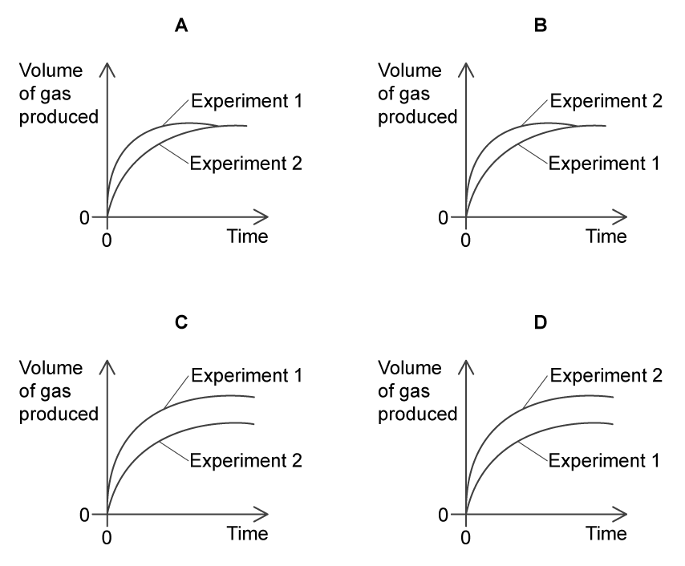
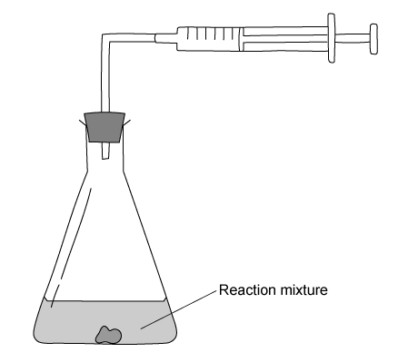

# Exam Questions — Chemical Change & Rate of Reaction
**6. Chemical Reactions** · Cambridge (CIE) IGCSE chemistry (0620 & 0971)
> Source: [https://www.savemyexams.com/igcse/chemistry/cie/23/topic-questions/](https://www.savemyexams.com/igcse/chemistry/cie/23/topic-questions/) · 19 questions across 1 sets

## Multiple Choice Questions (26 questions)

### Q1 — hard — 1 marks

**Q1** [1 mark]

A student investigates the rate of reaction between sodium carbonate granules and dilute hydrochloric acid.

The investigation is carried out twice, as Experiment 1 and Experiment 2. The volume of acid, the temperature, and the mass of the sodium carbonate granules are kept the same in both experiments.

Which row correctly compares the concentration of the acid (C), the average kinetic energy of the particles (KE), and the frequency of successful collisions in the two experiments?

|   | concentration of acid | average kinetic energy of particles | frequency of successful collisions |
|---|---|---|---|
| **A** | C2 > C1 | KE1 = KE2 | greater in experiment 2 |
| **B** | C2 > C1 | KE2 > KE1 | greater in experiment 2 |
| **C** | C1 > C2 | KE1 = KE2 | greater in experiment 1 |
| **D** | C1 > C2 | KE2 > KE1 | greater in experiment 1 |

### Q2 — easy — 1 marks

**Q2** [1 mark]

Which process is a physical change?

### Q3 — easy — 1 marks

**Q3** [1 mark]

A student investigates the effect of temperature on the rate of a reaction.

In Experiment 1, the reaction is performed at 10 °C. In Experiment 2, the reaction is repeated at 20 °C. All other conditions stay the same.

Which graph shows the results for the volume of gas produced against time?

### Q4 — easy — 1 marks

**Q4** [1 mark]

A student investigates the rate of reaction between aqueous sodium thiosulphate and aqueous hydrochloric acid by measuring the time taken for a precipitate to obscure a cross underneath the beaker.

Which statement is correct for the reaction?

### Q5 — easy — 1 marks

**Q5** [1 mark]

A student was measuring the rate of reaction using the apparatus in the diagram.

What reaction is the student studying?

### Q6 — easy — 1 marks

**Q6** [1 mark]

Physical and chemical changes are different processes. Which of the following rows correctly identifies characteristics of each one?

### Q7 — easy — 1 marks

**Q7** [1 mark]

Which of the following processes represents a physical change?

### Q8 — easy — 1 marks

**Q8** [1 mark]

The rate of a reaction was monitored by recording the volume of gas produced every 5 seconds.

What is the mean rate of reaction in the first 10 seconds of the reaction, in cm3/s?

### Q9 — easy — 1 marks

**Q9** [1 mark]

A student was investigating the rate of reaction between iron and a solution of sulfuric acid. Two experiments were performed, P and Q, in which the volume of hydrogen was recorded at regular intervals.

Which change could explain the difference in results between P and Q?

### Q10 — hard — 1 marks

**Q10** [1 mark]

The graph shows the results of two separate reaction rate investigations using excess calcium carbonate and sulfuric acid.

Which statement explains the difference between the results?

### Q11 — hard — 1 marks

**Q11** [1 mark]

A student was investigating the rate of reaction between acid and metals. The experimental set-up is shown below.

Which test tube would give the quickest reaction?

### Q12 — hard — 1 marks

**Q12** [1 mark]

Which of the following statements best describes the activation energy of a reaction?

### Q13 — hard — 1 marks

**Q13** [1 mark]

Which of the following statements explains how increasing temperature increases the rate of a reaction?

### Q14 — hard — 1 marks

**Q14** [1 mark]

Which of the following statements correctly describes the effects of increasing concentration on the rate of a reaction?

### Q15 — medium — 1 marks

**Q15** [1 mark]

Magnesium metal reacts with an excess of hydrochloric acid solution to form magnesium chloride and hydrogen:

**Mg (s) + 2HCl (aq) → MgCl****2**** (aq) + H****2**** (g)**

Which of the following will **not** increase the rate of this reaction?

### Q16 — medium — 1 marks

**Q16** [1 mark]

A student reacts a metal carbonate with nitric acid and measures the volume of carbon dioxide gas released at regular intervals. The results of the experiment are shown in the graph.

Between which two measurements was the reaction the fastest?

### Q17 — medium — 1 marks

**Q17** [1 mark]

A student was investigating the rate of reaction between a solid base and a solution of sulfuric acid. Two experiments were performed, S and T, in which the mass of the reaction flask was recorded as shown in the graph.

Which of the following changes could explain the difference in results between S and T?

### Q18 — medium — 1 marks

**Q18** [1 mark]

Catalysts are often used in chemical reactions.

Which letter represents **two** correct features of catalysts?

### Q19 — medium — 1 marks

**Q19** [1 mark]

Which graph correctly shows the effect of increasing the temperature on the rate of reaction between magnesium and sulfuric acid in which neither reactant runs out?

