# Mark Schemes — Reversible Reactions & Equilibrium
**6. Chemical Reactions** · Cambridge (CIE) IGCSE chemistry (0620 & 0971)

## Alternative To Practical Questions (2 questions)

### Q1
a) The arrow should be:

- Underneath the solid in tube;** [1 mark]**

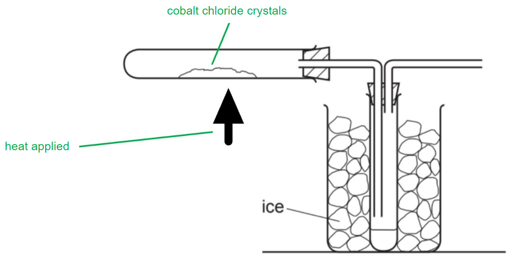

**[Total: 1 mark]**

- *This question is testing your ability to identify solids from diagrams*
- *There is a liquid in the other test tube*
b) The crystals change colour from:

- Red / pink to blue; **[1 mark]** 
*Both colours in the correct order are needed to gain the mark*

**[Total: 1 mark]**

- *Cobalt chloride is used as a test for the presence of water, usually in the form of cobalt chloride paper, but the colour change is the same, so make sure you learn the colour change*

- *The equation for this reaction is:*

> *CoCl**2**.6H**2**O  *$\rightleftharpoons$* CoCl**2** + 6H**2**O*
c) The purpose of the ice is:

- To cool / condense (the water / steam); **[1 mark]**

**[Total: 1 mark]**

- *As the hydrated cobalt(II) chloride is heated, the water of crystallisation leaves the structure*
- *Due to the heat, this is in the form of water vappur*
- *As it reaches the cold tube surrounded by ice, the water vapour condenses*
d) The tube is open at point **W** as:

- Pressure would build up / air or gases needs to escape owtte;** [1 mark]**

**[Total: 1 mark]**

### Q2
i) The copper sulphate crystals are placed:

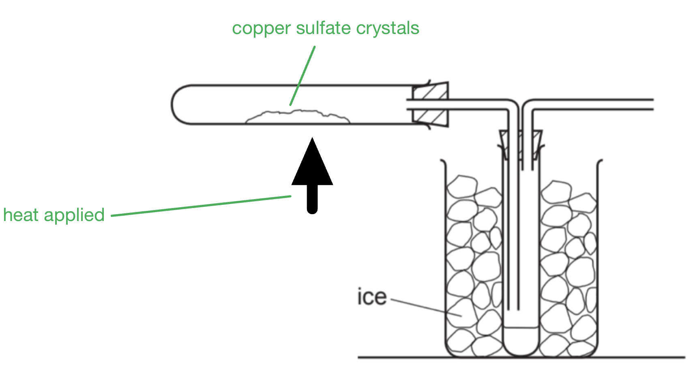

- Correct indication for crystals; **[1 mark]**

ii) Heat is applied:

- Correct indication of heat; **[1 mark] **

*   no labels but correct position max ***1 mark**

**Final answer:** **[Total: 2 marks] **

- *Make sure your diagrams are always labelled *
The purpose of the ice is:

- To cool/condense the water/gas/liquid;** [1 mark] **

**Final answer:** **[Total: 1 mark] **

- *Water will be liberated in this reaction as water vapour*
- *Therefore it needs to be cooled so it can be collected as a liquid - this is done by using ice or an ice bath*
The crystals changed colour from:

- Blue;** [1 mark] **
- To white: **[1 mark] **

**[Total: 2 marks]**

- *The equation for this reaction is:*

  - *CuSO**4**.**5H**2**O  ⇌  CuSO**4** + 5H**2**O*

## Multiple Choice Questions (28 questions)

### Q1
**Final answer:** **The correct answer is D**

The question asks you to identify the **incorrect** statement.

- **D is the incorrect statement (and therefore the right answer)**

  - The forward reaction is exothermic (Δ*H* is negative)
  - An **increase** in temperature will force the system to absorb the excess heat by shifting the equilibrium in the endothermic direction
  - The equilibrium will shift to the **left**, **decreasing** the yield of ammonia

**A** is incorrect as it is a **true statement.** There are 4 moles of reactant gas and only 2 moles of product gas. Increasing the pressure shifts the equilibrium to the side with fewer moles of gas (the right), increasing the yield

**B **is incorrect as it is a** true statement. **A catalyst speeds up the forward and reverse reactions equally. It helps the system reach equilibrium faster but does not shift the position of equilibrium or change the final yield

**C **is incorrect as it is a **true statement. **Increasing the volume of a container decreases the pressure of the gases inside. A decrease in pressure shifts the equilibrium to the side with more moles of gas (the left), which decreases the yield

### Q2
**Final answer:** **The correct answer is A**

- Statement 1 is correct

  - Heating hydrated copper(II) sulfate removes water of crystallisation, changing it from blue (hydrated) to white (anhydrous)
- Statement 2 is incorrect

  - **Melting** is **reversible**
  - **Combustion** is **irreversible**
  - The statement is false because it groups them together
- Statement 3 is incorrect

  - Anhydrous cobalt(II) chloride is blue and turns pink when water is added, not pink to blue

### Q3
**Final answer:** **The correct answer is**** D**** **

- Hydrated copper(II) sulfate is a **blue solid** which turns **white** on heating, producing **anhydrous** copper(II) sulfate.
- The addition of water to the anhydrous copper(II) sulfate **rehydrates** the compound, turning it blue.
- The blue compound is now **hydrated** and the reaction can be **reversed**.

**A** and **B** are incorrect as blue copper(II) sulfate is hydrated. If it were anhydrous it would be white.

**C**  is incorrect as the reaction is reversible.

### Q4
**Final answer:** **The correct answer is ****D**** **

- Nitrogen is obtained from the **air** by fractional distillation.
- Hydrogen is obtained by reacting **methane** with **steam** or from **cracking** of oil fractions.
- Iron in the form of **finely divided beads** is used as a catalyst, which increases the **surface area** allowing for a larger number of molecules to combine with the catalyst's surface.

**A** is incorrect as the catalyst used is finally divided iron.

**B** and **C** are incorrect as these options incorrectly describe the sources of the reactants.

### Q5
**Final answer:** **The correct answer is ****B**** **

- The Haber process involves the production of **ammonia **from the reaction between nitrogen and hydrogen:

  - $N_{2}+3H_{2}\rightleftharpoons2\mathrm{NH}_{3}$
- The reaction is carried out at **450**$^{\circ}C$and at **200 atm **of pressure.
- **Iron** is the only catalyst used.

**A, C** and **D** are incorrect as these options do not correctly describe the conditions used in the Haber process.

### Q6
**Final answer:** **The correct answer is**** A**** **

- The energetics of reversible reactions are such that if the forward direction is exothermic, then the reverse direction is the **opposite**, hence endothermic.
- This applies in both cases, so if the forward reaction is endothermic, then the reverse reaction must be exothermic.

**B** and **D** are incorrect as both directions will not have the same energy change.

**C** is incorrect as statements 1 and 2 are both true.

### Q7
**Final answer:** **The correct answer is**** C**** **

- Alkanes combust with oxygen producing **carbon dioxide** and **water**.
- The products do not react together and the reaction is **one** **way** only.
- Propane combusts as shown: C3H8 + 5O2 → 3CO2 + 4H2O

**A** is incorrect as after melting water can be **solidified **by being allowed to **cool **again.

**B** and **D** are incorrect as the hydration and dehydration of salts are reversible reactions.

### Q8
**Final answer:** **The correct answer is**** B**** **

- Heating hydrated cobalt(II) chloride takes heat energy in and **dehydrates **the compound and the resulting cobalt (II) sulfate turns from **pink** to **blue**.
- This is the colour change which has occurred so the pink cobalt(II) chloride crystals are **hydrated**.
- Since re-hydrating the compound through the addition of water causes the blue solid to  turn back to pink and give off heat, then the reaction is **reversible**.

**A** is incorrect as the reaction is reversible.

**C** and **D** are incorrect as the pink cobalt(II) chloride crystals are **hydrated**. If they were **anhydrous** they would be** blue**.

### Q9
**Final answer:** **The correct answer is**** D**** **

- Le Chatelier’s Principle states that when a change is made to the conditions of a system at equilibrium, the system automatically moves to oppose the change.
- The factors that affect the position of the equilibrium are **temperature**, **pressure** and **concentration**.

**A** is incorrect as concentration also affects the equilibrium position.

**B** and **C** are incorrect as the surface area of a solid reactant affects reaction rate but has **no effect** on the equilibrium position.

### Q10
**Final answer:** **The correct answer is**** C**** **

- Increasing the temperature will shift the equilibrium in the direction of an **endothermic reaction**.
- The reaction is **exothermic**, therefore an increase in temperature would favour the reverse reaction and decrease the yield of methanol.
- From the balanced equation, there are **3 **moles of reactants to** 1 **mole of product.
- An increase in pressure would shift the equilibrium to the side with **less** **volume**, so it would favour the forward reaction and **increase** the yield of methanol.

**A**, **B** and **D** are incorrect as these conditions would not provide the highest yield of methanol.

### Q11
**Final answer:** **The correct answer is**** A**** **

- The forward reaction is **exothermic,** so if the temperature is decreased, the **forward** **reaction** will be favored.
- There are 3 moles of gaseous reactants but only 2 moles of gaseous product.
- The products occupy less volume than the reactants, therefore if the pressure is increased the forward reaction will be favored as there is **more** **space** available for the product molecules.

**B**,** C **and** D **are incorrect as decreasing the concentration of oxygen will shift the equilibrium to the left, favouring the reverse reaction and decreasing the yield of SO3.

### Q12
**Final answer:** **The correct answer is**** A**** **

- The equilibrium position of a reversible reaction is a way of measuring the **concentrations **of the reacting substances **relative to** **one** **another** when the reaction has reached **equilibrium**.
- When the position of equilibrium shifts to the left, it means the concentration of **reactants** **increases**.
- When the position of equilibrium shifts to right, this means the concentration of **products** **increases**

**B, C and D are incorrect as these options incorrectly describe a reversible reaction at equilibrium.**

### Q13
**Final answer:** **The correct answer is ****B**** **

- From the balanced equation there are **4 moles** of gaseous reactants to **2 moles** of gaseous product.
- An increase in pressure would shift the equilibrium to the side with **less** gaseous moles, favouring the **forward reaction.**
- Therefore the percentage yield of ammonia **increases.**

**A** is incorrect as the percentage yield increases with increasing pressure.

**C** and **D** are incorrect as the rate if production increases with increasing pressure.

### Q14
**Final answer:** **The correct answer is**** D**** **

- For a reversible reaction at equilibrium if the forward reaction is exothermic then the reverse reaction will be endothermic by the same amount.
- The decomposition of N2O4 will therefore be **+58 kJ / mol**.
- *ΔH* is **positive** therefore the reverse reaction is **endothermic**.

**A **and** B** are incorrect as a decrease in pressure would favour NO2 as it is the side that has **more **moles** **of gas. An increase in pressure would favour the formation of N2O4 as it has **less** gaseous moles.

**C **is incorrect as the reverse reaction is **endothermic**.

### Q15
**Final answer:** **The correct answer is**** C**** **

- Le Chatelier’s Principle states that when a change is made to the conditions of a system at equilibrium, the system automatically moves to oppose the change.
- The principle is used to predict the position of equilibrium when there are changes in temperature, pressure or concentration.

**A**,** B** and **D** are incorrect as the direction of movement of the equilibrium position depends on the reaction and the change applied.

### Q16
**Final answer:** **The correct answer is ****B**** **

- The conditions are **450**$^{\circ}C$ and **1 - 2 atm** pressure which provide a percentage yield of **98%.**
- A higher pressure is not used as it is too dangerous given that SO3 is an **acidic** gas.
- In economic terms it isn't worth the expense to use a higher pressure when a 98% yield is achievable at 1 - 2 atm.

**A, C** and **D** are incorrect as these options do not correctly describe the conditions used for the reaction.

### Q17
**Final answer:** **The correct answer is**** B**** **

- The use of a catalyst has **no effect** on the equilibrium position.
- Catalysts do increase the **rate** at which equilibrium is reached as they increase the rate of reaction in the **forward** and **reverse** directions but by the **same** **amount**.
- There the** concentrations** of reactants and products is the same at equilibrium as it would be without the catalyst, hence the position of equilibrium is unaffected by catalysts.

**A**, **C** and **D **are incorrect as these options do not correctly describe the effects of catalysts on reversible reactions.

### Q18
**Final answer:** **The correct answer is ****C**** **

- For a reversible reaction at **equilibrium,** the rate of the **forward** reaction is **equal** to the rate of the **reverse** reaction.
- The concentrations of the reactants and products therefore remain constant.

**A** is incorrect as **both reactions** continue to occur at equilibrium.

**B** is incorrect as the concentrations of the reactants and products **remain constant** but are not equal to each other.

**D** is incorrect as at equilibrium the rate of reaction in either direction is the **same.**

### Q19
**Final answer:** **The correct answer is**** B**** **

- The **water of crystallisation **can be removed from blue hydrated copper(II) sulphate by **heating**.
- The now white dehydrated copper (II) sulphate can then be **rehydrated** and the blue colour returns.

**A**, **C** and **D** are incorrect as these reactions cannot be reversed.

### Q20
**Final answer:** **The correct answer is ****C**** **

- **Reacted** N2 and H2 form ammonia which is then removed in **liquid form** from the bottom of the reaction chamber.
- It is the **unreacted** N2 and H2 that is recycled back into the reaction chamber.

**A, B** and **D** are incorrect as these statements accurately reflect the Haber process.

### Q21
**Final answer:** **The correct answer is ****A**** **

- The forward reaction is **endothermic** as energy is needed to decompose the molecule and remove the water of crystallisation.
- In reversible reactions, if the forward reaction is endothermic then the reverse reaction is **exothermic** (and vice versa).
- Anhydrous cobalt(II) chloride turns **blue** to **pink** when water is added.

**B, C** and **D** are incorrect as these options do not correctly describe the reaction.

### Q22
**Final answer:** **The correct answer is**** B**** **

- High temperature gives the largest yield as this reaction is **endothermic**.
- **Low** **pressure** is favoured because there are 2 moles of gaseous product and only 1 mole of  gaseous reactant.
- A higher pressure would favour the reverse reaction (i.e the side with **fewer moles of gas**) and decrease the yield of H2.

**A**, **C** and** D** are incorrect as these conditions would not provide the highest yield of hydrogen.

## Theory Questions (41 questions)

### Q1
> **[mark-scheme]**
> - N2 + 3H2 ⇌ 2NH3 (Correct balancing) **[1 mark]**
- Each **nitrogen atom has 5 outer electrons**
- The two nitrogen atoms **share three pairs of electrons**, forming a **triple covalent bond**
- These **three shared pairs** appear in the **overlap between the atoms**
- Each nitrogen then has **one lone pair (two non-bonding electrons)** remaining
- This gives each nitrogen 8 electrons in its outer shell.

**[2 marks]**

> **[mark-scheme]**
> 1 mark for showing  3 shared pairs of electrons (dots and crosses) in the overlap area between the two nitrogen atoms
> 
> 1 mark for showing 2 non-bonding electrons (one lone pair) on each nitrogen atom to complete both octets

> **[exam-tip]**
> **Remember! **Dots and crosses are just symbols to show where electrons come from. Examiners do not mind which symbol you use, as long use them consistently for each element. Do not mix crosses and dots for the same element.
> 
> In diatomic molecules, the electrons of each atom must be represented with different symbols.
- The Haber process is an exothermic reaction, **products have lower energy than reactants**
- The difference in energy must be shown by a **downward arrow (ΔH)**
- The activation energy is the minimum energy necessary to start the reaction and it is shown as a **"hump"** that reactants must overcome to become products

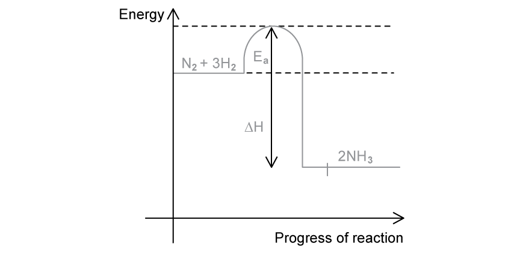

**[3 marks]**

> **[mark-scheme]**
> 1 mark for horizontal line for 2NH3 is drawn below the N2 + 3H2 line, connected by a curve with a 'hump'
> 
> **Accept ** N2 + H2 as reactants and NH3 as a product
> 
> 1 mark for an upward pointing arrow starting exactly from the reactants energy level to the peak of the curve, labelled *E*a
> 
> 1 mark for a downward pointing arrow starting exactly from the reactants energy level to the products energy level, labelled ΔH or enthalpy change

> **[exam-tip]**
> Be precise with arrows in energy profile diagrams.** The activation energy arrow must reach the very top of the peak**, and** ΔH for an exothermic reaction should be a single downward arrow**, not a double-headed.
> **[mark-scheme]**
> - The rate of the forward reaction equals the rate of the reverse reaction **[1 mark]**
> - The concentrations of reactants and products are constant / no longer changing **[1 mark]**

> **[exam-tip]**
> A common mistake among students is saying the concentrations are equal, but they are not. At equilibrium, state that concentrations are **constant (no longer changing)**.
| **change in condition** | **effect on the equilibrium yield of ammonia** | **effect on the rate of the forward reaction** |
|---|---|---|
| increasing the temperature | **decreases** **[1]** | **increases** **[1]** |
| increasing the pressure | **increases** **[1]** | **increases** **[1]** |
| adding a catalyst | **no change** **[1]** | increases |

> **[exam-tip]**
> Remember that **Haber Process is a frequent problem for exams**. You must know how changes in temperature, pressure, volume or adding a catalyst affect the equilibrium and the rate of reaction.
> 
> - **Increasing temperature**
> 
>   - The Haber process forward reactions is **exothermic**, so higher temperature shifts equilibrium **away from ammonia **favouring the endothermic reaction, decreasing the **yield.**
>   - However, particles move faster, so the **rate of the forward reaction increases.**
> - **Increasing pressure**
> 
>   - There are **4 moles of gas on the left (N****2****+ 3H****2****)** and **2 moles on the right (2NH****3****).**
>   - Higher pressure favours the side with **fewer gas molecules**, so the **yield of ammonia increases**, and collisions happen more often so the **rate also increases.**
> - **Adding a catalyst**
> 
>   - A catalyst **does not change equilibrium**, so the **yield stays the same.**
>   - It only **increases the rate** by lowering the activation energy.

### Q2
a) The symbols means it is a :

- Reversible / reversible reaction;** [1 mark]**

**[Total: 1 mark]**

- *A reversible reaction is one where the reactants form products, and the product can reform the reactants*
b) The  colour change when water is added to anhydrous cobalt(II) chloride is:

- (From) blue; **[1 mark]**
- (To) pink; **[1 mark]**

**[Total: 2 marks]**

- *Anhydrous cobalt(II) chloride is blue *
- *Hydrated cobalt(II) chloride is pink *
c) Hydrated copper(II) sulfate be changed into anhydrous copper(II) sulfate by

- Heat/ warm; **[1 mark]**

**[Total: 1 mark]**

- *Heating hydrated copper(II) sulfate will cause the water to evaporate and form anhydrous copper(II) sulfate*
- *In a reversible reaction, usually the change that has occurred in the forward reaction to obtain the product, can be reversed to obtain the reactant again *

### Q3
a) The term catalyst means:

- A substance that speeds up a reaction / increases rate; **[1 mark]**
- It remains unchanged (chemically) at the end / is not used up / lowers activation energy / provides an alternative pathway; **[1 mark]**

**[Total: 2 marks]**

- *You need to remember the definition of a catalyst, it comes up a lot and helps with interpreting graphs to identify what factor has affected the rate*
b) **Two** reasons why a temperature lower than 700 oC is used:

- The reaction would be too slow / slower; **[1 mark]**
- There would be a lower yield / less product(s) / equilibrium shifts to left / equilibrium shifts in direction of reactants / backward reaction favoured / reverse reaction favoured; **[1 mark]**

**[Total: 2 marks]**

- *Rate of reaction will always be slower when a lower temperature is used, so daily yield is compromised even if % yield is not*
- *The forward reaction is endothermic, so decreasing the temperature would shift the equilibrium in the reverse direction (to the reactants/ to the left) as the position of the equilibrium will shift to counteract the change*
c) **One** advantage of using a pressure greater than one atmosphere:

- Faster / increased rate; **[1 mark]**

**[Total: 1 mark]**

- *Increasing pressure increases the frequency of the collisions of the gas particles, therefore increasing the rate*
d) **One** disadvantage of using a pressure greater than one atmosphere:

- Lower yield / less product(s) / equilibrium shifts to left / equilibrium shifts in direction of reactants / backward reaction favoured / reverse reaction favoured 
**OR** 
Higher cost / expensive 
**OR** 
Safety risks; **[1 mark]**

**[Total: 1 mark]**

- *There are two moles of gas on the reactant side and four moles of gas on the product side of this reaction*

  - *It means that by increasing the pressure the equilibrium will shift to the side with fewer moles of gas, which is the left-hand side / reactants side*
  - *This will decrease the yield as there is then less product*
e)

i) Electrolysis means:

- The breakdown of an ionic compound when molten / in aqueous solution;** [1 mark]**
- (Using) electricity / electric current / electrical energy; **[1 mark]**

ii) The electrodes could be made of:

- Carbon / graphite/ platinum; **[1 mark]**

iii) An ionic half equation for the reaction in which hydrogen is produced is:

- 2H+ + 2e– → H2 
**OR** 
2H3O+ + 2e- → H2 + 2H2O; **[1 mark]**

iv) Hydrogen is produced at:

- The cathode / negative electrode; **[1 mark]**

v) The test for chlorine gas is:

- Use damp blue litmus paper; **[1 mark]**
- Bleaches / loses colour / turns white / turns colourless; **[1 mark]**

**[Total: 7 marks]**

- *The definition for electrolysis is another one you should be able to recall, as well as common materials for electrodes*
- *Hydrogen is produced from aqueous hydrogen ions, which involves the gain of electrons. You should know that the formula of hydrogen gas is H**2*
- *The hydrogen ion is positive and moves towards the negative electrode, the cathode*
- *The chlorine gas test is another one you need to recall!*
f) The chemical equation is:

2NaCl + 2H2O → 2NaOH + H2 + Cl2

- All formulae correct; **[1 mark]**
- Balancing is correct; **[1 mark]**

**[Total: 2 marks]**

- *The formulae in this equation are all common ones that you should be able to recall, and then balance*

### Q4
a) An experiment which shows that chlorine is more reactive than iodine is:

- Add chlorine to (potassium) iodide solution; **[1 mark]**
- A red / brown / yellow / orange (solution) is formed; **[1 mark]**
- Cl2 + 2KI → 2KCl + I2 
**OR** 
Cl2 + 2I– →  2Cl – + I2; **[1 mark] **
*A solution must be implied for the first marking point* *Allow any soluble iodide solution* *Allow black (ppt or solid)* *Ignore state symbols but KI (aq) would allow the solution aspect of the first marking point*

**Final answer:** **[Totol: 3 marks]**

- *Halogen displacement reactions occur when a more reactive halogen displaces a less reactive halogen from an aqueous solution of its halide*
- *The colour produced is the colour of the halogen in the solution*

  - *In this case, it is due to iodine which is formed in the reaction*
b) The formula of the compound can be deduced by:

- (0.013 moles of I and 0.065 moles of F atoms gives a) ratio 1:5; **[1 mark]**
- Formula = IF5; **[1 mark] **
*Award 2 marks for IF**5** without any working* *Allow one mark for I**5**F (as ratio is inverted)* *Allow one mark for IFl**5** or I**5**Fl*

**[Total: 2 marks]**

- *To find the ratio, divide the number of moles of each element by 0.013 (the smallest amount in moles of either element)*

  - *I: 0.013 / 0.013 = 1*
  - *F: 0.065 / 0.013 = 5*
c)

i) Another example of a reversible reaction is:

- Example of a reversible reaction including attempts at removing / adding waters of crystallisation 
**OR** 
Example of a reaction which under closed conditions would be reversible; **[1 mark]** 
*Allow a written description of the reaction *
*e.g. ‘Haber process’ unless equation is attempted in which case ignore written description *
*Allow word equations / unbalanced equations* 
*Allow equations without equilibrium arrows* *Ignore descriptions of physical changes*

ii) The term *equilibrium *means:

Any **two **from:

- (A reaction) which can take place in both directions 
**OR **
Which can be approached from both directions; **[1 mark]**
- (A reaction) in which concentrations / macroscopic properties remain constant / do not change (with time); **[1 mark]**
- The two reaction rates are equal 
**OR **
The forwards and backwards rates of reaction are equal; **[1 mark]**

**[Total: 3 marks]**

- *Typical examples of allowed equations would be:*

  - *The Haber Process:*
  
    - *N**2** + 3H**2** ⇌ 2NH**3*
  - *Hydrated cobalt(II) chloride ⇌ anhydrous cobalt(II) chloride + water*
  
    - *CoCl**2**.6H**2**O (s) ⇌ CoCl**2** (s) + 6H**2**O (l)*
d) There is less of the yellow solid and more dark brown liquid in the new equilibrium mixture because:

- Equilibrium goes to LHS 
**OR **
Equilibrium goes to reactants side 
**OR **
The backward reaction is favoured; **[1 mark] **
*Allow reaction goes to LHS but do NOT allow ‘equilibrium goes to LHS and to products side’*
- Because the concentration of chlorine decreases 
**OR **
To replace the missing chlorine; **[1 mark] **
*Ignore 'less yield' or 'less products*

**[Total: 2 marks]**

- *According to Le Chatelier's principle, an equilibrium will shift to counteract any change that is imposed on an equilibrium reaction*
- *In this example, removing chlorine means that there is less chlorine on the reactants side*

  - *This means that this change is corrected by favouring the backward reaction forming more Cl**2** *
  - *Since the ICl**3** product is yellow and the ICl reactant is dark brown, you will see the reaction mixture getting darker*
e) You can deduce about the forward reaction in this equilibrium that:

- The forward reaction is exothermic; **[1 mark]**

Because:

- Equilibrium goes to RHS 
**OR **
Equilibrium goes to the products side 
**OR **
The forward reaction is favoured; **[1 mark] **
*Allow the reaction goes to RHS but  do NOT allow ‘equilibrium goes to RHS and to reactants side’* *Ignore 'more yield' or 'more products'*
- Exothermic reactions are favoured by low temperatures; **[1 mark] **
*Allow  ‘decreasing temperature makes the equilibrium go to RHS’ for the explanation* *Allow backward reaction is endothermic*

**[Total: 3 marks]**

- *When the temperature of a reaction decreases, the equilibrium shifts in the exothermic direction*
- *As the amount of yellow solid increases when the equilibrium is placed in ice-cold water, more ICl**3** is produced which is formed by the forward reaction*
- *Therefore, the forward reaction must be an exothermic reaction*

### Q5
a) Describe how sulfur dioxide is converted into sulfur trioxide in stage 2:

- 2SO2 + O2 → 2SO3; **[1 mark]**
- 450 °C; **[1 mark]**
- Vanadium pentoxide / vanadium(V) oxide / V2O5 (catalyst); **[1 mark]**

**[Total: 3 marks]**

- *You are only expected to know the equation and conditions for this stage of the Contact process*
- *You could gain a mark for just vanadium oxide but if the oxidation number is given, it must be (V)*
b) Equilibrium is when the:

- Rate of forward reaction and rate of backward reaction are equal;** [1 mark]**
- Concentrations of reactants and products are constant; ** [1 mark]**

**[Total: 2 marks]**

- *Careful: **The concentrations of reactants and products remain constant but are not the same as one another *

### Q6
a) Sulfur dioxide is made from sulfur by:

- Burning sulfur in air / oxygen 
**OR **
Combustion in air / oxygen 
**OR **
Roasting sulfide ores;** [1 mark]**

**[Total: 1 mark]**

- *The most common correct answer to this question is the idea of burning / combustion the sulfur in oxygen*
b)

i) As the temperature increases, the percentage of sulfur trioxide in the equilibrium mixture will:

- Decrease;** [1 mark] **

ii) The forward reaction in the equilibrium 2SO2 + O2 $\rightleftharpoons$ 2SO3 is:

- Exothermic;** [1 mark]** *Zero marks can be awarded for an answer of endothermic reaction for part (ii)*
- (Because) increasing the temperature favours the backward reaction so it is endothermic 
**AND**
** **so the forward reaction must be exothermic; **[1 mark]**

iii) A temperature of 450 °C is used in the Contact process because:

- It is low enough for good yield; **[1 mark]**
- It is high enough for a good / economic rate;** [1 mark] ***Just the idea of this being the optimum temperature if insufficient for any marks*

**[Total: 5 marks]**

- *Part (i) requires you to use the graph to determine what happens to the percentage of sulfur trioxide as the temperature increases*
- *Since the percentage decreases as the temperature increases, the forward reaction to form sulfur trioxide must be exothermic*
- *Although 450 **o**C is likely to be the optimum temperature, you are specifically told to explain why this temperature is used in terms of rate and yield*

  - *Any optimum temperature is used to give a good yield and a good rate*

### Q7
a)

i) Nitrogen and hydrogen are obtained from:

- Nitrogen from: air; **[1 mark]**
- Hydrogen from: Petroleum / crude oil / alkanes  
**OR** 
Water / steam or steam reforming 
**OR** 
Suitable aqueous solution e.g. brine or sea water; **[1 mark]**

ii) The catalyst used in this process is:

- Iron; **[1 mark]**

iii) The most important use of ammonia is:

- (As a) fertiliser  
**OR** 
To make fertilisers; **[1 mark]**

**[Total: 4 marks]**

- *Although there are many uses of ammonia, you should be aware of its main use as a fertiliser, which has transformed food production across the world*
b)

i) Equilibrium means:

- Rate of the forward and back reactions is equal;** [1 mark]**
- So concentrations of reactant and products do not change; ** [1 mark]**

*Accept amounts stay the same* *Do NOT accept 'no change'*

ii) The percentage of ammonia varies with temperature because:

- It <u>decreases</u> with <u>increased</u> temperature **OR** It <u>increases</u> with <u>decreased</u> temperature; ** [1 mark]**

**[Total: 3 marks]**

- *Remember:** According to Le Chateliers principle, the change made to the system will cause the system to shift the equilibrium to oppose the change*
- *High temperatures will cause the system to oppose the change and decrease the temperature by favouring the endothermic reaction, in this case, the reverse reaction *
- *The equilibrium would shift to the left, thereby reducing the percentage yield of ammonia*
- *Equilibrium cannot be described as 'no change' as this is a dynamic equilibrium where there is always change, but the rate of that change in both directions is equal*
c)

i) The shape of the graph should be:

- Shows an increase (either a line or curve); **[1 mark]**

ii) It has this shape because:

- An increased pressure favours the side with lower volume / fewer molecules / fewer moles; **[1 mark]**
- That is the RHS or products side; **[1 mark]**

*Ignore any mention of rates*

**[Total: 3 marks]**

- *Remember:** According to Le Chatelier's principle, the change made to the system will cause the system to shift the equilibrium to oppose the change*
- *So higher pressures will cause the system to try and decrease the pressure by favouring the reaction that produces fewer molecules of gas, in this case, the forward reaction *
- *The equilibrium shifts to the right producing more product / ammonia and leads to a higher % yield*

### Q8
a) Two features of an equilibrium are:

- Reaction is reversible; **[1 mark]**
- Rate of forward reaction = rate of reverse reaction; **[1 mark]**

**[Total: 2 marks]**

- *Getting asked about the features of a dynamic equilibrium is a common exam question so make sure you spend the time to learn this*
- *At equilibrium, the concentrations of reactant and product remain constant (not the same as each other, just constant)*
b) The catalyst used in this stage is:

- Vanadium pentoxide / vanadium(V) oxide / V2O5 (catalyst); **[1 mark]**

**[Total: 1 mark]**

- *You could gain a mark for just vanadium oxide but if the oxidation number is given, it must be (V)*
c) This suggests that the forward reaction is:

- Exothermic; **[1 mark]**

**[Total: 1 mark]**

- *If a certain temperature is used for a process, it must produce a good enough yield of product *
- *Temperature affects the rate of the reaction and position of equilibrium*
- *A higher temperature favours a quicker rate of reaction, producing more sulfur trioxide*
- *A moderate temperature being used implies that higher temperatures will produce less sulfur trioxide i.e. favour the backwards reaction*
- *Applying Le Chatelier's principle, the system will counteract any change made to the system, so higher temperatures will favour the endothermic reaction to reverse the change*
- *This suggests that the reverse reaction is endothermic, therefore the forwards reaction is exothermic*

### Q9
a) **Two **advantages, with reasons, of using a high pressure are:

- Advantage 1: Faster reaction rate; **[1 mark]**
- Reason 1: Higher collision rate; **[1 mark]**
- Advantage 2: Greater yield; **[1 mark]**
- Reason 2: Pressure favours products / the right hand side of the reaction because it has a lower volume / there are fewer product molecules; **[1 mark]**

**[Total: 4 marks]**

- *Increasing the pressure will increase the rate of reaction*

  - *This is because the particles are closer together (same number of particles in a smaller unit volume)*
  - *This results in the particles colliding more frequently and successfully (more successful collisions per unit time / more frequent successful collisions)*
- *Increasing the pressure will increase the yield*

  - *This is because all of the chemicals involved in the reaction are gaseous*
  - *Therefore, one mole of any chemical will occupy the same volume*
  - *As a consequence, increasing the pressure will move the reaction towards the side that occupies the least space / has the fewest number of moles*
  - *In this case, there are 4 moles of reactant and 2 moles of product *
  - *Since there are less moles of product, the product side will take up the least space and increasing the pressure will move the reaction to make more product*
b) A higher temperature is not used because:

- (Higher temperature) favours the endothermic reaction; **[1 mark]**
- Which is the backward reaction / left hand side / reactants; **[1 mark]**
- (Therefore,) this reduces the yield; **[1 mark]**

**[Total: 3 marks]**

- *The Haber Process does use a higher temperature to increase the rate of reaction*

  - *Increasing the temperature gives the particles more thermal energy which is converted to kinetic energy*
  - *This means that the particles are moving faster and therefore colliding more frequently*
- *However, this is a compromise because increasing the temperature decreases the yield*

  - *The reaction is exothermic*
  - *This means that when you increase the temperature, the reaction goes backwards to try and remove / lose the energy*
  - *As a result of this less product is made / there is a lower yield*
c)

i) The iron catalyst is used as a fine powder because:

- It has a greater surface area; **[1 mark]**

ii) **Two **reasons why a catalyst is used are:

Any **two** of the following:

- Increase the reaction rate; **[1 mark]**
- Allow a lower temperature to be used with an economical rate; **[1 mark]**
- Stop / limit the yield decreasing as the temperature increases; **[1 mark]**

**[Total: 3 marks]**

- *Catalysts are commonly powdered to increase the surface area*

  - *This is not something that is limited to precious / expensive metals such as palladium, platinum and rhodium*
- *Remember: **Catalysts increase the rate of reaction by providing an alternative pathway of lower activation energy*

  - *Since the reaction now requires less energy to meet the activation energy requirements, you can use a lower temperature which will, in turn, increase the rate of reaction as the reaction is exothermic*
d) Ammonia can be separated from the mixture by:

Alternative 1:

- Lower / reduce the temperature (of the reaction mixture) 
**OR **
Cool the reaction mixture;** [1 mark]**
- Only the ammonia will become liquid / liquify; **[1 mark]**

Alternative 2:

- Add water (to the reaction mixture); **[1 mark]**
- Only the ammonia will dissolve; **[1 mark]**

Alternative 3:

- Increase the pressure; **[1 mark]**
- Only the ammonia will become liquid / liquify;** [1 mark]**

**[Total: 2 marks]**

- *This question gives you the boiling point information for all 3 chemicals involved in the equilibrium reaction*

  - *Good exam technique should tell you to use this information*
- *Ammonia has the highest boiling point *

  - *This means that it will be the first to condense back into a liquid when the reaction mixture is cooled*
- *The alternative 2 response requires you to be aware that ammonia dissolves in water unlike nitrogen and hydrogen*
- *The alternative 3 response requires you to consider how increasing the pressure on a reaction mixture will condense gases to liquids*

  - *At a much higher level, there is a consideration towards the potential order at which the chemicals condense*
e) The completed table used to determine if the reaction is exothermic or endothermic is:

| bond | energy change / kJ |
|---|---|
| N-H | (3 x 390) = 1170 |
| F-F | **(3 × 155) = + 465** |
| N-F | **– (3 × 280) = (–)840** |
| H-F | **– (3 × 565) = (–)1695** |

- All three rows of the table correct; **[2 marks]**
- Two rows of the table correct;** [1 mark]**

The determination of whether the reaction is exothermic or endothermic:

- Bonds broken = 1170 + 465 = <u>1635 </u>
**AND** 
Bonds formed = 840 + 1695 = <u>2535</u>;** [1 mark]**
- The reaction is <u>exothermic</u>** **
**AND** 
Some reasoning, e.g. energy change = 1635 - 2535 = –900;** [1 mark]**

**[Total: 4 marks]**

- *This question requires you to use the chemical equation for the reaction in order to determine the number of bonds broken and formed*

  - *NH**3** + 3F**2** → NF**3** + 3HF*
  - *3 N-H bonds in one molecule of ammonia are broken*
  - *3 F-F bonds in the three fluorine molecules are broken*
  - *3 N-F bonds are formed in one molecule of nitrogen trifluoride*
  - *3 H-F bonds are formed in three molecules of hydrogen fluoride*
  - *This information can then be used to complete the table*
- *The information in the table can be used to determine if the reaction is endothermic or exothermic using:*

  - *Energy change = total energy in - total energy out  OR Energy change = total bonds broken - total bonds formed*
- *Placing the appropriate numbers in this equation gives an answer with a negative value, meaning that energy is given out*

  - *Therefore, the reaction is exothermic*

### Q10
a)

i) The catalyst used in reaction **2** is:

- Vanadium pentoxide / vanadium(V) oxide / V2O5 (catalyst); **[1 mark] **
*Allow vanadium oxide but if oxidation number is given, it must be (V)*

ii) A catalyst, rather than a higher temperature, is used to increase the rate of this reversible reaction because:

- A higher temperature (increases rate) but reduces yield; **[1 mark]**
- A catalyst only increases the rate  
**OR** 
A catalyst does not influence the position of equilibrium; **[1 mark]**

iii) A symbol equation for reaction **4** is:

- H2S2O7 + H2O → 2H2SO4; **[1 mark]**

**[Total: 4 marks]**

- *Higher temperatures will favour the backward, endothermic process in reaction **2**, reducing the yield of SO**3*
- *This question shows the different stages in the Contact process to form sulfuric acid*
- *You only need to know the reaction and conditions for reaction **2*
- *Whilst you do not need to know the equation for reaction **4**, you can work out the symbol equation based on the information provided*
- *The reactants are H**2**S**2**O**7** + H**2**O and the product is H**2**SO**4** giving the unbalanced equation of:*

  - *H**2**S**2**O**7** + H**2**O → H**2**SO**4*
- *To balance, add a 2 in front of H**2**SO**4**:*

  - *H**2**S**2**O**7** + H**2**O → 2H**2**SO**4*
b)

i) The third element that is essential for plant growth and is present in most fertilisers is:

- Potassium;** [1 mark]**

ii) A nitrogen-containing fertiliser that is manufactured from sulphuric acid is:

- Ammonium sulphate; **[1 mark]**

iii) The formula of each of the phosphates is:

- Calcium phosphate: Ca3(PO4)2; **[1 mark]**
- Calcium superphosphate: Ca(H2PO4)2; **[1 mark]**

iv) The phosphate ion is described as acting as a base in this reaction because:

- It accepts a proton; **[2 marks]** 
*It accepts a H**+** / hydrogen ion scores [1 mark] only*

**[Total: 6 marks]**

- *This is from an older past paper, hence the spelling of sulphur / sulphuric acid / sulphate*
- *Ammonium ions are a good source of water-soluble nitrogen ions*
- *To work out the formulae of the phosphates, use the charges on the ions provided*
- *The charge of the compound must be zero so the positive and negative changes must cancel out*
- *For calcium phosphate, 3 Ca**2+** ions are needed for every 2 PO**4**3-** ions, *

  - *(3 x 2+) + (2 x 3-) = 0*
  - *This gives the formula Ca**3**(PO**4**)**2*
  - *Note how the compound ion PO**4**3-** has brackets around it as there is more than one ion present*
- *For calcium superphosphate, 1 Ca**2+** ions are needed for every 2 H**2**PO**4**-** ions *

  - *(1 x 2+) + (2 x 1-) = 0*
  - *This gives the formula Ca(H**2**PO**4**)**2*
- *In part (iv) the PO**4**3-** ion receives 2 H**+** ions to form H**2**PO**4**-*

  - *A base is defined as a proton acceptor therefore PO**4**3- **is acting as a base*
- *In the current specification, it is more likely that you would be awarded 1 mark to say either it accepts a proton or a hydrogen ion*

### Q11
a)

i) The Haber Process:

- Nitrogen from the air  
**AND** 
Hydrogen from natural gas are used; **[1 mark]**
- 200 atmospheres; **[1 mark]**
- 450 oC; **[1 mark]**
- Iron catalyst; **[1 mark]**
- N2   +  3H2    $\rightleftharpoons$   2NH3;**[1 mark]**

ii)  One  use of ammonia is:

Any **one **of the following:

- Fertilisers; **[1 mark]**
- Nitric acid; **[1 mark]**
- Nylon; **[1 mark]**
- Refrigeration;** [1 mark]**
- Explosives; **[1 mark]**
- Cleaning products;** [1 mark]**

**[Total: 6 marks]**

- *Although this question is not specifically asking about rate and yield it is important to know why these conditions are used *
- *A higher yield would be obtained at lower temperatures as the forward reaction is exothermic however the rate of reaction would be too slow so 450 **o**C is a compromise*
- *A higher yield would be obtained at higher pressure as the forward reaction produces less molecules of gas however high pressures raise safety concerns and need expensive equipment so 200 atmospheres is a compromise*
b) The correct dot and cross diagram is

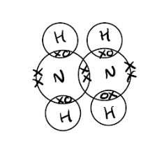

- One shared pair of electrons between two nitrogen atoms 
**AND** 
One lone pair of electrons on each nitrogen atom;** [1 mark]**
- One electron pair between each nitrogen and hydrogen atom ; ** [1 mark]**

**[Total: 2 marks]**

- *The diagram shows you that the nitrogen and hydrogen atoms are all attached by single covalent bonds so only one pair of electrons are shared where these bonds are formed*
- *If hydrogen is present in the compound you are drawing a dot and cross diagram for always draw these first as they must be shared*
- *Nitrogen has five electrons on the outer shell and so after sharing one with each hydrogen and the other nitrogen, there are two left over on their own *
c) A base is:

- A proton acceptor; **[1 mark]**

**[Total: 1 mark]**

- *Remember:** Bases are proton acceptors and acids are proton donors*
d)

i) One environmental problem caused by oxides of nitrogen is:

- Acid rain; **[1 mark]**

ii) Oxides of nitrogen form by:

- Nitrogen and oxygen reacting; **[1 mark]**
- At high temperatures; **[1 mark]**

**[Total: 3 marks]**

- *Oxygen and nitrogen from the air react at high temperatures in a car engine*
- *The nitrogen is not an impurity in the fuel - this is a common mistake students make*
- *When the oxides of nitrogen are released, they react with rainwater to form nitric acid resulting in acid rain*

### Q12
a)

i) The reaction conditions for the Contact Process are:

Any **three **from:

- Vanadium(V) oxide / vanadium oxide / vanadium pentoxide / V2O5 as catalyst; **[1 mark]** *Oxidation number not needed but if it is present, it must be (V)*
- Temperature 300 to 600 °C; **[1 mark]**
- Pressure up to 10 atmospheres; **[1 mark]** *Accept atmospheric pressure*
- The volume ratio of gases is 2: 1 **OR** There is a slight excess of oxygen; **[1 mark]**

ii) When the temperature is increased, the yield of sulfur trioxide would:

- Decrease; **[1 mark]**
- (Becasue) the backwards / reverse reaction is endothermic 
**OR **
The forward reaction is exothermic 
**OR **
An increase in temp favours the backwards / reverse reaction; **[1 mark]**

**[Total: 5 marks]**

- *Make sure you know the conditions of the Contact process as they are easy marks to pick up*
- *An increase in temperature will always favour the endothermic reaction in order to oppose the change in temperature*
b) The completed table of salt preparations is:

| **Method** | **Reactant 1** | **Reactant 2** | **Salt** |
|---|---|---|---|
| Titration | sulphuric acid | **sodium hydroxide / carbonate / hydrogencarbonate;** **[1 mark]** | sodium sulphate |
| Neutralisation | sulphuric acid | **zinc oxide or hydroxide or carbonate; ****[1 mark]** ***NOT zinc*** | zinc sulphate |
| Precipitation | sulphuric acid | **barium nitrate / chloride / hydroxide OR barium ions**; **[1 mark]** | barium sulphate |
| **Neutralisation**; **[1 mark]** ***NOT acid/base*** | sulphuric acid | copper(II) oxide | copper(II) sulphate |

**[Total: 4 marks]**

- *Whilst zinc + sulphuric acid does form the salt zinc sulphate, this is not an example of a neutralisation reaction, therefore it is not accepted as an answer*
- *To prepare an insoluble salt by precipitation, the reactants must be soluble*
- *All nitrates and most chlorides (including barium chloride) are soluble, hence these are suitable reactants to produce barium sulphate*
c)

i) The white powder is:

- Copper sulphate or anhydrous copper sulphate; **[1 mark]** Accept ''unhydrated" *Do NOT accept formula*

ii) When water is added to the white powder an observation is:

- It goes blue 
**OR **
Becomes hot 
**OR **
Forms steam; **[1 mark]**

iii) The black powder is:

- Copper oxide; **[1 mark]**

iv) The mass of the black powder is:

- Number of moles of CuSO4.5H2O = mass/molar mass = 5 / 250 = 0.02 moles; **[1 mark]**
- *M*r of CuO = 64 + 16 = 80; **[1 mark]**
- Mass of CuO = moles x molar mass = 0.02 x 80 = 1.6 g; **[1 mark]** *Correct answer with no working only scores [1 mark]*

**[Total: 6 marks]**

- *White anhydrous copper(II) sulfate is formed when blue hydrated copper(II) sulfate is heated and the water of crystallisation is driven from the crystal structure *
- *As it requires heat, it is an endothermic reaction*
- *Adding water to anhydrous copper(II) sulfate to form hydrated copper(II) sulfate is the reverse of the above reaction, so will be an exothermic reaction*

  - *CuSO**4**.5H**2**O (s) ⇌ CuSO**4** (s) + 5H**2**O (l)*
- *The copper(II) sulfate will become hot and causes some of the water present to turn to steam*
- *The formula of anhydrous copper(II) sulfate is CuSO**4*
- *It is heated producing sulfur trioxide, SO**3**, so the other product formed must be CuO, copper oxide:*

  - *CuSO**4** → CuO + SO**3*
- *Using the balanced symbol equations, you can see that 1 mole of hydrated copper(II) sulfate will produce 1 mole of CuO so 0.02 moles of hydrated copper(II) sulfate will produce 0.02 moles of CuO*
- *This can be used to work out the mass of copper oxide*

### Q13
a) Equilibrium means:

- The rate of the forward reaction equals the rate of the backwards / reverse reaction; **[1 mark]**
- Concentrations do not change / macroscopic properties remain constant (with time); **[1 mark]** *Accept: amounts*

**[Total: 2 marks]**

- *Definitions are easy marks to pick up in exams - if you have taken the time to learnt them!*
- *Careful**: Do not say that the reaction has stopped*

  - *Whilst it may look like it has, equilibrium is said to be dynamic as reactants are still forming products and vice versa, so reactions are still occurring*
  - *However, the amount of reactant / product remains constant as the reactions are happening at the same rate*
b) The reverse reaction is:

- Endothermic; **[1 mark]**
- (Because) it is favoured by high temperatures; **[1 mark]** The 2nd mark can only be awarded if the 1st marking point is correct

**[Total: 2 marks]**

- *When the temperature is increased, equilibrium will shift to oppose the change by favouring the endothermic reaction thus taking the heat energy and reducing the temperature of the reaction*
- *In this reaction, as it becomes a darker brown colour when heated, it must mean that the backwards reaction is favoured as more ICl is produced*
- *This means that the reverse reaction must be endothermic *
c)

i) The affect on the equilibirum, with a reason, is:

- It would move / shift to the left;** [1 mark]**
- (To produce) more moles / molecules / bigger volume;** [1 mark]**

ii) You would observe:

- Less yellow solid / more brown liquid;** [1 mark]** *Accept yellow to brown / less solid more liquid / goes brown*

**[Total: 3 marks]**

- *As pressure is decreased, the reaction that produces the most molecules is favoured as this will increase the pressure and oppose the change*
- *In this reaction, there are 2 molecules on the left hand side of the equation and 1 molecule on the right hand side so the reverse reaction is favoured to produce more molecules*
- *Less ICl**3**, which is a yellow solid, will be present as it breaks down to form more ICl, which is a dark brown liquid*

### Q14
a)

i) The phrase *photochemical reaction* means a reaction where:

- The rate of reaction; **[1 mark]**
- Is influenced by light / only happens in light; **[1 mark]** 
*Accept turns light into chemical energy for 2 marks *
*Accept light is a catalyst for 1 mark*

ii) Another example of a photochemical reaction, including its industrial / environmental importance, is:

Alternative 1:

- Reduction of silver halides; **[1 mark]**
- They are reduced to silver / appropriate example, e.g. 2AgCl → 2Ag + Cl2;** [1 mark]**
- An appropriate use, e.g. photography;** [1 mark]**

Alternative 2:

- Photosynthesis;** [1 mark]**
- A correct comment about the chemistry, e.g. carbon dioxide being converted to carbohydrates / oxygen; **[1 mark]**
- Anything sensible e.g. its role in the food chain or decreasing the greenhouse effect or oxygen for respiration; **[1 mark]**

Alternative 3:

- Chlorination; **[1 mark]**
- Making chloroalkanes; **[1 mark]**
- Appropriate importance given, e.g. making intermediates for agrochemicals / cosmetics / food goods / plastic stabilisers; **[1 mark]**

**[Total: 5 marks]**

- *The main alternative given to this question is photosynthesis as most students can explain its importance in terms of carbohydrates / food and oxygen*
b)

i) Increasing the pressure will cause the yield of carbonyl chloride to:

- Increasing pressure moves the position of equilibrium to the right-hand side / increases the yield of COCl2; **[1 mark]**
- Increasing pressure favours the side with less (gas) molecules / smaller volume;** [1 mark]**

ii) Very little carbonyl chloride forms above 200 °C because:

- Increasing temperature favours the endothermic reaction;** [1 mark]**
- So, less products are made / the yield is reduced;** [1 mark]**

iii) A catalyst is used because:

- It keeps the rate high 
**OR **
It increases the rate at lower temperatures; **[1 mark]**

**[Total: 5 marks]**

- *When you are talking about the effects of pressure make sure you say which said it moves to and your reason **must** include the number of moles on each side*

  - *The general statement of "moving to the side with fewer moles / molecules" has not been an accepted answer for a number of years now as it is too general and doesn't demonstrate your understanding of applying the theory*
- *Careful: **The effect of temperature is the most commonly incorrect answer when dealing with equilibria*

  - *Increasing temperature favours the endothermic reaction *
c) The diagram showing the arrangement of the outer (valency) electrons in one molecule of carbonyl chloride is:

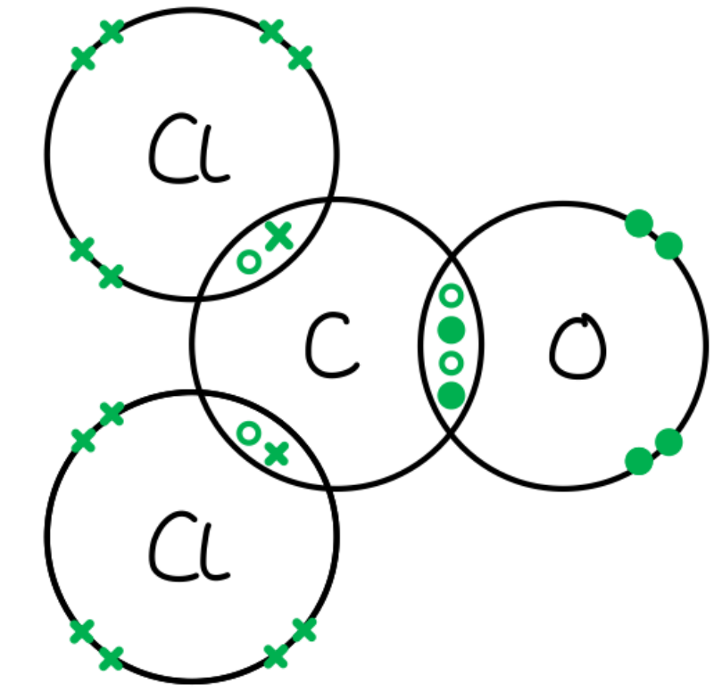

- Each chlorine has one bonding pair and 3 non-bonding pairs of electrons; **[1 mark]**
- 4 electrons shared between the carbon atom and the oxygen atom; **[1 mark]**
- 2 non-bonding pairs of electrons on the oxygen atom; **[1 mark]**

**[Total: 3 marks]**

- *When you are given a displayed formulae to work with, you can use the bonds shown to see where some of the electrons are*

  - *There are 2 electrons between each carbon and chlorine atoms as they have single bonds*
  - *There are 4 electrons between the carbon and oxygen atom as it is a double bond*
  - *Then you just have to add pairs of electrons so that the chlorine and oxygen atoms have their share of 8 electrons*

### Q15
a) One use of ammonia is:

- Making fertiliser; **[1 mark]**

**[Total: 1 mark]**

- *You should be aware that ammonium salts, containing ammonium, are used in fertilisers*
- *Some other uses of ammonia include*

  - *nitric acid / nylon / explosives / urea (for) cleaning products (allow oven cleaner) / refrigeration*
b) ** T**he meaning of the symbol $\rightleftharpoons$ is:

- Equilibrium / (a) reversible (reaction); **[1 mark]**

**[Total: 1 mark]**
c) The sources of nitrogen and hydrogen used in the Haber process are:

nitrogen

- Air / atmosphere; **[1 mark]**

hydrogen

- Methane / water / steam / alkane / named alkane / hydrocarbon / crude oil **OR **Petroleum / natural gas; **[1 mark]**

**[Total: 2 marks]**
d) The catalyst used in the Haber process is:

- Iron; **[1 mark]**

**[Total: 1 mark]**
e)

i) If a temperature higher than 450 °C was used in the Haber process, the rate of reaction would:

- Increase / (be) faster; **[1 mark]**
- (Because there are) more (effective) frequent collisions; **[1 mark]**

ii) If a temperature higher than 450 °C was used in the Haber process, the yield of ammonia would:

- Decrease; **[1 mark]**
- (Because the forward reaction is ) exothermic / reverse reaction endothermic / high temp favours endothermic reaction; **[1 mark]**

**[Total: 4 marks]**

- *Make sure to read equilibria questions carefully to check whether you are being asked about the effect on **yield** or **rate*
f)

i) If a pressure higher than 200 atmospheres was used in the Haber process, the yield of ammonia will:

- Increase; **[1 mark]**
- (Because there are) less / fewer molecules or moles or volume on right-hand side

**   OR**

(Because) high-pressure favours reaction which produces fewer molecules or moles or volume; **[1 mark]**

ii) The rate of reaction would be faster if the pressure was greater than 200 atmospheres because:

- Particles / molecules closer / more particles per unit area or volume / more molecules per unit area or volume / more concentration / particles have less space between them

**   AND**

more frequent collisions; **[1 mark]**

iii) A pressure higher than 200 atmospheres is not used in the Haber process due to:

- Safety issues / higher cost; **[1 mark]**

**[Total: 4 marks]**

- *When talking about why rate increases it is important to always include the fact that there are more frequent collisions and not just that particles move faster*
a) A dot-and-cross diagram to show the arrangement of the outer (valency) electrons in one molecule of ammonia:

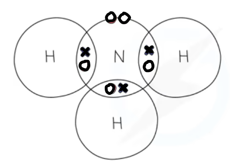

- 3 bond pairs between N & H; **[1 mark]**
- 1 lone pair on N;** [1 mark]**

**[Total: 2 marks]**

- *Nitrogen is in Group V so has 5 outer shell (valence) electrons*

  - *The nitrogen atom needs 3 electrons to complete its outer shell*
- *Each hydrogen has 1 electron*

  - *The hydrogen atoms need 1 electron to complete their outer shell as it is the first shell*
h)

i) A base is:

- A proton / H+ acceptor; **[1 mark]**

ii) A balanced equation for the reaction between ammonia and sulfuric acid:

2NH3 + H2SO4 → (NH4)2SO4

- Correct formula of (NH4)2SO4; **[1 mark]**
- The rest of the equation is correct; **[1 mark]**

**[Total: 3 marks]**

- *We are told in the question ammonia is a base*
- *As it is reacting with sulfuric acid, this a neutralisation reaction*
- *No water is formed in this reaction as the two hydrogens from the sulfuric acid are accepted by the two ammonia molecules forming NH**4**+*
- *The sulfate ion is SO**4**2-** *
- *So two ammonium, NH**4**+**, are needed for every 1 sulfate ion to balance the charge*

### Q16
a)

i) The term equilibrium mixture is where:

- The rate of the forward reaction = the rate of the backward reaction; **[1 mark]**
- The concentration of reactants and products remains constant 
**OR **
The macroscopic properties do not change / constant (with time); **[1 mark]**

ii) The colour of the gas inside the syringe change would:

- Go darker / brown; **[1 mark]**

Explanation:

- Low pressure favours the side with more moles; **[1 mark]**
- Which is the NO2 side / left hand side / reactants; **[1 mark]**

iii) The forward reaction is:

- Exothermic; **[1 mark]**

Explanation:

- Low temperatures favour the exothermic reaction 
**OR **
Low temperatures moves the equilibrium to the N2O4 side / right hand side / products; **[1 mark]**

iv) The other piece of information given in the equation that supports the answer to (iii) is:

- The forward reaction is bond forming; **[1 mark]**

**[Total: 7 marks]**

- *The term equilibrium mixture (sometimes seen as dynamic equilibrium) is usually a 2 mark definition *

  - *1 mark for the idea of the rates being equal*
  - *1 mark for the idea that the concentrations of reactants and products remain constant*
  
    - *Careful: **The concentrations of reactants and products are **not** equal*
- *Parts (ii) and (iii) all require you to apply your knowledge of Le Chatelier’s Principle*

  - *Decreasing the pressure favours the side with fewer moles*
  
    - *From the first chemical equation, this is the reactants as there are 2 moles of reactant but only one mole of product*
    - *This means that the equilibrium will shift to the left producing more NO**2** *
    - *As a result of this, the reaction mixture will go darker / brown*
  - *Increasing temperature favours the endothermic reaction*
  
    - *Using ice cold water is implying that the temperature is decreasing*
    - *The colour of the reaction mixture changes from brown to pale yellow which is the colour change for the forward reaction*
    - *Therefore, the forward reaction is exothermic*
- *Exothermic reactions release energy that comes from the bond forming involved*

  - *Using the equation in part (iv), there are no bonds being broken and one bond being formed*
  - *This means that the reaction must be exothermic*

### Q17
a) The term *equilibrium* means:

- The rate of the forward reaction equals the rate of the backwards / reverse reaction; **[1 mark]**
- Concentrations do not change / macroscopic properties remain constant (with time); **[1 mark]** 
*Accept: amounts*

**[Total: 2 marks]**

- *Definitions are easy marks to pick up in exams - if you have taken the time to learnt them!*
- *Careful**: Do not say that the reaction has stopped*

  - *Whilst it may look like it has, equilibrium is said to be dynamic as reactants are still forming products and vice versa, so reactions are still occurring*
  - *However, the amount of reactant / product remains constant as the reactions are happening at the same rate*
b)

i) The first graph shows:

- **Effect on percentage of products**: increase; **[1 mark]**
- **Reaction**: reaction 2; **[1 mark]**
- **Reason**: the volume of the reactants is greater than the volume of the products / Vr > Vp; **[1 mark]**

ii) The second graph shows:

- **Effect on percentage of products**: same; **[1 mark]**
- **Reaction**: reaction 1; **[1 mark]**
- **Reason**: the volume of the reactants is the same as the volume of the products / Vr = Vp; **[1 mark]**

iii) The third graph shows:

- **Effect on percentage of products**: decrease; **[1 mark]**
- **Reaction**: reaction 3; **[1 mark]**
- **Reason**: the volume of the reactants is less than the volume of the products / Vr < Vp; **[1 mark]**

**[Total: 9 marks]**

- *In gaseous equilibrium reactions, when pressure is altered, the equilibrium will shift to oppose the change*
- *If pressure increases, the equilibrium will favour the reaction which produces the fewest number of molecules as this will reduce the pressure to oppose the change*
- *To find out the side with the fewest number of molecules, compare the sum of the balancing numbers of reactants with the sum of the balancing numbers of products*
- *Reaction 1 has the same number either side, so changing the pressure will have no effect on the position of equilibrium *
- *Reaction 2 has 4 molecules on the left hand side of the equation and 2 molecules on the right hand side so will favour the forward reaction when the pressure is increased, increasing the percentage of products*
- *Reaction 3 has 2 molecules on the LHS and 3 molecules on the RHS so will favour the reverse reaction when the pressure is increased, decreasing the percentage of reactants*

### Q18
a)

i) How the concentration of each chemical changes:

- Concentration of reactants increases 
**OR **
Concentration of carbon monoxide 
**AND** 
chlorine increases; **[1 mark]**
- Concentration of product decreases 
**OR **
Concentration of carbonyl chloride decreases; **[1 mark]**

ii) The position of equilibrium moves to the left because a decrease in pressure:

- Favours the side with more moles / molecules / greater volume of gas; **[1 mark]**
- There are 2 moles / molecules of reactant 
**AND **
There is 1 mole / molecule of product; **[1 mark]**

**[Total: 4 marks]**

- *Remember: **Increasing pressure favours the side with the fewest moles / molecules*
- *Careful: **This question talks about decreasing pressure, so it will favour the side with more moles / molecules*

  - *It is not enough to write about favouring the side with more or less molecules*
  - *You have to tell the examiner which side this is to show that you understand the application of le Chatelier's principle to the given reaction*
b) The forward reaction is:

- Exothermic; **[1 mark]**
- (Because,) it is favoured by low temperatures / cool(er) conditions; **[1 mark]**

**[Total: 2 marks]**

- *Take your time with temperature-based equilibria questions because they are classically the questions that are answered the most incorrectly*
c) The acidic compounds which are formed are:

- Hydrogen chloride / hydrochloric acid / HCl; **[1 mark]**
- Carbon dioxide / CO2 / carbonic acid / hydrogen carbonate; **[1 mark]**

**[Total: 2 marks]**

- *A lot of unknown chemistry equations can be solved if you look for common chemicals that you are aware of, e.g. COCl**2** + H**2**O → CO**2** + HCl*
- *The hydrogen chloride / hydrochloric acid product is obviously acidic*
- *Carbon dioxide can dissolve into water to form carbonic acid*
d) A diagram showing the arrangement of the outer (valency) electrons in one molecule of this carbonyl chloride

- 8 electrons around both chlorine atoms; **[1 mark]**
- 4 electrons between carbon and oxygen atoms; **[1 mark]**
- 8 electrons around carbon atom; **[1 mark]**
- 8 electrons around oxygen; **[1 mark]**

**[Total: 4 marks]**

- *Start by thinking about how many outer electrons each atom has*

  - *carbon is in Group IV so has 4*
  - *oxygen is in Group VI so has 6*
  - *chlorine is in Group VII so has 7*
- *From the diagram you can see the carbon-chlorine bonds are single bonds whilst the carbon-oxygen bond is a double bond*
- *Draw the electrons in these bonds*
- *Then you can add in the other electrons on each atom in non-bonding pairs*
- *Check your answer by making sure each atom has a full outer shell *

### Q19
a)

i) Carbon monoxide could be formed instead of carbon dioxide because:

- Incomplete combustion occurs 
**OR** 
There is limited / not enough / less oxygen;** [1 mark]**

ii) A high temperature is used because:

Any **two** from:

- The forward reaction is endothermic; ** [1 mark]**
- High temperature increases yield 
**OR** 
The forward reaction is favoured ** ** 
**OR** 
The equilibrium shifts to the right; ** [1 mark]**
- The rate of reaction is faster; ** [1 mark]**

iii) A disadvantage of using high pressure is:

Any **two** from:

- High pressure reduced yield 
**OR** 
LHS is favoured; ** [1 mark]**
- Because LHS has fewer number of moles / molecules; ** [1 mark]**
- (High pressure) is expensive / dangerous / risk of explosions; ** [1 mark]**

**[Total: 5 marks]**

- *According to Le Chatelier's principle, when a change is made to a system, the system will oppose the change*
- *For example, in this case, when the temperature is increased, the system will favour the endothermic reaction (in this case the forward reaction) to decrease the temperature *
- *Aside from yield, the rate of reaction must also be considered when determining the temperature at which to carry out a reaction, too low and the rate of reaction will be slow*
- *For gaseous reactions, the safety considerations of pressure also need to be taken into account*
- *Usually, conditions for reactions are a compromise *
b) The electrolysis of concentrated aqueous sodium chloride involves:

- Hydrogen and chlorine / H2 and Cl2; **[1 mark]**
- Sodium hydroxide / NaOH / Na+ OH– ; **[1 mark]**
- 2H+ + 2e -→ H2  
**OR**
 2H+ → H2 – 2e– ; **[1 mark]**
- 2Cl–  →   Cl2 + 2e– 
**OR** 
2Cl– – 2e– → Cl2; **[1 mark]**
- Hydrogen / H2 / H / H+ at cathode 
**AND** 
Chlorine / chloride / Cl2 / Cl / Cl– at anode; **[1 mark]**

**[Total: 5 marks]**

- *When the electrolysis of a solution happens, you have to consider the ions found in the solution: OH**-** and H**+ **and how easily they are discharged compared to the other ions *
- *In concentrated aqueous sodium chloride solution you have the following ions:*

  - *Na**+**, Cl**-**, H**+**, and OH**-*
  - *H**+** will be discharged at the cathode as it is less reactive than Na**+** *
  - *Halide ions are more readily discharged than hydroxide ions so Cl**-** will be discharged at the anode*
  - *The Na**+** and OH**-** remain in solution and react to form sodium hydroxide** *
c) The completed diagram is:

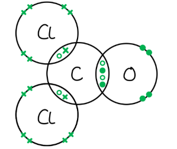

- Each chlorine 1 bonded pair and 3 non-bonded pair; **[1 mark]**
- Oxygen atom 2 non-bonded pairs and 2 bonded pairs as double bond; **[1 mark]**
- Carbon atom 4 bonded pairs including 2 bonded pairs as double bond; **[1 mark]**

**[Total: 3 marks]**

- *Valence electrons are outer shell electrons*
- *This term is not used in the new specification however you could still be asked to draw a dot and cross diagram for compounds such as the one above *
- *Remember:** If a double bond is present then four electrons are being shared between the two atoms *
- *Each atom should end up with a full outer shell of electrons, this being 8 for all atoms except hydrogen*

### Q20
a) Sulfur and its compounds are removed from these fuels before they are burned because:

- They burn to form sulfur dioxide;** [1 mark]**
- Acid rain / any problem associated with acid rain / sulfur dioxide is poisonous;** [1 mark]**

**[Total: 2 marks]**

- *Sulfur dioxide reacts with water in the atmosphere to form sulfuric acid, causing acid rain*
- *Flue gas desulfurisation can also be used to remove SO**2** from exhaust gases emitted when fuels containing sulfur are burnt*
b) Sulfur dioxide is changed into sulfur trioxide using the following conditions and equation:

- 2SO2 + O2 → 2SO3; **[1 mark]**
- Temperature: 400 to 450 oC; **[1 mark]**
- Pressure: 1 to 10 atmospheres; **[1 mark]**
- Catalyst: vanadium(V) oxide / vanadium oxide / vanadium pentoxide; **[1 mark]**

**[Total: 4 marks]**

- *This question is straightforward and relies on you having a good recall of facts*

### Q21
a)

i) The catalyst for this reaction is:

- Iron;** [1 mark]**

ii)  The advantage of using a lower temperature is:

- Higher yield is obtained; **[1 mark]**
- Lower temperatures favour the exothermic reaction (which is the forward reaction); ** [1 mark]**

**[Total: 3 marks]**

- *Remember:** According to Le Chatelier's principle, any change made to the system will cause the system to shift the position of the equilibrium to oppose the change*
- *Low temperatures will cause the system to oppose the change and increase the temperature by favouring the exothermic reaction, in this case the forward reaction *
- *However, at low temperatures the rate of reaction is slow due to the decreased frequency of successful collisions between particles *
b)

i)  The gases recycled are:

- Used to make more ammonia 
**OR** 
Sent over the catalyst again; **[1 mark]**

ii) Only ammonia gas liquefies because:

- It has the highest boiling point; **[1 mark]**

**[Total: 2 marks]**

- *Unreacted hydrogen and nitrogen are continuously fed back into the reactor and used again *
- *The temperature that the mixture is cooled to is higher than the boiling points of the nitrogen and hydrogen but lower than the boiling point of ammonia so ammonia will turn into a liquid but the other gases will not*

### Q22
a)

i)  the electron structure of an atom of nitrogen is:

- 2, 5; **[1 mark]**

ii) The formula of ammonia is NH3, not NH4 because:

- Nitrogen needs three electrons; **[1 mark]**
- To complete the energy level; **[1 mark]**

**[Total: 3 marks]**

- *Nitrogen has an atomic number of 7 so has 7 electrons in total*
- *A maximum of 2 electrons can fit in the first shell and a maximum of 8 in the second*
- *The electronic configuration is therefore 2, 5, using up the 7 electrons*
- *This means that 3 more electrons are required to fill the second shell to make it a full valence shell of 8*
- *The three hydrogen atoms will share one electron each with nitrogen as follows:* 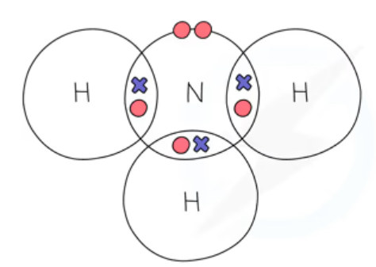
b)

i) A reason why the catalyst was changed to iron is:

- Iron is cheaper; 
**OR** 
It is a better catalyst; **[1 mark]**

ii) The highest pressure gives the highest percentage of ammonia in the equilibrium mixture. because:

- High pressure favours the side with smaller volume / fewer moles; **[1 mark]**
- This is right-hand side / the product side / ammonia side; **[1 mark]**

iii) The unreacted nitrogen and hydrogen are:

- Recycled / sent over catalyst again; **[1 mark]**

*Accept 'used again'*

iv) One advantage and one disadvantage of using a lower temperature is:

- Advantage - high yield; **[1 mark]**
- Disadvantage - slow reaction rate; **[1 mark]**

**[Total: 6 marks]**

- *Part i) is a 'suggest' question so you may not have covered this question specifically but should be able to come up with a sensible reason *
- *Remember: according to Le Chatelier's principle, the change made to the system will cause the system to shift the equilibrium to oppose the change*
- *So higher pressures will cause the system to try and decrease the pressure by favouring the reaction that produces few molecules of gas, in this case, the forward reaction *
- *The equilibrium shifts to the right producing more product/ ammonia *
- *Similarly, low temperatures will cause the system to oppose the change and increase the temperature by favouring the exothermic reaction, in this case, the forward reaction *
- *At low temperatures the rate of reaction is slow due to the decreased frequency of successful collisions between particles, so a compromise between yield and rate is often made*
- *As the unreacted gases in the Haber process are recycled, there is no loss of unreacted reactants so the % yield is less of an important factor than it otherwise would be, and a good rate to maintain a high daily yield is more important for profits*

### Q23
a)

i) Nitrogen is obtained by:

- Fractional distillation; **[1 mark]**
- Of air; **[1 mark]**

ii) Hydrogen is obtained for the Haber process by:

Alternative 1:

- Reacting an <u>alkane</u>; **[1 mark]** 
*Accept named alkanes*
- With <u>water / steam</u>; **[1 mark]**
- <u>Heat</u> / add a <u>catalyst</u>; **[1 mark]**

Alternative 2:

- Performing <u>electrolysis</u>; **[1 mark]**
- On <u>water</u>; **[1 mark] **
*Other suitable electrolytes are acceptable*
- To produce hydrogen at the cathode; **[1 mark]**

Alternative 3:

- Cracking; **[1 mark]**
- Reacting an <u>alkane</u>; **[1 mark]** 
*Accept named alkanes*
- <u>Heat</u> / add a <u>catalyst</u>; **[1 mark]**

**[Total: 5 marks]**

- *The most common methods to produce hydrogen are thermal cracking, steam cracking and electrolysis*
b)

i)  The pair of graphs which shows correctly how the percentage of ammonia at equilibrium varies with temperature and pressure is:

- C; **[1 mark]**

ii) This is correct because:

- High pressure favours side with lower volume / fewer moles; **[1 mark]**
- This is RHS / product / ammonia; **[1 mark]**
- %NH3 / yield increases as pressure increases; **[1 mark]**
- The forward reaction is exothermic; **[1 mark]**
- Exothermic reactions favoured by low temperatures; **[1 mark]**
- % NH3 / yield decreases as temperature increases; **[1 mark]**

iii) A catalyst is used in this process because:

- It increases the rate of reaction; **[1 mark]**
- By reducing the activation energy  
**OR** 
Decreases the amount of energy the particles need to react  
**OR** 
Economic rate at lower temperature so higher yield; **[1 mark]**

**Final answer:** **[Total:  9 marks]**

- *Part a) gives you the symbol equation for the Haber process and tells you the forward reaction is exothermic *
- *The equation is:  N**2** (g)   +   3H**2** (g)    *$\rightleftharpoons$*       *`equation`*2NH**3** (g)*
- *Remember**: According to Le Chatelier's principle whatever change in conditions is made to the system, the system will move the position of equilibrium to oppose the change *
- *Increasing temperature will cause the system to favour the endothermic reaction, in this case the reverse reaction, and shift the equilibrium to the left*

  - *The yield of ammonia would therefore decrease as temperature increases as shown on the first graph in pai C*
- *The equation shows that the forward reaction produces 2 molecules of gas, and the reverse 4 molecules *
- *Increasing pressure will cause the system to favour the forward reaction as it produces fewer molecules *

  - *The yield of ammonia would therefore increase as pressure increases as shown on the second graph in pair *

### Q24
a)  The reaction conditions and a chemical equation for step 2 are:

- Vanadium pentoxide / vanadium(V) oxide / V2O5 (catalyst); **[1 mark] ***Allow vanadium oxide but if oxidation number is given, it must be (V)*
- 1–5 atmospheres (units required); **[1 mark] **
*Allow 100 - 500 kPa*
- 450°C (units required); **[1 mark]**
- 2SO2 + O2 → 2SO3; **[1 mark]**
- Equilibrium / reversible reaction; **[1 mark]** 
*2SO**2** + O**2** *$\rightleftharpoons$*2SO**3 **scores final 2 marks*

**[Total: 5 marks]**

- *This question shows how important it is to learn the conditions of key processes, these are 5 easy marks to gain if you know them!*
b)

i) Three observations the student would make are:

- Bubbles / effervescence/ fizzing;
- Dissolves / disappears / forms a solution;
- Blue (solution);
- 3 correct; **[2 marks]**
- 2 correct; **[1 mark]**

ii) The names of all products formed are:

- Carbon dioxide 
**AND **
Water 
**AND **
Copper(II) sulfate; **[1 mark]**

**[Total: 3 marks]**

- *When giving observations from a reaction, it is useful to think about the states of the reactants and product*
- *A solid reactant (e.g. copper(II) carbonate) will disappear during the course of a reaction as it gets used up*
- *A gaseous product (e.g. carbon dioxide) will produce bubbles*
- *Any aqueous solutions may be coloured (e.g. copper(II) sulfate is a blue solution)*
- *The general equation when a metal carbonate reacts with an acid is:*

  - *metal carbonate + acid → salt + carbon dioxide + water*
- *The salt takes the first part of its name from the metal of the metal carbonate (copper) and the second part from the acid used (sulfuric acid produces sulfate salts)*

### Q25
a) Hydrogen is obtained for the modern process by:

Alternative 1:

- Reacting an <u>alkane / methane</u>; **[1 mark]** 
*Accept named alkanes*
- With <u>water / steam</u>; **[1 mark]**

Alternative 2:

- Performing <u>electrolysis</u>; **[1 mark]**
- On <u>water</u>; **[1 mark] ***O*
*ther suitable electrolytes are acceptable*

Alternative 3:

- Cracking; **[1 mark]**
- Reacting an <u>alkane</u>; **[1 mark]** 
*Accept named alkanes*

**[Total: 2 marks]**

- *The most common methods to produce hydrogen are thermal cracking, steam cracking and electrolysis*
b)

i) The catalyst used in the modern process is:

- Iron; **[1 mark]**

ii) The modern process, which uses a lower temperature, has a higher yield of 15% because:

- Lower temperature moves equilibrium to right; **[1 mark]**
- Because forward reaction is exothermic; **[1 mark]**

**Final answer:** **[Total:3 marks]**

- *Remember:** According to Le Chateliers principle, the change made to the system will cause the system to shift the equilibrium to oppose the change*
- *Low temperatures will cause the system to oppose the change and increase the temperature by favouring the exothermic  reaction, in this case the forward reaction*
- *The equilibrium would shift to the right increasing the percentage of ammonia*
- *However, at lower temperatures the rate of reaction is slower *
c)

i) The completed table is:

| **Bonds** | **Energy Change** | **Exothermic or Endothermic?** |
|---|---|---|
| 1 mole of N$\equiv$N broken | +945 | Endothermic; **[1 mark]** |
| 3 moles of H-H; **[1 mark]** broken | +1308 | Endothermic; **[1 mark]** |
| 6 moles of N – H formed | -2328 | Exothermic; **[1 mark]** |

ii) The forward reaction is exothermic because:

Alternative 1

- More heat is given out than taken in; **[1 mark]**
- –2328 -( 945 + 1308) = –75 (kJ); **[1 mark]**

Alternative 2:

- More heat is given out when bonds form than is taken in to break the bonds; **[2 marks] **
*Must mention bond breaking and forming*

**[Total: 6 marks]**

- *Energy is taken in to break bonds so bond breaking is endothermic*
- *Energy is released when new bonds are formed so forming bonds is exothermic *
- *Be very careful with your answer, a common mistake is to write 'More heat is used to form bonds than to break bonds'*

  - *You must say that the heat is **released/given out** when new bonds are formed, not that it is used to form bonds*
- *To calculate the overall energy change for the reaction: Energy to break bonds- Energy released when bonds are made*

### Q26
a)

i) The yield of nitric oxide in **equilibrium 1** increases with temperature because:

- The (forward) reaction is <u>endothermic</u>; **[1 mark]**

ii) Increasing the pressure will cause the percentage of nitric oxide in **equilibrium 1** to:

- Not change / have no effect; **[1 mark]**
- (Because,) the volume / number of moles / number of molecules of reactants and products are the same; **[1 mark]**

iii) **Equilibrium 2 **is only carried out at lower temperatures because:

- The reaction is <u>exothermic</u>; **[1 mark]**
- High temperatures push the equilibrium to the left / reactants 
**OR **
High temperatures decrease the yield of the products 
**OR **
Low temperatures favour the forward reaction / products; **[1 mark]**

iv) The equation for the reaction between nitrogen dioxide, water and oxygen to form nitric acid is:

4NO2 + O2 + 2H2O → 4HNO3

- H2O identified as the missing reactant; **[1 mark]**
- Correct balancing of the equation; **[1 mark]**

v) The ammonia-based process is preferred to the electric arc process because:

- A high / large amount of electricity / energy is used;** [1 mark] ***References to cost are ignored*

**[Total: 8 marks]**

- *Remember: **Increasing temperature favours the endothermic reaction and increasing pressure favours the side with fewest moles*

  - *For **equilibrium 1*
  
    - *Using a higher temperature (3000 **o**C) suggests that the forward reaction is endothermic*
    - *There are 2 moles of reactant and 2 moles of product, therefore changing the pressure will have no effect on the equilibrium*
  - *For **equilibrium 2*
  
    - *Using a lower temperature (cooled rapidly) suggests that the forward reaction is exothermic*
    - *There are 3 moles of reactant and 2 moles of product, therefore an increase in pressure will favour the forward reaction, increasing the yield of nitrogen dioxide*
- *To balance the equation*

  - *You are told that the reactants are nitrogen dioxide, water and oxygen, which gives the unbalanced equation NO**2** + O**2** + H**2**O → HNO**3** *
  - *One mole of water would form 2 moles of nitric acid and require 2 moles of nitrogen dioxide, i.e. 2NO**2** + O**2** + 2H**2**O → 2HNO**3*
  
    - *This has 6 atoms of oxygen on the product side and 7 atoms of oxygen and is unbalanced*
  - *Two moles of water would form 4 moles of nitric acid and require 4 moles of nitrogen dioxide, i.e. 4NO**2** + O**2** + 2H**2**O → 4HNO**3*
  
    - * This has 12 atoms of oxygen on the product side and 12 atoms of oxygen and is therefore balanced*
- *Part (v) mentions expense and the use of electricity*

  - *You are warned that the ammonia-based process is expensive due to the use of ammonia*
  - *The only reason to use the ammonia-based process would be if it was less expensive than the electric arc process*
  - *Therefore, you can assume that there must be a large amount of electricity / energy used in the electric arc process which will have a high associated cost*
b)

i) The fertiliser ammonium nitrate, NH4NO3, has the following advantage over ammonium sulfate, (NH4)2SO4:

- It contains more nitrogen per unit volume / per mole 
**OR **
It has a greater percentage by mass (of nitrogen); **[1 mark]**

ii) Chlorophyll is essential for plant growth because:

- It is used in <u>photosynthesis</u>; **[1 mark]**
- It is a catalyst / it absorbs light energy; **[1 mark]**
- (It helps) carbon dioxide and water to react; **[1 mark]**
- To make glucose / carbohydrates / starch / sugar / named sugar; **[1 mark]**

**[Total: 5 marks]**

- *Remember: **Fertilisers are used for three main elements - nitrogen, phosphorous and potassium*

  - *Both fertilisers only contain nitrogen*
  - *Therefore the question is about the amount of nitrogen*
  
    - *Ammonium nitrate has a lower molecular mass then ammonium sulfate*
    - *They contain the same mass / amount of nitrogen (2 atoms)*
    - *This means that ammonium nitrate contains more nitrogen per unit volume / per mole and will therefore have a higher percentage by mass of nitrogen*
- *Part (ii) requires you to have a good understanding of the photosynthesis reaction and the chemicals involved*

### Q27
a) The volume of air that contains 1 dm3 of oxygen is:

- 4.76 (dm3); **[1 mark]**

**[Total: 1 mark]**

- *21% of air is oxygen*
- *The volume of air containing 1 dm**3** of oxygen can be calculated by:*

  - $\frac{1}{21}\times100=4.76\mathrm{dm}^{3}$
b) The advantage of using an excess of air is:

- It moves equilibrium to right; **[1 mark]**
- It increases the yield (of sulfur trioxide) / uses up more sulfur dioxide; **[1 mark]**

**[Total: 2 marks]**

- *According to Le Chatelier's Principle, the equilibrium will shift to reduce the excess oxygen by favouring the reaction that will reduce the amount of oxygen*
- *The forward reaction is therefore favoured which reduces the amount of oxygen and increases the yield of SO**3*
c)

i) The effect on the position of equilibrium of using a temperature above 450 °C is:

- It moves equilibrium to left; **[1 mark]**
- (Because the forward reaction is) exothermic; **[1 mark]**

ii) The effect on the rate of using a temperature below 400 °C is:

- It decreases the rate; **[1 mark]**
- (Because) molecules have less energy / move slower; **[1 mark]**
- There are fewer collisions per second / per unit time / less frequent collisions **OR** Fewer particles / collisions have the activation energy; **[1 mark]**

**[Total: 5 marks]**

- *Increasing the temperature favours the endothermic reaction*
- *Decreasing the temperature favours the exothermic reaction*
- *In this case, as the forward reaction is exothermic, when the temperature is higher, the backwards (endothermic) reaction is favoured, equilibrium shifts to the left and the yield of SO**3** decreases*
- *When explaining the rate of reaction, remember that just saying 'fewer collisions' is not sufficient to gain a mark, you must qualify this with some indication of a time frame, i.e. fewer collisions per second or unit time*
d)

i) The effect on the position of equilibrium of using a higher pressure is:

- It moves to the right; **[1 mark]**

ii) A higher pressure is not used because:

- It gives a high yield at 2 atm; **[1 mark]**

**[Total: 2 marks]**

- *The equilibrium will shift to the right at higher pressures because, according to Le Chatalier's Principle, the equilibrium will move to the side with fewer molecules (the right-hand side) in order to reduce the pressure*
- *At equilibrium at 2 atmospheres, 98% of the mixture is SO**3** so the yield is very high at this pressure already without the need to increase it which would be more costly*
e) The catalyst used in the Contact process is:

- Vanadium(V) oxide/ vanadium pentoxide; **[1 mark]**

**[Total: 1 mark]**

- *The Roman numeral is important as vanadium can form ions with different charges and therefore form oxides with different formulae*
- *The Roman numeral shows that it is the V**5+** ion and therefore the formula of the oxide is V**2**O**5*

### Q28
a) One major use of ammonia is:

Any **one **of the following:

- Fertilisers; **[1 mark]**
- Nitric acid; **[1 mark]**
- Nylon; **[1 mark]**
- Refrigeration;** [1 mark]**
- Explosives; **[1 mark]**
- Cleaning products;** [1 mark]**

**[Total: 1 mark]**

- *The uses of ammonia are not clearly specified in the syllabus*

  - *Theoretically, they should not be asked about*
- *But, the syllabus does not clearly specify that you do not need to know them*

  - *Therefore, it could be good to know at least one use of ammonia just in case it is an introductory sub-question to a larger question*
  - *Your knowledge of fertilisers from a later topic should help you to remember that ammonia is used to make fertilisers, such as ammonium phosphate*
b) Hydrogen is obtained for the Haber process by:

Alternative 1:

- Reacting an <u>alkane</u>; **[1 mark]** 
*Accept named alkanes*
- With <u>water / steam</u>; **[1 mark]**
- <u>Heat</u> / add a <u>catalyst</u>; **[1 mark]**

Alternative 2:

- Performing <u>electrolysis</u>; **[1 mark]**
- On <u>water</u>; **[1 mark] **
*Other suitable electrolytes are acceptable*
- To produce hydrogen at the cathode; **[1 mark]**

Alternative 3:

- Cracking; **[1 mark]**
- Reacting an <u>alkane</u>; **[1 mark]** 
*Accept named alkanes*
- <u>Heat</u> / add a <u>catalyst</u>; **[1 mark]**

**[Total: 3 marks]**

- *The most common methods to produce hydrogen are thermal cracking, steam cracking and electrolysis*
c) The advantages of using a high pressure are:

Advantage 1:

- Faster (rate); **[1 mark]**

Reason 1:

- Molecules closer together / more particles per unit volume; **[1 mark]**
- More frequent (successful) collisions 
**OR **
More collisions with *E*a per unit time; **[1 mark]**

Advantage 2:

- Higher yield / more ammonia produced; **[1 mark]**

Reason 2:

- Equilibrium moves to the products side / right-hand side; **[1 mark]**
- (Because,) there are less moles / molecules / volume on the products / right-hand side; **[1 mark] ***Reverse argument about more moles / molecules / volume on the reactants / left-hand side is accepted*

Advantage 3:

- High pressure means lower temperature can be used to achieve comparable rate (thus saving energy); **[1 mark]**

**[Total: 5 marks]**

- *The effects of changing the pressure on the Haber process include:*

  - *Increasing the pressure will increase the rate of reaction because:*
  
    - *There are more particles per unit volume which leads to more **frequent **collisions and more **successful** collisions*
  - *Increasing the pressure will increase the yield because:*
  
    - *Higher pressure favours the side of the reaction with the fewest moles*
    - *There are 4 moles of reactant and 2 moles of product, therefore the reaction will shift to the right-hand side / products*
d)

i) The difference between an endothermic and an exothermic reaction is:

- Endothermic reactions take in / absorb / use / need / gain (heat) energy 
**AND **
Exothermic reactions give out / lose (heat) energy; **[1 mark]**

ii) The forward reaction is exothermic because:

| **bond** | **bond energy kJ / mol** | **energy change kJ** | **exothermic ** **or endothermic** |
|---|---|---|---|
| N$\equiv$N | 944 | +944 | endothermic |
| H–H | 436 | 3 x 436 = +1308 | **endothermic** |
| N–H | 388 | **6 x 388 = (-)2328** | **exothermic** |

- H-H identified as endothermic 
**AND **
N-H identified as exothermic; **[1 mark]**
- N-H energy change = 6 x 388 
**OR **
(-)2328 
**AND **
Indication of calculating energy in / bonds broken, i.e. 944 + 1308 
**OR **
2252; **[1 mark]**
- 2252 - 2328 = -76 (kJ) 
**OR **
(Total) Energy in / bonds broken is less than the (total) energy out / bonds formed 
**OR **
The (total) energy of the reactants / right-hand side is less than the (total) energy of the products / left-hand side 
**OR **
2252 < 2328; **[1 mark]** *Accept reverse arguments*

**[Total: 3 marks]**

- *Remember: **To prove that the reaction is exothermic, you need to calculate the total energy change using  energy change = energy in - energy out*

### Q29
a)

i) The completed word equation is:

- Calcium carbonate + sulfuric acid → calcium sulfate + **carbon dioxide** +** water**; **[1 mark] **
*Both carbon dioxide and water are required for the mark*

ii) You could test the water entering the cave to show that it contained sulfate ions by:

- Test: (acidified) barium chloride / barium nitrate / barium ions;** [1 mark]** 
*Lead(II) compounds are not accepted*
- Result: White precipitate; **[1 mark]**

iii) You could show that the water entering the cave has a high concentration of hydrogen ions by:

- (Testing the pH and it will have) a low pH 
**OR **
Adding universal indicator which will turn red; **[1 mark]**

**[Total: 4 marks]**

- *Remember: **Metal carbonate + acid → metal salt + carbon dioxide + water*
- *The most common test for the sulfate ion is to add acidified barium chloride solution and observe a white precipitate of insoluble barium sulfate form*
- *A high concentration of hydrogen ions means that the water will be acidic*

  - *This can easily be tested by using a pH meter or universal indicator*
b)

i) The completed equation for the reaction forming sulfuric acid is:

H2S + **2**O2 → **H****2****SO****4**** **

- H2SO4 correctly identified as the product;** [1 mark]**
- Correct balancing of the equation; **[1 mark] **

ii) All of the hydrogen sulfide should be removed from the petroleum before it is used as a fuel because it:

- Has an unpleasant smell 
**OR **
Is poisonous 
**OR **
Forms acid rain when burned / combusted 
**OR **
Forms sulfur dioxide / sulfuric acid; **[1 mark]**

iii) The diagram to show the arrangement of the valency electrons in one molecule of the covalent compound hydrogen sulfide is:

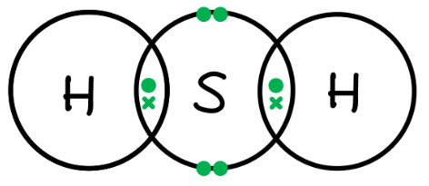

- Marking point: 2 hydrogen and 1 sulfur
- Marking point: 8 electrons around the sulfur atom
- Marking point: 2 electrons per hydrogen atom
- All three marking points correct;** [2 marks]**
- Two marking points correct; **[1 mark]** *Ionic structure gain no marks*

**[Total: 5 marks]**

- *For part (i), you are told that the reaction forms sulfuric acid*

  - *Adding sulfuric acid as a product leaves you with an equation that needs balancing for oxygen*
  
    - *H**2**S + ..........O**2** → H**2**SO**4** *
  - *Four oxygens on the product's side and only 2 on the reactant's side, which means that you need to double the O**2** *
  
    - *H**2**S + 2O**2** → H**2**SO**4** *
- *Part (ii) is reliant on you knowing that a major source of sulfur dioxide is the combustion of fossil fuels that contain sulfur compounds which is a problem as sulfur dioxide causes acid rain*

  - *Alternatively, you may be aware that hydrogen sulfide is the rotten egg smell*
- *For part (iii), you have two non-metal elements involved in the compound which means that it will be covalent bonding*

  1. *There are 3 atoms in total - 2 hydrogen and 1 sulfur*
  2. *This means that sulfur must be the central atom*
  3. *Hydrogen shares one electron with another element to form a bonding pair*
  4. *Sulfur requires a share of 8 electrons in total to be complete and sulfur has 6 electrons of its own* 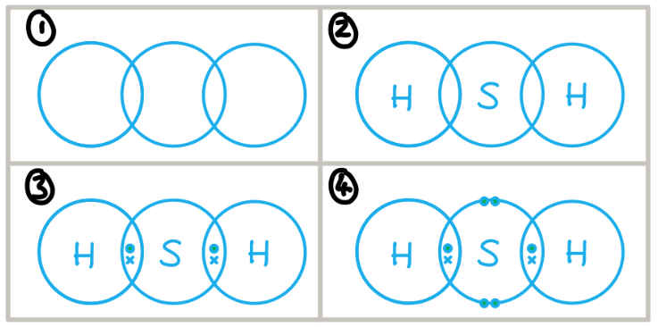
c)

i) The catalyst used in this reaction is:

- Vanadium oxide / vanadium(V) oxide / vanadium pentoxide / V2O5;** [1 mark] **
*If an oxidation state is given, then it must be correct*

ii) The temperature used for this reaction is:

- 400 to 500 oC; **[1 mark]**

**[Total: 2 marks]**

- *You need to recall the temperature, pressure and catalyst needed for the Contact process and the equation for the main stage only*
d) To calculate x.

- 79.1 g of CaSO4 = 0.58 moles;** [1 mark]**
- 20.9 g of H2O = 1.16 moles; **[1 mark]**
- x = 2; **[1 mark]**

**Final answer:** ** ****[Total: 3 marks]**

- *Questions to calculate x in hydrated salts such as CaSO**4**.xH**2**O can be treated as an adapted empirical formula question:* | > *Compound* | > *CaSO**4** * | > *H**2**O* |
|---|---|---|
| > *Value from question* | > *79.1* | > *20.9* |
| > *M**r* | > *136* | > *18* |
| > *Divide* | > $\frac{79.1}{136}$* = 0.58* | > $\frac{20.9}{18}$* = 1.16* |
| > *Ratio* | > $\frac{0.58}{0.58}$* = 1* | > $\frac{1.16}{0.58}$* = 2* |
- *Therefore, x = 2*

### Q30
a)

i) The forward reaction is:

- Exothermic;** [1 mark]**
- The forward reaction is favoured by low temperature / reverse reaction is favoured by high temperature; ** [1 mark]**

ii) The colour of the equilibrium mixture becomes lighter when the pressure on the mixture is increased because:

- The equilibrium shifts to the right / side of the product; ** [1 mark]**
- Because this side has a smaller volume / fewer moles of gas produced; ** [1 mark]**

**[Total: 4 marks]**

- *According to Le Chatalier's principle, when a change is made to a system, the system will shift the position of the equilibrium counteract the change*
- *Be careful in part i)- the question states that more of the reactant is formed at high temperatures, the focus is not on the product*
- *When temperature is increased, more reactant is formed so the system must have favoured the reverse reaction to decrease the temperature.*
- *The reverse reaction is therefore endothermic and the forward reaction exothermic*
- *You must give your answer in terms of the forward reaction as this is what has been asked for *
- *The forward reaction produces 1 mole of gas, whereas the reverse produces 2 *
- *For the mixture to become lighter the equilibrium must have shifted to the right *
b) To calculate the percentage of lead (II) nitrate in sample:

- Number of moles of O2 formed = 0.16/24 = 0.0067 mol; **[1 mark]**
- Number of moles of Pb(NO3)2 in the sample = 0.0133 mol; **[1 mark]** mass of one mole of Pb(NO3)2 = 331 g
- Mass of lead(II) nitrate in the sample = 4.4(1) g; **[1 mark]**
- Percentage of lead(II) nitrate in sample = 88.3% (allow 88–89); **[1 mark]**

**[Total: 4 marks]**

- *One mole of gas at r.t.p. occupies 24 dm**3** so to find the number of moles the volume of gas is divided by this number*
- *From the equation we can see the molar ratio of  Pb(NO**3**)**2** to O**2** is 2:1*

  - *The moles of oxygen is multiplied by 2 so 2 x 0.0067= 0.0133 mol *
- *The mass of one mole of  Pb(NO**3**)**2 **is 331 g given in the question *
- *To calculate the mass of lead(II) nitrate in the sample multiply the number of moles by the mass of one mole:*

  - *mass = 0.0133 x 331 = 4.41 g*
- *So the percentage of lead nitrate is: *$\frac{4.41}{5.00} \times 100 = 88.2 \%$* *
- *Note**: Your final answer is dependent on which numbers you round*

  - *If you use the calculator value throughout the question, your final answer will be *$88.2 6 \text{with} . on \text{top} \%$* which rounds to 88.3%*
  - *If you round your values at each stage (as per the workings shown above), then you will get a final answer which differs from this, which is why the mark scheme allows a range of answer*

### Q31
a) The symbols means it is a :

- Reversible reaction;** [1 mark]**

**[Total: 1 mark]**

- *A reversible reaction is one where the reactants form products, and the product can reform the reactants*
b) One source of hydrogen used in the manufacture of ammonia is:

- Methane / natural gas; **[1 mark]**

**[Total: 1 mark]**

- *You must know the source of both raw materials used for the Haber process:*

  - *Hydrogen = methane*
  - *Nitrogen = air*
c) The effect of increasing pressure and temperature on the yield of ammonia is:

- [increasing pressure] increases yield;** [1 mark]**
- [increasing temperature] decreases yield; **[1 mark]**

**[Total: 2 marks]**

- *To deduce the effect of increasing pressure, identify the rows in the table where pressure has increased but the temperature has been kept constant*

| *pressure* */atm* | *temperature* */ °C* | *percentage yield* *of ammonia* |
|---|---|---|
| > *250* | > *350* | > *58* |
| > *100* | > *450* | > *28* |
| > *400* | > *450* | > *42* |
| > *250* | > *550* | > *20* |

- *The yield of ammonia has increased from 28 to 42%*
- *To deduce the effect of increasing temperature, identify the rows in the table where temperature has increased but the pressure has been kept constant*

| *pressure* */atm* | *temperature* */ °C* | *percentage yield* *of ammonia* |
|---|---|---|
| > *250* | > *350* | > *58* |
| > *100* | > *450* | > *28* |
| > *400* | > *450* | > *42* |
| > *250* | > *550* | > *20* |

- *The yield of ammonia has decreased from 58% to 20%*

### Q32
a)

i) This technique separates liquid oxygen and nitrogen because:

- They have different boiling points;** [1 mark]**

ii) Two raw materials from which hydrogen is manufactured are:

Any **two** from:

- Methane / Natural gas; ** [1 mark]**
- Water; ** [1 mark]**
- Petrol; ** [1 mark]**
- Named petroleum fraction; ** [1 mark]**
- Alkane; ** [1 mark]**

**[Total: 3 marks]**

- *You must be able to describe the sources of both hydrogen and nitrogen for the Haber process*
b)

i) The percentage of ammonia increases as the pressure increases because:

- There are fewer moles of gas on the product side  
**OR** 
The volume decreases in the forward reaction; **[1 mark]**
- (Increase in pressure) causes equilibrium shifts to the right; **[1 mark]**

ii) The percentage of ammonia will change if the measurements had been made at a lower temperature by:

- Increasing; **[1 mark]**
- Exothermic reaction favoured by lower temperature; **[1 mark]**

iii) Two of the reaction conditions used in the Haber Process are;

Any **two** from:

- Iron (catalyst); **[1 mark]**
- 150- 300 atm; **[1 mark]**
- 300 to 600 oC; **[1 mark]**
- 1:3 volume ratio; **[1 mark]**

**Final answer:** **[Total; 6 marks]**

- *According to Le Chatelier's principle, when a change is made to a system, the system will shift the position of the equilibrium to counteract the change *
- *So when the temperature is lowered, the system will favour the exothermic reaction (in this case the forward reaction) to try and increase it*

  - *The equilibrium shifts to the right and more product is formed *
- *When the pressure is increased, the yield of ammonia increases because again the system opposes the change and tries to decrease the pressure *

  - *It does this by favouring the reaction that produces fewer molecules of gas, in this case, the forward reaction so the equilibrium shifts to the right again *
- *Do not just learn some of these conditions, learn them all, as you can be asked for them specifically *
c)

i) Ammonia can accept a:

- Proton; **[1 mark]**
- H+ ; **[1 mark]**

ii) An equation for ammonia acting as a base is:

- NH3 + HCI → NH4Cl **OR** NH3 + H+ → NH4+; **[1 mark]**

**[Total: 3 marks]**

- *Ammonia is a base which means it is a proton acceptor, for two marks in part i) you must also state what a proton is (H**+**)*
- *You can use the formula of NH**3** and H**+** to deduce that  you would make NH**4**+*
d)

i) The structural formula for hydrazine is:

- Correct structural formula; **[1 mark]**

ii) A diagram that shows the arrangement of the valency electrons in one molecule of hydrazine is:

- 8 electrons around nitrogen; **[1 mark]**
- 2 electrons around each hydrogen; **[1 mark]**

**[Total: 3 marks]**** **

- *The question tells you that each hydrogen only forms one bond and that nitrogen forms three*
- *For part ii) you need to make sure you know nitrogen has 5 electrons in its outer shell*
- *Draw the hydrogen electrons first, then those being shared by nitrogen with hydrogen, and finally the remaining nitrogen electrons *

### Q33
a)

i) The term *equilibrium means:*

- No change in concentration of reactants / products 
**OR **
Rates ( of the forward and reverse reaction are) equal; **[1 mark]** 
*Accept no change in amounts or it is as if the reaction has stopped*

ii) The percentage of methanol in the equilibrium mixture is lower than at 300 oC because:

- Backwards reaction is endothermic 
**OR **
the forward reaction is exothermic; **[1 mark]**
- An increase in temperature favours the endothermic reaction which is the back reaction 
**OR **
vice versa; **[1 mark]**

iii) Two advantages, with reasons, of using high pressure for this reaction are:

- Increased rate; **[1 mark]**
- (Because) molecules collide more frequently 
**OR **
concentration of molecules is increased 
**OR **
molecules are closer: **[1 mark]** *Do NOT accept they have more KE*
- Increased yield; **[1 mark]**
- (Because) high pressure favours side with few molecules 
**OR **
smaller volume 
**OR **
moves to reduce the pressure; **[1 mark]**
- (which) is the product side; **[1 mark]** *This can be implied*

**[Total: 8 marks]**

- *The position of equilibrium will shift according to Le Chatalier's Principle which states that when a change is made to the conditions of a system at equilibrium, the system automatically moves to oppose the change*
- *Whilst you do not specifically learn about the conditions for the manufacture of methanol, you can apply Le Chatalier's Principle to determine the optimum conditions for yield*
- *Remember**:  The industrial conditions used are usually a compromise between yield and rate (for temperature) and yield and expense/safety (for pressure)*
b)

i) The equation for the combustion of methanol in an excess of oxygen is:

**2**CH3OH + **3**O2 → **2CO****2** + **4H****2****O**

- CO2 and H2O as products; **[1 mark]**
- Correct balancing; **[1 mark]**

ii) The word equation is:

methanol + ethanoic acid → **methyl ethanoate **+ **water**

- Methyl ethanoate; **[1 mark]**
- Water; **[1 mark]**

iii) The acid that can oxidise methanol to an acid is:

- Methanoic acid; **[1 mark]**

**[Total: 5 marks]**

- *The products of combustion of alcohols are CO**2** and H**2**O, so the unbalanced equation for the combustion of methanol is:*

  - *CH**3**OH + O**2** → CO**2** + H**2**O*
- *When balancing combustion equations, balance the carbon atoms first, in this case, they are already balanced:*

  - *CH**3**OH + O**2** → CO**2** + H**2**O*
- *Then balance the hydrogen atoms:*

  - *CH**3**OH + O**2** → CO**2** + 2H**2**O*
- *Then the oxygen atoms:*

  - *CH**3**OH + 1½O**2** → CO**2** + 2H**2**O*
- *If you end up with a fraction, multiply all balancing numbers by 2:*

  - *2CH**3**OH + 3O**2** → 2CO**2** + 4H**2**O*
- *When a carboxylic acid and alcohol react, an ester and water are formed*
- *The first part of the name of an ester indicates the length of the carbon chain in the alcohol, and it ends with the letters ‘- yl’*
- *The second part of the name indicates the length of the carbon chain in the carboxylic acid, and it ends with the letters ‘- oate’*

  - *So the ester formed from methanol and ethanoic acid is called methyl ethanoate*
- *Alcohols can be oxidised to carboxylic acids which have the same number of carbon atoms in their chain, therefore **meth**anol will oxidise to** meth**anoic acid*

### Q34
a)

i) The position of equilibrium in the first reaction is affected by pressure but the position of equilibrium in the second reaction is not because:

- (First reaction) volume / moles / molecules of reactants and products are different; **[1 mark]**
- (Second reaction) volume / moles / molecules of reactants and products are the same; **[1 mark]**

ii) A high temperature is needed in the first reaction to get a high yield of products but in the second reaction a high yield is obtained at a low temperature because:

- The first reaction (forward) reaction is endothermic; **[1 mark]**
- The second reaction (forward) reaction is exothermic; **[1 mark]**

**[Total: 4 marks]**

- *Le Chatelier's principle states that when a change is made to the conditions of a system at equilibrium, the system will automatically move to oppose the change*
- *If there are the same number of reactant and product molecules, no reaction (forward or reverse) will be favoured if a change in pressure is imposed on the system*

  - *If no reaction is favoured, then the yield of reactant and product will not change*
- *If a high temperature is imposed on the system, it will move to oppose the change and attempt to decrease the temperature*
- *It will do this by favouring the endothermic reaction *

  - *In the first reaction, this is the forward reaction and so a higher yield of product is obtained *
  - *In the second reaction, the forward reaction is exothermic and so the reverse reaction is favoured, lowering the yield of product*
b)

i) An equation for the electrode reaction which forms hydrogen is:

2H+ + 2e- → H2

- Correct formulae; **[1 mark]**
- Correctly balanced; **[1 mark]**

ii) The other two products of the electrolysis of concentrated aqueous sodium chloride and use are:

- Chlorine; **[1 mark]**
- Sodium hydroxide; **[1 mark]**

Any **one** from:

Chlorine

- Water treatment; **[1 mark]**
- Bleach; **[1 mark]**
- HCl; **[1 mark]**
- Kill bacteria; **[1 mark]**
- Swimming pools; **[1 mark]** *Accept any correct use of chlorine*

Any **one** from:

Sodium hydroxide

- Making soap; **[1 mark]**
- Degreasing; **[1 mark]**
- Making paper; **[1 mark]**
- Detergents;**[1 mark] ***Accept any correct use of chlorine*

**[Total: 6 marks]**

- *Concentrated aqueous sodium chloride solution contains the ions; H**+**, Na**+**, OH**-**, Cl**-*
- *Hydrogen forms at the cathode as it is less reactive than sodium *
- *Chlorine forms at the anode as it is preferentially discharged over the OH**-** as it is a concentrated solution *
- *Na**+** and OH**-** remain in solution forming NaOH *

### Q35
a) A catalyst is used because:

- It has a large surface area/ large area of contact/ large surface; **[1 mark]**
- More (successful) collisions (between catalyst and gases or between reacting gases) **OR ** The rate of reaction is faster; **[1 mark]**

**[Total: 2 marks]**

- *A catalyst speeds up the rate of reaction by providing an alternative pathway for the reaction to occur*
- *It is not used in the reaction itself but a higher surface area will allow it to act as a catalyst more effectively *
b) Two changes that could be made to the reaction mixture are:

- Decrease temperature / temperature below 450°C / quoted temperature below 450°C; ;**[1 mark]**
- Increase pressure / pressure above 200 atm / quoted pressure above 200 atm; ;**[1 mark]**

**[Total: 2 marks]**

- *Decreasing the temperature will shift the equilibrium to the right-hand side to favour the exothermic reaction *
- *Increasing the pressure will shift the equilibrium to the right to favour the forward reaction which produces fewer molecules of gas *
c)  The changes you have described in (b) are not used in practice because:

- Decreased temperature would reduce rate / reaction slower / too slow; **[1 mark]**
- Increased pressure is expensive / there is the risk of explosion s/ strong pipes are needed; **[1 mark]**

**Final answer:** **[Total:2 marks]**

- *The conditions of 450 **o**C and 200 atmospheres are a compromise*
- *The temperature is a compromise between achieving an acceptable yield and a rate of reaction that isn't too slow*
- *The pressure is a compromise between achieving an acceptable yield whilst not requiring equipment that is too expensive or the process becoming a safety risk*

### Q36
a)

i) The effect on the yield of carbonyl chloride of increasing the pressure is:

- Increasing the pressure would move position of equilibrium to right / increase yield of COCl2;** [1 mark]**
- (As) increasing the pressure favours the side with less (gas) molecules / smaller volume; **[1 mark]**

ii) If the temperature is allowed to increase to above 200°C, very little carbonyl chloride is formed as:

- Increasing the temperature favours the endothermic reaction;** [1 mark]**
- So there are less products / reduces the yield;** [1 mark]**

iii) A catalyst is used to:

- Keep the rate high / increase rate at lower temperatures;** [1 mark]**

**[Total: 5 marks]**

- *Le Chatelier's principle tells us when a change is made to the conditions of a system at equilibrium, the system automatically moves to **oppose **the change*
- *Make sure you can use this to predict changes to the position of equilibrium when there are changes in **temperature**, **pressure** or **concentration*
- *Remember: A catalyst doesn't change the equilibrium position but increases the rate of both the forward and backward reactions*
b) A diagram showing the arrangement of the outer (valency) electrons in one molecule of this carbonyl chloride:

- Each chlorine has 1 bond pair and 3 non-bonding pairs; **[1 mark]**
- 4 electrons between the carbon atom and oxygen atom; **[1 mark]**
- 2 non-bonding pairs on the oxygen atom; **[1 mark]**

**[Total: 3 marks]**

- *Start by thinking about how many outer electrons each atom has*

  - *carbon is in Group IV so has 4*
  - *oxygen is in Group VI so has 6*
  - *chlorine is in Group VII so has 7*
- *From the diagram you can see the carbon-chlorine bonds are single bonds whilst the carbon-oxygen bond is a double bond*
- *Draw the electrons in these bonds*
- *Then you can add in the other electrons on each atom in non-bonding pairs*
- *Check your answer by making sure each atom has a full outer shell *
- *Note**: You do not have to draw the electrons in pairs*

### Q37
i) The formula of vanadium(V) oxide? is:

- V2O5; **[1 mark]**

ii) The advantage of using a lower temperature is:

- The position of equilibrium shifts right / yield increases; **[1 mark]**
- To save energy;** [1 mark]**

iii) Advantages of using a high pressure are:

- A faster reaction / rate;** [1 mark]**
- (Because) there are more collisions per second / higher collision frequency; **[1 mark]**
- The position of equilibrium shifts right / yield increases; **[1 mark]**
- (Because) there are fewer moles / molecules (of gas) on right; **[1 mark]**

**[Total: 7 marks]**

- *The charge on an ion is indicated by the Roman numeral in its name:*
- *The vanadium(V) ion is V**5+** *
- *The oxide ion has a 2- charge*
- *For the compound to be neutral overall, the charges need to cancel out:*

  - *2 x (2+) + 5 x (2-) = 0*
- *Therefore, vanadium(V) oxide contains 2 vanadium ions for every 5 oxide ions*
- *Lower temperatures will favour the exothermic reaction, which is the forward reaction in this case*

### Q38
a)

i) The rate of the forward reaction decreases with time because:

- The concentration of BiCl3; **[1 mark]**
- Decreases; **[1 mark]** 
Allow bismuth chloride is used up for **[1 mark]**

ii) The rate of the backward reaction increases with time because:

- Products are being formed 
**OR** 
The concentration of products increases; **[1 mark]** 
*The use of the term concentration can be awarded in either (i) or (ii)*

iii) After some time the appearance of the mixture remains unchanged because:

- The reaction has come to equilibrium; **[1 mark]**
- The (forward and backward) rates are equal **OR** There is no change in concentration; **[1 mark]**

iv) The cloudy mixture changes to a colourless solution when a few drops of concentrated hydrochloric acid are added because:

- The equilibrium to left / favours backward reaction / equilibrium moves to use up hydrochloric acid; **[1 mark]**
- BiOCl is used up 
**OR **
BiCl3 is formed; **[1 mark]**

**[Total: 7 marks]**

- *When dynamic equilibrium is established, even though both the forward and reverse reaction are still occurring but as this happens at the same rate, there is no difference in the macroscopic properties - i.e. there are no visible changes*
- *When hydrochloric acid is added, the concentration of HCl increases*
- *The equilibrium will shift to oppose this change by favouring the reaction which uses HCl as a reactant which is the reverse reaction*
- *This uses up the white, solid BiOCl and produces more BiCl3 which is a colourless liquid - you can tell this from the (aq) state symbol*
b)

i) A reason why an increase in pressure does not affect the position of equilibrium for reaction 1 is:

- There is no change in volume 
**OR** 
The same number of moles / molecules on both sides; **[1 mark]**

ii) When pressure is increased in reaction 2, equilibrium would:

- Move / shift to the right; **[1 mark]**
- (Because) the increase in pressure favours the side with smaller volume / smaller number of molecules / moles (of gas); **[1 mark]**

**[Total: 3 marks]**

- *Pressure arises from collisions between particles and the walls of their container*
- *The more particles there are, the greater the pressure and vice versa*
- *As reaction 1 has the same number of molecules on both sides of the equation, neither reaction will increase or decrease the pressure, so equilibrium does not shift*
- *In reaction 2, there are 3 molecules on the left hand side of the equation and 2 molecules on the right hand side, so when pressure is increased*

  - *Equilibrium will shift to oppose this change by favoring the side that has the fewest molecules i.e. it shifts to the right*

### Q39
a)

i) The term base *means*:

- Proton / H+ acceptor; **[1 mark]**

ii) You show that ammonia is the weaker base by:

- (Measuring) pH / (using) universal indicator; **[1 mark]** 
*Note: can be implied need not be explicit*
- Sodium hydroxide has high<u>er</u> pH / ammonia has low<u>er</u> pH; **[1 mark] **
*(This sentence would score 2 marks)*

**OR**

- Appropriate colours with universal indicator / appropriate numerical values; **[1 mark]**
- Ammonia is closer to green, blue-green, turquoise or lighter blue / sodium hydroxide is darker blue / purple / violet; **[1 mark]**

**OR**

- Measure electrical conductivity; **[1 mark]** 
*Can be implied need not be explicit*
- Ammonia (aq) is the poor<u>er</u> conductor / sodium hydroxide is the bett<u>er</u> conductor; **[1 mark]**

**[Total: 3 marks]**

- *Sodium hydroxide is a strong base, a solution of sodium hydroxide would have a pH which is higher than the pH of a solution of a weaker base such as ammonia*
- *Sodium hydroxide solution has a pH of around 13 (depending on concentration)*
- *Ammonia solution has a pH of around 11*
b)  As much ammonia as possible is made as quickly as possible by:

Any **five **from:

- High pressure favours lower volume side / movement to right / ammonia side 
**OR** 
High pressure increases the yield; **[1 mark]**
- High pressure increases rate; **[1 mark]**
- Low temperature favours exothermic reaction / increases yield / favours the forward reaction; **[1 mark]**
- Low temperature gives low rate or vice versa; **[1 mark]**
- Catalyst increases rate or lowers activation energy; **[1 mark]**
- 450 °C low enough to give an economic yield but with catalyst gives a fast enough rate; **[1 mark] **
*Note: need whole concept to get this compromise temperature point*

**[Total: 5 marks]**

- *The Haber process is a good example of how Le Chatlier's principle is used in industry*
- *The temperature conditions chosen are a compromise between yield and rate: *

  - *Low temperatures favour a high yield, as the forward reaction is exothermic, but the rate of reaction would be too slow*
  - *Using a higher temperature will reduce the yield but the rate of reaction will be quicker*
  - *So, in a given amount of time, whilst the yield of the reaction would be lower, the actual amount of ammonia produced would be greater as the reaction can happen a lot faster*
  - *As the unused reactants can be reused, it is not a problem that the yield is lower*
- *The pressure conditions used are a compromise between yield and cost/safety:*

  - *High pressures favour a high yield as there are fewer moles on the right-hand side of the equation, and a quick rate of reaction,*
  - *However, there is a cost associated with building and running a reaction vessel that can withstand extremely high pressures*
  - *There is also a risk of explosions at high pressures*
c) The completed equation for the preparation of hydrazine from ammonia is:

**   2**NH3 + NaClO → N2H4 + **NaCl **+ H2O

- Correct product / NaCl:** [1 mark]**
- Correct balancing:** [1 mark]**

**[Total: 2 marks]**

- *You are not expected to know this equation, so don't be put off from answering it if you don't recognise it*
- *Compare the reactants and products given to see what atoms have not been accounted for*
- *You should see that Na and Cl appear as a reactant but not in one of the given products so the missing product is NaCl*
- *Then, to balance, the reactants have 1 atom of N and 3 of H, but the products have 6 atoms of H and 2 of N, therefore to balance the equation, a 2 is needed in front of NH**3*
d) A diagram showing the arrangement of the valency electrons in one molecule of the covalent compound hydrazine is:

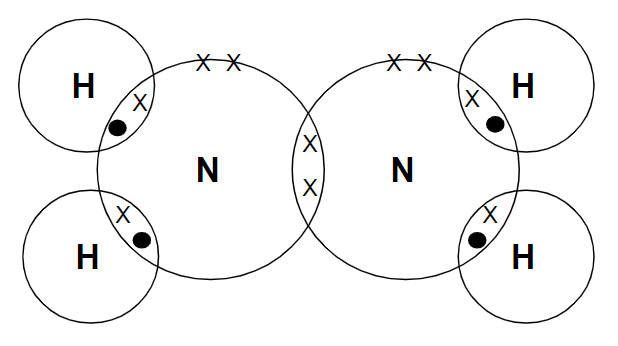

- 4 hydrogen atoms with 1 bonding pair each; **[1 mark]**
- 2 nitrogen atoms with 1 bonding pair between them; **[1 mark]**
- One non-bonding pair on each N (need not be seen as a pair); **[1 mark]**

**[Total: 3 marks]**

- *Make sure that the nitrogen electron shells have 8 electrons and the hydrogen electron shells have 2 electrons*
- *Hydrogen has 1 valency electron*
- *Nitrogen is in Group V so will have 5 electrons in its outer shell i.e. 5 valency electrons*

  - *4 of these will share a pair of electrons with a hydrogen atom*
  - *1 of these will share a pair with the other nitrogen atom*
e)

i) The effect that hydrazine has on the pH of water is:

- pH increases;** [1 mark]**

ii) A reason, other than pH, why hydrazine reduces the rate of rusting is:

- Oxygen needed for rusting 
**OR **
It removes / reacts with oxygen; **[1 mark]**

**[Total: 2 marks]**

- *This question requires you to apply your knowledge to an unfamiliar context*
- *It is the type of question that many students will assume they do not know the answer to as they are not familiar with the compound hydrazine*
- *The question tells you that hydrazine is a weak base, therefore when it is added to water, the water becomes slightly alkaline which increases the pH*
- *Oxygen and water are the conditions necessary for rusting to occur*
- *You are told that hydrazine removes oxygen from water which would reduce the rate of rusting*
