# Exam Questions — Reversible Reactions & Equilibrium
**6. Chemical Reactions** · Cambridge (CIE) IGCSE chemistry (0620 & 0971)
> Source: [https://www.savemyexams.com/igcse/chemistry/cie/23/topic-questions/](https://www.savemyexams.com/igcse/chemistry/cie/23/topic-questions/) · 63 questions across 3 sets

## Alternative To Practical Questions (2 questions)

### Q1 — medium — 4 marks

**Q1** [1 mark]

Hydrated cobalt chloride crystals, CoCl2.6H2O, were heated in the apparatus shown.

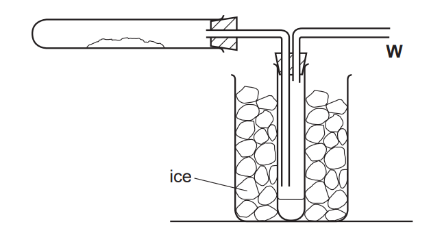

Indicate on the diagram, using an arrow, where heat is applied.

*Source: 2010 61 Q6*

**Q1** [1 mark]

**Extract:**

Hydrated cobalt chloride crystals, CoCl~2~.6H~2~O, were heated in the apparatus shown.

The crystals change colour from .............................. to .............................. .

*Source: 2010 61 Q6*

**Q1** [1 mark]

**Extract:**

Hydrated cobalt chloride crystals, CoCl~2~.6H~2~O, were heated in the apparatus shown.

What is the purpose of the ice?

*Source: 2010 61 Q6*

**Q1** [1 mark]

**Extract:**

Hydrated cobalt chloride crystals, CoCl~2~.6H~2~O, were heated in the apparatus shown.

Why is the tube open at point **W**?

*Source: 2010 61 Q6*

### Q2 — medium — 5 marks

**Q2** [2 marks]

Hydrated copper sulphate crystals, CuSO4.5H2O were heated in the apparatus shown below.

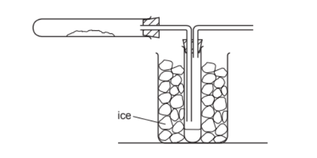

Indicate on the diagram using arrows

i) Where the copper sulphate crystals are placed

ii) Where heat is applied.

*Source: 2007 6 Q1*

**Q2** [1 mark]

**Extract:**

Hydrated copper sulphate crystals, CuSO~4~.5H~2~O were heated in the apparatus shown below. [Diagram of a test tube with a sealed stopper, connected to a tube immersed in an ice-filled beaker. The setup is likely for gas collection or condensation.]

What is the purpose of the ice?

*Source: 2007 6 Q1*

**Q2** [2 marks]

**Extract:**

Hydrated copper sulphate crystals, CuSO~4~.5H~2~O were heated in the apparatus shown below.

The crystals changed colour from ........................... to ..............................

*Source: 2007 6 Q1*

## Multiple Choice Questions (28 questions)

### Q1 — hard — 1 marks

**Q1** [1 mark]

Ammonia is manufactured by the Haber process.

N2(g) + 3H2(g) ⇌ 2NH3(g)

The forward reaction is exothermic.

Which statement about the Haber process is **not** correct?

### Q2 — easy — 1 marks

**Q2** [1 mark]

Three statements about chemical reactions are listed.

1. When heated, hydrated copper(II) sulphate will change from blue to white.
2. Melting and combustion are reversible reactions.
3. Anhydrous cobalt(II) chloride will change from pink to blue when added some drops of water.

Which statements are correct?

### Q3 — easy — 1 marks

**Q3** [1 mark]

Water and a white solid are produced when blue copper(II) sulfate is heated. On the addition of water to the white solid, heat is released and the white solid turns blue.

Which row correctly describes the reaction and the blue copper(II) sulfate?

### Q4 — easy — 1 marks

**Q4** [1 mark]

Nitrogen and hydrogen are the raw ingredients used in the production of ammonia, NH3.

Which row correctly describes the source of these reactants and the catalyst used?

|   | **nitrogen** | **hydrogen** | **catalyst** |
|---|---|---|---|
| **A** | air | methane | vanadium pentoxide |
| **B** | methane | water | finely divided iron |
| **C** | methane | water | vanadium pentoxide |
| **D** | air | methane | finely divided iron |

### Q5 — easy — 1 marks

**Q5** [1 mark]

Which row correctly describes the conditions used in the Haber process?

|   | **temperature / **$^{\circ}C$ | **pressure / atm** | **catalyst** |
|---|---|---|---|
| **A** | 400 | 300 | vanadium(V) oxide |
| **B** | 450 | 200 | iron |
| **C** | 200 | 300 | vanadium(V) oxide |
| **D** | 300 | 20 | iron |

### Q6 — easy — 1 marks

**Q6** [1 mark]

Reversible reactions occur when products formed in the forward reaction behave as reactants and proceed in the reverse direction to produce the original reactants again.

Which of the following statements is correct for a reversible reaction?

| **1** | If the forward reaction is exothermic, then the reverse reaction must be endothermic |
|---|---|
| **2** | If the forward reaction is endothermic, then the reverse reaction must be exothermic |
| **3** | Both directions are exothermic |
| **4** | Both directions are endothermic |

### Q7 — easy — 1 marks

**Q7** [1 mark]

Which of the following reactions cannot be reversed?

### Q8 — easy — 1 marks

**Q8** [1 mark]

Steam and a blue solid are produced when pink cobalt(II) chloride crystals are heated. With the addition of water to the blue solid, heat is released and the blue solid turns pink.

Which row correctly describes the reaction and the pink cobalt(II) chloride crystals?

### Q9 — hard — 1 marks

**Q9** [1 mark]

Which of the following factors affect the position of equilibrium for a reversible reaction?

| **1** | Temperature |
|---|---|
| **2** | Surface area of solid reactants |
| **3** | Pressure |
| **4** | Concentration |

### Q10 — hard — 1 marks

**Q10** [1 mark]

Carbon monoxide and steam react together exothermically to produce the alcohol methanol, as shown in the equation.

CO(g) + 2H2(g) ⇌ CH3OH(g)

Both reactants and the product are gaseous. Which conditions of pressure and temperature would provide the highest yield of CH3OH?

### Q11 — hard — 1 marks

**Q11** [1 mark]

A part of the contact process involves the production of sulfur trioxide from the reversible reaction of sulfur dioxide and oxygen, as shown below.

2SO2(g) + O2(g) ⇌ 2SO3(g)              ΔH = -197 kJ / mol

Which of the following changes would increase the yield of SO3 at equilibrium?

| **1** | Decreasing the temperature |
|---|---|
| **2** | Increasing the pressure |
| **3** | Decreasing the concentration of O2 |

### Q12 — hard — 1 marks

**Q12** [1 mark]

Which of the following statements best describes equilibrium position?

### Q13 — hard — 1 marks

**Q13** [1 mark]

The reaction for the production of ammonia is shown below.

N2(g) + 3H2(g) $\rightleftharpoons$ 2NH3(g)

What is the effect of increasing pressure on the rate of production of ammonia and the percentage yield of ammonia?

|   | **rate of production** | **percentage yield** |
|---|---|---|
| **A** | increases | decreases |
| **B** | increases | increases |
| **C** | decreases | increases |
| **D** | decreases | decreases |

### Q14 — hard — 1 marks

**Q14** [1 mark]

The reversible reaction between nitrogen dioxide and dinitrogen tetroxide is shown.

2NO2(g) ⇌ N2O4(g)                   *ΔH *= -58 kJ / mol

Which of the following statements about the equilibrium mixture in this reaction is correct?

### Q15 — hard — 1 marks

**Q15** [1 mark]

Which of the following statements best describes Le Chatelier’s Principle?

### Q16 — hard — 1 marks

**Q16** [1 mark]

The production of sulfur trioxide during Stage 2 of the Contact process involves a reversible reaction. Which row describes the conditions of temperature and pressure and the percentage yield of sulfur trioxide?

|   | **temperature / **$^{\circ}C$ | **pressure / atm** | **percentage yield** |
|---|---|---|---|
| **A** | 150 | 1 - 2 | 70 |
| **B** | 450 | 1 - 2 | 98 |
| **C** | 450 | 200 | 98 |
| **D** | 150 | 200 | 70 |

### Q17 — medium — 1 marks

**Q17** [1 mark]

Which of the following statements correctly describes the effect of catalysts on the equilibrium position?

### Q18 — medium — 1 marks

**Q18** [1 mark]

The reaction between nitrogen and hydrogen in the Haber process involves a reversible reaction where an equilibrium is established between the reactants and the products.

Which one of the following statements correctly describes the conditions at equilibrium?

### Q19 — medium — 1 marks

**Q19** [1 mark]

Which of the following reactions is reversible?

### Q20 — medium — 1 marks

**Q20** [1 mark]

Which of the following statements about the Haber process is **not** correct?

### Q21 — medium — 1 marks

**Q21** [1 mark]

Hydrated cobalt(II) chloride undergoes thermal decomposition when heated to produce anhydrous cobalt(II) chloride and water.

$CoCl_{2 bullet} 6 \mathrm{H}_{2} \mathrm{O} \rightleftharpoons CoCl_{2} + 6 \mathrm{H}_{2} \mathrm{O}$

The addition of water to CoCl2 rehydrates the compound. Which row correctly describes the reverse reaction?

|   | **reaction type** | **colour change** |
|---|---|---|
| **A** | exothermic | blue to pink |
| **B** | endothermic | blue to pink |
| **C** | exothermic | pink to blue |
| **D** | endothermic | pink to blue |

### Q22 — medium — 1 marks

**Q22** [1 mark]

Carbon and steam react together as shown in the equation.

C(s) + H2O(g) ⇌ CO(g) + H2(g)

Both of the products from the forward reaction are gaseous. Which conditions of pressure and temperature would provide the highest yield of H2?

## Theory Questions (41 questions)

### Q1 — medium — 13 marks

**Q1** [1 mark]

Ammonia is manufactured by the Haber process. **The forward reaction is exothermic**

Complete the chemical equation for this reaction.

N2(g) + ..........  H2(g)  ⇌   ......... NH3(g)      ΔH < 0

**Q1** [2 marks]

Nitrogen is a reactant in the Haber process.

Complete the dot-and-cross diagram in Fig 2.1 to show the electron arrangement in a molecule of nitrogen, N2. Show outer shell electrons only.

**Fig 2.1**

**Q1** [3 marks]

**Extract:**

Ammonia is manufactured by the Haber process. The forward reaction is exothermic
N2(g) + .......... H2(g) ⇌ ......... NH3(g) ΔH < 0
Mark scheme: N2 + 3H2 ⇌ 2NH3 (Correct balancing)

The forward reaction is exothermic. Complete Fig 2.2 to show the reaction pathway diagram for this reaction. Include labels for the:

- reactants and products
- enthalpy change of reaction, ΔH
- activation energy, *E*a

**Fig 2.2**

**Q1** [2 marks]

An engineer places nitrogen and hydrogen in a sealed reactor. The reaction reaches equilibrium. State **two** features of a reversible reaction at equilibrium.

**Q1** [5 marks]

**Extract:**

Ammonia is manufactured by the Haber process. The forward reaction is exothermic. N~2~(g) + 3 H~2~(g) ⇌ 2 NH~3~(g)      ΔH < 0

The engineer changes the conditions of the reactor.

Complete Table 2.1 to show the effect of changing the conditions on the equilibrium yield of ammonia and on the rate of the forward reaction. Use only the words **increases**, **decreases**, or **no change**.

**Table 2.1**

| **change in condition** | **effect on the equilibrium yield of ammonia** | **effect on the rate of the forward reaction** |
|---|---|---|
| increasing the temperature |   |   |
| increasing the pressure |   |   |
| adding a catalyst |   | increases |

### Q2 — easy — 4 marks

**Q2** [1 mark]

**Extract:**

Fig. 3.1 shows a coloured crystal of cobalt(II) chloride is placed at the bottom of a beaker containing water. After two days, the colour has spread throughout the water.

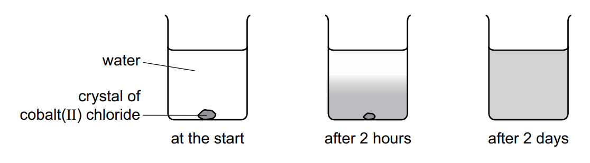

Cobalt(II) chloride can be used to test for the presence of water.

anhydrous                              hydrated      
cobalt(II) chloride          cobalt(II) chloride

#### Separate: Chemistry Only

Fig. 3.1 shows a coloured crystal of cobalt(II) chloride is placed at the bottom of a beaker containing water. After two days, the colour has spread throughout the water.

Cobalt(II) chloride can be used to test for the presence of water.

`CoC l _ 2 + 6 H _ 2 O rightwards harpoon / leftwards harpoon CoC l _ 2 * 6 H _ 2 O` 
anhydrous                              hydrated      
cobalt(II) chloride          cobalt(II) chloride

State the meaning of the symbol ⇌.

**Q2** [2 marks]

**Extract:**

Fig. 3.1 shows a coloured crystal of cobalt(II) chloride is placed at the bottom of a beaker containing water. After two days, the colour has spread throughout the water.

Cobalt(II) chloride can be used to test for the presence of water.

anhydrous                              hydrated      
cobalt(II) chloride          cobalt(II) chloride

#### Separate: Chemistry Only

State the colour change when water is added to anhydrous cobalt(II) chloride.

from   ............................................... to .....................................................

**Q2** [1 mark]

**Extract:**

Fig. 3.1 shows a coloured crystal of cobalt(II) chloride is placed at the bottom of a beaker containing water. After two days, the colour has spread throughout the water.

Cobalt(II) chloride can be used to test for the presence of water.

anhydrous                              hydrated      
cobalt(II) chloride          cobalt(II) chloride

#### Separate: Chemistry Only

How can hydrated copper(II) sulfate be changed into anhydrous copper(II) sulfate?

### Q3 — medium — 15 marks

**Q3** [2 marks]

Hydrogen can be manufactured from methane by steam reforming.

CH4 (g) + H2O (g) $\rightarrow$ CO (g) + 3H2 (g)

The reaction is carried out using a nickel catalyst at temperatures between 700 °C and 1100 °C and using a pressure of one atmosphere.

The forward reaction is endothermic.

What is meant by the term catalyst?

*Source: 2016 Ju42 Q4*

**Q3** [2 marks]

**Extract:**

Hydrogen can be manufactured from methane by steam reforming.
CH4 (g) + H2O (g) → CO (g) + 3H2 (g)
The reaction is carried out using a nickel catalyst at temperatures between 700 °C and 1100 °C and using a pressure of one atmosphere.
The forward reaction is endothermic.

Suggest **two** reasons why a temperature lower than 700 °C is not used.

*Source: 2016 Ju42 Q4*

**Q3** [1 mark]

**Extract:**

Hydrogen can be manufactured from methane by steam reforming. CH4 (g) + H2O (g) → CO (g) + 3H2 (g) The reaction is carried out using a nickel catalyst at temperatures between 700 °C and 1100 °C and using a pressure of one atmosphere. The forward reaction is endothermic.

Suggest **one** advantage of using a pressure greater than one atmosphere.

*Source: 2016 Ju42 Q4*

**Q3** [1 mark]

**Extract:**

Hydrogen can be manufactured from methane by steam reforming. CH~4 ~(g) + H~2~O (g) → CO (g) + 3H~2 ~(g) The reaction is carried out using a nickel catalyst at temperatures between 700 °C and 1100 °C and using a pressure of one atmosphere. The forward reaction is endothermic.

Suggest **one** disadvantage of using a pressure greater than one atmosphere.

*Source: 2016 Ju42 Q4*

**Q3** [7 marks]

**Extract:**

Hydrogen can also be manufactured by electrolysis. The electrolyte is concentrated aqueous sodium chloride. The electrodes are inert. 
The products of electrolysis are hydrogen, chlorine and sodium hydroxide.

Hydrogen can also be manufactured by electrolysis. The electrolyte is concentrated aqueous sodium chloride. The electrodes are inert. 
The products of electrolysis are hydrogen, chlorine and sodium hydroxide.

i) Define the term *electrolysis*.

[2]

ii) Name a substance that can be used as the inert electrodes.

[1]

iii) Write an ionic half-equation for the reaction in which hydrogen is produced.

[1]

iv) Where is hydrogen produced in the electrolytic cell?

[1]

v) Describe a test for chlorine.

test ............................................................................................................................... 
result ............................................................................................................................

[2]

*Source: 2016 Ju42 Q4*

**Q3** [2 marks]

The electrolysis of concentrated aqueous sodium chloride can be represented by the following word equation.

sodium chloride + water → sodium hydroxide + hydrogen + chlorine

Construct a chemical equation to represent this reaction. Do not include state symbols.

*Source: 2016 Ju42 Q4*

### Q4 — hard — 13 marks

**Q4** [3 marks]

**Extract:**

The halogens are a group of non-metals in Group VII of the Periodic Table.

The reactivity of the halogens decreases down the group.

The halogens are a group of non-metals in Group VII of the Periodic Table.

The reactivity of the halogens decreases down the group.

Describe an experiment which shows that chlorine is more reactive than iodine. Include an equation in your answer.

*Source: 2015 Ju31 Q5*

**Q4** [2 marks]

**Extract:**

The halogens form interhalogen compounds. These are compounds which contain two different halogens.

The halogens form interhalogen compounds. These are compounds which contain two different halogens.

Deduce the formula of the compound which has the composition 0.013 moles of iodine atoms and 0.065 moles of fluorine atoms.

*Source: 2015 Ju31 Q5*

**Q4** [3 marks]

**Extract:**

Iodine reacts with chlorine to form a dark brown liquid, iodine monochloride.

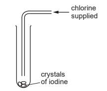

I2 (s) + Cl2 (g) → 2ICl (l)

dark brown

When more chlorine is added and the tube is sealed, a reversible reaction occurs and the reaction comes to equilibrium.

ICl (l) + Cl2 (g)  ICl3 (s)

dark brown                 yellow

Iodine reacts with chlorine to form a dark brown liquid, iodine monochloride.

I2 (s) + Cl2 (g) → 2ICl (l)

dark brown

When more chlorine is added and the tube is sealed, a reversible reaction occurs and the reaction comes to equilibrium.

ICl (l) + Cl2 (g) $\rightleftharpoons$ ICl3 (s)

dark brown                 yellow

i) Give another example of a reversible reaction.

[1]

ii) Explain the term *equilibrium*.

[2]

*Source: 2015 Ju31 Q5*

**Q4** [2 marks]

**Extract:**

Iodine reacts with chlorine to form a dark brown liquid, iodine monochloride.
I~2~ (s) + Cl~2~ (g) → 2ICl (l) (dark brown)
When more chlorine is added and the tube is sealed, a reversible reaction occurs and the reaction comes to equilibrium.
ICl (l) + Cl~2~ (g) ⇌ ICl~3~ (s)
dark brown (ICl) / yellow (ICl~3~)

Chlorine is removed from the tube and a new equilibrium is formed.

Explain why there is less of the yellow solid and more dark brown liquid in the new equilibrium mixture.

*Source: 2015 Ju31 Q5*

**Q4** [3 marks]

**Extract:**

Iodine reacts with chlorine to form a dark brown liquid, iodine monochloride. I~2~ (s) + Cl~2~ (g) → 2ICl (l) dark brown. When more chlorine is added and the tube is sealed, a reversible reaction occurs and the reaction comes to equilibrium. ICl (l) + Cl~2~ (g) ⇌ ICl~3~ (s) dark brown / yellow

A sealed tube containing the equilibrium mixture is placed in ice-cold water. There is an increase in the amount of yellow solid in the equilibrium mixture.

What can you deduce about the forward reaction in this equilibrium?

ICl (l) + Cl2 (g) $\rightleftharpoons$ ICl3 (s)

Explain your deduction.

*Source: 2015 Ju31 Q5*

### Q5 — medium — 5 marks

**Q5** [3 marks]

**Extract:**

Sulfuric acid is made from sulfur in a four-stage process.

stage 1  Sulfur is converted into sulfur dioxide. 
stage 2  Sulfur dioxide is converted into sulfur trioxide. 
stage 3  Sulfur trioxide is converted into oleum. 
stage 4  Oleum is converted into sulfuric acid.

Describe how sulfur dioxide is converted into sulfur trioxide in stage 2.

Your answer should include:

- an equation for the reaction
- the temperature used
- the name of the catalyst used.

#### Separate: Chemistry and Extended Only

Sulfuric acid is made from sulfur in a four-stage process.

stage 1  Sulfur is converted into sulfur dioxide. 
stage 2  Sulfur dioxide is converted into sulfur trioxide. 
stage 3  Sulfur trioxide is converted into oleum. 
stage 4  Oleum is converted into sulfuric acid.

Describe how sulfur dioxide is converted into sulfur trioxide in stage 2.

Your answer should include:

- an equation for the reaction
- the temperature used
- the name of the catalyst used.

**Q5** [2 marks]

**Extract:**

Sulfuric acid is made from sulfur in a four-stage process. stage 1 Sulfur is converted into sulfur dioxide. stage 2 Sulfur dioxide is converted into sulfur trioxide. stage 3 Sulfur trioxide is converted into oleum. stage 4 Oleum is converted into sulfuric acid.

#### Separate: Chemistry and Extended Only

The reaction in stage 2 can reach equilibrium.

What is meant by the term equilibrium?

### Q6 — medium — 6 marks

**Q6** [1 mark]

**Extract:**

Sulfuric acid is made by the Contact process in the following sequence of reactions.

**sulfur → sulfur dioxide → sulfur trioxide → sulfuric acid**

Sulfuric acid is made by the Contact process in the following sequence of reactions.

**sulfur → sulfur dioxide → sulfur trioxide → sulfuric acid**

How is sulfur dioxide made from sulfur?

*Source: 2006 Ju31 Q5*

**Q6** [5 marks]

**Extract:**

Sulfuric acid is made by the Contact process in the following sequence of reactions.

**sulfur → sulfur dioxide → sulfur trioxide → sulfuric acid**

The equation for a stage of the Contact process is

2SO2 + O2 $\rightleftharpoons$ 2SO3

The percentage of sulfur trioxide in the equilibrium mixture varies with temperature.

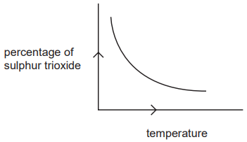

i) How does the percentage of sulfur trioxide in the equilibrium mixture vary as the temperature increases? Circle the correct answer.

**increases      stays the same      decreases**

[1]

ii) Is the forward reaction in the equilibrium 2SO2 + O2 $\rightleftharpoons$ 2SO3 exothermic or endothermic? Give a reason for your choice.

[2]

iii) Explain, mentioning both rate and percentage yield, why the temperature used in the Contact process is 450 °C.

[2]

*Source: 2006 Ju31 Q5*

### Q7 — easy — 10 marks

**Q7** [4 marks]

#### Separate: Chemistry and Extended Only

Ammonia is manufactured by the Haber process.

N2(g) + 3H2(g)$\rightleftharpoons$ 2NH3(g)

The forward reaction is exothermic.

i) Name the raw materials from which nitrogen and hydrogen are obtained.

Nitrogen from ............................................................................... Hydrogen from ............................................................................

[2]

ii) Name the catalyst used in this process.

[1]

iii) What is the most important use of ammonia?

[1]

*Source: 2009 Ju31 Q6*

**Q7** [3 marks]

#### Separate: Chemistry and Extended Only

The following graph shows how the percentage of ammonia in the equilibrium mixture changes with temperature.

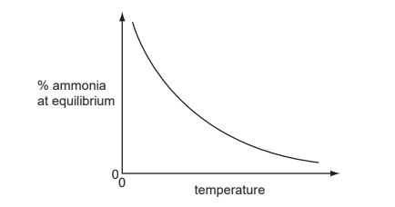

i) Explain the term equilibrium.

[2]

ii) How does the percentage of ammonia vary with temperature?

[1]

*Source: 2009 Ju31 Q6*

**Q7** [3 marks]

**Extract:**

Ammonia is manufactured by the Haber process. N~2~(g) + 3H~2~(g) ⇌ 2NH~3~(g). The forward reaction is exothermic.

#### Separate: Chemistry and Extended Only

i) Sketch a graph which shows how the percentage of ammonia in the equilibrium mixture varies with pressure.

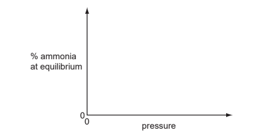

ii) Explain why the graph has the shape shown.

[2]

*Source: 2009 Ju31 Q6*

### Q8 — medium — 4 marks

**Q8** [2 marks]

**Extract:**

Sulfur dioxide, SO2, is used in the manufacture of sulfuric acid.

In the first stage of the process, sulfur dioxide is obtained from sulfur-containing ores.

The next stage of the process is a reaction which can reach equilibrium. The equation for this stage is shown.

#### Separate: Chemistry and Extended Only

Sulfur dioxide, SO2, is used in the manufacture of sulfuric acid.

In the first stage of the process, sulfur dioxide is obtained from sulfur-containing ores.

The next stage of the process is a reaction which can reach equilibrium. The equation for this stage is shown.

$2 SO_{2 } ( \mathrm{g} ) + \mathrm{O}_{2} ( \mathrm{g} ) \rightleftharpoons 2 SO_{3} ( \mathrm{g} )$

Describe two features of an equilibrium.

**Q8** [1 mark]

**Extract:**

Sulfur dioxide, SO~2~, is used in the manufacture of sulfuric acid. In the first stage of the process, sulfur dioxide is obtained from sulfur-containing ores. The next stage of the process is a reaction which can reach equilibrium. The equation for this stage is shown. 2 SO_2 (g) + O_2 (g) ⇌ 2 SO_3 (g)

#### Separate: Chemistry and Extended Only

Name the catalyst used in this stage.

**Q8** [1 mark]

**Extract:**

The next stage of the process is a reaction which can reach equilibrium. The equation for this stage is shown.

2 SO_2(g) + O_2(g) ⇌ 2 SO_3(g)

#### Separate: Chemistry and Extended Only

In this stage, only a moderate temperature of 450 °C is used.

What does this suggest about the forward reaction?

### Q9 — hard — 16 marks

**Q9** [4 marks]

Ammonia is made by the Haber process.

N2 (g) + 3H2 (g) $\rightleftharpoons$ 2NH3 (g)

The forward reaction is exothermic.

The conditions in the reaction chamber are:

- a pressure of 200 atmospheres,
- a catalyst of finely divided iron,
- a temperature of 400 to 450 °C.

What are the **two **advantages of using a high pressure? Give a reason for both.

advantage 1 ...............................................................................................................................

reason ........................................................................................................................................

advantage 2 ...............................................................................................................................

reason ........................................................................................................................................

*Source: 2014 Ju33 Q5*

**Q9** [3 marks]

**Extract:**

Ammonia is made by the Haber process. N~2~ (g) + 3H~2~ (g) \$\$\rightleftharpoons\$\$ 2NH~3~ (g) The forward reaction is exothermic. The conditions in the reaction chamber are: a pressure of 200 atmospheres, a catalyst of finely divided iron, a temperature of 400 to 450 °C.

A higher temperature would give a faster reaction rate.

Why is a higher temperature not used?

*Source: 2014 Ju33 Q5*

**Q9** [3 marks]

**Extract:**

Ammonia is made by the Haber process. N~2~ (g) + 3H~2~ (g) \u21cc 2NH~3~ (g) The forward reaction is exothermic. The conditions in the reaction chamber are: a pressure of 200 atmospheres, a catalyst of finely divided iron, a temperature of 400 to 450 \u00b0C.

i) Why is the iron catalyst used as a fine powder?

[1]

ii) Give **two **reasons why a catalyst is used.

[2]

*Source: 2014 Ju33 Q5*

**Q9** [2 marks]

**Extract:**

Ammonia is made by the Haber process. N~2~ (g) + 3H~2~ (g) ⇌ 2NH~3~ (g)

The equilibrium mixture leaving the reaction chamber contains 15% ammonia. Suggest how the ammonia could be separated from the mixture.

|   | boiling point / °C |
|---|---|
| hydrogen | -253 |
| nitrogen | -196 |
| ammonia | -33 |

*Source: 2014 Ju33 Q5*

**Q9** [4 marks]

**Extract:**

Ammonia is used to make nitrogen trifluoride, NF~3~.

Nitrogen trifluoride is essential to the electronics industry. It is made by the following reaction.

NH~3~ + 3F~2~ → NF~3~ + 3HF

Bond energy is the amount of energy, in kJ / mole, needed to break or make one mole of the bond.

| bond | bond energy in kJ / mole |
| N-H | 390 |
| F-F | 155 |
| N-F | 280 |
| H-F | 565 |

| bond | energy change / kJ |
| N-H | (3 x 390) = 1170 |
| F-F |   |
| N-F |   |
| H-F |   |

- 3 N-H bonds in one molecule of ammonia are broken
- 3 F-F bonds in the three fluorine molecules are broken
- 3 N-F bonds are formed in one molecule of nitrogen trifluoride
- 3 H-F bonds are formed in three molecules of hydrogen fluoride

- Energy change = total energy in - total energy out OR Energy change = total bonds broken - total bonds formed
- Placing the appropriate numbers in this equation gives an answer with a negative value, meaning that energy is given out
- Therefore, the reaction is exothermic

Ammonia is used to make nitrogen trifluoride, NF3.

Nitrogen trifluoride is essential to the electronics industry. It is made by the following reaction.

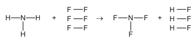

Determine if the above reaction is exothermic or endothermic using the following bond energies and by completing the following table. The first line has been done as an example. Bond energy is the amount of energy, in kJ / mole, needed to break or make one mole of the bond.

| bond | bond energy in kJ / mole |
|---|---|
| N-H | 390 |
| F-F | 155 |
| N-F | 280 |
| H-F | 565 |

| bond | energy change / kJ |
|---|---|
| N-H | (3 x 390) = 1170 |
| F-F |   |
| N-F |   |
| H-F |   |

*Source: 2014 Ju33 Q5*

### Q10 — medium — 10 marks

**Q10** [4 marks]

**Extract:**

Sulfur is used to make sulphuric acid. In the UK, the annual production of the acid is about 2.5 million tonnes.

The reactions in the manufacture of sulfuric acid by the Contact Process are shown below.

| Sulfur |  | Sulfur dioxide |
|---|---|---|
| S | **reaction 1** | SO2 |
|   |   |   |
| Sulfur dioxide + oxygen |  | Sulfur trioxide |
| 2SO2 + O2 | **reaction 2** | 2SO3 |
|   |   |   |
| Sulfur trioxide |  | Oleum |
| 2SO3 | **reaction 3** | H2S2O7 |
|   |   |   |
| Oleum + water |  | Sulfuric acid |
| H2S2O7 | **reaction 4** | H2SO4 |

Sulfur is used to make sulphuric acid. In the UK, the annual production of the acid is about 2.5 million tonnes.

The reactions in the manufacture of sulfuric acid by the Contact Process are shown below.

Sulfur                            $\underset{}{\rightarrow}$               Sulfur dioxide

S                                         **reaction 1**                            SO2

Sulfur dioxide + oxygen             $\underset{}{\rightarrow}$                Sulfur trioxide

2SO2 + O2                                          **reaction 2**                                 2SO3

Sulfur trioxide              $\underset{}{\rightarrow}$                                  Oleum

2SO3                                **reaction 3**                               H2S2O7

Oleum + water                 $\underset{}{\rightarrow}$                             Sulfuric acid

H2S2O7                           **reaction 4**                                         H2SO4

i) Name the catalyst used in reaction **2**.

[1]

ii) Reaction **2** is exothermic. Why is a catalyst, rather than a higher temperature, used to increase the rate of this reversible reaction?

[2]

iii) Write a symbol equation for reaction **4**.

[1]

*Source: 2004 Ju31 Q2*

**Q10** [6 marks]

**Extract:**

Sulfur is used to make sulphuric acid. In the UK, the annual production of the acid is about 2.5 million tonnes.

About one third of this production of acid is used to make nitrogen and phosphorus-containing fertilisers.

i) Name the third element that is essential for plant growth and is present in most fertilisers.

[1]

ii) Name a nitrogen-containing fertiliser that is manufactured from sulphuric acid.

[1]

iii) Rock phosphate (calcium phosphate) is obtained by mining. It reacts with concentrated sulphuric acid to form the fertiliser, superphosphate. Predict the formula of each of these phosphates.

| **Fertiliser** | **Ions** | **Formula** |
|---|---|---|
| calcium phosphate | Ca2+ and PO43- | ................................................................. |
| calcium superphosphate | Ca2+ and H2PO4- | ................................................................. |

[2]

iv) The ionic equation for the reaction between the phosphate ion and sulphuric acid is shown below.

PO43– + 2H2SO4 → H2PO4– + 2HSO4–

Explain why the phosphate ion is described as acting as a base in this reaction.

[2]

*Source: 2004 Ju31 Q2*

### Q11 — hard — 12 marks

**Q11** [6 marks]

This question is about compounds of nitrogen.

i) Describe the Haber Process giving reaction conditions and a chemical equation.

Reference to rate and yield is not required.

[5]

ii) Give one use of ammonia.

[1]

*Source: 2016 Ja42 Q5*

**Q11** [2 marks]

The diagram shows the structure of a hydrazine molecule.

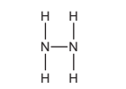

Draw the electron arrangement of a hydrazine molecule. Show the outer shell electrons only.

*Source: 2016 Ja42 Q5*

**Q11** [1 mark]

**Extract:**

Hydrazine is a base.

Hydrazine is a base.

Define the term base.

*Source: 2016 Ja42 Q5*

**Q11** [3 marks]

Nitrogen dioxide is an atmospheric pollutant.

i) State one environmental problem caused by nitrogen dioxide.

[1]

ii) Explain how oxides of nitrogen, such as nitrogen dioxide, are formed in car engines.

[2]

*Source: 2016 Ja42 Q5*

### Q12 — hard — 15 marks

**Q12** [5 marks]

Sulfuric acid is made by the Contact Process.

2SO2 (g) + O2 (g) → 2SO3 (g)   forward reaction is exothermic

i) What are the reaction conditions for the Contact Process?

[3]

ii) Would the yield of sulfur trioxide increase, decrease or stay the same when the temperature is increased? Explain your answer.

[2]

*Source: 2002 O31 Q1*

**Q12** [4 marks]

There are three ways of making salts from sulphuric acid.

<u>Titration</u> using a burette and indicator <u>Precipitation</u> by mixing the solutions and filtering <u>Neutralisation</u> of sulphuric acid using an excess of an insoluble base Complete the following table of salt preparations.

| **Method** | **Reactant 1** | **Reactant 2** | **Salt** |
|---|---|---|---|
| Titration | sulphuric acid |   | sodium sulphate |
| Neutralisation | sulphuric acid |   | zinc sulphate |
| Precipitation | sulphuric acid |   | barium sulphate |
|   | sulphuric acid | copper(II) oxide | copper(II) sulphate |

*Source: 2002 O31 Q1*

**Q12** [6 marks]

The results of an investigation into the action of heat on copper(II) sulphate-5-water, a blue crystalline solid, are given below. The formula is CuSO4.5H2O and the mass of one mole is 250 g A 5.0 g sample of the blue crystals is heated to form 3.2 g of a white powder. With further heating this decomposes into a black powder and sulphur trioxide.

i) Name the white powder.

[1]

ii) What is observed when water is added to the white powder?

[1]

iii) Name the black powder.

[1]

iv) Calculate the mass of the black powder. Show your working.

[3]

*Source: 2002 O31 Q1*

### Q13 — easy — 7 marks

**Q13** [2 marks]

#### Separate: Chemistry and Extended Only

Iodine reacts with chlorine to form dark brown iodine monochloride.

I2 + Cl2 → 2ICl

This reacts with more chlorine to give yellow iodine trichloride. There is an equilibrium between these iodine chlorides.

ICl (l) + Cl2 (g) $\rightleftharpoons$ICl3 (s)

dark brown              yellow

Explain what is meant by *equilibrium*.

*Source: 2010 Ju31 Q6*

**Q13** [2 marks]

**Extract:**

Iodine reacts with chlorine to form dark brown iodine monochloride.
I~2~ + Cl~2 ~→ 2ICl
This reacts with more chlorine to give yellow iodine trichloride. There is an equilibrium between these iodine chlorides.
ICl (l) + Cl~2~ (g) ⇌ ICl~3~ (s)
dark brown              yellow

#### Separate: Chemistry and Extended Only

When the equilibrium mixture is heated it becomes a darker brown colour. 
Is the reverse reaction endothermic or exothermic? Give a reason for your choice.

*Source: 2010 Ju31 Q6*

**Q13** [3 marks]

**Extract:**

Iodine reacts with chlorine to form dark brown iodine monochloride. I~2~ + Cl~2 ~→ 2ICl. This reacts with more chlorine to give yellow iodine trichloride. There is an equilibrium between these iodine chlorides. ICl (l) + Cl~2~ (g) ⇌ ICl~3~ (s) dark brown yellow

#### Separate: Chemistry and Extended Only

The pressure on the equilibrium mixture is decreased.

i) How would this affect the position of equilibrium and why?

[2]

ii) Describe what you would observe.

[1]

*Source: 2010 Ju31 Q6*

### Q14 — medium — 13 marks

**Q14** [5 marks]

**Extract:**

Carbonyl chloride, COCl2, is widely used in industry to make polymers, dyes and pharmaceuticals.

Carbonyl chloride was first made in 1812 by exposing a mixture of carbon monoxide and chlorine to bright sunlight.

This is a photochemical reaction.

CO (g) + Cl2 (g) → COCl2 (g)

Carbonyl chloride, COCl2, is widely used in industry to make polymers, dyes and pharmaceuticals.

Carbonyl chloride was first made in 1812 by exposing a mixture of carbon monoxide and chlorine to bright sunlight.

This is a photochemical reaction.

CO (g) + Cl2 (g) → COCl2 (g)

i) Explain the phrase *photochemical reaction*.

[2]

ii) Give another example of a photochemical reaction and explain why it is important either to the environment or in industry.

[3]

*Source: 2012 O31 Q5*

**Q14** [5 marks]

**Extract:**

Carbonyl chloride, COCl2, is widely used in industry to make polymers, dyes and pharmaceuticals.

Carbonyl chloride was first made in 1812 by exposing a mixture of carbon monoxide and chlorine to bright sunlight.

This is a photochemical reaction.

CO (g) + Cl2 (g) → COCl2 (g)

Carbonyl chloride is now made by the reversible reaction given below.

CO (g) + Cl2 (g) $\rightleftharpoons$ COCl2 (g)

The forward reaction is exothermic.

The reaction is catalysed by carbon within a temperature range of 50 to 150 °C.

i) Predict the effect on the yield of carbonyl chloride of increasing the pressure.

Explain your answer.

[2]

ii) If the temperature is allowed to increase to above 200°C, very little carbonyl chloride is formed. Explain why.

[2]

iii) Explain why a catalyst is used.

[1]

*Source: 2012 O31 Q5*

**Q14** [3 marks]

The structural formula of carbonyl chloride is given below.

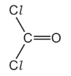

Draw a diagram showing the arrangement of the outer (valency) electrons in one molecule of this covalent compound.

Use o to represent an electron from a carbon atom.

Use x to represent an electron from a chlorine atom.

Use ● to represent an electron from an oxygen atom.

*Source: 2012 O31 Q5*

### Q15 — medium — 18 marks

**Q15** [1 mark]

**Extract:**

Ammonia is manufactured by the Haber process. Nitrogen and hydrogen are passed over a catalyst at a temperature of 450 °C and a pressure of 200 atmospheres. The equation for the reaction is as follows.

N2 + 3H2  2NH3

The forward reaction is exothermic.

Ammonia is manufactured by the Haber process. Nitrogen and hydrogen are passed over a catalyst at a temperature of 450 °C and a pressure of 200 atmospheres. The equation for the reaction is as follows.

N2 + 3H2 $\rightleftharpoons$ 2NH3

The forward reaction is exothermic.

State **one** use of ammonia.

*Source: 2015 Ja32 Q3*

**Q15** [1 mark]

**Extract:**

N~2~ + 3H~2~ \$\$\rightleftharpoons\$\$ 2NH~3~

What is the meaning of the symbol $\rightleftharpoons$?

*Source: 2015 Ja32 Q3*

**Q15** [2 marks]

**Extract:**

Ammonia is manufactured by the Haber process. Nitrogen and hydrogen are passed over a catalyst at a temperature of 450 °C and a pressure of 200 atmospheres. The equation for the reaction is as follows. N~2~ + 3H~2~ ⇌ 2NH~3~ The forward reaction is exothermic.

What are the sources of nitrogen and hydrogen used in the Haber process?

nitrogen ...................... 
hydrogen ....................

*Source: 2015 Ja32 Q3*

**Q15** [1 mark]

**Extract:**

Ammonia is manufactured by the Haber process. Nitrogen and hydrogen are passed over a catalyst at a temperature of 450 °C and a pressure of 200 atmospheres. The equation for the reaction is as follows. N~2~ + 3H~2~ ⇌ 2NH~3~ The forward reaction is exothermic.

Name the catalyst in the Haber process.

*Source: 2015 Ja32 Q3*

**Q15** [4 marks]

**Extract:**

Ammonia is manufactured by the Haber process. Nitrogen and hydrogen are passed over a catalyst at a temperature of 450 °C and a pressure of 200 atmospheres. The equation for the reaction is as follows. N~2~ + 3H~2~ \$\$\rightleftharpoons\$\$ 2NH~3~ The forward reaction is exothermic.

i)If a temperature higher than 450 °C was used in the Haber process, what would happen to the **rate** of the reaction? Give a reason for your answer.

[2]

ii) If a temperature higher than 450 °C was used in the Haber process, what would happen to the **yield** of ammonia? Give a reason for your answer.

[2]

*Source: 2015 Ja32 Q3*

**Q15** [4 marks]

**Extract:**

Ammonia is manufactured by the Haber process. Nitrogen and hydrogen are passed over a catalyst at a temperature of 450 °C and a pressure of 200 atmospheres. The equation for the reaction is as follows. N~2~ + 3H~2~ \$\$\rightleftharpoons\$\$ 2NH~3~ The forward reaction is exothermic.

i) If a pressure higher than 200 atmospheres was used in the Haber process, what would happen to the **yield** of ammonia? Give a reason for your answer.

[2]

ii) Explain why the rate of reaction would be faster if the pressure was greater than 200 atmospheres.

[1]

iii) Suggest **one** reason why a pressure higher than 200 atmospheres is not used in the Haber process.

[1]

*Source: 2015 Ja32 Q3*

**Q15** [2 marks]

Draw a dot-and-cross diagram to show the arrangement of the outer (valency) electrons in one molecule of ammonia.

*Source: 2015 Ja32 Q3*

**Q15** [3 marks]

Ammonia acts as a base when it reacts with sulfuric acid.

i) What is a base?

[1]

ii) Write a balanced equation for the reaction between ammonia and sulfuric acid.

[2]

*Source: 2015 J32 Q3*

### Q16 — hard — 7 marks

**Q16** [7 marks]

Almost all samples of nitrogen dioxide are an equilibrium mixture of nitrogen dioxide, NO2, and dinitrogen tetroxide, N2O4.

|   | forward reaction |   |
|---|---|---|
| 2NO2 (g) | $\rightleftharpoons$ | N2O4 (g) |
| dark brown | backward reaction | colourless |

In the forward reaction, a bond forms between the two nitrogen dioxide molecules.

NO2 + NO2 → O2N–NO2

i) Explain the term *equilibrium mixture*.

[1]

ii) The syringe contains a sample of the equilibrium mixture. The plunger was pulled back reducing the pressure.

How would the colour of the gas inside the syringe change? Give an explanation for your answer.

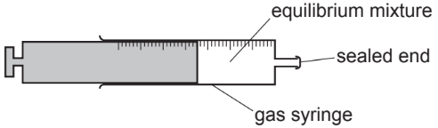

[3]

iii) A sealed tube containing an equilibrium mixture of nitrogen dioxide and dinitrogen tetroxide was placed in a beaker of ice cold water. The colour of the mixture changed from brown to pale yellow.

Is the forward reaction exothermic or endothermic? Give an explanation for your choice.

[2]

iv) What other piece of information given in the equation supports your answer to (iii)?

NO2 + NO2 → O2N–NO2

[1]

*Source: 2013 Ju33 Q5*

### Q17 — medium — 11 marks

**Q17** [2 marks]

Reversible reactions can come to equilibrium. The following are three examples of types of gaseous equilibria.

A2 (g) + B2 (g)$\rightleftharpoons$2AB (g)    **reaction 1**

A2 (g) + 3B2 (g)$\rightleftharpoons$ 2AB3 (g)    **reaction 2**

2AB2 (g) $\rightleftharpoons$2AB(g) + B2 (g)    **reaction 3**

Explain the term *equilibrium*.

*Source: 2011 O31 Q4*

**Q17** [9 marks]

**Extract:**

Reversible reactions can come to equilibrium. The following are three examples of types of gaseous equilibria.

A~2~ (g) + B~2~ (g) ⇌ 2AB (g)    reaction 1

A~2~ (g) + 3B~2~ (g) ⇌ 2AB~3~ (g)    reaction 2

2AB~2~ (g) ⇌ 2AB(g) + B~2~ (g)    reaction 3

The following graphs show how the percentage of products of a reversible reaction at equilibrium could vary with pressure.
 For each graph, decide whether the percentage of products decreases, increases or stays the same when the pressure is increased, then match each graph to one of the above reactions and give a reason for your choice.

i).

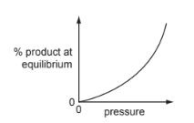

effect on percentage of products ..................................................................... 
reaction ...................................................................................................................... 
reason ........................................................................................................................

[3]

ii)

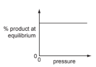

effect on percentage of products ..................................................................... 
reaction ...................................................................................................................... 
reason ........................................................................................................................

[3]

iii).

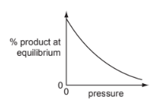

effect on percentage of products ..................................................................... 
reaction ...................................................................................................................... 
reason ........................................................................................................................

[3]

*Source: 2011 O31 Q4*

### Q18 — medium — 12 marks

**Q18** [4 marks]

**Extract:**

Carbonyl chloride, COCl2, is a colourless gas. It is made by the following reaction.

cool

CO (g) + Cl2 (g)                    COCl2 (g)

heat

When the pressure on the equilibrium mixture is decreased, the position of equilibrium moves to left.

Carbonyl chloride, COCl2, is a colourless gas. It is made by the following reaction.

cool

CO (g) + Cl2 (g)          $\rightleftharpoons$          COCl2 (g)

heat

When the pressure on the equilibrium mixture is decreased, the position of equilibrium moves to left.

i) How does the concentration of each of the three chemicals change?

[2]

ii) Explain why the position of equilibrium moves to the left.

[2]

*Source: 2008 Ju31 Q5*

**Q18** [2 marks]

**Extract:**

Carbonyl chloride, COCl~2~, is a colourless gas. It is made by the following reaction.

                                                    cool

CO (g) + Cl~2~ (g)          \$\$\rightleftharpoons\$\$          COCl~2~ (g)

                                                  heat

Using the information given with the equation, is the forward reaction exothermic or endothermic? Give a reason for your choice.

*Source: 2008 Ju31 Q5*

**Q18** [2 marks]

**Extract:**

Carbonyl chloride, COCl~2~, is a colourless gas.

Carbonyl chloride reacts with water to form two acidic compounds.

Suggest which acidic compounds are formed.

1. .......................................................................................

2. .......................................................................................

*Source: 2008 Ju31 Q5*

**Q18** [4 marks]

**Extract:**

Carbonyl chloride, COCl~2~, is a colourless gas.

The structural formula of carbonyl chloride is given below.

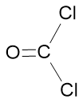

Draw a diagram that shows the arrangement of the valency electrons in one molecule of this covalent compound.

Use x for an electron from a chlorine atom.

Use o for an electron from a carbon atom.

Use ● for an electron from an oxygen atom.

*Source: 2008 Ju31 Q5*

### Q19 — hard — 13 marks

**Q19** [5 marks]

**Extract:**

Carbonyl chloride is made from carbon monoxide and chlorine.

CO (g) + Cl2 (g)   COCl2 (g)

Two methods of preparing carbon monoxide are from methane and oxygen, and from methane and steam.

The reaction between methane and oxygen can also form carbon dioxide.

Carbonyl chloride is made from carbon monoxide and chlorine.

CO (g) + Cl2 (g) $\rightleftharpoons$  COCl2 (g)

Two methods of preparing carbon monoxide are from methane and oxygen, and from methane and steam.

The reaction between methane and oxygen can also form carbon dioxide.

i) How can carbon monoxide be made instead of carbon dioxide?

[1]

ii) The following reaction is used to make carbon monoxide and hydrogen.

The reaction is carried out at 1100 °C and normal pressure.

CH4 (g) + H2O (g)  $\rightleftharpoons$  CO (g) + 3H2 (g)

The reaction is reversible and comes to equilibrium. Suggest why a high temperature is used.

[2]

iii) What is the disadvantage of using a high pressure for the reaction given in (a)(ii)?

[2]

*Source: 2014 Ju32 Q5*

**Q19** [5 marks]

**Extract:**

Chlorine is made by the electrolysis of concentrated aqueous sodium chloride.

Chlorine is made by the electrolysis of concentrated aqueous sodium chloride.

Describe this electrolysis. Write ionic equations for the reactions at the electrodes and name the sodium compound formed.

*Source: 2014 Ju32 Q5*

**Q19** [3 marks]

The structural formula of carbonyl chloride is given below.

Draw a diagram showing the arrangement of the valency electrons around the atoms in one molecule of this covalent compound.

Use ○ to represent an electron from a carbon atom. Use × to represent an electron from a chlorine atom. Use ● to represent an electron from an oxygen atom.

*Source: 2014 Ju32 Q5*

### Q20 — hard — 6 marks

**Q20** [2 marks]

**Extract:**

Sulfur is needed for the production of sulfuric acid. Two of the major sources of sulfur are:

- Underground deposits of the element sulfur,
- Sulfur compounds from natural gas and petroleum.

Sulfur is needed for the production of sulfuric acid. Two of the major sources of sulfur are:

- Underground deposits of the element sulfur,
- Sulfur compounds from natural gas and petroleum.

Explain why sulfur and its compounds are removed from these fuels before they are burned.

*Source: 2011 O32 Q2*

**Q20** [4 marks]

Describe how sulfur dioxide is changed into sulfur trioxide. Give the reaction conditions and an equation.

*Source: 2011 O32 Q2*

### Q21 — easy — 5 marks

**Q21** [3 marks]

**Extract:**

Ammonia is manufactured by the Haber Process.

N2 (g) + 3H2 (g)  2NH3 (g)

200 atmospheres 450°C

The forward reaction is exothermic.

#### Separate: Chemistry and Extended Only

Ammonia is manufactured by the Haber Process.

N2 (g) + 3H2 (g) $\rightleftharpoons$ 2NH3 (g)

200 atmospheres 450°C

The forward reaction is exothermic.

i) What is the catalyst for this reaction?

[1]

ii) Newer catalysts have been discovered for this process. Using these catalysts, the operating temperature is lowered from 450°C to 400°C. What is the advantage of using a lower temperature? Explain your answer.

advantage..........................................................................................................

explanation.......................................................................................................

[2]

*Source: 2011 O33 Q3*

**Q21** [2 marks]

**Extract:**

Ammonia is manufactured by the Haber Process. N2 (g) + 3H2 (g) ⇌ 2NH3 (g) 200 atmospheres 450°C The forward reaction is exothermic.

#### Separate: Chemistry and Extended Only

After passing over the catalyst, the mixture contains 15% of ammonia. It is cooled and the ammonia liquefies and is separated from the unreacted nitrogen and hydrogen. They are recycled.

i) How are the gases recycled?

[1]

ii) Only ammonia gas liquefies. Suggest an explanation for this.

[1]

*Source: 2006 O31  Q5*

### Q22 — easy — 9 marks

**Q22** [3 marks]

Ammonia is an important industrial chemical.

i) Give the electronic structure of an atom of nitrogen.

[1]

ii) Use this electronic structure, rather than the valency of nitrogen, to explain why the formula of ammonia is NH3, not NH4.

[2]

*Source: 2010 O31 Q4*

**Q22** [6 marks]

#### Separate: Chemistry and Extended Only

Ammonia is made by the Haber Process.

N2 (g) + 3H2 (g)   $\rightleftharpoons$  2NH3 (g)

The forward reaction is exothermic.

The percentage of ammonia in the equilibrium mixture varies with conditions.

| **Pressure/ atmospheres** | **100** | **200** | **300** | **400** |
|---|---|---|---|---|
| % ammonia at 300 °C | 45 | 65 | 72 | 78 |
| % ammonia at 500 °C | 9 | 18 | 25 | 31 |

The conditions actually used are 200 atmospheres, 450 °C and an iron catalyst. Osmium was previously used as the catalyst for this process.

i) Suggest a reason why it was changed to iron.

[1]

ii) Explain why the highest pressure gives the highest percentage of ammonia in the equilibrium mixture.

[2]

iii) What happens to the unreacted nitrogen and hydrogen?

[1]

iv) State one advantage and one disadvantage of using a lower temperature. 
advantage ................................................................................................................. 
disadvantage ..........................................................................................................

[2]

*Source: 2010 O31 Q4*

### Q23 — hard — 14 marks

**Q23** [5 marks]

Ammonia is manufactured by the Haber process.

N2(g) + 3H2(g)  $\rightleftharpoons$  2NH3

The forward reaction is exothermic.

Describe how the reactants are obtained.

i) Nitrogen ....................................................................................................................................

[2]

ii) Hydrogen ..................................................................................................................................

[3]

*Source: 2013 O31 Q3*

**Q23** [9 marks]

**Extract:**

Ammonia is manufactured by the Haber process.

N~2~(g) + 3H~2~(g)  \rightleftharpoons  2NH~3~

The forward reaction is exothermic.

The percentage of ammonia in the equilibrium mixture varies with temperature and pressure.

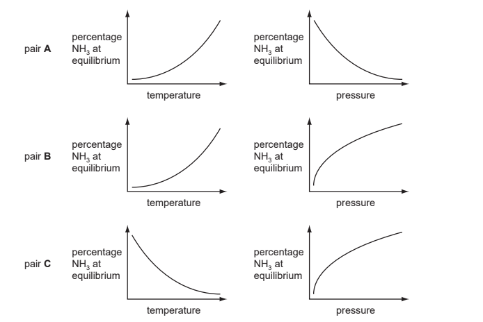

i) Which pair of graphs, A, B or C, shows correctly how the percentage of ammonia at equilibrium varies with temperature and pressure?

[1]

ii) Give a full explanation of why the pair of graphs you have chosen in (i) is correct.

[6]

iii) Catalysts do not alter the position of equilibrium. Explain why a catalyst is used in this process.

[2]

*Source: 2013 O31 Q3*

### Q24 — hard — 8 marks

**Q24** [5 marks]

**Extract:**

Sulfuric acid is produced by the Contact process. The steps of the Contact process are shown.

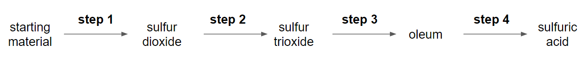

Sulfuric acid is produced by the Contact process. The steps of the Contact process are shown.

Describe step 2, giving reaction conditions and a chemical equation. Reference to reaction rate and yield is not required.

*Source: 2016 Ju41 Q1*

**Q24** [3 marks]

**Extract:**

Dilute sulfuric acid is a typical acid. A student adds excess dilute sulfuric acid to a sample of solid copper(II) carbonate in a test-tube.

Dilute sulfuric acid is a typical acid. A student adds excess dilute sulfuric acid to a sample of solid copper(II) carbonate in a test-tube.

i) Give three observations the student would make.

[2]

ii) Give the names of all products formed.

[1]

*Source: 2016 Ju41 Q5*

### Q25 — medium — 11 marks

**Q25** [2 marks]

**Extract:**

In 1909, Haber discovered that nitrogen and hydrogen would react to form ammonia. The yield of ammonia was 8%.

N2 (g) + 3H2 (g) 2NH3 (g)

The forward reaction is exothermic

catalyst: platinum 
temperature: 600 oC 
pressure: 200 atm

In 1909, Haber discovered that nitrogen and hydrogen would react to form ammonia. The yield of ammonia was 8%.

N2 (g) + 3H2 (g)$\rightleftharpoons$ 2NH3 (g)

The forward reaction is exothermic

catalyst: platinum 
temperature: 600 oC 
pressure: 200 atm

Describe how hydrogen is obtained for the modern process.

*Source: 2005 o31  Q7*

**Q25** [3 marks]

**Extract:**

In 1909, Haber discovered that nitrogen and hydrogen would react to form ammonia. The yield of ammonia was 8%.

N~2~ (g) + 3H~2~ (g) \rightleftharpoons 2NH~3~ (g)

The forward reaction is exothermic

catalyst: platinum

temperature: 600 ^o^C

pressure: 200 atm

i) What is the catalyst in the modern process?

[1]

ii) Explain why the modern process, which uses a lower temperature, has a higher yield of 15%.

[2]

*Source: 2005 O31 Q7*

**Q25** [6 marks]

**Extract:**

In 1909, Haber discovered that nitrogen and hydrogen would react to form ammonia. N~2~ (g) + 3H~2~ (g) ⇌ 2NH~3~ (g). The forward reaction is exothermic

i) Complete the following table that describes the bond breaking and forming in the reaction between nitrogen and hydrogen to form ammonia.

| **Bonds** | **Energy Change** | **Exothermic or Endothermic?** |
|---|---|---|
| 1 mole of N$\equiv$N broken | +945 | ....................................... |
| 3 moles of ............ broken | +1308 | ....................................... |
| 6 moles of N – H formed | -2328 | ....................................... |

[4]

ii) Explain, using the above data, why the forward reaction is exothermic.

[2]

*Source: 2005 o31 Q7*

### Q26 — medium — 13 marks

**Q26** [8 marks]

**Extract:**

Nitric acid is now made by the oxidation of ammonia. It used to be made from air and water. This process used very large amounts of electricity.

Air was blown through an electric arc and heated to 3000 °C.

| N2 (g) + O2 (g) | 2NO (g)       **equilibrium 1** |
|---|---|
|   | nitric oxide |

The equilibrium mixture leaving the arc contained 5% of nitric oxide. This mixture was cooled rapidly. At lower temperatures, nitric oxide will react with oxygen to form nitrogen dioxide.

| 2NO (g) + O2 (g) | 2NO2 (g)       **equilibrium 2** |
|---|---|

Nitrogen dioxide reacts with oxygen and water to form nitric acid

Nitric acid is now made by the oxidation of ammonia. It used to be made from air and water. This process used very large amounts of electricity.

Air was blown through an electric arc and heated to 3000 °C.

| N2 (g) + O2 (g) | $\rightleftharpoons$ 2NO (g)       **equilibrium 1** |
|---|---|
|   | nitric oxide |

The equilibrium mixture leaving the arc contained 5% of nitric oxide. This mixture was cooled rapidly. At lower temperatures, nitric oxide will react with oxygen to form nitrogen dioxide.

| 2NO (g) + O2 (g) | $\rightleftharpoons$ 2NO2 (g)       **equilibrium 2** |
|---|---|

Nitrogen dioxide reacts with oxygen and water to form nitric acid.

i) Suggest a reason why the yield of nitric oxide in **equilibrium 1** increases with temperature.

[1]

ii) What effect, if any, would increasing the pressure have on the percentage of nitric oxide in **equilibrium 1**? Explain your answer.

[2]

iii) Deduce why **equilibrium 2 **is only carried out at lower temperatures.

[2]

iv) Complete the equation for the reaction between nitrogen dioxide, water and oxygen to form nitric acid.

........NO2 + O2 + ............ → ............HNO3

[2]

v) Ammonia is more expensive than water and air. Suggest a reason why the ammonia-based process is preferred to the electric arc process.

[1]

*Source: 2013 O32 Q3*

**Q26** [5 marks]

**Extract:**

Nitric acid is used to make the fertiliser ammonium nitrate, NH4NO3.

Nitric acid is used to make the fertiliser ammonium nitrate, NH4NO3.

i) What advantage has this fertiliser over another common fertiliser, ammonium sulfate, (NH4)2SO4?

[1]

ii) Plants need nitrogen to make chlorophyll. Explain why chlorophyll is essential for plant growth.

[4]

*Source: 2013 O32 Q3*

### Q27 — hard — 11 marks

**Q27** [1 mark]

**Extract:**

Sulfuric acid is made by the Contact process.

The following equation represents the equilibrium in the Contact process.

2SO2 (g) + O2 (g)  2SO3 (g)

Oxygen is supplied from the air. The composition of the reaction mixture is 1 volume of sulfur dioxide to 1 volume of oxygen.

Sulfuric acid is made by the Contact process.

The following equation represents the equilibrium in the Contact process.

2SO2 (g) + O2 (g) $\rightleftharpoons$ 2SO3 (g)

Oxygen is supplied from the air. The composition of the reaction mixture is 1 volume of sulfur dioxide to 1 volume of oxygen.

What volume of air contains 1 dm3 of oxygen?

*Source: 2015 O31 Q3*

**Q27** [2 marks]

**Extract:**

Sulfuric acid is made by the Contact process. The following equation represents the equilibrium in the Contact process. 2SO~2 ~(g) + O~2 ~(g) \$\$\rightleftharpoons\$\$ 2SO~3 ~(g) Oxygen is supplied from the air. The composition of the reaction mixture is 1 volume of sulfur dioxide to 1 volume of oxygen.

Sulfur dioxide is more expensive than air.

What is the advantage of using an excess of air?

*Source: 2015 O31 Q3*

**Q27** [5 marks]

**Extract:**

Sulfuric acid is made by the Contact process. The following equation represents the equilibrium in the Contact process. 2SO~2 ~(g) + O~2 ~(g) ⇌ 2SO~3 ~(g)

The forward reaction is exothermic. The reaction is usually carried out at a temperature between 400 and 450 °C.

i) What is the effect on the position of equilibrium of using a temperature above 450 °C? 
Explain your answer.

[2]

ii) What is the effect on the rate of using a temperature below 400 °C? 
Explain your answer.

[3]

*Source: 2015 O31 Q3*

**Q27** [2 marks]

**Extract:**

Sulfuric acid is made by the Contact process. The following equation represents the equilibrium in the Contact process. 2SO~2 ~(g) + O~2 ~(g) \$\$\rightleftharpoons\$\$ 2SO~3 ~(g)

A low pressure, 2 atmospheres, is used. At equilibrium, about 98% SO3 is present.

i) What is the effect on the position of equilibrium of using a higher pressure?

[1]

ii) Explain why a higher pressure is not used.

[1]

*Source: 2015 O31 Q3*

**Q27** [1 mark]

**Extract:**

Sulfuric acid is made by the Contact process.

The following equation represents the equilibrium in the Contact process.

2SO~2 ~(g) + O~2 ~(g) ⇌ 2SO~3 ~(g)

Name the catalyst used in the Contact process.

*Source: 2015 O31 Q3*

### Q28 — medium — 13 marks

**Q28** [1 mark]

Ammonia is made by the Haber process.

N2 (g) + 3H2 (g) $\rightleftharpoons$ 2NH3 (g)

State one major use of ammonia.

*Source: 2012 O33 Q7*

**Q28** [3 marks]

Describe how hydrogen is obtained for the Haber process.

*Source: 2012 O33 Q7*

**Q28** [5 marks]

**Extract:**

Ammonia is made by the Haber process. N~2~ (g) + 3H~2~ (g) ⇌ 2NH~3~ (g)

This reaction is carried out at a high pressure, 200 atmospheres.

State, with an explanation for each, **two **advantages of using a high pressure.

*Source: 2012 O33 Q7*

**Q28** [4 marks]

**Extract:**

Ammonia is made by the Haber process. N~2~ (g) + 3H~2~ (g) \$\$\rightleftharpoons\$\$ 2NH~3~ (g)

i) What is the difference between an endothermic and an exothermic reaction?

[1]

ii) Bond breaking is an endothermic process. Bond energy is the amount of energy needed to break or form one mole of the bond.

Complete the table and explain why the forward reaction is exothermic.

| **bond** | **bond energy kJ / mol** | **energy change kJ** | **exothermic ** **or endothermic** |
|---|---|---|---|
| N$\equiv$N | 944 | +944 | endothermic |
| H–H | 436 | 3 x 436 = +1308 |   |
| N–H | 388 |   |   |

[3]

*Source: 2012 O33 Q7*

### Q29 — hard — 14 marks

**Q29** [4 marks]

**Extract:**

The Carlsbad caverns in New Mexico are very large underground caves. Although the walls of these caves are coated with gypsum (hydrated calcium sulfate), the caves have been formed in limestone.

It is believed that the caves were formed by sulfuric acid reacting with the limestone.

The Carlsbad caverns in New Mexico are very large underground caves. Although the walls of these caves are coated with gypsum (hydrated calcium sulfate), the caves have been formed in limestone.

It is believed that the caves were formed by sulfuric acid reacting with the limestone.

i) Complete the word equation.

| calcium    + | sulfuric   → | calcium + | .................. + | .................. |
|---|---|---|---|---|
| carbonate | acid | sulfate |   |   |

[1]

ii) Describe how you could test the water entering the cave to show that it contained sulfate ions.

test ......................................

result ......................................

[2]

iii) How could you show that the water entering the cave has a high concentration of hydrogen ions?

[1]

*Source: 2005 Ju31 Q4A*

**Q29** [5 marks]

**Extract:**

Hydrogen sulfide gas which was escaping from nearby petroleum deposits was being oxidised to sulfuric acid.

Hydrogen sulfide gas which was escaping from nearby petroleum deposits was being oxidised to sulfuric acid.

i) Complete the equation for this reaction forming sulfuric acid.

H2S + .................... O2 → ....................

[2]

ii) Explain why all the hydrogen sulfide should be removed from the petroleum before it is used as a fuel.

[1]

iii) Draw a diagram to show the arrangement of the valency electrons in one molecule of the covalent compound hydrogen sulfide.

Use o to represent an electron from a sulfur atom. 
Use x to represent an electron from a hydrogen atom.

[2]

*Source: 2005 Ju31 Q4B*

**Q29** [2 marks]

**Extract:**

Sulfuric acid is manufactured by the Contact Process. Sulfur dioxide is oxidised to sulfur trioxide by oxygen.

2SO2 + O2 2SO3

Sulfuric acid is manufactured by the Contact Process. Sulfur dioxide is oxidised to sulfur trioxide by oxygen.

2SO2 + O2 $\rightleftharpoons$2SO3

i) Name the catalyst used in this reaction.

[1]

ii) What temperature is used for this reaction?

[1]

*Source: 2005 Ju31 Q4C*

**Q29** [3 marks]

**Extract:**

Gypsum is hydrated calcium sulphate, CaSO4.xH2O. It contains 20.9% water by mass.

Gypsum is hydrated calcium sulphate, CaSO4.xH2O. It contains 20.9% water by mass.

Calculate x.

*M*r: CaSO4, 136; H2O, 18.

79.1 g of CaSO4 = .............................. moles

20.9 g of H2O = .............................. moles

x = ..............................

*Source: 2005 Ju31 Q4D*

### Q30 — hard — 8 marks

**Q30** [4 marks]

**Extract:**

Nitrogen dioxide is a brown gas. It can be made by heating certain metal nitrates.

2Pb(NO3)2 → 2PbO + 4NO2 + O2

At most temperatures, samples of nitrogen dioxide are equilibrium mixtures.

2NO2 (g)     N2O4 (g) 
dark brown            pale yellow

Nitrogen dioxide is a brown gas. It can be made by heating certain metal nitrates.

2Pb(NO3)2 → 2PbO + 4NO2 + O2

At most temperatures, samples of nitrogen dioxide are equilibrium mixtures.

2NO2 (g)   $\rightleftharpoons$  N2O4 (g) 
dark brown            pale yellow

i) At 25 °C, the mixture contains 20 % of nitrogen dioxide. At 100 °C this has risen to 90%. Is the forward reaction exothermic or endothermic? Give a reason for your choice.

[2]

ii) Explain why the colour of the equilibrium mixture becomes lighter when the pressure on the mixture is increased.

[2]

*Source: 2010 Ju32 Q8*

**Q30** [4 marks]

**Extract:**

A 5.00 g sample of impure lead(II) nitrate was heated. The volume of oxygen formed was 0.16 dm3 measured at r.t.p. The impurities did not decompose.

Calculate the percentage of lead(II) nitrate in the sample.

2Pb(NO3)2    →   2PbO   +   4NO2  +   O2

A 5.00 g sample of impure lead(II) nitrate was heated. The volume of oxygen formed was 0.16 dm3 measured at r.t.p. The impurities did not decompose.

Calculate the percentage of lead(II) nitrate in the sample.

2Pb(NO3)2    →   2PbO   +   4NO2  +   O2

Number of moles of O2 formed = .......................................

Number of moles of Pb(NO3)2 in the sample = .......................................

Mass of one mole of Pb(NO3)2 = 331 g

Mass of lead(II) nitrate in the sample = ....................................... g

Percentage of lead(II) nitrate in sample = .....................................

*Source: 2010 Ju32 Q8*

### Q31 — easy — 4 marks

**Q31** [1 mark]

**Extract:**

Ammonia is manufactured by the Haber process.

The equation for the reaction is shown.

#### Separate: Chemistry Only

Ammonia is manufactured by the Haber process.

The equation for the reaction is shown.

$\mathrm{N}_{2} ( \mathrm{g} ) + 3 \mathrm{H}_{2} ( \mathrm{g} ) \rightleftharpoons 2 NH_{3} ( \mathrm{g} )$

State what is meant by the symbol $\rightleftharpoons$.

**Q31** [1 mark]

**Extract:**

Ammonia is manufactured by the Haber process.

#### Separate: Chemistry and Extended Only

State **one** source of hydrogen used in the manufacture of ammonia.

**Q31** [2 marks]

#### Separate: Chemistry and Extended Only

The table shows some data for the production of ammonia.

| pressure /atm | temperature / °C | percentage yield of ammonia |
|---|---|---|
| 250 | 350 | 58 |
| 100 | 450 | 28 |
| 400 | 450 | 42 |
| 250 | 550 | 20 |

Deduce the effect on the percentage yield of ammonia of:

- increasing the pressure of the reaction

- increasing the temperature of the reaction.

### Q32 — medium — 15 marks

**Q32** [3 marks]

**Extract:**

Ammonia contains the elements nitrogen and hydrogen. It is manufactured from these elements in the Haber process.

N2(g) + 3H2(g)      2NH3

The forward reaction is exothermic.

Ammonia contains the elements nitrogen and hydrogen. It is manufactured from these elements in the Haber process.

N2(g) + 3H2(g)   $\rightleftharpoons$   2NH3

The forward reaction is exothermic.

i) Nitrogen is obtained from liquid air by fractional distillation. Why does this technique separate liquid oxygen and nitrogen?

[1]

ii) Name two raw materials from which hydrogen is manufactured.

[2]

*Source: 2003 O31 Q1*

**Q32** [6 marks]

**Extract:**

Ammonia contains the elements nitrogen and hydrogen. It is manufactured from these elements in the Haber process. N~2~(g) + 3H~2~(g) ⇌ 2NH~3~ The forward reaction is exothermic.

The table shows how the percentage of ammonia in the equilibrium mixture varies with pressure at 600 °C.

| percentage ammonia | 8 | 12 | 15 | 20 |
|---|---|---|---|---|
| pressure / atm | 200 | 300 | 400 | 500 |

i) Explain why the percentage of ammonia increases as the pressure increases.

[2]

ii) How would the percentage of ammonia change if the measurements had been made at a lower temperature? Explain your answer.

[2]

iii) State two of the reaction conditions used in the Haber Process.

[2]

*Source: 20013 O31 Q1*

**Q32** [3 marks]

Ammonia is a base.

i) Name a particle that an ammonia molecule can accept from an acid.

[2]

ii) Write an equation for ammonia acting as a base.

[1]

*Source: 2003 O31 Q1*

**Q32** [3 marks]

Another compound that contains nitrogen and hydrogen is hydrazine, N2H4.

i) Draw the structural formula of hydrazine. Hydrogen can form only one bond per atom but nitrogen can form three.

[1]

ii) Draw a diagram that shows the arrangement of the valency electrons in one molecule of hydrazine. Hydrazine is a covalent compound. Use x to represent an electron from a nitrogen atom. Use o to represent an electron from a hydrogen atom.

[2]

*Source: 2003 O31 Q1*

### Q33 — medium — 13 marks

**Q33** [8 marks]

**Extract:**

The simplest alcohol is methanol.

It is manufactured by the following reversible reaction.

300 oC             
30 atm 
CO (g) + 2H2 (g)  CH3OH (g)

The simplest alcohol is methanol.

It is manufactured by the following reversible reaction.

300 oC             
30 atm 
CO (g) + 2H2 (g) $\rightleftharpoons$ CH3OH (g)

i) Reversible reactions can come to equilibrium. Explain the term *equilibrium*.

[1]

ii) At 400 oC, the percentage of methanol in the equilibrium mixture is lower than at 300 oC. Suggest an explanation.

[2]

iii) Suggest **two **advantages of using high pressure for this reaction. Give a reason for each advantage.

[5]

*Source: 2004 O31 Q3*

**Q33** [5 marks]

i) Complete the equation for the combustion of methanol in an excess of oxygen.

.......... CH3OH + .......... O2 → .............................. + ..............................

[2]

ii) Complete the word equation.

methanol + ethanoic acid → .......................  ..................... + ....................

[2]

iii) Methanol can be oxidised to an acid. Name this acid.

[1]

*Source: 2004 O31 Q3*

### Q34 — medium — 10 marks

**Q34** [4 marks]

**Extract:**

At present the most important method of manufacturing hydrogen is steam reforming of methane.

In the first stage of the process, methane reacts with steam at 800°C.

CH4(g) + H2O(g) 3H2(g) + CO(g)

In the second stage of the process, carbon monoxide reacts with steam at 200 °C.

CO(g) + H2O(g)    CO2(g) + H2(g)

At present the most important method of manufacturing hydrogen is steam reforming of methane.

In the first stage of the process, methane reacts with steam at 800°C.

CH4(g) + H2O(g) $\rightleftharpoons$3H2(g) + CO(g)

In the second stage of the process, carbon monoxide reacts with steam at 200 °C.

CO(g) + H2O(g)  $\rightleftharpoons$  CO2(g) + H2(g)

i) Explain why the position of equilibrium in the first reaction is affected by pressure but the position of equilibrium in the second reaction is not.

[2]

ii) Suggest why a high temperature is needed in the first reaction to get a high yield of products but in the second reaction a high yield is obtained at a low temperature.

[2]

*Source: 2013 Ju32 Q4*

**Q34** [6 marks]

**Extract:**

At present the most important method of manufacturing hydrogen is steam reforming of methane.

In the first stage of the process, methane reacts with steam at 800°C.

CH4(g) + H2O(g) 3H2(g) + CO(g)

In the second stage of the process, carbon monoxide reacts with steam at 200 °C.

CO(g) + H2O(g)    CO2(g) + H2(g)

Two other ways of producing hydrogen are cracking and electrolysis.

There are three products of the electrolysis of concentrated aqueous sodium chloride. Hydrogen is one of them.

i) Write an equation for the electrode reaction which forms hydrogen.

[2]

ii) Name the other two products of the electrolysis of concentrated aqueous sodium chloride and give a use of each one.

product ............................................ 
use ............................................

product ............................................ 
use ............................................

[4]

*Source: 2013 Ju32 Q4*

### Q35 — medium — 6 marks

**Q35** [2 marks]

**Extract:**

Ammonia is made by the Haber process.

N2 (g) + 3H2 (g)    2NH3 (g)

The forward reaction is exothermic. Typical reaction conditions are:

- finely divided iron catalyst,
- temperature 450 °C,
- pressure 200 atmospheres.

Ammonia is made by the Haber process.

N2 (g) + 3H2 (g)  $\rightleftharpoons$  2NH3 (g)

The forward reaction is exothermic. Typical reaction conditions are:

- finely divided iron catalyst,
- temperature 450 °C,
- pressure 200 atmospheres.

Explain why the catalyst is used as a very fine powder and larger pieces of iron are not used.

*Source: 2015 Ju32 Q4*

**Q35** [2 marks]

**Extract:**

Ammonia is made by the Haber process. N2 (g) + 3H2 (g) ⇌ 2NH3 (g). The forward reaction is exothermic. Typical reaction conditions are: finely divided iron catalyst, temperature 450 °C, pressure 200 atmospheres.

Using the above conditions, the equilibrium mixture contains about 15% ammonia.

State two changes to the reaction conditions which would increase the percentage of ammonia at equilibrium.

*Source: 2015 Ju32 Q4*

**Q35** [2 marks]

**Extract:**

Ammonia is made by the Haber process. N2(g) + 3H2(g) \u21cc 2NH3(g). The forward reaction is exothermic. Typical reaction conditions are: finely divided iron catalyst, temperature 450 °C, pressure 200 atmospheres.
Using the above conditions, the equilibrium mixture contains about 15% ammonia. State two changes to the reaction conditions which would increase the percentage of ammonia at equilibrium. Answer: Decrease temperature / temperature below 450°C; Increase pressure / pressure above 200 atm.

Suggest why the changes you have described in (b) are not used in practice.

*Source: 2015 Ju32 Q4*

### Q36 — medium — 8 marks

**Q36** [5 marks]

**Extract:**

Carbonyl chloride is made by the reversible reaction given below.

CO(g) + Cl2(g)  COCl2(g)

The forward reaction is exothermic. The reaction is catalysed by carbon within a temperature range of 50 to 150 °C.

Carbonyl chloride is made by the reversible reaction given below.

CO(g) + Cl2(g) $\rightleftharpoons$ COCl2(g)

The forward reaction is exothermic. The reaction is catalysed by carbon within a temperature range of 50 to 150 °C.

i) Predict the effect on the yield of carbonyl chloride of increasing the pressure. Explain your answer.

[2]

ii) If the temperature is allowed to increase to above 200 °C, very little carbonyl chloride is formed. Explain why.

[2]

iii) Explain why a catalyst is used.

[1]

*Source: 2012 Oct13 Q5*

**Q36** [3 marks]

The structural formula of carbonyl chloride is given below.

Draw a diagram showing the arrangement of the outer (valency) electrons in one molecule of this covalent compound.

Use o to represent an electron from a carbon atom.

Use x to represent an electron from a chlorine atom.

Use ● to represent an electron from an oxygen atom.

*Source: 2012 Oct13 Q5*

### Q37 — medium — 7 marks

**Q37** [7 marks]

**Extract:**

The main use of sulfur dioxide is the manufacture of sulfuric acid.

The Contact process changes sulfur dioxide into sulfur trioxide.

2SO2 (g) + O2 (g)  2SO3 (g)

The forward reaction is exothermic Temperature 400 to 450 °C Low pressure 1 to 10 atmospheres Catalyst vanadium(V) oxide

The main use of sulfur dioxide is the manufacture of sulfuric acid.

The Contact process changes sulfur dioxide into sulfur trioxide.

2SO2 (g) + O2 (g) $\rightleftharpoons$ 2SO3 (g)

The forward reaction is exothermic Temperature 400 to 450 °C Low pressure 1 to 10 atmospheres Catalyst vanadium(V) oxide

i) What is the formula of vanadium(V) oxide?

[1]

ii) Vanadium(V) oxide is an efficient catalyst at any temperature in the range 400 to 450 °C. Scientists are looking for an alternative catalyst which is efficient at 300°C. What would be the advantage of using a lower temperature?

[2]

iii) The process does not use a high pressure because of the extra expense. Suggest two advantages of using a high pressure? Explain your suggestions.

[4]

*Source: 2014 O31 Q3*

### Q38 — medium — 10 marks

**Q38** [7 marks]

**Extract:**

Reversible reactions can come to equilibrium. They have both a forward and a backward reaction.

When water is added to an acidic solution of bismuth(III) chloride, a white precipitate forms and the mixture slowly goes cloudy.

BiCl3 (aq) + H2O (l)       BiOCl (s) + 2HCl (aq)

colourless             white

Reversible reactions can come to equilibrium. They have both a forward and a backward reaction.

When water is added to an acidic solution of bismuth(III) chloride, a white precipitate forms and the mixture slowly goes cloudy.

BiCl3 (aq) + H2O (l)   `rightwards harpoon over leftwards harpoon from backward to forward of`    BiOCl (s) + 2HCl (aq)

colourless             white

i) Explain why the rate of the forward reaction decreases with time.

[2]

ii) Why does the rate of the backward reaction increase with time?

[1]

iii) After some time why does the appearance of the mixture remain unchanged?

[2]

iv) When a few drops of concentrated hydrochloric acid are added to the cloudy mixture, it changes to a colourless solution. Suggest an explanation.

[2]

*Source: 2005 O31 Q3*

**Q38** [3 marks]

**Extract:**

Both of the following reactions are reversible.

**reaction 1 **   N2 (g) + O2 (g)  2NO (g) 
**reaction 2  **  2NO (g) + O2 (g)  2NO2 (g)

Both of the following reactions are reversible.

**reaction 1 **   N2 (g) + O2 (g) $\rightleftharpoons$ 2NO (g) 
**reaction 2  **  2NO (g) + O2 (g) $\rightleftharpoons$ 2NO2 (g)

i) Suggest a reason why an increase in pressure does not affect the position of equilibrium for reaction 1.

[1]

ii) What effect would an increase in pressure have on the position of equilibrium for reaction 2? Give a reason for your answer.

[2]

*Source: 2005 O31 Q3*

### Q39 — hard — 15 marks

**Q39** [3 marks]

**Extract:**

Ammonia is a compound which only contains the elements nitrogen and hydrogen. It is a weak base.

Ammonia is a compound which only contains the elements nitrogen and hydrogen. It is a weak base.

i) Define the term *base*.

[1]

ii) Given aqueous solutions of ammonia and sodium hydroxide, both having a concentration of 0.1mol / dm3, how could you show that ammonia is the weaker base?

[2]

*Source: 2013 Ju31 Q6*

**Q39** [5 marks]

**Extract:**

Ammonia is manufactured by the Haber Process. The economics of this process require that as much ammonia as possible is made as quickly as possible.

Ammonia is manufactured by the Haber Process. The economics of this process require that as much ammonia as possible is made as quickly as possible.

Explain how this can be done using the following information.

The conditions for the following reversible reaction are:

- 450°C
- 200 atmospheres pressure
- iron catalyst

N2(g) + 3H2(g) $\rightleftharpoons$ 2NH3(g)                       the reaction is exothermic

*Source: 2013 Ju31 Q6*

**Q39** [2 marks]

Another compound which contains only nitrogen and hydrogen is hydrazine, N2H4.

Complete the equation for the preparation of hydrazine from ammonia.

.....NH3 + NaClO → N2H4 + ............ + H2O

*Source: 2013 Ju31 Q6*

**Q39** [3 marks]

**Extract:**

Another compound which contains only nitrogen and hydrogen is hydrazine, N~2~H~4~.

The structural formula of hydrazine is given below.

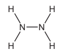

Draw a diagram showing the arrangement of the valency electrons in one molecule of the covalent compound hydrazine.

Use x to represent an electron from a nitrogen atom.

Use o to represent an electron from a hydrogen atom.

*Source: 2013 Ju31 Q6*

**Q39** [2 marks]

**Extract:**

Hydrazine is a weak base and it removes dissolved oxygen from water. It is added to water in steel boilers to prevent rusting.

Hydrazine is a weak base and it removes dissolved oxygen from water. It is added to water in steel boilers to prevent rusting.

i) One way it reduces the rate of rusting is by changing the pH of water. What effect would hydrazine have on the pH of water?

[1]

ii) Give a reason, other than pH, why hydrazine reduces the rate of rusting.

[1]

*Source: 2013 Ju31 Q6*

