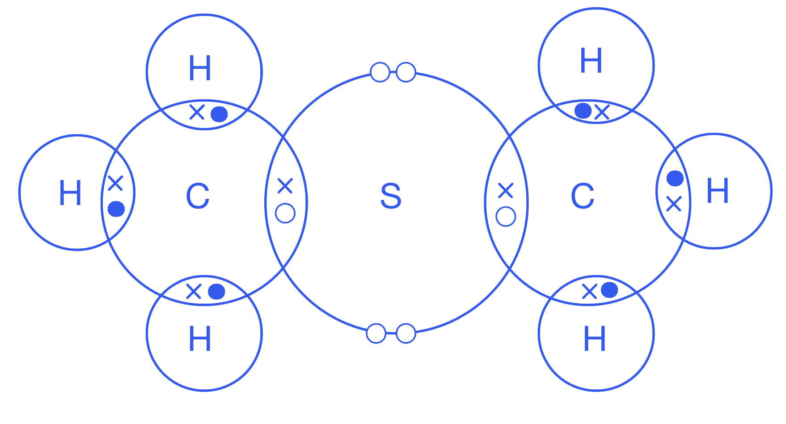

# Mark Schemes — Redox
**6. Chemical Reactions** · Cambridge (CIE) IGCSE chemistry (0620 & 0971)

## Multiple Choice Questions (28 questions)

### Q1
**Final answer:** **The correct answer is C**

**Step 1. **State the rules

Sum of oxidation numbers in a neutral compound = 0

K = +1 (Group I metal, forms 1+ ion)

O = −2

**State 2: **Set up the equation

(+1) + Mn + 4(−2) = 0

**Step 3: **Solve

+1 + Mn − 8 = 0
Mn = +7

### Q2
**Final answer:** **The correct answer is A**

To identify the agents (**which are always at the reactants**), you must first determine what is being oxidised and what is being reduced by looking at the electron transfer or changes in oxidation number

- **Zinc (Zn) **

  - The zinc atom goes from an oxidation state of 0 in Zn(s) to +2 in  ZnSO4 (aq)
  - The oxidation number of Zn has increased, this implies that Zn has lost electrons (oxidised)
  - Since zinc is **oxidised**, the substance that is oxidised acts as the **reducing agent** because it gives electrons to the other substance forcing it to reduce
- **Copper(II) sulfate (CuSO****4****) **

  - The copper ion goes from an oxidation state of +2 in CuSO4 (aq) to 0 in solid Cu(s)
  - The oxidation number of Cu has decreased this implies that Cu has gained electrons (reduced)
  - Since copper is** reduced**, the substance that is reduced acts as the **oxidising agent** because it takes electrons from the other substance forcing it to oxidise

**B** is incorrect as the agents are swapped

**C** & **D **are incorrect as oxidising and reducing agents must always be in the *reactants*

### Q3
**Final answer:** **The correct answer is D**

- Copper(II) sulphate **loses oxygen** when copper metal is formed

  - Loss of oxygen is **reduction**
- Therefore, **CuSO****4** is the substance that is reduced

**A **is incorrect because Zinc (Zn)  reacts with copper(II) sulphate (CuSO4) and **gains oxygen**, forming zinc sulphate (ZnSO4). Gaining oxygen is **oxidation**

**B **and **C **are incorrect because  ZnSO4  and Cu are products of the reaction. (ZnSO4) is a product of oxidation. C (Cu) is the product of reduction.

### Q4
**Final answer:** **The correct answer is ****B**** **

- When copper is heated in air, it reacts with oxygen to form copper oxide, a black solid:

  - copper + oxygen → copper oxide
- Copper gains oxygen, therefore it is oxidised

**A** is incorrect as it doesn't undergo decomposition, decomposition reactions involve a substance breaking down into two or more substances

**C** is incorrect as it does not burn with a lilac flame

**D** is incorrect as it does not lose oxygen so it is not reduced

### Q5
**Final answer:** **The correct answer is ****D**

- Reduction is the loss of oxygen
- In equation **D**, lead(II) oxide is gaining oxygen to form lead(IV) oxide, PbO2, therefore lead(II) oxide is being oxidised

**A, B** and **C** are incorrect as PbO is losing oxygen, therefore is being reduced, to form lead

### Q6
**Final answer:** **The correct answer is ****C**** **

- Oxidation is the gain of oxygen
- Carbon monoxide, CO, gains oxygen from iron(III) oxide, Fe2O3, to form carbon dioxide, CO2

**A**, **B **and** D **are incorrect as the substances underlined are all losing oxygen, therefore they are reduced

### Q7
**Final answer:** **The correct answer is ****C**** **

- Oxidation is defined as the gain of oxygen and reduction as the loss of oxygen
- Magnesium is oxidised as it gains oxygen in the reaction to form magnesium oxide

**A** is not correct as magnesium oxide is a product formed by the oxidation of magnesium

**B** is not correct as iron is a product formed by the reduction of iron(III) oxide

**D** is not correct as iron(III) oxide is reduced as it loses oxygen to form iron

### Q8
**Final answer:** **The correct answer is**** B**** **

There are three definitions of oxidation. It is a reaction in which:

- Oxygen is **added** to an element or a compound.
- An element, ion or compound **loses** electrons.
- The oxidation state of an element or compound is **increased**.

**A**,** C** and **D** are incorrect as these options do not correctly describe what happens during oxidation.

### Q9
**Final answer:** **The correct answer is**** B**** **

- Reduction is the **gain of electrons**.
- Mg2+ gains 2 electrons and its oxidation number changes from **+2** to **0**, hence it has been reduced.

**A** is incorrect as Mg loses electrons hence is **oxidised**.

**C** is incorrect as oxidation occurs since the oxidation number of Cr **increases** from +2 to +3.

**D** is incorrect as C has gained oxygen so it has been **oxidised**.

### Q10
**Final answer:** **The correct answer is**** C**** **

The oxidation state of V in V2O3 is **+3** and in V2O5 it is **+5**, hence its oxidation number has **increased**, so oxidation has occurred.

**A** is incorrect as reduction has occurred since the oxidation number of V **decreased** from +3 to +2.

**B** is incorrect as reduction has occurred since the oxidation number of V **decreased** from +5 to +4.

**D** is incorrect as reduction has occurred since the oxidation number of V **decreased** from +4 to +3.

### Q11
**Final answer:** **The correct answer is**** D**** **

- Oxygen has been **removed** from MnO, hence it has been reduced.
- Its oxidation number has **decreased** from +2 to 0.

**A** is incorrect as oxidation has occurred since the oxidation number of Mn **increased** from +3 to +7.

**B** is incorrect as oxidation has occurred since the oxidation number of Mn **increased** from +2 to +6.

**C** is incorrect as the oxidation number of Mn is +2 in both compounds.

### Q12
**Final answer:** **The correct answer is**** C**** **

- Carbon monoxide and calcium **removes **the** oxygen** from the other reactant, therefore acting as a reducing agent.
- The CO and Ca molecule is then itself oxidised as it **gains** an oxygen atom.

**A**, **B** and **D** are incorrect as the underlined substances in each option is reduced so they cannot themselves be the reducing agents.

### Q13
**Final answer:** **The correct answer is**** D**** **

- Carbon monoxide is an important **reducing agent** which is used in the extraction of **iron** from iron ore.
- It removes the oxygen from the iron ore:

Fe2O3 + 3CO → 2Fe + 3CO2

- In the reaction the carbon monoxide is itself oxidised:

3CO → 3CO2

**A**, **B** and** C** are incorrect as sulfuric acid, potassium permanganate and hydrogen peroxide are all oxidising agents.

### Q14
**Final answer:** **The correct answer is ****D**** **

- In the reaction the hydrogen **removes** the oxygen atom from the copper oxide molecule, hence the hydrogen is the **reducing agent.**
- In doing so, the hydrogen has itself now become oxidised by the copper oxide which is therefore the **oxidising agent.**
- C is incorrect as water is not an oxidising agent.

**A** is incorrect as water is not an oxidising agent.

**B** and **C** are incorrect as an oxidising agent must be able to add oxygen to another substance.

### Q15
**Final answer:** **The correct answer is**** A**** **

Oxygen has been added to CO in reactions 1 and 4.

**B** is incorrect as although carbon is oxidised in reaction 3, it is an element and **not an oxide**.

**C** is incorrect as NO is **reduced** in reaction 1 as it loses oxygen.

**D** is incorrect as Fe2O3 is **reduced** in reaction 4 as it loses oxygen.

### Q16
**Final answer:** **The correct answer is**** A**** **

- An oxidising agent is an element or a compound that **oxidises** another substance.
- In so doing the oxidising agent is itself **reduced**.
- A reducing agent is an element or a compound that **reduces** another substance.
- In so doing the reducing agent is itself **oxidised**.

**B** is incorrect as reducing agents decrease the oxidation number of substances.

**C** and **D** are incorrect as the opposite occurs for both the oxidising agent and the reducing agent in both options.

### Q17
**Final answer:** **The correct answer is**** B**** **

- When acidified potassium manganate (VII) is added to a reducing agent its colour changes from **pink-purple** to **colourless**.
- The MnO4- ions undergo **reduction **by electron gain to form Mn2+ ions which are colourless.

**A** is incorrect as the MnO4- are **reduced**, not oxidised.

**C** and **D** are incorrect as the colour change is the other way around.

### Q18
**Final answer:** **The correct answer is**** D**** **

- Oxidation number refers to a single** atom** or **ion** which can be on their own or in a compound.
- The oxidation number of a compound is **0** and of an element is also **0**.
- The oxidation number of an ion is equal to the **charge** of that ion e.g. Fー is  -1.
- The oxidation number of **oxygen** in a compound is always **-2** (except in peroxide R-O-O-R, where it is **-1**).
- There are 3 oxygens in Fe2O3,  so 3 x -2 = -6.
- As it is a compound, the overall charge must be 0, hence each Fe atom must be +3 since 2 x 3 = 6  and +6 - 6 = 0.

**A**, **B** and **C** are incorrect as these options do not provide an oxidation number of 0 for the compound.

### Q19
**Final answer:** **The correct answer is**** D**** **

- For CuSO4 it’s (II) as the oxidation state of Cu **+2** since SO42- is -2.
- For KMnO4 it's (VII) as the oxidation state of Mn is **+7** as K is +1 and each oxygen is -2, so 4 x -2 = -8 and -8 + 1 = -7. The compound is thus -7 + (+ 7) = 0.
- For FeCl3 it's (III) as the oxidation state of Fe is **+3** as each Cl is -1.

**A**,** B** and **C** are incorrect as these names do not correctly match with the formulae.

### Q20
**Final answer:** **The correct answer is**** B**** **

The colour changes to **brown** as **solid iodine** is formed in solution.

**A**,** C** and **D** are incorrect as solid iodine forms a brown colour in acidified solution, not yellow.

### Q21
**Final answer:** **The correct answer is**** A**** **

- For NO and MgO, oxygen has been added so they are **oxidised**:

NO → NO2            MgO → MgO2

- For O3, oxygen has been removed so it has been **reduced**:

O3 → O2

**B**,** C** and **D** are incorrect as these options do not correctly describe what happens to each reactant molecule.

### Q22
**Final answer:** **The correct answer is**** C**** **

There are three definitions of reduction. It is a reaction in which:

- Oxygen is **removed **from an element or a compound.
- An element, ion or compound **gains** electrons.
- The oxidation state of an element or compound is **decreased**.

**A**,** B** and **D **are incorrect as these options do not correctly describe what happens during reduction.

## Theory Questions (16 questions)

### Q1
a)  Identifying what has been oxidised with a reason:

- N / NH3; **[1 mark]**
- Change in oxidation state of N from -3 to +2 / increase in oxidation number / gain in oxygen / loss of electrons; **[1 mark]**

**[Total: 2 marks]**

- *You can explain why this is oxidation in 3 different ways:*

  - *As the gain of oxygen*
  - *As the loss of electrons (extended students only)*
  - *As the increases in oxidation number (Separate: Chemistry and extended only students)*
- *In this question, the simplest way to describe this is that nitrogen gains oxygen*
- *The oxidation number of N in NH**3** is -3 and is +2 in NO*
- *The oxidation number of N increases, so N is oxidised*
b)  The balanced chemical equation for this reaction is:

4KI + 2CuSO4 → 2CuI + I2 + 2K2SO4 

- Balancing of reactants; **[1 mark]**
- Balancing of products; **[1 mark]**

**[Total: 2 marks]**

- *This is not a straightforward equation to balance*
- *If you balance the K atoms by adding a 2 in front of KI on the left-hand side:*

  - *2**KI + CuSO**4** → CuI + I**2** + K**2**SO**4 *
- *This would give 2 I on the LHS and 3 I on the RHS, so this can't be correct*
- *But, if you doubled this, i.e:*

  - *4**KI + CuSO**4** → CuI + I**2** + **2**K**2**SO**4 *
- *Then this would give 4 I on the LHS and 3 on the RHS, which can be balanced by putting a 2 in front of CuI:*

  - *4KI + CuSO**4** → **2**CuI + I**2** + 2K**2**SO**4 *
- *Now, balance Cu and SO**4**:*

  - *4KI + **2**CuSO**4** → 2CuI + I**2** + 2K**2**SO**4 *
c)  The charge on the copper ion in CuI is:

- 1+; **[1 mark]**

**[Total: 1 mark]**

- *Copper can exist as ions of different charges*
- *Iodine only forms the 1- ion as it has 7 electrons in its outer shell so will gain one electron when it forms an ionic compound, giving it a 1- charge*
- *The formula shows that for every 1 ion of copper there is 1 ion of iodide*
- *The compound does not have an overall charge, so the positive and negative charges must cancel out*
- *This means that copper must have a 1+ charge*
- *Charges are shown with the number first, then the sign*

  - *If you wrote +1, you would still be awarded the mark*
d) Copper is reduced in this reaction because:

- (It / copper) gains electron(s); **[1 mark]**

**[Total: 1 mark]**

- *Copper changes from a 2+ ion in CuSO**4** to a 1+ ion in CuI*
- *This happens by copper gaining an electron:*

  - *Cu**2+** + e**–** → Cu**+*
- *Remember**: OIL RIG - **O**xidation **I**s **L**oss, **R**eduction **I**s **G**ain of electrons*
e) The reducing agent is:

- KI / potassium iodide / iodide (ions) / I–; **[1 mark]**

**[Total: 1 mark]**

- *A reducing agent is a substance that reduces another substance and becomes oxidised in the process*
- *In this case, the potassium iodide causes the reduction of copper, so it is, therefore, the reducing agent*

### Q2
An *oxidising agent *is a substance that:

- Oxidises another substance / makes another substance oxidise
**OR**
Gives oxygen to another substance
**OR**
Removes electrons from another substance; **[1 mark]**
- And is itself reduced / gets reduced
**OR**
Undergoes reduction
**OR**
Gains electrons; **[1 mark]**

**[Total: 2 marks]**

- *You should know the definitions for both oxidising agent and reducing agent*
- *You are also expected to know how to identify them in a redox reaction*
- *Remember: the substance that gets reduced is the oxidising agent*
- *You can define an oxidising agent in terms of:*

  - *Oxygen transfer (gives oxygen)*
  - *Electron transfer (accepts/removes electrons)*
  - *Or simply as a substance that oxidises another substance*
The relative formula mass of potassium manganate(VII), KMnO4 is:

- 39 + 55 + (4 x 16); **[1 mark]**
- = 158; **[1 mark]**

**[Total: 2 marks]**

- *To calculate the relative formula mass, add up the relative atomic masses, **A**r**, of all of the atoms present in the formula:*

  - *1 x K atom, 1 x Mn atom, 4 x O atoms*
- *Use the Periodic Table to obtain the relative atomic masses - in the version you are given in your exam, this is the number underneath the name of the element*

  - *M**r** = 1 x 39 + 1 x 55 + (4 x 16) = 158*
The colour change seen is:

- Purple to colourless;** [1 mark]**

**[Total: 1 mark]**

- *Potassium manganate(VII) has a distinctive purple colour*
- *When it is added to a reducing agent, the purple colour fades until it is colourless as it reacts with the reducing agent*
- *The other colour changes are all colour changes that you would observe with different indicators:*

  - *Thymolphthalein will turn from colourless in acids to blue in alkalis*
  - *Litmus will turn from red in acids to blue in alkalis*
  - *Methyl orange will turn from yellow in alkalis to red in acids*
The complete half-equation is:

2I– → I2 + 2e–

- 2 in front of the I-
**AND**
2 in front of the e–;** [1 mark]**

**[Total: 1 mark]**

- *Both balancing numbers are needed to obtain the mark*
- *Start by balancing I;  there are 2 on the right-hand side, to balance add a 2 in front of I**–**:*

  - *2**I**–** → I**2** + e**–*
- *Now, balance the charges; the charge is 2- on the left-hand side, so 2 electrons are needed on the right-hand side:*

  - *2I**–** → I**2** + **2**e**–*

### Q3
a) The matching key terms and definitions are:

- Oxidation = the gain of oxygen; **[1 mark]**
- Reduction = the loss of oxygen; **[1 mark]**
- Oxidising agent = a substance that oxidises another substance; **[1 mark]**
- Reducing agent = a substance that reduces another substance; **[1 mark]**

**[Total: 4 marks]**

- *You could be asked to define any of these key terms so ensure that you learn them*
b) The charge on the chromium ion in the compound chromium(II) oxide, CrO is:

- 2+;** [1 mark]**

**[Total: 1 mark]**

- *The Roman numeral in the name is the oxidation number*
- *The oxidation number of an element in a monoatomic ion is always the same as its charge*
- *Chromium is a metal so will form a positive ion, which means its charge is 2+*
- *A charge should be written with the number first followed by the sign*

  - *But, you would be awarded the mark if you wrote it as +2*
c) The complete half-equation is:

Cr** **→  Cr2+  +  2e–

- Cr** **
**AND**
2e(–); **[1 mark]**

**[Total: 1 mark]**

- *You are told that chromium(II) oxide forms from chromium, therefore the reactant must be chromium, Cr*
- *There is no overall charge given on the left-hand side*
- *So, to ensure there is no overall charge on the right-hand side, 2 electrons are needed*
d) This shows that oxygen has been reduced because:

- Oxygen / it has gained electrons;** [1 mark]**

**[Total: 1 mark]**

- *In terms of electrons, **O**xidation **I**s Loss,** R**eduction** I**s **G**ain (**OIL RIG**)*
- *The electrons are added to the oxygen, therefore oxygen is reduced*

### Q4
a)

i) A description of what you would observe when this reaction occurs:

- Change in colour from red-brown or orange to colourless (not just bromine decolourised);** [1 mark]**
- Yellow (not dark) / white solid / precipitate / goes cloudy; **[1 mark] ***Brown to yellow with no mention of solid / precipitate scores = maximum of 1 mark*

ii) A symbol equation for this reaction is:

- Br2 + Na2S $\rightarrow$ 2NaBr + S; **[1 mark]**

iii) Explain, in terms of electron transfer, why bromine is the oxidant (oxidising agent) in this reaction:

- Sulfide (ion) / sulfur (ion) loses electrons; **[1 mark]**
- Bromine accepts them; **[1 mark] ***Not sodium sulfide*

**[Total: 5 marks]**

- *Bromine, which is a red-brown solution, turns into bromide ions, which are colourless. It is important to state the initial colour and not just the final one*
- *The full equation needs to include the sodium, which is mentioned in the first line of the question*
- *The oxidising agent is the species which is reduced, which is the species that gains electrons*

  - *This allows something else to be oxidised; in this case the bromine accepts electrons, allowing the sulfide ion to lose them*
b)

i) **Reaction 1** is:

- Oxidation; **[1 mark]** *Not redox*

ii) The name of the colourless gas mentioned in **reaction 1 **is:

- Hydrogen / H2; **[1 mark] **
*Do not allow H*

iii) The name of the iron compound formed in **reaction 2** is:

- Iron(II) hydroxide / ferrous hydroxide; **[1 mark]**

iv) The balanced equation for **reaction 3** is:

- 4Fe(OH)2 + O2 + 2H2O $\rightarrow$ 4Fe(OH)3;** [1 mark]**

v)  The change from Fe(OH)2 to Fe(OH)3 is oxidation as:

- Oxidation number or state or valency increases / electron loss / Fe2+ to Fe3+; **[1 mark] **
*Do not allow gains oxygen*

vi) Iron in electrical contact with a piece of zinc does not rust as:

Any **three** from:

- Sacrificial protection or zinc is sacrificed / zinc corrodes not iron or zinc corrodes therefore iron doesn’t (not zinc rusts); **[1 mark]**
- Zinc is oxidised in preference to iron; **[1 mark]**
- Zinc reacts with oxygen and water in preference to iron; **[1 mark]**
- Zinc is more reactive or electropositive than iron; **[1 mark]**
- Zinc forms ions more readily than iron or zinc loses electrons more readily than iron;** [1 mark]**
- Electrons move on to iron;** [1 mark]**
- Iron is the cathode or zinc is the anode; **[1 mark]**

**[Total: 8 marks]**

- *The colourless gas needs to be from a reduction half equation that is gaining electrons, as the iron is losing electrons (oxidation)*

  - *This means that hydrogen ions going to hydrogen would be viable, but hydroxide or oxide ions going to oxygen are not viable*
  - *The proper name of the iron compound is iron (II) hydroxide, but the older name (not IUPAC) is accepted in this case. It may not be in the future, so learn the IUPAC name! It is important to include the (II) as iron can also be (III)*
- *The balanced equation is fairly standard, and half equations do not need to be deduced as there is an obvious change from Fe**2+** to Fe**3+** shown by the difference in the formulae of hydroxides*
- *Sacrificial protection by zinc is a common question on this topic and there are a number of valid marking points, just remember that electrons can travel through iron to get to the zinc and for the zinc to react and this is why the zinc does not have to coat the entire surface to be effective*

### Q5
a)

i) When the only oxidation state of an element is zero it means that the element:

- Does not form compounds / does not accept and does not lose electrons / has a full outer shell / has 8e- in outer shell / it is a Noble Gas / it is in Group 0/8; **[1 mark]**

ii) Some elements have positive oxidation states but others have negative ones as:

- Elements with a small number of outer electrons lose electrons and are then positive; **[1 mark]**
- Elements with a large number of outer electrons gain electrons and are then negative; **[1 mark]**

iii)  Two elements in the table which exist as diatomic molecules of the type X2 are:

Any **two** from

- Nitrogen; **[1 mark]**
- Oxygen; **[1 mark]**
- Fluorine; **[1 mark] ***Accept symbols / molecular formulae*

**[Total: 5 marks]**

- *This question is checking your basic redox knowledge by asking questions in  a slightly less direct manner than the normal*
- *You are also expected to recall the common diatomic gases, which are useful when writing equations later on too*
b)

i) Another metal with an amphoteric hydroxide is:

- Zinc / aluminium / lead / tin / chromium; **[1 mark]**

ii) The observation when an excess of aqueous sodium hydroxide is added gradually to aqueous beryllium sulfate is:

- White precipitate; **[1 mark]**
- Precipitate dissolves / colourless solution forms / forms a clear solution / soluble in excess; **[1 mark]**

**[Total: 3 marks]**

- *The amphoteric oxides within the specification are aluminium and zinc, both of which also have amphoteric hydroxides. The other metals listed are valid too but not expected knowledge*
- *When an excess of aqueous sodium hydroxide is added gradually to aqueous beryllium sulfate, the products formed are sodium sulfate and beryllium hydroxide*
- *The solubility rules tells us that:*

  - *Most sulfates are soluble, so sodium sulfate remains in solution*
  - *Most hydroxides are insoluble except for Group 1 metals, ammonium and calcium (partially), so beryllium hydroxide will be a precipitate*
- *Coloured precipitates occur when the metal is a transition metal, which beryllium is not, so the precipitate is white*
c)

i) The formulae of lithium fluoride and nitrogen fluoride are:

- LiF; **[1 mark]**
- NF3; **[1 mark]**

ii) Two differences in their properties are:

Any **two** from:

- LiF has higher mp / bp; **[1 mark]**
- LiF is a (crystalline) solid, NF3 is probably a gas / a liquid / LiF is less volatile; **[1 mark]**
- As liquids only LiF conducts;** [1 mark]**
- LiF is soluble in water, NF3 is not; **[1 mark]**
- When both solids LiF is harder; **[1 mark]**

iii) These two fluorides have different properties as:

- LiF is an ionic compound; **[1 mark]**
- NF3 is a covalent / molecular compound; **[1 mark]**

*For stating that one is ionic and the other covalent allow 1 mark if it is not specified which is which*

**[Total: 6 marks]**

- *The properties of ionic and both simple and giant covalent structures are commonly asked about in exams - make sure you know them! There are usually lots of choose from to access the marks*

### Q6
a)  This equation shows that Co3O4 is reduced because:

- Co3O4 loses oxygen / cobalt oxide loses oxygen / it loses oxygen / oxygen removed from cobalt oxide / gains electrons/ oxidation number of Co is reduced; **[1 mark]**

**[Total: 1 mark]**

- *Remember**: Reduction is a reaction in which oxygen is removed from a compound*
- *In this case, Co**3**O**4** loses oxygen to form Co*
- *In redox reactions oxidation and reduction take place together*
- *Hydrogen gains oxygen to form water so hydrogen is oxidised*
- *Your answer can refer to electrons or oxidation numbers (extended students only)*
b) In terms of changes in oxidation numbers, this is a redox reaction because:

- Copper: +2 to +1;** [1 mark]**
- Oxygen: –2 to 0; ** [1 mark]**
- Decrease in oxidation number is reduction 
**AND **
Increase in oxidation number is oxidation; ** [1 mark]**

**[Total: 3 marks]**

- *The oxidation number of an atom which is not combined with another atom of a different element is 0*

  - *The oxidation number of O**2** is therefore 0*
- *The oxidation number of a monoatomic ion is the same as its charge*

  - *The charge on Cu in CuO is 2+, so its oxidation number is +2*
  - *The charge on Cu in Cu2O is 1+, so its oxidation number is +1*
  - *The charge of O in CuO and Cu**2**O is 2-, so its oxidation number is -2*
- *The oxidation number of copper decreases, so copper is reduced*
- *The oxidation number of oxygen increases, so oxygen is oxidised*
c) This equation shows that iron gets oxidised because:

- Iron gains oxygen (from water); **[1 mark]**

**[Total: 1 mark]**

- *Oxidation is a reaction in which oxygen is added to an element or a compound*
- *This equation shows that Fe gains O**2** to form Fe**3**O**4*

### Q7
a) The completed sentences are:

In terms of oxygen, **reduction **is the loss of oxygen.

In terms of oxygen, **oxidation **is the gain of oxygen.

- Reduction; **[1 mark]**
- Oxidation;** [1 mark]**

**[Total: 2 marks]**

- *These are one of the basic descriptions of reduction and oxidation that you must know*
b) The balanced symbol equations that show both reactions of nickel with oxygen are:

- 2Ni + O2 → 2NiO; **[1 mark]**
- 4Ni + 3O2 → 2Ni2O3; **[1 mark]**

**[Total: 2 marks]**

- *This question gives you both balanced equations for iron and tells you that nickel can behave in a similar manner*

  - *This means that you just have to swap the Fe for Ni in both equations*
- *If you were asked to write these from scratch, you would be told which nickel oxide you are forming and then have to balance the equation*

  - *Balancing the nickel(II) oxide / NiO equation, would be for core and extended students*
  - *Balancing the nickel(III) oxide / Ni**2**O**3** equation is more suited to extended students*
c) Explaining if carbon is oxidised or reduced:

- Carbon is <u>oxidized</u>; **[1 mark]**
- Reason: Carbon removes / gains oxygen from the nickel(II) oxide / from another substance; **[1 mark]**

**[Total: 2 marks]**

- *In terms of oxygen:*

  - *Oxidation is the gain of oxygen*
  - *Reduction is the loss of oxygen*
d) The completed half-equation is:

Ni3+ + **3**e– → **Ni **

- Product identified as Ni;** [1 mark]**
- e– correctly balanced with 3;** [1 mark]**

**[Total: 2 marks]**

- *Nickel ions gain electrons to form a nickel atom, so Ni is the missing product*
- *The nickel ion has a 3+ charge, therefore it will gain 3 electrons to form a neutral atom*
- *Check that the charges balance on both sides of the equation:*

  - *There is no charge given on the right-hand side*
  - *The charge on the nickel ion is 3+ and there are 3 electrons with a total charge of 3-*
  
    - *These charges cancel out, so there is no overall charge on the left-hand side*

### Q8
a) Three physical properties of vanadium are:

- Hard
- Strong / high tensile strength
- High mp / bp / high fixed points
- High density
- 3 properties = **[2 marks]**
- 2 properties = **[1 mark]** 
*Do not allow properties of all metals e.g. good conductor, lustre etc. or form coloured compounds*

**[Total: 2 marks]**

- *You must make sure that you do not give properties of all metals but only those properties that are specific to transition elements*
b) A catalyst is used and not a higher temperature because:

- A catalyst would not affect yield / change position of equilibrium / affects both sides equally; **[1 mark]**
- (A higher) temperature would reduce yield / increase in temperature would favour backwards reaction; **[1 mark]**

**[Total: 2 marks]**

- *When temperature is increased the reaction will favour the endothermic direction to restore the equilibrium, according to Le Chatlier's Principle*
- *In this case, the endothermic direction is the reverse reaction so the yield of SO**3** would decrease*
- *A catalyst speeds up both the forward and the reverse reaction equally so will not alter the position of equilibrium and therefore the yield is unaltered*
c)

i) The oxidising agent is:

- V3+; **[1 mark]**

ii) The change which is oxidation is:

- V3+ to  V4+; **[1 mark]**
- (Because) there is an increase in oxidation number / electron loss; **[1 mark]**

**[Total: 3 marks]**

- *An oxidising agent is a substance that oxidises another substance, and becomes reduced in the process*
- *V**3+** is the oxidising agent as it is reduced during the reaction as it gains an electron to become V**2+**:*

  - *V**3+ **+ e**–** → V**2+*
- *Zn is oxidised as it loses 2 electrons to form Zn**2+*

  - *Zn → Zn**2+ **+ 2e**–*
- *In the second equation, V**3+** loses an electron so is therefore oxidised*

  - *V**3+ **→ V**4+ **+ e**–*
- *Remember**: **O**xidation **I**s **L**oss, **R**eduction **I**s **G**ain of electrons*

### Q9
a) Reduction is:

- The gain of electrons;** [1 mark]**

**[Total: 1 mark]**

- *Core students need to be able to define reduction as the loss of oxygen*
- *In addition, extended students need to be able to define reduction as:*

  - *The gain of electrons*
  - *A decrease in oxidation number*
- *You could be expected to identify reduction and/or oxidation using any of these ways*
- *A reaction that involves the simultaneous gain and loss of electrons is a redox reaction*
b) The reaction that shows iron being reduced is:

- iron(II) oxide + carbon → iron + carbon dioxide;** [1 mark]**

**[Total: 1 mark]**

- *Iron(II) oxide loses oxygen so is reduced*
- *Core students should recognise this in terms of oxygen*
- *Extended students should also recognise this in terms of electrons:*

  - *Iron(II) oxide gains 2 electrons to form iron, Fe:*
  
    - *Fe**2+** + 2e**–** → Fe*
    - *Iron is reduced as reduction is the gain of electrons *
  - *In the other reactions, iron loses electrons to form Fe**2+*
  
    - *Fe  → Fe**2+** + 2e**–*
    - *Iron is oxidised as oxidation is the loss of electrons*
c) The oxidation number of iron is:

- In Fe: 0; **[1 mark]**
- In FeSO4: +2;** [1 mark]**

**[Total: 2 marks]**

- *The oxidation number of any uncombined element is 0*
- *The oxidation number of Fe in FeSO**4** is the same as its charge, Fe**2+*
- *The Roman numeral in its name, iron**(II)** sulfate, also shows that it is a 2+ ion, so its oxidation number is +2*
d) The oxidation numbers show that iron has been oxidised because:

- Its oxidation number has increased;** [1 mark]**

**[Total: 1 mark]**

- *An increase in oxidation number shows oxidation*
- *A decrease in oxidation number shows reduction*

### Q10
a) The balanced symbol equation for the reaction is:

WO3 + 3H2 → W + 3H2O

- Correct formulae of all reactants and products; **[1 mark]**
- Correct balancing; **[1 mark]**

**[Total: 2 marks]**

- *The question gives you sufficient information to construct the unbalanced equation:*

  - *WO**3** + H**2** → W + H**2**O*
- *First balance the oxygen atoms:*

  - *WO**3** + H**2** → W + **3**H**2**O*
- *Then balance the H atoms:*

  - *WO**3** + **3**H**2** → W + 3H**2**O*
b) Explaining reduction and oxidation in terms of electrons and oxidation numbers is:

- Reduction is gain of electrons 
**AND** 
Oxidation is loss of electrons; **[1 mark]**
- Reduction is a decrease in oxidation number  
**AND** 
Oxidation is an increase in oxidation number; **[1 mark]**

**[Total: 2 mark]**

- *These are definitions that you need to learn*
- *Remember**: **OIL RIG**: **O**xidation **I**s **L**oss, **R**eduction **I**s **G**ain of electrons*
- *With oxidation number, think that the oxidation number **reduces **when **reduction **occurs*
c) Using oxidation numbers to identify what has been oxidised and what has been reduced in this reaction:

- Tungsten ion / W ion / W6+ has been reduced 
**AND ** 
Hydrogen / H / H2 has been oxidised; **[1 mark]**
- The oxidation number of tungsten has decreased from +6 (in WO3) to 0 (in W); **[1 mark]**
- The oxidation number of hydrogen has increased from 0 (in H2) to +1 (in H2O); **[1 mark]**

**[Total: 3 marks]**

- *The oxidation number of elements in their uncombined state is zero, therefore H in H**2** and W will both have an oxidation number of 0*
- *You are told that oxygen has an oxidation number of -2 and you should know that the sum of the oxidation numbers in a compound is zero*
- *This means you can work out the oxidation number of W in WO**3** and H in H**2**O:*

  - *In WO**3**, there are 3 atoms of oxygen with the oxidation number of -2, 3 x -2 = -6*
  
    - *For the oxidation number of the compound to be zero, the one atom of W must have the oxidation number +6*
    - *+6 + (-6) = 0*
  - *In H**2**O, there is one atom of oxygen and two atoms of hydrogen*
  
    - *Each atom must have the oxidation number of +1 for the oxidation number of the compound to be zero:*
    - *2 x (+1) + (-2) = 0*
- *As mentioned in the previous question, oxidation is an increase in oxidation number, reduction is a decrease in oxidation number*
- *Careful**: When stating what has been reduced, you must specify that it is the tungsten **ion** that is reduced, not just tungsten - it is the tungsten ions that gain electrons*
d) The maximum amount of tungsten that could be obtained from 50 tonnes of this ore is:

- Mass of WO3 in ore = 50 x $\frac{3.4}{100}$ = 1.7 (tonnes) / 1700000 (g); **[1 mark]**
- Moles of WO3 = $\frac{1700000}{232}$ = 7328 (moles); **[1 mark]**
- Moles of W = 7328 (moles); **[1 mark]**
- Mass of W = 7328 x 184 = 1348276 (g); **[1 mark]**
- = 1.35 (tonnes); **[1 mark]**

**[Total: 5 marks]**

- *First, find out how much WO**3** is contained within the ore - this is calculated by finding 3.4% of 50 tonnes*
- *You need to use the equation moles = *$\frac{\mathrm{mass}}{M_{r}}$
- *Remember**: The mass needs to be in g for the equation to calculate the number of moles*
- *When you know the moles of WO**3**, using the balanced symbol equation shows that 1 mole of WO**3** produces 1 mole of W, so the number of moles of W produced will be the same as the number of moles of WO**3*
- *Now use mass = moles x** A**r** - remember that the mass will be calculated in grams*
- *For the final mark, you must convert to tonnes **AND **give your answer to 3 sig fig*

  - *Note**: To convert from tonnes to g, multiply by 1000000*
  - *To convert from g to tonnes, divide by 1000000*

### Q11
a) A technique that might separate this mixture:

- Diffusion; **[1 mark]**
- Different Mr or ozone molecules heavier than oxygen molecules 
**OR** 
Different densities or oxygen molecules move faster than ozone molecules; **[1 mark]**

*Do not allow oxygen is lighter or ozone is heavier*

**OR**

- Fractional distillation; **[1 mark]**
- They have different boiling points; **[1 mark]**

**[Total: 2 marks]**

- *There are two possible separation methods for the gases; either is acceptable*
- *Diffusion is the movement of a species, in this case, gases, from an area of high concentration to an area of low concentration*

  - *Molecules with greater mass travel at slower speeds, so passing gases along a tube allows gases of different masses to be separated*
- *Fractional distillation separates substances based on boiling point by using a temperature gradient*
b)

i) When ozone is bubbled through aqueous acidified potassium iodide:

- From colourless (solution);** [1 mark]**
- To brown (solution); **[1 mark]**

ii) In terms of electron transfer, the change from iodide ions to iodine molecules is oxidation as:

- I- loses electrons (to form iodine molecules);** [1 mark]**

*Must be in terms of electron transfer NOT oxidation number*

iii) Ozone is the oxidising agent in this reaction as:

- They (electrons) are accepted by ozone 
**OR** 
It is an electron acceptor;** [1 mark]**

**[Total: 4 marks]**

- *Read the language of this question carefully; it asks specifically about electrons so the reasoning must be based on this*
- *Oxidation is loss of electrons, reduction is gain of electrons*
- *The oxidising agent is the species that is being reduced*
c)

i) A diagram that shows the arrangement of the outer electrons in one molecule of this covalent compound:

- Correct structural skeleton; **[1 mark]**
- 4 bonding pairs around both carbon atoms; **[1 mark]**
- 2 bonding pairs and 2 non-bonding pairs around the sulfur atom; **[1 mark]**

*NOTE marks 2 and 3 can only be awarded if mark 1 has been scored*

ii) The three compounds formed when dimethyl sulfide is burnt in excess oxygen are:

Water, carbon dioxide and sulfur dioxide

- All three; **[2 marks]**
- Any two;** [1 mark]**

*Accept correct formulae*

**[Total: 5 marks]**

- *When drawing dot and cross diagrams, ensure that you check that each element ends up with a full outer shell (valence shell) of electrons, which is 8 for carbon and sulfur, and 2 for hydrogen*

- *The question also dictates which symbols should be used for each of the elements*
- *The compounds formed when dimethyl sulfide is burnt can be deduced by considering what each of the elements will form when it reacts with oxygen*

  - *Carbon will form carbon dioxide*
  - *Sulfur will form sulfur dioxide*
  - *Hydrogen will form water*

### Q12
a) The term redox reaction means:

- A reaction that involves simultaneous oxidation and reduction;** [1 mark]**

**[Total: 1 mark]**

- *You can describe this as when oxidation and reduction occur at the same time / simultaneously to gain the mark*
- *This is a definition that you do need to know*

> **[exam-tip]**
> Make sure you mention both oxidation and reduction, and stress that they happen at the same time
b) The equation shows that zinc oxide is reduced because:

- It / zinc oxide loses oxygen **OR **It / zinc gains electrons **OR **It / zinc decreases in oxidation number;** [1 mark]**

**[Total: 1 mark]**

- *Core students only need to refer to oxygen*

  - *Reduction is the loss of oxygen*
  - *Zinc oxide loses oxygen forming zinc*
- *Extended students may answer this in terms of electrons or change in oxidation number *
c) The Roman numerals indicate :

- The oxidation number of iron (in iron oxide) / an element in a compound
**OR**
The charge on the iron / metal ion in a compound;** [1 mark]**

**[Total: 1 mark]**

- *Roman numerals indicate the oxidation number of the element that they are directly next to in a compound *
- *In a monatomic ion, the oxidation number is the same as the charge*

  - *So, for iron, this is also an indication of the charge on the ion*
  
    - *Fe**2+** is called iron(II) and Fe**3+** is called Fe(III)*

> **[exam-tip]**
> Make it clear that the numeral refers to the specific metal (iron), not to oxygen or the compound as a whole
d) The completed balanced equation to show the reduction of iron(III) oxide with carbon is:

2Fe2O3 + **3**C → **4**Fe + **3**CO2

- Reactants correctly balanced; **[1 mark]**
- Products correctly balanced; **[1 mark]**

**[Total: 2 marks]**

- *The unbalanced equation as given in the question shows 4 atoms of Fe on the left-hand side, so balance the Fe atoms:*

  - *2Fe**2**O**3** + C → **4**Fe + CO**2*
- *There are 6 O atoms on the left-hand side so balance the O atoms on the right-hand side*

  - *There are 2 O atoms in each CO**2** molecule, so 3CO**2** are required to give 6 O atoms:*
  - *2Fe**2**O**3** + C → 4Fe + **3**CO**2*
- *Finally, balance the C atoms - there are 3 on the right-hand side so 3 are needed on the left-hand side:*

  - *2Fe**2**O**3** + **3**C → 4Fe +3CO**2*

### Q13
An oxidising agent means:

- A substance that oxidises another substance; **[1 mark]**
- And is itself reduced; **[1 mark]**

**[Total: 2 marks]**

- *Careful**: Reducing and oxidising agents are a confusing aspect of Chemistry*
- *You need to make sure you are 100% secure in your knowledge and definitions*

  - *Oxidising agents are substances that oxidise other atoms / ions by causing them to lose electrons*
  - *Oxidising agents gain electrons and, therefore, they get reduced*
  - *The oxidation number of an oxidising agent decreases*
  - *Reducing agents are substances that reduce other atoms / ions by causing them to gain electrons*
  - *Reducing agents lose / donate electrons and, therefore, they get oxidised*
  - *The oxidation number of a reducing agent increases*

An oxidising agent is a substance that:

- Oxidises another substance / makes another substance oxidise
OR
Gives oxygen to another substance
OR
Removes electrons from another substance; **[1 mark]**
- And is itself reduced / gets reduced
OR
Undergoes reduction
OR
Gains electrons; **[1 mark]**

**[Total: 2 marks]**

- *You should know the definitions for both oxidising agent and reducing agent*
- *You are also expected to know how to identify them in a redox reaction*
- *Remember: the substance that gets reduced is the oxidising agent*
- *You can define an oxidising agent in terms of:*

  - *Oxygen transfer (gives oxygen)*
  - *Electron transfer (accepts/removes electrons)*
  - *Or simply as a substance that oxidises another substance*
The sulfite ions, SO32-, are acting as:

- A reducing agent; **[1 mark]**
- (Because) They / the sulfite ions / SO32- have been oxidised  
**OR **
They / the sulfite ions / SO32-  have gained oxygen; **[1 mark]**

**[Total: 2 marks]**

- *Try not to get confused or overwhelmed by the more complex-looking equation which is more akin to an A Level question*
- *Remember**: You don’t always have to look at electrons / oxidation numbers*

  - *The sulfite ions, SO**3**2-**, gain oxygen to become sulfate ions, SO**4**2-*
  - *They are oxidised*
  - *This means that they are a reducing agent*
The species that is acting as the oxidising agent is:

- Chlorine / Cl2;** [1 mark]**
- (Because) The chlorine / Cl2 has gained electrons 
**OR **
(Because) The oxidation number of chlorine / Cl2 has decreased from 0 to -1; **[1 mark]**

**[Total: 2 marks]**

- *Remember**: Oxidising agents cause oxidation by gaining electrons*

  - *The chlorine molecule gains electrons and forms 2 chloride ions*
- *Remember**: If you look at the oxidation number, then you are looking for a decrease in oxidation number*

  - *The chlorine starts with an oxidation number of 0 in Cl**2** as the oxidation number of elements in their uncombined state is zero*
  - *It ends with an oxidation number of -1 in the chloride ions as the oxidation number of a monatomic ion is the same as the charge on the ion*
An indicator is not needed when potassium manganate(VII) is added to a reducing agent in redox titrations because:

- When added to a reducing agent it changes colour / its colour changes from purple to colourless 
**OR** 
The reducing agent changes colour from colourless to pale pink / purple (when the reducing agent is used up);** [1 mark]**

**[Total: 1 mark]**

- *The 'suggest' command word indicates that this is not something that you are expected to have learnt, but it is something that you should be able to answer by applying your knowledge*
- *You should be aware of the use of potassium manganate(VII) to test for the presence of reducing agents*
- *When it is added to a reducing agent, it turns from purple to colourless*
- *In titrations, when the reducing agent has fully reacted with potassium manganate(VII), and more potassium manganate(VII) is added, it won't change colour and the purple colour will remain*

  - *When adding potassium manganate(VII) to a reducing agent, the endpoint is considered to be when a pale pink colour is observed*
- *Potassium manganate(VII) is said to be self-indicating*

### Q14
a)

i) The term oxidation means:

- Electron loss; **[1 mark]**

ii) The positive ions in the above equations are oxidising agents because:

- They can accept/gain electrons; **[1 mark]** *Ignore reference to reduction*

**[Total: 2 marks]**

- *Remember**: **OIL RIG** - **O**xidation** I**s **L**oss, **R**eduction **I**s **G**ain of electrons*
- *Oxidising agents oxidise other substances, therefore they themselves are reduced, i.e. they accept electrons*
- *The reverse reactions show positive ions gaining electrons to form atoms*
b)

i) The metals in the series which do not react with dilute acids to form hydrogen are:

- Copper 
**AND** 
Mercury; **[1 mark]**

ii) An experiment which would confirm the prediction made in (b)(i) is:

- Add copper / mercury / metal to (named) acid 
**AND **
No reaction / no bubbles / no hydrogen; **[1 mark]**

**[Total: 2 marks]**

- *Metals below hydrogen in the reactivity series do not react with acid*
- *When metals react with acid, a salt and hydrogen are formed and bubbles of hydrogen are seen*
- *Those metals that are below hydrogen in the series will therefore not react so no hydrogen is produced*
- *Note**: The command word used is 'describe' which means that just stating what experiment could be performed is not sufficient, you also need to explain **how **the test would confirm the prediction as well*
c)

i) The metal in the series that can form a negative ion which gives a pink / purple solution in water is:

- Mn; **[1 mark]**

ii) When zinc, a reducing agent, is added to this pink / purple solution, you would observe:

- (Solution) becomes colourless / decolourises; **[1 mark]** 
**NOT**: clear

**[Total: 2 marks]**

- *Potassium manganate(VII), KMnO**4**, an oxidising agent, is often used to test for the presence of reducing agents*
- *When acidified potassium manganate(VII) is added to a reducing agent its colour changes from purple to colourless*

### Q15
a) The colour change that occurs when excess sulfur dioxide is bubbled into acidified aqueous potassium manganate(VII)

- Purple to colourless; **[1 mark]**

**[Total: 1 mark]**

- *Potassium managante(VII) is an oxidising agent which can be used to test for the presence of reducing agents*
- *As sulfur dioxide is a reducing agent, when acidified potassium manganate(VII) is added, its colour will change from purple to colourless*
- *You need to know this colour change*
- *Careful**: You would not be awarded the mark if you just stated purple, as you need to describe the change in colour, and you wouldn't obtain the mark if you used the term 'clear' instead of 'colourless' - they do NOT mean the same thing!*
b) The reducing agent in the displacement reaction, with a reason, is:

- Ni / Nickel; **[1 mark]**
- (Because it) loses or donates electrons; **[1 mark]**

**[Total: 2 marks]**

- *A reducing agent is a* *substance that reduces another substance and becomes oxidised in the process, so it will lose electrons*
- *Looking at the two ionic half-equations given, you can see that nickel is losing electrons, so must act as the reducing agent*
- *Lead ions gain electrons, so they are reduced*
c) The general term given to the type of reaction in which electrons are transferred from one species to another is:

- Redox;** [1 mark]**

**[Total: 1 mark]**

- *Redox is a term that you should know the definition of*
- *One species is **red**uced i.e. gains electrons*
- *Another species is **ox**idised, i.e. loses electrons*
- *Reduction and oxidation always occur in the same reaction, you cannot have a reduction reaction without oxidation and vice versa*
