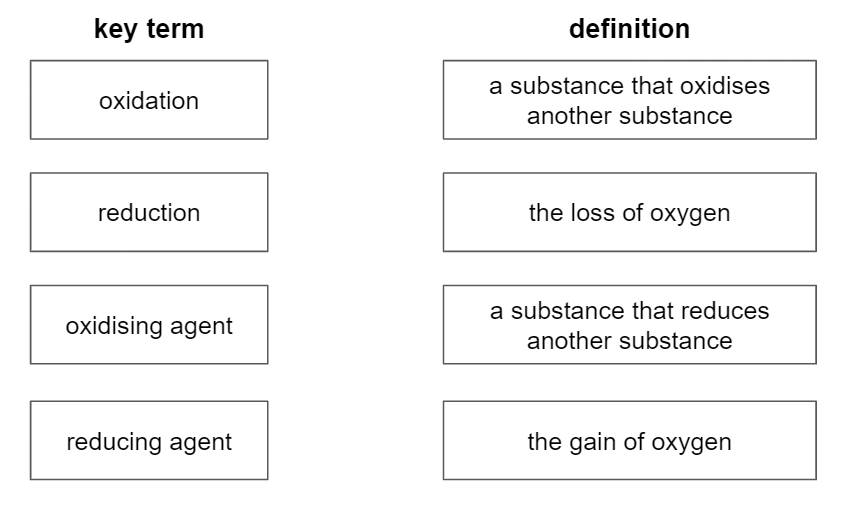
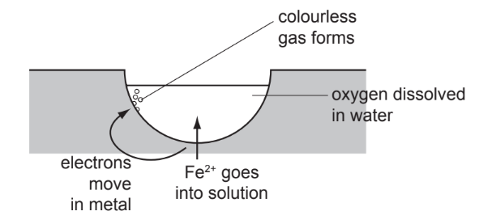
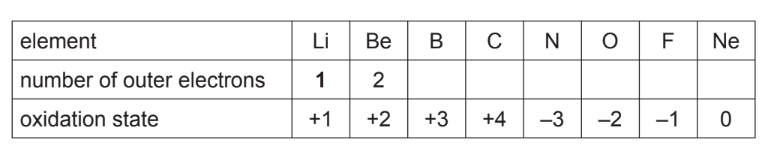

# Exam Questions — Redox
**6. Chemical Reactions** · Cambridge (CIE) IGCSE chemistry (0620 & 0971)
> Source: [https://www.savemyexams.com/igcse/chemistry/cie/23/topic-questions/](https://www.savemyexams.com/igcse/chemistry/cie/23/topic-questions/) · 37 questions across 2 sets

## Multiple Choice Questions (28 questions)

### Q1 — medium — 1 marks

**Q1** [1 mark]

What is the oxidation number of manganese in KMnO4?

### Q2 — medium — 1 marks

**Q2** [1 mark]

Aqueous copper(II) sulfate reacts with zinc according to the equation shown.

Zn (s) + CuSO4(aq) → ZnSO4(aq) + Cu(s)

Which row correctly identifies the oxidising agent and the reducing agent in this reaction?

|   | oxidising agent | reducing agent |
|---|---|---|
| **A** | CuSO4 | Zn |
| **B** | Zn | CuSO4 |
| **C** | Cu | ZnSO4 |
| **D** | ZnSO4 | Cu |

### Q3 — easy — 1 marks

**Q3** [1 mark]

Solid zinc reacts with aqueous copper(II) sulphate.

Zn (s)  + CuSO4 (aq) → ZnSO4 (aq) + Cu (s)

Which substance is reduced?

### Q4 — easy — 1 marks

**Q4** [1 mark]

When copper is heated in air, its surface turns black.

What is happening to the copper in this reaction?

### Q5 — easy — 1 marks

**Q5** [1 mark]

Lead(II) oxide undergoes a number of different redox reactions.

In which of the following reactions is lead(II) oxide, PbO, **not** reduced?

### Q6 — easy — 1 marks

**Q6** [1 mark]

The following equations are all examples of redox reactions.

In which equation is the underlined substance being oxidised?

### Q7 — easy — 1 marks

**Q7** [1 mark]

Magnesium reacts with iron(III) oxide in the following reaction.

magnesium + iron(III) oxide → magnesium oxide + iron

Which statement about this reaction is correct?

### Q8 — easy — 1 marks

**Q8** [1 mark]

Which row correctly describes oxidation in terms of oxygen, electrons and oxidation state?

|   | **oxygen is** | **electrons are** | **oxidation state is** |
|---|---|---|---|
| **A** | added | added | increased |
| **B** | added | lost | increased |
| **C** | lost | added | decreased |
| **D** | lost | lost | decreased |

### Q9 — hard — 1 marks

**Q9** [1 mark]

In which reaction is the reactant being reduced?

### Q10 — hard — 1 marks

**Q10** [1 mark]

Vanadium is a transition element and forms several oxides. In which of the following reactions does vanadium undergo oxidation?

### Q11 — hard — 1 marks

**Q11** [1 mark]

Manganese is a transition element and forms several oxides. In which of the following changes does manganese undergo reduction?

### Q12 — hard — 1 marks

**Q12** [1 mark]

In which two of the following redox reactions is the substance in **bold** acting as a reducing agent?

| **1** | **CuO** + H2 → Cu + H2O |
|---|---|
| **2** | **2Ca** + O2 → 2CaO |
| **3** | **CO** + CuO → Cu + CO2 |
| **4** | **CO****2** + C → 2CO |

### Q13 — hard — 1 marks

**Q13** [1 mark]

Which one of the following substances is commonly used as a reducing agent?

### Q14 — hard — 1 marks

**Q14** [1 mark]

Hydrogen and copper(II) oxide react to produce copper metal and water.

CuO + H2 → Cu + H2O

Which row correctly describes the oxidising agent and reducing agent**?**

### Q15 — hard — 1 marks

**Q15** [1 mark]

A series of redox reactions are shown. What is the oxide that undergoes oxidation?

| **1** | 2CO + 2NO → 2CO2 + N2 |
|---|---|
| **2** | Fe2O3 + 2Al → Al2O3 + 2Fe |
| **3** | 2ZnO + C → 2Zn + CO2 |
| **4** | Fe2O3 + 3CO → 2Fe + 3CO2 |

### Q16 — hard — 1 marks

**Q16** [1 mark]

Which row correctly describes an oxidising agent and a reducing agent?

### Q17 — hard — 1 marks

**Q17** [1 mark]

Potassium manganate (VII) is used to test for the presence of reducing agents. Which row correctly describes what happens when acidified potassium manganate (VII) is added to a solution containing a reducing agent?

### Q18 — medium — 1 marks

**Q18** [1 mark]

What is the oxidation state of Fe in Fe2O3?

### Q19 — medium — 1 marks

**Q19** [1 mark]

Which row correctly names each compound?

|   | **CuSO****4** | **KMnO****4** | **FeCl****3** |
|---|---|---|---|
| **A** | copper sulfate | potassium manganate (IV) | iron(II) chloride |
| **B** | copper sulfate | potassium manganate (V) | iron(III) chloride |
| **C** | copper(II) sulfate | potassium manganate (VI) | iron(II) chloride |
| **D** | copper(II) sulfate | potassium manganate (VII) | iron(III) chloride |

### Q20 — medium — 1 marks

**Q20** [1 mark]

Potassium iodide is used to test for the presence of oxidising agents. 
Which row correctly describes what happens when potassium iodide is added to an acidified solution containing an oxidising agent?

### Q21 — medium — 1 marks

**Q21** [1 mark]

Three reactions are shown below.

- NO + O3 → NO2 + O2
- 2C + O2 → 2CO
- 2MgO + O2 → 2MgO2

Which row correctly describes the process each reactant molecule undergoes?

|   | **NO** | **O****3** | **MgO** |
|---|---|---|---|
| **A** | oxidised | reduced | oxidised |
| **B** | oxidised | oxidised | reduced |
| **C** | reduced | oxidised | oxidised |
| **D** | reduced | reduced | oxidised |

### Q22 — medium — 1 marks

**Q22** [1 mark]

Which row correctly describes the process of reduction in terms of oxygen, electrons and oxidation state?

|   | **oxygen is** | **electrons are** | **oxidation state is** |
|---|---|---|---|
| **A** | lost | added | unchanged |
| **B** | added | lost | increased |
| **C** | lost | added | decreased |
| **D** | added | lost | unchanged |

## Theory Questions (16 questions)

### Q1 — medium — 7 marks

**Q1** [2 marks]

Ammonia is manufactured by the Haber process.

Ammonia, NH3, is used to produce nitric acid, HNO3. This happens in a three-stage process.

**Stage 1** is a redox reaction.

4NH3 + 5O2 → 4NO + 6H2O

Identify what is oxidised in **stage 1**.

Give a reason for your answer.

substance oxidised .....................................

reason    .....................................

*Source: 2020 42/04 Q3E*

**Q1** [2 marks]

Zinc and copper are elements next to each other in the Periodic Table.

Aqueous potassium iodide reacts with aqueous copper(II) sulfate to produce iodine.

Balance the chemical equation for this reaction.

$\mathrm{KI}+\mathrm{CuSO}_{4}\rightarrow\mathrm{CuI}+I_{2}+K_{2}\mathrm{SO}_{4}$

*Source: 2019 Ju41/04 Q3E*

**Q1** [1 mark]

**Extract:**

Aqueous potassium iodide reacts with aqueous copper(II) sulfate to produce iodine.

Balance the chemical equation for this reaction.

KI + CuSO_4 → CuI + I_2 + K_2SO_4

#### Extended Only

Deduce the charge on the copper ion in CuI.

*Source: 2019 Ju41/04 Q3E*

**Q1** [1 mark]

**Extract:**

Aqueous potassium iodide reacts with aqueous copper(II) sulfate to produce iodine.

4KI + 2CuSO~4~ → 2CuI + I~2~ + 2K~2~SO~4~

The charge on the copper ion in CuI is 1+.

#### Extended Only

In terms of electron transfer, explain why copper is reduced in this reaction.

*Source: 2019 Ju41/04 Q3E*

**Q1** [1 mark]

**Extract:**

Aqueous potassium iodide reacts with aqueous copper(II) sulfate to produce iodine.

4KI + 2CuSO~4~ → 2CuI + I~2~ + 2K~2~SO~4~

#### Separate: Chemistry and Extended Only

Identify the reducing agent.

*Source: 2019 Ju41/04 Q3E*

### Q2 — easy — 6 marks

**Q2** [2 marks]

#### Separate: Chemistry and Extended Only

Redox reactions can be identified by colour changes.

Potassium manganate(VII), KMnO4, is an oxidising agent which is used to test for the presence of reducing agents.

What is meant by the term *oxidising agent*?

**Q2** [2 marks]

Calculate the relative formula mass of potassium manganate(VII), KMnO4. Use your Periodic Table to help you.

relative formula mass = ...................................

**Q2** [1 mark]

**Extract:**

Redox reactions can be identified by colour changes. Potassium manganate(VII), KMnO~4~, is an oxidising agent which is used to test for the presence of reducing agents.

#### Separate: Chemistry and Extended Only

When potassium manganate(VII) is added to a reducing agent, a colour change is seen. Which of the following correctly shows the colour change seen? Tick **one** box.

| colourless to blue |   |
|---|---|
|   |   |
| red to blue |   |
|   |   |
| yellow to red |   |
|   |   |
| purple to colourless |   |

**Q2** [1 mark]

#### Separate: Chemistry and Extended Only

Potassium iodide is a reducing agent that can be used to test for the presence of oxidising agents.  Complete the half-equation to show how iodide ions act as a reducing agent.

... I– → I2 + .... e–

### Q3 — easy — 7 marks

**Q3** [4 marks]

#### Separate: Chemistry and Extended Only

This question is about redox reactions.

Match the key term on the left with the definition on the right.

**Q3** [1 mark]

#### Separate: Chemistry and Extended Only

Chromium is an element that can have different oxidation numbers when it is combined with other elements. State the charge on the chromium ion in the compound chromium(II) oxide.

**Q3** [1 mark]

#### Extended Only

Chromium(II) oxide can be formed from the reaction between chromium and oxygen.

Complete the half-equation for the reaction.

.........  →  Cr2+  +  ..... e–

**Q3** [1 mark]

**Extract:**

Chromium(II) oxide can be formed from the reaction between chromium and oxygen. Complete the half-equation for the reaction. Cr → Cr^2+ + 2e^–

#### Extended Only

The other half-equation for the reaction is shown below.

O2 + 4e– → 2O2–

Explain, in terms of electrons, how this shows that oxygen has been reduced.

### Q4 — hard — 13 marks

**Q4** [5 marks]

The following are examples of redox reactions.

Bromine water was added to aqueous sodium sulfide. The ionic equation is:

Br2 (aq) + S2– (aq) → 2Br– (aq) + S(s)

i) Describe what you would observe when this reaction occurs.

[2]

ii) Write a full symbol equation for this reaction.

[1]

iii) Explain, in terms of electron transfer, why bromine is the oxidant (oxidising agent) in this reaction.

[2]

*Source: 2010 Ju32 Q3*

**Q4** [8 marks]

#### Extended Only

Iron and steel in the presence of water and oxygen form rust.

The reactions involved are: 
**reaction 1**

Fe → Fe2+ + 2e–

The electrons move through the iron onto the surface where a colourless gas forms.

**reaction 2**

Fe2+ + 2OH– → Fe(OH)2

**reaction 3**

..........Fe(OH)2 + O2 + ..........H2O → ..........Fe(OH)3

The water evaporates to leave rust.

i) What type of reaction is **reaction 1**?

[1]

ii) Deduce the name of the colourless gas mentioned in **reaction 1**.

[1]

iii) What is the name of the iron compound formed in **reaction 2**?

[1]

iv) Balance the equation for **reaction 3**. ..........Fe(OH)2 + O2 + ..........H2O → ..........Fe(OH)3

[1]

v) Explain why the change Fe(OH)2 to Fe(OH)3 is oxidation.

[1]

vi) Explain why iron in electrical contact with a piece of zinc does not rust.

[3]

*Source: 2010 Ju32 Q3*

### Q5 — medium — 14 marks

**Q5** [5 marks]

The table below shows the elements in the second period of the Periodic Table and some of their oxidation states in their most common compounds.

i) What does it mean when the only oxidation state of an element is zero?

[1]

ii) Explain why some elements have positive oxidation states but others have negative ones.

[2]

iii) Select two elements in the table which exist as diatomic molecules of the type X2.

[2]

*Source: 2010 Oc31 Q6*

**Q5** [3 marks]

#### Separate: Chemistry and Extended Only

Beryllium hydroxide, a white solid, is an amphoteric hydroxide.

i) Name another metal which has an amphoteric hydroxide.

[1]

ii) Suggest what you would observe when an excess of aqueous sodium hydroxide is added gradually to aqueous beryllium sulfate.

[2]

*Source: 2010 Oc31 Q6*

**Q5** [6 marks]

i) Give the formulae of lithium fluoride and nitrogen fluoride.

Lithium fluoride ................................................................................................... Nitrogen fluoride ..................................................................................................

[2]

ii) Predict two differences in their properties.

[2]

iii) Explain why these two fluorides have different properties.

[2]

*Source: 2010 Oc31 Q6*

### Q6 — medium — 5 marks

**Q6** [1 mark]

When the oxide, Co3O4  is heated in hydrogen, cobalt metal is formed.

Co3O4   +  4H2   →   3Co   +   4H2O

Explain how this equation shows that Co3O4 is reduced.

*Source: 2020 Sp03 Q3F*

**Q6** [3 marks]

#### Separate: Chemistry and Extended Only

When copper(II) oxide is heated at 800 °C it undergoes the reaction shown by the  equation.

$4\mathrm{CuO}\rightarrow2\mathrm{Cu}_{2}O+O_{2}$

Identify the changes in oxidation numbers of copper and oxygen in this reaction.

Explain in terms of changes in oxidation numbers why this is a redox reaction.   

change in oxidation number of copper: from …………… to …………… change in oxidation number of oxygen: from …………… to ……………

explanation ...

*Source: Specimen 04 Q3B*

**Q6** [1 mark]

The reaction of iron with steam is shown.

3Fe + 4H2O → Fe3O4 + 4H2

How does this equation show that iron gets oxidised?

*Source: 2020 Ju32 Q6D*

### Q7 — easy — 8 marks

**Q7** [2 marks]

This question is about the reactions of metals with oxygen.

Complete the sentences.

In terms of oxygen, ____________________ is the loss of oxygen.

In terms of oxygen, ____________________ is the gain of oxygen.

**Q7** [2 marks]

**Extract:**

Iron can react with oxygen to form iron(II) oxide.

2Fe + O~2~ → 2FeO

Iron can also react with oxygen to form iron(III) oxide

4Fe + 3O~2~ → 2Fe~2~O~3~

Nickel can react with oxygen to form nickel(II) oxide or nickel(III) oxide.

Iron can react with oxygen to form iron(II) oxide.

2Fe + O2 → 2FeO

Iron can also react with oxygen to form iron(III) oxide

4Fe + 3O2 → 2Fe2O3

Nickel can react with oxygen to form nickel(II) oxide or nickel(III) oxide.

Write **two** balanced symbol equations to show both reactions of nickel with oxygen.

**Q7** [2 marks]

**Extract:**

In terms of oxygen, reduction is the loss of oxygen. In terms of oxygen, oxidation is the gain of oxygen.

Nickel is below carbon in the reactivity series.

This means that carbon can be used to extract nickel from nickel(II) oxide.

nickel(II) oxide + carbon → nickel + carbon dioxide

The reaction of nickel(II) oxide with carbon is a redox reaction.

Is carbon oxidised or reduced? Explain your answer. ** **

Carbon is ____________________

Reason: ____________________

**Q7** [2 marks]

#### Extended Only

Nickel can also be extracted from nickel(III) oxide using carbon.

Nickel(III) gains electrons to form nickel.

Balance the half-equation to show how nickel gains electrons:

Ni3+      +     .... e–     →    .........

### Q8 — hard — 7 marks

**Q8** [2 marks]

Vanadium is a transition element. It has more than one oxidation state.
The element and its compounds are often used as catalysts.

Predict three physical properties of vanadium which are typical of transition elements.

*Source: 2012 Ju31 Q4*

**Q8** [2 marks]

#### Separate: Chemistry and Extended Only

Vanadium(V) oxide is used to catalyse the exothermic reaction between sulfur dioxide and oxygen in the Contact Process.

2SO2 + O2 $\rightleftharpoons$2SO3

The rate of this reaction can be increased either by using a catalyst or by increasing the temperature. Explain why a catalyst is used and not a higher temperature.

*Source: 2012 Ju31 Q4*

**Q8** [3 marks]

#### Separate: Chemistry and Extended Only

The oxidation states of vanadium in its compounds are V(+5), V(+4), V(+3) and V(+2).

The vanadium(III) ion can behave as a reducing agent or an oxidising agent.

i) Indicate on the following equation which reactant is the oxidising agent.

2V3+ + Zn → 2V2+ + Zn2+

[1]

ii) Which change in the following equation is oxidation? Explain your choice.

V3+ + Fe3+ → V4+ + Fe2+

[2]

*Source: 2012 Ju31 Q4*

### Q9 — easy — 5 marks

**Q9** [1 mark]

#### Extended Only

During metal displacement reactions, the metal that is the least reactive metal is reduced.

Which of these statements correctly describes what reduction is?

Tick **one** box.

| The gain of oxygen |   |
|---|---|
|   |   |
| The gain of electrons |   |
|   |   |
| The simulatanous gain and loss of electrons |   |
|   |   |
| An increase in oxidation number |   |

**Q9** [1 mark]

Which of the following reactions shows iron being reduced?  Tick **one** box.

| copper nitrate + iron → iron nitrate + copper |   |
|---|---|
|   |   |
| iron + oxygen → iron(II) oxide |   |
|   |   |
| iron(II) oxide + carbon → iron + carbon dioxide |   |
|   |   |
| hydrochloric acid + iron → iron chloride + hydrogen |   |

**Q9** [2 marks]

**Extract:**

When iron reacts with sulfuric acid, iron(II) sulfate is produced:

Fe + H2SO4 → FeSO4 + H2

#### Separate: Chemistry and Extended Only

When iron reacts with sulfuric acid, iron(II) sulfate is produced:

Fe + H2SO4 → FeSO4 + H2

Give the oxidation number of iron in the following species: 
Fe ............................ 
FeSO4 ............................

**Q9** [1 mark]

**Extract:**

When iron reacts with sulfuric acid, iron(II) sulfate is produced: Fe + H~2~SO~4~ → FeSO~4~ + H~2~. Give the oxidation number of iron in the following species: Fe ............ FeSO~4~ ............
The oxidation number of iron is: In Fe: 0; In FeSO~4~: +2;

#### Separate: Chemistry and Extended Only

Explain how the oxidation numbers in part (c) show that iron has been oxidised.

### Q10 — hard — 12 marks

**Q10** [2 marks]

An ore of tungsten conatins WO3. Tungsten can be obtained from WO3 by reacting it with hydrogen. The reaction is a redox reaction, water is also produced.

Write the balanced symbol equation for the reaction.

**Q10** [2 marks]

#### Extended Only

Explain reduction and oxidation in terms of electrons and oxidation numbers.

**Q10** [3 marks]

**Extract:**

An ore of tungsten contains WO~3~. Tungsten can be obtained from WO~3~ by reacting it with hydrogen. The reaction is a redox reaction, water is also produced. The balanced symbol equation for the reaction is: WO~3~ + 3H~2~ → W + 3H~2~O

#### Separate: Chemistry and Extended Only

The oxidation number of oxygen is -2 and this remains unchanged during the reaction.

Identify, using oxidation numbers, what has been oxidised and what has been reduced in this reaction.

**Q10** [5 marks]

**Extract:**

An ore of tungsten conatins WO~3~. Tungsten can be obtained from WO~3~ by reacting it with hydrogen. The reaction is a redox reaction, water is also produced.
WO~3~ + 3H~2~ → W + 3H~2~O

#### Extended Only

50 tonnes of the tungsten ore were processed. The ore was found to contain 3.4% of WO3 by mass. Calculate the maximum mass, in tonnes, of tungsten that could be obtained from this ore.

Give your answer to **three **significant figures.

[*A*r (W) = 184;    *M*r (WO3) = 232]

maximum mass of tungsten = ................................................. tonnes

### Q11 — hard — 11 marks

**Q11** [2 marks]

The distinctive smell of the seaside was thought to be caused by ozone, O3. Ozone is a form of the element oxygen.

A mixture of oxygen and ozone is formed by passing electric sparks through oxygen.

3O2 $\rightleftharpoons$2O3

Suggest a technique that might separate this mixture. Explain why this method separates the two forms of oxygen.

*Source: 2009 Oc31 Q4*

**Q11** [4 marks]

#### Extended Only

Ozone is an oxidant. It can oxidise an iodide ion to iodine.

2I– + O3 + 2H+ → I2 + O2 + H2O

i) What would you see when ozone is bubbled through aqueous acidified potassium iodide?

[2]

ii) Explain in terms of electron transfer why the change from iodide ions to iodine molecules is oxidation.

[1]

iii) Explain, using your answer to b(ii), why ozone is the oxidising agent in this reaction.

[1]

*Source: 2009 Oc31 Q4*

**Q11** [5 marks]

#### Extended Only

It is now known that the smell of the seaside is due to the chemical dimethyl sulfide, (CH3)2S.

i) Draw a diagram that shows the arrangement of the outer electrons in one molecule of this covalent compound. Use x to represent an electron from a carbon atom. Use ● to represent an electron from a hydrogen atom. Use o to represent an electron from a sulfur atom.

[3]

ii) Name the three compounds formed when dimethyl sulfide is burnt in excess oxygen.

[2]

*Source: 2009 Oc31 Q4*

### Q12 — easy — 5 marks

**Q12** [1 mark]

The reaction of zinc oxide with carbon is an example of a redox reaction.

What is meant by the term *redox reaction*?

**Q12** [1 mark]

**Extract:**

ZnO + C → Zn + CO

When zinc oxide reacts with carbon, carbon displaces zinc from its oxide.

ZnO + C → Zn + CO

How does this equation show that zinc oxide is reduced?

**Q12** [1 mark]

**Extract:**

- Do not accept "charge on oxygen" or the charge of an incorrect element.
- Reject if the answer offers a wrong alternative (e.g. "charge of oxygen") alongside the correct one.

Iron oxide can also be reduced by carbon. Iron oxide can exist as iron(II) oxide or iron(III) oxide.

What do the Roman numerals indicate in the names of the compound?

**Q12** [2 marks]

Complete the balanced equation to show the reduction of iron(III) oxide with carbon.

2Fe2O3 + .... C → .... Fe + .... CO2

### Q13 — hard — 7 marks

**Q13** [2 marks]

#### Separate: Chemistry and Extended Only

What is meant by the term *oxidising agent*?

**Q13** [2 marks]

#### Separate: Chemistry and Extended Only

The dichromate ion, Cr2O72-, reacts with sulfite ions, SO32-, according to the following equation

Cr2O72- + 8H+ + 3SO32-  →  2Cr3+ + 4H2O + 3SO42-

Are the sulfite ions, SO32-, acting as an oxidising or reducing agent. Justify your answer.

**Q13** [2 marks]

**Extract:**

A substance that oxidises another substance; And is itself reduced; Oxidising agents are substances that oxidise other atoms / ions by causing them to lose electrons. Oxidising agents gain electrons and, therefore, they get reduced. The oxidation number of an oxidising agent decreases.

#### Separate: Chemistry and Extended Only

Identify which species is acting as the oxidising agent in the following reaction. Justify your answer.

Cl2 + 2Br– →  2Cl– + Br2 

**Q13** [1 mark]

#### Separate: Chemistry and Extended Only

Redox titrations can be carried out between reducing agents and oxidising agents in a similar way to the method used for titrations between acids and alkalis.

Suggest why an indicator is not needed when potassium manganate(VII) is added to a reducing agent.

### Q14 — medium — 6 marks

**Q14** [2 marks]

#### Separate: Chemistry and Extended Only

The following reactivity series shows both familiar and unfamiliar elements in order of decreasing reactivity. Each element is represented by a redox equation.

Rb $\rightleftharpoons$ Rb+ + e–       
Mg $\rightleftharpoons$ Mg2+ + 2e–       
Mn $\rightleftharpoons$ Mn2+ + 2e–       
Zn $\rightleftharpoons$ Zn2+ + 2e–       
H2 $\rightleftharpoons$ 2H+ + 2e–       
Cu $\rightleftharpoons$ Cu2+ + 2e–       
Hg $\rightleftharpoons$ Hg2+ + 2e–

Two of the uses of the series are to predict the thermal stability of compounds of the metals and to explain their redox reactions.

i) Define in terms of electron transfer the term *oxidation*.

[1]

ii) Explain why the positive ions in the above equations are oxidising agents.

[1]

*Source: 2013 032 Q6*

**Q14** [2 marks]

**Extract:**

The following reactivity series shows both familiar and unfamiliar elements in order of decreasing reactivity. Each element is represented by a redox equation.

Rb ⇌ Rb+ + e–
Mg ⇌ Mg2+ + 2e–
Mn ⇌ Mn2+ + 2e–
Zn ⇌ Zn2+ + 2e–
H2 ⇌ 2H+ + 2e–
Cu ⇌ Cu2+ + 2e–
Hg ⇌ Hg2+ + 2e–

i) Which metals in the series above do not react with dilute acids to form hydrogen?

[1]

ii) Describe an experiment which would confirm the prediction made in (b)(i).

[1]

*Source: 2013 032 Q6*

**Q14** [2 marks]

**Extract:**

The following reactivity series shows both familiar and unfamiliar elements in order of decreasing reactivity. Each element is represented by a redox equation.

Rb \rightleftharpoons Rb^+ + e^–
Mg \rightleftharpoons Mg^2+ + 2e^–
Mn \rightleftharpoons Mn^2+ + 2e^–
Zn \rightleftharpoons Zn^2+ + 2e^–
H~2~ \rightleftharpoons 2H^+ + 2e^–
Cu \rightleftharpoons Cu^2+ + 2e^–
Hg \rightleftharpoons Hg^2+ + 2e^–

#### Separate: Chemistry and Extended Only

i) Which metal in the series above can form a negative ion which gives a pink / purple solution in water?

[1]

ii) Describe what you would observe when zinc, a reducing agent, is added to this pink / purple solution.

[1]

*Source: 2013 032 Q6*

### Q15 — medium — 4 marks

**Q15** [1 mark]

#### Separate: Chemistry and Extended Only

Sulfur dioxide is a reducing agent.

Give the colour change that occurs when excess sulfur dioxide is bubbled into acidified aqueous potassium manganate(VII).

starting colour of the solution .............................................. 
final colour of the solution       ..............................................

**Q15** [2 marks]

#### Separate: Chemistry and Extended Only

Displacement reactions occur between metals and metal ions. Displacement reactions can be used to determine the order of reactivity of metals such as lead (Pb), nickel (Ni), and silver (Ag). The ionic equation for a displacement reaction is shown.

$\text{Ni} ( \mathrm{s} ) + Pb^{2 +} ( \text{aq} ) \rightarrow \text{Pb} ( \mathrm{s} ) + Ni^{2 + } ( \text{aq} )$

The ionic half-equations for this reaction are shown.

$\text{Ni} ( \mathrm{s} ) \rightarrow Ni^{2 + } ( \text{aq} ) + 2 \mathrm{e}^{-}$

$Pb^{2 + } ( \text{aq} ) + 2 \mathrm{e}^{-} \rightarrow \text{Pb} ( \mathrm{s} )$

The ionic half-equations show that electrons are donated by nickel atoms and accepted by lead ions. Identify the reducing agent in the displacement reaction. Give a reason for your answer. reducing agent......................................... reason              ..........................................

**Q15** [1 mark]

#### Extended Only

What is the general term given to the type of reaction in which electrons are transferred from one species to another?
