# Mark Schemes — The Characteristic Properties of Acids & Bases
**7. Acids, Bases & Salts** · Cambridge (CIE) IGCSE chemistry (0620 & 0971)

## Alternative To Practical Questions (12 questions)

### Q1
> **[mark-scheme]**
> **Method 1: **Preparing a solution for titration
> 
> Any** six** from:
> 
> - Weigh a specific/known mass of the solid sodium hydroxide granules
> - Dissolve the solid sodium hydroxide in a known volume of distilled water to make an alkaline solution
> - Use a volumetric pipette / measuring cylinder to measure a fixed volume of acid A
> - Pour acid A into a conical flask and add a few drops of named indicator suitable for titration (e.g., methyl orange / thymolphthalein / phenolphthalein)
> - Fill a burette with the sodium hydroxide solution
> - Add the sodium hydroxide solution from the burette to the flask slowly while swirling
> - Stop adding when the indicator changes colour (or state specific colour change, e.g. colourless to pink for phenolphthalein)
> - Record the volume of sodium hydroxide solution used
> - Repeat the whole experiment using the exact same volume of acid B
> - The acid that requires the larger volume of sodium hydroxide solution to neutralise it is the more concentrated acid
> 
> **[6 marks]**
> 
> **Method 2: **Maximum temperature change
> 
> Any **six **from:
> 
> - Use a measuring cylinder / volumetric pipette to measure a <u>known/fixed volume</u> of acid A
> - Pour acid A into a <u>polystyrene cup</u>
> - Measure the initial temperature of the acid using a thermometer
> - Weigh a <u>known/fixed mass</u> of solid sodium hydroxide granules (must be an excess)
> - Add the solid sodium hydroxide to the acid and stir continuously
> - Record the highest/maximum temperature reached by the mixture
> - Calculate the temperature change (highest temperature – initial temperature)
> - Repeat the whole experiment using the exact same volume of acid B and the same mass of solid sodium hydroxide
> - The acid that produces the larger temperature change is the more concentrated acid. **[6 marks]**
> 
> **Method 3: **Direct addition of solid granules
> 
> Any **six **from:
> 
> - Use a volumetric pipette / measuring cylinder to measure a fixed volume of acid A
> - Pour acid A into a beaker / conical flask
> - Add a few drops of named indicator (e.g., methyl orange / thymolphthalein / phenolphthalein)
> - Find the initial mass of a container holding the solid sodium hydroxide granules using a balance
> - Add the solid sodium hydroxide granules gradually / a little at a time to the acid
> - Stir the mixture continuously to ensure the solid dissolves and reacts
> - Stop adding the solid as soon as the indicator changes colour
> - Reweigh the container to calculate the mass of sodium hydroxide used
> - Repeat the whole experiment using the exact same volume of acid B
> - The acid that requires the larger mass of solid sodium hydroxide to neutralise it is the more concentrated acid
> 
> **[6 marks]**

> **[exam-tip]**
> Be precise and practical in your plan!
> 
> If a **solid reagent** is given (e.g. sodium hydroxide granules), you cannot “put it in a burette.” You must either **dissolve it to prepare a solution** first or **measure its mass** before reacting it.
> 
> When stating control variables, be specific.  Write **“use the same volume (e.g. 25.0 cm³) of acid”** or **“keep the mass of solid constant.”** Do not write vague terms like “same amount.”
> 
> Finally, always state how the results lead to the conclusion. For example:
> "The solution requiring the larger volume of hydroxide is more concentrated"
> 
> A clear method, specific measurements (mass, volume, equipment such as burette, pipette, balance), and a direct conclusion statement secure the marks.

### Q2
a) The plotted graph is:

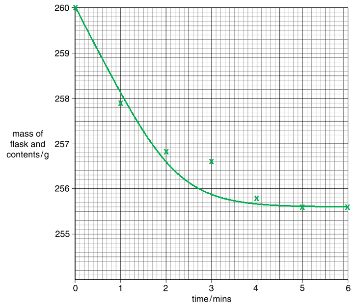

- All points plotted correctly;** [2 marks]** 
*One mark lost per incorrect point*
- Smooth curve of best fit ignoring the anomalous result; **[1 mark]**

**[Total: 3 marks]**

- *Take your time plotting this graph as the y-axis scale can be off-putting*
b) The inaccurate result is:

- The point at 3 minutes;** [1 mark]**
- (Because,) it is not on the curve of best fit; **[1 mark]**

**[Total: 2 marks]**

- *Anomalous results (or outliers) are results that do not fit the general pattern of results*
- *Ideally, they should be re-tested *
- *In practice, they are more commonly ignored*
c) The mass of the flask and contents decrease because:

- A gas / carbon dioxide is given off / released; **[1 mark]**

**[Total: 1 mark]**

- *You are told at the start of the overall question that nitric acid is reacting with magnesium carbonate:*

  - *Nitric acid + magnesium carbonate → magnesium nitrate + water + carbon dioxide*
- *Carbon dioxide is a gas which will be released *
d) The purpose of the cotton wool is to:

- Prevent the loss of acid / spray 
**OR **
Only allow gas to escape; **[1 mark]**

**[Total: 1 mark]**

- *Gas will still be allowed through the cotton wool*
- *This means that the cotton wool can only realistically be there to keep the rest of the reaction in*
e) The reaction finished at:

- 5 minutes; **[1 mark]**

**[Total: 1 mark]**

- *The reaction is finished when the temperature remains constant*
f) The sketch that you would expect if the experiment were repeated using nitric acid at a higher temperature is:

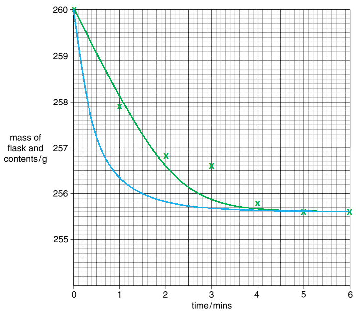

- Curve below / steeper than the original curve (blue line); **[1 mark]**
- Levels off to the same temperature; **[1 mark]**

**[Total: 2 marks]**

- *At a higher temperature, the particles will have more (kinetic) energy resulting in more frequent, successful collisions*
- *This means that reaction will happen faster *
- *The amounts (concentrations and volumes) of the chemicals have not been changed *
- *Therefore, the total mass lost will be the same*

### Q3
a) The pieces of equipment are:

- A = (filter) funnel; **[1 mark]**
- B = conical flask; **[1 mark]**
- C = pipette; **[1 mark]**

**[Total: 3 marks]**

- *You need to be able to name laboratory equipment *
b) The soil was crushed to:

- Increase the surface area;** [1 mark]**
- Reference to rate / efficiency / ease; **[1 mark]** e.g. To allow the sample to dissolve / mix with water quicker / better

**[Total: 2 marks]**

- *A mortar and pestle are commonly used to crash large pieces into smaller pieces so that they will react / dissolve better or more quickly*
c) Soil samples should be taken from different parts of the field because:

- The pH may be different / vary in different parts (of the field); **[1 mark]**

**[Total: 1 mark]**

- *You should be able to answer this question by considering that you are sampling the pH of soil from a field*
- *Most fields are large and may therefore have different pH values at different points in the field*
d) It is important to know the pH of soil so:

- The farmer knows what plants / crops to grow; **[1 mark]**

**[Total: 1 mark]**

- *Farmers will be growing plants / crops in their fields*
- *They want to grow the maximum amount of plants / crops so they get as much profit as possible*
- *The best way to do this is to grow plants / crops that should grow well in the pH of the soil*

### Q4
a) The completed table is:

| experiment | mass of solid **C** / g | thermometer diagram | initial temperature of acid / oC | thermometer diagram | maximum temperature reached / oC | temperature difference / oC |
|---|---|---|---|---|---|---|
| 1 | 1 |  | 21 |  | 23 | 2 |
| 2 | 2 |  | 23 |  | 27 | 4 |
| 3 | 3 |  | 22 |  | 28 | 6 |
| 4 | 5 |  | 24 |  | 34 | 10 |

- All masses correct; **[1 mark]**
- All initial temperatures correct 
**AND **
All maximum temperatures correct; **[1 mark]**
- All temperature differences correct; **[1 mark]**

**[Total: 3 marks]**

- *For the masses, you need to use the experimental information given in the written part of the question*
- *For the initial and maximum temperatures, you need to read off the appropriate thermometer images*
- *For the temperature differences, you need to work out the change in temperature*

  - *e.g. 21 → 23 **o**C is a temperature difference of 2 **o**C*
b) The correct results are:

- Initial temperature of dilute hydrochloric acid = 21 °C; **[1 mark]** 
**AND **
Final temperature of liquid mixture = 13 °C
- Temperature change = –8 °C *Minus / negative sign ****must**** be included for the mark*; **[1 mark]**

**[Total: 2 marks]**

- *Just like part (a), you need to use the thermometer images to get the readings and calculate the temperature change*
- *Careful:** The temperature decreases so the temperature change should be negative*
c) The completed graph is:

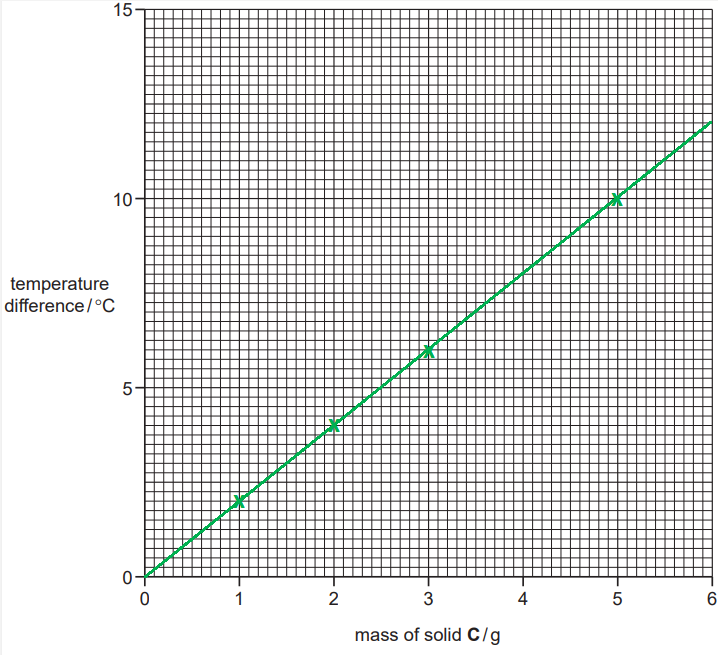

- All points plotted correctly; **[3 marks] **
*Lose 1 mark per incorrect point*
- Straight line graph drawn with a ruler;** [1 mark]**

**[Total: 4 marks]**

- *Take your time plotting the points because you have been given a graph with the scale already on*
- *It can be very easy to lose which line on the y-axis you should be working to*
d)

i) The temperature of the solution when 6 g of solid **C** is added to 30 cm3  of dilute hydrochloric acid is:

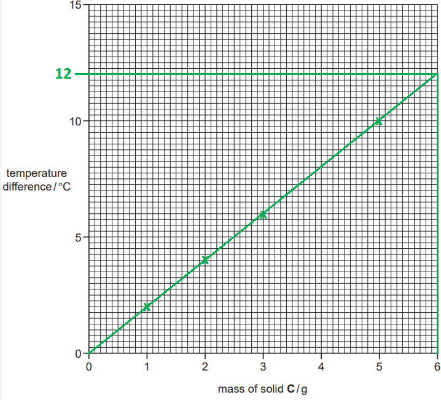

- Extrapolation is clearly shown on the graph; **[1 mark]**
- Value from graph ± half small square; **[1 mark]** *This is expected to be around 12 °C*

ii) The mass of solid **C** that would give a temperature rise of 9°C when added to 30 cm3 of dilute hydrochloric acid is:

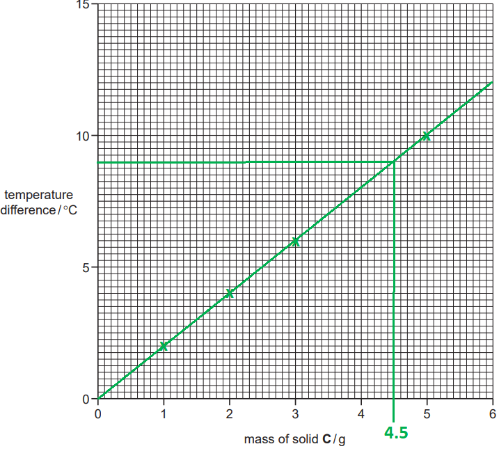

- Extrapolation is clearly shown on the graph; **[1 mark]**
- Value from graph ± half small square; **[1 mark]** *This is expected to be around 4.5 g*

**[Total: 2 marks]**

- *You need to be able to extrapolate from graphs*
- *Basic outline to extrapolation: *

  - *Find the value you need to deduce from*
  - *Draw a straight line to your line of best fit*
  - *Draw a straight line to the other axis*
  - *Read off the other axis to get the final answer*
e) The type of chemical process that occurs when solid **D** reacts with dilute hydrochloric acid is:

- Endothermic; **[1 mark]**

**[Total: 1 mark]**

- *Since you only have information about the temperature change, you can only comment on whether the process is exothermic or endothermic*
f) The effect on the results if Experiment 3 was repeated using 60cm3 of dilute hydrochloric acid is:

- A smaller / lower temperature change 
**OR** 
3 °C temperature change; **[1 mark]**
- (Because,) there is a greater volume / more acid; **[1 mark]**

**[Total: 2 marks]**

- *The original experiment uses 30 cm**3** of dilute hydrochloric acid*

  - *Using 60 cm**3** of dilute hydrochloric acid releases the same amount of energy into the solution Since the volume is greater, there will be a smaller temperature change*
g) The temperature of the solution in Experiment 4 after 1 hour will be:

- Room temperature 
**OR **
Initial temperature from table / 24°C; **[1 mark]**
- (Because,) the reaction has finished; **[1 mark]**

**[Total: 2 marks]**

- *If the reaction is left to stand for 1 hour, you can expect it to have completed and the temperature to cool to room temperature*
h) **One **advantage and **one **disadvantage of taking the temperature readings after exactly one minute would be:

- Advantage: To compare results 
**OR **
For a fair test; **[1 mark]**
- Disadvantage: The reaction may not have finished 
**OR **
The temperature may still be changing 
**OR **
It might not have reached its maximum temperature;** [1 mark]**

**[Total: 2 marks]**

- *Controlling other variables such as the measurement time allows for you to able to compare results*

  - *The alternative answer about "fair test" shows the age of this question, as this would no longer be an acceptable answer *
- *Using shorter times causes the common problem about whether the reaction has gone to completion / reached its maximum temperature*

### Q5
a) An experiment to obtain an aqueous solution of an indicator from some berries is:

- Add water; **[1 mark]**
- Crush / mix / warm; **[1 mark]**
- Filter / decant or pipette off liquid / sieve; **[1 mark]**

**[Total: 3 marks]**

- *This requires you to apply your knowledge to an application that you may not have come across before*
- *Don't panic, think about some of the techniques to prepare solutions and decide which is the most appropriate*
- *In this case, the berries must be crushed so that the indicator can dissolve in water, then the mixture filtered to discard the crushed berries, leaving the indicator in solution*
b) An experiment to use the indicator solution to show that it is an effective indicator is:

- Add indicator solution to acid (and note colour); **[1 mark]**
- Add indicator solution to alkali / named alkali (and note colour); **[1 mark]** *Not base*
- Conclusion e.g. colours should be different owtte; **[1 mark]**

**[Total: 3 marks]**

- *Indicators will change colour depending on if they are in acidic or alkaline conditions so the experiment needs to show that it will be different colours in these two chemical environments*

### Q6
a) The completed results table is:

| **Experiment** | **Initial temperature / ****o****C ** | **Final temperature / ****o****C** | **Temperature difference / ****o****C** |
|---|---|---|---|
| **1** | 18 | 19 | 1 |
| **2** | 26 | 29 | 3 |
| **3** | 16 | 21 | 5 |
| **4** | 22 | 41 | 19 |

- All initial temperatures correct **AND **All final temperatures correct; **[3 marks]** *One mark is lost for each incorrect reading*
- All temperature differences correct; **[1 mark]**

**[Total: 4 marks]**

- *Careful: **All the scales are different so take your time to make sure that you are recording the correct temperature from the diagram*
b) The expected observation in Experiment 2 would be:

- Bubbles / fizzing; **[1 mark]**

**[Total: 1 mark]**

- *In this experiment, powdered calcium carbonate is being added to dilute hydrochloric acid*
- *This will form calcium chloride (salt), water and carbon dioxide*
- *The carbon dioxide will be seen in the reaction mixture as bubbles*
c) The completed bar chart is:

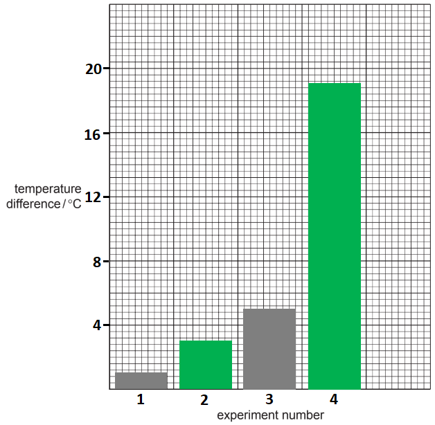

- Appropriate scale for y-axis; **[1 mark]**
- 4 bars correctly drawn; **[2 marks]** 
*One mark is lost for each incorrect bar*

**[Total: 3 marks]**

- There is a temptation to try and use all 6 big boxes / the full y-axis to make your bar chart fill the entire grid - you don't have to
- Your bar chart should cover at least half the available grid
- This means that you can still pick a suitable / appropriate scale but without filling the entire grid

  - Avoid scales with gaps / intervals of 3 because they are hard to accurately work with
d)

i) The experiment that produced the smallest temperature change is:

- Experiment 1; **[1 mark]**

ii) The experiment that produced the largest temperature change is:

- Experiment 4;** [1 mark]**

**[Total: 2 marks]**

- *You are simply looking for the smallest and largest bars on your bar chart as these correspond to the smallest and largest temperature changes*
e) **Two **reasons why the temperature changes are different in (d) are:

- The size of the solid chemical used is different 
**OR **
One uses small chips and the other uses lumps; **[1 mark]**
- Different chemicals are used 
**OR **
One uses marble / calcium carbonate and the other uses calcium oxide; **[1 mark]**

**[Total: 2 marks]**

- *The easiest way to get the answers to this question is to play spot the difference between the 2 methods*

  - *The only differences are the chemicals used and the size of the pieces used*
f) You could tell which reactant is in excess because:

Alternative 1:

- If the marble chips were in excess; **[1 mark]**
- There would be <u>some marble chips visible</u> at the end of the reaction;** [1 mark]**

Alternative 2:

- If the hydrochloric acid was in excess; **[1 mark]**
- There would be <u>no marble chips visible</u> at the end of the reaction; **[1 mark]**

**[Total: 2 marks]**

- *This question requires you to consider how you would be able to tell which reagent is in excess simply by looking at the reaction*

  - *You are not given enough information to be able to calculate the number of moles of each chemical and, therefore, determine the reagent in excess*
- *Since you are reacting a solid (marble chips) with a liquid (hydrochloric acid):*

  - *If the solid is in excess, then there will be some solid left over / unreacted at the end of the reaction*
  - *If the liquid is in excess, then all of the solid will be used up / reacted at the end of the reaction*
g) If 100 cm3 of hydrochloric acid were used in the experiments, then the temperature changes would be:

- Smaller / less 
**OR **
Half of the value (for each experiment); **[1 mark]**
- (Because,) there is a larger volume of acid (to heat up); **[1 mark]**

**[Total: 2 marks]**

- *When the volume of the liquid being heated increases, it will require more energy to heat it up by the same amount*

  - *i.e. With the same amount of energy, 25 cm**3** of a liquid will give a greater temperature rise than 50 cm**3** of the same liquid*

### Q7
a) The measured temperatures are:

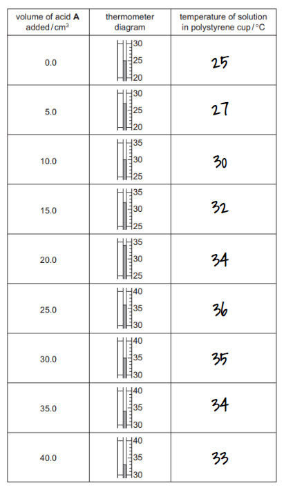

- 25, 27, 30, 32, 34, 36, 35, 34, 33 
*all 9 = ***[3 marks]** 
*8 = ***[2 marks]** 
*7 = ***[1 mark]**

**[Total: 3 marks]**
b) The thermometer readings are:

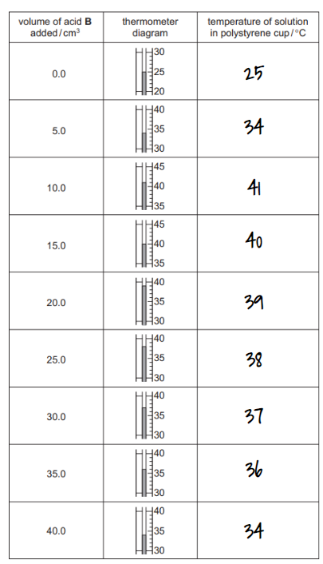

- 25, 34, 41, 40, 39, 38, 37, 36, 34 
*All 9 =*** [3 marks]** 
*8 = ***[2 marks]** 
*7 = ***[1 mark]**

**[Total: 3 marks]**
c) A graph to show the results:

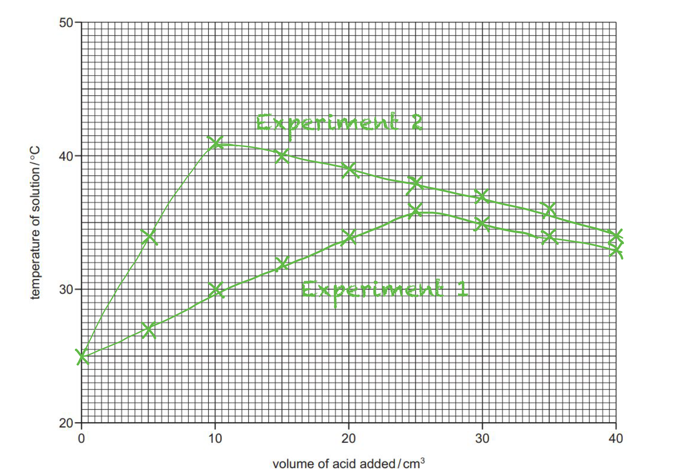

- All 18 points plotted within half a small square; **[3 marks]** 17 points plotted within half a small square; **[2 marks]** 16 points plotted within half a small square; **[1 mark]**
- Smooth line graph; **[1 mark]**
- Labels; **[1 mark]**

**[Total: 5 marks]**

- *The most common mistake when drawing graphs is to use the scale incorrectly*
- *Make sure that you find what the intervals on both axes are:*

  - *In this case, on the x-axis, each square represents 0.5 cm**3*
  - *On the y-axis, each square represents 0.5 °C*
- *When drawing a line of best fit:*

  - *ignore any anomalous points, if any*
  - *try to get as many points on the line as possible, and, for those that don't fit on the line, an equal number of points above and below the line*
- *Don't forget to label each curve*
d) The temperature of the reaction mixture when 8.0 cm3 of acid **B** was added to 50 cm3 of aqueous sodium hydroxide can be found from the graph as follows:

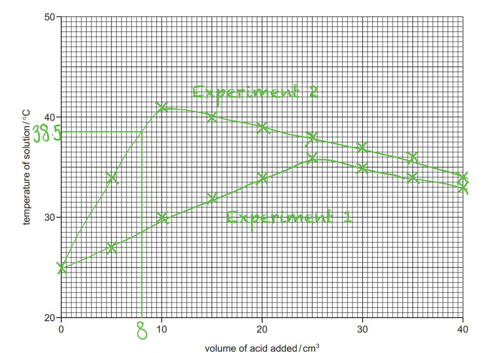

- Value read from graph, 38.5°C; **[1 mark]** *Allow ± 0.5 °C*
- Indication on graph clearly shown; **[1 mark]**

**[Total: 2 marks]**

- *You should use the graph to draw a line from 8 cm**3** of acid on the x-axis to where it intersects your line of best fit*
- *Then, draw a line from this intersection to meet the y-axis and read off the temperature this corresponds to*
- *Remember to use a ruler *
e) The other type of chemical reaction that occurred when acid **A** reacted with sodium hydroxide is:

- Exothermic:** [1 mark]**

**[Total: 1 mark]**

- *Energy is released to the surroundings causing the temperature of the solution to increase, therefore it is an exothermic reaction*
- *Neutralisation reactions are usually exothermic*
f) The burette was rinsed firstly with distilled water and then with acid **B** before starting Experiment 2 to:

- Remove traces of acid **A **/ clean; **[1 mark]**
- Remove water; **[1 mark]**

**[Total: 2 marks]**
g)

i) The experiment in which the maximum temperature change was greater is:

- Experiment 2 / acid **B**;** [1 mark]**

ii) This is because:

- Acid **B** is stronger / dibasic / has a lower pH / more acidic; **[1 mark]**

**[Total: 2 marks]**

- *If acid **B** is stronger, it will have a higher concentration of H**+** ions in solution, even if the 2 acids are at the same concentration as it will ionise more than acid **A*
- *This results in more of the neutralisation reaction occurring and more energy is released*
h) A source of error in Experiment 2, and an improvement, are:

- Source of error: heat losses; **[1 mark] **
- Improvement: insulate / use a lid **[1 mark]** 
**OR**
- Source of error: using a measuring cylinder; **[1 mark] **
- Improvement: use a burette; **[1 mark]** 
**OR**
- Source of error: thermometer; **[1 mark] **
- Improvement: use a digital thermometer; **[1 mark]** 
**OR**

- Source of error: cup not washed / clean; **[1 mark] **
- Improvement: use a new cup; **[1 mark]**

**[Total: 2 marks]**

- *Whenever you are measuring temperature changes, heat loss is the most significant source of error*
- *Insulating the reaction vessel or putting a lid on it are the most common methods of reducing the heat loss and thereby making the results more accurate*

### Q8
a) The completed results tables are:

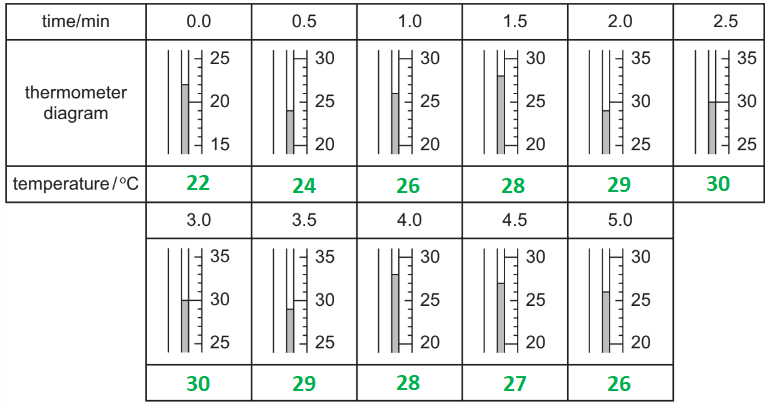

- All temperature readings correct;** [2 marks]** *One mark lost per incorrect reading   *

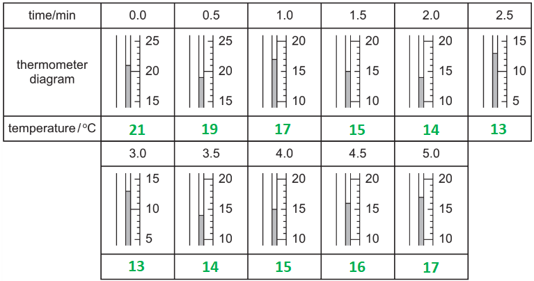

- All temperature readings correct;** [2 marks]** *One mark lost per incorrect reading*

**[Total: 4 marks]**

- *Take your time reading the thermometer diagrams correctly*
b) The plotted graphs are:

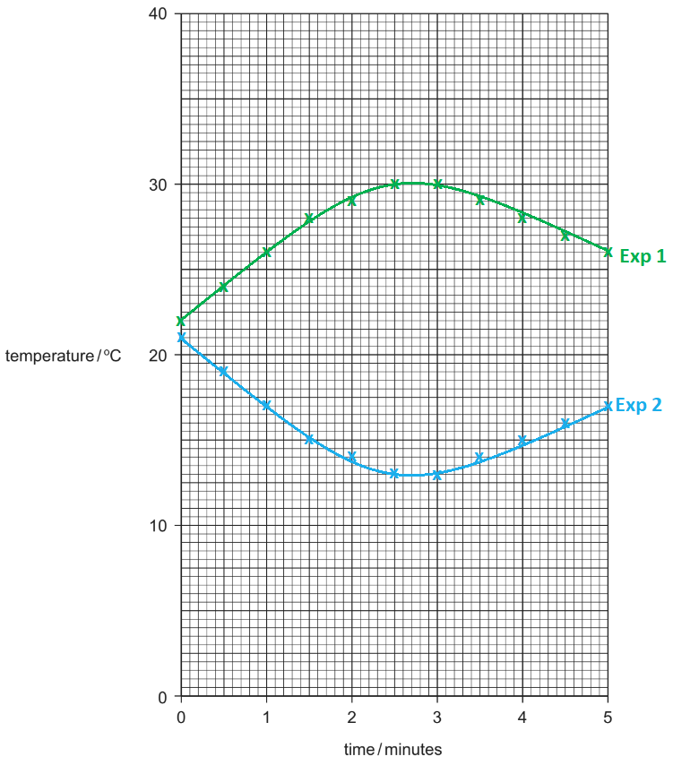

- All points plotted correctly;** [3 marks]** 
*One mark lost per incorrect point*
- Smooth line for experiment 1; **[1 mark]**
- Smooth line for experiment 2; **[1 mark]**
- Lines correctly labelled; **[1 mark]**

**[Total: 6 marks]**

- *Graph plotting is an expected skill at GCSE *
- *Mark schemes for graphs vary from year to year*
- *More recent years have seen it acceptable to have an error of ±1 small square but you cannot rely on this, so make sure you can correctly plot graphs*
c)

i) The temperature of the reaction mixture after hydrochloric acid has reacted with the following for 2 minutes 15 seconds is:

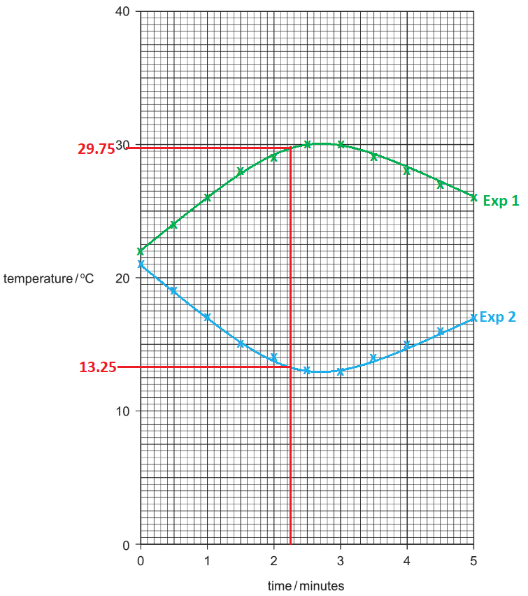

- Solid **A**: 29.5; **[1 mark]** 
*Accept answers ± 0.25 **o**C*
- Solid **B**: 13.5; **[1 mark]** 
*Accept answers ± 0.25 **o**C*

ii) The type of chemical reaction that occurs when hydrochloric acid reacts with the following is:

- Solid **A**: Exothermic; **[1 mark]**
- Solid **B**: Endothermic; **[1 mark] **

**[Total: 4 marks]**

- *To extrapolate the answers for part (i), draw a line vertically upwards from 2.25 minutes to each curve and then horizontally across to the y-axis to read off the value*
- *The reaction with **A** is exothermic because the temperature increases*
- *The reaction with **B** is endothermic because the temperature decreases *
d) Compounds / solids **A **and **B **are:

- Carbonates; **[1 mark]**
- (Because,) they fizz / release gas when they react with acid;** [1 mark]**

**[Total: 2 marks]**

- *If you think about the various reactions with acid, there are only two that produce a gas:*

  - *Metal + acid → salt + hydrogen*
  - *Metal carbonate + acid → salt + water + carbon dioxide*
- *You are told that **A** and **B** are compounds*

  - *Therefore, they must be carbonates as metals would be elements*
e)

i) If left for one hour, solid **A** and hydrochloric acid would reach:

- 22 oC; **[1 mark] **

ii) If left for one hour, solid **B** and hydrochloric acid would reach:

- 21 oC; **[1 mark]**

Explanation:

- They would return to room temperature / the start temperature **OR **The reaction has finished;** [1 mark]**

**[Total: 3 marks]**

- *Careful: **From the results / graph, it appears that experiments 1 and 2 started at different temperatures - suggesting different room temperatures at the start of the reaction*

### Q9
a) The pieces of equipment are:

- A = spatula; **[1 mark]**
- B = beaker; **[1 mark]**
- C = (filter) funnel; **[1 mark]**

**[Total: 3 marks]**

- *You need to be able to name laboratory equipment *
b) The term *excess *means:

- More than enough to react; **[1 mark]** 
*Accept words to that effect*

**[Total: 1 mark]**

- *This is not a common definition to ask for, but you should know what excess means*
c) The pH of a solution of calcium chloride will be:

- 6 - 7; **[1 mark]**

**[Total: 1 mark]**

- *Calcium chloride hydrolyses in water to form calcium hydroxide, Ca(OH)**2**, and H**+** *
- *The H**+** ions decrease the pH of the water*

### Q10
a) The graph with line of best fit is:

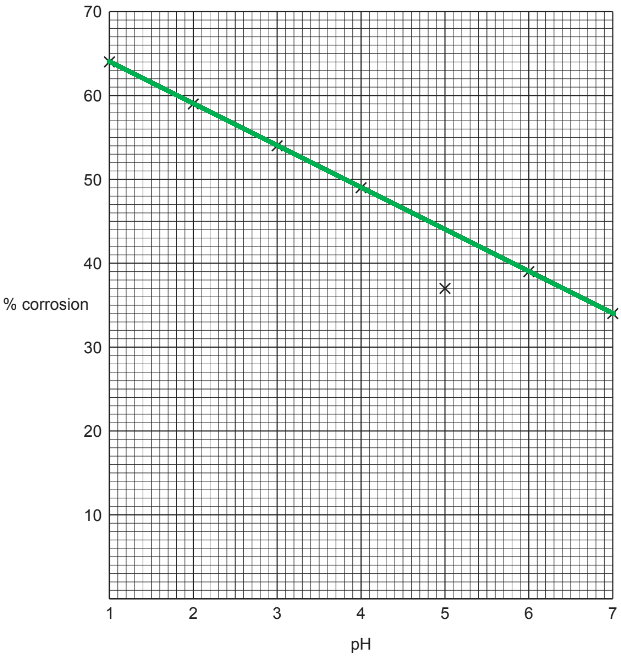

- Straight line ignoring the anomalous result; **[1 mark]**

**[Total: 1 mark]**

- *Remember:** The line of best fit can be one straight line or one smooth curve and should go through as many points as possible or have an equal number of points above and below the line*
b) The point on the grid that is inaccurate is:

- The point at pH 5; **[1 mark]**
- (Because,) it is not on the line; **[1 mark]**

**[Total: 2 marks]**

- *Inaccurate points / anomalies / outliers are results that do not fit the pattern *
- *This means that they will not sit on the line or curve of best fit*
c) As the pH changes from 1 to 7, the percentage corrosion:

- Decreases; **[1 mark]**

**[Total: 1 mark]**

- *Tip: **If you are asked to describe the pattern / trend in a set of results, start your answer with the word **"as"*

  - *This focuses your answer so you automatically write the relationship including both variables, e.g. **as** x does this, y does that*

### Q11
a) The plan of the investigation to find out the pH of the soil sample could be:

- Add the soil sample to water;** [1 mark]**
- Stir / heat the (resulting) solution; **[1 mark]**
- Filter the solution; **[1 mark]**
- Add Universal Indicator; **[1 mark]**
- Compare the colour of the solution to the pH chart; **[1 mark]**

**[Total: 5 marks]**

- *To test the pH of the soil sample, you need to make a solution from the soil sample *
- *You can then test the pH of the sample by adding Universal Indicator to the solution*
b) The further experiments that would be necessary are:

- Collect more samples; **[1 mark]**
- From different parts of the field(s);** [1 mark]**

**[Total: 2 marks]**

- *The key point here is that the sample from the farmer will only provide an estimate of the field's pH in and around the particular area that the sample was taken from*
- *Therefore, more samples are needed and from different areas*

## Multiple Choice Questions (30 questions)

### Q1
**Final answer:** **The correct answer is B**

- The pH scale is used to measure the acidity or alkalinity of a solution
- Acids have a pH of less than 7
- Propanoic acid is a **weak acid**

  - Weak acids partially dissociates into their ions in aqueous solution

- Since pH depends on the concentration of hydrogen ions (H+), a weak acid produces fewer H+ ions than a strong acid when they are mixed with water, so its pH is below 7 but not very low
- Therefore, its pH will be closer to neutral, typically between pH 4 and pH 6

**A** is incorrect as a pH of 1 or 2 indicates a **strong acid** (such as dilute hydrochloric acid or dilute sulfuric acid) that completely dissociates into H+ in solution

**C** is incorrect as a pH of 7 is completely neutral (like pure distilled water)

**D** is incorrect as a pH of 13 or 14 indicates a strongly alkaline solution (like aqueous sodium hydroxide)

### Q2
**Final answer:** **The correct answer is A**

- X is on the left of the Periodic Table, so it's a metal

  - X is in Group I where all the elements have a valency of I
  - Therefore, it will form metal oxides of the general formula **X****2****O**, such as **Na****2****O or K****2****O**
  - When a metal oxide is dissolved in water form a **basic solution (pH >7)**
- Y is on the right of the Periodic Table, so it's a non-metal

  - Y can react with oxygen to form non-metal oxides
  - When a non-metal oxide is dissolved in water, it forms an an **acidic solution (pH < 7)**
  - Therefore, **YO****3** is an **acidic oxide**

**B **is incorrect because **YO****3** is an **acidic oxide, **acidic solutions are **colourless** with thymolphthalein; while basic solutions are **blue**

**C **is incorrect because X is a metal, so **X****2****O** forms a **basic oxide**. When mixed with water, the solution will have a pH **above 7**, not below

**D **is incorrect because **X****2****O **is a basic oxide. The solution prepared would turn **red litmus paper to blue**, not blue litmus to red

### Q3
**Final answer:** **The correct answer is ****B**** **

- Litmus is red in acids and blue in alkalis

**A** is incorrect as methyl orange is red in acids and yellow in alkalis

**C** is incorrect as thymolphthalein is colourless in acids and blue in alkalis

**D** is incorrect as universal indicator is green in neutral substances

### Q4
**Final answer:** **The correct answer is**** A**** **

- Some metals react with oxygen in the air forming a **metal oxide** on their surface.
- Metal oxides are **basic** substances and react with **acids** to form salt and water.

**B **is incorrect as metal oxides are **basic** and react with acids.

**C **and **D **are incorrect as alloys are **mixtures** of metals with other metals or with other nonmetals such as carbon.

### Q5
**Final answer:** **The correct answer is**** B**** **

- Weak acids are neutralised by **weak** **bases**.
- Toothpaste has a pH of 8 and is the safest option as it won't harm skin which is **pH neutral**.

**A** and **D **are incorrect as these are **acidic substances** and will only further aggravate the problem.

**C **is incorrect as grill cleaner is **too abrasive** due to its high pH.

### Q6
**Final answer:** **The correct answer is ****D **

- H+ ions are released when an acid is added to water

  - e.g. HCl → H+ + Cl–
- OH– ions are released when alkalis, such as NaOH, are added to water

  - e.g. NaOH → Na + OH–

**A** is incorrect as acids do not contain Na+

**B** is incorrect as the ions are correct but in the wrong order

**C** is incorrect as Cl– are only released when hydrochloric acid is added to water

### Q7
**Final answer:** **The correct answer is ****B**** **

- When a metal reacts with an acid, a salt and hydrogen are produced
- In this reaction:

  - calcium + sulfuric acid → calcium sulfate + hydrogen

**A** is incorrect as oxygen is not a product formed when a salt is formed

**C** is incorrect as water is formed when a metal oxide or hydroxide reacts with an acid

**D** is incorrect as carbon dioxide is formed when a metal carbonate reacts with an acid

### Q8
**Final answer:** **The correct answer is**** D**** **

- In equation 1 substance X **accepts** a proton so is behaving as a base.
- In equation 2 substance X **donates** a proton so it behaves as an acid.

**A**, **B** and **C** are incorrect as these options do not match with the behaviour of substance **X** in equations 1 and 2.

### Q9
**Final answer:** **The correct answer is ****A**** **

- Methyl orange is red in acids and yellow in alkalis
- Sulfuric acid is an acid
- Potassium hydroxide is an alkali

**B** is incorrect as universal indicator can turn a variety of colours, and is usually blue or purple in alkalis depending on alkali strength

**C** is incorrect as litmus is red in acids and blue in alkalis

**D** is incorrect as thymolphthalein is colourless in acids and blue in alkalis

### Q10
**Final answer:** **The correct answer is ****C **

- pH is a measure of the concentration of hydrogen ions in solution, but they have an inverse relationship
- As acid **Y** has a lower pH than acid **X**, acid **Y** will have a higher concentration of hydrogen ions in solution
- The pH scale is logarithmic, meaning that each change of 1 on the scale represents a change in hydrogen ion concentration by a factor of 10
- Therefore acid **Y** with a pH of 3 has 10 x 10 x 10 = 1000 times the concentration of H+ ions than acid **X** with a pH 6

### Q11
**Final answer:** **The correct answer is ****B**** **

- When a metal carbonate and acid react, a salt, carbon dioxide and water are formed
- In option B, the formula for calcium nitrate is wrong and the equation is not balanced
- The correct equation is:

CaCO3 + 2HNO3 → Ca(NO3)2 + CO2 + H2O

- The correct formula for calcium nitrate is Ca(NO3)2

  - Ca2+ and NO3– are the ions, so two nitrate ions are required to form a neutral ionic compound

### Q12
**Final answer:** **The correct answer is**** C**** **

- Acid P reacts **faster** but both acids produce the **same** **amount** of hydrogen.
- Therefore the rate of reaction of P is **faster** than that for Q.
- P must therefore be a **stronger** acid than Q since the concentration of H+ ions in P must be greater than in Q.
- This is because strong acids dissociate more in aqueous solutions than weak acids.

**A** is incorrect as if **P** had a higher pH then it would imply that **P** is** weaker **than **Q.**

**B **is incorrect as carboxylic acids are weak and only **partially dissociate**.

**D **is incorrect as the concentration must be the same since the same amount of gas is produced by both acids.

### Q13
**Final answer:** **The correct answer is**** C**** **

- Ammonium carbonate reacts with **alkalis** to produce the metal carbonate, ammonia gas and water. Ammonia gas is **colourless** and **pungent**

- An example is the reaction with sodium hydroxide:

  - (NH4)2CO3 + 2NaOH → Na2CO3 + 2H2O + 2NH3
- The reaction is** not characteristic **of an acid as an acid-base neutralisation reaction produces a salt and water only.

**A** is incorrect as acids have pH values of **below 7** and will turn blue litmus paper **red**.

**B **is incorrect as copper oxide is a weak base and will react with an acid forming **blue** hydrated copper salt. For example with sulfuric acid:

CuO +H2SO4 → CuSO4 + H2O

**D **is incorrect as magnesium reacts with acids producing the metal salt and **bubbles** of hydrogen gas. For example with hydrochloric acid:

Mg + 2HCl → MgCl2 + H2

### Q14
**Final answer:** **The correct answer is**** D**** **

- Acids have **low **pH values and bases have **high** pH values.
- The **lower** the **pH** value then the **higher** the **acidity** of the solution.

**A** is incorrect as ammonia gas is produced in this reaction:

NH4Cl + NaOH → **NH****3** + NaCl + H2O

**B** is incorrect as acid-base reactions are **neutralisation **reactions.

**C** is incorrect as CO2 is a product in this reaction:

CaCO3 + 2HCl → CaCl2 + **CO****2** + H2O

### Q15
**Final answer:** **The correct answer is**** D**** **

- Potassium hydroxide is a **strong base** and reacts with sulfuric acid to produce salt and water:

  - 2 KOH + H2SO4 → K2SO4 + 2 H2O
- At the beginning of the reaction and before any alkali has been added the pH of the sulfuric acid is 1.
- As the alkali is added and neutralisation begins, more and more of the acid is neutralised as the alkali is added and the pH rises.
- As the alkali is added in **excess**, the pH continues to rise until it reaches pH 14 which indicates a **strong alkaline** solution.

**A** and **B **are** **incorrect as the pH of the acid increases from 1 to 14 as more alkali is added

**C **is incorrect as if the alkali is added in excess then the pH increases beyond neutrality

### Q16
**Final answer:** **The correct answer is**** A**** **

Carbonates are **alkalis **and therefore do not react when added to a base.

**B **is incorrect as salt and water are formed in acid-base neutralisation reactions.

**C **is incorrect as ammonium salts decompose when warmed with alkalis, producing **ammonia gas**, salt and water.

**D **is incorrect as all bases turn Universal Indicator paper **blue**.

### Q17
**Final answer:** **The correct answer is**** C**** **

- Ammonium chloride, NH4Cl, when reacted with a base will produce **ammonia gas**, salt and water:

- NH4Cl(aq) + X-OH(aq) → NH3(g) + H2O(l) + XCl(aq)

- Methyl orange indicator turned yellow which means the substance is a base.

**A** and **B** are incorrect as salts and metals are **neutral compounds** and do not cause a colour change in methyl orange.

**D **is incorrect as potassium carbonate is a base and would react with an acid.

### Q18
**Final answer:** **The correct answer is**** B**** **

- In a reaction with an alkali and an **ammonium salt**, **ammonia** gas is produced.
- **P** and **Q** are sodium hydroxide and ammonium nitrate, which react together to produce sodium nitrate, water and **ammonia**:

  - NaOH + NH4NO3 → NaNO3 + H2O + **NH****3**
- Ammonia gas is **alkaline** and turns damp Universal Indicator paper **blue**.

**A** is incorrect as ammonium nitrate is a slightly acidic salt hence it will not react with another acid.

**C** is incorrect as sodium carbonate reacts with hydrochloric acid to produce sodium chloride, water and carbon dioxide gas:

Na2CO3 + 2HCl → 2NaCl + H2O + CO2

CO2 gas is very slightly acidic and hence will not turn the indicator paper blue.

**D** is incorrect as both substances are alkaline and so do not react together.

### Q19
**Final answer:** **The correct answer is**** A**** **

- Nitrogen is a non metal element and hence forms an **acidic oxide.**
- The acidic oxide is water soluble and can be used to produce an acidic solution that can neutralise an alkaline solution.

**B** and **C** are incorrect as magnesium and iron are both metals and form **basic** oxides.

**D **is incorrect as helium is a noble gas and does not form oxides.

## Theory Questions (33 questions)

### Q1
a) The correct pH's are:

| **Solution ** | **pH** |
|---|---|
| aqueous ammonia, a weak base | 10; **[1 mark]** |
| dilute hydrochloric acid, a strong acid | 1; **[1 mark]** |
| aqueous sodium hydroxide, a strong base | 13; **[1 mark]** |
| aqueous sodium chloride, a salt | 7; **[1 mark]** |
| dilute ethanoic acid, a weak acid | 3; **[1 mark]** |

**[Total: 5 marks]**

- *Use the clues in the question to help you*
- *A strong acid will have a pH between 1 and 3 *
- *A weak acid will have a pH between 3 and 6*
- *A neutral solution will have a pH of 7 - Sodium chloride is a salt, salts are formed by neutralisation reactions*
- *A weak base will have a pH between 8 and 10*
- *A strong base will have a pH between 11 and 14*
b) Solutions of hydrochloric acid and ethanoic acid with the same concentration, in mol/dm3, have a different pH because:

- Hydrochloric acid is a strong acid or ethanoic acid is a weak acid 
**OR** 
Hydrochloric acid completely ionised or ethanoic acid partially ionised; **[1 mark]**
- Hydrochloric acid greater concentration of/more H+ ions than ethanoic acid;** [1 mark] **

**Final answer:** **[Total: 2 marks] **

- *The higher the concentration of [H**+**] the lower the pH or the more acidic the solution *
- *If the concentrations of the weak and strong acids are the same:*

  - *The strong acid will release more hydrogen ions because it fully dissociates*
  - *The weak acid will release less hydrogen ions because it only partially dissociates *
c) Another method for distinguishing between a strong and weak acid is:

Alternative 1

- Rate of reaction with Ca, Mg, Zn, Fe; **[1 mark] **
- Strong (hydrochloric) acid bubbles faster or more bubbles or dissolves faster; **[1 mark] **

Alternative 2

- Rate of reaction with (metal) carbonate; **[1 mark] **
- Strong (hydrochloric) acid faster or more bubbles or dissolves faster (only if carbonate insoluble; **[1 mark] **

Alternative 3

- Electrical conductivity; **[1 mark] **
- Strong (hydrochloric) acid better conductor;** [1 mark] **

**Final answer:** **[Total: 2 marks] **

- *The strong acid will react more vigorously than a weak acid*
- *This is due to the increased number of hydrogen ions*

### Q2
a) Gas **P** is:

- Hydrogen;** [1 mark] **

**[Total: 1 mark]**

- *You should know that hydrogen gas ignites easily and will burn with a 'squeaky pop'*
b) The ion responsible for making solution **Q** alkaline is:

- Hydroxide 
**OR **
OH–; **[1 mark] **

**Final answer:** **[Total: 1 mark] **

- *Bases are substances which can neutralise an acid, forming a salt and water*
- *Bases are usually oxides or hydroxides of metals*
- *When alkalis are added to water, they form negative hydroxide ions (OH**–**)*

  - *NaOH (s)   →    Na**+** (aq)    +    OH**–** (aq)*
- *The presence of the OH**-** ions is what makes the aqueous solution an alkali*
c) The pH of solution **Q** is:

- 7< pH <12;** [1 mark] **

**Final answer:** **[Total: 1 mark] **

- *The pH must be lower than 12 as you are told the solution is weakly alkaline*
- *As it is alkaline, the pH must be above 7*
d) The symbol equation for the reaction of calcium with cold water is:

Ca + 2H2O → Ca(OH)2 + H2

- Ca(OH)2; **[1 mark] **
- Rest of equation including correct balancing; **[1 mark] **

**[Total: 2 marks]**

- *Calcium is in Group II, so forms a 2+ ion*
- *OH**–** ions have a charge of 1- so the formula of calcium hydroxide which is formed in the reaction is Ca(OH)**2*
- *To balance the equation*

  - *Ca + H**2**O → Ca(OH)**2 **+ H**2** *
  
    - *There are two hydrogen atoms on the left hand side, and four on the right hand side*
    - *Therefore a 2 should be placed in front of H**2**O *
  - *Ca + **2**H**2**O → Ca(OH)**2 **+ H**2*

### Q3
The correct pH is:

- pH 1; **[1 mark]**

**[Total: 1 mark]**

- *Nitric acid is a strong acid, therefore have pH less than 3*

### Q4
> **[mark-scheme]**
> The ways these three zirconium atoms are the same and the ways they are different are:
> 
> - Same: they all have the same number of protons **[1 mark]**
> - Same: they all have the same number of electrons **[1 mark]**
> - Different: they have different numbers of neutrons **[1 mark]**
> 
> Answers given in terms of atomic number and mass number are not accepted, because the question asks for electrons, neutrons and protons.

> **[exam-tip]**
> The question names three particles and asks for both a similarity and a difference, so check you have covered protons, electrons and neutrons before moving on.
> 
> The number of protons is what makes an atom zirconium. Change it and you have a different element, so it cannot vary between these three.
> 
> Each atom is neutral, which means the number of electrons must equal the number of protons. That is why the electrons are the same as well.
> 
> The upper number is the only thing that differs, at 90, 91 and 92. Since the protons are fixed at 40, the difference has to lie in the neutrons, giving 50, 51 and 52.
The equation is:

Zr + 2H2O → ZrO2 + 2H2

**[2 marks]**

> **[mark-scheme]**
> 1 mark for all formulae correct
> 
> 1 mark for the equation correctly balanced
> 
> State symbols are not required.

> **[exam-tip]**
> The stem gives you both products, zirconium(IV) oxide and hydrogen, so the formulae are the easy part. Write them down first and leave the balancing until the formulae are fixed.
> 
> Hydrogen is diatomic, so it is H2 and not H. This is the detail most often missed, and it changes the balancing.
> 
> Balance the oxygen next. ZrO2 needs two oxygen atoms, so two molecules of water are required, and those two waters then supply four hydrogen atoms, which come off as 2H2.
> 
> Never change a formula to make an equation balance. Only the numbers in front of each formula can be adjusted.
The completed table is:

| if the oxide is | predicted result with hydrochloric acid | predicted result with aqueous sodium hydroxide |
|---|---|---|
| acidic | **Final answer:** **NR** | **Final answer:** **R** |
| basic | **Final answer:** **R** | **Final answer:** **NR** |
| amphoteric | **Final answer:** **R** | **Final answer:** **R** |

**[3 marks]**

> **[mark-scheme]**
> 1 mark for both results in the acidic row
> 
> 1 mark for both results in the basic row
> 
> 1 mark for both results in the amphoteric row
> 
> Both results in a row are needed for that row's mark.

> **[exam-tip]**
> Work from what each word means rather than trying to remember the pattern of the table.
> 
> - An acidic oxide is neutralised by an alkali, so it reacts with sodium hydroxide and not with the acid.
> - A basic oxide is neutralised by an acid, so it reacts with hydrochloric acid and not with the alkali.
> - An amphoteric oxide does both.
> 
> The acidic and basic rows are mirror images of each other. If you have written the same pair of results in both, one of them is wrong.
> 
> Notice that the acid column on its own cannot tell a basic oxide from an amphoteric one, because both react. It is the alkali column that separates them, which is why the test needs both reagents to give a useful answer.

### Q5
a) To show that the reaction is exothermic:

- Bonds broken / energy in: 436 + 242 = 678 (kJ / mol);** [1 mark]**
- Bonds formed / energy out: 2 x 431 = 862 (kJ / mol);** [1 mark]**
- Energy change: Bonds broken - bonds formed = 678 - 862 = –184 (kJ / mol);** [1 mark]**
*It is not necessary to calculate –184, just show that the exothermic change is greater than the endothermic change Allow error carried forward as long as the answer is negative –184 kJ scores all 3 marks*

**[Total: 3 marks]**

- *The easiest and most consistent way to prove that the reaction is exothermic is to complete the calculation *

  - *You can show the reaction is exothermic by proving that the energy in / bonds broken is less than the energy out / bonds formed **but** this requires you to make a statement to this effect, which is easy to forget*
b)

i) Water behaves as a base in both of these reactions because:

- It accepts a proton; **[1 mark]**
- It accepts a hydrogen ion / H+; **[1 mark]**

ii) The equilibrium percentages tell us the following about the acids:

- Hydrogen chloride is a strong acid; **[1 mark]**
- Hydrogen fluoride is a weak acid; **[1 mark]** 
*Accept answers using weaker or stronger if they are correctly applied for 2 marks, e.g. hydrogen chloride is stronger than hydrogen fluoride*

iii) The pH of these two solutions will differ by:

- Hydrogen chloride will have a <u>lower</u> pH 
**OR **
Hydrogen fluoride will have a <u>higher</u> pH<u>;</u> **[1 mark] ** 
*If values are suggested, they cannot be higher than pH 7*

**[Total: 5 marks]**

- *This question depends upon the correct application of the definitions of acids and bases*

  - *Acids are proton donors because they release hydrogen ions / H**+** *
  - *Bases are proton acceptors because they accept hydrogen ions / H**+** *
- *Strong acids (almost) fully dissociate into their ions while weak acids barely dissociate into their ions*

  - *You are told that hydrogen chloride exists as 1% molecules at equilibrium, which means that 99% of the molecules have dissociated into their ions - hydrogen chloride is a strong acid*
  - *You are also told that hydrogen fluoride exists as 97% molecules at equilibrium, which means that only 3% has dissociated into ions - hydrogen fluoride is a weak acid*
- *pH is a measure of the amount of hydrogen ions*

  - *Hydrogen chloride has a lot of hydrogen ions and therefore has a low pH*
  - *Hydrogen fluoride does not have a lot of hydrogen ions and therefore has a higher pH than hydrogen chloride*
  - *Careful: **Low pH (e.g. 1 -3) means that the acid is stronger while higher pH (e.g. 4 -6) means that the acid is weaker because it is closer to neutral / pH 7*

### Q6
a) An acid is:

- A proton donor;** [1 mark]**

**Final answer:** **[Total: 1 mark] **
b) A strong acid is:

- (An acid that is) completely dissociated in aqueous solution; **[1 mark] **

**Final answer:** **[Total: 1 mark] **

- *An example of a strong acid is hydrochloric acid*
- *It dissociates fully to give H**+** and Cl**–*

  - *HCl (aq) → H**+** (aq) + Cl**–** (aq)*

### Q7
a) Two chemical properties of aqueous ethanoic acid are:

Any **two **of the following:

- Reacts with alkalis / named alkali; **[1 mark] **
- Reacts with metals / named metal;** [1 mark]**
- Reacts with (reactive) metal oxides / named metal oxide;** [1 mark] **
- Reacts with metal carbonates / named metal carbonate; **[1 mark] **
- Turns blue litmus red / turns methyl orange red / turns universal indicator yellow / orange / red; **[1 mark] **

**Final answer:** **[Total: 2 marks] **
b) The correct pH is:

- pH 6;** [1 mark]**

**Final answer:** **[Total: 1 mark] **

- *A slightly acidic solution will have a pH just below 7*
- *pH 7 is neutral *

### Q8
a) An acid is:

- A proton donor;** [1 mark] **

**[Total: 1 mark]**
b) The completed equation is:

CH3COOH ⇌ CH3COO–  + H+ 

- ⇌ 
**AND** 
CH3COO–; **[1 mark] **
- H+ ;** [1 mark] **

> *[Total: 2 marks] *

- *Weak acids only partially dissociate which is why a reversible sign is used in the equation*

  - *You should include this to gain the mark*
- *Acids donate a proton so CH**3**COOH will become CH**3**COO**–*

  - *Protons have a positive charge, so this forms the negative ethanoate ion and a positive proton, H**+*

### Q9
a) The formula for barium hexanesulfonate is:

- Ba(C6H13SO3)2 / (C6H13SO3)2Ba; **[1 mark] **

**Final answer:** **[Total: 1 mark] **

- *The hexanesulfonate ion, C**6**H**13**SO**3**–**, has a charge of 1-, therefore two of these ions are required to neutralise the charge on the Ba**2+** ion *
- *Make sure you place the C**6**H**13**SO**3**– **ion in brackets in the formula*
b)

i) Magnesium + hexanesulfonic acid → .

- magnesium hexanesulfonate + hydrogen; **[1 mark] **

ii) Calcium oxide + hexanesulfonic acid →

- calcium hexanesulfonate + water; **[1 mark] **

iii) The completed symbol equation for .....C6H13SO3H + Na2CO3 → ............................. + ............ + ............ is:

2C6H13SO3H + Na2CO3 → 2C6H13SO3Na + CO2 + H2O

- C6H13SO3Na; **[1 mark] **
- Remaining species correct and equation balanced;** [1 mark] **

**Final answer:** **[Total: 4 marks] **

- *A metal and an acid will give a salt and hydrogen*
- *A base and acid will give salt and water*
- *A carbonate and acid will give salt, water and carbon dioxide *
- *Water and carbon dioxide usually are giving as the same marking point*
c)

i) You could show that hexanesulfonic acid is also a strong acid by:

Alternative 1

- Rate of reaction with Ca, Mg, Zn, Fe; **[1 mark] **
- Both fast reactions; **[1 mark] **

Alternative 2

- Rate of reaction with (metal) carbonate; **[1 mark] **
- Both fast reactions; **[1 mark] **

Alternative 3

- Electrical conductivity; **[1 mark] **
- Both good conductivity;** [1 mark] **

Alternative 4

- Measure pH / add universal indicator; **[1 mark]**
- Both acids have a low value / pH 0–2 / same colour / red; **[1 mark]**

ii) The two acid solutions must have different concentrations because:

- To have same concentration of H+ / one acid is H2SO4, the other is C6H13SO3H / sulfuric acid is dibasic, hexanesulfonic is monobasic; **[1 mark]**

iii) The terms strong acid and weak acid mean:

- A strong acid is completely ionised, **[1 mark]**
- A weak acid is partially ionised;** [1 mark]**

**Final answer:** **[Total: 5 marks] **

- *You could also use these methods to determine if two acids had differing strengths*
- *A strong acid will give the observations listed in the mark scheme*
- *A weak acid will give a slower reaction rate, a poor conductivity and a pH reading between 4-6 or show a beige to light green colour in universal indicator *
- *Monobasic acids (or monoprotic acids) will dissociate to give 1 mol of hydrogen ions*
- *Dibaasic acids (or diprotic acids) will dissociate to give 2 mol of hydrogen ions *

  - *The dissociation for diprotic acids occurs in two steps, though this is explored more in further study*
- *Hexanesulfonic acid is classed as a strong acid, as stated in the question, therefore will fully dissociate *

### Q10
a) A compound is:

- (A substance containing) atoms of two or more different elements bonded / joined together; **[1 mark]**

**[Total: 1 mark]**
b) The formula of the ion that is present in an aqueous solution of all acids is:

- H+; **[1 mark] **

**[Total: 1 mark]**

- *When acids are added to water, they form positively charged hydrogen ions (H**+**)*
- *The presence of H**+** ions is what makes a solution acidic*
- *You have been asked for the formula, so make sure you write H**+** and not hydrogen ion*
c) The colour will change to:

- Red; **[1 mark] **

**[Total: 1 mark]**

- *You should know the colour changes for the indicators litmus, thymolphthalein and methyl orange *

| > *Indicator* | > *Colour in acid* | > *Colour in alkali* |
|---|---|---|
| > *Litmus* | > *red* | > *blue* |
| > *Thymolphthalein* | > *colourless* | > *blue* |
| > *Methyl orange* | > *red* | > *yellow* |
b) The relative molecular mass is:

- 98; **[2 marks]**

**[Total: 2 marks]**

- The completed table is:

| > *atom* | > *number of atoms* | > *relative atomic mass* |   |
|---|---|---|---|
| > *hydrogen* | > *2* | > *1* | > *2 × 1 = 2* |
| > *sulfur* | > *1* | > *32* | > *1 x 32 = 32* |
| > *oxygen* | > *4* | > *16* | > *4 x 16 = 64* |

- *If you haven't got an answer of 98 then you can score 1 mark for  S = (1 x 32) = 32 *
*OR *
*O = (4 x 16) = 64*

### Q11
a)

i) The word equation is:

- Magnesium + sulphuric acid = magnesium sulphate + hydrogen; **[1 mark]** 
*Accept hydrogen sulphate for sulfuric acid *

ii) The symbol equation is:

- Li2O + H2SO4 → Li2SO4 + H2O; **[2 marks] ** Formulae correct but not balanced scores **[1 mark]**

iii) The symbol equation is:

- CuO + H2SO4 → CuSO4 + H2O **OR **CuO + 2HCl → CuCl2 + H2O **OR** CuO + 2HNO3 → Cu(NO3)2 +H2O; **[2 marks] **Formulae correct but not balanced scores **[1 mark]**

iv) The word equation is:

- Sodium carbonate + sulphuric acid  → sodium sulphate + carbon dioxide + water; **[1 mark] **

**[Total: 6 marks] **

- *In order to write symbol equations you must be able to write the formulas for the reactants and products*

  - *Lithium oxide; Li**+** bonds with O**2-**, therefore the formula is Li**2**O*
  - *Lithium oxide; Li**+** bonds with SO**4**2–**, therefore the formula is Li**2**SO**4*
  - *Copper(II) sulfate; Cu**2+ ** bonds with SO**4**2–**, therefore the formula is CuSO**4*
  - *Copper(II) chloride; Cu**2+ ** bonds with Cl**-**, therefore the formula is CuCl**2*
  - *Copper(II) nitrate; Cu**2+ ** bonds with NO**3**-** therefore the formula is Cu(NO**3**)**2*
- *To change the ionic equation CuO + 2H**+** → Cu**2+** + H**2**O into a symbol equation, you can use any strong acid you like, as long as 2 moles of H**+ **ions are used in the reaction*

  - *This could be H**2**SO**4** or 2HCl or 2HNO**3*
b) Water is behaving as a base because:

- It accepts;** [1 mark]**
- A proton; **[1 mark] ** It accepts a hydrogen ion **[1 mark]** ONLY

**[Total: 2 marks] **

- *An acid will donate a proton*
- *A base will accept a proton*
- *As water is gaining a proton it is behaving as a base*

  - *H**2**SO**4** + H**2**O → HSO**4**– **+ **H**3**O**+*
c) The difference between a strong acid and a weak acid

- Sulphuric acid is completely ionised 
**OR** 
Few molecules and many ions; **[1 mark] **
- Ethanoic acid is partially ionised 
**OR** 
Many molecules and few ions; **[1 mark] **

**Final answer:** **[Total: 2 marks] **

- *Strong acids completely dissociate (or ionise) in water, producing solutions of a very low pH *

  - *Eg: HCl (aq) → H**+** (aq) + Cl**–** (aq)*
- *Weak acids partially dissociate (or ionise) in water and produce pH values which are closer to the middle of the pH scale, whilst still being below 7*

  - *Eg: CH**3**CH**2**COOH (aq) ⇌ H**+** (aq) + CH**3**CH**2**COO**–** (aq)*

### Q12
> **[mark-scheme]**
> i) The oxide that reacts with hydrochloric acid but not with aqueous sodium hydroxide is:
> 
> - Lithium oxide / strontium oxide **[1 mark]**
> 
> ii) The oxide that reacts with aqueous sodium hydroxide but not with hydrochloric acid is:
> 
> - Sulfur dioxide / nitrogen dioxide **[1 mark]**
> 
> iii) The oxide that reacts with both hydrochloric acid and aqueous sodium hydroxide is:
> 
> - Aluminium oxide **[1 mark]**
> 
> Correct formulae are accepted in place of names.

> **[exam-tip]**
> Each of the three sub-parts is describing one of the three types of oxide, so name the type first and then find it in the list.
> 
> - Reacting with acid only is a basic oxide, and basic oxides come from metals. Lithium and strontium are the metals here.
> - Reacting with alkali only is an acidic oxide, and acidic oxides come from non-metals. Sulfur and nitrogen are the non-metals here.
> - Reacting with both is an amphoteric oxide, and there are only two of those at this level. Aluminium oxide is the one in the list.
> 
> Sorting the list into metals and non-metals before you start makes all three sub-parts fall out at once.
> 
> Two oxides fit sub-part i) and two fit sub-part ii), so either answer scores. Only aluminium oxide fits sub-part iii), because zinc oxide, the other amphoteric oxide, is not in the list.
> **[mark-scheme]**
> The two oxides responsible for acid rain, and the reasons they are present in the atmosphere, are:
> 
> - Sulfur dioxide **[1 mark]**
> - Burning (fossil) fuels containing sulfur / volcanoes **[1 mark]**
> - Nitrogen dioxide **[1 mark]**
> - Reaction between nitrogen and oxygen (from the air) **[1 mark]**
> - At high temperatures / in a car engine **[1 mark]**
> 
> Answers stating that oxides of nitrogen come from the exhaust gases of a car are not accepted without reference to the high temperature at which they form.

> **[exam-tip]**
> The question asks for two things about each oxide, its identity and why it is in the atmosphere, so a list of two names on its own scores only two of the five marks.
> 
> The two gases get there in completely different ways, and it is worth keeping them separate in your mind:
> 
> - Sulfur dioxide is released because the fuel itself contains sulfur, which burns along with it.
> - Nitrogen dioxide is not in the fuel at all. The nitrogen and oxygen already in the air react together, and they only do so where it is hot enough.
> 
> That second point is where most marks are lost. Saying nitrogen oxides come out of the exhaust describes where they appear, not how they form. The temperature inside the engine is the reason, because it supplies enough energy to make two normally unreactive gases combine.
> 
> The same chemistry happens in high-temperature furnaces and during lightning strikes.
> **[mark-scheme]**
> i) Another ionic oxide in the list is:
> 
> - Strontium oxide / SrO
> **OR**
> Aluminium oxide / Al2O3 **[1 mark]**

ii) The diagram of lithium oxide is:

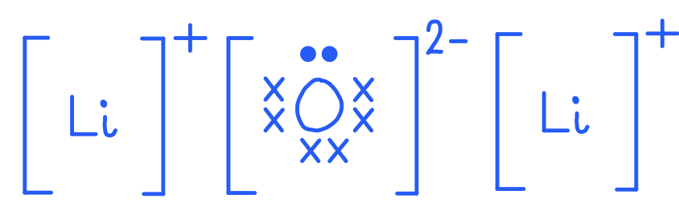

**[2 marks]**

> **[mark-scheme]**
> 1 mark for the correct formula, showing two lithium ions and one oxide ion, with the charges 1+ and 2- given
> 
> 1 mark for eight electrons in the outer shell of the oxide ion, six drawn as x and two drawn as o
> 
> Electrons drawn around the lithium ions are ignored.

> **[exam-tip]**
> An ionic oxide needs a metal to supply the positive ion, so scan the list for metals. Lithium, strontium and aluminium are the metals here.
> 
> For the diagram, work out the formula before you draw anything. Lithium is in Group I and loses one electron to form Li+. Oxygen is in Group VI and gains two electrons to form O2-. Two lithium ions are therefore needed for each oxide ion, giving Li2O.
> 
> The question tells you which symbol to use for which electron, so follow it exactly. The oxide ion ends up with eight outer electrons, six that were already oxygen's own and two gained from the two lithium atoms.
> 
> Charges are part of the answer, not decoration. A diagram showing the right arrangement of electrons but no charges on the ions does not score the first mark.

### Q13
a) Water is behaving as an acid as:

- It is a proton donor; **[1 mark] **

**Final answer:** **[Total: 1 mark] **

- *Water is donating one of its protons to the ethylamine *

  - *CH**3**–CH**2**–NH**2** + **H**2**O *$\rightleftharpoons$*CH**3**–CH**2**–N**H**3**+** + OH**–*
  - *This is why the OH**– **ion is formed*
  - *This makes the solution basic*
b) To show that ethylamine is a weak base:

Alternative 1

- Equal concentrations of both (solutions); **[1 mark] **
- Add Universal indicator / determine pH / pH paper; **[1 mark] **
- Ethylamine has lower pH / ORA; **[1 mark] **

Alternative 2

- Equal concentration of both (solutions); **[1 mark] **
- Measure conductivity of aqueous ethylamine and sodium hydroxide; **[1 mark] **
- Ethylamine will have lower conductivity / sodium hydroxide will have higher conductivity; **[1 mark] **

**[Total: 3 marks]**

- *This is a common question and one of the key points is that the concentrations of the bases (or acids if asked) must be the same*
c) To displace ethylamine:

- Add strong(er) base / NaOH / KOH;** [1 mark] **
- Warm / heat;** [1 mark] **

**Final answer:** **[Total: 2 marks] **

- *To displace the ethyalmine from the salt, we need to use a stronger base*
- *This is similar to displacing a metal from its salt, we use a more reactive metal*
d) The chemistry of the reaction is:

- (Ethylamine forms) hydroxide ions / OH– (in water);** [1 mark]**
- Hydroxide ions / OH– reacts with iron(III) ions / Fe3+ 
**OR **
Iron(III) hydroxide / Fe(OH)3 (forms as a brown precipitate); **[1 mark]**

*Note: balanced or unbalanced ionic equation i.e. Fe**3+** + (3)OH**–** → Fe(OH)**3** scores both marks*

**[Total: 2 marks]**

- *This is another way of asking how to test for a Fe**3+** ion*

  - *You know that adding a base to a solution containing Fe**3+** ions will form a brown precipitate *
  - *Solutions of bases contain OH**–** ions*
  - *Therefore the iron(III) hydroxide formed from iron(III) chloride will result in a brown precipitate *

### Q14
a) The correct pH's are:

| Solution | pH |
|---|---|
| Aqueous ammonia | 10 |
| Dilute hydrochloric acid | 1 |
| Sodium hydroxide solution | 13 |
| Vinegar | 4 |

- All correct; **[2 marks] **
- Two correct; **[1 mark]**

**Final answer:** **[Total: 2 marks] **

- *These are typical examples of acids and bases of varying strength*
- *Aqueous ammonia is classed as a weak base so will have a pH between 8-10*
- *Sodium hydroxide solution is classed as a strong base, so will have a pH between 11-14*
- *Vinegar is classed as a weak acid (it contains ethanoic acid), so it will have a pH between 4-6*
- *Dilute hydrochloric acid is classed as a strong acid, so it will have a pH between 1-3*
b) The name and the formula of the particle which is transferred from nitric acid to water are:

- Proton; **[1 mark]** 
NOT hydrogen ion
- H+; **[1 mark] ** 
H+ not conditional on proton

**Final answer:** **[Total: 2 marks] **

- *You should know that protons are released when an acid dissociates in water*
c)

i) The oxides that will react with hydrochloric acid but not with aqueous sodium hydroxide are:

- CaO 
**AND **
MgO;** [1 mark] **

ii) The oxides that will react with aqueous sodium hydroxide but not with hydrochloric acid are:

- CO2 
**AND **
SO2;** [1 mark] **

iii) The oxide that will react both with hydrochloric acid and with aqueous sodium hydroxide is:

- Al2O3;** [1 mark] **

iv) The oxide that will react neither with hydrochloric acid nor with aqueous sodium hydroxide is:

- CO;** [1 mark] **

**[Total: 4 marks]**

- *Metal oxides are basic and therefore react with acids*
- *Aluminium oxide is amphoteric, so can react with acids and bases*
- *Non-metal oxides are acidic and therefore react with bases *
- *Carbon monoxide does not show basic and acidic properties when they react with water, therefore, it is neutral oxide*

### Q15
a) A macromolecule is:

- Giant covalent 
**OR** 
Polymer made from monomers; **[1 mark]**

**Final answer:** **[Total: 1 mark]**** **

- *Examples of macromolecules are diamond, graphite and silicon dioxide*
- *They are bonded by covalent bonds *
b)

i) Three properties of the two oxides are:

Any **three** from:

- High mp / bp; **[1 mark] **
- Hard; **[1 mark]**
- Brittle;** [1 mark] **
- Insoluble (in water); **[1 mark]**
- Poor conductor of electricity / heat; **[1 mark] **

ii) An element that has the same physical properties is:

- Carbon / diamond / silicon / boron; **[1 mark]** 
*ignore graphite*

**Final answer:** **[Total: 4 marks] **

- *You should know the general properties of macromolecules, high melting point being the main one*
- *Use your knowledge of SiO**2** to help you answer this question, you are not expected to know about ZrO**2 **but you are told that it is a macromolecule*
(c)

i) A reagent that will react with both oxides is:

- Sodium hydroxide / any named alkali / reactive metal; **[1 mark] **

ii) The reagent and oxide is:

- Named acid; **[1 mark] **
- Zirconium oxide; **[1 mark]**

**Final answer:** **[Total: 3 marks] **

- *Silicon(IV) oxide is an acidic oxide so can react with bases, not with acids*
- *You are told that zirconium oxide is an amphoteric oxide*

  - *This means it can react with both acids and bases *

### Q16
The meaning of the term weak acid is:

- Acid: donate or lose protons;** [1 mark] **
- Weak: Does not fully ionise / partially ionises / forms an equilibrium mixture; **[1 mark] **

**Final answer:** **[Total: 2 marks] **

- *Weak acids will only partially ionise, strong acids fully ionise*

### Q17
a) The colour change is:

- From green to blue / purple; **[1 mark]**
- Because sodium oxide is a basic oxide; **[1 mark] **

**Final answer:** **[Total: 2 marks] **

- *Metal oxides are basic, so they have a pH above 7*
- *Sodium oxide is a strong base*
- *Therefore it will turn universal indicator from green to purple *
b) The products of this reaction and observations are:

- Forms magnesium chloride; **[1 mark] **
- Forms water and carbon dioxide; **[1 mark]**

Any **two** from the following:

- Reaction is exothermic / (reaction mixture) gets warm;** [1 mark] **
- Bubbles / effervescence / fizzes; **[1 mark] **
- Magnesium carbonate disappears (or gets smaller); **[1 mark] **

**[Total: 4 marks] **

- *When an acid reacts with a carbonate a neutralisation reaction occurs*
- *The products are a water, carbon dioxide and a salt*

  - *You can remember this by **CAWCS*
  - *C**arbonate + **A**cid → **W**ater + **C**arbon dioxide + **S**alt*
- *As hydrochloric acid is used, a chloride salt is formed - in this case, magnesium chloride*
- *Metal carbonates dissolve in acids, so you would see the solid getting smaller*
- *A gas is formed (carbon dioxide) so you would see fizzing*

### Q18
> **[mark-scheme]**
> The oxide that reacts with dilute hydrochloric acid to give a blue solution is:
> 
> - Copper(II) oxide / CuO **[1 mark]**

> **[exam-tip]**
> Two things have to be true at once here. The oxide must react with an acid, which means it is basic or amphoteric, and the solution formed must be blue.
> 
> The colour is what settles it. Copper(II) ions give blue solutions, so copper(II) oxide is the only oxide in the list that fits both conditions.
> 
> Several of the others react with hydrochloric acid, including sodium oxide, aluminium oxide and zinc oxide, but all of them give colourless solutions. Reacting with the acid is not enough on its own.
> 
> It is worth learning the coloured ions you meet at this level. Copper(II) is blue, iron(II) is green and iron(III) is orange or brown, and questions often use colour as the deciding clue.
> **[mark-scheme]**
> The oxide that reacts with water to give a strong alkali solution is:
> 
> - Sodium oxide / Na2O **[1 mark]**

> **[exam-tip]**
> Work through the stem in two steps. The oxide has to be basic, which rules out every non-metal oxide in the list, and it then has to dissolve in water, which rules out most of the metal oxides.
> 
> Group I metal oxides are the ones that do both. Sodium oxide reacts with water to give sodium hydroxide:
> 
> Na2O (s) + H2O (l) → 2NaOH (aq)
> 
> Sodium hydroxide is a strong alkali because it releases hydroxide ions fully in solution.
> 
> The word strong is doing real work here. Copper(II) oxide is basic too, but it is insoluble in water, so it produces no alkaline solution at all.
> **[mark-scheme]**
> The oxide used as a bleach is:
> 
> - Sulfur dioxide / SO2 **[1 mark]**

> **[exam-tip]**
> Sulfur dioxide bleaches only in damp conditions, because it first has to react with water to form sulfurous acid.
> 
> It works by removing oxygen from the coloured compounds in a dye, which is a reduction. That makes it a reducing bleach, and it is worth contrasting with chlorine, which bleaches by oxidising instead.
> 
> Sulfur dioxide turns up repeatedly across the course, as an acidic oxide, as a cause of acid rain, as a bleach and as the gas that decolourises acidified potassium manganate(VII). Check which property a question is asking about before you answer.
> **[mark-scheme]**
> The amphoteric oxide is:
> 
> - Aluminium oxide / Al2O3 
> **OR**
> Zinc oxide / ZnO **[1 mark]**

> **[exam-tip]**
> There are only two amphoteric oxides at this level, aluminium oxide and zinc oxide, and both appear in this list. Aluminium oxide is the answer here because zinc oxide is the answer elsewhere in the question.
> 
> Amphoteric means the oxide reacts with acids and with alkalis, producing a salt and water each time.
> 
> Do not be drawn to an oxide simply because it looks unusual. Copper(II) oxide is a coloured transition metal oxide and stands out in a list, but it is an ordinary basic oxide.
> **[mark-scheme]**
> The oxide with a giant covalent structure is:
> 
> - Silicon(IV) oxide / SiO2 **[1 mark]**

> **[exam-tip]**
> There are only three giant covalent structures you need to know, and two of them are forms of carbon. Diamond, graphite and silicon(IV) oxide.
> 
> Every atom in silicon(IV) oxide is joined to its neighbours by strong covalent bonds in a regular arrangement that extends throughout the whole structure. Breaking it down means breaking covalent bonds, which is why the melting point is so high.
> 
> Do not confuse structure with classification. Silicon(IV) oxide has a giant covalent structure and is also an acidic oxide, and questions use both facts separately.
> 
> The other oxides here are either ionic, such as sodium oxide and copper(II) oxide, or simple molecular, such as carbon monoxide and sulfur dioxide.
> **[mark-scheme]**
> The oxide that is soluble in water and acidic is:
> 
> - Sulfur dioxide / SO2 **[1 mark]**

> **[exam-tip]**
> Two conditions have to be met, so check both before choosing. The oxide must be acidic, which means it comes from a non-metal, and it must dissolve in water.
> 
> That pairing is what rules out silicon(IV) oxide. It is acidic, but its giant covalent structure makes it insoluble in water, so it fails the second condition.
> 
> Carbon monoxide is the other non-metal oxide here, and it is the odd one out. It does not form an acidic solution in water.
> 
> Sulfur dioxide dissolving to form an acidic solution is the same chemistry that causes acid rain, which is worth remembering as a single linked fact rather than two separate ones.

### Q19
a) NH3 behaves as a base by:

- Accepting a proton / proton acceptor; **[1 mark]**

**Final answer:** **[Total: 1 mark] **

- *A base accepts protons and an acid donates protons*
- *NH**3** accepts a proton to become NH**4**+*
b) A suggested pH of aqueous ammonia is:

- Above pH 7 up to 11; **[1 mark] **

**Final answer:** **[Total: 1 mark] **

- *Aqueous ammonia is a weak base, so the pH must be above 7 and up to 11*
c) The type of reaction is:

- Neutralisation; **[1 mark]**

**[Total: 1 mark] **

- *The overall reaction is*

  - *2NaOH (aq) + H**2**SO**4** (aq) → Na**2**SO**4** + 2H**2**O*
- *This reaction is an example of neutralisation as an acid is reacting with an alkali/base to form a salt and water*

  - *You can remember this by thinking of BAWS*
  - *Base + Acid → Water + Salt*
- *The salt formed is a **sulfate** as **sulfuric acid** is being used *

### Q20
a) The correct complete description of the manufacture of sulfuric acid is:

- Sulfur dioxide reacts with <u>**oxygen**</u> to form sulfur trioxide; **[1 mark]**
- The above reaction is catalysed by <u>**vanadium oxide / vanadium(V) oxide / vanadium pentoxide**</u>; **[1 mark]**
- The optimum temperature for this reaction is** **<u>**400°C to 450°C**</u>; **[1 mark]**

**[Total: 3 marks]**

- *This question is easy if you have learnt the key facts about the Contact process thoroughly!*
b)

i) The term *acid *means:

- Proton donor; **[1 mark]**

ii) You could show that sulfuric acid is a strong acid and ethanedioic acid is a weak acid by:

- Method: measure pH / use pH paper; **[1 mark]**
- Result: sulfuric acid has the lower pH; **[1 mark] **
*Accept colours / appropriate numerical values*

**OR**

- Method: add magnesium / named fairly reactive metal; **[1 mark]**
- Result: ethanedioic acid gives the slower reaction; **[1 mark]** *NOTE result must refer to rate not amount*

**OR**

- Method: add a carbonate; **[1 mark]**
- Result: ethanedioic acid gives the slower reaction; **[1 mark]** *NOTE result must refer to rate not amount*

**OR**

- Method: measure electrical conductivity; **[1 mark]**
- Result: sulfuric acid is the better conductor; **[1 mark]**

**[Total: 3 marks]**

- *Strong acids completely ionise in aqueous solution whereas weak acids only partially ionise in aqueous solution*
- *Therefore, a solution of a strong acid will have a higher hydrogen ion concentration than that of a weak acid of equal concentration*
- *This means that the pH of a strong acid is lower and it will react quicker than weaker acids*
c)

i) The number of moles of H2SO4 that were added is:

- (Concentration x volume (in dm3) = 0.30 x 0.02) = 0.006 (moles); **[1 mark]**

ii) The number of moles of NaOH that were used is:

- (Concentration x volume (in dm3) = 0.20 x 0.04) = 0.008 (moles); **[1 mark]**

iii) The reagent which is in excess is:

- Sulfuric acid; **[1 mark]**
- (Because) 0.006 > 0.008/2; **[1 mark]** *Allow ecf if used 1:2 ratio and with values from (i) and (ii).*

iv) The pH of the final mixture is:

- Less than 7; **[1 mark]**

**[Total: 5 marks]**

- *When calculating moles using the concentration, ensure that you convert volume to dm**3** by dividing the volume in cm**3** by 1000*
- *In this reaction, 2 moles of NaOH react with 1 mole of H**2**SO**4*
- *So 0.008 moles of NaOH would react with 0.008/2 = 0.004 moles of H**2**SO**4 *
- *The number of moles of H**2**SO**4** present in the reaction is 0.006 moles, therefore, there is 0.002 moles more H**2**SO**4 **than needed to react with the NaOH present, i.e. H**2**SO**4** is in excess*
- *Once the reaction has gone to completion, the final mixture will contain the neutral salt and water and also the excess sulfuric acid*
- *This causes the final mixture to be acidic so will have a pH less than 7*

### Q21
a)

i) The change that occurs in the region D to E is:

- Boiling; **[1 mark]**

ii) The difference in the region B to C if an impure sample had been used would be:

- At a lower temperature 
**OR** 
over temperature range  
**OR** 
No plateau; **[1 mark]**

iii) If the acid was heated to a higher temperature, the line would continue as:

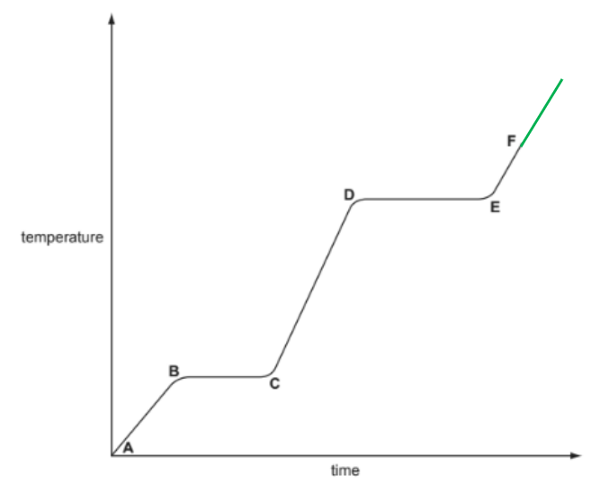

- Direct continuation of E to F; **[1 mark]**

iv) The completed table to compare the separation and movement of the molecules in regions C to D with those in E to F is:

|   | **C to D** | **E to F** |
|---|---|---|
| separation (distance between particles) | close **OR **touching; **[1 mark]** | far apart; **[1 mark]** |
| movement of particles | random and slow | fast **AND **random; **[1 mark]** |
| Can particles move apart to fill any volume? | no / cannot move apart; **[1 mark]** | yes / can move apart; **[1 mark]** |

**[Total: 8 marks]**

- *When a substance is heated, either the sample increases in temperature or it changes in state*
- *This is shown on a heating curve by a horizontal line during state changes for pure samples which correspond to its melting / boiling point*
- *If the same is impure - this is not horizontal as the sample will not have a fixed melting / boiling point *
b) The completed word equations for the reactions of ethanoic acid are:

- calcium + ethanoic acid → **calcium ethanoate + hydrogen**; **[1 mark]** 
*Both products must be correct for [1 mark]*
- **zinc oxide / zinc hydroxide** + ethanoic acid → zinc ethanoate + water; **[1 mark]**

**[Total: 2 marks]**

- *Ethanoic acid will follow the general equations for acids:*

  - *metal + acid → salt + hydrogen*
  - *acid + base → salt + water*
- *Ethanoic acid will produce ethanoate salts*
- *Metal oxides and hydroxides are common bases*
c) The symbol equation for the reaction between ethanoic acid and sodium hydroxide is:

CH3COOH + NaOH → CH3COONa + H2O

- Correct reactants; **[1 mark]**
- Correct products; **[1 mark]**

**[Total: 2 marks]**

- *When ethanoic acid reacts with the base sodium hydroxide, the hydrogen ion on the -COOH group will be replaced with the sodium ion forming sodium ethanoate*

> **[exam-tip]**
> When the question asks for a symbol equation, always use chemical formulae — writing product names such as 'sodium ethanoate + water' earns no marks.
> 
> Learn the formulae of common organic compounds carefully so you don't slip up on the number of carbons or hydrogens.

### Q22
a) You would find out if it is a basic, an acidic or an amphoteric oxide by:

- Test it with both hydrochloric acid and sodium hydroxide (aq); **[1 mark] ** 
*Accept: any named strong acid and any strong alkali If only acid and alkali given then max = 3*
- Basic oxide reacts with acid;** [1 mark] **
- Acidic oxide reacts with alkali/base;** [1 mark] **
- Amphoteric reacts with both; **[1 mark] ** 
*accept: for react – form salt and water*

**Final answer:** **[Total: 4 marks] **

- *This question asks you to describe how to test for an amphoteric oxide*
- *It does not ask you to explain what an amphoteric oxide is*
- *You should know how that an amphoteric oxide reacts with acids and bases in a neutralisation reaction forming a salt and water*
- *If asked to describe a test imagine that you are telling someone how to carry it out*
- *This is why you need to state a named acid and alkali as well as giving the results for an acidic oxide, basic oxide and an amphoteric oxide*
b)

i) The appearance of the mixture remains unchanged after sometime because:

- At equilibrium rate of forward reaction equals rate of back reaction / concentrations remain; **[1 mark] **
- Constant / macroscopic properties do not change with time;** [1 mark] ** 
*Accept: amounts do not change with time*

ii) It changes to a colourless solution when a few drops of acid are added because:

- Equilibrium moves to left (SbOCl used up) 
**OR** 
Hydrochloric acid removed by reacting with SbOCl 
**OR** 
Precipitate dissolves in hydrochloric acid; **[1 mark] **

iii) You could make the colourless solution go cloudy by:

- Add water / dilute / add an alkali / add more SbCl3 / add a base / add a carbonate;** [1 mark] **

**Final answer:** **[Total: 4 marks] **

- *This reaction is reversible which is represented by the *$\rightleftharpoons$
- *An equilibrium can therefore be established*
- *Once equilibrium is reached*

  - *The rate of reaction is the same for the forward and backward reactions *
  - *The concentration of the reactants and products remain constant (do not change)*
- *We can manipulate the position of equilibrium by making a change*

  - *Adding acid will cause the equilibrium to shift to the left hand side (backward)*
  - *This is because the reaction has opposed the change as there are already acid molecules on the right hand side*
  - *Adding water (or a base to 'mop' up the acid) will cause the equilibrium to shift to the right (forward)*
  - *This is because the reaction is opposing the change made to it*

### Q23
a)

i) A weak base is:

- Proton acceptor;** [1 mark] **
- Does not accept (protons) readily 
**OR **
less able to accept protons (than strong bases); **[1 mark] **

ii) You can show sodium hydroxide is a stronger base by:

- Same concentration of both bases; **[1 mark] **
- Measure their pH;** [1 mark] **
- The higher pH is the stronger base; **[1 mark] **

**Final answer:** **[Total 5 marks] **

- *Alternative methods could also be*

  - *Measuring conductivity; a higher conductivity indicates the stronger base*
  - *Add aluminium/ Al and stronger base gives faster rate of effervescence/more fizzing/ more bubbling *
- *The concentrations of the base must be the same for this experiment to be conducted correctly *
b)

i) The completed equation is:

2CH3CH2NH2 + H2SO4 → (CH3CH2NH3)2SO4

- Correct species; **[1 mark] **
- Correct balancing;** [1 mark]**
- The salt is ethylammonium sulfate; **[1 mark] **

ii) A reagent that could be used to displace the weak base, ethylamine, from its salt ethylammonium chloride is

- Sodium hydroxide / calcium hydroxide / NaOH / Ca(OH)2;** [1 mark] ** *Allow any Group 1 or Group 2 hydroxide or oxide*

**[Total: 4 marks] **

- *The word displacement should indicate that you are looking for an oxide or hydroxide that contains a cation that will form a chloride salt*
- *Therefore, any group 1 or group 2 metal oxide or hydroxide will work*
- *NaOH + CH**3**CH**2**NH**3**Cl → NaCl + CH**3**CH**2**NH**3**OH*
c)

i) Gases diffuse because:

Any **two** from:

- (Particles move in) random motion; **[1 mark] **
- (Particles) collide; **[1 mark] **
- (Particles) move from a region of high concentration to low concentration / down a concentration gradient;** [1 mark] **

ii) The white solid will form at position:

- (Position) C; **[1 mark] **
- It has a lower (relative) molecular mass/ less dense (than HBr); **[1 mark] **
- Ethylamine diffuses faster (than HBr); **[1 mark] **

**[Total: 5 marks]**

- *This experiment is a slight change from the usual HCl + NH**3 **→ NH**4**Cl, but the same principle applies *

### Q24
a)

i) To determine whether the sample is pure:

- Measure melting point; **[1 mark]**
- Pure sample would melt at 135 °C 
**OR **
Impure would melt lower than 135 °C; **[1 mark] ** * Ignore heating*

ii) The molecular formula of malonic acid is:

- C3H4O4;** [1 mark] **

iii) The name and molecular formula of the acid is:

- C2H4O2/ CH3COOH; **[1 mark] **
- Ethanoic/ acetic acid;** [1 mark]**

iv) The circled group is:

- An ester;** [1 mark] **

**[Total: 6 marks]**** **

- *Using a melting point test is a good way of testing for purity *
- *This is done using a melting point apparatus which allows you to slowly heat up a small amount of the sample, making it easier to observe the exact melting point*
- *This is then compared to data tables*
- *Heating malonic acid will cause the following reaction:*

  - *C**3**H**4**O**4** → CO**2** + CH**3**COOH*
  - *The question states that two products are formed, one of which is carbon dioxide, CO**2*
  - *If we remove CO**2** from C**3**H**4**O**4** we get the carboxylic acid CH**3**COOH*
- *It is a common question to spot an ester group, so look for the C=O and C-O bonds present*
b)

i) Malonic acid has a higher pH because::

- Malonic is a weaker acid/ less dissociated 
**OR **
Sulfuric acid is a stronger acid/ more dissociated; **[1 mark]** 
*Ignore sulfuric acid is a strong acid*

ii) A test to distinguish between strong and weak acids is:

Alternative 1

- Rate of reaction with Ca, Mg, Zn, Fe; **[1 mark] **
- Strong (sulfuric) acid bubbles faster or more bubbles or dissolves faster; **[1 mark] **

Alternative 2

- Rate of reaction with (metal) carbonate; **[1 mark] **
- Strong (sulfuric) acid faster or more bubbles or dissolves faster (only if carbonate insoluble); **[1 mark] **

Alternative 3

- Electrical conductivity; **[1 mark] **
- Strong (sulfuric) acid better conductor;** [1 mark] **

**Final answer:** **[Total: 2 marks] **

- *The strong acid will react more vigorously than a weak acid*
- *This is due to the increased number of hydrogen ions*
c) The complete equations are:

**i)**

- sodium malonate + water; **[1 mark]**

Reject chemical formulae (e.g., *H*2*O*) as the prompt is a word equation

**ii)**

- CuSO4 + H2O;** [2 marks]**

1 mark is awarded for each correct product. Allow products in any order.

**iii)**

- CH2(COO)2Mg + H2;** [2 marks]**

1 mark is awarded for each correct product. Allow products in any order.
Alternative correct formulae for the salt, such as *Mg*(*CH*2(*COO*)2), *MgCH*2(*COO*)2, or *MgC*3*H*2*O*4.

**iv)**

- K2SO4 + CO2 + H2O; **[2 marks]**

1 mark is awarded for *K*2*SO*4. 1 mark is awarded for BOTH *CO*2 and *H*2*O*
Allow products in any order

**[Total: 7 marks]**

- *You are told in part a) that malonic acid forms salts called 'malonates', therefore if reacted with sodium hydroxide (an alkali) the products will be sodium malonate and water *
- *For ii) and iii) one mark is awarded for each product*
- *For iv) 1 mark is awarded for K**2**SO**4** and 1 mark for both CO**2** and H**2**O*

### Q25
a) The completed sentence is:

- Bases are metal hydroxides or metal <u>oxides;</u> **[1 mark]**

**[Total: 1 mark]**
b) The reactions are:

Any **four** from the following:

**Reaction with a named acid** 
A maximum of **three** from the following

- Forms a salt; [1 mark]
- Correctly named sodium salt from correctly named acid; [1 mark]
- Water formed; [1 mark]
- Neutralisation reaction; [1 mark]

**Reaction with an ammonium salt** 
A maximum of **three** from the following

- Ammonia produced / NH3 produced; [1 mark]
- Forms a (different) salt; [1 mark]
- Correctly named salt from named ammonium salt; [1 mark]
- Water formed; [1 mark]
- Gas turns (damp) red litmus blue;** [1 mark] **

**Final answer:** **[Total: 4 marks] **

- *Sodium hydroxide is an alkali (a soluble base) so will react with acids and form a salt and water in a neutralisation reaction*

  - *With a named acid e.g. hydrochloric acid*
  - *NaOH (aq) + HCl (aq) → NaCl (aq) + H**2**O (l)*
  - *The salt is sodium chloride*
- *With an ammonium salt such as ammonium chloride the reaction will be:*

  - *NH**4**Cl (aq) + NaOH (aq) → NaCl (aq) + H**2**O (l) + NH**3** (aq)*
- *This reaction is used as a chemical test to confirm the presence of the ammonium ion (NH**4**+**)*
- *An alkali is added to the substance with gentle warming followed by the test for ammonia gas using damp red litmus paper*
- *The damp litmus paper will turn from red to blue if ammonia is present*
c) The correct pH is:

- pH 10; **[1 mark] **

**[Total: 1 mark]**

- *Ammonia is a weak base so will have a pH between 8 and 10*

### Q26
a)

i) An acid is:

- A proton donor/ H+ donor/ hydrogen ion donor; **[1 mark] **

ii) The difference between a weak acid and a strong acid is:

- Strong acids completely or fully ionises / completely or fully dissociates / completely or fully splits into ions;** [1 mark] **
- Weak acids partially or incompletely ionises or dissociates or splits into ions /does not ionise fully; **[1 mark] **

**Final answer:** **[Total: 3 marks] **

- *The ionisation of a strong acid is shown by using a → in the equation, showing it is non-reversible*
- *The ionisation of a weak acid is shown by using a *$\rightleftharpoons$*in the equation, showing it is reversible*

  - *H**2**SO**3 *$\rightleftharpoons$* HSO**3**–** + H**+*
b)

i) Precipitate A is:

- Barium sulphite/ barium sulfate(IV)/ BaSO3;** [1 mark] **

ii) Precipitate B is:

- Barium sulfate / BaSO4; **[1 mark] **

iii) The ionic equation for the reduction of the bromine molecule is:

- Br2 + 2e– → 2Br– /Br2 → 2Br– – 2e–; **[1 mark] **

iv) The product formed by the oxidation of sulfurous acid is:

- Sulfuric acid; **[1 mark]**

**[Total: 4 marks] **

- *A sulfite ion is SO**3**2-** and a sulfate ion is SO**4**2-*
- *It is easy to get confused between the two, so make sure you read the question thoroughly as the clue that sulfites are formed from sulfurous acid is given*
- *Reduction is the gain of electrons, therefore the bromine molecule will become two bromide ions when reacted with the weak sulfurous acid*
- *You have been asked for the name of the product formed from the oxidation of sulfurous acid which is sulfuric acid, not the formula, H**2**SO**4*
c)

i) magnesium hydroxide + dilute sulfuric acid forms:

- magensium sulfate + water; **[1 mark] **

ii) zinc + dilute sulfuric acid forms:

- zinc sulfate + hydrogen; **[1 mark]**

iii) copper carbonate + dilute sulfuric acid forms

- copper(II) sulfate/ copper sulfate + carbon dioxide + water;** [1 mark] **

**[Total: 3 marks] **

- *Sulfuric acid will form sulfate salts when reacted with a base, metal or carbonate *
- *You can remember the products by:*

  - *MASH: Metal + acid → salt + hydrogen*
  - *BAWS: Base + acid → water + salt*
  - *CAWCS: Carbonate + acid → water + carbon dioxide + salt *
d)

i) The equation is:

- 2NH3 + H2SO4 → (NH4)2SO4 
**OR** 
NH3 + H2SO4 → (NH4)HSO4;** [1 mark] **

ii) The equation is:

Alternative 1

2NaOH + H2SO4 → Na2SO4 + 2H2O

- Na2SO4 ; **[1 mark]**
- rest of equation correct; **[1 mark] **

Alternative 2

H+ + OH– → H2O

- H2O as the only product on the right hand side;  **[1 mark] **
- rest of equation correct; **[1 mark] **

Alternative 3

NaOH + H2SO4 → NaHSO4 + H2O

- NaHSO4; **[1 mark] **
- rest of equation correct; **[1 mark] **

Alternative 4

OH– + H2SO4 → HSO4– + H2O

- HSO4–; **[1 mark] **
- rest of equation correct; **[1 mark] **

iii) The equation is:

Alternative 1

Fe + H2SO4 → FeSO4 + H2

- FeSO4; **[1 mark] **
- Rest of equation correct; **[1 mark] **

Alternative 2    Fe + 2H+ → Fe2+ + H2

- Fe2+; **[1 mark] **
- Rest of equation correct; **[1 mark] **

Alternative 3    2Fe + 3H2SO4 → Fe2(SO4)3 + 3H2

- Fe2(SO4)3; **[1 mark] **
- Rest of equation correct; **[1 mark] **

Alternative 4    2Fe + 6H+ → 2Fe3+ + 3H2

- Fe3+; **[1 mark] **
- Rest of equation correct; **[1 mark] **

**Final answer:** **[Total 5 marks] **

- *The question does not specify what type of equation that needs writing *
- *Therefore you can include symbol or ionic equations*

  - *As you can see in the mark scheme there are plenty of options *
- *Just double check that your formulas are correct and your equation is balanced*
- *For the reaction of sulfuric acid with iron you can either form FeSO**4** (iron(II) sulfate) using the Fe**2+ **ion, or Fe**2**(SO**4**)**3** (iron(III) sulfate) using the Fe**3+ **ion*

### Q27
a) Calcium oxide is:

- Basic oxide; **[1 mark]**
- Calcium is metal / metallic (oxide);** [1 mark] **

**[Total: 2 marks]**

- *Metals can form oxides when they react with oxygen*

  - *E.g. Magnesium + oxygen → Magnesium oxide*
- *Metal oxides are basic *
- *Non-metal oxides are acidic*

> **[exam-tip]**
> When asked for a reason, always justify your choice — naming the oxide type alone will not earn the second mark
> 
> Remember: metal oxides are basic and non-metal oxides are acidic, so check whether the element is a metal first
b) The correct pH is:

- pH 4; **[1 mark]**

**Final answer:** **[Total: 1 mark] **

- *Acid rain is classed as a weak acid*
- *Weak acids have a pH between 3 and 6*
