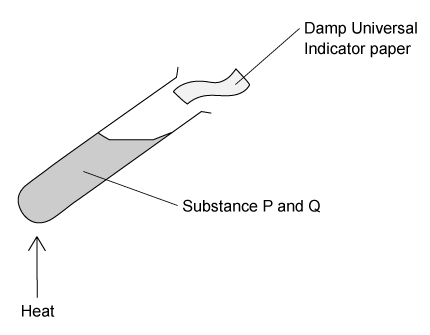

# Exam Questions — The Characteristic Properties of Acids & Bases
**7. Acids, Bases & Salts** · Cambridge (CIE) IGCSE chemistry (0620 & 0971)
> Source: [https://www.savemyexams.com/igcse/chemistry/cie/23/topic-questions/](https://www.savemyexams.com/igcse/chemistry/cie/23/topic-questions/) · 19 questions across 1 sets

## Multiple Choice Questions (30 questions)

### Q1 — medium — 1 marks

**Q1** [1 mark]

Propanoic acid is a weak acid.

What is a possible pH for a dilute aqueous solution of propanoic acid?

### Q2 — easy — 1 marks

**Q2** [1 mark]

The diagram shows elements X and Y in a section of the Periodic Table

Which statement about the oxides of the elements is correct?

### Q3 — easy — 1 marks

**Q3** [1 mark]

Indicators are substances that change colour when they are added to acidic or alkaline solutions.

| **Indicator** | **Colour in acid** | **Colour in alkali** |
|---|---|---|
| **methyl orange** | red | orange |
| **litmus** | red | blue |
| **thymolphthalein** | blue | colourless |
| **universal indicator** | green | purple |

Which indicator displays the correct colour in each solution?

| **A** | Methyl orange |
|---|---|
| **B** | Litmus |
| **C** | Thymolphthalein |
| **D** | Universal indicator |

### Q4 — easy — 1 marks

**Q4** [1 mark]

Hydrochloric acid is often used to clean metals by reacting with the surface coating which develops on some metals when exposed to the atmosphere.

Which row correctly describes the surface coating on these metals?

|   | **name** | **acidic or basic** | **reacts with** |
|---|---|---|---|
| **A** | oxide | basic | acid |
| **B** | oxide | acidic | basic |
| **C** | alloy | acidic | basic |
| **D** | alloy | basic | acid |

### Q5 — easy — 1 marks

**Q5** [1 mark]

Most insect bites cause a stinging sensation because of the injection of a weak acid into the surface of the skin. Which substance could be used to neutralise the acid from an insect bite?

|   | **substance** | **pH** |
|---|---|---|
| **A** | battery acid | 1 |
| **B** | toothpaste | 8 |
| **C** | grill cleaner | 13 |
| **D** | lime juice | 3 |

### Q6 — easy — 1 marks

**Q6** [1 mark]

Which words complete the gaps 1 & 2 in these sentences?

Aqueous solutions of acids contain <u>         1         </u> ions and aqueous solutions of alkalis contain <u>         2         </u> ions.

| ** ** | 1 | 2 |
|---|---|---|
| ** A** | Na+ | OH– |
| ** B** | OH– | H+ |
| ** C** | H+ | Cl– |
| ** D** | H+ | OH– |

### Q7 — easy — 1 marks

**Q7** [1 mark]

Calcium reacts with sulfuric acid to form the salt, calcium sulfate, and another product.

What is the other product?

| **A** | Oxygen |
|---|---|
| **B** | Hydrogen |
| **C** | Water |
| **D** | Carbon dioxide |

### Q8 — hard — 1 marks

**Q8** [1 mark]

Ionic equations 1 and 2 show how substance **X** behaves in aqueous solution.

| **1** | X- + H+ → XH |
|---|---|
| **2** | X → X- + H+ |

Which row correctly describes substance X?

|   | **acid** | **base** |
|---|---|---|
| **A** | 1 | 1 |
| **B** | 1 | 2 |
| **C** | 2 | 2 |
| **D** | 2 | 1 |

### Q9 — hard — 1 marks

**Q9** [1 mark]

Which indicator displays the correct colour in each solution?

| **Indicator** | **Colour in dilute sulfuric acid ** | **Colour in potassium hydroxide solution** |
|---|---|---|
| **methyl orange** | red | yellow |
| **universal indicator** | red | orange |
| **litmus** | red | purple |
| **thymolphthalein** | blue | colourless |

### Q10 — hard — 1 marks

**Q10** [1 mark]

The pH of two samples of different dilute acids were found.

Acid **X** had a pH of 6

Acid **Y** had a pH of 3

Which statement is correct?

### Q11 — hard — 1 marks

**Q11** [1 mark]

Which equation does **not** show the correct reaction of an acid?

### Q12 — hard — 1 marks

**Q12** [1 mark]

In a reaction rate experiment, a student used equal volumes of acids **P** and **Q** to react with excess magnesium in separate conical flasks.

The following observations were recorded:

| **1** | Acid **P** produces hydrogen gas faster than acid **Q** |
|---|---|
| **2** | Both gases produce the same total volume of hydrogen gas |

Which statement correctly explains the students observations?

### Q13 — medium — 1 marks

**Q13** [1 mark]

A student is provided with an unmarked beaker containing a colourless solution and asked to identify it. The student decides to perform a series of reactions with the solution and record the observations.

Which of these observations is not indicative of an acid?

### Q14 — medium — 1 marks

**Q14** [1 mark]

Which of the following statements is not correct?

### Q15 — medium — 1 marks

**Q15** [1 mark]

A student gradually added excess potassium hydroxide from a burette to a conical flask containing sulfuric acid as part of a rate of reaction investigation.

Which statement describes the change in pH of the sulfuric acid as the aqueous potassium hydroxide was added?

### Q16 — medium — 1 marks

**Q16** [1 mark]

Which of the following properties is not indicative of a base?

### Q17 — medium — 1 marks

**Q17** [1 mark]

A student was given an unknown substance and asked to analyse it. The student decided to perform three tests and recorded the results as shown below.

1. On heating with ammonium chloride a gas is released
2. The substance turns methyl orange yellow.
3. The substance does not react with potassium carbonate.

What kind of substance was the student given?

### Q18 — medium — 1 marks

**Q18** [1 mark]

A student is testing two substances, **P** and **Q**, as shown.

The results of the test are that the Universal indicator paper turns blue. What are substances **P **and **Q**?

### Q19 — medium — 1 marks

**Q19** [1 mark]

Which of the following elements forms an oxide that can be used to neutralise an alkaline solution?
