# Exam Questions — The Characteristic Properties of Acids & Bases
**7. Acids, Bases & Salts** · Cambridge (CIE) IGCSE chemistry (0620 & 0971)
> Source: [https://www.savemyexams.com/igcse/chemistry/cie/23/topic-questions/](https://www.savemyexams.com/igcse/chemistry/cie/23/topic-questions/) · 57 questions across 3 sets

## Alternative To Practical Questions (12 questions)

### Q1 — medium — 6 marks

**Q1** [6 marks]

A student found two unlabelled bottles of dilute hydrochloric acid, **solution A** and **solution B**, in the laboratory. The labels showing their concentrations had fallen off.

The student wants to find out which solution of hydrochloric acid is more concentrated.

Plan an investigation to determine which of the two solutions, **A** or **B**, is more concentrated. You are provided with solid sodium hydroxide granules, a suitable indicator, and common laboratory apparatus.

### Q2 — medium — 10 marks

**Q2** [3 marks]

Dilute nitric acid was added to a large amount of magnesium carbonate in a conical flask as shown.

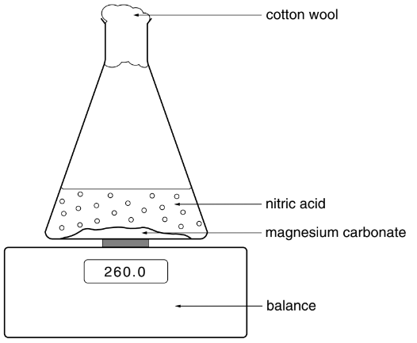

The flask was placed on a balance and the mass of the flask and contents recorded every minute. The results are shown in the table.

| time / min | 0 | 1 | 2 | 3 | 4 | 5 | 6 |
|---|---|---|---|---|---|---|---|
| mass of flask and contents / g | 260.0 | 257.9 | 256.8 | 256.6 | 255.8 | 255.6 | 255.6 |

Plot the results on the grid and draw a smooth line graph.

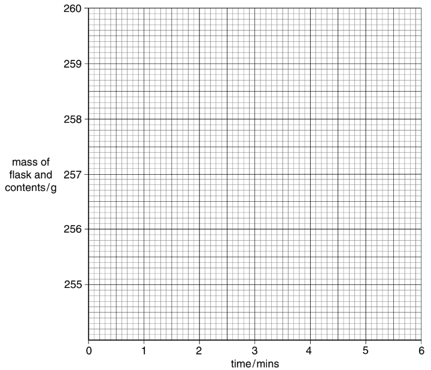

*Source: 2002 6 Q3*

**Q2** [2 marks]

**Extract:**

Dilute nitric acid was added to a large amount of magnesium carbonate in a conical flask as shown. The flask was placed on a balance and the mass of the flask and contents recorded every minute. The results are shown in the table.

| time / min | 0 | 1 | 2 | 3 | 4 | 5 | 6 |
| mass of flask and contents / g | 260.0 | 257.9 | 256.8 | 256.6 | 255.8 | 255.6 | 255.6 |

Plot the results on the grid and draw a smooth line graph.

Which result appears to be inaccurate? Why have you selected this result?

*Source: 2002 6 Q3*

**Q2** [1 mark]

**Extract:**

Dilute nitric acid was added to a large amount of magnesium carbonate in a conical flask as shown. The flask was placed on a balance and the mass of the flask and contents recorded every minute.

Why does the mass of the flask and contents decrease?

*Source: 2002 6 Q3*

**Q2** [1 mark]

**Extract:**

Dilute nitric acid was added to a large amount of magnesium carbonate in a conical flask as shown. The flask was placed on a balance and the mass of the flask and contents recorded every minute.

Suggest the purpose of the cotton wool.

*Source: 2002 6 Q3*

**Q2** [1 mark]

**Extract:**

Dilute nitric acid was added to a large amount of magnesium carbonate in a conical flask. The flask was placed on a balance and the mass of the flask and contents recorded every minute. The results are shown in the table.

| time / min | 0 | 1 | 2 | 3 | 4 | 5 | 6 |
| mass of flask and contents / g | 260.0 | 257.9 | 256.8 | 256.6 | 255.8 | 255.6 | 255.6 |

At what time did the reaction finish?

*Source: 2002 6 Q3*

**Q2** [2 marks]

**Extract:**

Dilute nitric acid was added to a large amount of magnesium carbonate in a conical flask. The flask was placed on a balance and the mass of the flask and contents recorded every minute. The results are shown in the table.

| time / min | 0 | 1 | 2 | 3 | 4 | 5 | 6 |
| mass of flask and contents / g | 260.0 | 257.9 | 256.8 | 256.6 | 255.8 | 255.6 | 255.6 |

Plot the results on the grid and draw a smooth line graph.

On the grid, sketch the graph you would expect if the experiment were repeated using nitric acid at a higher temperature.

*Source: 2002 6 Q3*

### Q3 — medium — 7 marks

**Q3** [3 marks]

An experiment was carried out to find the pH of samples of soil from a farmer’s field.

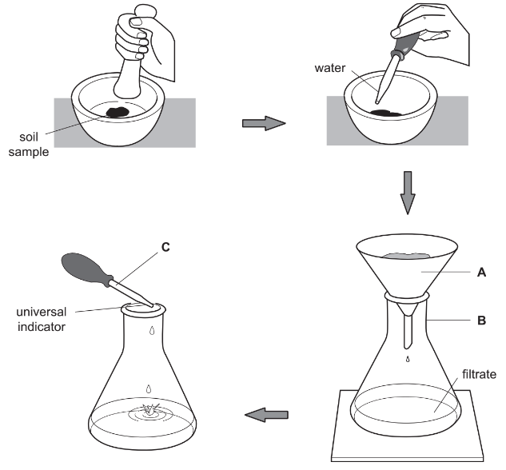

Identify the pieces of apparatus labelled

**A**, ....................................................................................................

**B**, ....................................................................................................

**C**. ....................................................................................................

*Source: 2004 6 Q1*

**Q3** [2 marks]

**Extract:**

An experiment was carried out to find the pH of samples of soil from a farmer’s field.

Why was the soil crushed?

*Source: 2004 6 Q1*

**Q3** [1 mark]

**Extract:**

An experiment was carried out to find the pH of samples of soil from a farmer’s field.

Why should soil samples be taken from different parts of the field?

*Source: 2004 6 Q1*

**Q3** [1 mark]

**Extract:**

An experiment was carried out to find the pH of samples of soil from a farmer's field.

Suggest why it is important to know the pH of soil.

*Source: 2004 6 Q1*

### Q4 — medium — 20 marks

**Q4** [3 marks]

A student investigated the reaction between two different solids, **C** and **D**, and excess dilute hydrochloric acid.

Five experiments were carried out.

- ***Experiment 1***

  - A measuring cylinder was used to pour 30 cm3 of dilute hydrochloric acid into a polystyrene cup. The temperature of the dilute hydrochloric acid was measured. 1 g of solid **C** was added to the dilute hydrochloric acid and the mixture stirred with a thermometer.
  - The maximum temperature reached by the liquid mixture was measured.
- ***Experiment 2***

  - The polystyrene cup was emptied and rinsed with water.
  - Experiment 1 was repeated using 2 g of solid **C**.
- ***Experiments 3 and 4***

  - Experiment 2 was repeated using 3 g and then 5 g of solid **C**.

Complete the first column in the table.

Use the thermometer diagrams to record the results in the table below.

Complete the final column in the table.

| experiment | mass of solid **C** / g | thermometer diagram | initial temperature of acid / oC | thermometer diagram | maximum temperature reached / oC | temperature difference / oC |
|---|---|---|---|---|---|---|
| 1 |   | 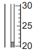 |   | 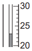 |   |   |
| 2 |   | 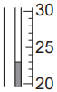 |   | 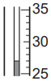 |   |   |
| 3 |   | 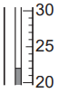 |   | 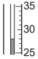 |   |   |
| 4 |   |  |   | 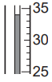 |   |   |

*Source: 2013 Ju61 Q3*

**Q4** [2 marks]

**Extract:**

A student investigated the reaction between two different solids, **C** and **D**, and excess dilute hydrochloric acid.

***Experiment 1***

A measuring cylinder was used to pour 30 cm^3 of dilute hydrochloric acid into a polystyrene cup. The temperature of the dilute hydrochloric acid was measured. 1 g of solid **C** was added to the dilute hydrochloric acid and the mixture stirred with a thermometer.
The maximum temperature reached by the liquid mixture was measured.

***Experiment 5***

Experiment 1 was repeated using solid **D**. Use the thermometer diagrams to record the results in the spaces below.

|  | 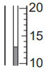 |
|---|---|
| initial temperature of acid | final temperature of liquid mixture |

initial temperature of dilute hydrochloric acid = .................... °C

final temperature of liquid mixture = .................... °C

temperature change = .................... °C

*Source: 2013 Ju61 Q3*

**Q4** [4 marks]

**Extract:**

| experiment | mass of solid C / g | temperature difference / °C |
| 1 | 1 | 2 |
| 2 | 2 | 4 |
| 3 | 3 | 6 |
| 4 | 5 | 10 |

Plot the results for Experiments 1, 2, 3 and 4 on the grid and draw a straight line graph.

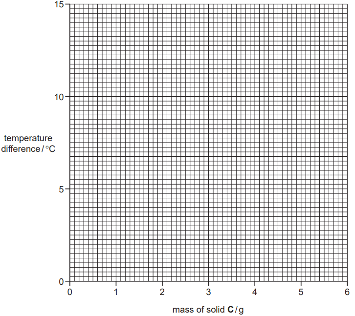

*Source: 2013 Ju61 Q3*

**Q4** [4 marks]

**Extract:**

Plot the results for Experiments 1, 2, 3 and 4 on the grid and draw a straight line graph.

The completed graph plots temperature difference / °C (y-axis) against mass of solid C / g (x-axis), passing through the points: (1 g, 2 °C), (2 g, 4 °C), (3 g, 6 °C), (5 g, 10 °C) as a straight line through the origin.

i) **From your graph,** deduce the temperature of the solution when 6 g of solid **C** is added to 30 cm3  of dilute hydrochloric acid. Show clearly on the grid how you worked out your answer.

.............................. °C

[2]

ii) **From your graph, **deduce the mass of solid **C** that would give a temperature rise of 9°C when added to 30 cm3 of dilute hydrochloric acid.

..............................

[2]

*Source: 2013 Ju61 Q3*

**Q4** [1 mark]

**Extract:**

Experiment 5: Experiment 1 was repeated using solid D. Initial temperature of dilute hydrochloric acid = 21 °C AND Final temperature of liquid mixture = 13 °C. Temperature change = –8 °C (the temperature decreases so the temperature change is negative).

What type of chemical process occurs when solid **D** reacts with dilute hydrochloric acid?

*Source: 2013 Ju61 Q3*

**Q4** [2 marks]

**Extract:**

Experiment 1: A measuring cylinder was used to pour 30 cm^3 of dilute hydrochloric acid into a polystyrene cup. The temperature of the dilute hydrochloric acid was measured. 1 g of solid C was added to the dilute hydrochloric acid and the mixture stirred with a thermometer. The maximum temperature reached by the liquid mixture was measured. Experiment 2: Experiment 1 was repeated using 2 g of solid C. Experiments 3 and 4: Experiment 2 was repeated using 3 g and then 5 g of solid C.
For Experiment 3 (3 g of solid C), the temperature difference was 6 °C (initial 22 °C, maximum 28 °C).

Suggest the effect on the results if Experiment 3 was repeated using 60 cm3 of dilute hydrochloric acid.

*Source: 2013 Ju61 Q3*

**Q4** [2 marks]

**Extract:**

Experiment 4: mass of solid C = 5 g, initial temperature of acid = 24°C, maximum temperature reached = 34°C, temperature difference = 10°C. (Experiment 4 involved adding 5 g of solid C to 30 cm^3 of dilute hydrochloric acid in a polystyrene cup.)

Predict the temperature of the solution in Experiment 4 after 1 hour. Explain your answer.

*Source: 2013 Ju61 Q3*

**Q4** [2 marks]

**Extract:**

A student investigated the reaction between two different solids, C and D, and excess dilute hydrochloric acid. Five experiments were carried out. Experiment 1: A measuring cylinder was used to pour 30 cm^3 of dilute hydrochloric acid into a polystyrene cup. The temperature of the dilute hydrochloric acid was measured. 1 g of solid C was added to the dilute hydrochloric acid and the mixture stirred with a thermometer. The maximum temperature reached by the liquid mixture was measured. Experiment 2: The polystyrene cup was emptied and rinsed with water. Experiment 1 was repeated using 2 g of solid C. Experiments 3 and 4: Experiment 2 was repeated using 3 g and then 5 g of solid C.

When carrying out the experiments, what would be **one **advantage and **one **disadvantage of taking the temperature readings after exactly one minute?

advantage ....................................................................................................

disadvantage ....................................................................................................

*Source: 2013 Ju61 Q3*

### Q5 — medium — 6 marks

**Q5** [3 marks]

Acid base indicators Indicators are used to identify acids and bases.

Indicators can be obtained from berries and other fruits.

Plan an experiment to obtain an aqueous solution of an indicator from some berries.

*Source: 2009 61 Q6*

**Q5** [3 marks]

**Extract:**

Acid base indicators. Indicators are used to identify acids and bases. Indicators can be obtained from berries and other fruits. Plan an experiment to obtain an aqueous solution of an indicator from some berries.

Plan an experiment to use the indicator solution to show that it is an effective indicator.

*Source: 2009 61 Q6*

### Q6 — medium — 16 marks

**Q6** [4 marks]

A student investigated the reaction of dilute hydrochloric acid with two different solids, calcium carbonate (marble) and calcium oxide.

Four experiments were carried out.

***Experiment 1***

By using a measuring cylinder, 50 cm3 of dilute hydrochloric acid was poured into a polystyrene cup and the initial temperature of the acid was measured.

2.5 g of small marble chips were added to the cup and the mixture stirred with the thermometer.

The temperature of the mixture was measured after 2 minutes.

Use the thermometer diagrams to record the temperatures in the table of results.

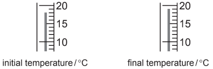

***Experiment 2***

Experiment 1 was repeated using 2.5 g of powdered calcium carbonate. Use the thermometer diagrams to record the results in the table.

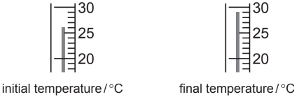

***Experiment 3***

Experiment 1 was repeated using 1.5 g of lumps of calcium oxide. Use the thermometer diagrams to record the temperatures in the table.

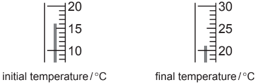

***Experiment 4***

Experiment 1 was repeated using 1.5 g of powdered calcium oxide. Use the thermometer diagrams to record the results in the table.

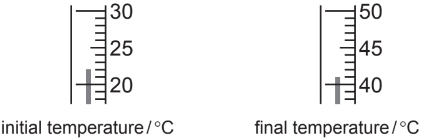

***Table of results ***

| **Experiment** | **Initial temperature / ****o****C ** | **Final temperature / ****o****C** | **Temperature difference / ****o****C** |
|---|---|---|---|
| **1** |   |   |   |
| **2** |   |   |   |
| **3** |   |   |   |
| **4** |   |   |   |

*Source: 2007 6 Q4*

**Q6** [1 mark]

**Extract:**

A student investigated the reaction of dilute hydrochloric acid with two different solids, calcium carbonate (marble) and calcium oxide.

Experiment 1: By using a measuring cylinder, 50 cm^3 of dilute hydrochloric acid was poured into a polystyrene cup and the initial temperature of the acid was measured. 2.5 g of small marble chips were added to the cup and the mixture stirred with the thermometer.

Experiment 2: Experiment 1 was repeated using 2.5 g of powdered calcium carbonate.

What would be observed in Experiment 2?

*Source: 2007 6 Q4*

**Q6** [3 marks]

**Extract:**

Table of results:
| Experiment | Initial temperature / °C | Final temperature / °C | Temperature difference / °C |
| 1 | 18 | 19 | 1 |
| 2 | 26 | 29 | 3 |
| 3 | 16 | 21 | 5 |
| 4 | 22 | 41 | 19 |

Draw a bar chart of the results of the experiments on the grid below.

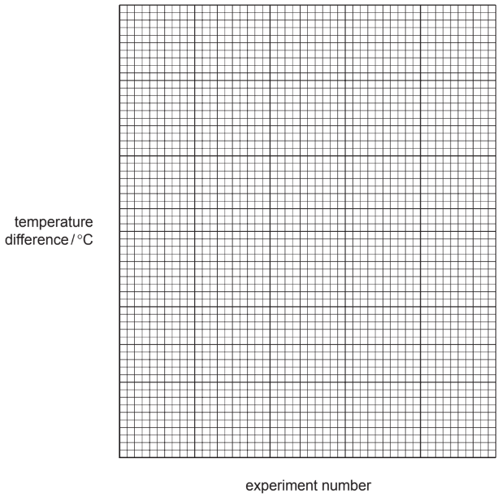

*Source: 20074 6 Q4*

**Q6** [2 marks]

**Extract:**

| **Experiment** | **Initial temperature / oC ** | **Final temperature / oC** | **Temperature difference / oC** |
| 1 | 18 | 19 | 1 |
| 2 | 26 | 29 | 3 |
| 3 | 16 | 21 | 5 |
| 4 | 22 | 41 | 19 |

Which experiment produced

i) the smallest temperature change,

[1]

ii) the largest temperature change?

[1]

*Source: 2007 6 Q4*

**Q6** [2 marks]

**Extract:**

A student investigated the reaction of dilute hydrochloric acid with two different solids, calcium carbonate (marble) and calcium oxide.

Experiment 1: 50 cm^3 of dilute hydrochloric acid, 2.5 g of small marble chips added.
Experiment 2: repeated using 2.5 g of powdered calcium carbonate.
Experiment 3: repeated using 1.5 g of lumps of calcium oxide.
Experiment 4: repeated using 1.5 g of powdered calcium oxide.

d) i) The experiment that produced the smallest temperature change is Experiment 1. ii) The experiment that produced the largest temperature change is Experiment 4.

Give **two **reasons why the temperature changes are different in (d).

*Source: 2007 6 Q4*

**Q6** [2 marks]

**Extract:**

Experiment 1: By using a measuring cylinder, 50 cm^3 of dilute hydrochloric acid was poured into a polystyrene cup and the initial temperature of the acid was measured. 2.5 g of small marble chips were added to the cup and the mixture stirred with the thermometer. The temperature of the mixture was measured after 2 minutes.

In Experiment 1, how would you know which reactant is in excess? Explain your answer.

*Source: 2007 6 Q4*

**Q6** [2 marks]

**Extract:**

By using a measuring cylinder, 50 cm^3 of dilute hydrochloric acid was poured into a polystyrene cup and the initial temperature of the acid was measured. 2.5 g of small marble chips were added to the cup and the mixture stirred with the thermometer. The temperature of the mixture was measured after 2 minutes.

Explain how the temperature changes would differ in the experiments if 100 cm3 of hydrochloric acid were used.

*Source: 2007 6 Q4*

### Q7 — medium — 20 marks

**Q7** [3 marks]

A student investigated the reaction of aqueous sodium hydroxide with aqueous solutions of two different acids, **A** and **B**.
 Two experiments were done.

*Experiment 1*

Using a measuring cylinder, 50 cm3 of aqueous sodium hydroxide solution was poured into a polystyrene cup. The initial temperature of the solution was measured.

A burette was filled with the solution of acid A to the 0.0 cm3  mark. 5.0 cm3 of acid **A** was added to the aqueous sodium hydroxide in the cup and the mixture stirred. 
The temperature of the solution was measured. Another 5.0 cm3  of acid **A** was added to the cup and the mixture stirred. The temperature of the mixture was measured. 
More 5.0 cm3 portions of acid **A** were added to the cup until a total volume of 40.0 cm3 of acid had been added. After each addition, the mixture was stirred and the temperature measured.

Use the thermometer diagrams in the table to record the temperatures.

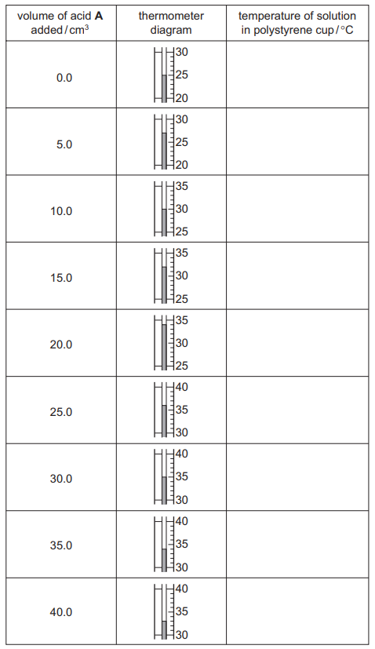

*Source: 2015 61 Q4*

**Q7** [3 marks]

**Extract:**

A student investigated the reaction of aqueous sodium hydroxide with aqueous solutions of two different acids, A and B. Two experiments were done. Experiment 1: Using a measuring cylinder, 50 cm^3 of aqueous sodium hydroxide solution was poured into a polystyrene cup. The initial temperature of the solution was measured. A burette was filled with the solution of acid A to the 0.0 cm^3 mark. 5.0 cm^3 of acid A was added to the aqueous sodium hydroxide in the cup and the mixture stirred. The temperature of the solution was measured. Another 5.0 cm^3 of acid A was added to the cup and the mixture stirred. The temperature of the mixture was measured. More 5.0 cm^3 portions of acid A were added to the cup until a total volume of 40.0 cm^3 of acid had been added. After each addition, the mixture was stirred and the temperature measured.

The burette was emptied and rinsed with distilled water, and then with acid **B**. This acid was discarded. The burette was then filled up to the 0.0 cm3 mark with acid **B**.

*Experiment 2*

Experiment 1 was repeated using acid **B** instead of acid **A**. 
Use the thermometer diagrams in the table to record the temperatures.

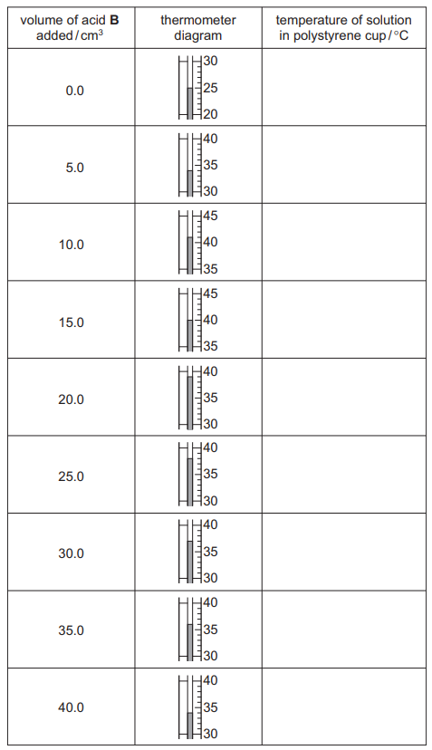

*Source: 2015 61 Q4*

**Q7** [5 marks]

**Extract:**

Experiment 1: Using a measuring cylinder, 50 cm^3 of aqueous sodium hydroxide solution was poured into a polystyrene cup. The initial temperature of the solution was measured. 5.0 cm^3 of acid A was added and temperature measured. More 5.0 cm^3 portions of acid A were added until a total volume of 40.0 cm^3 had been added, temperature measured after each addition. Measured temperatures for Experiment 1: 25, 27, 30, 32, 34, 36, 35, 34, 33.
Experiment 2 was Experiment 1 repeated using acid B. Measured temperatures for Experiment 2: 25, 34, 41, 40, 39, 38, 37, 36, 34.

Plot the results for Experiments 1 and 2 on the grid and draw a smooth line graph for each experiment. Clearly label your graphs.

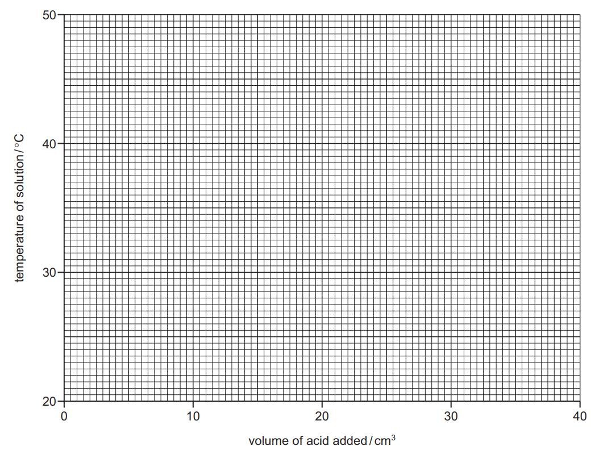

*Source: 2015 61 Q4*

**Q7** [2 marks]

**Extract:**

A student investigated the reaction of aqueous sodium hydroxide with aqueous solutions of two different acids, A and B. Experiment 1: Using a measuring cylinder, 50 cm^3 of aqueous sodium hydroxide solution was poured into a polystyrene cup... 5.0 cm^3 portions of acid A were added... temperature measured. Results for Experiment 1: 25, 27, 30, 32, 34, 36, 35, 34, 33.
Experiment 2 was repeated using acid B instead of acid A. Thermometer readings for acid B: 25, 34, 41, 40, 39, 38, 37, 36, 34.
Plot the results for Experiments 1 and 2 on the grid and draw a smooth line graph for each experiment.

Use your graph to estimate the temperature of the reaction mixture when 8.0 cm3  of acid **B** were added to 50 cm3 of aqueous sodium hydroxide. Show clearly on the grid how you worked out your answer.

*Source: 2015 61 Q4*

**Q7** [1 mark]

**Extract:**

A student investigated the reaction of aqueous sodium hydroxide with aqueous solutions of two different acids, A and B. Experiment 1: Using a measuring cylinder, 50 cm^3 of aqueous sodium hydroxide solution was poured into a polystyrene cup. The initial temperature of the solution was measured. 5.0 cm^3 of acid A was added to the aqueous sodium hydroxide in the cup and the mixture stirred. The temperature of the solution was measured. More 5.0 cm^3 portions of acid A were added until a total volume of 40.0 cm^3 of acid had been added. After each addition, the mixture was stirred and the temperature measured. The measured temperatures were: 25, 27, 30, 32, 34, 36, 35, 34, 33.

What type of chemical reaction, other than neutralisation, occurred when acid **A** reacted with sodium hydroxide?

*Source: 2015 61 Q4*

**Q7** [2 marks]

**Extract:**

The burette was emptied and rinsed with distilled water, and then with acid B. This acid was discarded. The burette was then filled up to the 0.0 cm^3 mark with acid B.
Experiment 2: Experiment 1 was repeated using acid B instead of acid A.
(Experiment 1 had used acid A in the burette.)

Why was the burette rinsed firstly with distilled water and then with acid **B** before starting Experiment 2?

*Source: 2015 61 Q4*

**Q7** [2 marks]

**Extract:**

A student investigated the reaction of aqueous sodium hydroxide with aqueous solutions of two different acids, A and B. Two experiments were done. Experiment 1: Using a measuring cylinder, 50 cm^3 of aqueous sodium hydroxide solution was poured into a polystyrene cup... 5.0 cm^3 of acid A was added... More 5.0 cm^3 portions of acid A were added to the cup until a total volume of 40.0 cm^3 of acid had been added. Temperatures recorded: 25, 27, 30, 32, 34, 36, 35, 34, 33.
Experiment 2 was Experiment 1 repeated using acid B instead of acid A. Temperatures recorded: 25, 34, 41, 40, 39, 38, 37, 36, 34.

The solutions of acids **A** and **B** are the same concentration.

i) In which experiment was the maximum temperature change greater?

[1]

ii)Suggest why the maximum temperature change was greater in this experiment.

[1]

*Source: 2015 61 Q4*

**Q7** [2 marks]

**Extract:**

Experiment 1: Using a measuring cylinder, 50 cm^3 of aqueous sodium hydroxide solution was poured into a polystyrene cup. The initial temperature of the solution was measured. A burette was filled with the solution of acid A to the 0.0 cm^3 mark. 5.0 cm^3 of acid A was added to the aqueous sodium hydroxide in the cup and the mixture stirred. The temperature of the solution was measured. Another 5.0 cm^3 of acid A was added to the cup and the mixture stirred. The temperature of the mixture was measured. More 5.0 cm^3 portions of acid A were added to the cup until a total volume of 40.0 cm^3 of acid had been added. After each addition, the mixture was stirred and the temperature measured.
Experiment 2: Experiment 1 was repeated using acid B instead of acid A.

Describe one source of error in Experiment 2. Suggest one improvement to reduce this source of error. 
source of error  ........................................................................................................................... 
improvement ..............................................................................................................................

*Source: 20015 61 Q4*

### Q8 — medium — 19 marks

**Q8** [4 marks]

A student investigated the temperature changes that occur when two compounds **A** and **B**, react with hydrochloric acid. The apparatus below was used.

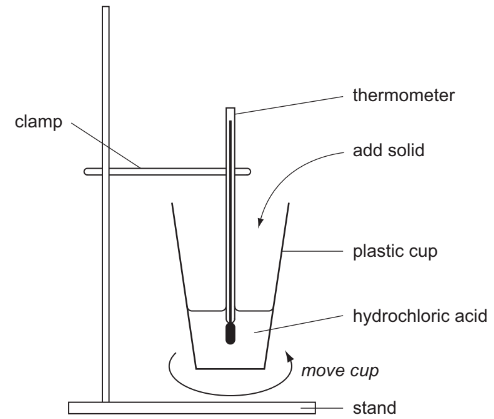

*Experiment 1*

By using a measuring cylinder, 30cm3 of hydrochloric acid was added to the plastic cup.

Use the thermometer diagram to record the initial temperature of the acid in the table. The timer was started, and some of the solid **A **was added to the cup. Immediate effervescence occurred. The mixture was stirred by moving the cup until the fizzing stopped.

More of **A **was then added and the student continued adding **A **in this way until all of solid **A **had been added.

Use the thermometer diagrams to record the temperature of the mixture every half minute.

*Experiment 2*

Experiment 1 was repeated using solid **B**. Use the thermometer diagrams to record the temperatures in the table.

*Table of results*

*Experiment 1 *

* *

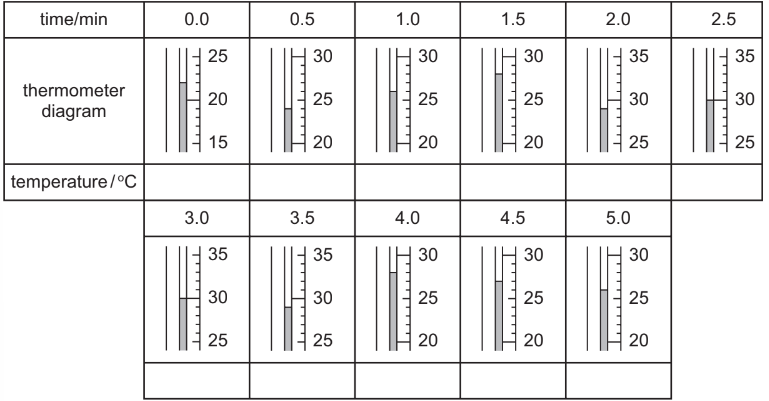

*  *

*Experiment 2 *

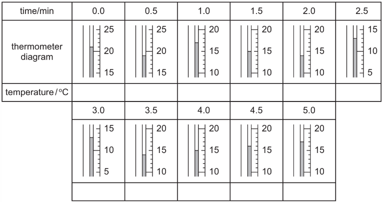

*Source: 2004 6 Q4*

**Q8** [6 marks]

**Extract:**

A student investigated the temperature changes that occur when two compounds A and B, react with hydrochloric acid.

Experiment 1
By using a measuring cylinder, 30cm^3 of hydrochloric acid was added to the plastic cup. Record the initial temperature of the acid. The timer was started, and some of the solid A was added to the cup. Immediate effervescence occurred. The mixture was stirred by moving the cup until the fizzing stopped. More of A was then added and the student continued adding A in this way until all of solid A had been added. Record the temperature of the mixture every half minute.

Experiment 2
Experiment 1 was repeated using solid B. Record the temperatures in the table.

The results tables for Experiment 1 (solid A) and Experiment 2 (solid B) contain the temperature readings taken every half minute (over 5 minutes), which are needed to plot the graph.

Plot the results from both experiments on the grid below. For each set of results draw a smooth line graph. Indicate clearly which line represents Experiment 1 and which line Experiment 2.

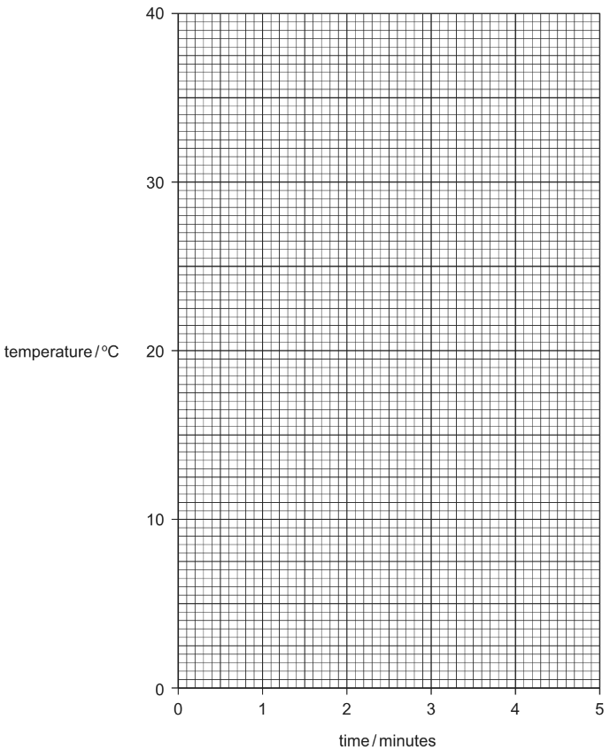

*Source: 2004 6 Q4*

**Q8** [4 marks]

**Extract:**

A student investigated the temperature changes that occur when two compounds **A** and **B**, react with hydrochloric acid.

Experiment 1: By using a measuring cylinder, 30cm^3 of hydrochloric acid was added to the plastic cup. Record the initial temperature of the acid. The timer was started, and some of the solid A was added to the cup. Immediate effervescence occurred. The mixture was stirred until the fizzing stopped. More of A was then added and the student continued adding A in this way until all of solid A had been added. Record the temperature of the mixture every half minute.

Experiment 2: Experiment 1 was repeated using solid B.

**From your graphs;**

i) Find the temperature of the reaction mixture after the hydrochloric acid had reacted for 2 minutes 15 seconds with

solid **A**, ..................................................

solid **B**. ..................................................

[2]

ii) What type of chemical reaction occurs when

solid** A**, ..................................................

solid **B** ..................................................

reacts with hydrochloric acid?

[2]

*Source: 2004 6 Q4*

**Q8** [2 marks]

**Extract:**

A student investigated the temperature changes that occur when two compounds **A** and **B**, react with hydrochloric acid.

By using a measuring cylinder, 30cm^3^ of hydrochloric acid was added to the plastic cup. Use the thermometer diagram to record the initial temperature of the acid in the table. The timer was started, and some of the solid **A **was added to the cup. Immediate effervescence occurred. The mixture was stirred by moving the cup until the fizzing stopped. More of **A **was then added and the student continued adding **A **in this way until all of solid **A **had been added.

Experiment 1 was repeated using solid **B**.

Suggest what type of compound solids **A **and **B **are. Explain your answer.

*Source: 2004 6 Q4*

**Q8** [3 marks]

**Extract:**

A student investigated the temperature changes that occur when two compounds A and B, react with hydrochloric acid. Experiment 1: By using a measuring cylinder, 30cm^3 of hydrochloric acid was added to the plastic cup. Record the initial temperature of the acid. The timer was started, and some of the solid A was added to the cup. Immediate effervescence occurred. The mixture was stirred by moving the cup until the fizzing stopped. More of A was then added and the student continued adding A in this way until all of solid A had been added. Record the temperature of the mixture every half minute. Experiment 2: Experiment 1 was repeated using solid B.

If the plastic cup and final reaction mixture are left for one hour, predict the temperature at this time for

i) solid **A** and hydrochloric acid,

ii) solid **B** and hydrochloric acid.

Explain your answers.

*Source: 2004 6 Q4*

### Q9 — medium — 5 marks

**Q9** [3 marks]

A student investigated the neutralisation of dilute hydrochloric acid, using an excess of calcium carbonate.

Step 1 Excess calcium carbonate was added to hydrochloric acid.

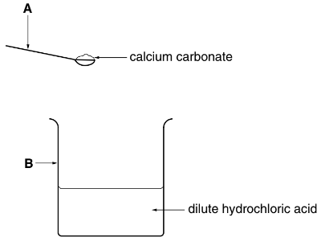

Step 2. Excess calcium carbonate was removed from the solution.

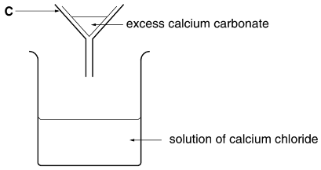

Step 3. The solution of calcium chloride was tested with indicator paper.

Identify the pieces of apparatus labelled

** A**, ....................................................................................................

** B**, ....................................................................................................

**C**. ....................................................................................................

*Source: 2002 6 Q1*

**Q9** [1 mark]

**Extract:**

A student investigated the neutralisation of dilute hydrochloric acid, using an excess of calcium carbonate.
Step 1 Excess calcium carbonate was added to hydrochloric acid.

What does the term *excess *mean?

*Source: 2002 6 Q1*

**Q9** [1 mark]

**Extract:**

A student investigated the neutralisation of dilute hydrochloric acid, using an excess of calcium carbonate. Step 1 Excess calcium carbonate was added to hydrochloric acid. Step 2. Excess calcium carbonate was removed from the solution. Step 3. The solution of calcium chloride was tested with indicator paper.

Suggest the pH value of the solution of calcium chloride.

*Source: 2002 6 Q1*

### Q10 — medium — 4 marks

**Q10** [1 mark]

Samples of concrete were placed in solutions of different pH. The graph shows the percentage corrosion of the samples.

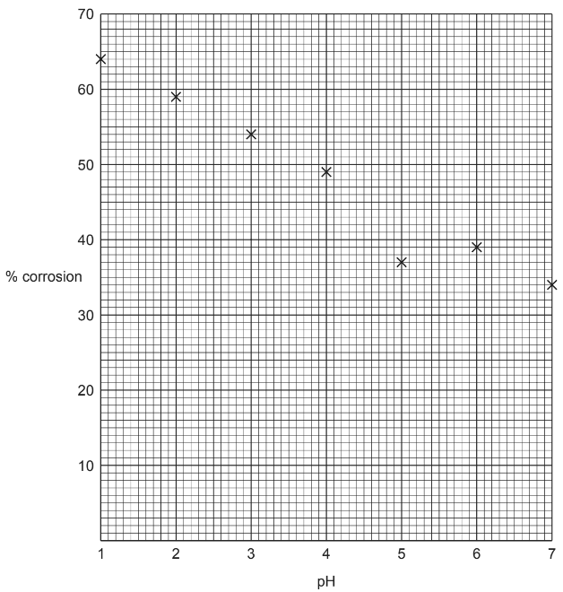

Draw a smooth line graph on the grid.

*Source: 2005 6 Q7*

**Q10** [2 marks]

**Extract:**

Samples of concrete were placed in solutions of different pH. The graph shows the percentage corrosion of the samples. Draw a smooth line graph on the grid.

Which point on the grid appears to be inaccurate? Explain your reason for identifying this point.

*Source: 2005 6 Q7*

**Q10** [1 mark]

**Extract:**

Samples of concrete were placed in solutions of different pH. The graph shows the percentage corrosion of the samples.

What happens to the percentage corrosion as the pH changes from 1 to 7?

*Source: 2005 6 Q7*

### Q11 — medium — 7 marks

**Q11** [5 marks]

Some plants do not grow well in acidic soil.

A farmer gives you a small sample of soil from a corner of one of his fields.

Plan an investigation to find out the pH of the soil sample.

You are provided with Universal Indicator solution and common laboratory apparatus.

*Source: 2005 6 Q7*

**Q11** [2 marks]

**Extract:**

Some plants do not grow well in acidic soil. A farmer gives you a small sample of soil from a corner of one of his fields. Plan an investigation to find out the pH of the soil sample. You are provided with Universal Indicator solution and common laboratory apparatus.

What further experiments would be necessary to inform the farmer which plants should be grown in each of his fields?

*Source: 2005 6 Q7*

## Multiple Choice Questions (30 questions)

### Q1 — medium — 1 marks

**Q1** [1 mark]

Propanoic acid is a weak acid.

What is a possible pH for a dilute aqueous solution of propanoic acid?

### Q2 — easy — 1 marks

**Q2** [1 mark]

The diagram shows elements X and Y in a section of the Periodic Table

Which statement about the oxides of the elements is correct?

### Q3 — easy — 1 marks

**Q3** [1 mark]

Indicators are substances that change colour when they are added to acidic or alkaline solutions.

| **Indicator** | **Colour in acid** | **Colour in alkali** |
|---|---|---|
| **methyl orange** | red | orange |
| **litmus** | red | blue |
| **thymolphthalein** | blue | colourless |
| **universal indicator** | green | purple |

Which indicator displays the correct colour in each solution?

| **A** | Methyl orange |
|---|---|
| **B** | Litmus |
| **C** | Thymolphthalein |
| **D** | Universal indicator |

### Q4 — easy — 1 marks

**Q4** [1 mark]

Hydrochloric acid is often used to clean metals by reacting with the surface coating which develops on some metals when exposed to the atmosphere.

Which row correctly describes the surface coating on these metals?

|   | **name** | **acidic or basic** | **reacts with** |
|---|---|---|---|
| **A** | oxide | basic | acid |
| **B** | oxide | acidic | basic |
| **C** | alloy | acidic | basic |
| **D** | alloy | basic | acid |

### Q5 — easy — 1 marks

**Q5** [1 mark]

Most insect bites cause a stinging sensation because of the injection of a weak acid into the surface of the skin. Which substance could be used to neutralise the acid from an insect bite?

|   | **substance** | **pH** |
|---|---|---|
| **A** | battery acid | 1 |
| **B** | toothpaste | 8 |
| **C** | grill cleaner | 13 |
| **D** | lime juice | 3 |

### Q6 — easy — 1 marks

**Q6** [1 mark]

Which words complete the gaps 1 & 2 in these sentences?

Aqueous solutions of acids contain <u>         1         </u> ions and aqueous solutions of alkalis contain <u>         2         </u> ions.

| ** ** | 1 | 2 |
|---|---|---|
| ** A** | Na+ | OH– |
| ** B** | OH– | H+ |
| ** C** | H+ | Cl– |
| ** D** | H+ | OH– |

### Q7 — easy — 1 marks

**Q7** [1 mark]

Calcium reacts with sulfuric acid to form the salt, calcium sulfate, and another product.

What is the other product?

| **A** | Oxygen |
|---|---|
| **B** | Hydrogen |
| **C** | Water |
| **D** | Carbon dioxide |

### Q8 — hard — 1 marks

**Q8** [1 mark]

Ionic equations 1 and 2 show how substance **X** behaves in aqueous solution.

| **1** | X- + H+ → XH |
|---|---|
| **2** | X → X- + H+ |

Which row correctly describes substance X?

|   | **acid** | **base** |
|---|---|---|
| **A** | 1 | 1 |
| **B** | 1 | 2 |
| **C** | 2 | 2 |
| **D** | 2 | 1 |

### Q9 — hard — 1 marks

**Q9** [1 mark]

Which indicator displays the correct colour in each solution?

| **Indicator** | **Colour in dilute sulfuric acid ** | **Colour in potassium hydroxide solution** |
|---|---|---|
| **methyl orange** | red | yellow |
| **universal indicator** | red | orange |
| **litmus** | red | purple |
| **thymolphthalein** | blue | colourless |

### Q10 — hard — 1 marks

**Q10** [1 mark]

The pH of two samples of different dilute acids were found.

Acid **X** had a pH of 6

Acid **Y** had a pH of 3

Which statement is correct?

### Q11 — hard — 1 marks

**Q11** [1 mark]

Which equation does **not** show the correct reaction of an acid?

### Q12 — hard — 1 marks

**Q12** [1 mark]

In a reaction rate experiment, a student used equal volumes of acids **P** and **Q** to react with excess magnesium in separate conical flasks.

The following observations were recorded:

| **1** | Acid **P** produces hydrogen gas faster than acid **Q** |
|---|---|
| **2** | Both gases produce the same total volume of hydrogen gas |

Which statement correctly explains the students observations?

### Q13 — medium — 1 marks

**Q13** [1 mark]

A student is provided with an unmarked beaker containing a colourless solution and asked to identify it. The student decides to perform a series of reactions with the solution and record the observations.

Which of these observations is not indicative of an acid?

### Q14 — medium — 1 marks

**Q14** [1 mark]

Which of the following statements is not correct?

### Q15 — medium — 1 marks

**Q15** [1 mark]

A student gradually added excess potassium hydroxide from a burette to a conical flask containing sulfuric acid as part of a rate of reaction investigation.

Which statement describes the change in pH of the sulfuric acid as the aqueous potassium hydroxide was added?

### Q16 — medium — 1 marks

**Q16** [1 mark]

Which of the following properties is not indicative of a base?

### Q17 — medium — 1 marks

**Q17** [1 mark]

A student was given an unknown substance and asked to analyse it. The student decided to perform three tests and recorded the results as shown below.

1. On heating with ammonium chloride a gas is released
2. The substance turns methyl orange yellow.
3. The substance does not react with potassium carbonate.

What kind of substance was the student given?

### Q18 — medium — 1 marks

**Q18** [1 mark]

A student is testing two substances, **P** and **Q**, as shown.

The results of the test are that the Universal indicator paper turns blue. What are substances **P **and **Q**?

### Q19 — medium — 1 marks

**Q19** [1 mark]

Which of the following elements forms an oxide that can be used to neutralise an alkaline solution?

## Theory Questions (33 questions)

### Q1 — medium — 9 marks

**Q1** [5 marks]

**Extract:**

Match the following pH values to the solutions given below

1    3    7    10    13

The solutions all have the same concentration.

| **Solution ** | **pH** |
|---|---|
| aqueous ammonia, a weak base | ............... |
| dilute hydrochloric acid, a strong acid | ............... |
| aqueous sodium hydroxide, a strong base | ............... |
| aqueous sodium chloride, a salt | ............... |
| dilute ethanoic acid, a weak acid | ............... |

Match the following pH values to the solutions given below

1    3    7    10    13

The solutions all have the same concentration.

| **Solution ** | **pH** |
|---|---|
| aqueous ammonia, a weak base | ............... |
| dilute hydrochloric acid, a strong acid | ............... |
| aqueous sodium hydroxide, a strong base | ............... |
| aqueous sodium chloride, a salt | ............... |
| dilute ethanoic acid, a weak acid | ............... |

*Source: 2014 O31 Q1A*

**Q1** [2 marks]

#### Separate: Chemistry and Extended Only

Explain why solutions of hydrochloric acid and ethanoic acid with the same concentration, in mol/dm3, have a different pH.

*Source: 2014 O31 Q1B*

**Q1** [2 marks]

**Extract:**

#### Separate: Chemistry and Extended Only

Measuring pH is one way of distinguishing between a strong acid and a weak acid.

#### Separate: Chemistry and Extended Only

Measuring pH is one way of distinguishing between a strong acid and a weak acid.

Describe another method.

method ....................................................................................................................................... ......................................................................................................................................................

results ........................................................................................................................................ ......................................................................................................................................................

*Source: 2014 O31 Q1C*

### Q2 — medium — 5 marks

**Q2** [1 mark]

**Extract:**

Magnesium, calcium and strontium are Group II elements.

Calcium reacts with cold water to form two products:

- a colourless gas, **P**, which ‘pops’ with a lighted splint
- a weakly alkaline solution, **Q**, which turns milky when carbon dioxide is bubbled through it.

Magnesium, calcium and strontium are Group II elements.

Calcium reacts with cold water to form two products:

- a colourless gas, **P**, which ‘pops’ with a lighted splint
- a weakly alkaline solution, **Q**, which turns milky when carbon dioxide is bubbled through it.

Name gas **P**.

*Source:  Specimen0620/04 Q2C*

**Q2** [1 mark]

**Extract:**

Magnesium, calcium and strontium are Group II elements. Calcium reacts with cold water to form two products: a colourless gas, P, which 'pops' with a lighted splint; a weakly alkaline solution, Q, which turns milky when carbon dioxide is bubbled through it.

Identify the ion responsible for making solution **Q** alkaline.

*Source:  Specimen0620/04 Q2C*

**Q2** [1 mark]

**Extract:**

Calcium reacts with cold water to form two products: a colourless gas, P, which 'pops' with a lighted splint; a weakly alkaline solution, Q, which turns milky when carbon dioxide is bubbled through it.

Suggest the pH of solution **Q**.

*Source:  Specimen0620/04 Q2C*

**Q2** [2 marks]

**Extract:**

Magnesium, calcium and strontium are Group II elements. Calcium reacts with cold water to form two products: a colourless gas, P, which 'pops' with a lighted splint; a weakly alkaline solution, Q, which turns milky when carbon dioxide is bubbled through it.

Write a symbol equation for the reaction of calcium with cold water.

*Source:  Specimen0620/04 Q2C*

### Q3 — easy — 1 marks

**Q3** [1 mark]

**Extract:**

Oxides of nitrogen are pollutants in the air.

Oxides of nitrogen are formed during the manufacture of nitric acid.

Oxides of nitrogen are pollutants in the air.

Oxides of nitrogen are formed during the manufacture of nitric acid. Which one of the pH values could be the pH of nitric acid? Draw a circle around the correct answer.

pH 1   pH 7   pH 10   pH 14

*Source: 2019 Ju0620/32/03 Q1A*

### Q4 — easy — 8 marks

**Q4** [3 marks]

**Extract:**

Zirconium (Zr) is a metal in Period 5. Its main oxidation state is +4.

The following are all zirconium atoms:

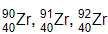

Zirconium (Zr) is a metal in Period 5. Its main oxidation state is +4.

The following are all zirconium atoms: $Zr_{40}^{90} , Zr_{40}^{91} , Zr_{40}^{92}$.

In terms of numbers of electrons, neutrons and protons, how are these three atoms the same and how are they different?

They are the same because ...

They are different because ...

*Source: 2013 Oct33 Q1*

**Q4** [2 marks]

**Extract:**

Zirconium (Zr) is a metal in Period 5. Its main oxidation state is +4.

The following are all zirconium atoms:

Above 900°C, zirconium reacts with water to form zirconium(IV) oxide, ZrO2, and hydrogen. Write an equation for this reaction.

*Source: 2013 Oct33 Q1B)III)*

**Q4** [3 marks]

**Extract:**

Zirconium (Zr) is a metal in Period 5. Its main oxidation state is +4.

The following are all zirconium atoms:

It is possible to determine whether zirconium(IV) oxide is acidic, basic or amphoteric using an acid and an alkali.

Complete the table of possible results.

If the oxide is predicted to react write 'R'. If it is predicted not to react write 'NR'.

| if the oxide is | predicted result with hydrochloric acid | predicted result with aqueous sodium hydroxide |
|---|---|---|
| acidic |   |   |
| basic |   |   |
| amphoteric |   |   |

*Source: 2013 Oct33 Q1*

### Q5 — hard — 8 marks

**Q5** [3 marks]

**Extract:**

Hydrogen reacts with the halogens to form hydrogen halides.

Bond energy is the amount of energy, in kJ, that must be supplied (endothermic) to break one mole of a bond.

| **bond** | **bond energy in kJ/mol ** |
|---|---|
| H-H | +436 |
| Cl-Cl | +242 |
| H-Cl | +431 |

Hydrogen reacts with the halogens to form hydrogen halides.

Bond energy is the amount of energy, in kJ, that must be supplied (endothermic) to break one mole of a bond.

| **bond** | **bond energy in kJ/mol ** |
|---|---|
| H-H | +436 |
| Cl-Cl | +242 |
| H-Cl | +431 |

Use the above data to show that the following reaction is exothermic.

H─H + Cl─Cl → 2H─Cl

*Source: 2009 Ju31 Q7*

**Q5** [5 marks]

**Extract:**

They react with water to form acidic solutions.

HCl + H2O  H3O+ + Cl–

HF + H2O  H3O+ + F–

They react with water to form acidic solutions.

HCl + H2O $\rightleftharpoons$ H3O+ + Cl–

HF + H2O $\rightleftharpoons$ H3O+ + F–

i) Explain why water behaves as a base in both of these reactions.

[2]

ii) At equilibrium, only 1% of the hydrogen chloride exists as molecules, the rest has formed ions. In the other equilibrium, 97% of the hydrogen fluoride exists as molecules, only 3% has formed ions.

What does this tell you about the strength of each acid?

[2]

iii) How would the pH of these two solutions differ?

[1]

*Source: 2009 Ju31 Q7*

### Q6 — medium — 2 marks

**Q6** [1 mark]

#### Separate: Chemistry and Extended Only

Sulfuric acid has many uses. Sulfuric acid is a strong acid.

Define the term acid.

*Source:  Specimen0620/04 Q4A*

**Q6** [1 mark]

#### Separate: Chemistry and Extended Only

Define the term strong acid.

*Source:  Specimen0620/04 Q4A*

### Q7 — easy — 3 marks

**Q7** [2 marks]

**Extract:**

Aqueous ethanoic acid has chemical properties which are typical of acids.

Aqueous ethanoic acid has chemical properties which are typical of acids. 
Describe two chemical properties of aqueous ethanoic acid.

*Source: 2019 Ju0620/32/03 Q2A*

**Q7** [1 mark]

**Extract:**

When carbon is completely burned in air, carbon dioxide is formed. Carbon dioxide forms a slightly acidic solution in water.

When carbon is completely burned in air, carbon dioxide is formed. Carbon dioxide forms a slightly acidic solution in water.

Which **one** of these pH values is the pH of a slightly acidic solution? Draw a circle around the correct answer.

pH 6     pH 7   pH 8    pH 10

*Source: 2019 Ju0620/32/03 Q8A*

### Q8 — medium — 3 marks

**Q8** [1 mark]

#### Separate: Chemistry and Extended Only

Ethanoic acid is a weak acid and hydrochloric acid is a strong acid. 
Both ethanoic acid and hydrochloric acid dissociate in aqueous solution.

Define the term acid.

*Source: 2019 Ju0620/41 Q4A*

**Q8** [2 marks]

#### Separate: Chemistry and Extended Only

The chemical equation shows the changes which occur when the strong acid, hydrochloric acid, is added to water.

HCl (aq)$\rightarrow$H+ (aq) + Cl– (aq)

Complete the chemical equation to show the changes which occur when the weak acid, ethanoic acid, is added to water. 
CH3COOH (aq)  ______________________________

*Source: 2019 Ju0620/41/04 Q4A*

### Q9 — medium — 10 marks

**Q9** [1 mark]

**Extract:**

Sulfuric acid is a strong acid. Hexanesulfonic acid is also a strong acid. It has similar properties to sulfuric acid.

The formula of the hexanesulfonate ion is C6H13SO3–.

Sulfuric acid is a strong acid. Hexanesulfonic acid is also a strong acid. It has similar properties to sulfuric acid.

The formula of the hexanesulfonate ion is C6H13SO3–.

The formula of the barium ion is Ba2+. What is the formula of barium hexanesulfonate?

*Source: 2013 O33 Q4B*

**Q9** [4 marks]

**Extract:**

Sulfuric acid is a strong acid. Hexanesulfonic acid is also a strong acid. It has similar properties to sulfuric acid. The formula of the hexanesulfonate ion is C~6~H~13~SO~3~^–^.

Complete the following equations.

i) Magnesium + hexanesulfonic acid → ............................. ......................... + .........................

[1]

ii) Calcium oxide + hexanesulfonic acid → ............................. ......................... + .........................

[1]

iii) .....C6H13SO3H + Na2CO3 → ............................. + ............ + ............

[2]

*Source: 2013 O33 Q4C*

**Q9** [5 marks]

**Extract:**

Sulfuric acid is a strong acid. You are given aqueous sulfuric acid, concentration 0.1 mol /dm3 , and aqueous hexanesulfonic acid, concentration 0.2 mol /dm3.

#### Separate: Chemistry and Extended Only

i) Sulfuric acid is a strong acid. You are given aqueous sulfuric acid, concentration 0.1 mol /dm3 , and aqueous hexanesulfonic acid, concentration 0.2 mol /dm3. Describe how you could show that hexanesulfonic acid is also a strong acid.

[2]

ii) Deduce why, for a fair comparison, the two acid solutions must have different concentrations.

[1]

iii) Explain the terms strong acid and weak acid.

[2]

*Source: 2013 O33 Q4D*

### Q10 — medium — 5 marks

**Q10** [1 mark]

A student investigates the reaction of small pieces of zinc with dilute sulfuric acid at 20 °C. 
The zinc is in excess. 
Sulfuric acid is a compound.

Define the term compound.

*Source:  Specimen0620/03 Q4C*

**Q10** [1 mark]

State the formula of the ion that is present in an aqueous solution of all acids.

*Source:  Specimen0620/03 Q4C*

**Q10** [1 mark]

**Extract:**

| Indicator | Colour in acid | Colour in alkali |
| Litmus | red | blue |
| Thymolphthalein | colourless | blue |
| Methyl orange | red | yellow |

A few drops of the indicator methyl orange are added to aqueous dilute sulfuric acid. State the colour change observed

from orange to ____________________

*Source:  Specimen0620/03 Q4C*

**Q10** [2 marks]

The formula of sulfuric acid is H2SO4. Complete **Table 1** to calculate the relative molecular mass of sulfuric acid.                                                                                   **Table 1**

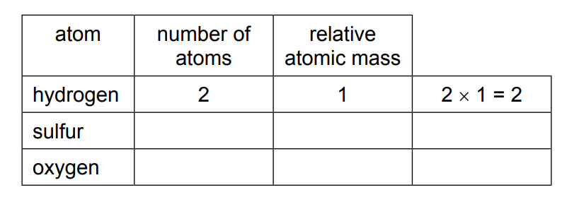

*Source:  Specimen0620/03 Q4C*

### Q11 — hard — 10 marks

**Q11** [6 marks]

Sulphuric acid is a typical strong acid.

Change the equations given into a different format.

i) Mg + H2SO4 → MgSO4 + H2

Change into a word equation.

[1]

ii) Lithium oxide + sulphuric acid → lithium sulphate + water

Change into a symbol equation.

[2]

iii) CuO + 2H+ → Cu2+ + H2O

Change the ionic equation into a symbol equation.

[2]

iv) Na2CO3 + H2SO4 → Na2SO4 + CO2 + H2O Change into a word equation.

[1]

*Source: 2008 Ju31 Q4A*

**Q11** [2 marks]

**Extract:**

When sulphuric acid dissolves in water, the following reaction occurs.

H2SO4 + H2O → HSO4– + H3O+

When sulphuric acid dissolves in water, the following reaction occurs.

H2SO4 + H2O → HSO4– + H3O+

Explain why water is behaving as a base in this reaction.

*Source: 2008 Ju31 Q4B*

**Q11** [2 marks]

Sulphuric acid is a strong acid, ethanoic acid is a weak acid.

Explain the difference between a strong acid and a weak acid.

*Source: 2008 Ju31 Q4C*

### Q12 — medium — 11 marks

**Q12** [3 marks]

**Extract:**

This question is concerned with the following oxides.

sulfur dioxide 
carbon monoxide
 lithium oxide 
aluminium oxide 
nitrogen dioxide 
strontium oxide

This question is concerned with the following oxides.

sulfur dioxide
carbon monoxide
lithium oxide
aluminium oxide
nitrogen dioxide
strontium oxide

Each oxide may be used once, more than once or not at all.

i) Which of the above oxides will react with hydrochloric acid but not with aqueous sodium hydroxide?

[1]

ii) Which of the above oxides will react with aqueous sodium hydroxide but not with hydrochloric acid?

[1]

iii) Which of the above oxides will react with both hydrochloric acid and aqueous sodium hydroxide?

[1]

*Source: 2011 O31 Q1A*

**Q12** [5 marks]

**Extract:**

This question is concerned with the following oxides. sulfur dioxide, carbon monoxide, lithium oxide, aluminium oxide, nitrogen dioxide, strontium oxide

Two of the oxides are responsible for acid rain.

Identify the two oxides and explain their presence in the atmosphere.

*Source: 2011 O31 Q1B*

**Q12** [3 marks]

**Extract:**

This question is concerned with the following oxides. sulfur dioxide, carbon monoxide, lithium oxide, aluminium oxide, nitrogen dioxide, strontium oxide

Lithium oxide is an ionic compound.

i) Identify another ionic oxide in the list in part a)

[1]

ii) Draw a diagram which shows the formula of lithium oxide, the charges on the ions and the arrangement of the valency electrons around the negative ion.

Use x to represent an electron from an atom of oxygen. 
Use o to represent an electron from an atom of lithium.

[2]

*Source: 2011 O31 Q1C*

### Q13 — hard — 8 marks

**Q13** [1 mark]

**Extract:**

Ethylamine, CH3–CH2–NH2, is a base which has similar properties to ammonia.

In aqueous ethylamine, there is the following equilibrium.

CH3–CH2–NH2 + H2O CH3–CH2–NH3+ + OH–

Ethylamine, CH3–CH2–NH2, is a base which has similar properties to ammonia.

In aqueous ethylamine, there is the following equilibrium.

CH3–CH2–NH2 + H2O $\rightleftharpoons$CH3–CH2–NH3+ + OH–

Explain why water is behaving as an acid in this reaction.

*Source: 2012 Ju32 Q8A*

**Q13** [3 marks]

**Extract:**

Ethylamine, CH~3~–CH~2~–NH~2~, is a base which has similar properties to ammonia. In aqueous ethylamine, there is the following equilibrium. CH~3~–CH~2~–NH~2~ + H~2~O ⇌ CH~3~–CH~2~–NH~3~^+^ + OH^–^

Given aqueous solutions of ethylamine and sodium hydroxide, describe how you could show that ethylamine is a weak base like ammonia and not a strong base like sodium hydroxide.

*Source: 2012 Ju32 Q8B*

**Q13** [2 marks]

**Extract:**

Ethylamine, like ammonia, reacts with acids to form salts.

CH3–CH2–NH2 + HCl → CH3–CH2–NH3Cl                                                         ethylammonium chloride

Ethylamine, like ammonia, reacts with acids to form salts.

CH3–CH2–NH2 + HCl → CH3–CH2–NH3Cl                                                         ethylammonium chloride

Suggest how you could displace ethylamine from the salt, ethylammonium chloride.

*Source: 2012 Ju32 Q8C*

**Q13** [2 marks]

**Extract:**

Ethylamine, CH~3~–CH~2~–NH~2~, is a base which has similar properties to ammonia. In aqueous ethylamine, there is the following equilibrium. CH~3~–CH~2~–NH~2~ + H~2~O ⇌ CH~3~–CH~2~–NH~3~^+^ + OH^–^

Explain the chemistry of the following reaction:

When aqueous ethylamine is added to aqueous iron(III) chloride, a brown precipitate is formed.

*Source: 2012 Ju32 Q8D*

### Q14 — medium — 8 marks

**Q14** [2 marks]

**Extract:**

Four bottles were known to contain aqueous ammonia, dilute hydrochloric acid, sodium hydroxide solution and vinegar, which is dilute ethanoic acid. The bottles had lost their labels. The pH values of the four solutions were 1, 4, 10 and 13.

Four bottles were known to contain aqueous ammonia, dilute hydrochloric acid, sodium hydroxide solution and vinegar, which is dilute ethanoic acid. The bottles had lost their labels. The pH values of the four solutions were 1, 4, 10 and 13.

Complete the table.

| solution | pH |
|---|---|
| aqueous ammonia |   |
| dilute hydrochloric acid |   |
| sodium hydroxide solution |   |
| vinegar |   |

*Source: 2006 Ju31 Q3A*

**Q14** [2 marks]

**Extract:**

When nitric acid is added to water the following reaction occurs.

HNO3 + H2O → NO3– + H3O+

When nitric acid is added to water the following reaction occurs.

HNO3 + H2O → NO3– + H3O+

Give the name and the formula of the particle which is transferred from nitric acid to water.

name

formula

*Source: 2006 Ju31 Q3C*

**Q14** [4 marks]

**Extract:**

aluminium oxide | Al2O3
calcium oxide | CaO
carbon dioxide | CO2
carbon monoxide | CO
magnesium oxide | MgO
sulphur dioxide | SO2

#### Extended Only

This question is concerned with the following oxides.

| aluminium oxide | Al2O3 |
|---|---|
| calcium oxide | CaO |
| carbon dioxide | CO2 |
| carbon monoxide | CO |
| magnesium oxide | MgO |
| sulphur dioxide | SO2 |

i) Which of the above oxides will react with hydrochloric acid but not with aqueous sodium hydroxide?

[1]

ii) Which of the above oxides will react with aqueous sodium hydroxide but not with hydrochloric acid?

[1]

iii) Which of the above oxides will react both with hydrochloric acid and with aqueous sodium hydroxide?

[1]

iv) Which of the above oxides will react neither with hydrochloric acid nor with aqueous sodium hydroxide?

[1]

*Source: 2006 Ju31 Q3D*

### Q15 — hard — 8 marks

**Q15** [1 mark]

Silicon(IV) oxide, SiO2, and zirconium(IV) oxide, ZrO2, are both macromolecules. They have similar physical properties but silicon(IV) oxide is acidic and zirconium(IV) oxide is amphoteric.

Define the term macromolecule.

*Source: 2012 O31 Q4A*

**Q15** [4 marks]

**Extract:**

Silicon(IV) oxide, SiO~2~, and zirconium(IV) oxide, ZrO~2~, are both macromolecules. They have similar physical properties but silicon(IV) oxide is acidic and zirconium(IV) oxide is amphoteric.

i) Predict three physical properties of these two oxides.

[3]

ii) Name an element which has the same physical properties as these two oxides.

[1]

*Source: 2012 O31 Q4B*

**Q15** [3 marks]

**Extract:**

Silicon(IV) oxide, SiO~2~, and zirconium(IV) oxide, ZrO~2~, are both macromolecules. They have similar physical properties but silicon(IV) oxide is acidic and zirconium(IV) oxide is amphoteric.

i) Name a reagent that reacts with the oxides of both elements.

[1]

ii) Name a reagent that reacts with only one of the oxides.

reagent .......................................... 
oxide which reacts .........................................

[2]

*Source: 2012 O31 Q4C*

### Q16 — easy — 2 marks

**Q16** [2 marks]

#### Separate: Chemistry and Extended Only

Some acids are described as weak acids. State the meaning of the term weak acid.

weak    __________________ 
acid      __________________

*Source: 2020 0620/43/04 Q1B*

### Q17 — easy — 6 marks

**Q17** [2 marks]

Universal indicator is added to an aqueous solution of sodium oxide.

What colour change is observed? from green to ________________

Give a reason for your answer.

*Source: 2020 Ju20200620/32 Q4C*

**Q17** [4 marks]

**Extract:**

Acids have characteristic properties.

Hydrochloric acid reacts with magnesium carbonate.

Acids have characteristic properties.

Hydrochloric acid reacts with magnesium carbonate. 
Name the products of this reaction and give the observations.

*Source: 2020 Ju20200620/32 Q6A*

### Q18 — medium — 6 marks

**Q18** [1 mark]

**Extract:**

This question is concerned with the following oxides.

**aluminium oxide** **   **
**carbon monoxide** **   **
**copper(II) oxide** **   **
**silicon(IV) oxide** **   **
**sodium oxide** **   **
**sulfur dioxide** **   **
**zinc oxide**

Choose one oxide from the above list to match each of the following descriptions. An oxide may be used once, more than once or not at all.

This question is concerned with the following oxides.

**   aluminium oxide**
**   carbon monoxide**
**   copper(II) oxide**
**   silicon(IV) oxide**
**   sodium oxide**
**   sulfur dioxide**
**   zinc oxide**

Choose one oxide from the above list to match each of the following descriptions. An oxide may be used once, more than once or not at all.

This oxide reacts with dilute hydrochloric acid to give a blue solution.

*Source: 2015 Ju33 Q2A*

**Q18** [1 mark]

**Extract:**

This question is concerned with the following oxides.

aluminium oxide
carbon monoxide
copper(II) oxide
silicon(IV) oxide
sodium oxide
sulfur dioxide
zinc oxide

Choose one oxide from the above list to match each of the following descriptions. An oxide may be used once, more than once or not at all.

This oxide reacts with water to give a strong alkali solution.

*Source: 2015 Ju33 Q2B*

**Q18** [1 mark]

**Extract:**

This question is concerned with the following oxides.
aluminium oxide, carbon monoxide, copper(II) oxide, silicon(IV) oxide, sodium oxide, sulfur dioxide, zinc oxide
Choose one oxide from the above list to match each of the following descriptions. An oxide may be used once, more than once or not at all.

This oxide is used as a bleach.

*Source: 2015 Ju33 Q2C*

**Q18** [1 mark]

**Extract:**

This question is concerned with the following oxides.
aluminium oxide
carbon monoxide
copper(II) oxide
silicon(IV) oxide
sodium oxide
sulfur dioxide
zinc oxide
Choose one oxide from the above list to match each of the following descriptions. An oxide may be used once, more than once or not at all.

#### Extended Only

This oxide is amphoteric.

*Source: 2015 Ju33 Q2D*

**Q18** [1 mark]

**Extract:**

This question is concerned with the following oxides.

aluminium oxide
carbon monoxide
copper(II) oxide
silicon(IV) oxide
sodium oxide
sulfur dioxide
zinc oxide

Choose one oxide from the above list to match each of the following descriptions. An oxide may be used once, more than once or not at all.

This oxide has a giant covalent structure.

*Source: 2015 Ju33 Q2E*

**Q18** [1 mark]

**Extract:**

This question is concerned with the following oxides.

aluminium oxide
carbon monoxide
copper(II) oxide
silicon(IV) oxide
sodium oxide
sulfur dioxide
zinc oxide

Choose one oxide from the above list to match each of the following descriptions. An oxide may be used once, more than once or not at all.

This oxide is soluble in water and it is acidic.

*Source: 2015 Ju33 Q2F*

### Q19 — medium — 3 marks

**Q19** [1 mark]

**Extract:**

Ammonia reacts with water to form ions.

NH3 + H2ONH4+ + OH–

#### Separate: Chemistry and Extended Only

Ammonia reacts with water to form ions.

NH3 + H2O$\rightleftharpoons$NH4+ + OH–

How does this equation show that ammonia, NH3, behaves as a base?

*Source: 2020 Ju0620/41 Q4B*

**Q19** [1 mark]

**Extract:**

Aqueous ammonia is described as a weak base.

#### Separate: Chemistry and Extended Only

Aqueous ammonia is described as a weak base. Suggest the pH of aqueous ammonia.

*Source: 2020 Ju0620/41 Q4B*

**Q19** [1 mark]

**Extract:**

Aqueous sodium hydroxide, NaOH (aq), is a strong alkali that reacts with dilute sulfuric acid exothermically.

Aqueous sodium hydroxide, NaOH (aq), is a strong alkali that reacts with dilute sulfuric acid exothermically. 
What type of reaction is this?

*Source: 2020 Ju0620/41 Q4B*

### Q20 — hard — 11 marks

**Q20** [3 marks]

The major use of sulfur dioxide is to manufacture sulfuric acid.

Complete the following description of the manufacture of sulfuric acid.

Sulfur dioxide reacts with .............................. to form sulfur trioxide.

The above reaction is catalysed by ................................................. .

The optimum temperature for this reaction is .............................. °C.

*Source: 2010 O32 Q7*

**Q20** [3 marks]

i) Define the term *acid*.

[1]

ii) Sulfuric acid is a strong acid. Ethanedioic acid is a weak acid. Given solutions of both acids, how could you show that sulfuric acid is a strong acid and ethanedioic acid is a weak acid?

Method

[1]

Result for each acid

[1]

*Source: 2010 O32 Q7*

**Q20** [5 marks]

**Extract:**

20.0 cm3 of sulfuric acid, concentration 0.30 mol / dm3, was added to 40 cm3 of sodium hydroxide, concentration 0.20 mol / dm3.

2NaOH + H2SO4 → Na2SO4 + 2H2O

20.0 cm3 of sulfuric acid, concentration 0.30 mol / dm3, was added to 40 cm3 of sodium hydroxide, concentration 0.20 mol / dm3.

2NaOH + H2SO4 → Na2SO4 + 2H2O

i) How many moles of H2SO4 were added?

[1]

ii) How many moles of NaOH were used?

[1]

iii) Which reagent is in excess? Give a reason for your choice.

Reagent in excess

[1]

Reason

[1]

iv) Is the pH of the final mixture less than 7, equal to 7 or more than 7?

[1]

*Source: 2010 O32 Q7*

### Q21 — easy — 12 marks

**Q21** [8 marks]

#### Extended Only

Ethanoic acid is a colourless liquid at room temperature. It has the typical acid properties and forms compounds called ethanoates.

A pure sample of ethanoic acid is slowly heated from 0 oC to 150 oC and its temperature is measured every minute. The results are represented on the graph below.

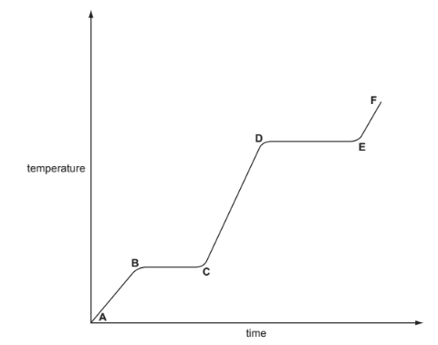

i) Name the change that occurs in the region D to E.

[1]

ii) What would be the difference in the region B to C if an impure sample had been used?

[1]

iii) Sketch on the graph how the line would continue if the acid was heated to a higher temperature.

[1]

iv) Complete the following table that compares the separation and movement of the molecules in regions C to D with those in E to F.

|   | **C to D** | **E to F** |
|---|---|---|
| separation (distance between particles) |   |   |
| movement of particles | random and slow |   |
| Can particles move apart to fill any volume? |   |   |

[5]

*Source: 2005 O31 Q2*

**Q21** [2 marks]

Complete the word equations for the reactions of ethanoic acid.

calcium + ethanoic acid → .......................................... +  ..........................................

.......................................... + ethanoic acid → zinc ethanoate + water

*Source: 2005 O31 Q2*

**Q21** [2 marks]

**Extract:**

- Accept NaCH3COO for CH3COONa (sodium ethanoate).

#### Separate: Chemistry Only

Write the symbol equation for the reaction between ethanoic acid and sodium hydroxide.

*Source: 2005 O31 Q2*

### Q22 — hard — 8 marks

**Q22** [4 marks]

**Extract:**

Antimony oxide is a white powder which is insoluble in water.

Antimony oxide is a white powder which is insoluble in water. Describe how you would find out if it is a basic, an acidic or an amphoteric oxide.

*Source: 2011 O32 Q3B*

**Q22** [4 marks]

**Extract:**

When antimony chloride is added to water, a faint white precipitate forms and the mixture slowly goes cloudy.

forward

SbCl3 (aq) + H2O (l)  2HCl (aq) + SbOCl (s)

colourless                         backward          white

When antimony chloride is added to water, a faint white precipitate forms and the mixture slowly goes cloudy.

forward

SbCl3 (aq) + H2O (l) $\rightleftharpoons$ 2HCl (aq) + SbOCl (s)

colourless                         backward          white

i) Explain why after some time the appearance of the mixture remains unchanged.

[2]

ii) When a few drops of concentrated hydrochloric acid are added to the mixture, it changes to a colourless solution. Suggest an explanation.

[1]

iii) Suggest how you could make the colourless solution go cloudy.

[1]

*Source: 2011 O32 Q3C*

### Q23 — hard — 14 marks

**Q23** [5 marks]

**Extract:**

Ethylamine is a weak base and sodium hydroxide is a strong base.

Ethylamine is a weak base and sodium hydroxide is a strong base.

i) In terms of proton transfer, explain what is meant by the term weak base.

[2]

ii) Given aqueous solutions of both bases, describe how you could show that sodium hydroxide is the stronger base. How could you ensure a ‘fair’ comparison between the two solutions?

[3]

*Source: 2015 Ju31 Q6A*

**Q23** [4 marks]

**Extract:**

Ethylamine reacts with acids to form salts.

CH3CH2NH2 + HCl → CH3CH2NH3Cl                ethylammonium chloride

Ethylamine reacts with acids to form salts.

CH3CH2NH2 + HCl → CH3CH2NH3Cl                ethylammonium chloride

i) Complete the equation for the reaction between sulfuric acid and ethylamine.

......CH3CH2NH2 + ............ → .........................

Name the salt formed.

[3]

ii) Amines and their salts have similar chemical properties to ammonia and ammonium salts.

Suggest a reagent that could be used to displace the weak base, ethylamine, from its salt ethylammonium chloride.

[1]

*Source: 2015 Ju31 Q6B*

**Q23** [5 marks]

**Extract:**

Gases diffuse, which means that they move to occupy the total available volume.

Gases diffuse, which means that they move to occupy the total available volume.

i) Explain, using kinetic particle theory, why gases diffuse.

[2]

ii) When the colourless gases hydrogen bromide and ethylamine come into contact, a white solid is formed.

CH3CH2NH2 (g) + HBr (g) → CH3CH2NH3Br (s)

white solid

The following apparatus can be used to compare the rates of diffusion of the two gases ethylamine and hydrogen bromide.

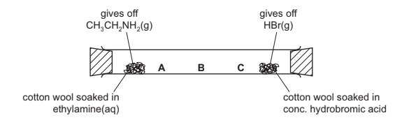

Predict at which position, A, B or C, the white solid will form. Explain your choice.

[3]

*Source: 2015 Ju31 Q6B*

### Q24 — hard — 16 marks

**Q24** [6 marks]

**Extract:**

Sulfuric acid and malonic acid are both dibasic acids. One mole of a dibasic acid can form two moles of hydrogen ions.

H2SO4 → 2H+ + SO42–

Dibasic acids can form salts of the type Na2X and CaX.

Malonic acid is a white crystalline solid which is soluble in water. It melts at 135 °C. The structural formula of malonic acid is given below. It forms salts called malonates.

CH2(COOH)2 or HOOC–CH2 –COOH

Sulfuric acid and malonic acid are both dibasic acids. One mole of a dibasic acid can form two moles of hydrogen ions.

H2SO4 → 2H+ + SO42–

Dibasic acids can form salts of the type Na2X and CaX.

Malonic acid is a white crystalline solid which is soluble in water. It melts at 135 °C. The structural formula of malonic acid is given below. It forms salts called malonates.

CH2(COOH)2 or HOOC–CH2 –COOH

i) How could you determine if a sample of malonic acid is pure?

Technique used .......................................................................................................... Result if pure .........................................................................................................

[2]

ii) What is the molecular formula of malonic acid?

[1]

iii) When malonic acid is heated there are two products, carbon dioxide and a simpler carboxylic acid. Deduce the name and molecular formula of this acid.

[2]

iv) Malonic acid reacts with ethanol to form a colourless liquid which has a ‘fruity’ smell. Its structural formula is given below.

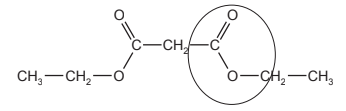

What type of compound contains the group which is circled?

[1]

*Source: 2013 Ju33 Q6A*

**Q24** [3 marks]

**Extract:**

Sulfuric acid and malonic acid are both dibasic acids. One mole of a dibasic acid can form two moles of hydrogen ions.

H~2~SO~4~ → 2H^+^ + SO~4~^2–^

Malonic acid is a white crystalline solid which is soluble in water. It melts at 135 °C. The structural formula of malonic acid is given below. It forms salts called malonates.

CH~2~(COOH)~2~ or HOOC–CH~2~ –COOH

i) Suggest why a solution of malonic acid, concentration 0.2 mol /dm3, has a higher pH than one of sulfuric acid of the same concentration.

[1]

ii) Describe a test, other than measuring pH, which can be carried out on both acid solutions to confirm the explanation given in (b)(i) for the different pH values of the two acids.

[2]

*Source: 2013 Ju33 Q6B*

**Q24** [7 marks]

**Extract:**

Sulfuric acid and malonic acid are both dibasic acids. One mole of a dibasic acid can form two moles of hydrogen ions. H~2~SO~4~ → 2H^+^ + SO~4~^2–^. Dibasic acids can form salts of the type Na~2~X and CaX. Malonic acid is a white crystalline solid which is soluble in water. It melts at 135 °C. The structural formula of malonic acid is given below. It forms salts called malonates. CH~2~(COOH)~2~ or HOOC–CH~2~ –COOH

Complete the following equations for reactions of these two acids.

i) sodium hydroxide + malonic acid → ........................ .......................... + ....................

[1]

ii) CuO + H2SO4 → .................... + ....................

[2]

iii) Mg + CH2(COOH)2 → .................... + ....................

[2]

iv) K2CO3 + H2SO4 → .................... + .................... + ....................

[2]

*Source: 2013 Ju33 Q6C*

### Q25 — medium — 6 marks

**Q25** [1 mark]

Aqueous sodium hydroxide is a base.

Complete this sentence about the different types of bases. Bases are metal hydroxides or metal _______________________

*Source:  Specimen0620/03 Q6A*

**Q25** [4 marks]

Describe the reaction of aqueous sodium hydroxide with:

i) A named acid

ii) An ammonium salt

*Source: 2023 Specimen0620/03 Q6B*

**Q25** [1 mark]

**Extract:**

Ammonia is a soluble base.

Ammonia is a soluble base. 
Draw a circle around the pH value of aqueous ammonia.                            ** **

**pH 1    pH 5    pH 7    pH 10**

*Source:  Specimen0620/03 Q6C*

### Q26 — medium — 15 marks

**Q26** [3 marks]

**Extract:**

Sulfuric acid is a strong acid. In aqueous solution, it ionises as shown below.

H2SO4  → 2H+ + SO42–

Sulfuric acid is a strong acid. In aqueous solution, it ionises as shown below.

H2SO4  → 2H+ + SO42–

i) What is meant by the term acid?

[1]

Sulfurous acid, H2SO3, is a weak acid.

ii) State the difference between a weak acid and a strong acid.

[2]

*Source: 2015 O33 Q5A*

**Q26** [4 marks]

**Extract:**

Sulfurous acid forms salts called sulfites and contain the ion SO32-

When barium nitrate solution is added to aqueous sulfurous acid, a white precipitate, **A**, forms. Bromine water changes from brown to colourless when added to aqueous sulfurous acid.

Bromine oxidises sulfurous acid. When this solution is tested with acidified barium nitrate a different white precipitate **B** is formed.

Sulfurous acid forms salts called sulfites and contain the ion SO32-

When barium nitrate solution is added to aqueous sulfurous acid, a white precipitate, **A**, forms. Bromine water changes from brown to colourless when added to aqueous sulfurous acid.

Bromine oxidises sulfurous acid. When this solution is tested with acidified barium nitrate a different white precipitate **B** is formed.

i) Identify the white precipitate, **A**.

[1]

ii) Identify the white precipitate, **B**.

[1]

iii) Write an ionic equation for the reduction of the bromine molecule.

[1]

iv) Name the product formed by the oxidation of sulfurous acid.

[1]

*Source: 2015 O33 Q5B*

**Q26** [3 marks]

Complete the following word equations.

i) magnesium hydroxide + dilute sulfuric acid

.......................................................................................................................................

[1]

ii) zinc + dilute sulfuric acid

.......................................................................................................................................

[1]

iii) copper carbonate + dilute sulfuric acid

......................................................................................................................................

[1]

*Source: 2015 O33 Q5C*

**Q26** [5 marks]

Write equations for the reaction of dilute sulfuric acid with each of the following.

i) ammonia

[1]

ii) sodium hydroxide

[2]

iii) iron

[2]

*Source: 2015 O33 Q5D*

### Q27 — easy — 3 marks

**Q27** [2 marks]

**Extract:**

Limestone is added to the blast furnace. The limestone is converted into calcium oxide and carbon dioxide. The reaction is endothermic.

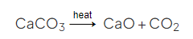

Limestone is added to the blast furnace. The limestone is converted into calcium oxide and carbon dioxide. The reaction is endothermic.

CaCO3 $\overset{\mathrm{heat}}{\rightarrow}$  CaO + CO2 

What type of oxide is calcium oxide? Give a reason for your answer.

*Source: 2019 Ju0620/31/03 Q2D*

**Q27** [1 mark]

**Extract:**

Sulfur dioxide is a pollutant in the air.

Sulfur trioxide dissolves in rainwater to form acid rain.

Sulfur dioxide is a pollutant in the air.

Sulfur trioxide dissolves in rainwater to form acid rain.

Which **one** of the following pH values could be the pH of acid rain? Draw a  circle around the correct answer.

pH 4      pH  7     pH 9     pH 13

*Source: 2019 Ju0620/31/03 Q8A*

