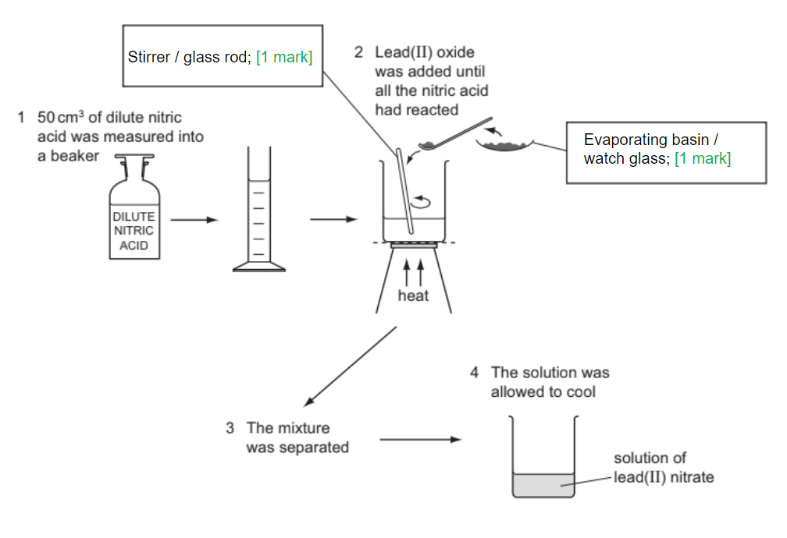
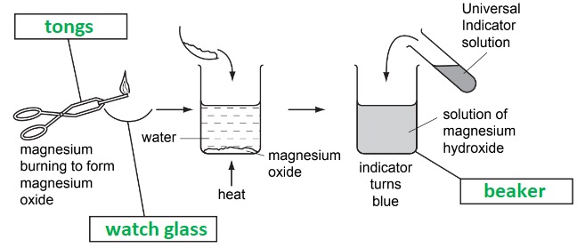
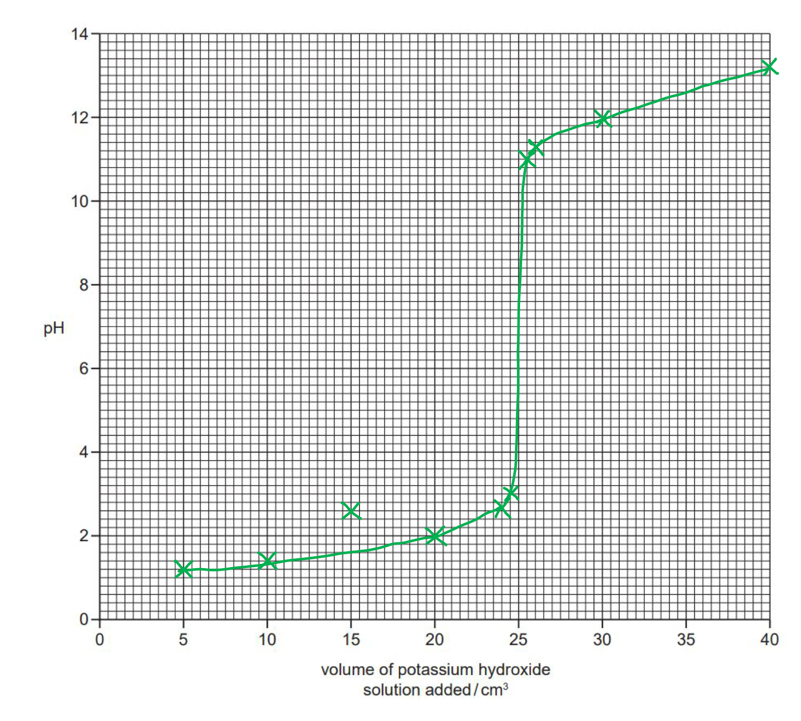
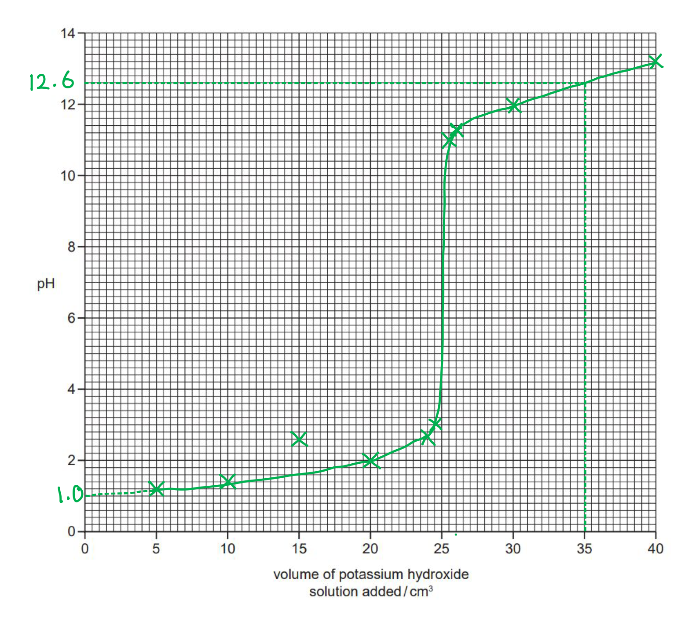
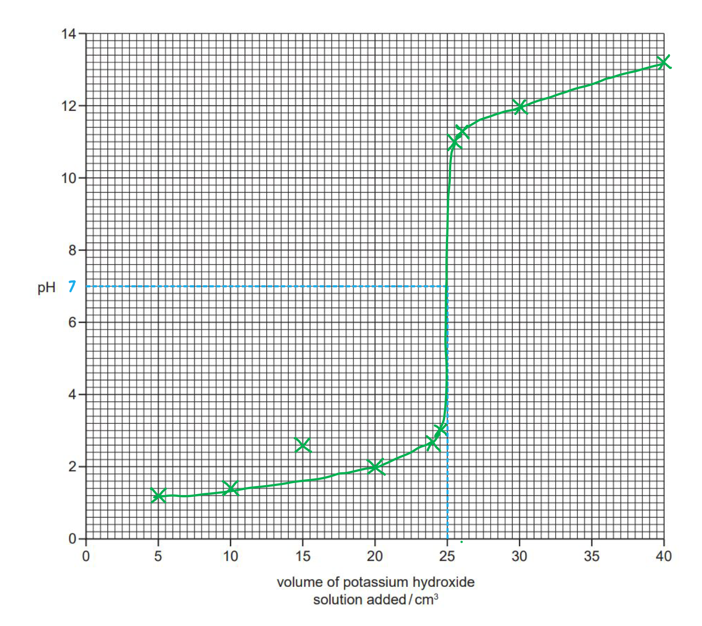
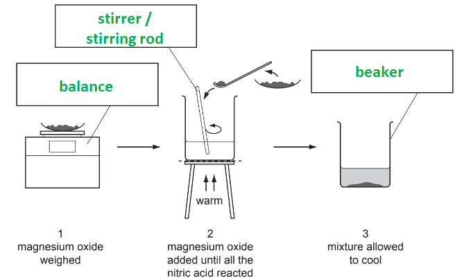
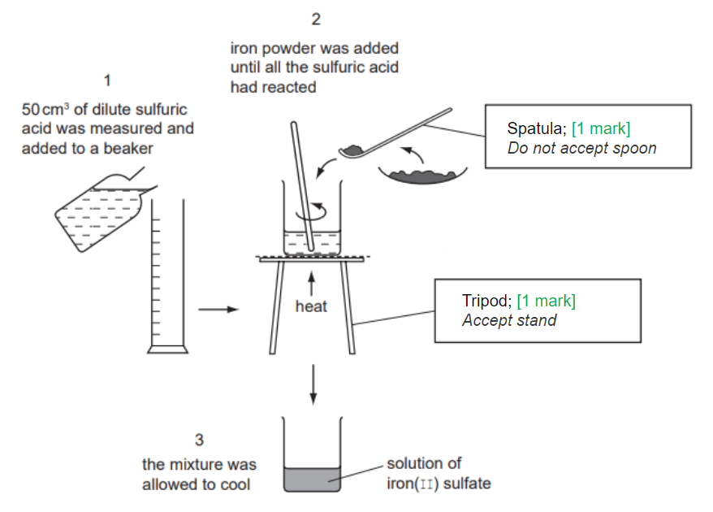
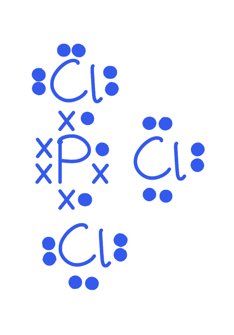

# Mark Schemes — Preparation of Salts
**7. Acids, Bases & Salts** · Cambridge (CIE) IGCSE chemistry (0620 & 0971)

## Alternative To Practical Questions (8 questions)

### Q1
a) The completed boxes are:

**[Total: 2 marks]**

- *It is important that you know the names of common pieces of laboratory equipment that are used in the methods covered in the course*
b) The dilute nitric acid is heated to:

- Speed up the reaction / increase the rate of reaction; **[1 mark]**

**[Total: 1 mark]**

- *Temperature is one of the factors that affects the rate of reaction, and a higher temperature is often used to increase the rate of reaction*
c) The mass of lead(II) oxide added to the dilute nitric acid is:

- 17.8 - 13.6; **[1 mark]**
- = 4.2 g;** [1 mark]** 
*Correct answer of 4.2 g scores 2 marks with no workings*

**[Total: 2 marks]**

- *Make sure you read the scale carefully: each interval on the thermometer represents 0.2 g *
d)

i) The student would know when all of the dilute nitric acid had reacted in stage 2 by:

- Solid / lead oxide visible / remaining; **[1 mark]** 
*Do not allow: mention of precipitate*

ii) The method used to separate the mixture in stage 3 is:

- Filtration; **[1 mark]**

iii) The term used to describe the unreacted lead(II) oxide is:

- Excess; **[1 mark]** 
*Allow: residue*

**[Total: 3 marks]**

### Q2
a) The correctly labelled boxes are:

- Tongs; **[1 mark]**
- Watch glass / evaporating basin / evaporating dish;** [1 mark]**
- Beaker; **[1 mark]**

**[Total: 3 marks]**

- *Make sure you know the names of laboratory equipment*
b) Burning magnesium is:

- Oxidation 
**OR **
Combustion 
**OR **
Exothermic 
**OR **
Redox; **[1 mark]**

**[Total: 1 mark]**

- *The most common answers to this question are combustion and oxidation because people recognise that the burning of magnesium is actually the reaction of magnesium with oxygen from the air *
c) The pH for the solution of magnesium hydroxide would be:

- Greater than 7; **[1 mark]**

**[Total: 1 mark]**

- *Magnesium hydroxide is an alkali and, therefore, has a pH value of greater than 7*

### Q3
a) A plot of the graph:

- Points plotted correctly; **[2 marks]**
- Smooth line graph missing anomalous point; **[1 mark]**

**[Total: 3 marks]**
b) The point that appears to be inaccurate is:

- Point at 15 cm3 / pH 2.6 / third point; **[1 mark]**

**[Total: 1 mark]**

- *An anomalous point is one that does not fit the pattern shown in the rest of the data, i.e. does not sit on or near the line of best fit*
c) Using the graph:

i) The pH of the solution when 35.0 cm3 of potassium hydroxide was added is:

- 12.6; **[1 mark]**

ii) The pH of 25.0 cm3 of nitric acid is:

- pH 1; **[1 mark]**
- Extrapolation shown; **[1 mark]**

**[Total: 3 marks]**

- *You should use the graph to draw a line from 35 cm**3** of potassium hydroxide on the x-axis to where it intersects your line of best fit*
- *Then, draw a line from this intersection to meet the y-axis and read off the pH this corresponds to*
- *Remember to use a ruler *
- *To find the pH of 25.0 cm**3** of nitric acid, you need to extrapolate your line of best fit until it reaches the y-axis and the volume of potassium hydroxide added is 0.0 cm**3*
d)

i) The pH of the solution when all of the nitric acid has just been neutralised is:

- 7; **[1 mark]**

ii) The volume of potassium hydroxide that was required to neutralise 25.0 cm3 of nitric acid is:

- 25 (cm3); **[1 mark]**

**[Total: 2 marks]**

- *For part (ii), you should use the graph to find the volume of potassium hydroxide added when the pH is 7:*

e) The student should modify the experiment to obtain pure crystals of potassium nitrate by:

Any **three **from:

- Repeat experiment; **[1 mark]**
- Stop when 25 cm3; **[1 mark]**
- added / when pH7; **[1 mark]**
- Evaporate / heat; **[1 mark]**
- Use same volumes; **[1 mark]**
- To crystallising point / until saturated; **[1 mark]**

**[Total: 3 marks]**

- *A question asking to describe this method can be worth up to 6 marks, so it is worth learning the steps of the process as these can be easy marks to pick up!*

### Q4
a) You could make a solution of magnesium sulfate starting with magnesium oxide powder and dilute sulfuric acid by:

- Heat / warm the acid; **[1 mark]**
- Add excess oxide / description of no more solid reacting; **[1 mark]**
- Filter / decant; **[1 mark]**

**[Total: 3 marks]**

- *This is a common question so make sure you learn the steps thoroughly*
b) You would obtain pure dry crystals of hydrated magnesium sulfate, MgSO4.7H2O, from the solution of magnesium sulfate by:

Any **three** from:

- Heat qualified e.g. to crystallising point 
**OR **
Description of e.g. using glass rod/leave it to evaporate;** [1 mark]**
- Cool to form crystals;** [1 mark]**
- Filter off crystals;** [1 mark]**
- Method of drying crystals e.g. pressed filter papers / oven at low temperature;** [1 mark]**

**[Total: 3 marks]**

- *Again, this is another common question so learn the steps thoroughly*
- *It is important that heat is not applied to dryness as the hydrated magnesium sulfate could lose its water of crystallisation, forming the anhydrous salt or decompose even further*

### Q5
a) One reason for using excess zinc oxide in Step 2 is:

- To use up all the acid 
**OR**
To neutralise the acid; **[1 mark]**

**[Total: 1 mark]**

- *This question is testing your understanding of why the steps are carried out in the method - it is important that you not only know the method but that you understand the reason for each step as this is a common type of question*
b) The excess zinc oxide can be removed from the solution in Step 3 by:

- Filtration / filtering; **[1 mark]**

**[Total: 1 mark]**

- *As with part (a), this is testing your understanding of the method*
c)

i) A saturated solution is where:

- No more solid / solute can dissolve;** [1 mark]**
- At that temperature;** [1 mark]**

ii) The solution can be shown to be saturated by:

- Using a glass rod to show crystals forming **OR **Observing crystals forming on the edge of the solution; **[1 mark]**

**[Total: 3 marks]**

- *When no more solute can dissolve, crystals will appear*
- *This is why, when a solution is heated, crystals start to appear:*

  - *The water evaporates, reducing the amount of solvent present causing the solution to become saturated forming crystals*
d) The crystals are dried in Step 7 using filter paper instead of by heating to:

- To prevent breakdown / decomposition of the crystals **OR **To not form powder **OR **To not lose water; **[1 mark]**

**[Total: 1 mark]**

- *Salts formed in this way are hydrated salts as the water becomes trapped in the lattice structure*
- *Further heating will cause this water of crystallisation to be driven off, leaving the anhydrous salt*
- *Further heating can cause the anhydrous salt to thermally decompose further into a different substance*

### Q6
a) The sulfuric acid is warmed to:

- Speed up the reaction;** [1 mark]**

**[Total: 1 mark]**
b) You would know when excess magnesium oxide is present in **Step 2** because:

- The solid is visible / no more solid dissolves / owtte; **[1 mark]**

**[Total: 1 mark]**

- *When all of the sulfuric acid has been used up, no more magnesium oxide can react*
- *Magnesium oxide is insoluble in water so it will remain unreacted and as a solid in the beaker*
c) The method used in **Step 3** is:

- Filtration / centrifuge;** [1 mark]**
 *Not decant*

**[Total: 1 mark]**

- *Filtration is suitable as magnesium oxide is a solid which needs to be separated from a solution*
- *The filter paper will trap the excess magnesium oxide and the filtrate is the solution of magnesium sulfate*
d) Care must be taken when drying the crystals in **Step 4** to:

- Make sure water (of crystallisation) is not lost / stop dehydration / so crystals do not turn into powder / does not decompose; **[1 mark]** *Not crystals break*

**[Total: 1 mark]**

- *The best method to prepare crystals is to heat the solution until some crystals begin to form, then leave in a warm place for the solution to evaporate*
- *The crystals can be patted dry with filter paper*
e) The method would differ if magnesium carbonate was used instead of magnesium oxide because:

Any **two** from:

- No heat needed / not necessary to warm acid; **[1 mark]**
- Carbonates react with acid at room temperature; **[1 mark]**
- No bubbles would indicate that carbonate is in excess; **[1 mark]**

**[Total: 2 marks]**

- *When the acid reacts with a carbonate, salt, water and carbon dioxide are produced*
- *As a gas is evolved during the reaction, bubbles are an indication that the reaction is progressing*
- *The reaction between a metal carbonate and acid occurs readily without the need for heat to speed the reaction up*

### Q7
a) The correctly labelled boxes are:

- Balance; **[1 mark]**
- Stirrer / stirring rod / glass rod; **[1 mark] ***Thermometer is not accepted *
- Beaker; **[1 mark]**

**[Total: 3 marks]**

- *You must know the names of laboratory apparatus*
b)

i) The term used to describe the unreacted magnesium oxide is:

- Excess;** [1 mark]** *Residue is not accepted*

ii) The method that is used to remove the unreacted magnesium oxide after stage 3 is:

- Filtration / filtering **OR **Decanting;** [1 mark]** *Sieving / straining / using a centrifuge are not accepted*

**[Total: 2 marks]**

- *The unreacted magnesium oxide is described as being in excess*

  - *It is not a residue until it has been collected in the filter paper during filtration*
c) Crystals of magnesium nitrate could be quickly obtained from the solution by:

- Heating / evaporating the solution;** [1 mark]**
- Until crystallisation / saturation point 
**OR **
Until crystals start to form (on a glass rod) 
**OR **
Until half the solution has evaporated; **[1 mark]**

**[Total: 2 marks]**

- *When crystallising, you should make it clear that the solution is only heated until crystals start to form (the crystallisation / saturation point)*
- *Heating the solution until all the water is removed produces small, poor quality crystals and can lead to decompostion of the crystals (depending on the chemical)*

### Q8
a) The completed boxes to identify the pieces of apparatus labelled are:

**[Total: 2 marks]**

- *Ensure you know the names of all of the common laboratory equipment used in the experimental techniques you learn across the course*
b) Two reasons that the student would know when all of the sulfuric acid had reacted are:

- Fizz / bubbles / effervescence stops; **[1 mark]**
- Solid / iron / powder visible / no more iron dissolves / reacts; **[1 mark]**

**[Total: 2 marks]**

- *When sulfuric acid is added to iron, the salt, iron(II) sulfate and hydrogen gas will be produced*
- *As a gas is given off, fizzing will be observed*
- *When the sulfuric acid has all reacted, no more hydrogen will be produced, so no more fizzing is observed*
- *As more iron powder is added, it will no longer react so it remains as a powder suspended within the solution*

## Multiple Choice Questions (19 questions)

### Q1
**Final answer:** **The correct answer is A**

- Silver chloride is an **insoluble salt**
- When the two aqueous solutions are mixed, silver chloride forms as a solid precipitate
- The key steps when preparing a pure, dry sample are:

  1. Mix both solutions
  2. Filter the mixture and collect the solid left in the filter paper (**the residue**)
  3. Wash the residue with distilled water to remove any soluble impurities (like excess sodium nitrate)
  4. Dry it (e.g., between filter papers, in an oven if the substance is not reactive)

**B **is incorrect as the silver chloride is the solid residue, not the liquid filtrate

**C **is incorrect** **as crystallisation is used to prepare **soluble salts** from an aqueous solution. Silver chloride is completely insoluble, therefore, it forms a precipitate immediately and does not need to be crystallised

**D** is incorrect as evaporating the mixture to dryness would leave the silver chloride mixed with the other product, sodium nitrate, meaning the sample would not be pure

### Q2
**Final answer:** **The correct answer is A**

This option shows the steps in order for preparing **hydrated crystals of copper (II) sulphate**

1. **Add excess copper(II) oxide** to ensure all sulfuric acid reacts
2. **Filter** to remove unreacted (excess) copper(II) oxide
3. **Evaporate the filtrate** to the point of crystallisation (do not dry it because otherwise it will become anhydrous copper (II) sulphate)
4. **Cool** so hydrated copper(II) sulfate crystals form

**B **& **D **are incorrect because excess copper(II) oxide (a solid) is still present in the mixture, so it needs to be removed before heating. Therefore, it must be the second step

**C **is incorrect because heating until dry removes water of crystallisation, so hydrated crystals cannot form

### Q3
**Final answer:** **The correct answer is ****A**** **

- The reactants, lead(II) nitrate and sodium sulfate, are both soluble salts

  - Therefore, they have the (aq) state symbol
- The first product, lead(II) sulfate is an insoluble salt

  - Therefore, it has the (s) state symbol
- The second product, sodium nitrate, is a soluble salt

  - Therefore, it has the (aq) state symbol
- The solid lead(II) sulfate can be removed from the mixture by filtration

** B** is incorrect as NaNO3 is soluble, so will have the (aq) state symbol

**C** is incorrect as only the state symbol for Na2SO4 is correct

**D** is incorrect as to prepare an insoluble salt, two soluble salts are used so Pb(NO3)2 should have (aq) state symbol

### Q4
**Final answer:** **The correct answer is ****C**** **

- Neutralisation needs to occur and for this, the acid needs to have fully reacted with the base
- To remove the unreacted copper carbonate, the solution should be filtered as filtration separates a solid and a liquid

**A** is incorrect as the copper carbonate is in excess, it will not determine the amount of salt crystals made, this is determined by the amount of sulfuric acid used

**B** is incorrect as adding an excess will not alter the colour intensity **AND **filtration needs to occur before crystallisation

**D** is incorrect as adding copper carbonate in excess will not change the rate of reaction **AND **evaporation occurs after filtration

### Q5
**Final answer:** **The correct answer is ****D **

- **P** is a burette, it is used to add varying volumes which can be measured to a high degree of accuracy
- **Q** is a pipette, it is used to measure a specific quantity of liquid to a high degree of accuracy
- **R** is a measuring cylinder, it is used to measure volumes of liquids but the degree of accuracy is not as high as using a pipette or burette

**A** is incorrect as the names of **P** and **Q** are the wrong way round

**B** is incorrect as **R** is not a conical flask

**C** is incorrect as all of the names are incorrect

### Q6
**Final answer:** **The correct answer is ****C **

- When a solute mixes with water, it will dissolve forming a solution
- Solid sodium chloride is the solute

**A** is incorrect as crystallising is the formation of a solid (crystal) from a solution by evaporation

**B** is incorrect as diluting involves the addition of water to a solution

**D** is incorrect as melting is the process of turning a solid into a liquid

### Q7
**Final answer:** **The correct answer is ****C**** **

- Salts that contain water within their structure are called hydrated salts

**A** is incorrect as anhydrous salts are those that contain no water in their structure

**B** is incorrect as dehydrated means to have lost water but these salts contain water

**D** is incorrect as soluble salts are able to dissolve in water

### Q8
**Final answer:** **The correct answer is ****B**** because:**

- Using an excess of potassium chloride ensures that all of the silver ions react to form silver chloride, maximising the amount of product.

**A** is incorrect because if silver nitrate is in excess, not all of it will react. The unreacted silver nitrate will stay dissolved in the solution and be lost during filtration, meaning some potential silver chloride is not formed.

**C** is incorrect because equal volumes of solution won’t guarantee the correct ratio of ions unless the potassium chloride is more concentrated than the silver nitrate. Since we want potassium chloride to be in excess, equal volumes alone aren't sufficient.

**D** is incorrect because even if the solutions have equal concentrations, you'd still need to use a larger volume of potassium chloride to ensure it's in excess.

### Q9
**Final answer:** **The correct answer is ****B****  **

- By definition water of crystallisation is the number of water molecules present in hydrated crystals, such as CoCl2.6H2O

**A** is incorrect as anhydrous means no water present. Gentle heating of a *hydrated* salt, such as hydrated copper(II) sulfate, will result in mass loss as the water of crystallisation is lost.

**C **is incorrect as not all soluble salts contain water of crystallisation. There is no particular pattern to which salts do, but generally salts of transition metals will often be hydrated

**D** is incorrect as the formula of hydrated copper(II) sulfate is CuSO4.5H2O

### Q10
**Final answer:** **The correct answer is ****C**** **

- Magnesium chloride can be made from magnesium metal plus hydrochloric acid (method 2)
- It can also be made from excess magnesium oxide or hydroxide and hydrochloric acid (method 3)

**A, B** and **D** are incorrect as a titration is only suitable for salts made from an alkali and acid; the alkali would have to be a soluble hydroxide, but since magnesium hydroxide is insoluble this method is not suitable

### Q11
**Final answer:** **The correct answer is**** C**** **

- Copper salts cannot be made as copper is unreactive and will not react with dilute acids.
- Magnesium oxide will react with both acids producing **magnesium sulfate **and **magnesium** **chloride**:

  - H2SO4 + MgO → MgSO4 + H2O
  - 2HCl + MgO → MgCl2 + H2O
- Zinc carbonate will also react with both acids producing **zinc** **sulfate** and **zinc** **chloride**:

  - H2SO4 + ZnCO3 → ZnSO4 + H2O + CO2
  - 2HCl + ZnCO3 → ZnCl2 + CO2 + H2O

**A**,** B** and **D** are incorrect as there are** four** salts which can be produced from the chemicals available.

### Q12
**Final answer:** **The correct answer is**** B**** **

- Aqueous barium chloride reacts with sulfuric acid to form a white precipitate of barium sulfate:

BaCl2 (aq) + H2SO4 (aq) → BaSO4 (s) + 2HCl (aq)

- Barium sulfate is **insoluble** and hence can be removed by filtration.

**A **is incorrect as sodium hydroxide reacts to form sodium sulfate and all sodium salts are **soluble**

**C** is incorrect as copper metal is unreactive and does not react with dilute sulfuric acid

**D **are incorrect as copper(II) carbonate reacts to form copper(II) sulfate, which is a soluble salt

### Q13
**Final answer:** **The correct answer is**** B**** **

These options are the correct steps for 1 - 4 to produce copper(II) sulfate crystals using this method.

**A**,** C** and **D** are incorrect as these options do not describe the correct method for this practical. The copper oxide must be added until it is in excess and no more dissolves before filtering the solution to remove any excess and cooling to obtain copper (II) sulfate crystals.

### Q14
**Final answer:** **The correct answer is ****C **** **

- In order to make an insoluble salt such as lead(II) iodide you need to start with two solutions of salts, so the first step is dissolving
- The solutions are then mixed (suitable volumes would be measured out) and a precipitate results -  lead(II) iodide in this case
- The precipitate is removed by filtration, so the lead(II) iodide is the residue left on the filter paper
- However, it is contaminated with the other product, potassium nitrate, and any leftover reactants, so it must be rinsed with a little distilled water
- The lead(II) iodide must then be dried to remove the water

**A, B** and **D** are incorrect as these steps are in the wrong sequence

### Q15
**Final answer:** **The correct answer is**** D**** **

- A burette and a pipette imply the use of **liquid/aqueous chemicals**.
- Potassium chloride is formed by mixing potassium hydroxide and hydrochloric acid.
- Both of these reactants are **soluble** in water (forming aqueous solutions) so potassium chloride could be prepared using this method.

**A**, **B** and **C** incorrect as calcium carbonate, copper (II) oxide and zinc metal are all **insoluble** in water, so using a burette and a pipette would not be suitable to prepare salts with these reactants.

### Q16
**Final answer:** **The correct answer is**** D**** **

- You can work out the product formed by swapping the metal and non-metal part

  - barium chloride + sodium sulfate → barium sulfate + sodium chloride
- Use the solubility rules to deduce which product is insoluble

  - **sulfates** are soluble, except **barium**, calcium and lead
  - chlorides are soluble, except lead and silver
- So barium sulfate will be an insoluble product

**A** is incorrect as

potassium chloride + sodium hydroxide → potassium hydroxide + sodium chloride

Hydroxides are insoluble, except sodium, potassium, ammonium and calcium (partially)

Chlorides are soluble, except lead and silver.

Both products are soluble

**B** is incorrect as

ammonium chloride + potassium sulfate → ammonium sulfate + potassium chloride

Sulfates are soluble, except barium, calcium and lead

Chlorides are soluble, except lead and silver.

Both products are soluble

**C** is incorrect as

sodium nitrate + magnesium sulfate → sodium sulfate + magnesium nitrate

Sulfates are soluble, except barium, calcium and lead

All nitrates are soluble

Both products are soluble

### Q17
**Final answer:** **The correct answer is**** A**** **

- Copper(II) carbonate reacts with sulfuric acid to produce copper(II) sulfate:

  - CuCO3 + H2SO4→ CuSO4 + H2O + CO2
- Copper(II) sulfate is **soluble **and is separated from the mixture by **evaporation**.
- If there is any acid remaining in the solution it would become dangerously concentrated during this phase of the preparation.
- For this reason the carbonate is added in excess to make sure that all of the acid has reacted.

**B** and **D **are incorrect as the rate of reaction and yield are not dependent on there being an excess of only one of the reactants.

**C **is incorrect as any unreacted copper(II) carbonate is removed by **filtration**.

## Theory Questions (18 questions)

### Q1
a) A molecule of phosphorus trichloride should contain:

- 3 bonding pairs around phosphorous 
**AND **
1 non-bonding pair around phosphorus; **[1 mark] **
- 1 bonding pair around each chlorine
 **AND **
3 non-bonding pairs around each chlorine; **[1 mark] **

**Final answer:** **[Total: 2 marks] **

- *The structure should be:*

- *Phosphorus has 5 electrons (x) and each chlorine atom has 7 electrons (•)*
b)

i) The correct balanced equation is:

- PCl3 + 3H2O → 3HCl + H3PO3;** [1 mark] **

ii) You could show that phosphorus acid, H3PO3, is a weaker acid than hydrochloric acid by:

Alternative 1

- Using acid solutions of the same concentration;** [1 mark] **
- Measuring the rate of reaction with Ca, Mg, Zn, Fe; **[1 mark] **
- Strong (hydrochloric) acid bubbles faster / produces more bubbles / dissolves faster; **[1 mark] **

Alternative 2

- Using acid solutions of the same concentration;** [1 mark] **
- Measuring the rate of reaction with (metal) carbonate; **[1 mark] **
- Strong (hydrochloric) acid faster / produces more bubbles / dissolves faster (only if the carbonate is insoluble); **[1 mark] **

Alternative 3

- Using acid solutions of the same concentration;** [1 mark] **
- Measure the electrical conductivity; **[1 mark] **
- Strong (hydrochloric) acid is a better conductor;** [1 mark] **

iii) A method of preparation for each of these salts from aqueous phosphorus acid can be:

Sodium salt

- Sodium hydroxide / sodium carbonate;** [1 mark]**
- Titration (conditional on correct reagent); **[1 mark] ***Second mark scores for mention of titration / burette / pipette / indicator*

Calcium salt

- Any named soluble calcium salt e.g. calcium chloride / nitrate / hydroxide;** [1 mark] **
- Precipitation / filter / decant / centrifuge;** [1 mark] **

**Final answer:** **[Total: 8 marks] **

- *The strong acid will react more vigorously than a weak acid*
- *This is due to the increased number of hydrogen ions*
- *To prepare the sodium salt, you will need a base containing sodium which will be soluble*
- *The salt sodium phosphate will also be soluble, therefore a titration method is required *
- *To prepare the calcium salt which is insoluble, a soluble salt is required so the two reagents can be mixed to form the precipitate *

### Q2
a)

i) The balanced equation is:

Ca2+ + 2F–→ CaF2

- Both species correct; **[1 mark] **
- Correct balancing; **[1 mark] **

ii) The volume of sodium fluoride solution is double that of the calcium chloride solution because

- Mole ratio Ca2+: F– is 1:2; **[1 mark] ** 
*Answer must mention moles*
 *Accept an argument based on charges or number of ions* 
*Accept 2 moles of NaF react with 1 mole of CaCl**2* 
*NOT just “2” in equation* 
*If fluorine must specify atoms or ions*

iii) The mixture is washed with distilled water:

- To remove traces of solutions 
**OR **
To remove <u>soluble</u> impurities 
**OR **
To remove a named salt sodium chloride / sodium fluoride / calcium chloride; **[1 mark]** 
*To remove impurities is not enough*

iv) The solid is heated:

- To dry (precipitate) 
**OR **
To remove / evaporate water; **[1 mark] ** 
*Do not accept to evaporate some of water Do not accept to crystallise the salt*

**Final answer:** **[Total: 5 marks]**

- *Calcium is a 2+ ion, therefore 2 fluoride ions, F**–**, ions are required for the formula CaF**2*
- *The overall equation is:*

  - *2NaF + CaCl**2** → 2NaCl + CaF**2*
  - *This shows the 2:1 ratio so we need twice the volume of NaF to CaCl**2*
- *The washing and drying of an insoluble salt is standard in the preparation of an insoluble salt*
- *It is fine to wash the calcium fluoride salt with distilled water as it will not dissolve, but will wash away the soluble impurities *

  - *Make sure you state soluble impurities or the reactants themselves, be specific with your answer*
- *All the water must be removed so this is why it is dried by heating*
b) The formula for the phosphate of metal T is:

- T3(PO4)2; **[1 mark]**
- Explain why 8 cm3 react fully; **[1 mark]**
- Comment about mole ratio; **[1 mark]**

**Final answer:** **[Total: 3 marks] **

- *The concentrations of the solutions are both the same which is the major clue in this question*

  - *The volumes can therefore be compared*
- *When 8 cm**3** of sodium phosphate (x axis) are added, the height of precipitate reaches its maximum height*
- *This is two thirds of the amount of the nitrate solution added (containing metal T)*
- *Therefore the ratio for the reaction must be 2:3*

  - *This means 2 moles of sodium phosphate (Na**3**PO**4**) to 3 moles of nitrate solution*
- *Now we know this we can start piecing together the equation and formula*

  - *2Na**3**PO**4** (aq) + 3T**?**(NO**3**)**?** **(aq) → T**?**(PO**4**)**? **(s) + 6NaNO**3** (aq) *
  - *If we need 6NaNO**3 **then there must be 6 NO**3**-** ions on the reactants side*
  - *We know there is a 3 in front of the nitrate compound containing the metal T, therefore there must be 2 NO**3**-** ions in this formula *
  - *Therefore T must be a 2+ ion*
- *The equation for this reaction is*

  - *2Na**3**PO**4** (aq) + 3T(NO**3**)**2** (aq) → **T**3**(PO**4**)**2 **(s)** + 6NaNO**3** (aq) *

### Q3
a) The correct options are:

- Method = A; **[1 mark] **
- Reagent = hydrochloric acid/ HCl / hydrogen chloride solution; **[1 mark] **
- Equation = nickel carbonate + hydrochloric acid → nickel chloride + water + carbon dioxide 

**OR **NiCO3 + 2HCl → NiCl2 + CO2 + H2O; **[1 mark]**

**Final answer:** **[Total: 3 marks] **

- *You are given nickel carbonate, therefore the method must be A*
- *The salt required is nickel chloride, therefore hydrochloric acid needed *
- *The word equation must include carbon dioxide as a carbonate has been reacted with acid*
b) The correct options are:

- Method = C; **[1 mark]**
- The reagent = any (aqueous/ dilute/ solution of soluble) bromide including potassium bromide/ KBr, hydrogen bromide/ HBr i.e. all bromides except silver, lead and mercury; **[1 mark] **
- Ionic equation = Pb2+ + 2Br– → PbBr2; **[1 mark] **

**Final answer:** **[Total 3 marks] **

- *Preparing an insoluble salt requires method C, the clue here is the word 'precipitate' *
- *Lead nitrate is a soluble salt, so another soluble salt is required*
- *All nitrate salts are soluble, and all group 1 salts are soluble, so this is a good way of ensuring you have named two soluble salts to prepare the insoluble salt *
- *In your ionic equation make sure you have only included the ions that are forming the insoluble salt*
c) The correct options are:

- Method = B; **[1 mark] **
- Sulfuric acid/ hydrogen sulfate/ H2SO4; **[1 mark] ** 2LiOH + H2SO4 → Li2SO4 + 2H2O
- Correct species; **[1 mark] **
- Correct balancing; **[1 mark] **

**Final answer:** **[Total: 4 marks] **

- *To form a soluble salt from a soluble base/ alkali such as lithium hydroxide, we must use a burette and an indicator to work out when neutralisation has occurred, this is method B*
- *The salt required is a sulfate, so sulfuric acid is required*
- *As the reaction is an acid base reaction, water is formed, therefore this will give you the products for your equation*

### Q4
a) You could prepare a  pure sample of crystals of hydrated cobalt(II) sulfate using dilute sulfuric acid and an excess of cobalt(II) carbonate by:

Any **three** of the following**:**

- **Heat** cobalt carbonate with sulfuric acid; **[1 mark]**
- Filter off the (excess) cobalt carbonate; **[1 mark]**
- Heat the **filtrate** / (cobalt sulfate) **solution** to the point of crystallisation; **[1 mark]**
- Dry between filter papers / dry in drying oven; **[1 mark]**

**[Total: 3 marks]**

- *The method to prepare a soluble salt using filtration is a commonly examined method*
- *You need to know each step and why each step is performed, as this is also frequently asked*
- *Just stating to add cobalt(II) carbonate to sulfuric acid is not sufficient, you need to explain that they need to be heated - otherwise, the reaction is too slow*
b) The salt formed when magnesium reacts with hydrochloric acid is:

- Magnesium chloride;** [1 mark]**

**[Total: 1 mark]**

> **[exam-tip]**
> Do not add Roman numerals for Group 1 and Group 2 metals as they have a single oxidation state. So, 'magnesium chloride' is correct, not 'magnesium(II) chloride'

- *The first part of the name of the salt comes from the metal of the metal carbonate, i.e. magnesium*
- *The second part of the name comes from the acid used*

  - *Hydrochloric acid produces chloride salts*

### Q5
a)  The equation for the reaction between aqueous sodium hydroxide and dilute sulfuric acid is:

2NaOH + H2SO4 → Na2SO4 + 2H2O

- Na2SO4; **[1 mark]**
- 2H2O; **[1 mark]**

**[Total: 2 marks]**

- *When sodium hydroxide and sulfuric acid react, a neutralisation reaction occurs as sodium hydroxide is an alkali and sulfuric acid is an acid*

  - *A salt and water are formed*
- *The salt is formed from the metal ion of the alkali, Na**+** and the negative ion of the acid, SO**4**2-*
- *For the salt to have no overall charge, the charges must cancel out, therefore 2 Na**+** ions are needed for every 1 SO**4**2-** ion, giving the formula Na**2**SO**4*
- *This gives the unbalanced equation to be:*

  - *NaOH + H**2**SO**4** → Na**2**SO**4** + H**2**O*
- *Balance Na:*

  - *2**NaOH + H**2**SO**4** → Na**2**SO**4** + H**2**O*
- *Balance H:*

  - *2NaOH + H**2**SO**4** → Na**2**SO**4** + **2**H**2**O*
- *This should also balance S and O, giving you the completed balanced equation*
b) The salt formed when calcium carbonate reacts with hydrochloric acid is:

- Calcium chloride;** [1 mark]**

**[Total: 1 mark]**

- *The first part of the name of the salt comes from the metal of the metal carbonate, i.e. calcium*
- *The second part of the name comes from the acid used*

  - *Hydrochloric acid produces chloride salts*
c) You could prepare a  pure sample of crystals of hydrated zinc sulfate using dilute sulfuric acid and an excess of zinc by:

Any **three** of the following**:**

- **Heat** (excess) zinc with sulfuric acid; **[1 mark]**
- Filter off the (excess) zinc; **[1 mark]**
- Heat **filtrate** / (zinc sulfate) **solution** to the point of crystallisation; **[1 mark]**
- Dry between filter papers / dry in drying oven; **[1 mark]**

**[Total: 3 marks]**

- *The method to prepare a soluble salt using filtration is a commonly examined method*
- *You need to know each step and why each step is performed, as this is also frequently asked*
- *Just stating to add zinc to sulfuric acid is not sufficient, you need to explain that they need to be heated - otherwise, the reaction is too slow*
d) The salt formed when magnesium carbonate reacts with dilute nitric acid is:

- Magnesium nitrate; **[1 mark]**

**[Total: 1 mark]**

- *The first part of the name of the salt comes from the metal of the metal carbonate, i.e. magnesium*
- *The second part of the name comes from the acid used*

  - *Nitric acid produces nitrate salts*

### Q6
a)

The salt that is soluble in water is:

- Ammonium sulfate (3rd box ticked);** [1 mark]**

**[Total: 1 mark]**

- *You need to know the solubility rules to answer this question*
- *Most sulfates, except barium, calcium and lead(II) sulfates, are soluble, therefore ammonium sulfate is soluble*

  - *Barium sulfate is insoluble*
- *Most carbonates are insoluble, except carbonates of sodium, potassium and ammonium, therefore calcium carbonate is insoluble*
- *Most hydroxides are insoluble, except for the hydroxides of sodium, potassium, ammonium and calcium (partially), therefore iron(II) hydroxide is insoluble*
b)  The process that does **not** produce carbon dioxide is:

- Third box down ticked (reaction of hydrochloric acid with magnesium);** [1 mark]**

**[Total: 1 mark]**

- *The reaction between hydrochloric acid and magnesium produces hydrogen, not carbon dioxide:*

  - *hydrochloric acid + magnesium → magnesium chloride + hydrogen*
  - *Remember: MASH **- **M**etal + **A**cid → **S**alt + **H**ydrogen*
- *The other reactions all produce carbon dioxide as shown by the following equations:*

  - *hydrochloric acid + calcium carbonate → calcium chloride + water + carbon dioxide*
  - *methane + oxygen → water + carbon dioxide*
  - *calcium carbonate → calcium oxide + carbon dioxide*
c) The solid product formed in each case is:

- Anhydrous copper(II) sulfate; **[1 mark]**
- Carbon; **[1 mark]**

**[Total: 2 marks]**

- *Hydrated copper(II) sulfate contains water within its structure*
- *Concentrated sulfuric acid removes the water, which leaves anhydrous copper(II) sulfate:*

  - *hydrated copper(II) sulfate ⇌ anhydrous copper(II) sulfate + water*
- *When sucrose is dehydrated, H**2**O is removed from its structure*
- *The formula of sucrose is C**12**H**22**O**11**, so 11 water molecules can be removed from each sucrose molecule, leaving 12 carbon atoms*
- *This means that solid carbon is formed when sucrose is dehydrated*
d) You could prepare a pure sample of crystals of hydrated copper(II) sulfate using dilute sulfuric acid and an excess of copper(II) oxide by:

Any **three** of the following**:**

- **Heat** copper oxide with sulfuric acid; **[1 mark]**
- Filter off the (excess) copper oxide; **[1 mark]**
- Heat the **filtrate / **(copper sulfate) solution to the point of crystallisation; **[1 mark]**
- Dry between filter papers / dry in drying oven; **[1 mark]**

**[Total: 3 marks]**

- *The method to prepare a soluble salt using filtration is a commonly examined method*
- *You need to know each step and why each step is performed, as this is also frequently asked*
- *Just stating to add copper oxide to sulfuric acid is not sufficient, you need to explain that they need to be heated - otherwise, the reaction is too slow*

### Q7
a) The completed table is:

| Method | Reagent 1 | Reagent 2 | Salt |
|---|---|---|---|
| Titration | Nitric acid; **[1 mark] ** | Sodium hydroxide / carbonate / hydrogen carbonate; **[1 mark] ** | Sodium nitrate |
| Neutralisation | Nitric acid | Copper(II) oxide / hydroxide / carbonate;** [1 mark]** | Copper(II) nitrate |
| Precipitation | Any named soluble chloride / hydrochloric acid / hydrogen chloride; **[1 mark] ** | Silver(I) nitrate / ethanoate / sulfate; **[1 mark]**  *Must be soluble silver salt not silver oxide / carbonate* | Silver(I) chloride |
| Neutralisation | Sulfuric acid | Zinc(II) carbonate | Zinc(II) sulfate; **[1 mark]** |

* Reagents can be in either order    If chemical formulae are given, then they must be correct*

**Final answer:** **[Total: 6 marks] **

- *If a titration is being used to prepare a salt, the solution must be soluble*
- *Neutralisation requires an acid and a base*

  - *Copper nitrate and zinc sulfate cannot be made by neutralisation using just the metal and acid*
b)

i) The ionic equation with state symbols for the preparation of silver(I) chloride is:

Ag+ (aq) + Cl– (aq) → AgCl (s)

- Correct equation; **[1 mark] **
- Correct state symbols;** [1 mark] **

ii) The completed equation is:

ZnCO3 + H2SO4 → ZnSO4 + CO2 + H2O

- Correct formula for zinc sulfate; **[1 mark] **
- CO2 and H2O; **[1 mark] **

**[Total: 4 marks]**

- *State symbols are important when writing an ionic equation in which an insoluble salt is formed*
- *This tells us what the precipitate is*
- *A different example is the formation of barium sulfate (testing for sulfates)*

  - *Ba**2+** (aq) + SO**4**2-** (aq) → BaSO**4** (s)*
- *There is no need to include the spectator ions as these do not change either side of the equation*

### Q8
a)  The term *precipitate* means:

- A solid; **[1 mark]**
- Which forms when two solutions are mixed / reacted / added; **[1 mark]**

**[Total: 2 marks]**

- *As this question is worth 2 marks, you need to explain what a precipitate is further than just saying that it is a solid*

  - *You also need to say from what it is formed, i.e. two solutions reacting*
b) The chemical equation to show the formation of insoluble silver chloride from aqueous barium chloride and the silver salt you have named are:

- (Silver) nitrate; **[1 mark]**  
BaC*l*2 + 2AgNO3 → 2AgC*l *+ Ba(NO3)2
- Correct formulae; **[1 mark]**
- Correct balancing; **[1 mark]**

**[Total: 3 marks]**

- *A suitable silver salt that could be used to prepare silver chloride needs to be a soluble salt*
- *Using the solubility rules, you should know that silver nitrate and silver sulfate are soluble*
- *If silver sulfate was reacted with barium chloride, silver chloride and barium sulfate would be produced*
- *Barium sulfate is also insoluble so would form a precipitate, which would contaminate the silver chloride *

  - *This means that silver sulfate is not a suitable salt*
- *Silver nitrate reacts with barium chloride to form silver chloride and barium nitrate, which is soluble meaning that silver chloride could be filtered and collected*

  - *Silver nitrate is, therefore, a suitable salt *

### Q9
a) The student adds an **excess** of magnesium carbonate to:

- Remove the acid / make sure all the acid is used up / no acid is left over;** [1 mark]**

**[Total: 1 mark]**

- *If not all of the acid is used up, then when the reaction mixture would contain magnesium chloride, hydrochloric acid and water*

  - *As the acid and magnesium chloride are both aqueous, this would make the mixture more difficult to separate*
- *Adding excess magnesium carbonate uses up all of the acid which leaves magnesium chloride, water and the excess insoluble magnesium carbonate in the reaction mixture*

  - *Magnesium carbonate is easily removed by filtration and the water is removed by evaporation leaving the salt, magnesium chloride*
b) The student rinses the residue to:

- Make sure all the filtrate / MgCl2 / salt goes through 
**OR **
To make sure that no MgCl2 is left behind**; [1 mark]**

**[Total: 1 mark]**

- *Without rinsing, some of the magnesium chloride may remain on the filter paper or within the solid residue *
c) The student would obtain pure crystals of magnesium chloride from the filtrate by:

- Evaporation; **[1 mark]**
- Heat the **filtrate **/ (magnesium chloride) **solution** to the point of crystallisation; **[1 mark]**
- Dry between filter papers / dry in drying oven; **[1 mark]**

**[Total: 3 marks]**

- *There are 3 marks available so that should give you an indication of how much detail you need to give*
- *Careful**: You should not heat to dryness using a Bunsen burner as the crystals can decompose further*
- *A Bunsen burner can be used to evaporate some of the water, but when crystals start to appear, a more gentle method of heating to evaporate the remaining water is required*
- *Placing the filtrate into a drying oven, or leaving it near a radiator are suitable methods*
- *Patting the crystals with filter paper can help to remove the last traces of water*

### Q10
a) The completed table is:

| Type of oxide | pH of solution of oxide | Example |
|---|---|---|
| Acidic | pH < 7; **[1 mark]** | SO2 / CO2 / correct example; **[1 mark]** |
| Basic | pH > 7; **[1 mark]** | Na2O / other metal oxide example; **[1 mark]** |
| Neutral | pH = 7; **[1 mark]** | H2O / CO / NO; **[1 mark]** |

*   NOT amphoteric oxides Be, Al, Zn, Pb, Sn etc.*

**[Total: 6 marks] **

- *You should be able to classify oxides as either acidic or basic*
- *If they are acidic oxides the pH will be below 7*
- *If they are basic oxides the pH will be above 7*
- *Neutral oxides will have a pH of 7*
- *An oxide that combines with water to give an acid is termed as an acidic oxide*
- *The oxide that gives a base in water is known as a basic oxide*
- *An amphoteric solution is a substance that can chemically react as either acid or base*
b)

i) The term amphoteric means:

- Shows both basic and acidic properties; **[1 mark]**

ii) Two reagents that are needed to show that an oxide is amphoteric are

- A named strong acid; **[1 mark] **
- A named alkali; **[1 mark]**

**Final answer:** **[Total: 3 marks]**** **

- *You should know  that zinc oxide, ZnO and aluminum oxide, Al**2**O**3** are amphoteric*
- *The hydroxides of both of these elements also behave amphoterically*
- *Aluminium oxide reacts with an acid and will behave as a base:*

  - *Al**2**O**3** + 6HCl → 2AlCl**3** + 3H**2**O*
- *Aluminium oxide also reacts with a base and will behave as an acid*

  - *Al**2**O**3** + 2NaOH → 2NaAlO**2** + H**2**O*

### Q11
a) The completed method of preparing dry crystals of the soluble salt cobalt(II) chloride-6-water from the insoluble base cobalt(II) carbonate is:

- Filter / centrifuge / decant; **[1 mark]**
- (Partially) evaporate / heat / boil; **[1 mark]**
- Allow to crystallise / cool / let crystals form; **[1 mark]**
- Dry crystals / dry between filter paper / leave in a warm place to dry;** [1 mark] **

**Final answer:** **[Total: 4 marks] **

- *The filtration is important as the excess cobalt(II) carbonate which is insoluble must be removed*
- *The steps are the same for the preparation of a soluble salt so make sure you learn the steps above thoroughly *
b)

i) To calculate the maximum yield of cobalt(II) chloride-6-water and show that the cobalt(II) carbonate was in excess:

- number of moles of HCl used = 0.04 × 2 = 0.08; **[1 mark] **
- number of moles CoCl2 formed = 0.04;** [1 mark] **
- number of moles CoCl2.6H2O formed = 0.04; **[1 mark]**
- maximum yield of CoCl2.6H2O = 9.52; **[1 mark] ** *allow 9.5* *allow ecf on number of moles of HCl*
- number of moles of CoCO3 in 5.95 g of cobalt(II) carbonate = $\frac{5.95}{119}$ = 0.05;** [1 mark] **

ii) The calculations show that cobalt(II) carbonate is in excess by:

- 0.05 > 0.04 or stated in words; **[1 mark] ** *allow ecf on number of moles of CoCl**2** formed*

**Final answer:** **[Total: 6 marks] **

- *This calculation requires you to use two equations:*

  - *Moles in a solution = *$\frac{\mathrm{concentration}}{1000}\times\mathrm{volume}$* *
  *AND  *
  *Moles in solid = *$\frac{\mathrm{Mass}(g)}{M_{r}}$
- *The number of moles of HCl can be calculated by *$\frac{2}{1000}\times40$* = 0.08 moles*
- *Therefore the number of moles of CoCl**2** used is half of 0.08 = 0.04 moles*
- *The two equations are linked, so you can assume that if 1 mole of CoCl**2** is used in the first equation, then 1 mole of CoCl**2 **is used in the second equation, therefore the ratio is 1:1*

### Q12
a) The difficulty arises if the name of a compound of a transition element does not include its oxidation state is:

- Because they have more than one oxidation state or valency / form ions with different charges; **[1 mark] **
- There are two iron oxides (iron(III) oxide and iron(II) oxide) / iron forms Fe2+ and Fe3+ compounds / iron forms iron(II) and iron(III) compounds; **[1 mark] **

**Final answer:** **[Total: 2 marks] **

- *The oxidation state in a compound is indicated by the number in brackets after the name of the metal e.g. *

  - *Copper(I) oxide contains Cu**+ **therefore the formula is Cu**2**O*
  - *Copper(II) oxide contains Cu**2+** therefore the formula is CuO*
- *The difference in oxidation state has an impact on the formula*
b)

i) It is necessary to filter the mixture after mixing and stirring because:

- To remove the precipitate / remove the silver(I) chromate(VI) / remove the residue; **[1 mark] **

ii) The purpose of washing the precipitate is:

- To remove soluble impurities / remove named soluble salt e.g. potassium nitrate / remove reactants; **[1 mark]**

iii) It is necessary to leave the precipitate in a warm oven because:

- To dry solid / to remove water; **[1 mark] **

**Final answer:** **[Total: 3 marks] **

- *These are standard steps in the preparation of an insoluble salt which you should know and also why they are completed** *
- *The aim is to obtain a pure dry salt at the end of the preparation*
c)

i) The concentrations of silver(I) nitrate and potassium chromate(VI) are different because:

- Need one mole of potassium chromate(VI) for two moles of silver(I) nitrate / correct references to mole ratio; **[1 mark] **

ii) To calculate the mass of silver(I) nitrate is needed to prepare 100 cm3 of silver(I) nitrate solution, concentration 0.2 mol / dm3:

- Mass of AgNO3 needed is 170 × 0.2 × 0.1 = 3.4 g; **[2 marks] ** 
*Allow 34 for 1 mark (if answer given is 34 they have omitted 0.1)*

iii) To calculate the maximum mass of silver(I) chromate(VI) which could be obtained from 20 cm3 of aqueous silver(I) nitrate, concentration 0.2 mol / dm3

- Number of moles of AgNO3 used = 0.02 x 0.2 = 0.004 moles; **[1 mark] **
- Number of moles of Ag2CrO4 formed = 0.002; **[1 mark] **
- Mass of one mole of Ag2CrO4 = 332 g
- Mass of Ag2CrO4 formed = 0.002 x 332 = 0.664 g;** [1 mark] **

**Final answer:** **[Total: 6 marks] **

- *In this method 20 cm**3** of aqueous silver(I) nitrate, concentration 0.2 mol / dm**3**, was mixed with 20 cm**3** of aqueous potassium chromate(VI), concentration 0.1 mol / dm**3*
- *Silver(I) nitrate is soluble as it is a nitrate and potassium carbonate is soluble as it is a group 1 salt*
- *Given that the ratio is 2:1, we need to account for this in the concentration of reagents and also in the calculation for part c)*

  - *2AgNO**3** (aq) + K**2**CrO**4** (aq) → Ag**2**CrO**4** (s) + 2KNO**3** (aq)*
- *Note for the first part of the calculation the volume in dm**3** has been used to calculate the number of moles*

  - *20 cm**3** of AgNO**3** = 0.02 dm**3*

### Q13
a) You could obtain a neutral solution of lithium chloride which does not contain an indicator by:

Alternative 1:

- Add carbon / animal charcoal; **[1 mark]**
- Filter; **[1 mark]**

Alternative 2:

- Repeat experiment without indicator; **[1 mark]**
- Using the same quantity / volume of acid; **[1 mark]**

**[Total: 2 marks]**

- *If you add active charcoal to a mixture of indicator and solution and swirl it, the mixture will become colourless because the active charcoal absorbs the indicator*

  - *You are not required to know this but it is sometimes an acceptable answer given in mark schemes*
- *Alternatively, you know the required amount of acid needed for the reaction from the titration*
- *This means you can just repeat the experiment without indicator using the correct amount of acid deduced from performing the titration*
b) The concentration of aqueous lithium hydroxide can be calculated as follows:

- Number of moles of HCl = 0.020 x 2.20 = 0.044  
**AND  **
Number of moles of LiOH = 0.044; **[1 mark]**
- Concentration of LiOH = 0.044 / 0.025 = 1.769 (mol / dm3); **[1 mark] **** **
*Accept 1.75 to 1.77 (need at least 2 d.p.) Correct answer scores 2 marks*

**[Total: 2 marks]**

- *You first need to calculate the number of moles of HCl using the formula*

  - *concentration (mol / dm**3** ) = *$\frac{\mathrm{moles}(\mathrm{mol})}{\mathrm{volume}(\mathrm{dm}^{3})}$
- *You can then use the molar ratio of HCl: LiOH to find the moles of LiOH*

  - *1:1*
- *You can then use the same equation to find the concentration of LiOH using the moles calculated and the volume given in the question*
- *Always make sure your units are consistent e.g. both concentration and volume use dm**3*
- *You may have to convert volumes from cm**3** to dm**3** in an exam*
c) The hydrate that contains 45.9% of water can be calculated as follows:

(for LiCl.2H2O)

- Mass of one mole = 78.5; **[1 mark]**
- Percentage water = 36 / 78.5 x 100; **[1 mark]**
- 45.9 so is LiCl.2H2O; **[1 mark]  **
*Allow: max 2 for applying a correct method to another hydrate, [1] for the method and [1] for the correct value, working is essential*

**[Total: 3 marks]**

- *To find the percentage of water you must first start by finding the relative molecular mass of the hydrate*

  - *LiCl.2H**2**O = (7 x 1) + (35.5 x 1) + (2 x 18) = 78.5*
- *The percentage of water can be determined by dividing the molecular mass of water in the hydrate by the total relative molecular mass*

  - *(2 x 18) / 78.5 x 100 = 45.9*
- *You will only get the marks if you have laid out your reasoning and it results in 45.9% of water so make sure you justify your answer*
- *This also means if your final answer is incorrect you can still get a mark for working*

### Q14
i) For the preparation of the soluble salt, zinc sulfate, from the insoluble base, zinc oxide:

- method = C; **[1 mark] **
- reagent = sulfuric acid; **[1 mark]  **
*The reagent can be shown in the equation*
- word equation = zinc oxide + sulfuric acid → zinc sulfate + water; **[1 mark]**

ii) For the preparation of the soluble salt, potassium chloride, from the soluble base, potassium hydroxide:

- method = A; **[1 mark]**
- reagent = hydrochloric acid; **[1 mark]  **
*The reagent can be shown in the equation*
- equation = KOH + HCl → KCl + H2O; **[1 mark]**

iii) For the preparation of the insoluble salt, lead(II) iodide, from the soluble salt, lead(II) nitrate:

- method = B; **[1 mark]**
- reagent = potassium iodide / any soluble iodide;** [1 mark] **
- equation = Pb2+ + 2I- → PbI2; **[2 marks] **

**Final answer:** **[Total: 10 marks]**** **

- *Remember:*

  - *Sulfate salts are formed from sulfuric acid*
  - *Chloride salts are formed from hydrochloric acid*
  - *If we are making an insoluble salt, we must make sure that the two salts being mixed are soluble *
  - *Group 1 salts and nitrate salts are all soluble, so these are always good options for this method*

### Q15
a)

i) It is necessary to use excess carbonate to:

- Neutralise all the acid / so all acid reacts;** [1 mark]** 
*Do ****not ****allow reaction goes to completion*

ii) It is necessary to filter to:

- Remove excess carbonate / removes unreacted carbonate; **[1 mark]** 
*Do ****not ****allow remove solid*

iii) You would partially evaporate rather than evaporate to dryness because:

- Need water of crystallisation / hydrated crystals / to get crystals; **[1 mark]**

iv) The additional steps needed to obtain dry crystals are:

- Filter / decant / wash crystals; **[1 mark]**
- Dry with filter paper or tissues etc.; **[1 mark]** 
*Allow in warm oven / warm place / in sun* *Do not allow just heat*

**[Total: 5 marks]**

- *Exam questions often ask you to give the method to prepare soluble salts but this question is focussing on the reasons behind the steps in the method*
b)

i) A different experimental method should be used to prepare potassium chloride from hydrochloric acid and potassium carbonate because:

- Potassium carbonate is soluble / both salts soluble; **[1 mark]**

ii) A description of the different method is:

- Use potassium carbonate solution;**[1 mark]** *Allow an implication of solution, e.g. in pipette / burette / 25 cm**3*
- Titrate / titration term required; **[1 mark]**
- Use an indicator; **[1 mark] ***Accept any named acid / base indicator*
- Repeat without indicator 
**OR **
Use carbon / (activated) charcoal to remove the indicator; **[1 mark]**

**[Total: 5 marks]**

- *Students often miss out the final step which would mean that the resulting crystals would not be pure as the indicator would be present in the crystals*

  - *The purpose of using the indicator is to determine exactly what quantity of acid is needed to neutralise the alkali*
  - *Repeating the titration without the indicator but using the exact quantity of acid to neutralise the alkali means that the resulting mixture will only contain the salt and water*
  - *The salt can then be crystallised*
  - *Alternatively, carbon or activated charcoal can be added which removes the indicator*
  
    - *The carbon or activated charcoal then needs to be filtered off before crystallising the salt*
- *Make sure you know the two different methods to prepare a soluble salt from soluble reactants and from reactants where one is insoluble*
- *To determine whether a reactant is soluble, you need to think about the solubility rules*
- *Most metal carbonates are insoluble, but potassium carbonate is one of the exceptions, so is soluble*
- *NOTE**: There is another method to prepare a salt if the salt is insoluble *

  - *This involves a precipitation reaction*
c) The x in the formula for hydrated magnesium sulfate MgSO4.xH2O can be found by:

- The number of moles of BaSO4 formed = mass / molar mass = 1.398 / 233 = 0.006 moles; **[1 mark]**
- The number of moles of MgSO4.xH2O = number of moles of BaSO4 = 0.006 moles; **[1 mark]**
- The mass of one mole of MgSO4.xH2O = mass / moles = 1.476 / 0.006 = 246 g; **[1 mark]**
- The mass of xH2O in one mole of MgSO4.xH2O = 246 – 120 = 126 g; **[1 mark]**
- x = 126 / 18 = 7; **[1 mark]** *If x given without method = max 1* *Note: apply ecf but x must be an integer and less than 10*

**[Total: 5 marks]**

- *Using the balanced symbol equation, 1 mole of MgSO**4** produces 1 mole of BaSO**4*
- *The mass of water present in one mole is found by the difference in mass between the hydrated salt and the anhydrous salt*
- *To find x, divide the mass of the water present in one mole by the molar mass of water, which is 18*

### Q16
The completed sentences are:

- Add excess copper(II) oxide to **dilute**; **[1 mark] **sulphuric acid in a beaker and boil it.
- **Filter**; **[1 mark] **to remove the unreacted copper(II) oxide.
- Heat the solution until it is **saturated**; **[1 mark]**
- **Cool**; **[1 mark] **the solution to form **blue**; **[1 mark] **coloured crystals of copper (II) **sulfate**; **[1 mark]**

**Final answer:** **[Total: 6 marks] **

- *This is a method for preparing a soluble salt *
- *There are two methods for preparing a soluble salt that you should know*

  - *Method 1 – use a burette and an indicator.*
  - *Method 2 – add an excess of base or metal to dilute acid and remove the excess by filtration.*

### Q17
a) Two observations which show that the reaction is complete in **step 1 **are:

- No more fizzing;** [1 mark]**
- (ZnCO3) stops dissolving
**OR**
A (white) solid remains; **[1 mark]**

**[Total: 2 marks]**

- *When zinc carbonate reacts with sulfuric acid, zinc sulfate, carbon dioxide and water are produced:*

  - *ZnCO**3** (s) + H**2**SO**4** (aq) → ZnSO**4** (aq) + CO**2** (g) + H**2**O (l)*
- *When giving observations, think about what state the reactants and products are in and how you would see changes during the course of the reaction as the reactants are used up and the products are formed:*

  - *As carbon dioxide is a gas, you would see bubbles / effervescence*
  - *As zinc carbonate is a solid, it would disappear / dissolve*
- *When the reaction stops, these observations would also stop*

> **[exam-tip]**
> Focus on signs that the reaction has stopped, not on products forming
> 
> Zinc sulfate is soluble, so no precipitate forms
> 
> Avoid indicator colour changes as an answer here
b) It is important to add an excess of zinc carbonate in **step 1:**

- To use up all the acid / H+ ions;** [1 mark]**

**[Total: 1 mark]**

- *If not all of the acid is used up, then when the reaction mixture would contain zinc sulfate, sulfuric acid and water*
- *As both the acid and zinc sulfate are aqueous, they are more difficult to separate*
- *Adding excess zinc carbonate uses up all of the acid*
- *This leaves zinc sulfate, water and the excess insoluble zinc carbonate in the reaction mixture*
- *Zinc carbonate is easily removed by filtration and the water is removed by evaporation leaving the salt, zinc sulfate*
c) A saturated solution means:

- A solution that can hold no more solute / solid 
**OR** 
A solution containing the maximum concentration of a solute / solid dissolved in the solvent; **[1 mark]**
- At the specified temperature; **[1 mark]**

**[Total: 2 marks]**

- *Many students fail to gain 2 marks as they forget to state 'at a specified temperature'*
- *A solution that is saturated at one temperature may not be saturated at a different temperature, so this part of the definition is important*
d) Another zinc compound which can be used to make zinc sulfate from dilute sulfuric acid using this method is:

- Zinc oxide 
**OR **
Zinc hydroxide; **[1 mark]**

**[Total: 1 mark]**

- *Any alkali which contains zinc would be suitable*
- *Metal hydroxides and oxides are common alkalis*
- *Therefore, either zinc hydroxide or zinc oxide would be suitable compounds:*

  - *zinc hydroxide + sulfuric acid → zinc sulfate + water*
  - *zinc oxide + sulfuric acid → zinc sulfate + water*
e) This method would **not** work to make barium sulfate from barium carbonate and dilute sulfuric acid because:

- Barium sulfate is insoluble;** [1 mark]**

**[Total: 1 mark]**

- *The method is the previous parts is suitable for the preparation of soluble salts*
- *A different method is required if the salt to be produced is insoluble*
- *You should be aware of the solubility rules which state that most sulfates are soluble, with the exception of barium, calcium and lead(II), therefore, barium sulfate cannot be prepared using this method*

### Q18
a)

i) The equation for the first reaction is:

2Li + 2HI → 2LiI + H2

- **2**Li + **2**HI → **2LiI + H****2**;** [1 mark]**

ii) The equation for the second reaction is:

Zinc carbonate + hydriodic acid → zinc iodide + carbon dioxide + water

- Zinc iodide + carbon dioxide + water; **[1 mark]**

iii) The reaction for the third reaction is:

MgO + 2HI → MgI2 + H2O

- MgO + **2HI** → **MgI****2**** + H****2****O**;** [1 mark]**

**[Total: 3 marks]**

- *The reactions of acids between metals, oxides, hydroxides and carbonates are all required*
- *Remember that the names of the salts made take the first part of their name from the metal used and the second part of their name from the acid*
- *Once an equation is written then check that it is balanced*
b) The reaction which is redox is:

- Reaction 1 is redox / the Li / 2HI reaction is redox; **[1 mark]**
- As the oxidation number / state changes OR
- There is electron transfer; **[1 mark]**

**[Total: 2 marks]**

- *A quick way to see if any electron transfer has occurred is to see if there are any changes from elements to ions or ions to elements; if this is the case then the reaction is a redox reaction*
- *In the first equation hydrogen ions become hydrogen gas, and lithium metal becomes lithium ions, so this is a redox reaction*

  - *Half equations are:*
  
    - *Li *$\rightarrow$*Li**+** + e**-*
    - *2H**+** + 2e**-** *$\rightarrow$*H**2*
c) You could distinguish between hydriodic, HI (aq), and hydrobromic, HBr (aq) acids, by:

- With hydriodic acid – iodine formed / goes dark brown / grey / black solid; **[1 mark]**
- With hydrobromic acid – bromine formed / goes orange / yellow / brown / reddish brown / red / brown vapour; **[1 mark] ***Allow brown for iodine provided bromine is different, for example, orange/brown etc. *
*Do not allow purple vapour or purple / black solution for iodine*

**[Total: 2 marks]**

- *This is a question looking at how to identify bromine and iodine in an aqueous solution but asked in an unusual manner*
- *It is important to not fall into the trap of identifying purple colours for iodine; this is the colour of the vapour and of iodine in an organic solvent, but not in water*
d)

i) The temperature increases rapidly at first then stops increasing as:

- The reaction is exothermic 
 **OR  **
The reaction produces heat / energy **[1 mark]**
- All the sodium hydroxide is used up / neutralised ** **
**OR  **
The reaction has stopped **[1 mark]**

ii) The temperature drops after the addition of 18.0 cm3 of acid due to:

- Adding colder acid / no more heat produced; **[1 mark] ***If not given in (d)(i) any comments such as “the reaction has stopped” can gain this mark*

iii) The concentration of acid is:

- 1.33 / 1.3 / 1.3333 (mol / dm3); **[2 marks] **
*Do not allow 1.34*  
*Allow correct working with an incorrect answer only [1 mark]*

**[Total: 5 marks]**

- *Exothermic reactions are those that transfer thermal energy to the surroundings, leading to a temperature rise in the surroundings*
- *There are two potential reasons for the temperature drop*

  - *The reaction has completed and so no more energy is being transferred*
  - *The acid being added in the second part of the reaction may be cooler if it was not kept warm*
- *Method for the concentration calculation*

  - *The number of moles in the solution is equal, so C**1** x V**1** = C**2** x V**2*
  - *C**1** = *$\frac{C_{2}\timesV_{2}}{V_{1}}$* = *$\frac{1.00\times0.02}{0.015}$* **= 1.33 mol / dm**3*
