# Exam Questions — Preparation of Salts
**7. Acids, Bases & Salts** · Cambridge (CIE) IGCSE chemistry (0620 & 0971)
> Source: [https://www.savemyexams.com/igcse/chemistry/cie/23/topic-questions/](https://www.savemyexams.com/igcse/chemistry/cie/23/topic-questions/) · 43 questions across 3 sets

## Alternative To Practical Questions (8 questions)

### Q1 — medium — 8 marks

**Q1** [2 marks]

A student reacted dilute nitric acid with lead(II) oxide to prepare lead(II) nitrate. The diagram shows the stages in the method used.

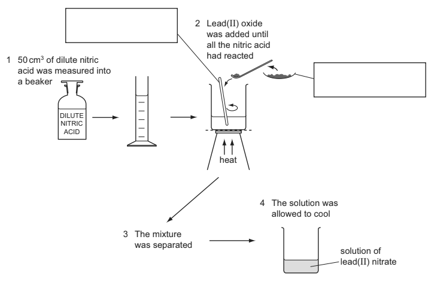

Complete the boxes to identify the pieces of apparatus.

*Source: 2014 O61 Q1*

**Q1** [1 mark]

**Extract:**

A student reacted dilute nitric acid with lead(II) oxide to prepare lead(II) nitrate. The diagram shows the stages in the method used.

Why is the dilute nitric acid heated?

*Source: 2014 O61 Q1*

**Q1** [2 marks]

The lead(II) oxide was weighed before and after the additions.

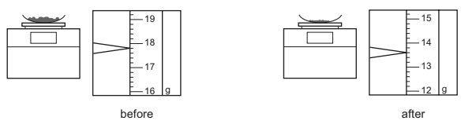

Use the balance diagrams to work out the mass of lead(II) oxide added to the dilute nitric acid.

*Source: 2014 O61 Q1*

**Q1** [3 marks]

**Extract:**

A student reacted dilute nitric acid with lead(II) oxide to prepare lead(II) nitrate. The diagram shows the stages in the method used.

i) How would the student know when all of the dilute nitric acid had reacted in stage 2?

[1]

ii) What method is used to separate the mixture in stage 3?

[1]

iii) What term is used to describe the unreacted lead(II) oxide?

[1]

*Source: 2014 O61 Q1*

### Q2 — medium — 5 marks

**Q2** [3 marks]

The diagram shows the formation of a solution of magnesium hydroxide from magnesium.

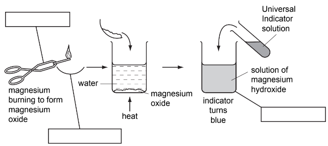

Complete the empty boxes to name the pieces of apparatus.

*Source: 2006 6 Q1*

**Q2** [1 mark]

What type of chemical reaction is the burning of magnesium?

*Source: 2006 6 Q1*

**Q2** [1 mark]

**Extract:**

The diagram shows the formation of a solution of magnesium hydroxide from magnesium.

Suggest a pH for the solution of magnesium hydroxide.

*Source: 2006 6 Q1*

### Q3 — medium — 12 marks

**Q3** [3 marks]

A student prepared a sample of potassium nitrate by neutralising nitric acid using potassium hydroxide solution.

25.0 cm3 of nitric acid was poured into a conical flask. Potassium hydroxide was added a little at a time from a burette as shown below.

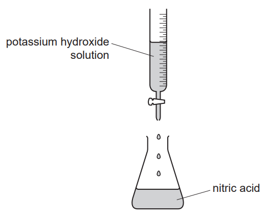

After each addition of potassium hydroxide solution the pH was measured with a pH meter and the values recorded in the table of results.

| volume of potassium hydroxide solution added / cm3 | pH value |
|---|---|
| 5.0 | 1.2 |
| 10.0 | 1.4 |
| 15.0 | 2.6 |
| 20.0 | 2.0 |
| 24.0 | 2.7 |
| 24.5 | 3.0 |
| 25.5 | 11.0 |
| 26.0 | 11.3 |
| 30.0 | 12.0 |
| 40.0 | 13.2 |

You are going to draw a graph to find the volume of potassium hydroxide solution required to neutralise the 25.0 cm3 of nitric acid.

Plot the results on the grid below and draw a smooth line graph.

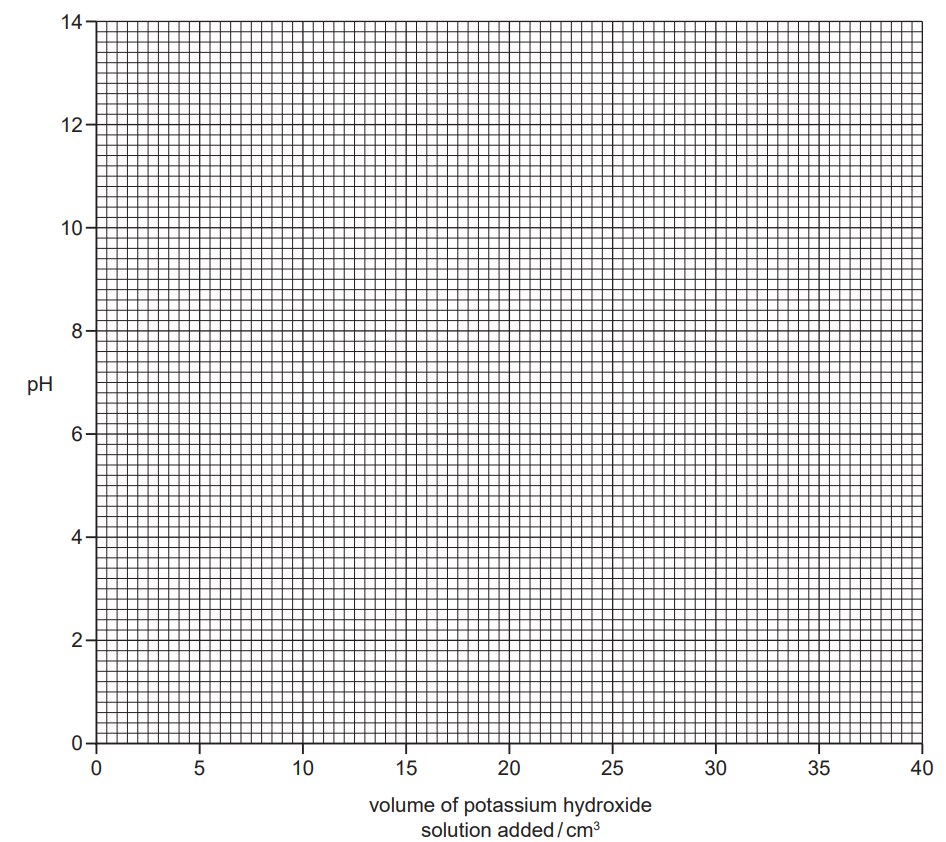

*Source: 2011 61 Q2*

**Q3** [1 mark]

**Extract:**

A student prepared a sample of potassium nitrate by neutralising nitric acid using potassium hydroxide solution. 25.0 cm^3^ of nitric acid was poured into a conical flask. Potassium hydroxide was added a little at a time from a burette. After each addition of potassium hydroxide solution the pH was measured with a pH meter and the values recorded in the table of results.

| volume of potassium hydroxide solution added / cm^3^ | pH value |
| :---: | :---: |
| 5.0 | 1.2 |
| 10.0 | 1.4 |
| 15.0 | 2.6 |
| 20.0 | 2.0 |
| 24.0 | 2.7 |
| 24.5 | 3.0 |
| 25.5 | 11.0 |
| 26.0 | 11.3 |
| 30.0 | 12.0 |
| 40.0 | 13.2 |

Which point appears to be inaccurate?

*Source: 2011 61 Q4*

**Q3** [3 marks]

**Extract:**

A student prepared a sample of potassium nitrate by neutralising nitric acid using potassium hydroxide solution. 25.0 cm^3^ of nitric acid was poured into a conical flask. Potassium hydroxide was added a little at a time from a burette. After each addition of potassium hydroxide solution the pH was measured with a pH meter and the values recorded in the table of results.

| volume of potassium hydroxide solution added / cm^3^ | pH value |
| :---: | :---: |
| 5.0 | 1.2 |
| 10.0 | 1.4 |
| 15.0 | 2.6 |
| 20.0 | 2.0 |
| 24.0 | 2.7 |
| 24.5 | 3.0 |
| 25.5 | 11.0 |
| 26.0 | 11.3 |
| 30.0 | 12.0 |
| 40.0 | 13.2 |

You are going to draw a graph to find the volume of potassium hydroxide solution required to neutralise the 25.0 cm^3^ of nitric acid. Plot the results on the grid below and draw a smooth line graph.

i) **Use your graph** to find the pH of the solution when 35.0 cm3 of potassium hydroxide was added.

[1]

ii) **Use your graph** to find the pH of 25.0 cm3 of nitric acid.

Show clearly **on the grid** how you obtained your answer.

[2]

*Source: 2011 61 Q2*

**Q3** [2 marks]

**Extract:**

A student prepared a sample of potassium nitrate by neutralising nitric acid using potassium hydroxide solution. 25.0 cm^3 of nitric acid was poured into a conical flask. Potassium hydroxide was added a little at a time from a burette. After each addition of potassium hydroxide solution the pH was measured with a pH meter and the values recorded in the table of results.

| volume of potassium hydroxide solution added / cm^3 | pH value |
| 5.0 | 1.2 |
| 10.0 | 1.4 |
| 15.0 | 2.6 |
| 20.0 | 2.0 |
| 24.0 | 2.7 |
| 24.5 | 3.0 |
| 25.5 | 11.0 |
| 26.0 | 11.3 |
| 30.0 | 12.0 |
| 40.0 | 13.2 |

You are going to draw a graph to find the volume of potassium hydroxide solution required to neutralise the 25.0 cm^3 of nitric acid.

i) What is the pH of the solution when all of the nitric acid has just been neutralised?

[1]

ii) What volume of potassium hydroxide was required to neutralise 25.0 cm3 of nitric acid?

[1]

*Source: 2011 61 Q2*

**Q3** [3 marks]

**Extract:**

A student prepared a sample of potassium nitrate by neutralising nitric acid using potassium hydroxide solution.

25.0 cm^3 of nitric acid was poured into a conical flask. Potassium hydroxide was added a little at a time from a burette. After each addition of potassium hydroxide solution the pH was measured with a pH meter.

Describe how the student should modify the experiment to obtain pure crystals of potassium nitrate.

*Source: 2011 61 Q2*

### Q4 — medium — 6 marks

**Q4** [3 marks]

A solution of magnesium sulfate can be made by reacting magnesium oxide with warm sulfuric acid.

Describe how you could make a solution of magnesium sulfate starting with magnesium oxide powder and dilute sulfuric acid.

*Source: 2008 6 Q7*

**Q4** [3 marks]

**Extract:**

A solution of magnesium sulfate can be made by reacting magnesium oxide with warm sulfuric acid. Describe how you could make a solution of magnesium sulfate starting with magnesium oxide powder and dilute sulfuric acid.

Describe how you would obtain pure dry crystals of hydrated magnesium sulfate, MgSO4.7H2O, from the solution of magnesium sulfate in (a).

*Source: 2008 6 Q7*

### Q5 — medium — 6 marks

**Q5** [1 mark]

The information in the box is about the preparation of zinc nitrate crystals.

| Step 1: Add a small amount of zinc oxide to some hot dilute nitric acid, and stir.  Step 2: Keep adding zinc oxide until it is in excess.  Step 3: Remove the excess zinc oxide to leave colourless zinc nitrate solution.  Step 4: Evaporate the zinc nitrate solution until it is saturated.  Step 5: Leave the saturated solution to cool. White crystals form on cooling.  Step 6: Remove the crystals from the remaining solution.  Step 7: Dry the crystals on a piece of filter paper. |
|---|

Suggest a reason for using excess zinc oxide in Step 2.

*Source: 2007 6 Q3*

**Q5** [1 mark]

**Extract:**

The information in the box is about the preparation of zinc nitrate crystals. Step 1: Add a small amount of zinc oxide to some hot dilute nitric acid, and stir. Step 2: Keep adding zinc oxide until it is in excess. Step 3: Remove the excess zinc oxide to leave colourless zinc nitrate solution. Step 4: Evaporate the zinc nitrate solution until it is saturated. Step 5: Leave the saturated solution to cool. White crystals form on cooling. Step 6: Remove the crystals from the remaining solution. Step 7: Dry the crystals on a piece of filter paper.

Suggest how the excess zinc oxide can be removed from the solution in Step 3.

*Source: 2007 6 Q3*

**Q5** [3 marks]

**Extract:**

The information in the box is about the preparation of zinc nitrate crystals.

Step 1: Add a small amount of zinc oxide to some hot dilute nitric acid, and stir.
Step 2: Keep adding zinc oxide until it is in excess.
Step 3: Remove the excess zinc oxide to leave colourless zinc nitrate solution.
Step 4: Evaporate the zinc nitrate solution until it is saturated.
Step 5: Leave the saturated solution to cool. White crystals form on cooling.
Step 6: Remove the crystals from the remaining solution.
Step 7: Dry the crystals on a piece of filter paper.

i) What is meant by the term *saturated solution*?

[2]

ii) What practical method could show the solution to be saturated?

[1]

*Source: 2007 6 Q3*

**Q5** [1 mark]

**Extract:**

The information in the box is about the preparation of zinc nitrate crystals. Step 1: Add a small amount of zinc oxide to some hot dilute nitric acid, and stir. Step 2: Keep adding zinc oxide until it is in excess. Step 3: Remove the excess zinc oxide to leave colourless zinc nitrate solution. Step 4: Evaporate the zinc nitrate solution until it is saturated. Step 5: Leave the saturated solution to cool. White crystals form on cooling. Step 6: Remove the crystals from the remaining solution. Step 7: Dry the crystals on a piece of filter paper.

Why are the crystals dried in Step 7 using filter paper instead of by heating?

*Source: 2007 6 Q3*

### Q6 — medium — 6 marks

**Q6** [1 mark]

The following instructions were used to prepare magnesium sulfate crystals, MgSO4.7H2O.

| **Step 1 ** | Measure 50 cm3 of dilute sulfuric acid into a beaker and warm the solution. |
|---|---|
| **Step 2** | Using a spatula, add some magnesium oxide and stir the mixture. Continue adding the magnesium oxide until excess is present. |
| **Step 3 ** | Separate the excess magnesium oxide from the solution of magnesium sulfate. |
| **Step 4 ** | Heat the solution until crystals form. Obtain the crystals and dry them. |

Why is the sulfuric acid warmed?

*Source: 2010 61 Q2*

**Q6** [1 mark]

**Extract:**

The following instructions were used to prepare magnesium sulfate crystals, MgSO4.7H2O.
Step 1: Measure 50 cm3 of dilute sulfuric acid into a beaker and warm the solution.
Step 2: Using a spatula, add some magnesium oxide and stir the mixture. Continue adding the magnesium oxide until excess is present.
Step 3: Separate the excess magnesium oxide from the solution of magnesium sulfate.
Step 4: Heat the solution until crystals form. Obtain the crystals and dry them.

How would you know when excess magnesium oxide is present in **Step 2**?

*Source: 2010 61 Q2*

**Q6** [1 mark]

**Extract:**

The following instructions were used to prepare magnesium sulfate crystals, MgSO~4~.7H~2~O.

Step 1: Measure 50 cm^3 of dilute sulfuric acid into a beaker and warm the solution.
Step 2: Using a spatula, add some magnesium oxide and stir the mixture. Continue adding the magnesium oxide until excess is present.
Step 3: Separate the excess magnesium oxide from the solution of magnesium sulfate.
Step 4: Heat the solution until crystals form. Obtain the crystals and dry them.

What method is used in **Step 3**?

*Source: 2010 61 Q2*

**Q6** [1 mark]

**Extract:**

The following instructions were used to prepare magnesium sulfate crystals, MgSO~4~.7H~2~O.
Step 1: Measure 50 cm^3 of dilute sulfuric acid into a beaker and warm the solution.
Step 2: Using a spatula, add some magnesium oxide and stir the mixture. Continue adding the magnesium oxide until excess is present.
Step 3: Separate the excess magnesium oxide from the solution of magnesium sulfate.
Step 4: Heat the solution until crystals form. Obtain the crystals and dry them.

Why must care be taken when drying the crystals in **Step 4**?

*Source: 2010 61 Q6*

**Q6** [2 marks]

**Extract:**

The following instructions were used to prepare magnesium sulfate crystals, MgSO~4~.7H~2~O.

Step 1: Measure 50 cm^3 of dilute sulfuric acid into a beaker and warm the solution.
Step 2: Using a spatula, add some magnesium oxide and stir the mixture. Continue adding the magnesium oxide until excess is present.
Step 3: Separate the excess magnesium oxide from the solution of magnesium sulfate.
Step 4: Heat the solution until crystals form. Obtain the crystals and dry them.

Explain how the method would differ if magnesium carbonate was used instead of magnesium oxide.

*Source: 2010 61 Q2*

### Q7 — medium — 7 marks

**Q7** [3 marks]

A student reacted nitric acid with magnesium oxide to prepare magnesium nitrate. The diagram shows the procedure followed in three stages.

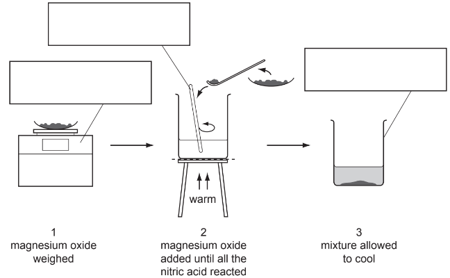

Complete the boxes to identify the pieces of apparatus labelled.

*Source: 2009 61 Q1*

**Q7** [2 marks]

**Extract:**

A student reacted nitric acid with magnesium oxide to prepare magnesium nitrate. The diagram shows the procedure followed in three stages.

i) What term is used to describe the unreacted magnesium oxide?

[1]

ii) What method is used to remove the unreacted magnesium oxide after stage 3?

[1]

*Source: 2009 61 Q1*

**Q7** [2 marks]

**Extract:**

A student reacted nitric acid with magnesium oxide to prepare magnesium nitrate. The diagram shows the procedure followed in three stages.

Describe how crystals of magnesium nitrate could be quickly obtained from the solution.

*Source: 2009 61 Q1*

### Q8 — medium — 4 marks

**Q8** [2 marks]

A student reacted excess iron powder with sulfuric acid to prepare a solution of iron(II) sulfate.  The diagram shows the procedure followed in three stages

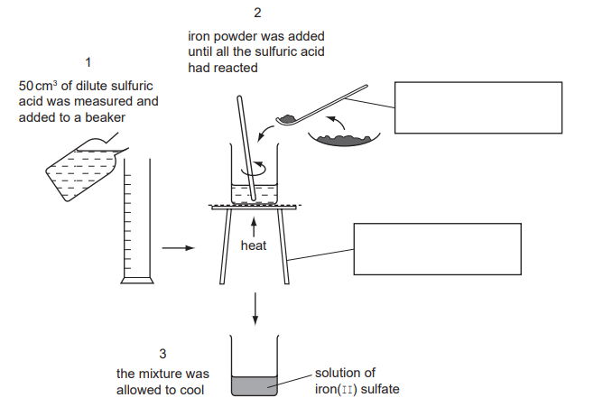

Complete the boxes to identify the pieces of apparatus labelled.

*Source: 2012 61 Q1*

**Q8** [2 marks]

**Extract:**

A student reacted excess iron powder with sulfuric acid to prepare a solution of iron(II) sulfate. The diagram shows the procedure followed in three stages

How would the student know when all of the sulfuric acid had reacted? Give **two **reasons.

*Source: 2012 O61 Q1*

## Multiple Choice Questions (19 questions)

### Q1 — hard — 1 marks

**Q1** [1 mark]

Aqueous silver nitrate is added to aqueous sodium chloride to prepare a pure, dry sample of silver chloride.

What are the correct steps to obtain the sample?

### Q2 — easy — 1 marks

**Q2** [1 mark]

A student prepares pure hydrated copper(II) sulfate crystals from copper(II) oxide and dilute sulfuric acid.

Which row shows the correct order of steps for this preparation?

### Q3 — easy — 1 marks

**Q3** [1 mark]

#### Separate: Chemistry and Extended Only

The chemical equation for the preparation of lead(II) sulfate is written below.

Pb(NO3)2  (___) + Na2SO4 (___) → PbSO4 (___) + 2NaNO3 (___)

What are the state symbols for each substance in this reaction?

| **A** | aq, aq, s, aq |
|---|---|
| **B** | aq, aq, s, s |
| **C** | s, aq, aq, s |
| **D** | s, aq, s, aq |

### Q4 — easy — 1 marks

**Q4** [1 mark]

A student making copper sulfate crystals used the method shown.

Unreacted copper carbonate was left over as it had been added in excess.

What is the reason for adding it in excess and what would step 3 be of this method?

| ** ** | **reason for adding in excess** | **step 3** |
|---|---|---|
| ** A** | to produce a greater amount of salt crystals | filtration |
| ** B** | to improve the colour intensity of the crystals | crystallisation |
| ** C** | to ensure all the acid reacts | filtration |
| ** D** | to increase the rate of reaction | evaporation |

### Q5 — easy — 1 marks

**Q5** [1 mark]

Different salts can be prepared by titrating an alkali with an aqueous acid.

Three pieces of apparatus, **P**, **Q** and **R**, used to measure volumes of liquid are shown below.

What are the names of the three pieces of apparatus, **P**, **Q** and **R**?

| ** ** | **P** | **Q** | **R** |
|---|---|---|---|
| ** A** | pipette | burette | measuring cylinder |
| ** B** | burette | pipette | conical flask |
| ** C** | pipette | volumetric flask | burette |
| ** D** | burette | pipette | measuring cylinder |

### Q6 — easy — 1 marks

**Q6** [1 mark]

When solid sodium chloride is mixed with water, sodium chloride solution forms.

What name is given to the process of mixing a solid with water to form a solution?

| **A** | Crystallising |
|---|---|
| **B** | Diluting |
| **C** | Dissolving |
| **D** | Melting |

### Q7 — easy — 1 marks

**Q7** [1 mark]

When an aqueous salt is crystallised, some water can be retained within the structure of the salt.

What is the name given to the type of salt that forms?

| **A** | anhydrous salt |
|---|---|
| **B** | dehydrated salt |
| **C** | hydrated salt |
| **D** | soluble salt |

### Q8 — hard — 1 marks

**Q8** [1 mark]

Silver chloride can be prepared by reacting silver nitrate solution with potassium chloride solution.

To ensure the maximum amount of silver chloride is formed, which of the following should be done?

### Q9 — hard — 1 marks

**Q9** [1 mark]

Which statement is correct?

### Q10 — hard — 1 marks

**Q10** [1 mark]

Which method(s) of salt preparation could be used to prepare a sample of magnesium chloride?

1   Titration

2   Reaction of an acid with excess metal

3  Reaction of an acid with excess insoluble base

### Q11 — hard — 1 marks

**Q11** [1 mark]

A student is provided with solutions of dilute hydrochloric acid, dilute sulfuric acid, solid magnesium oxide, zinc carbonate and copper.

How many different salts could the student make?

### Q12 — hard — 1 marks

**Q12** [1 mark]

A substance reacts with dilute H2SO4 to form a salt which is separated by filtration.

What is the substance?

### Q13 — medium — 1 marks

**Q13** [1 mark]

A student wanted to prepare copper(II) sulfate crystals by reacting solid copper(II) oxide to a solution of hot sulfuric acid.

An extract from the method section of the experimental handout is shown below:

Add the copper(II) oxide in small amounts to the hot acid in the reaction flask and stir until it is …..**1**…... When the reaction has gone to completion the copper(II) oxide will no longer …..**2**……, …..**3**….. and …..**4**….. the solution to obtain the copper(II) sulfate crystals.

|   | **1** | **2** | **3** | **4** |
|---|---|---|---|---|
| **A** | in excess | precipitate | cool | dissolve |
| **B** | in excess | dissolve | filter | cool |
| **C** | reacting | dissolve | cool | filter |
| **D** | reacting | precipitate | filter | cool |

### Q14 — medium — 1 marks

**Q14** [1 mark]

What is the correct sequence of steps for the preparation of a pure sample of lead(II) iodide from solid potassium iodide and lead(II) nitrate ?

### Q15 — medium — 1 marks

**Q15** [1 mark]

Which of the following methods to prepare a salt can be achieved using a burette and a pipette?

### Q16 — medium — 1 marks

**Q16** [1 mark]

Samples of two solids, P & Q, are separately dissolved in water and made into solutions.

Which combination of P & Q solutions, would give an insoluble product on mixing?

|   | **P** | **Q** |
|---|---|---|
| **A** | potassium chloride | sodium hydroxide |
| **B** | ammonium chloride | potassium sulfate |
| **C** | sodium nitrate | magnesium sulfate |
| **D** | barium chloride | sodium sulfate |

### Q17 — medium — 1 marks

**Q17** [1 mark]

Copper(II) sulfate can be prepared by reacting solid copper(II) carbonate with hot sulfuric acid. The copper(II) carbonate is always added in excess.

Why is the solid reactant added in excess?

## Theory Questions (18 questions)

### Q1 — medium — 10 marks

**Q1** [2 marks]

**Extract:**

Chlorine reacts with phosphorus to form phosphorus trichloride.

Chlorine reacts with phosphorus to form phosphorus trichloride.

Draw a diagram showing the arrangement of the outer electrons in one molecule of the covalent compound, phosphorus trichloride.

Use x to represent an electron from a phosphorus atom. 
Use o to represent an electron from a chlorine atom.

*Source: 2011 Ju32 Q7A*

**Q1** [8 marks]

**Extract:**

Phosphorus trichloride reacts with water to form two acids.

#### Extended Only

Phosphorus trichloride reacts with water to form two acids.

i) Balance the equation for this reaction.

PCl3 + .......H2O → .......HCl + H3PO3

[1]

ii) Describe how you could show that phosphorus acid, H3PO3, is a weaker acid than hydrochloric acid.

[3]

iii) Two salts of phosphorus acid are its sodium salt, which is soluble in water, and its calcium salt which is insoluble in water. Suggest a method of preparation for each of these salts from aqueous phosphorus acid. Specify any other reagent needed and briefly outline the method.

Sodium salt

[2]

Calcium salt

[2]

*Source: 2011 Ju31 Q7B*

### Q2 — hard — 8 marks

**Q2** [5 marks]

**Extract:**

Insoluble salts are made by precipitation.

A preparation of the insoluble salt calcium fluoride is described below.

To 15 cm3 of aqueous calcium chloride, 30 cm3 of aqueous sodium fluoride is added. The concentration of both solutions is 1.00 mol / dm3. The mixture is filtered and the precipitate washed with distilled water. Finally, the precipitate is heated in an oven.

#### Extended Only

Insoluble salts are made by precipitation.

A preparation of the insoluble salt calcium fluoride is described below.

To 15 cm3 of aqueous calcium chloride, 30 cm3 of aqueous sodium fluoride is added. The concentration of both solutions is 1.00 mol / dm3. The mixture is filtered and the precipitate washed with distilled water. Finally, the precipitate is heated in an oven.

i) Complete the equation.

Ca2+ + ..........F- →...............

[2]

ii) Why is the volume of sodium fluoride solution double that of the calcium chloride solution?

[1]

iii) Why is the mixture washed with distilled water?

[1]

iv) Why is the solid heated?

[1]

*Source: 2009 Ju31 Q5A*

**Q2** [3 marks]

**Extract:**

Insoluble salts are made by precipitation.

A preparation of the insoluble salt calcium fluoride is described below.

To 15 cm3 of aqueous calcium chloride, 30 cm3 of aqueous sodium fluoride is added. The concentration of both solutions is 1.00 mol / dm3. The mixture is filtered and the precipitate washed with distilled water. Finally, the precipitate is heated in an oven.

#### Extended Only

The formulae of insoluble compounds can be found by precipitation reactions. To 12.0 cm3 of an aqueous solution of the nitrate of metal T was added 2.0 cm3 of aqueous sodium phosphate, Na3PO4. The concentration of both solutions was 1.00 mol/ dm3.

When the precipitate had settled, its height was measured.

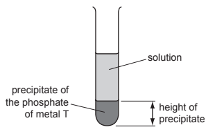

The experiment was repeated using different volumes of the phosphate solution. The results are shown on the following graph.

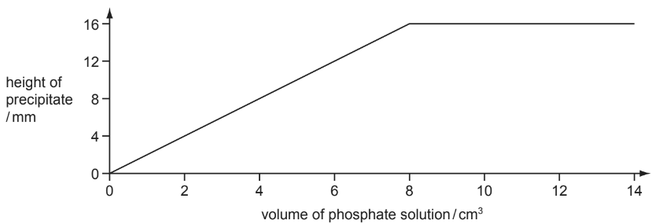

What is the formula of the phosphate of metal T? Give your reasoning.

*Source: 2009 Ju31 Q5B*

### Q3 — medium — 10 marks

**Q3** [3 marks]

**Extract:**

Three common methods of preparing salts are shown below.

| **method A** | adding an excess of an insoluble base or carbonate or metal to a dilute acid and removing excess by filtration |
|---|---|
| **method B** | using a burette and indicator |
| **method C** | mixing two solutions to obtain the salt by precipitation |

For each of the following salt preparations, choose a method, A, B or C. Name any additional reagent which is needed and complete the equation.

The soluble salt, nickel chloride, from the insoluble compound nickel carbonate

Three common methods of preparing salts are shown below.

| **method A** | adding an excess of an insoluble base or carbonate or metal to a dilute acid and removing excess by filtration |
|---|---|
| **method B** | using a burette and indicator |
| **method C** | mixing two solutions to obtain the salt by precipitation |

For each of the following salt preparations, choose a method, A, B or C. Name any additional reagent which is needed and complete the equation.

The soluble salt, nickel chloride, from the insoluble compound nickel carbonate

method ....................................................................................................................................... 
reagent ...................................................................................................................................... 
word equation ............................................................................................................................

*Source: 2015 Ju32 Q5A*

**Q3** [3 marks]

**Extract:**

Three common methods of preparing salts are shown below.

method A: adding an excess of an insoluble base or carbonate or metal to a dilute acid and removing excess by filtration
method B: using a burette and indicator
method C: mixing two solutions to obtain the salt by precipitation

For each of the following salt preparations, choose a method, A, B or C. Name any additional reagent which is needed and complete the equation.

#### Separate: Chemistry and Extended Only

The insoluble salt, lead(II) bromide, from aqueous lead(II) nitrate

method .......................................................................................................................................

reagent ......................................................................................................................................

ionic equation ........ + ........ → PbBr2

*Source: 2015 Ju32 Q5B*

**Q3** [4 marks]

**Extract:**

Three common methods of preparing salts are shown below.

| method A | adding an excess of an insoluble base or carbonate or metal to a dilute acid and removing excess by filtration |
| method B | using a burette and indicator |
| method C | mixing two solutions to obtain the salt by precipitation |

For each of the following salt preparations, choose a method, A, B or C. Name any additional reagent which is needed and complete the equation.

The soluble salt, lithium sulfate, from the soluble base lithium hydroxide

method .......................................................................................................................................

reagent ......................................................................................................................................

equation .....................................................................................................................................

*Source: 2015 Ju32 Q5C*

### Q4 — easy — 4 marks

**Q4** [3 marks]

This question is about cobalt and compounds of cobalt.

Describe how you could prepare a  pure sample of crystals of hydrated cobalt(II) sulfate using dilute sulfuric acid and an excess of cobalt(II) carbonate.

*Source: 2019 Ju32 Q6A*

**Q4** [1 mark]

**Extract:**

A student investigates the rate of reaction of magnesium ribbon with an excess of dilute hydrochloric acid.

Mg + 2HCl → MgCl2 + H2

A student investigates the rate of reaction of magnesium ribbon with an excess of dilute hydrochloric acid.

Mg + 2HCl → MgCl2 + H2

Name the salt formed when magnesium reacts with dilute hydrochloric acid.

*Source: 2019 Ju32 Q7A*

### Q5 — easy — 7 marks

**Q5** [2 marks]

**Extract:**

Aqueous sodium hydroxide, NaOH(aq), is a strong alkali that reacts with dilute sulfuric acid exothermically.

Aqueous sodium hydroxide, NaOH(aq), is a strong alkali that reacts with dilute sulfuric acid exothermically.

Complete the equation for the reaction between aqueous sodium hydroxide and dilute sulfuric acid.

2NaOH + H2SO4 → ......................... + .........................

**Q5** [1 mark]

**Extract:**

A student investigates the rate of reaction of small pieces of calcium carbonate with an excess of hydrochloric acid of concentration 1 mol / dm3.

CaCO3 (s) + 2HCl (aq) → CaCl2 (aq) + CO2 (g) + H2O (l)

A student investigates the rate of reaction of small pieces of calcium carbonate with an excess of hydrochloric acid of concentration 1 mol / dm3.

CaCO3 (s) + 2HCl (aq) → CaCl2 (aq) + CO2 (g) + H2O (l)

Name the salt formed when calcium carbonate reacts with hydrochloric acid.

*Source: 2019 Ju31 Q7A*

**Q5** [3 marks]

Describe how you could prepare a  pure sample of crystals of hydrated zinc sulfate using dilute sulfuric acid and an excess of zinc.

*Source: 2019 Ju33 Q6A*

**Q5** [1 mark]

**Extract:**

A student investigates the rate of reaction of large pieces of magnesium carbonate with an excess of dilute nitric acid.

MgCO3 + 2HNO3 → Mg(NO3)2 + CO2 + H2O

A student investigates the rate of reaction of large pieces of magnesium carbonate with an excess of dilute nitric acid.

MgCO3 + 2HNO3 → Mg(NO3)2 + CO2 + H2O

Name the salt formed when magnesium carbonate reacts with dilute nitric acid.

*Source: 2019 Ju33 Q7A*

### Q6 — medium — 7 marks

**Q6** [1 mark]

**Extract:**

Which one of these salts is soluble in water? Tick one box.

| barium sulfate |   |
|---|---|
| calcium carbonate |   |
| ammonium sulfate |   |
| iron(II) hydroxide |   |

#### Separate: Chemistry Only

Which one of these salts is soluble in water? Tick one box.

| barium sulfate |   |
|---|---|
| calcium carbonate |   |
| ammonium sulfate |   |
| iron(II) hydroxide |   |

**Q6** [1 mark]

**Extract:**

Carbon dioxide is a gas.

Carbon dioxide is a gas.

Which **one** of these processes does **not** produce carbon dioxide?

Tick **one** box.

| the reaction of hydrochloric acid with calcium carbonate |   |
|---|---|
| the complete combustion of carbon-containing fuels |   |
| the reaction of hydrochloric acid with magnesium |   |
| the thermal decomposition of calcium carbonate |   |

**Q6** [2 marks]

**Extract:**

Concentrated sulfuric acid is a dehydrating agent which can chemically remove water from substances.

Both hydrated copper(II) sulfate crystals and sucrose (a sugar), C12H22O11, can be completely dehydrated by concentrated sulfuric acid.

Concentrated sulfuric acid is a dehydrating agent which can chemically remove water from substances.

Both hydrated copper(II) sulfate crystals and sucrose (a sugar), C12H22O11, can be completely dehydrated by concentrated sulfuric acid.

Name the solid product formed in each case.

hydrated copper(II) sulfate crystals ________________

sucrose ________________

*Source: 2020 Ju41 Q3C*

**Q6** [3 marks]

This question is about copper and copper compounds.

Describe how you could prepare a pure sample of crystals of hydrated copper(II) sulfate using dilute sulfuric acid and an excess of copper(II) oxide.

*Source: 2019 Ju31 Q6A*

### Q7 — medium — 10 marks

**Q7** [6 marks]

**Extract:**

Three ways of making salts are

- titration using a soluble base or carbonate
- neutralisation using an insoluble base or carbonate
- precipitation

#### Extended Only

Three ways of making salts are

- titration using a soluble base or carbonate
- neutralisation using an insoluble base or carbonate
- precipitation

Complete the following table of salt preparations.

| Method | Reagent 1 | Reagent 2 | Salt |
|---|---|---|---|
| Titration | .............................  ............................. | .............................  ............................. | Sodium nitrate |
| Neutralisation | Nitric acid | .............................  ............................. | Copper(II) nitrate |
| Precipitation | .............................  ............................. | .............................  ............................. | Silver(I) chloride |
| Neutralisation | Sulfuric acid | Zinc(II) carbonate | .............................  ............................. |

*Source: 2012 Ju31 Q2A*

**Q7** [4 marks]

i) Write an ionic equation with state symbols for the preparation of silver(I) chloride.

[2]

ii) Complete the following equation.

ZnCO3 + H2SO4 → ............... + ............... + ...............

[2]

*Source: 2012 Ju31 Q2B*

### Q8 — medium — 5 marks

**Q8** [2 marks]

#### Extended Only

Silver chloride, AgC*l*, is insoluble. It can be made by a precipitation reaction between aqueous barium chloride and a suitable aqueous silver salt.

What is meant by the term *precipitate*?

*Source: 2019 Ju41 Q4E*

**Q8** [3 marks]

**Extract:**

Silver chloride, AgCl, is insoluble. It can be made by a precipitation reaction between aqueous barium chloride and a suitable aqueous silver salt.

#### Separate: Chemistry and Extended Only

Name a suitable silver salt to use to prepare silver chloride.

Complete the chemical equation to show the formation of insoluble silver chloride from aqueous barium chloride and the silver salt you have named.

name of a suitable silver salt ...........................................

BaC*l*2 + ..................... $\rightarrow$ ..................... + .....................

*Source: 2019 Ju41 Q4E*

### Q9 — easy — 5 marks

**Q9** [1 mark]

**Extract:**

A student prepares crystals of magnesium chloride by adding an excess of magnesium carbonate to 50.00 cm3 of 2.00 mol / dm3 hydrochloric acid. 
The student filters the mixture and rinses the residue.

A student prepares crystals of magnesium chloride by adding an excess of magnesium carbonate to 50.00 cm3 of 2.00 mol / dm3 hydrochloric acid. 
The student filters the mixture and rinses the residue.

Why does the student add an **excess** of magnesium carbonate?

*Source: 2019 Ju41 Q4D*

**Q9** [1 mark]

**Extract:**

A student prepares crystals of magnesium chloride by adding an excess of magnesium carbonate to 50.00 cm^3 of 2.00 mol / dm^3 hydrochloric acid. The student filters the mixture and rinses the residue.

Why does the student rinse the residue?

*Source: 2019 Ju41 Q4D*

**Q9** [3 marks]

**Extract:**

A student prepares crystals of magnesium chloride by adding an excess of magnesium carbonate to 50.00 cm^3 of 2.00 mol / dm^3 hydrochloric acid. The student filters the mixture and rinses the residue.

Describe how the student would obtain pure crystals of magnesium chloride from the filtrate.

*Source: 2019 Ju41 Q4D*

### Q10 — medium — 9 marks

**Q10** [6 marks]

**Extract:**

Oxides are classified as acidic, basic, neutral and amphoteric.

Oxides are classified as acidic, basic, neutral and amphoteric.

Complete the table.

| Type of oxide | pH of solution of oxide | Example |
|---|---|---|
| Acidic |   |   |
| Basic |   |   |
| Neutral |   |   |

*Source: 2009 O31 Q2A*

**Q10** [3 marks]

**Extract:**

Oxides are classified as acidic, basic, neutral and amphoteric.

#### Extended Only

i) Explain the term *amphoteric*.

[1]

ii) Name two reagents that are needed to show that an oxide is amphoteric.

[2]

*Source: 2009 O31 Q2B*

### Q11 — hard — 10 marks

**Q11** [4 marks]

**Extract:**

Soluble salts can be made using a base and an acid.

Complete this method of preparing dry crystals of the soluble salt cobalt(II) chloride-6-water from the insoluble base cobalt(II) carbonate.

Soluble salts can be made using a base and an acid.

Complete this method of preparing dry crystals of the soluble salt cobalt(II) chloride-6-water from the insoluble base cobalt(II) carbonate.

Step 1

Add an excess of cobalt(II) carbonate to hot dilute hydrochloric acid.

Step 2

............................................................................................................

Step 3

............................................................................................................

Step 4

............................................................................................................

[4]

*Source: 2016 Specimen4 Q6A*

**Q11** [6 marks]

**Extract:**

5.95g of cobalt(II) carbonate were added to 40 cm3 of hydrochloric acid, concentration 2.0 mol / dm3.

#### Separate: Chemistry and Extended Only

5.95g of cobalt(II) carbonate were added to 40 cm3 of hydrochloric acid, concentration 2.0 mol / dm3.

i) Calculate the maximum yield of cobalt(II) chloride-6-water and show that the cobalt(II)carbonate was in excess.

CoCO3 + 2HCl → CoCl2 + CO2 + H2O

CoCl2 + 6H2O → CoCl2.6H2O

** Maximum yield:**

number of moles of HCl used = ..............................

number of moles of CoCl2 formed = ..............................

number of moles of CoCl2.6H2O formed = ..............................

mass of one mole of CoCl2.6H2O = 238 g

maximum yield of CoCl2.6H2O = .............................. g

** To show that cobalt(II) carbonate is in excess:**

number of moles of HCl used = .............................. (use your value from above)

mass of one mole of CoCO3 = 119g

number of moles of CoCO3 in 5.95g of cobalt(II) carbonate = ..............................

[5]

ii) Explain how these calculations show that cobalt(II) carbonate is in excess.

[1]

*Source: 2016 Specimen4 Q6B*

### Q12 — hard — 11 marks

**Q12** [2 marks]

**Extract:**

Silver(I) chromate(VI) is an insoluble salt. It is prepared by precipitation. 20 cm3 of aqueous silver(I) nitrate, concentration 0.2 mol /dm3, was mixed with 20 cm3 of aqueous potassium chromate(VI), concentration 0.1 mol /dm3. After stirring, the mixture was filtered. The precipitate was washed several times with distilled water. The precipitate was then left in a warm oven for several hours.

2AgNO3 (aq) + K2CrO4 (aq) → Ag2CrO4 (s) + 2KNO3 (aq)

Silver(I) chromate(VI) is an insoluble salt. It is prepared by precipitation. 20 cm3 of aqueous silver(I) nitrate, concentration 0.2 mol /dm3, was mixed with 20 cm3 of aqueous potassium chromate(VI), concentration 0.1 mol /dm3. After stirring, the mixture was filtered. The precipitate was washed several times with distilled water. The precipitate was then left in a warm oven for several hours.

2AgNO3 (aq) + K2CrO4 (aq) → Ag2CrO4 (s) + 2KNO3 (aq)

What difficulty arises if the name of a compound of a transition element does not include its oxidation state, for example iron oxide?

*Source: 2013 O32 Q5A*

**Q12** [3 marks]

**Extract:**

Silver(I) chromate(VI) is an insoluble salt. It is prepared by precipitation. 20 cm^3 of aqueous silver(I) nitrate, concentration 0.2 mol /dm^3, was mixed with 20 cm^3 of aqueous potassium chromate(VI), concentration 0.1 mol /dm^3. After stirring, the mixture was filtered. The precipitate was washed several times with distilled water. The precipitate was then left in a warm oven for several hours.

2AgNO3 (aq) + K2CrO4 (aq) → Ag2CrO4 (s) + 2KNO3 (aq)

#### Extended Only

These questions refer to the preparation of the salt.

i) Why is it necessary to filter the mixture after mixing and stirring?

[1]

ii) What is the purpose of washing the precipitate?

[1]

iii) Why leave the precipitate in a warm oven?

[1]

*Source: 2013 O32 Q5B*

**Q12** [6 marks]

**Extract:**

Silver(I) chromate(VI) is an insoluble salt. It is prepared by precipitation. 20 cm^3^ of aqueous silver(I) nitrate, concentration 0.2 mol /dm^3^, was mixed with 20 cm^3^ of aqueous potassium chromate(VI), concentration 0.1 mol /dm^3^. After stirring, the mixture was filtered. The precipitate was washed several times with distilled water. The precipitate was then left in a warm oven for several hours.

2AgNO~3~ (aq) + K~2~CrO~4~ (aq) → Ag~2~CrO~4~ (s) + 2KNO~3~ (aq)

#### Separate: Chemistry and Extended Only

i) Explain why the concentrations of silver(I) nitrate and potassium chromate(VI) are different.

[1]

ii) What mass of silver(I) nitrate is needed to prepare 100 cm3 of silver(I) nitrate solution, concentration 0.2 mol / dm3?

The mass of one mole of AgNO3 is 170 g.

[2]

iii) What is the maximum mass of silver(I) chromate(VI) which could be obtained from 20 cm3 of aqueous silver(I) nitrate, concentration 0.2 mol / dm3?

Number of moles of AgNO3 used = .....................

[1]

Number of moles of Ag2CrO4 formed = .....................

[1]

Mass of one mole of Ag2CrO4 = 332 g

Mass of Ag2CrO4 formed = ..................... g

[1]

*Source: 2013 O32 Q5C*

### Q13 — hard — 7 marks

**Q13** [2 marks]

**Extract:**

20.0 cm3 of aqueous sodium hydroxide, 2.00 mol / dm3, was placed in a beaker.

The temperature of the alkali was measured and 1.0 cm3 portions of hydriodic acid were added.

The hydroxides of the Group I metals are soluble in water. Most other metal hydroxides are insoluble in water.

Crystals of lithium chloride can be prepared from lithium hydroxide by titration.

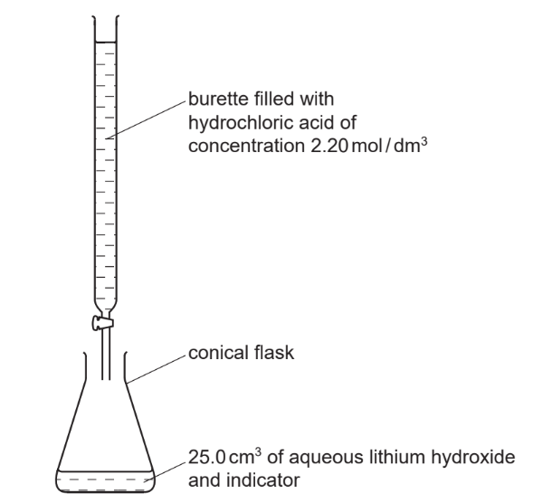

25.0cm3 of aqueous lithium hydroxide is pipetted into the conical flask.

A few drops of an indicator are added. Dilute hydrochloric acid is added slowly to the alkali until the indicator just changes colour. The volume of acid needed to neutralise the lithium hydroxide is noted.

A neutral solution of lithium chloride, which still contains the indicator, is left.

Explain how you could obtain a neutral solution of lithium chloride, without any inidcator.

*Source: 2013 Ju31 Q7*

**Q13** [2 marks]

**Extract:**

The concentration of the hydrochloric acid was 2.20 mol / dm3. The volume of acid needed to neutralise the 25.0 cm3 of lithium hydroxide was 20.0 cm3.

#### Separate: Chemistry and Extended Only

The concentration of the hydrochloric acid was 2.20 mol / dm3. The volume of acid needed to neutralise the 25.0 cm3 of lithium hydroxide was 20.0 cm3. Calculate the concentration of the aqueous lithium hydroxide.

LiOH + HCl → LiCl + H2O

*Source: 2013 Ju31 Q7*

**Q13** [3 marks]

**Extract:**

Lithium chloride forms three hydrates. They are LiCl.H2O, LiCl.2H2O and LiCl.3H2O.

#### Separate: Chemistry and Extended Only

Lithium chloride forms three hydrates. They are LiCl.H2O, LiCl.2H2O and LiCl.3H2O.

Which one of these three hydrates contains 45.9% of water? Show how you arrived at your answer.

*Source: 2013 Ju31 Q7*

### Q14 — medium — 10 marks

**Q14** [10 marks]

**Extract:**

There are three methods of preparing salts.

- Method A – use a burette and an indicator.
- Method B – mix two solutions and obtain the salt by precipitation.
- Method C – add an excess of base or a metal to a dilute acid and remove the excess by filtration.

For each of the following salt preparations, choose one of the methods A, B or C, name any additional reagent needed and then write or complete the equation.

#### Extended Only

There are three methods of preparing salts.

- Method A – use a burette and an indicator.
- Method B – mix two solutions and obtain the salt by precipitation.
- Method C – add an excess of base or a metal to a dilute acid and remove the excess by filtration.

For each of the following salt preparations, choose one of the methods A, B or C, name any additional reagent needed and then write or complete the equation.

i) The soluble salt, zinc sulfate, from the insoluble base, zinc oxide

method ..................................................

reagent ..................................................

word equation ..................................................

[3]

ii) The soluble salt, potassium chloride, from the soluble base, potassium hydroxide

method ..................................................

reagent ..................................................

equation ..................... + .....................  → KCl + H2O

[3]

iii) The insoluble salt, lead(II) iodide, from the soluble salt, lead(II) nitrate

method ..................................................

reagent ..................................................

equation Pb2+ + ..................... → .....................

[4]

*Source: 2007 Ju31 Q3A*

### Q15 — medium — 15 marks

**Q15** [5 marks]

**Extract:**

Soluble salts can be made by the neutralisation of an acid by a base. Insoluble salts can be made by precipitation.

The following is a brief description of the preparation of the soluble salt, nickel(II) chloride-6-water, from the insoluble base nickel(II) carbonate. Nickel(II) carbonate is added in small amounts to hot dilute hydrochloric acid until it is in excess. The mixture is filtered. The filtrate is partially evaporated and then allowed to cool until crystals of nickel(II) chloride-6-water form.

Soluble salts can be made by the neutralisation of an acid by a base. Insoluble salts can be made by precipitation.

The following is a brief description of the preparation of the soluble salt, nickel(II) chloride-6-water, from the insoluble base nickel(II) carbonate. Nickel(II) carbonate is added in small amounts to hot dilute hydrochloric acid until it is in excess. The mixture is filtered. The filtrate is partially evaporated and then allowed to cool until crystals of nickel(II) chloride-6-water form.

i) Why is it necessary to use excess carbonate?

[1]

ii) Explain why it is necessary to filter.

[1]

iii) Why partially evaporate rather than evaporate to dryness?

[1]

iv) What additional steps are needed to obtain dry crystals?

[2]

*Source: 2011 O31 Q4*

**Q15** [5 marks]

**Extract:**

Soluble salts can be made by the neutralisation of an acid by a base. Insoluble salts can be made by precipitation.

The following is a brief description of the preparation of the soluble salt, nickel(II) chloride-6-water, from the insoluble base nickel(II) carbonate. Nickel(II) carbonate is added in small amounts to hot dilute hydrochloric acid until it is in excess. The mixture is filtered. The filtrate is partially evaporated and then allowed to cool until crystals of nickel(II) chloride-6-water form.

#### Separate: Chemistry Only

Potassium chloride can be made from hydrochloric acid and potassium carbonate.

i) Why must a different experimental method be used for this preparation?

[1]

ii) Give a description of the different method used for this salt preparation.

[4]

*Source: 2011 O32 Q6*

**Q15** [5 marks]

**Extract:**

Insoluble salts are made by precipitation. An equation for the preparation of barium sulfate is given below.

BaCl2 (aq) + MgSO4 (aq) → BaSO4 (s) + MgCl2 (aq)

This reaction can be used to find x in the formula for hydrated magnesium sulfate MgSO4.xH2O.

A known mass of hydrated magnesium sulfate, MgSO4.xH2O, was dissolved in water. Excess aqueous barium chloride was added. The precipitate of barium sulfate was filtered, washed and dried. Finally it was weighed.

Mass of hydrated magnesium sulfate = 1.476 g 
Mass of barium sulfate formed = 1.398 g 
The mass of one mole of BaSO4 = 233 g

#### Separate: Chemistry and Extended Only

Insoluble salts are made by precipitation. An equation for the preparation of barium sulfate is given below.

BaCl2 (aq) + MgSO4 (aq) → BaSO4 (s) + MgCl2 (aq)

This reaction can be used to find x in the formula for hydrated magnesium sulfate MgSO4.xH2O.

A known mass of hydrated magnesium sulfate, MgSO4.xH2O, was dissolved in water. Excess aqueous barium chloride was added. The precipitate of barium sulfate was filtered, washed and dried. Finally it was weighed.

Mass of hydrated magnesium sulfate = 1.476 g 
Mass of barium sulfate formed = 1.398 g 
The mass of one mole of BaSO4 = 233 g

The number of moles of BaSO4 formed = ...............

[1]

The number of moles of MgSO4.xH2O = ...............

[1]

The mass of one mole of MgSO4.xH2O = ...............g

[1]

The mass of one mole of MgSO4= 120 g

The mass of xH2O in one mole of MgSO4.xH2O = ...............

[1]

x = ...............

[1]

*Source: 2011 O32 Q6*

### Q16 — easy — 6 marks

**Q16** [6 marks]

**Extract:**

The salt copper(II) sulphate can be prepared by reacting copper(II) oxide with sulphuric acid.

Complete the list of instructions for making copper(II) sulphate using six of the words below.

| blue | cool | dilute | filter |
|---|---|---|---|
| saturated | sulfate | oxide | white |

Instructions

1      Add excess copper(II) oxide to .............................. sulphuric acid in a beaker and boil it.

2     .............................. to remove the unreacted copper(II) oxide.

3      Heat the solution until it is ..............................

The salt copper(II) sulphate can be prepared by reacting copper(II) oxide with sulphuric acid.

Complete the list of instructions for making copper(II) sulphate using six of the words below.

| blue | cool | dilute | filter |
|---|---|---|---|
| saturated | sulfate | oxide | white |

Instructions

1      Add excess copper(II) oxide to .............................. sulphuric acid in a beaker and boil it.

2     .............................. to remove the unreacted copper(II) oxide.

3      Heat the solution until it is ..............................

4      .............................. the solution to form .............................. coloured crystals of copper(II) ..............................

*Source: 2004 O31 Q2*

### Q17 — easy — 7 marks

**Q17** [2 marks]

**Extract:**

Sulfuric acid has many uses. Dilute sulfuric acid is used to make salts known as sulfates. A method consisting of three steps is used to make zinc sulfate from zinc carbonate. 
**step 1**   Add an excess of zinc carbonate to 20 cm3 of 0.4 mol / dm3 dilute sulfuric acid until the reaction is complete. 
**step 2**   Filter the mixture. 
**step 3   **Heat the filtrate until a saturated solution forms and then allow it to crystallise.

Sulfuric acid has many uses. Dilute sulfuric acid is used to make salts known as sulfates. A method consisting of three steps is used to make zinc sulfate from zinc carbonate. 
**step 1**   Add an excess of zinc carbonate to 20 cm3 of 0.4 mol / dm3 dilute sulfuric acid until the reaction is complete. 
**step 2**   Filter the mixture. 
**step 3   **Heat the filtrate until a saturated solution forms and then allow it to crystallise.

Suggest two observations which show that the reaction is complete in **step 1**.

*Source: Specimen 03 Q2B*

**Q17** [1 mark]

**Extract:**

Sulfuric acid has many uses. Dilute sulfuric acid is used to make salts known as sulfates. A method consisting of three steps is used to make zinc sulfate from zinc carbonate. 

**step 1** Add an excess of zinc carbonate to 20 cm^3^ of 0.4 mol / dm^3^ dilute sulfuric acid until the reaction is complete. 

**step 2** Filter the mixture. 

**step 3** Heat the filtrate until a saturated solution forms and then allow it to crystallise.

State why it is important to add an excess of zinc carbonate in **step 1**.

**Q17** [2 marks]

Define the term saturated solution.

**Q17** [1 mark]

**Extract:**

Sulfuric acid has many uses. Dilute sulfuric acid is used to make salts known as sulfates. A method consisting of three steps is used to make zinc sulfate from zinc carbonate. step 1 Add an excess of zinc carbonate to 20 cm^3 of 0.4 mol / dm^3 dilute sulfuric acid until the reaction is complete. step 2 Filter the mixture. step 3 Heat the filtrate until a saturated solution forms and then allow it to crystallise.

Name **another** zinc compound which can be used to make zinc sulfate from dilute sulfuric acid using this method.

**Q17** [1 mark]

**Extract:**

Sulfuric acid has many uses. Dilute sulfuric acid is used to make salts known as sulfates. A method consisting of three steps is used to make zinc sulfate from zinc carbonate. step 1 Add an excess of zinc carbonate to 20 cm^3 of 0.4 mol / dm^3 dilute sulfuric acid until the reaction is complete. step 2 Filter the mixture. step 3 Heat the filtrate until a saturated solution forms and then allow it to crystallise.

#### Separate: Chemistry and Extended Only

Suggest why this method would **not** work to make barium sulfate from barium carbonate and dilute sulfuric acid.

### Q18 — hard — 12 marks

**Q18** [3 marks]

**Extract:**

Hydriodic acid, HI (aq), is a strong acid. Its salts are iodides.

It has the reactions of a typical strong acid.

Hydriodic acid, HI (aq), is a strong acid. Its salts are iodides.

It has the reactions of a typical strong acid. Complete the following equations.

i) ............Li + ............HI → ........................ + ...................

[1]

ii) Zinc carbonate + hydriodic acid → .................... + .................... + ....................

[1]

iii) MgO + ............HI → ................... + ...................

[1]

*Source: 2011 Ju31 Q5*

**Q18** [2 marks]

**Extract:**

Hydriodic acid, HI (aq), is a strong acid. Its salts are iodides. It has the reactions of a typical strong acid. Complete the following equations. i) Li + HI → ... (2Li + 2HI → 2LiI + H2) ii) Zinc carbonate + hydriodic acid → zinc iodide + carbon dioxide + water iii) MgO + 2HI → MgI2 + H2O

Two of the reactions in (a) are acid / base and one is redox. Which one is redox? Explain your choice.

*Source: 2011 Ju31 Q5*

**Q18** [2 marks]

Describe how you could distinguish between hydriodic, HI (aq), and hydrobromic, HBr (aq) acids, by bubbling chlorine through these two acids.

Result with hydriodic acid ..................................................................................................

Result with hydrobromic acid .......................................................................................

*Source: 2011 Ju31 Q5*

**Q18** [5 marks]

**Extract:**

20.0 cm3 of aqueous sodium hydroxide, 2.00 mol / dm3, was placed in a beaker.

The temperature of the alkali was measured and 1.0 cm3 portions of hydriodic acid were added.

20.0 cm3 of aqueous sodium hydroxide, 2.00 mol / dm3, was placed in a beaker.

The temperature of the alkali was measured and 1.0 cm3 portions of hydriodic acid were added.

After each addition, the temperature of the mixture was measured. Typical results are shown on the graph.

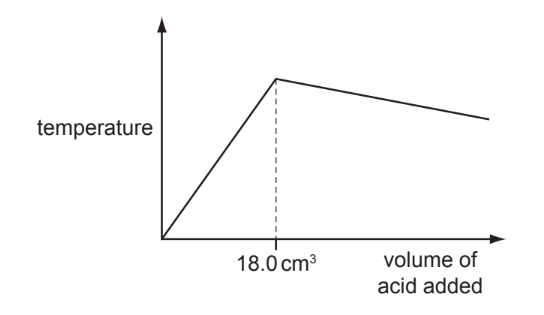

NaOH (aq) + HI (aq) → NaI (aq) + H2O (l)

i) Explain why the temperature increases rapidly at first and then stops increasing.

[2]

ii) Suggest why the temperature drops after the addition of 18.0 cm3 of acid.

[1]

iii) In another experiment, it was shown that 15.0 cm3 of the acid neutralised 20.0 cm3 of aqueous sodium hydroxide, 1.00 mol / dm3. Calculate the concentration of the acid.

[2]

*Source: 2011 Ju31 Q5*

