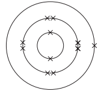
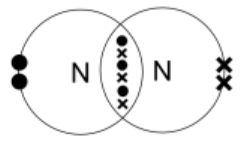

# Mark Schemes — The Periodic Table & Trends
**8. The Periodic Table** · Cambridge (CIE) IGCSE chemistry (0620 & 0971)

## Multiple Choice Questions (22 questions)

### Q1
**Final answer:** **The correct answer is D**

- Chromium is a transition metal
- Transition metals can have more than one oxidation state (e.g. Cr2+, Cr3+).
- **Different oxidation states** give rise to **coloured compounds**, which is a key property of transition metals

**A **is incorrect because lithium reacts with water, but chromium does not react vigorously with water, therefore the statement is false

**B **is incorrect because although both are metals which particles are arranged in a metallic lattice, **the melting point of transition metals is significantly higher than Group I metals**. Therefore, lithium and chromium have very different melting points

**C **is incorrect because  lithium is a **Group I metal** and **only forms 1+ ions**, so it does not have multiple oxidation states and does not form coloured compounds

### Q2
**Final answer:** **The correct answer is B**

- Density of halogens increases down Group VII  because atoms get larger and intermolecular forces get stronger, therefore, the halogens become denser as you go down the group
- At room temperature, fluorine and chlorine are gases, so they will have very low density

  - **W** has the lowest density of the table, 0.0017 g/cm3 , so** W is fluorine**
  - **Y** has the next lowest density of the table, 0.0032 g/cm3 , so** Y is chlorine**
- Bromine is a liquid at room temperature, so it must have a higher density than fluorine and chlorine

  - **X **has a density of 3.1 g/cm3  which matches **bromine**
- Iodine is a solid at room temperature and is the densest halogen listed. **Z **has the highest density (4.93 g/cm3) , so its **iodine**

### Q3
**Final answer:** **The correct answer is**** C**** **

Alloys are **mixtures** of different metals or metals with nonmetals and are not found on the Periodic table.

**A**,** B** and **D** are incorrect as these terms all correspond to groups of elements from the Periodic table. Alkali metals are Group 1 elements. Group 7 elements are known as the halogens.

### Q4
**Final answer:** **The correct answer is**** A**** **

- Elements are arranged on the Periodic table in order of **increasing atomic** **number**, where each element has one proton more than the element preceding it.
- The table is arranged in vertical columns called **Groups** numbered I - VIII and in rows called **Periods**.

**B** and **D** are incorrect as the mass number is not used to order the elements.

**C **is incorrect as the name used for columns is **Group** and for rows is **Period.**

### Q5
**Final answer:** **The correct answer is ****C**** **

- Atoms form ions to achieve a full outer shell of electrons
- An ion with a charge of 2- has gained two electrons to do this
- Elements in Group 6 have six electrons in their outer shell so will gain two electrons to achieve 8

**A **is incorrect as Group 1 elements lose one electron to form ions with a 1+ charge

**B** is incorrect as Group 2 elements lose two electrons to form ions with a 2+ charge

**D** is incorrect as Group 7 elements gain one electron to form ions with a 1- charge

### Q6
**Final answer:** **The correct answer is**** B**** **

- Elements are arranged on the Periodic table by **increasing atomic number **
- Where each element has one proton more than the element preceding it.
- Each element is neutral so as the atomic number increases by one so too does the number of **electrons**.
- Each element has one electron more than the preceding element and this electron is added to the **outer shell**.

**A** is incorrect as the number of electrons shells increases moving **down** the table but stays the same moving across.

**C **is incorrect as metallic character **decreases** as we move across the Periodic table from left to right.

**D **is incorrect as the tendency of the elements to form positive ions **decreases moving** across with an increasing number of outer shell electrons.

### Q7
**Final answer:** **The correct answer is ****B**** **

- Elements in Group 7 are non- metals
- Non metals are poor conductors of electricity due to the lack of charged particles that can move freely
- Non- metals can also form acidic oxides

**A**, **C **and **D **are incorrect as Group 7 elements typically have low melting points due to weak intermolecular forces between molecules and are not malleable

### Q8
**Final answer:** **The correct answer is**** C**** **

- The elements are arranged on the Periodic Table in order of increasing atomic  number.
- Argon has 22 neutrons while potassium has 20 but argon has **18 protons **while  potassium has **19**.
- Argon has therefore the higher relative atomic mass of the two elements but is listed before potassium as it has a **smaller** **atomic** **number**.

**A **is incorrect as argon has **more** neutrons.

**B **is incorrect as potassium has a **higher** atomic number than argon (and therefore less protons).

**D **is** **incorrect as position does not depend on the number of **neutrons**.

### Q9
**Final answer:** **The correct answer is ****D**** **

- W is lithium, Y is magnesium, X is nitrogen and Z is argon
- Lithium is the furthest left of all four, hence, it is the most metallic
- Argon is a noble gas which has a full outer shell of electrons and does not react with other elements, hence it is found in nature as an element and not a compound
- Nitrogen bonds with hydrogen to form ammonia, NH3

  - Both nitrogen and hydrogen are non-metals, hence the electrons are shared and the compound is covalent

**A**, **B** and **C** are incorrect as all of the statements are correct for these elements

### Q10
**Final answer:** **The correct answer is**** B**** **

- The outer shell electrons become easier to lose as the atomic radius increases moving down the group as more electron shells are added.
- The larger distances means there is less attraction between the nucleus and the valence electrons, making them easier to be removed.

**A** is** **incorrect as the electrons are more easily **lost** with increasing atomic radius.

**C** and **D **are incorrect as although these statements are true, it is the increasing atomic radius that affects the attraction between the nucleus and the outer electrons.

### Q11
**Final answer:** **The correct answer is**** D**** **

- They are all in Group VI hence they each have **6 electrons** in their outer shell.
- Elements in the **same** group have **similar** chemical properties due to their having the same number of outer shell electrons.

**A **is incorrect as the physical properties in groups change moving down the group.

**B **is incorrect as tellurium is a semimetal.

**C **is incorrect as all Group VI elements have 6 outer shell electrons.

### Q12
**Final answer:** **The correct answer is ****B**** **

- X is a metal and Y is a non-metal
- Metals have higher melting and boiling points than non-metals due to the strong attraction between positive metal ions and delocalised electrons
- Metals also contain metallic bonds or form ionic bonds when they react with non-metals
- Non-metals form covalent bonds by sharing electrons

**A**, **C** and **D** are incorrect as statements 2 and 4 are correct. Non-metals gain electrons when they react with metals thereby forming negative ions and metals form basic oxides.

### Q13
**Final answer:** **The correct answer is**** D**** **

- The change in metallic to non-metallic character as we move across the Periodic table from left to right is linked to the **electronic configuration** of the elements.
- Non-metals have **more electrons** in their outer shells than metals.
- Potassium is in **Group I **and has **1** electron in its outer shell whereas krypton is in **Group VIII** and has **8** electrons in its outer shell.

**A** and **B** are incorrect as although potassium has fewer electrons and protons than krypton, it is the **outer shell electrons** that determine its chemical properties.

**C **is incorrect as both elements are in the same period they have the same number of electron shells.

### Q14
**Final answer:** **The correct answer is ****A**** **

- The electronic configuration shows the arrangement of electrons in their shells
- The last notation is the number of electrons in the outer shell
- The number of electrons in the outer shell correlates to the group number

  - 2,8,**6 **shows there are six electrons in the outer shell so the element is in Group 6
- The period number refers to the number of shells an atom has
- The number of notations shows the number of shells

  - 2,8,6 has three notations so the element has three shells and is in Period 3

**B**, **C** and **D** are incorrect as the group or period number is wrong

### Q15
**Final answer:** **The correct answer is**** B**** **

- There are **patterns** in the way the elements are arranged on the Periodic table, there are also patterns and trends in the **chemical** **behaviour** of the elements.
- In this way the Periodic table can be used to predict how an unknown element will behave and was used to **identify** them.

**A** is incorrect as elements in the same Period tend to behave **differently**.

**C **is incorrect as elements in different Groups have **different** **properties** as they have different outer shell **electron** **configurations**. Elements in the same group have the same number of electrons in their outer shell and share similar properties.

**D **is incorrect as the elements were positioned according to their **atomic** **number** and **chemical** properties.

### Q16
**Final answer:** **The correct answer is**** C**** **

- Metallic character of elements **decreases** as you move across a period and is linked to the number of outer shell electrons in each element.
- Elements on the right more **readily accept electrons** to fill their valence shells as it is easier for them to gain a small number of electrons than it is to lose a large number of them.
- Elements on the left are more likely to **lose** outer electrons, exposing a full  valence shell ‘below’.

**A**,** B** and **D** are incorrect as although these statements are correct they do not explain the trend in metallic character.

### Q17
**Final answer:** **The correct answer is**** A**** **

- Magnesium lies further to the **left** than silicon, hence it has a greater metallic character than silicon.
- Beryllium is further **left** than carbon, hence it also has greater metallic character than carbon.

**B**,** C** and **D** are incorrect as as lithium and sodium are both more metallic than boron and aluminium as they lie further on the left of the Periodic table.

## Theory Questions (18 questions)

### Q1
> **[mark-scheme]**
> - aluminium oxide **[1 mark]**
> **[mark-scheme]**
> - copper **[1 mark]**

> **[exam-tip]**
> In aqueous copper sulfate, Cu2+ and H+ (from water) are competing to be discharged at the cathode (negative electrode)
> 
> The **less reactive ion in the reactivity series is discharged first** at the cathode.
> 
> Because copper is less reactive than hydrogen, Cu2+ **is reduced to copper metal**, not hydrogen gas.
> **[mark-scheme]**
> - diamond **[1 mark]**

> **[exam-tip]**
> Silicon(IV) oxide may look like a simple molecule from its formula (SiO2), but it is actually a **giant covalent structure** similar to diamond.
> 
> Because of the many strong covalent bonds the arrangement, it has a **very high melting point**.
> **[mark-scheme]**
> - nitrogen monoxide **[1 mark]**
> **[mark-scheme]**
> - copper **[1 mark]**
> **[mark-scheme]**
> - ethene **[1 mark]**
> **[mark-scheme]**
> - copper **OR** sodium **[1 mark]**

> **[exam-tip]**
> Watch out! Both **ionic compounds and metals are arranged in lattices**, but the particles and how they interact are different
> 
> In **ionic lattices**, positive and negative ions attract each other.
> 
> In **metallic bonding**, the lattice is made of **positive metal ions attracted to a sea of delocalised electrons**.
> **[mark-scheme]**
> - carbon dioxide **[1 mark]**
> **[mark-scheme]**
> - sodium **[1 mark]**

> **[exam-tip]**
> Use the **reactivity series** to decide how a metal is extracted.
> 
> If the metal is **above carbon** in the reactivity series (like sodium), it **cannot be reduced by carbon** and must be extracted by **electrolysis**.

### Q2
> **[mark-scheme]**
> - chlorine 
> **OR **
> oxygen **[1 mark]**

> **[exam-tip]**
> Remember **HOFBrINCl (hydrogen, oxygen, fluorine, bromine, iodine, nitrogen, chlorine) **— these elements exist as diatomic molecules
> **[mark-scheme]**
> - diamond 
> **OR **
> graphite **[1 mark]**
> **[mark-scheme]**
> - copper** [1 mark]**

> **[exam-tip]**
> **Not all metals have high melting points. **Group I and Group II metals have low melting points because their metallic bonds are weak.
> **[mark-scheme]**
> - ethanol **[1 mark]**
> **[mark-scheme]**
> - carbon monoxide **[1 mark]**
> **[mark-scheme]**
> - magnesium **[1 mark]**
> **[mark-scheme]**
> - lithium **[1 mark]**
> **[mark-scheme]**
> - ethene **[1 mark]**
> **[mark-scheme]**
> - graphite **[1 mark]**
> **[mark-scheme]**
> - chlorine **[1 mark]**

### Q3
a) Element Z is:

- Phosphorus / P; **[1 mark]**

**[Total: 1 mark]**

- *Period 3 means that the element is in the third period / row of the Periodic Table*

  - *Basically, 3 down*
- *Group V means that it is in the fifth group / column*

  - *Basically, 5 across*
- *This means that the element is phosphorous*

  - *Phosphorous is 3 down and 5 across on the Periodic Table*
b) Neon is unreactive because:

- Neon has a complete / full outer (electron) shell  
**OR **
The outer shell of neon cannot gain or lose electron(s); **[1 mark]**

**[Total: 1 mark]**

- *Chemical reactions are based around electrons*
- *Neon is a Noble gas with a full outer shell of electrons*
- *This means that it has no need to react and gain / lose electrons*
c) Two other chemical properties of transition elements which make them different from Group I elements are:

- They form coloured compounds / ions; **[1 mark]**
- They act as catalysts; **[1 mark]**

**[Total: 2 marks]**

- *You need to know the properties of the transition elements as well as be able to compare them with other elements*

### Q4
a) Two elements that are in the same group are:

- A
**AND**
E; **[1 mark]**

**[Total: 1 mark]**

- *Elements in the same group have the same number of outer shell (valence) electrons*
b)  The element that forms a fluoride with a formula of the type XF3 is:

- D; **[1 mark]**

**[Total: 1 mark]**

- *Fluorine has a valency of 1*
- *This means X must have a valency of 3*
- *To form 3 bonds or donate 3 electrons*
- *The element must therefore have 3 electrons in its outer shell*
c) The element that reacts violently with cold water is:

- C;** [1 mark]**

**[Total: 1 mark]**

- *Group 1 elements react violently with cold water*
- *Hence we are looking for the element with 1 electron in its outer shell*
d) The element that has a macromolecular structure similar to that of diamond is:

- B;** [1 mark]**

**[Total: 1 mark]**

- *Silicon (IV) oxide has a similar macromolecular structure to diamond*
- *Silicon is in group 4*
- *We are therefore looking for the element with 4 outer shell (valence) electrons*
e) The element whose only oxidation state is 0 is:

- F; **[1 mark]**

**[Total: 1 mark]**

- *Oxidation state refers to the number of electrons an atom needs to either lose or gain to obtain a full outer shell*
- *To have an oxidation state of 0 the element must have a full outer shell*
- *You may also see oxidation state referred to as oxidation number*
f) The element which is bromine is:

- E; **[1 mark]**

**[Total: 1 mark]**

- *Bromine is a group 7 halogen*
- *Therefore it has 7 outer shell (valence) electrons*
g) The element which is a good conductor of electricity is:

- C
**OR**
D;** [1 mark]**

**[Total: 1 mark]**

- *Metals are good conductors of electricity*
- *The metals are located on the left-hand side of the periodic table (groups 1-3)*
- *All the other elements apart from C are in groups 4-8*

### Q5
a) The **two** elements which share similar chemical properties are:

- A  
**AND** 
D; **[1 mark]**

**[Total: 1 mark]**

- *Elements with the same number of electrons in their outer shell share similar chemical properties, meaning they react in a similar way *
- *The electronic configuration of an element tells you several things:*

  - *Element A: 2,8,7** *
  
    - *The number of shells (Period Number) is indicated by the number of notations, in this case, 3*
    - *The number of electrons in the outer shell (Group Number) is indicated by the number in the last notation, in this case, 7 *
    - *The total number of electrons is deduced by adding up the number for each notation, 2 + 8 + 7 = 17*
    - *In an element, the number of protons and electrons are equal so the element is chlorine*
- *Element D has 9 electrons and is fluorine *
- *If you had given chlorine and fluorine as an answer you would also score the mark*
b) The element which is a good conductor of electricity is:

- E;** [1 mark]**

**[Total: 1 mark]**

- *Metals are good conductors of electricity due to having delocalised electrons which can move throughout the structure *
- *You therefore need to identify a metal from the electronic structures*
- *Metals are on the left hand side of the Periodic Table, and non-metals on the right*
- *Apart from E, all the elements have a high number of electrons in their outer shell *
- *E has 2 electrons in its outer shell which indicates it is in Group II and therefore a metal *
- *You could also work out that E is magnesium because it has 12 electrons in total (2 + 8 + 2  = 12) *

  - *The number of protons and electrons in an element is equal so there are 12 protons*
  - *The atomic number of magnesium is 12*
- *If you have given magnesium as an answer you would also score the mark *
c) The noble gas is:

- B; **[1 mark]**

**[Total: 1 mark]**

- Noble gases have full outer shells of electrons so are chemically unreactive
- A total of two electrons can occupy the first shell
- A total of eight electrons can occupy the second shell
- A total of eight electrons can occupy the third shell
- Element C has the electronic configuration of 2,8,**8** so has a full outer shell of electrons
- The total number of electrons is 2 + 8 + 8 = 18, so the element is argon
- If you have given argon as an answer you would also score the mark
d) The element with a high melting point is:

- E; **[1 mark]**

**[Total: 1 mark]**

- Metals have high melting / boiling points due to a strong electrostatic attraction between positive metal ions and delocalised electrons
- Non-metals have low melting / boiling points due to to weak intermolecular forces
- *As discussed in part b) element E can be identified as the metal magnesium*
- *If you have given magnesium as an answer you would also score the mark *

### Q6
a)

i) The completed table is:

| Group number | I | II | III | IV | V | VI | VII |
|---|---|---|---|---|---|---|---|
| Symbol | Na | Mg | Al | Si | P | S | Cl |
| Number of valency electrons | **1** | **2** | **3** | **4** | **5** | **6** | **7** |
| Valency | **1** | **2** | **3** | **4** | **3** | **2** | **1** |

- Number of valency electron correct;** [1 mark]**
- Valency correct; **[1 mark]**

ii) The relationship between the group number and the number of valency electrons is:

- The number of valency electrons = the group number; **[1 mark]**

iii) The relationship between the number of valency electrons and the valency is:

- For the elements Na to Al: the valency is the same as the number of valency (outer) electrons; **[1 mark]**
- (because) this is the number of electrons lost (for full energy level); **[1 mark]**
- For the elements P to Cl: the valency is 8 – [number of valency (outer) electrons] **OR** Valency + valency electrons = 8; **[1 mark]**
- (Because) this is number of electrons needed (or to be gained) (for full energy level); **[1 mark]**

**[Total: 7 marks]**

- *Valency electrons is another way of saying outer electrons*
- *Valency is the number of electrons an atom either gains, loses or shares to form a compound*
- *It is useful to help write formula of compounds*
b)

i) Across the period shown, the type of oxide changes from:

- Basic to amphoteric;** [1 mark]**
- (From amphoteric) to acidic; **[1 mark]** Assume change is left to right unless clearly stated

ii) The type of bonding in the chlorides formed by these elements changes across this period from:

- Ionic (metal) chlorides on the left; **[1 mark]**
- Covalent (non-metal) chlorides on the right; **[1 mark]**

**[Total: 4 marks]**

- *Basic oxides are formed when a metal element combines with oxygen*
- *Acidic oxides are formed when a non-metal element combines with oxygen*
- *Amphoteric oxides can behave as both acidic and basic, depending on whether the other reactant is an acid or a base*
- *A common amphoteric oxide is aluminum oxide, Al**2**O**3*
- *Ionic bonding exists between metals (found on the left of the Periodic Table) and chlorine which is a non-metal*
- *Covalent bonding exists between non-metals (found on the right of the Periodic Table) and chlorine*

### Q7
a) The charge of a calcium ion is:

- 2+;** [1 mark]**

**[Total: 1 mark]**

- *Calcium is in Group II of the Periodic Table *
- *It loses two electrons to achieve a full outer shell*
- *When this happens, it has 2 more positive protons than negative electrons so has an overall charge of 2+*
b) Two properties of transition metals are:

Any** two **from:

- Form coloured compounds / ions; **[1 mark]**
- Act / used as catalysts; **[1 mark]**
- Have variable oxidation states / numbers; **[1 mark]**
- Have high densities; **[1 mark]**
- Have high melting / boiling points; **[1 mark]**
- Are hard and strong; **[1 mark]**

**[Total: 2 marks]**

- *Do not write properties that apply to all metals, such as "conducts electricity," "malleable," or "shiny."*

  - *These will not score because they do not distinguish transition metals from other metals*
- *If the question asks for physical properties, focus on:*

  - *High density*
  - *High melting point*
  - *Hardness compared to Group I metals*
- *If it asks for chemical properties, focus on:*

  - *Coloured compounds*
  - *Catalytic activity*
  - *Variable oxidation states*

> **[exam-tip]**
> Metals conduct electricity as solids via delocalised electrons, so never say they conduct only when molten or in solution.
c) Neon is unreactive because:

- It has an electronic configuration of 2,8
**OR**
It has 8 electrons in its outer shell; **[1 mark]**
- It has a full outer shell so does not need to gain, lose or share electrons / does not need to form bonds; **[1 mark]**

**[Total: 2 marks]**

- *All noble gases are unreactive due to their outer electron shell being full*
- *You would score the mark if you had drawn the electronic configuration of neon as well*

> **[exam-tip]**
> You must state the actual electronic configuration (2,8) or the number of outer electrons (8). Explaining that neon has a full outer shell without giving the configuration will lose you a mark.
> 
> Do not generalise that all noble gases have 8 outer electrons. Helium has only 2. Keep your answer specific to neon.
> 
> Saying neon is "stable" or "inert" on its own is not enough for the second mark. You need to explain why: full outer shell, so no need to gain, lose, or share electrons.
d) The formula and state of bromine at room temperature are:

- (Formula) Br2; **[1 mark]**
- (State at room temperature) liquid; **[1 mark]**

**[Total: 2 marks]**

- *You should be able to predict the properties of an element given its location in the Periodic Table*
- *Elements in Group VII are diatomic, so form molecules of two atoms *
- *The boiling points of the halogens increases going down the group which causes their physical state to change *

  - *Fluorine: gas*
  - *Chlorine: gas*
  - *Bromine: liquid*
  - *Iodine: solid*
  - *Astatine: solid*

### Q8
a) The elements in the Periodic Table are arranged in order of:

- Atomic number; **[1 mark]**

**[Total: 1 mark]**

- *Elements are arranged in order of increasing atomic number *
- *The atomic number is the number of protons in an atom *
b) The formula of the ion formed by element **Y **is:

- Y- ;** [1 mark]**

**[Total: 1 mark]**

- *Group VII elements have seven electrons in their outer shell *
- *To achieve a full outer shell they must gain one electron *
- *This will mean the Group VII element has one more negative electron than protons giving it a 1- charge which is indicated using a single -*
- *You will not score the mark for just writing 1- or -, as the question asks for the formula of the ion*
c) Two physical properties of element **Y **are:

**Final answer:** **Any ****two ****from:**

- Brittle; **[1 mark]**
- Poor conductor of heat; **[1 mark]**
- Poor conductor of electricity; **[1 mark]**
- Low melting / boiling points; **[1 mark]**
- Dull;** [1 mark]**

**[Total: 2 marks]**

- *Element **Y** is located in Group VII so is a non-metal*
- *You should be able to give physical and chemical properties for this group *
- *A physical property can be determined without changing the state of the element *
- *A chemical property refers to how the element reacts*
d) The completed sentences are:

Going down the group, the number of electron shells **increases;**** ****[1 mark]** so the outer electron is** further from;**** ****[1 mark]** the nucleus. There are **weaker; **** ****[1 mark]** electrostatic** **forces of attraction between the outer electron and the nucleus making it harder for the element to **gain;** **[1 mark]** an electron.

**[Total: 4 marks]**

- *The reactivity of a Group VII element is determined by its ability to gain an electron to complete its outer shell *
- *The more easily it can gain an electron, the more reactive it is*
- *The higher up the group, the less shells there are meaning there is more attraction between the negative electron being gained and the positive nucleus *

### Q9
a) This reaction show that chlorine is more reactive than bromine because:

- Chlorine has displaced / taken the place of bromine in magnesium bromide; **[1 mark]**

**[Total: 1 mark]**

- *The halogens get more reactive as you move up the group*
- *Since chlorine is above bromine, this means that chlorine will displace bromide from compounds*
b) In an aqueous solution, bromine is:

- Red-brown; **[1 mark]**

**[Total: 1 mark]**

- *Other colours such as orange and brown may be accepted*
- *Red, on its own, is often not accepted*
c) The completed word equation is:

Sodium iodide + chlorine → iodine + sodium chloride

- Sodium iodide; **[1 mark]**
- Chlorine; **[1 mark]**

**[Total: 2 marks]**

- *Chlorine is above iodine in the Periodic Table*
- *This means that it is more reactive than iodine *
- *Therefore, the reactant halogen is chlorine*

  - *.................... + **chlorine **→ iodine + sodium chloride*
- *This means that the halide compound must be sodium iodide as sodium and iodine are the "missing" elements *

  - *Sodium iodide** + **chlorine **→ iodine + sodium chloride*
d) Aqueous bromine will not react with aqueous sodium chloride because:

- Chlorine is more reactive than bromine / bromine is less reactive than chlorine **OR **Chlorine is above bromine in the periodic table / bromine is below chlorine in the periodic table; **[1 mark]**

**[Total: 1 mark]**

- *As seen in the previous answers, the displacement reactions of the halogens depend on their relative reactivity*
- *Since aqueous bromine does not react with aqueous sodium chloride, you can conclude that bromine is less reactive than chlorine *

### Q10
a) The electronic configuration for sodium is:

- Two electrons in the first shell, eight in the second, one in the third (2,8,1);** [1 mark]**

**[Total: 1 mark]**

- *Remember:** A maximum of 2 electrons can occupy the first shell, 8 in the second, and 8 in the third*
- *The electrons do not need to be in pairs to score the mark as long as the number of them is correct*
b) Lithium, sodium, and potassium are all in Group I of the Periodic Table because:

- They contain 1 electron in the outer shell; **[1 mark]**

**[Total: 1 mark]**

- *Each group contains elements with the same number of electrons in their outer shell *
- *This is also why the elements in the same group share similar chemical properties*
- *The electron configuration of:*

  - *lithium is 2,**1*
  - *sodium is 2,8,**1** *
  - *potassium is 2,8,8,**1*
c) Describe the trend in reactivity of Group I metals:

- Going down Group I reactivity increases 
**OR** 
Going up Group I reactivity decreases; **[1 mark]**

**[Total: 1 mark]**

- *Careful:** You will not score the mark for simply stating reactivity increases if you have not also said it increases **down the group*
- *The question doesn't ask what happens to reactivity down the group, it simply says to give the trend so you must include this in your answer *
- *You should already know this trend, however you can easily observe it from the information given in the table *
- *The reactions between Group I elements and water get more vigorous from lithium to potassium, for example, potassium burns with a flame whereas the other two don't*
d) Two products formed when rubidium reacts with water are:

- Rubidium hydroxide / RbOH;** [1 mark]**
- Hydrogen / H2; ** [1 mark]**

**[Total: 2 marks]**

- *Using the information in the last column of the table you can predict the products made when rubidium is added to water*
- *In each case, a metal hydroxide and hydrogen gas are formed *

  - *The word equation would be:*
  
    - *rubidium + water  →   rubidium hydroxide + hydrogen *

### Q11
a) The only non-metal which is a good conductor of electricity is:

- Graphite / carbon;** [1 mark]**

**[Total: 1 mark]**

- *Although carbon is acceptable, diamond is not acceptable as it will not conduct electricity*

  - *In diamond, all the outer shell electrons in carbon are held in the four covalent bonds around each carbon atom*
  - *So, there are no freely moving charged particles to carry the current *
- *Only carbon's graphite allotrope will conduct electricity due to free (delocalised) electrons which exist **in** **between** the layers and are free to move through the structure and carry charge*
b) Inert electrodes are made from:

- Platinum / titanium / mercury / gold;** [1 mark]**

**[Total: 1 mark]**

- *Careful: **Carbon / graphite is used for inert electrodes*

  - *However, they wouldn't be accepted because this question asks for a metal and carbon / graphite is a non-metal*
c) An element which can form an ion of the type X3– is:

- Nitrogen 
**OR **
Phosphorus; **[1 mark]**

**[Total: 1 mark]**

- *Remember: **The group number tells you the number of outer shell electrons and hence the charge on the ion formed*
- *As the charge on element X is -3, element X must be in group 3*
d) The element that has the same electron distribution as the calcium ion, Ca2+ is:

- Argon;** [1 mark]**

**[Total: 1 mark]**

- *Calcium has 20 electrons*
- *The calcium ion has a 2+ charge so it must have lost 2 electrons*

  - *Total electrons = 18*
- *This means you are looking for an element in the periodic table with 18 electrons*
- *As the elements in the periodic table are neutral, the number of protons = number of electrons*

  - *So, you are looking for the element with atomic number = 18*
e) The element that is in Period 5 and Group VI is:

- Tellurium / Te;** [1 mark]**

**[Total: 1 mark]**

- *Remember:** Groups are the columns in the periodic table and periods are the rows*
- *Don't forget that hydrogen and helium are in period 1*

### Q12
a) The formulae of the following compounds is:

i) Nitrogen fluoride:

- NF3; **[1 mark]**

ii) Phosphorus sulphide:

- P2S3; **[1 mark]**

**[Total: 2 marks]**

- *Nitrogen fluoride:*

  - *Write the valency of each element *
  
    - *Nitrogen is in group 5 so has a valency of 3*
    - *Fluorine is in group 7 so has a valency of 1*
  - *Write the symbols in the same order as in the name*
  
    - *NF*
  - *Add numbers after the symbols to balance the valencies*
  
    - *NF**3*
- *Phosphorus fluoride:*

  - *Write the valency of each element*
  
    - *Phosphorus is in group 5 so has a valency of 3*
    - *Sulphur is in group 6 so has a valency of 2*
  - *Write the symbols in the same order as in the name*
  
    - *PS*
  - *Add numbers after the symbols to balance the valencies*
  
    - *P**2**S**3*
b) The formula of the following ions is:

i) Selenide:

- Se2-; **[1 mark]**

ii) Gallium

- Ga3+; **[1 mark]**

**[Total: 2 marks]**

- *Selenium is in group 6 so has 6 electrons in its outer shell*

  - *This means it needs to gain two electrons to obtain a full outer shell*
  - *Hence it will form a 2- ion*
- *Gallium is in group 3 so has 3 electrons in its outer shell*

  - *This means it needs to lose 3 electrons to obtain a full outer shell*
  - *Hence it will form a 3+ ion*
c)  The formulae of the following compounds would be:

i) Chromium (III) sulphate:

- Cr2(SO4)3; **[1 mark]**

ii) Barium hydroxide:

- Ba(OH)2; **[1 mark]**

**[Total: 2 marks]**

- *Chromium (III) sulphate*

  - *2 chromium ions are needed for every 3 sulphate ions to balance the charge*
  - *(2 x Cr**3+**) + (3 x SO**4**2-**) = 0*
  - *(2 x +3) + (3 x -2) = 0*
- *Barium hydroxide*

  - *2 hydroxide ions are needed for every barium ion to balance the charge*
  - *(1 x Ba**2+**) + (2 x OH**-**) = 0*
  - *(1 x +2) + (2 x -1) = 0*

### Q13
a) Element **M** is likely to be in group:

- Three / 3 / III; **[1 mark]**

**[Total: 1 mark]**

- *Remember:** The number of electrons in the outer shell is the same as the group number*
b) Element **M** is a:

- Good conductor 
**AND **
(Because) it is a metal 
**OR **
it has delocalised / free electrons;** [1 mark]**

**[Total: 1 mark]**

- *We have already identified that the element is in group 3 from the previous question *
- *Elements on the left-hand side of the periodic table are generally metals*

  - *This includes groups 1, 2 and 3*
c) An element which could form a binary compound with element **M** would be:

- N 
**OR **
P 
**OR **
As 
**OR **
Sb 
**OR **
Bi;** [1 mark]**

**[Total: 1 mark]**

- *We are told that a binary compound is one which contains two atoms per molecule*
- *We also know that element **M** is in group 3 so will form an M**3+** ion*

  - *This means we are looking for an element which forms a 3- ion*
- *Elements in group 5 gain 3 electrons to form 3- ions in order to achieve a full outer shell*

  - *Hence, we are looking for any element in group 5*
d) The formula of the sulfate of **M **would be:

- **M**2(SO4)3 
**OR **
Ga2(SO4)3; **[1 mark]**

**[Total: 1 mark]**

- *First, we need to identify the ion charges*

  - *Element **M **has a 3+ charge*
  - *The sulfate ion, SO**4**2-**, has a 2- charge*
- *Next, we need to balance the number of ions*

  - *2 **M** ions are needed for every 3 sulfate ions*
- *This means the ratio of the ions is*

  - *2 : 3*
- *You could have identified element **M** as being gallium from its electron configuration given at the start of the question*

  - *This is why the formula for galium sulfate is also an acceptable answer*
e) You could show that the hydroxide of **M **is amphoteric as:

- It would<u> react with / dissolves in</u> a named strong acid 
**AND **
It would <u>react with / dissolves in</u> a named alkali;** [1 mark]**

- It shows both basic and acid properties;** [1 mark]**

**[Total: 2 marks]**

- *An amphoteric substance reacts with acids and with bases to produce a salt and water*
- *If the hydroxide of **M** is amphoteric it will react with both acids and bases/alkalis*
- *You can use these two reactions to confirm whether the hydroxide is amphoteric*
- *Any strong acid is acceptable *

  - *e.g. hydrochloric, nitric, sulfuric*
- *Any alkali is acceptable*

  - *e.g. any metal hydroxide*
- *Make sure you are specific with your terminology - you must either use 'react with' or ' dissolves in' to get the marks*

### Q14
a) The unreactive element is:

- Ne / Neon; **[1 mark]**

**[Total: 1 mark]**

- *Noble gases are unreactive due to their full outer shell of electrons and are located in Group VIII of the Periodic Table*
b) The element in Group VII of the Periodic Table is:

- F / fluorine; **[1 mark]**

**[Total: 1 mark]**

- *Use your Periodic Table to find Group VII, the halogens, and identify which element in the list above is found there*

> **[exam-tip]**
> Only choose from the elements actually listed in the question, even if other valid answers exist
c) The element which forms an ion with a 1+ charge is:

- Li / lithium; **[1 mark]**

**[Total: 1 mark]**

- *Answers are restricted to the listed symbols (Ne, Li, O, F, Al, Ca); do not accept elements outside this list, e.g. silver*
- *Lithium is in Group I of the Periodic Table *
- *Lithium (and all atoms) has no charge because the number of protons and electrons is equal so the positive and negative charges cancel each other out *

  - *Lithium has 3 protons and 3 electrons*
  - *To gain a full outer shell it loses its one outer electron*
  - *It now has 3 protons but only 2 electrons*
  - *There is one more positive than negative charge so overall a lithium ion has a 1+ charge*

> **[exam-tip]**
> A 1+ ion forms when an atom loses one electron, so look for a Group I element among the options.
d) The element in Period 3 of the Periodic Table is:

- Al / aluminium; **[1 mark]**

**[Total: 1 mark]**

- *Periods are the rows going across the Periodic Table and indicate the number of shells an atom has*
- *Careful: **Period 1 begins with the row containing** **hydrogen and helium not that beginning with lithium *

### Q15
a) The element with only 2 electrons in its outer shell is:

- Be / beryllium; **[1 mark]**

**[Total: 1 mark]**

- The element with 2 outer electrons will be in group 2
- Since the elements are listed in order from left to right, this will also be the second element in the list
b) The element that is a monoatomic gas is:

- Ne / neon; **[1 mark]**

**[Total: 1 mark]**

- *The Noble gases are monoatomic gases*
- *The only Noble gas in the list is neon*
c) The element that is stored in oil is:

- Li / lithium; **[1 mark]**

**[Total: 1 mark]**

- *The group 1 metals are stored in oil because they tarnish quickly with oxygen in the air*
- *They can also react with moisture in the air*
- *The oil acts as a barrier protecting the metal*
- *The only group 1 metal in the list is lithium*
d) The element that has only 7 protons is:

- N / nitrogen; **[1 mark]**

**[Total: 1 mark]**

- *The number of protons in an element is also the atomic number*
- *The element with an atomic number of 7 is nitrogen*

### Q16
a) Why these three elements are all stored in paraffin oil:

- To keep out of contact / prevent reaction with air / oxygen / water / moisture; **[1 mark]**

**[Total: 1 mark]**

- *Group I elements are highly reactive*
- *You can say that the elements react with air, oxygen or water to get the mark*
b)

i)   A similarity and a difference between the reactions of potassium with water and caesium with water:

- *Similarity: *both fizz / move on surface / produce flames; **[1 mark]**
- *Difference:* caesium is faster / more violent / vigorous reaction;** [1 mark]**

ii)  The chemical equation for the reaction between caesium and water:

2Cs + 2H2O  → 2CsOH + H2

- All symbols/formulae correct; **[1 mark]**
- **Correctly balanced; [1 mark]**

**[Total: 4 marks]**

- *You can express your answer to part ii) in other ways; as they both:*

  - *melt, produce a gas, produce hydrogen and form an alkaline solution*
- *You can use reverse arguments and contrast how potassium is less reactive than caesium*

  - *Fractions would also be acceptable in the equation, e.g. Cs + H**2**O  → CsOH + ½H**2*
c) The completed table:

| **Halogen** | **Physical state at room temperature** | **Colour** |
|---|---|---|
| fluorine | gas | yellow |
| chlorine | gas | pale green |
| bromine | liquid | red-brown |
| iodine | solid | grey |
| astatine | **solid**; **[1 mark]** | **dark grey / black**;** [1 mark]** |

**[Total: 2 marks]**

- *You are expected to know the appearance of the halogens and be able to use the trends to predict the properties of other halogens*
- *The melting and boiling points of the halogens increase as you go down the group which causes the difference in their physical state at room temperature*
- *The halogens get progressively darker as you go down the group*
d)

i) These results show the order of reactivity of bromine, chlorine and iodine by:

- The order of reactivity is chlorine (most), bromine and iodine (least); **[1 mark]**
- Chlorine (is most reactive because it) displaces bromine and iodine / oxidises bromide and iodide (ions) / reacts with  sodium bromide and sodium iodide;** [1 mark]**
- Bromine (is less reactive than chlorine since it) only displaces iodine / only oxidises iodide (ions) / only reacts with sodium iodide;** [1 mark]**

ii) The student does not need to add bromine solution to sodium bromide solution because:

- Bromine cannot displace itself / bromine does not react with sodium bromide / there would be no reaction;** [1 mark]**

iii) The reaction between bromine and sodium iodide is a redox reaction because:

- Bromine is reduced 
**AND **
Iodide (ions) / I- are oxidised;** [1 mark]**
- Bromine gains electrons 
**AND **
Iodide (ions) / I- loses electrons; **[1 mark]**

**OR**

- Bromine gains electrons so it is reduced; **[1 mark]**
- Iodide (ions) / I- loses electrons so are oxidised;** [1 mark]**

**[Total: 6 marks]**

- When explaining how the results show the order of reactivity, be careful with the use of the endings -ine and -ide as you will be deducted a mark for each incorrect use
- Redox reactions can be explained in terms of the loss and gain of oxygen or electrons
- In this case, oxygen is not present, so the explanation must be in terms of electrons

  - **Remember**: **OIL RIG** - <u>**O**</u>xidation <u>**I**</u>s <u>**L**</u>oss, <u>**R**</u>eduction <u>**I**</u>s <u>**G**</u>ain of electrons

### Q17
a) Neon exists as single atoms whilst fluorine exists as molecules because:

- Neon has full outer shell / energy level / valency shell / octet / 8 (electrons) in outer shell

**   OR**

Neon does not need to lose or gain electrons; **[1 mark]**

- Fluorine atoms have 7 electrons / needs 1 electron to fill (its outer shell) / has an incomplete (outer) shell

**   OR**

Fluorine forms bonds with other fluorine atoms/ fluorine (atoms) form covalent bonds/ shares electrons;** [1 mark]**

**[Total: 2 marks]**

- *Atoms form bonds to other atoms to gain a full outer shell of electrons*
- *Noble gases have a complete outer shell so don't need to form bonds with other atoms*

  - *Hence they exist as single atoms*
- *Halogens always exist as diatomic molecules*
b) The order of elements in a period is determined by:

- Atomic number / proton number / number of protons (in one atom); **[1 mark]**

**[Total: 1 mark]**
c) The boiling point of nitrogen is very low even though the bond between the atoms in a nitrogen molecule is very strong because:

- (There are) weak intermolecular (or between molecules) forces

**   OR**

(There are) Van der Waals forces between molecules

**   OR**

A low amount of energy is required to break bonds between molecules; **[1 mark]**

- Strong bonds (within the molecule) don’t break

**   OR**

Covalent bonds (within the molecule) don’t break

**   OR**

Covalent bonds between atoms don’t break; **[1 mark]**

**[Total: 2 marks]**

- *Whenever you see the term boiling/melting point you should be thinking about the forces** between **molecules (intermolecular forces)*
- *When a substance boils/melts it is these intermolecular forces which are overcome **NOT** the bonds between atoms within the molecule*
- *This is why a substance can have very strong bonds between atoms in a molecule but still have a  low melting/boiling point*
d) A diagram showing the arrangement of the outer shell (valency) electrons in a molecule of nitrogen:

- 1 non-bonding pair on each nitrogen atom; **[1 mark]**
- 6 electrons between nitrogen atoms; **[1 mark]**

**[Total: 2 marks]**

- *Each nitrogen has 5 outer shell electrons*
- *The nitrogen atoms will each share 3 electrons (forming a triple bond) to allow them to complete obtain a full outer shell*
