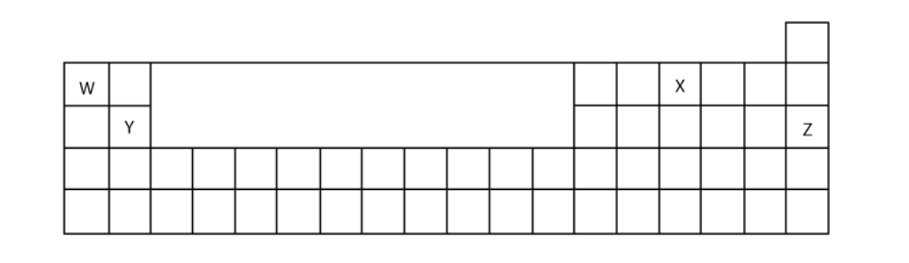

# Exam Questions — The Periodic Table & Trends
**8. The Periodic Table** · Cambridge (CIE) IGCSE chemistry (0620 & 0971)
> Source: [https://www.savemyexams.com/igcse/chemistry/cie/23/topic-questions/](https://www.savemyexams.com/igcse/chemistry/cie/23/topic-questions/) · 17 questions across 1 sets

## Multiple Choice Questions (22 questions)

### Q1 — easy — 1 marks

**Q1** [1 mark]

Lithium and chromium are metals.

Which statement about the properties of these elements is correct?

### Q2 — easy — 1 marks

**Q2** [1 mark]

The table shows the densities at room temperature of halogens W, X, Y and Z

| halogens | density at room temperature / g/cm3 |
|---|---|
| W | 0.0017 |
| X | 3.1 |
| Y | 0.0032 |
| Z | 4.93 |

Which row correctly identifies W, X, Y and Z?

|   | W | X | Y | Z |
|---|---|---|---|---|
| **A** | fluorine | chlorine | bromine | iodine |
| **B** | fluorine | bromine | chlorine | iodine |
| **C** | iodine | chlorine | bromine | fluorine |
| **D** | iodine | bromine | chlorine | fluorine |

### Q3 — easy — 1 marks

**Q3** [1 mark]

Which one of the following names does not correspond to a group of elements on the Periodic table?

### Q4 — easy — 1 marks

**Q4** [1 mark]

Which row describes how the elements are positioned on the Periodic table and the names used?

|   | **elements placed by** | **group** | **period** |
|---|---|---|---|
| **A** | atomic number | vertical column | horizontal row |
| **B** | mass number | vertical column | horizontal row |
| **C** | atomic number | horizontal row | vertical column |
| **D** | mass number | horizontal row | vertical column |

### Q5 — easy — 1 marks

**Q5** [1 mark]

Element **Z** forms an ion with a 2- charge.

Which group of the Periodic Table is element **Z** found in?

### Q6 — easy — 1 marks

**Q6** [1 mark]

Which property of elements increases as you move across the Periodic table?

### Q7 — easy — 1 marks

**Q7** [1 mark]

#### Separate: Chemistry Only

Element **X **is found in Group 7 of the Periodic Table.

Which properties are typical of element **X**?

| **1** | Poor conductor of electricity |
|---|---|
| **2** | Malleable |
| **3** | High melting points |
| **4** | Form acidic oxides |

### Q8 — hard — 1 marks

**Q8** [1 mark]

Potassium has a lower relative atomic mass than argon but on the Periodic table potassium appears after argon.

Why is potassium placed after argon?

### Q9 — hard — 1 marks

**Q9** [1 mark]

Elements W, X, Y and Z are shown.

Which of the following statements are correct?

| **1** | Z is found in nature in the elemental state |
|---|---|
| **2** | W is more metallic than X |
| **3** | W is more metallic than Y |
| **4** | X forms a covalent compound with hydrogen |

### Q10 — hard — 1 marks

**Q10** [1 mark]

As you move down a group on the Periodic table the elements become more metallic in character.

Which statement explains this observation?

### Q11 — hard — 1 marks

**Q11** [1 mark]

Oxygen, sulfur, selenium and tellurium are Group VI elements. What do all these elements have in common?

### Q12 — hard — 1 marks

**Q12** [1 mark]

X and Y are two elements from the same period in The Periodic Table

The table gives some properties of X and Y

|   | **X** | **Y** |
|---|---|---|
| **appearance** | shiny grey | dull yellow |
| **malleability** | malleable | brittle |
| **electrical conductivity when solid** | good | poor |

Which statements are correct about X and Y?

**1**    Y has a higher melting point than X

**2**   Y forms negative ions when it reacts

**3**   X forms covalent compounds

**4**   X forms a basic oxide

### Q13 — medium — 1 marks

**Q13** [1 mark]

Potassium and krypton are elements in Period 4. Potassium is at the beginning of the period and is more metallic than krypton which is at the end of the period.

What makes potassium more metallic than krypton?

### Q14 — medium — 1 marks

**Q14** [1 mark]

An element has an electronic configuration of 2,8,6.

Which group and period can the element be found in?

|   | **group** | **period** |
|---|---|---|
| **A** | 6 | 3 |
| **B** | 6 | 8 |
| **C** | 3 | 6 |
| **D** | 8 | 2 |

### Q15 — medium — 1 marks

**Q15** [1 mark]

The early Periodic table was used to classify the known elements and was used to predict the properties of the elements that had not yet been discovered.

Which row correctly describes how this was possible?

### Q16 — medium — 1 marks

**Q16** [1 mark]

The metallic character of the elements changes as you move across a period.

Which statement explains this trend?

### Q17 — medium — 1 marks

**Q17** [1 mark]

The elements of the Periodic table can be broadly classified into two main characters which are metals and nonmetals. Which statements are correct?

| **1** | Magnesium is more metallic than silicon. |
|---|---|
| **2** | Boron is more metallic than lithium. |
| **3** | Carbon is less metallic than beryllium. |
| **4** | Sodium is less metallic than aluminium. |
