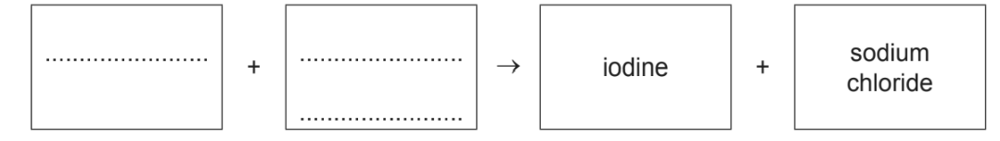
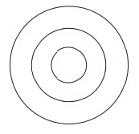

# Exam Questions — The Periodic Table & Trends
**8. The Periodic Table** · Cambridge (CIE) IGCSE chemistry (0620 & 0971)
> Source: [https://www.savemyexams.com/igcse/chemistry/cie/23/topic-questions/](https://www.savemyexams.com/igcse/chemistry/cie/23/topic-questions/) · 34 questions across 2 sets

## Multiple Choice Questions (22 questions)

### Q1 — easy — 1 marks

**Q1** [1 mark]

Lithium and chromium are metals.

Which statement about the properties of these elements is correct?

### Q2 — easy — 1 marks

**Q2** [1 mark]

The table shows the densities at room temperature of halogens W, X, Y and Z

| halogens | density at room temperature / g/cm3 |
|---|---|
| W | 0.0017 |
| X | 3.1 |
| Y | 0.0032 |
| Z | 4.93 |

Which row correctly identifies W, X, Y and Z?

|   | W | X | Y | Z |
|---|---|---|---|---|
| **A** | fluorine | chlorine | bromine | iodine |
| **B** | fluorine | bromine | chlorine | iodine |
| **C** | iodine | chlorine | bromine | fluorine |
| **D** | iodine | bromine | chlorine | fluorine |

### Q3 — easy — 1 marks

**Q3** [1 mark]

Which one of the following names does not correspond to a group of elements on the Periodic table?

### Q4 — easy — 1 marks

**Q4** [1 mark]

Which row describes how the elements are positioned on the Periodic table and the names used?

|   | **elements placed by** | **group** | **period** |
|---|---|---|---|
| **A** | atomic number | vertical column | horizontal row |
| **B** | mass number | vertical column | horizontal row |
| **C** | atomic number | horizontal row | vertical column |
| **D** | mass number | horizontal row | vertical column |

### Q5 — easy — 1 marks

**Q5** [1 mark]

Element **Z** forms an ion with a 2- charge.

Which group of the Periodic Table is element **Z** found in?

### Q6 — easy — 1 marks

**Q6** [1 mark]

Which property of elements increases as you move across the Periodic table?

### Q7 — easy — 1 marks

**Q7** [1 mark]

#### Separate: Chemistry Only

Element **X **is found in Group 7 of the Periodic Table.

Which properties are typical of element **X**?

| **1** | Poor conductor of electricity |
|---|---|
| **2** | Malleable |
| **3** | High melting points |
| **4** | Form acidic oxides |

### Q8 — hard — 1 marks

**Q8** [1 mark]

Potassium has a lower relative atomic mass than argon but on the Periodic table potassium appears after argon.

Why is potassium placed after argon?

### Q9 — hard — 1 marks

**Q9** [1 mark]

Elements W, X, Y and Z are shown.

Which of the following statements are correct?

| **1** | Z is found in nature in the elemental state |
|---|---|
| **2** | W is more metallic than X |
| **3** | W is more metallic than Y |
| **4** | X forms a covalent compound with hydrogen |

### Q10 — hard — 1 marks

**Q10** [1 mark]

As you move down a group on the Periodic table the elements become more metallic in character.

Which statement explains this observation?

### Q11 — hard — 1 marks

**Q11** [1 mark]

Oxygen, sulfur, selenium and tellurium are Group VI elements. What do all these elements have in common?

### Q12 — hard — 1 marks

**Q12** [1 mark]

X and Y are two elements from the same period in The Periodic Table

The table gives some properties of X and Y

|   | **X** | **Y** |
|---|---|---|
| **appearance** | shiny grey | dull yellow |
| **malleability** | malleable | brittle |
| **electrical conductivity when solid** | good | poor |

Which statements are correct about X and Y?

**1**    Y has a higher melting point than X

**2**   Y forms negative ions when it reacts

**3**   X forms covalent compounds

**4**   X forms a basic oxide

### Q13 — medium — 1 marks

**Q13** [1 mark]

Potassium and krypton are elements in Period 4. Potassium is at the beginning of the period and is more metallic than krypton which is at the end of the period.

What makes potassium more metallic than krypton?

### Q14 — medium — 1 marks

**Q14** [1 mark]

An element has an electronic configuration of 2,8,6.

Which group and period can the element be found in?

|   | **group** | **period** |
|---|---|---|
| **A** | 6 | 3 |
| **B** | 6 | 8 |
| **C** | 3 | 6 |
| **D** | 8 | 2 |

### Q15 — medium — 1 marks

**Q15** [1 mark]

The early Periodic table was used to classify the known elements and was used to predict the properties of the elements that had not yet been discovered.

Which row correctly describes how this was possible?

### Q16 — medium — 1 marks

**Q16** [1 mark]

The metallic character of the elements changes as you move across a period.

Which statement explains this trend?

### Q17 — medium — 1 marks

**Q17** [1 mark]

The elements of the Periodic table can be broadly classified into two main characters which are metals and nonmetals. Which statements are correct?

| **1** | Magnesium is more metallic than silicon. |
|---|---|
| **2** | Boron is more metallic than lithium. |
| **3** | Carbon is less metallic than beryllium. |
| **4** | Sodium is less metallic than aluminium. |

## Theory Questions (18 questions)

### Q1 — medium — 9 marks

**Q1** [1 mark]

A list of substances is shown.

**aluminium oxide**

**diamond**

**carbon dioxide**

**copper**

**chlorine**

**hydrogen**

**ethanol**

**ethene**

**nitrogen monoxide**

**oxygen**

**sodium**

**sulfur dioxide**

Answer the following questions about these substances. Each substance may be used once, more than once or not at all.

State which substance:

is an amphoteric oxide

**Q1** [1 mark]

**Extract:**

A list of substances is shown. aluminium oxide, diamond, carbon dioxide, copper, chlorine, hydrogen, ethanol, ethene, nitrogen monoxide, oxygen, sodium, sulfur dioxide. Answer the following questions about these substances. Each substance may be used once, more than once or not at all.

From the list in part a), state which substance is discharged at the cathode in the electrolysis of aqueous copper sulfate

**Q1** [1 mark]

**Extract:**

A list of substances is shown. aluminium oxide, diamond, carbon dioxide, copper, chlorine, hydrogen, ethanol, ethene, nitrogen monoxide, oxygen, sodium, sulfur dioxide. Answer the following questions about these substances. Each substance may be used once, more than once or not at all.

From the list in part a), state which substance has a melting point similar to silicon(IV) oxide

**Q1** [1 mark]

**Extract:**

A list of substances is shown. aluminium oxide, diamond, carbon dioxide, copper, chlorine, hydrogen, ethanol, ethene, nitrogen monoxide, oxygen, sodium, sulfur dioxide. Answer the following questions about these substances. Each substance may be used once, more than once or not at all.

From the list in part a), state which substance is a harmful gas reduced in the catalytic converter from a car

**Q1** [1 mark]

**Extract:**

A list of substances is shown. aluminium oxide, diamond, carbon dioxide, copper, chlorine, hydrogen, ethanol, ethene, nitrogen monoxide, oxygen, sodium, sulfur dioxide. Answer the following questions about these substances. Each substance may be used once, more than once or not at all.

From the list in part a), state which substance has more than one oxidation number

**Q1** [1 mark]

**Extract:**

A list of substances is shown. aluminium oxide, diamond, carbon dioxide, copper, chlorine, hydrogen, ethanol, ethene, nitrogen monoxide, oxygen, sodium, sulfur dioxide. Answer the following questions about these substances. Each substance may be used once, more than once or not at all.

From the list in part a), state which substance reacts with hydrogen in presence of a nickel catalyst

**Q1** [1 mark]

**Extract:**

A list of substances is shown. aluminium oxide, diamond, carbon dioxide, copper, chlorine, hydrogen, ethanol, ethene, nitrogen monoxide, oxygen, sodium, sulfur dioxide. Answer the following questions about these substances. Each substance may be used once, more than once or not at all.

From the list in part a), state which substance has ions arranged in a lattice which are attracted to a sea of delocalised electrons

**Q1** [1 mark]

**Extract:**

A list of substances is shown. aluminium oxide, diamond, carbon dioxide, copper, chlorine, hydrogen, ethanol, ethene, nitrogen monoxide, oxygen, sodium, sulfur dioxide. Answer the following questions about these substances. Each substance may be used once, more than once or not at all.

From the list in part a), state which substance turns limewater milky

**Q1** [1 mark]

**Extract:**

A list of substances is shown. aluminium oxide, diamond, carbon dioxide, copper, chlorine, hydrogen, ethanol, ethene, nitrogen monoxide, oxygen, sodium, sulfur dioxide. Answer the following questions about these substances. Each substance may be used once, more than once or not at all.

From the list in part a), state which substance needs to be extracted by electrolysis from its ore

### Q2 — easy — 10 marks

**Q2** [1 mark]

A list of substances is shown.

**diamond**

**carbon dioxide**

**carbon monoxide**

**copper**

**chlorine**

**ethane**

**ethanol**

**ethene**

**graphite**

**lithium**

**magnesium**

**oxygen**

**sulfur dioxide**

Answer the following questions about these substances. Each substance may be used once, more than once or not at all.

State which substance is:

a diatomic element

**Q2** [1 mark]

**Extract:**

A list of substances is shown. diamond, carbon dioxide, carbon monoxide, copper, chlorine, ethane, ethanol, ethene, graphite, lithium, magnesium, oxygen, sulfur dioxide. Answer the following questions about these substances. Each substance may be used once, more than once or not at all. State which substance is:

a carbon allotrope

**Q2** [1 mark]

**Extract:**

A list of substances is shown.

diamond
carbon dioxide
carbon monoxide
copper
chlorine
ethane
ethanol
ethene
graphite
lithium
magnesium
oxygen
sulfur dioxide

Answer the following questions about these substances. Each substance may be used once, more than once or not at all.

the metal with the **highest melting point **from the list

**Q2** [1 mark]

**Extract:**

A list of substances is shown. diamond, carbon dioxide, carbon monoxide, copper, chlorine, ethane, ethanol, ethene, graphite, lithium, magnesium, oxygen, sulfur dioxide. Answer the following questions about these substances. Each substance may be used once, more than once or not at all. State which substance is:

the alcohol produced by fermentation

**Q2** [1 mark]

**Extract:**

A list of substances is shown. diamond, carbon dioxide, carbon monoxide, copper, chlorine, ethane, ethanol, ethene, graphite, lithium, magnesium, oxygen, sulfur dioxide. Answer the following questions about these substances. Each substance may be used once, more than once or not at all. State which substance is:

a toxic gas produced by incomplete combustion

**Q2** [1 mark]

**Extract:**

A list of substances is shown.

diamond, carbon dioxide, carbon monoxide, copper, chlorine, ethane, ethanol, ethene, graphite, lithium, magnesium, oxygen, sulfur dioxide

Answer the following questions about these substances. Each substance may be used once, more than once or not at all. State which substance is:

an element that has an electron configuration of 2,8,2

**Q2** [1 mark]

**Extract:**

A list of substances is shown. diamond, carbon dioxide, carbon monoxide, copper, chlorine, ethane, ethanol, ethene, graphite, lithium, magnesium, oxygen, sulfur dioxide. Answer the following questions about these substances. Each substance may be used once, more than once or not at all. State which substance is:

an element that forms an ion with a 1+ charge

**Q2** [1 mark]

**Extract:**

A list of substances is shown. diamond, carbon dioxide, carbon monoxide, copper, chlorine, ethane, ethanol, ethene, graphite, lithium, magnesium, oxygen, sulfur dioxide. Answer the following questions about these substances. Each substance may be used once, more than once or not at all. State which substance is:

a compound used as a monomer

**Q2** [1 mark]

**Extract:**

A list of substances is shown.

diamond, carbon dioxide, carbon monoxide, copper, chlorine, ethane, ethanol, ethene, graphite, lithium, magnesium, oxygen, sulfur dioxide

Answer the following questions about these substances. Each substance may be used once, more than once or not at all.

State which substance is:

a giant covalent structure that **conducts electricity**

**Q2** [1 mark]

**Extract:**

A list of substances is shown. diamond, carbon dioxide, carbon monoxide, copper, chlorine, ethane, ethanol, ethene, graphite, lithium, magnesium, oxygen, sulfur dioxide. Answer the following questions about these substances. Each substance may be used once, more than once or not at all. State which substance is:

a pale yellow-green gas used in water treatment

### Q3 — medium — 4 marks

**Q3** [1 mark]

Element Z is in Period 3 and Group V. Identify element Z.

*Source: 2020 Ju41 Q*

**Q3** [1 mark]

Helium, neon and argon are noble gases.

Explain, in terms of the electronic structure, why neon is unreactive.

*Source: 2020 Ju41 Q*

**Q3** [2 marks]

Copper is a transition element. It can have variable oxidation states.

State two other chemical properties of transition elements which make them different from Group I elements.

*Source: 2020 Ju41 Q*

### Q4 — hard — 7 marks

**Q4** [1 mark]

**Extract:**

The table below gives the electron distributions of atoms of different elements.

element electron distribution

| **element** | **electron distribution** |
|---|---|
| A | 2 + 7 |
| B | 2 + 8 + 4 |
| C | 2 + 8 + 8 + 1 |
| D | 2 + 8 + 18 + 3 |
| E | 2 + 8 + 18 + 7 |
| F | 2 + 8 + 18 + 18 + 8 |

For each of the following, select an element or elements from the table that matches the description. Each element may be selected once, more than once or not at all.

The table below gives the electron distributions of atoms of different elements.

element electron distribution

| **element** | **electron distribution** |
|---|---|
| A | 2 + 7 |
| B | 2 + 8 + 4 |
| C | 2 + 8 + 8 + 1 |
| D | 2 + 8 + 18 + 3 |
| E | 2 + 8 + 18 + 7 |
| F | 2 + 8 + 18 + 18 + 8 |

For each of the following, select an element or elements from the table that matches the description. Each element may be selected once, more than once or not at all.

These **two** elements are in the same group.

*Source: 2014 Ju32 Q1*

**Q4** [1 mark]

**Extract:**

The table below gives the electron distributions of atoms of different elements.

| element | electron distribution |
| A | 2 + 7 |
| B | 2 + 8 + 4 |
| C | 2 + 8 + 8 + 1 |
| D | 2 + 8 + 18 + 3 |
| E | 2 + 8 + 18 + 7 |
| F | 2 + 8 + 18 + 18 + 8 |

This element forms a fluoride with a formula of the type XF3.

*Source: 2014 Ju32 Q1*

**Q4** [1 mark]

**Extract:**

The table below gives the electron distributions of atoms of different elements.

| element | electron distribution |
| A | 2 + 7 |
| B | 2 + 8 + 4 |
| C | 2 + 8 + 8 + 1 |
| D | 2 + 8 + 18 + 3 |
| E | 2 + 8 + 18 + 7 |
| F | 2 + 8 + 18 + 18 + 8 |

For each of the following, select an element or elements from the table that matches the description. Each element may be selected once, more than once or not at all.

This element reacts violently with cold water.

*Source: 2014 Ju32 Q1*

**Q4** [1 mark]

**Extract:**

The table below gives the electron distributions of atoms of different elements.

| element | electron distribution |
| A | 2 + 7 |
| B | 2 + 8 + 4 |
| C | 2 + 8 + 8 + 1 |
| D | 2 + 8 + 18 + 3 |
| E | 2 + 8 + 18 + 7 |
| F | 2 + 8 + 18 + 18 + 8 |

For each of the following, select an element or elements from the table that matches the description.

#### Separate: Chemistry and Extended Only

This element has a macromolecular structure similar to that of diamond.

*Source: 2014 Ju32 Q1*

**Q4** [1 mark]

**Extract:**

The table below gives the electron distributions of atoms of different elements.

| **element** | **electron distribution** |
| :---: | :---: |
| A | 2 + 7 |
| B | 2 + 8 + 4 |
| C | 2 + 8 + 8 + 1 |
| D | 2 + 8 + 18 + 3 |
| E | 2 + 8 + 18 + 7 |
| F | 2 + 8 + 18 + 18 + 8 |

For each of the following, select an element or elements from the table that matches the description. Each element may be selected once, more than once or not at all.

The only oxidation state of this element is 0.

*Source: 2014 Ju32 Q1*

**Q4** [1 mark]

**Extract:**

The table below gives the electron distributions of atoms of different elements.

| element | electron distribution |
| A | 2 + 7 |
| B | 2 + 8 + 4 |
| C | 2 + 8 + 8 + 1 |
| D | 2 + 8 + 18 + 3 |
| E | 2 + 8 + 18 + 7 |
| F | 2 + 8 + 18 + 18 + 8 |

For each of the following, select an element or elements from the table that matches the description. Each element may be selected once, more than once or not at all.

This element is bromine.

*Source: 2014 Ju32 Q1*

**Q4** [1 mark]

**Extract:**

The table below gives the electron distributions of atoms of different elements.

| **element** | **electron distribution** |
| :---: | :---: |
| A | 2 + 7 |
| B | 2 + 8 + 4 |
| C | 2 + 8 + 8 + 1 |
| D | 2 + 8 + 18 + 3 |
| E | 2 + 8 + 18 + 7 |
| F | 2 + 8 + 18 + 18 + 8 |

For each of the following, select an element or elements from the table that matches the description. Each element may be selected once, more than once or not at all.

This element is a good conductor of electricity.

*Source: 2014 Ju32 Q1*

### Q5 — easy — 4 marks

**Q5** [1 mark]

The electronic configurations of some elements are shown in Table 4.1.** **

**Table 4.1**

| **Element** | **Electronic configuration** |
|---|---|
| A | 2,8,7 |
| B | 2,8,8 |
| C | 2,6 |
| D | 2,7 |
| E | 2,8,2 |

Answer the following questions about these elements.

Each element may be used once, more than once or not at all.

Which **two** elements share similar chemical properties?

**Q5** [1 mark]

**Extract:**

The electronic configurations of some elements are shown in Table 4.1.
Table 4.1
| Element | Electronic configuration |
| A | 2,8,7 |
| B | 2,8,8 |
| C | 2,6 |
| D | 2,7 |
| E | 2,8,2 |

Which element is a good conductor of electricity?

**Q5** [1 mark]

**Extract:**

The electronic configurations of some elements are shown in Table 4.1. Table 4.1 | Element | Electronic configuration | | A | 2,8,7 | | B | 2,8,8 | | C | 2,6 | | D | 2,7 | | E | 2,8,2 |

Which element is a noble gas?

**Q5** [1 mark]

**Extract:**

The electronic configurations of some elements are shown in Table 4.1. Table 4.1 | Element | Electronic configuration | | A | 2,8,7 | | B | 2,8,8 | | C | 2,6 | | D | 2,7 | | E | 2,8,2 | Answer the following questions about these elements. Each element may be used once, more than once or not at all.

Which element has a high melting point?

### Q6 — hard — 11 marks

**Q6** [7 marks]

In the Periodic Table, the elements are arranged in columns called Groups and in rows called Periods.

i) Complete the table for some of the elements in Period 3.

| Group number | I | II | III | IV | V | VI | VII |
|---|---|---|---|---|---|---|---|
| Symbol | Na | Mg | Al | Si | P | S | Cl |
| Number of valency electrons |   |   |   |   |   |   |   |
| Valency |   |   |   |   |   |   |   |

[2]

ii) What is the relationship between the group number and the number of valency electrons?

[1]

iii) Explain the relationship between the number of valency electrons and the valency: For the elements Na to Al, For the elements P to Cl.

[4]

*Source: 2014 Ju31 Q4*

**Q6** [4 marks]

**Extract:**

In the Periodic Table, the elements are arranged in columns called Groups and in rows called Periods. Complete the table for some of the elements in Period 3. | Group number | I | II | III | IV | V | VI | VII | | Symbol | Na | Mg | Al | Si | P | S | Cl |

#### Extended Only

Across a period, the elements change from metallic to non-metallic.

i) Describe how the type of oxide changes across this period.

[2]

ii) Describe how the type of bonding in the chlorides formed by these elements changes across this period.

[2]

*Source: 2014 Ju31 Q4*

### Q7 — easy — 7 marks

**Q7** [1 mark]

This question is about elements in the Periodic Table.

Calcium is a metal located in Group II of the Periodic Table. What is the charge of a calcium ion?

Draw a circle around the correct answer.

| **1+** | **2+** | **2-** | **1-** |
|---|---|---|---|

**Q7** [2 marks]

Copper is a transition metal.

Give** two** properties of transition metals.

**Q7** [2 marks]

Neon is a noble gas.

Explain why neon is unreactive.

You should include its electronic configuration in your answer.

**Q7** [2 marks]

Bromine is located in Group VII of the Periodic Table:

Give the formula and state of bromine at room temperature.

Formula: ...........................

State at room temperature: ............................

### Q8 — easy — 8 marks

**Q8** [1 mark]

The Periodic Table consists of elements arranged in a particular order.

What is the Periodic Table arranged in order of?

| Relative atomic mass |   |
|---|---|
|   |   |
| Atomic number |   |
|   |   |
| Number of electrons in the outer shell |   |
|   |   |
| The number of shells |   |

**Q8** [1 mark]

Element **Y **is located in Group VII of the Periodic Table.  Write the formula of the ion formed by element **Y**.

**Q8** [2 marks]

**Extract:**

Element **Y** is located in Group VII of the Periodic Table.

Give **two** physical properties of element **Y**.

**Q8** [4 marks]

Going down Group VII reactivity decreases.  Explain why reactivity decreases going down Group VII using words from the list.

| \| **increases** \| **lose** \| **stronger** \| **gain** \| \|---\|---\|---\|---\| |
|---|
| \| **weaker** \| **closer to** \| **further from** \| \|---\|---\|---\| |

Going down the group, the number of electron shells .................. so the outer electron is .........................  the nucleus.

There are ............................ elecrostatic forces of attraction between the outer electron and nucleus making it harder for the element to ............... an electron.

### Q9 — medium — 5 marks

**Q9** [1 mark]

Aqueous chlorine reacts with aqueous magnesium bromide.

Cl2 + MgBr2 → Br2 + MgCl2

How does this reaction show that chlorine is more reactive than bromine?

**Q9** [1 mark]

What colour is bromine in aqueous solution?

**Q9** [2 marks]

**Extract:**

Sodium iodide + chlorine → iodine + sodium chloride

- Chlorine is above iodine in the Periodic Table
- This means that it is more reactive than iodine
- Therefore, the reactant halogen is chlorine

- .................... + chlorine → iodine + sodium chloride
- This means that the halide compound must be sodium iodide as sodium and iodine are the "missing" elements

- Sodium iodide + chlorine → iodine + sodium chloride

Complete the word equation to show the halogen and halide compound which react to form the products iodine and sodium chloride.

**Q9** [1 mark]

**Extract:**

Chlorine has displaced / taken the place of bromine in magnesium bromide; The halogens get more reactive as you move up the group Since chlorine is above bromine, this means that chlorine will displace bromide from compounds Chlorine is above iodine in the Periodic Table This means that it is more reactive than iodine Therefore, the reactant halogen is chlorine

Explain, in terms of the reactivity of the halogens, why aqueous bromine will not react with aqueous sodium chloride.

### Q10 — easy — 5 marks

**Q10** [1 mark]

**Extract:**

Table 3.1 shows information about the reactions of Group I  elements with water..

**Table 3.1**

| **element** | **observations** | **products formed** |
|---|---|---|
| lithium | bubbles | lithium hydroxide + hydrogen |
| sodium | bubbles, sodium moves quickly on the surface of the water | sodium hydroxide + hydrogen |
| potassium | bubbles, potassium moves very quickly on the surface of the water burns with a lilac flame | potassium hydroxide + hydrogen |

Table 3.1 shows information about the reactions of Group I  elements with water..

**Table 3.1**

| **element** | **observations** | **products formed** |
|---|---|---|
| lithium | bubbles | lithium hydroxide + hydrogen |
| sodium | bubbles, sodium moves quickly on the surface of the water | sodium hydroxide + hydrogen |
| potassium | bubbles, potassium moves very quickly on the surface of the water burns with a lilac flame | potassium hydroxide + hydrogen |

Draw the electronic configuration for sodium.

**Q10** [1 mark]

**Extract:**

Table 3.1 shows information about the reactions of Group I elements with water.

| element | observations | products formed |
| lithium | bubbles | lithium hydroxide + hydrogen |
| sodium | bubbles, sodium moves quickly on the surface of the water | sodium hydroxide + hydrogen |
| potassium | bubbles, potassium moves very quickly on the surface of the water burns with a lilac flame | potassium hydroxide + hydrogen |

Why are lithium, sodium, and potassium all in Group I  of the Periodic Table?

**Q10** [1 mark]

**Extract:**

Table 3.1 shows information about the reactions of Group I elements with water.

Table 3.1

| element | observations | products formed |
| lithium | bubbles | lithium hydroxide + hydrogen |
| sodium | bubbles, sodium moves quickly on the surface of the water | sodium hydroxide + hydrogen |
| potassium | bubbles, potassium moves very quickly on the surface of the water burns with a lilac flame | potassium hydroxide + hydrogen |

Use Table 3.1 to describe the trend in reactivity of Group I metals.

**Q10** [2 marks]

**Extract:**

Table 3.1 shows information about the reactions of Group I elements with water. Table 3.1 | element | observations | products formed | lithium | bubbles | lithium hydroxide + hydrogen | sodium | bubbles, sodium moves quickly on the surface of the water | sodium hydroxide + hydrogen | potassium | bubbles, potassium moves very quickly on the surface of the water burns with a lilac flame | potassium hydroxide + hydrogen |

Predict the** two** products formed when rubidium reacts with water.

### Q11 — medium — 5 marks

**Q11** [1 mark]

For each of the following, name an element which matches the description.

It is the only non-metal which is a good conductor of electricity.

*Source: 2013 Oct31 Q1*

**Q11** [1 mark]

**Extract:**

For each of the following, name an element which matches the description.

Inert electrodes are made from this metal.

*Source: 2013 Oct31 Q1*

**Q11** [1 mark]

**Extract:**

For each of the following, name an element which matches the description.

An element which can form an ion of the type X3–.

*Source: 2013 Oct31 Q1*

**Q11** [1 mark]

**Extract:**

For each of the following, name an element which matches the description.

It has the same electron distribution as the calcium ion, Ca2+.

*Source: 2013 Oct31 Q1*

**Q11** [1 mark]

**Extract:**

For each of the following, name an element which matches the description.

The element is in Period 5 and Group VI.

*Source: 2013 Oct31 Q1*

### Q12 — hard — 6 marks

**Q12** [2 marks]

Use your copy of the Periodic Table to help you answer some of these questions.

Predict the formulae of the following compounds.

i) nitrogen fluoride .........................

ii) phosphorus sulfide ...................

*Source: 2015 Oct32 Q1*

**Q12** [2 marks]

**Extract:**

- Accept charge written after the symbol with sign and magnitude in either order, e.g. "Se-2" or "Se2-" for Se2- and "Ga+3" or "Ga3+" for Ga3+.
- Do not accept a wrong charge magnitude or wrong sign.

Deduce the formulae of the following ions.

i) Selenide

ii) Gallium

*Source: 2015 Oct32 Q1*

**Q12** [2 marks]

#### Extended Only

Use the following ions to determine the formulae of the compounds. **          **

**ions**                                OH–    Cr3+    Ba2+    SO42–

**compounds**

i) Chromium(III) sulfate

ii) Barium hydroxide

*Source: 2015 Oct32 Q1*

### Q13 — medium — 6 marks

**Q13** [1 mark]

An element, **M**, has the electron distribution 2 + 8 + 18 + 3.

Which group in the Periodic Table is element **M** likely to be in?

*Source: 2013 Ju31 Q2*

**Q13** [1 mark]

**Extract:**

An element, M, has the electron distribution 2 + 8 + 18 + 3.
Element M is likely to be in group Three / 3 / III.

#### Extended Only

Predict whether element **M** is a poor or a good conductor of electricity. 
Give a reason for your answer.

*Source: 2013 Ju31 Q2*

**Q13** [1 mark]

**Extract:**

An element, **M**, has the electron distribution 2 + 8 + 18 + 3.
Which group in the Periodic Table is element **M** likely to be in? Element **M** is likely to be in group Three / 3 / III.

Binary compounds contain two atoms per molecule, for example HCl. 
Identify an element which could form a binary compound with element **M**.

*Source: 2013 Ju31 Q2*

**Q13** [1 mark]

**Extract:**

An element, M, has the electron distribution 2 + 8 + 18 + 3.

#### Extended Only

Predict the formula of the sulfate of **M**. The formula of the sulfate ion is SO4 2-.

*Source: 2013 Ju31 Q2*

**Q13** [2 marks]

**Extract:**

An element, **M**, has the electron distribution 2 + 8 + 18 + 3.

#### Extended Only

The hydroxide of **M** is a white powder which is insoluble in water. 
Describe how you could show that this hydroxide is amphoteric.

*Source: 2013 Ju31 Q2*

### Q14 — easy — 4 marks

**Q14** [1 mark]

**Extract:**

The symbols of some elements in the Periodic Table are shown.

**Ne      Li      O      F      Al      Ca**

For each of the following, give the symbol of an element which matches the description.

Each element may be used once, more than once or not at all.

The symbols of some elements in the Periodic Table are shown.

**Ne      Li      O      F      Al      Ca**

For each of the following, give the symbol of an element which matches the description.

Each element may be used once, more than once or not at all.

Which element is unreactive?

**Q14** [1 mark]

**Extract:**

The symbols of some elements in the Periodic Table are shown.

**Ne      Li      O      F      Al      Ca**

For each of the following, give the symbol of an element which matches the description.

Each element may be used once, more than once or not at all.

Which element is in Group VII of the Periodic Table?

**Q14** [1 mark]

**Extract:**

The symbols of some elements in the Periodic Table are shown.

**Ne      Li      O      F      Al      Ca**

For each of the following, give the symbol of an element which matches the description.

Each element may be used once, more than once or not at all.

Which element forms an ion with a 1+ charge?

**Q14** [1 mark]

**Extract:**

The symbols of some elements in the Periodic Table are shown.

**Ne      Li      O      F      Al      Ca**

For each of the following, give the symbol of an element which matches the description.

Each element may be used once, more than once or not at all.

Which element is in Period 3 of the Periodic Table?

### Q15 — medium — 4 marks

**Q15** [1 mark]

The symbols of the elements in Period 2 of the Periodic Table are shown.** **

**Li  Be  B  C  N  O  F  Ne**

For each of the following, give the symbol of an element from Period 2 which matches the description.

Each element may be used once, more than once or not at all.

Which element has atoms with only two electrons in the outer shell?

**Q15** [1 mark]

**Extract:**

The symbols of the elements in Period 2 of the Periodic Table are shown. Li  Be  B  C  N  O  F  Ne. For each of the following, give the symbol of an element from Period 2 which matches the description. Each element may be used once, more than once or not at all.

Which element is a monoatomic gas?

**Q15** [1 mark]

**Extract:**

The symbols of the elements in Period 2 of the Periodic Table are shown.

Li  Be  B  C  N  O  F  Ne

For each of the following, give the symbol of an element from Period 2 which matches the description.

Each element may be used once, more than once or not at all.

Which element is a soft metal stored in oil?

**Q15** [1 mark]

**Extract:**

The symbols of the elements in Period 2 of the Periodic Table are shown. Li Be B C N O F Ne. For each of the following, give the symbol of an element from Period 2 which matches the description. Each element may be used once, more than once or not at all.

Which element has atoms with only seven protons?

### Q16 — hard — 13 marks

**Q16** [1 mark]

#### Separate: Chemistry Only

Trends can be observed in the way Group I and Group VII elements react.

Suggest why Group I elements lithium, sodium and potassium are all stored in paraffin oil.

*Source: 2021 Ja1CR Q9A*

**Q16** [4 marks]

#### Separate: Chemistry and Extended Only

Caesium, Cs, is below potassium in Group I.

i) Give a similarity and a difference between the reactions of potassium with water and caesium with water.

similarity..........................................................

difference........................................................

[2]

ii) Give the chemical equation for the reaction between caesium and water.

[2]

*Source: 2021 Ja1CR Q9B*

**Q16** [2 marks]

**Extract:**

| **Halogen** | **Physical state at room temperature** | **Colour** |
| fluorine | gas | yellow |
| chlorine | gas | pale green |
| bromine | liquid | red-brown |
| iodine | solid | grey |
| astatine |   |   |

#### Separate: Chemistry Only

Table 5.1 gives some information about the halogens. Complete the table by predicting the physical state of astatine at room temperature and the colour of astatine.

**Table 5.1**

| **Halogen** | **Physical state at room temperature** | **Colour** |
|---|---|---|
| fluorine | gas | yellow |
| chlorine | gas | pale green |
| bromine | liquid | red-brown |
| iodine | solid | grey |
| astatine |   |   |

*Source: 2021 Ja1C Q8A*

**Q16** [6 marks]

**Extract:**

A student investigates the reactivity of some halogens. 

She uses these solutions of halogens and their halides.

- bromine, chlorine and iodine
- sodium bromide, sodium chloride and sodium iodide

She adds each halogen solution to each halide solution. 

Table 5.2 shows her results.

Table 5.2

|   | Sodium bromide | Sodium chloride | Sodium iodide |
| Bromine | no reaction | no reaction | reaction occurs |
| Chlorine | reaction occurs | no reaction | reaction occurs |
| Iodine | no reaction | no reaction | no reaction |

i) Explain how these results show the order of reactivity of bromine, chlorine and iodine.

ii) Suggest why the student does not need to add bromine solution to sodium bromide solution.

iii) The ionic equation for the reaction between bromine and sodium iodide is

Br~2 ~(aq) + 2I^−^ (aq) → I~2 ~(aq) + 2Br^−^ (aq)

Explain why this is a redox reaction.

#### Extended Only

A student investigates the reactivity of some halogens.

She uses these solutions of halogens and their halides.

- bromine, chlorine and iodine
- sodium bromide, sodium chloride and sodium iodide

She adds each halogen solution to each halide solution.

Table 5.2 shows her results.

**Table 5.2**

|   | **Sodium bromide** | **Sodium chloride** | **Sodium iodide** |
|---|---|---|---|
| ** Bromine** | no reaction | no reaction | reaction occurs |
| ** Chlorine** | reaction occurs | no reaction | reaction occurs |
| ** Iodine** | no reaction | no reaction | no reaction |

i) Explain how these results show the order of reactivity of bromine, chlorine and iodine.

[3]

ii) Suggest why the student does not need to add bromine solution to sodium bromide solution.

[1]

iii) The ionic equation for the reaction between bromine and sodium iodide is

Br2 (aq) + 2I− (aq) → I2 (aq) + 2Br− (aq)

Explain why this is a redox reaction.

[2]

*Source: 2021 Ja1C Q8C*

### Q17 — hard — 7 marks

**Q17** [2 marks]

The table below includes information about some of the elements in Period 2.

| **element** | carbon | nitrogen | fluorine | neon |
|---|---|---|---|---|
| **symbol** | C | N | F | Ne |
| **structure** | macromolecular | simple molecules N2 | simple molecules F2 | single atoms Ne |
| **boiling point/ °C** | 4200 | -196 | -188 | -246 |

Why does neon exist as single atoms but fluorine exists as molecules?

*Source: 2012 Ju23 Q1*

**Q17** [1 mark]

What determines the order of the elements in a period?

*Source: 2012 Ju23 Q1*

**Q17** [2 marks]

#### Extended Only

When liquid nitrogen boils the following change occurs.

N2(l) → N2(g)

The boiling point of nitrogen is very low even though the bond between the atoms in a nitrogen molecule is very strong. Suggest an explanation.

*Source: 2012 Ju23 Q1*

**Q17** [2 marks]

#### Extended Only

Draw a diagram showing the arrangement of the outer shell (valency) electrons in a molecule of nitrogen.

*Source: 2012 Ju23 Q1*

