# Mark Schemes — Group Properties & Trends
**8. The Periodic Table** · Cambridge (CIE) IGCSE chemistry (0620 & 0971)

## Multiple Choice Questions (29 questions)

### Q1
**Final answer:** **The correct answer is B**

- Halogens are Group VII non-metals
- In terms of reactivity, a more reactive halogen displaces a less reactive halide ion from its aqueous solution
- The reactivity decreases down the group (chlorine > bromine > iodine)
- When a more reactive halogen displaces a less reactive halogen in aqueous state, the less reactive halogen will be observed in the mixture

  - It is important to recap the  appearance of the halogens
  
    - Chlorine is a pale yellow-green gas, bromine is a red-brown liquid, and iodine is a grey-black solid (brown in solution)
- A brown solution is formed when aqueous Y is added to ions of Z

  - A brown solution in water can indicate that bromine (red-brown liquid) or iodine (typically grey solid, but brown in aqueous) was formed
  - This means that** Z is less reactive than Y**

- When aqueous X is added to Z ions, **no reaction occurs**

  - This means **X is less reactive than Z**
  - In consequence, **X is** **less reactive than Y**

- Therefore, in order of decreasing reactivity:

  - Y >  Z  >  X

- Since, reactivity decreases down the group (chlorine > bromine > iodine)

  - Y = chlorine, Z = bromine, X = iodine

### Q2
**Final answer:** **The correct answer is B**

- **Statement 1 is incorrect**

  - Elements in the same group share similar **chemical** properties, not physical properties, because of their outer shell electrons
  - Group I metals actually show a trend in physical properties (e.g., melting point decreases down the group).
- **Statement 2 is correct**

  - As you go down Group I, the atoms get larger
  - The single outer electron is further from the positive nucleus, meaning the electrostatic attraction is weaker, making the electron easier to lose
  - Metals like to lose electrons, therefore, if the electron is easier to lose the reactivity is greater

- **Statement 3 is correct**

  - Transition elements are generally much harder and have much higher melting points than Group I metals
  - This is because transition elements have stronger metallic lattices.
- **Statement 4 is incorrect**

  - While Group I oxides do dissolve in water to form high pH (alkaline) solutions, metals form **basic** oxides, not acidic oxides
  - Acidic oxides are formed by non-metals (like sulfur or carbon)

> **[exam-tip]**
> In multiple-choice questions, examiners often combine **one correct idea and one incorrect idea** in the same statement.
> 
> If one part is wrong, the whole statement is wrong, even if another part sounds correct.
> 
> Do not skim for keywords like “high pH.” Read the entire statement carefully before deciding.

### Q3
**Final answer:** **The correct answer is**** C**** **

- The transition metals often have **various** **oxidation** states, e.g. the common oxidation states of chromium are +2, +3 or +6.
- This gives them the ability to easily **transfer electrons** to and from other species in a reaction.

**A **is incorrect as their oxidation state is variable and so can change.

**B **is incorrect as surface area is a physical property which can easily be increased by grinding metals into finer sized particles.

**D **is incorrect as they do form coloured compounds but this property is irrelevant to their catalytic ability.

### Q4
**Final answer:** **The correct answer is**** B**** **

- The **noble gases** are a group of unreactive non metal elements.
- They are in Group VIII / 0 at the far right hand side of the table.

**A **is incorrect as this position corresponds to the Group I elements which are all **reactive metals**.

**C **is incorrect as **carbon** sits at the top of Group VI and does react with other elements to form compounds.

**D **is incorrect as elements in Group VII are **reactive** and combine with other elements.

### Q5
**Final answer:** **The correct answer is**** D**

- The Group I metals are also called the alkali metals and they produce **alkaline solutions** in reaction with water.
- Lithium for example reacts to produce a lithium hydroxide solution which is alkaline, and hydrogen gas:

  - 2 Li (s) + 2 H2O (l) → 2 LiOH (aq) + H2 (g)

**A**,** B **and** C** are incorrect as these are all characteristics of the **Group I **metals.

### Q6
**Final answer:** **The correct answer is**** A**** **

- Fluorine is a** pale yellow gas** at room temperature.
- In Group VII reactivity **decreases **moving down the group, fluorine is above chlorine and so is **more reactive **than chlorine.

**B**, **C** and **D** are incorrect as these properties do not describe fluorine.

### Q7
**Final answer:** **The correct answer is ****D**** **

- Going down Group 7 the melting and boiling point of the halogens increases
- The intermolecular forces therefore get stronger and need more energy to break
- Fluorine and chlorine are both gases, bromine, a liquid, and iodine and astatine solids
- Group 7 elements exist as molecules and are diatomic, meaning they go round in pairs

### Q8
**Final answer:** **The correct answer is**** C**** **

- There is an **extra shell **added for every period that you move down on the table which increases the distance from the **nucleus** to the **outermost** **electrons**.
- The increasing distance makes it easier for the metals to lose their outer (valence) electrons as the **electrostatic forces of attraction** are **weakened** by the longer distance.

**A** is incorrect  as the distance **increases** moving down the group.

**B **is incorrect as the greater distance makes it **easier** to remove the valence electrons, not harder.

**D** is incorrect as Group 1 metals do not gain electrons, they lose them.

### Q9
**Final answer:** **The correct answer is**** B**** **

- Melting point **decreases** moving down Group I and density **increases**.
- B has the lowest melting point and the highest density, hence it must be the lowest placed of the four elements.

**A**,** C **and** D **are incorrect as these options do not match with the data given in the table.

### Q10
**Final answer:** **The correct answer is**** C**** **

- Rubidium is a **Group I **metal which loses its **single outer shell electron**, forming positively charged ions, Rb+.
- Bromine is a **Group VII** halogen which requires just **one electron** to complete its outer  shell, forming the negatively charged ion Br-.
- Both ions attract in a 1:1 ratio forming the ionic compound **RbBr**.
- The salts of the metals in Group I, II and III are generally **white solids**, hence RbBr is white.

**A** and **B **are incorrect as the compound formed is a white solid.

**D **is incorrect as the formula for rubidium bromide is RbBr.

### Q11
**Final answer:** **The correct answer is**** C**

- In Group VII reactivity decreases moving down the group and the atomic radius increases, so the outer shell gets further from the nucleus.
- The attraction between the nucleus and electrons gets weaker, so an electron is less easily gained, making it more difficult for the halogens to receive electrons.
- For the halogen in solution to displace the halide from the lithium halide, it must sit above the halide
- Chlorine in above iodine in the Periodic Table so chlorine will displace iodine from lithium iodide to produce lithium chloride and iodine

  - chlorine + lithium iodide → lithium chloride + iodine
- Aqueous iodine is a brown solution, so as iodine is produced, the reaction mixture will darken

**A** and **B** are incorrect as bromine sits **below **both chlorine and fluorine and cannot displace them as it is less reactive than both.

**D **is incorrect as chlorine sits** below** fluorine.

### Q12
**Final answer:** **The correct answer is**** B**** **

- Element Q has displaced bromine from the compound KBr, so it must therefore be more reactive than bromine as reactivity **decreases** moving down Group VII.
- The atomic mass also **increases** moving down the group as subatomic particles are added on.
- Element Q is thus **more** **reactive** than bromine and has a **lower** relative atomic mass.

**A **is incorrect as since Q is more reactive than bromine it must sit above it so its relative atomic mass must be **less** than that of bromine.

**C **and** D** are incorrect as Q is more reactive than bromine since it **displaced bromine** from KBr.

### Q13
**Final answer:** **The correct answer is**** D**** **

- The Group I elements are **metals** and **lose** their outer shell electron whereas the Group VII elements are nonmetals and need to **gain** just one more electron to achieve an octet (and full outer shell).
- The atomic radius **increases** moving down the group so the outer shell gets **further** **away** from the nucleus the further down you go.
- The attraction between the nucleus and electrons gets weaker, so an electron is  **less** **easily** **gained** as there is **greater shielding** of the nucleus.

**A** and** C** are incorrect as the distance between the nucleus and outermost shell **increases** moving down the group.

**B **is incorrect as the longer distance makes it **harder** to remove the valence electrons, not harder.

### Q14
**Final answer:** **The correct answer is**** B**** **

- The transition elements are **dense** metals with **high** melting points.
- They form **coloured compounds**.

**A** and **C** are incorrect as transition metals have **high melting points**.

**C** and **D **are incorrect as they are dense metals which often have more than one oxidation state.

### Q15
**Final answer:** **The correct answer is**** D**** **

- The physical state of astatine is most likely **solid **as the melting points and boiling points **increase** moving down as the atomic number increases.
- The colour is most likely **black** as the colour darkens moving down Group VII.
- It is unlikely to be able to displace iodine as iodine is above astatine in the group and reactivity in Group VII **increases** as you **move up** the group.

**A** and **C** are incorrect as astatine is more than likely to be a **solid**.

**B **is incorrect as the colour of astatine is likely to be **black** or a very **dark grey**.

### Q16
**Final answer:** **The correct answer is**** A**** **

- The atomic number of the elements increases and their properties change as you move down Group I.
- Melting and boiling points and hardness **decrease **while their density **increases**.
- They become **more** **reactive** due to increasing distance between the outermost  electrons and the nucleus, making it easier for the metals to lose their outer shell electron.
- Potassium is below lithium in Group I so its density is **higher **than that of lithium.

**B **is incorrect as lithium is **less dense** than sodium as it is higher up in the group.

**C **is incorrect as potassium is below sodium in Group I and is thus **more** **reactive**.

**D **is incorrect as sodium has a **lower** melting point than lithium since it is lower down the group.

### Q17
**Final answer:** **The correct answer is**** A**** **

- All the noble gases have **full outer shells**. Helium, the first noble gas has only one shell which holds a maximum of 2 electrons.
- The noble gases exist as **monatomic gases** as they do not combine with other elements due to their extremely **stable electronic configuration**.
- Their melting point and boiling points are **extremely low**.

**B** and **D** are incorrect as the noble gases have full outer shells.

**C **is incorrect as the noble gases have extremely low boiling points. Helium for example boils at -269 oC which is the lowest of all the elements.

## Theory Questions (33 questions)

### Q1
> **[mark-scheme]**
> - halogens **[1 mark]**
> **[mark-scheme]**
> i)
> 
> - the solution turns orange/brown/red-brown **[1 mark]**
> 
> ii)
> 
> - **prediction:** no reaction / nothing happens **[1 mark]**
> - **explanation:** iodine is less reactive than bromine / reactivity decreases down Group VII **[1 mark]**

> **[exam-tip]**
> Do not assume a gas is produced in halogen displacement reactions.
> 
> These reactions occur at **low temperature in aqueous solution**, so **bromine forms in solution as an orange/brown liquid**, not a gas.
> 
> When the question asks for an **observation**, **describe the colour change in the solution**
> **[mark-scheme]**
> i)
> 
> - (UV) light/sunlight **[1 mark]**

ii)

To calculate the enthalpy change of a reaction:

**Method 1: Calculate using all bonds in reactants and products**

**Step 1: **Draw the structures of the molecules

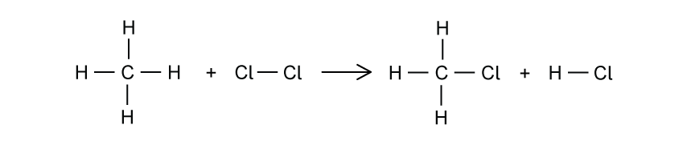

**Step 2: **Count all the bonds in the reactants

- In CH4, there are 4 C–H bonds
- In Cl2, there is 1 Cl–Cl bond

**Step 3: **Add the bond energies for all bonds in the reactants

bonds broken = (4 × 410) + 240

bonds broken  = 1880 kJ **[1 mark]**

**Step 4:** Count all the bonds in the products

- In CH3Cl, there are 3 C–H bonds and 1 C–Cl bond
- In HCl, there is 1 H–Cl bond

**Step 5: **Add the bond energies for all bonds in the products

bonds formed = (3 × 410) + 340 + 430

bonds formed = 2000 kJ **[1 mark]**

**Step 6: **Calculate the enthalpy change

Δ*H* = bonds broken − bonds formed

Δ*H* = 1880 − 2000

Δ*H *=** −120 kJ/mol** **[1 mark]**

**Method 2: Calculate using only the bonds that change**

**Step 1: **Draw the structures of the molecules

- Compare the reactants and products carefully
- Identify which bonds are broken and which bonds are formed

**Step 2: **Work out which bonds are broken

- 1 C–H bond is broken
- 1 Cl–Cl bond is broken

**Step 3: **Add the bond energies of the bonds broken

bonds broken = 410 + 240

bonds broken = 650 kJ **[1 mark]**

**Step 4: **Work out which bonds are formed

- 1 C–Cl bond is formed
- 1 H–Cl bond is formed

**Step 5: **Add the bond energies of the bonds formed

bonds formed = 340 + 430

bonds formed = 770 kJ **[1 mark]**

**Step 6: **Calculate the enthalpy change

Δ*H* = bonds broken − bonds formed

Δ*H* = 650 − 770

Δ*H*= **−120 kJ/mol** **[1 mark]**

> **[mark-scheme]**
> 1 mark for the correct calculation of the energy of bonds broken
> 
> 1 mark for the correct calculation of the energy of bonds formed
> 
> 1 mark for calculating the enthalpy using  ΔH= bonds broken − bonds formed

> **[exam-tip]**
> Structure your answer in three clear steps: **bonds broken**, **bonds formed**, and **overall energy change**.
> 
> Writing each stage separately helps the examiner see your method.
> 
> If you make a small arithmetic mistake at the end, clear working can still earn you method marks instead of losing all the marks.
> **[mark-scheme]**
> i)
> 
> Any **one** from:
> 
> - (electrical) insulation
> - water pipes
> - window frames
> - clothing
> 
> **[1 mark]**

ii)

The monomer of PVC is **chloroethene** and the structure of the molecule is:

**[2 marks]**

> **[mark-scheme]**
> 1 mark for a C=C double bond is shown
> 
> 1 mark for the fully correct displayed formula of chloroethene showing exactly 3 hydrogen atoms and 1 chlorine atom attached to the carbons, with all single bonds clearly drawn out

> **[exam-tip]**
> The monomers used from addition polymers are **alkenes**. When drawing a monomer, make sure you draw the actual alkene molecule with a C=C double bond, not the repeating unit of the polymer.
> 
> A common mistake is drawing single bonds with continuation lines, which represents the **polymer**, not the monomer.
> 
> If the question says **“show all atoms and all bonds,”** make sure the **bond to atoms like Cl is clearly drawn**, not just written beside the carbon.

### Q2
> **[mark-scheme]**
> sodium hydroxide** [1 mark]**
- According to the statement, the temperature during the reaction  increased

  - If temperature increases, it means energy has been **released **to the surroundings
- This means the reaction is **exothermic**
- In an exothermic reaction, **products have lower energy than reactants**
- The energy difference is shown by a **downward arrow (Δ*****H*****)**

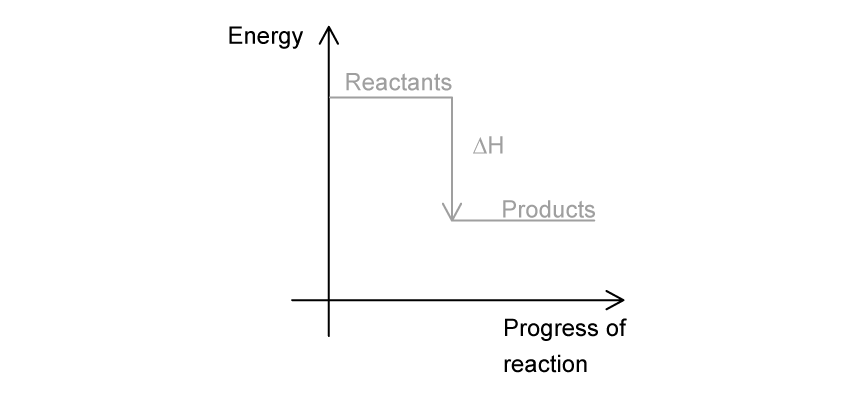

**[3 marks]**

> **[mark-scheme]**
> 1 mark for drawing the product line below the reactant line
> 
> 1 mark for labelling “Reactants” and “Products”** **correctly
> 
> 1 mark for drawing a downward arrow from reactants to products and labelling it  ΔH

> **[exam-tip]**
> Remember:
> 
> **“Exo = Exit”** → energy **exits** the system → temperature **increases **→ products are lower in energy than reactants.
> 
> **“Endo = Enter”** → energy **enters** the system → temperature **decreases ** → products are higher in energy than reactants.
> **[mark-scheme]**
> **Test:**  (Place a) lighted splint/flame **[1 mark]**
> 
> **Observation: **Squeaky pop / pop sound **[1 mark]**
- Nitrogen has **5 electrons in its outer shell**
- Each hydrogen has **1 outer electron**
- Nitrogen shares **one electron with each hydrogen**, forming **three single covalent bonds**
- After forming three bonds, nitrogen has **two electrons left over**
- These two electrons form a **lone pair on nitrogen**

**[2 marks]**

> **[mark-scheme]**
> 1 mark for showing three correct single covalent bonds between nitrogen and hydrogen (one dot and one cross)
> 
> 1 mark for showing one lone pair of electrons on the nitrogen atom

> **[exam-tip]**
> **Remember! **Dots and crosses are just symbols to show where electrons come from. Examiners do not mind which symbol you use, as long use them consistently for each element. Do not mix crosses and dots for the same element.
> 
> Keep in mind that  hydrogen is special. It only needs **2 electrons** to fill its outer shell, and these always come from the **single bond it forms**. **Hydrogen never has lone electrons.**
> **[mark-scheme]**
> i)
> 
> 2,8,1 **[1 mark]**
> 
> ii)
> 
> Any **two **from:
> 
> - Iron forms coloured compounds while sodium compounds are white/colourless
> - Iron and its compounds act as **catalysts**, whereas sodium does not
> - Iron has variable oxidation states (Fe2+ and Fe3+), whereas sodium has one (+1)
> 
> **[2 marks]**

> **[exam-tip]**
> When a question asks for **differences**, you must compare both elements in each point.
> 
> For each mark, write a **paired statement**  (e.g. Iron forms coloured compounds, whereas sodium compounds are white.
> 
> **You can lose marks with a one side answer.**

### Q3
Two other chemical properties of transition elements which make them different from Group I elements are:

Any **two** of the following

- Act as catalysts; **[1 mark] **
- Form coloured compounds / coloured ions; **[1 mark]**
- Higher melting point; **[1 mark] **
- Higher density; **[1 mark] **
- Harder;** [1 mark]**

**[Total: 2 marks]**

- *You should know the general properties of transition elements *
- *Group I elements are very reactive, have low density and relatively low melting points*

### Q4
a)

i) Element C is:

- Sb; **[1 mark]**

ii) The element in the list that does not form any compounds is:

- Xe / B; **[1 mark]**

iii) The element in the list that forms a chloride of the type XCl2 is:

- Te / D; **[1 mark]**

iv) The two elements would react together to form a compound of the type XY4 are:

- Sn **AND **I / E **AND **F; **[1 mark]**

**[Total: 4 marks]**

- *Do not get thrown by the more complicated electron distributions given in the question*
- *Chemical reactivity depends on the number of electrons in the outer shell, so you just need to focus on the last numbers in the electron distributions *
- *Element **C** is Sb as it has 5 electrons in its outer shell so must be in Group V*
- *Element **B** is Xe as it has a full outer shell of electrons (the last number in its electron distribution is 8) so is in Group VIII*
- *Element **D** is Te as it has 6 electrons in its outer shell so will react with 2 chlorine atoms to form TeCl**2*
- *Elements **E** & **F** are Sn and I respectively as **E**/Sn has 4 electrons in its outer shell and **F**/I has 7 electrons in its outer shell*

  - *Sn will react with 4 I atoms forming SnI**4** *
b) Two differences in physical properties and two differences in chemical properties between rubidium and the transition metal niobium are:

**Physical differences**

Any **two** from:

- Niobium is harder; **[1 mark] **
- Stronger;** [1 mark] **
- Higher melting/boiling point; **[1 mark] **
- Higher density; **[1 mark] ** *Note: there has to be a comparison*

**Chemical differences**

Any **two **from:

- Niobium is less reactive;** [1 mark] **
- Forms coloured compounds; **[1 mark] **
- Its compounds have catalytic properties; **[1 mark] **
- Has more than one oxidation state / number; **[1 mark] **
- Has more than one valency electron;** [1 mark] **
- Forms complex ions; **[1 mark] ** *Note: the response has to refer to or compare properties of both elements*

**[Total: 4 marks]**

- *Use your Periodic Table to identify that rubidium is in Group 1 and*
- *This question requires you to compare your knowledge about the properties of Group I metals and the transition elements to identify the differences*
- *Marks are not awarded if a comparison between the two is not made*
- *NOTE**: You are not expected to know that niobium forms complex ions (or even know what they are) but this is a correct response so would be allowed*

### Q5
a) the formula of each of the following compounds is:

i) Barium oxide:

- BaO; **[1 mark]**

ii) Boron oxide:

- B2O3; **[1 mark]**

**[Total: 2 marks]**

- *For barium oxide*

  - *Barium is in group 2 so will lose two electrons to form a Ba**2+ ** ion*
  - *Oxygen is in group 6 so will gain two electrons to form an O**2-** ion*
- *For boron oxide*

  - *Boron is in group 3 so will lose three electrons to form a B**3+** ion*
  - *Oxygen is in group 6 so will gain two electrons to form an O**2-** ion*
  - *2 B atoms are needed for every 3 oxygen atoms to balance the charges*
b) The formula of the following ions is:

i) sulphide:

- S2-; **[1 mark]**

ii) gallium:

- Ga3+; **[1 mark]**

**[Total: 2 marks]**

- *Remember you can determine the charge on an ion by looking at its group number*

  - *Sulfur is in group 6 so will gain two electrons to obtain a full outer shell*
  - *Gallium is in group 3 so will lose three electrons to obtain a full outer shell*
c) A diagram showing the arrangement of the valency electrons in one molecule of the covalent compound nitrogen trichloride:

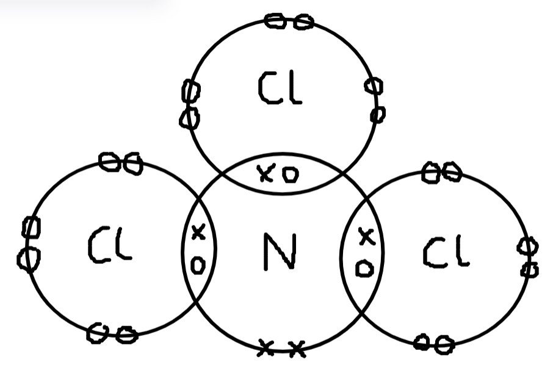

- 1 N and 3 Cl; **[1 mark]**
- 8 electrons (1 bond pair and 3non bonding pairs) around each chlorine; **[1 mark]**
- 8 electrons (3 bond pairs and 1 non-bond pair) around nitrogen; **[1 mark]**

**[Total: 3 marks]**

- *Nitrogen is in group 5 so has 5 outer shells (valence) electrons*

  - *Nitrogen needs 3 electrons to complete its outer shell*
- *Chlorine is in group 7 so has 7 outer shells (valence) electrons*

  - *Each chlorine needs 1 electron to complete its outer shell*
d)

i) **Two** differences in the physical properties of potassium and vanadium are:

*any ****two**** of the following:*

- Vanadium is harder; **[1 mark]**
- Vanadium has a higher melting point or boiling point; **[1 mark]**
- Vanadium has a higher density; **[1 mark]**

*Accept corresponding statements for potassium* * Statements must be comparisons for the marks*

ii) **Two **differences in the chemical properties of potassium and vanadium are:

*any ****two ****of the following:*

- Potassium is more reactive 
**OR**
- A specific example of different reactivities - potassium reacts with cold water, vanadium does not; **[1 mark]**
- Potassium has one oxidation state whilst vanadium has more than one; **[1 mark]**
- Vanadium forms coloured compounds whilst potassium is white or colourless; **[1 mark]**
- Vanadium and its compounds can act as catalysts, whilst potassium cannot; **[1 mark]**

*Each statement must comment on both elements and how they are different*

**[Total: 4 marks]**

- *The first step here is to recognise potassium is a group 1 metal and vanadium is a transition metal*
- *This question then becomes one comparing the physical and chemical properties of metals and transition metals*
- *Whenever you are asked for differences in a question make sure you refer to both elements in each statement and say how they are different*
e) Using our knowledge of the other halogens we can predict the following: i) The physical state of fluorine at r.t.p:

- gas; **[1 mark]**

The physical state of astatine at r.t.p:

- solid; **[1 mark]**

ii) **Two** similarities in their chemical properties would be:

*Any ****two**** of the following:*

- They both have a valency of one; **[1 mark]**
- They both can react with other elements to form halides; **[1 mark]**
- They are both are oxidants 
**OR **
Any correct Chemistry – they both form acidic hydrides; **[1 mark]**
- They both have diatomic molecules; **[1 mark]**
- They both accept one electron or form ion X-; **[1 mark]**
- They both have seven valency electrons; **[1 mark]**
- They both react with non-metals to form covalent compounds; **[1 mark]**
- They both react with metals to form ionic compounds; **[1 mark]**
- They both form acidic oxides; **[1 mark]** ***NOT**** have a valency of 7*

**[Total: 4 marks]**

- *The halogens become **denser** as you go down the group*
- *Fluorine is at the top of Group VII so will be a **gas*
- *Astatine is at the bottom of Group VII so will be a **solid*
- *Remember** valency refers to the number of electrons needed to fill an atoms outer shell*

  - *Hence the halogens have a valency of 1 not 7*

### Q6
a) The completed equation is:

Chlorine + Potassium bromide → Bromine + Potassium chloride

- Chlorine;** [1 mark] **
- Potassium bromide; **[1 mark]**

**[Total: 2 marks]**

- *Chlorine is more reactive than bromine as it is above bromine in Group VII*
- *Therefore chlorine will displace bromine from potassium bromide to form potassium chloride and bromine*
- *Careful:** If a Group VII element (halogen) is in an ionic compound such as potassium chloride, the name of the Group VII element must end in ___ide*

  - *This is because it has become an ion by gaining one electron*
  - *Therefore in this equation chlorine becomes chloride*
b) Aqueous bromine does not react with aqueous potassium chloride because:

- Chlorine more reactive than bromine / bromine less reactive than chlorine; **[1 mark] **

**Final answer:** **[Total: 1 mark] **

- *The reactivity of Group VII elements increases as you move up the group*
- *Out of the three commonly used halogens, chlorine, bromine and iodine, chlorine is the most reactive and iodine is the least reactive*

  - *Chlorine > bromine > iodine*

### Q7
a) An element which is gaseous at room temperature and pressure is:

- Chlorine / argon;** [1 mark]**

**[Total: 1 mark]**

- *You should know the physical state of the halogens and noble gases*
- *All metals (except mercury) will be solid at room temperate*
- *Phosphorus and sulfur are solids at room temperature*
b) An element that is added to water to kill bacteria is:

- Chlorine; **[1 mark]**

**[Total: 1 mark]**

- *Chlorine is used in water treatment to kill microbes*
- *Alternatively, ozone or UV light can be used*
c) An element that forms a basic oxide of the type XO is:

- Magnesium; **[1 mark]**

**[Total: 1 mark]**

- *Basic oxides are formed when a metal element combines with oxygen*
- *In this case, the formula is XO*
- *Oxygen has a 2- charge, therefore X must have a 2+ charge for the charges to cancel each other out*
- *Elements in Group II form ions with a 2+ charge*
- *The element that is in Group II and Period 3 is magnesium*
d) An element that forms an amphoteric oxide is:

- Aluminium; **[1 mark]**

**[Total: 1 mark]**

- *Amphoteric oxides can behave as **both** **acidic** and **basic**, depending on whether the other reactant is an acid or a base*
- *Examples of amphoteric oxides that you need to know are Al**2**O**3** and ZnO*
e) An element that reacts vigorously with cold water to produce hydrogen is:

- Sodium; **[1 mark]**

**[Total: 1 mark]**

- *Many metals will react with water, but the key here is that this element reacts vigorously with cold water*
- *Magnesium and aluminium will react very slowly with cold water, whereas sodium, being higher in the reactivity series, reacts readily with cold water*

### Q8
a)

i) The colour change of the halogens as you move down the group is:

- (They) become darker; **[1 mark]**

ii) The melting points and boiling points change down the group as follows:

- Both increase; **[1 mark]**

iii) The colour and physical state (solid, liquid or gas) of astatine, At are:

- (The colour is) black / dark grey; **[1 mark]**
- (The physical state is) solid; **[1 mark]**

*Brown is not acceptable for the colour of astatine*

**[Total: 4 marks]**

- *We know the halogens become darker as you move down the group*
- *The colour of iodine is grey-black *
- *As astatine is below iodine you need to give a colour darker than this*
- *We know the both the melting and boiling points increase as you move down the group*
- *Iodine is a solid*
- *Therefore as astatine will have a higher melting point than iodine it will also be a solid*
b)

i) The definition of the term isotope is:

- (Atoms with the) same Z / same number of protons; **[1 mark]**

*accept: atoms of the same element*

- (But) different number of neutrons / different nucleon number / different mass number; **[1 mark]**

ii) The number of protons, electrons and neutrons in one atom of $I_{53}^{131}$ is:

- 53 protons **   AND** 53 electrons; **[1 mark]**
- 78 neutrons; **[1 mark]**

iii) The name of the element is:

- xenon; **[1 mark]**

**[Total: 5 marks]**

- *The number of protons is given by the atomic number (bottom number)*

  - *number of protons = 53*
- *The mass number (top number) = number of protons + number of neutrons*

  - *number of neutrons = mass number - number of protons*
  - *number of neutrons = 131 - 53 = 78*
- *The atom has no charge*

  - *This means the number of protons = number of electrons*
c) The formula of compound 1 is:

- BrF3 / F3Br; **[1 mark]**

The formula of compound 2 is:

- BrF5 / F5Br; **[1 mark]**

**[Total: 2 marks]**

> *Compound 1*

- $\mathrm{molar} \mathrm{mass}=\frac{\mathrm{mass}}{\mathrm{moles}}$
- $\mathrm{molar} \mathrm{mass}=\frac{137}{1}$* = 137 g / mol*
- *Bromine has a mass of 80*
- *Fluorine has a mass of 19*
- *You are looking for any combination of bromine and fluorine atoms that adds up to 137*

  - * (1 x Br) + (3 x F)*
  
    - *(1 x 80) + (3 x 19) = 137*

> *Compound 2*

- *First start by forming an equation for the formation of compound 2*

  - *Br + F → compound 2*
- *You can now look at the molar ratios *

  - *Br           +   F       →      compound 2*
  *0.02   :    0.1    :          0.02*
- *From this we can see that we have x5 as many moles of F compared to Br and compound 2*

  - *0.1 ÷ 0.02 = 5*
  - *Br + 5F → BrF**5*

### Q9
a)

i) The element that is the most reactive metal is:

- Cs / Fr; **[1 mark]**

ii) The element that is the only non-metal which is a liquid at r.t.p. is:

- Br; **[1 mark]**

iii) The Group VII element that is a solid at r.t.p. is:

- I or At; **[1 mark]**

iv) The element that is in Group V and Period 4 is:

- As; **[1 mark]**

v) The element that is an unreactive gas used to fill lamps is:

- He / Ne / Ar / Kr / Xe; **[1 mark]**

**[Total: 5 marks]**

- *Potassium is at the top of the reactivity series with sodium second, showing that the Group I metals are the most reactive of the metals*
- *The reactivity of Group I metals increase as you down the group so the Group I metal at the bottom of the group will be the most reactive element*
- *This is francium but caesium is also accepted, as there is such a small amount of francium found naturally (there is estimated to be about 30 g in the whole of the Earth's crust!)*
b) The formula of the compounds is

i) Germanium oxide:

- GeO2; **[1 mark]** 
*Allow GeO*

ii) Tellurium bromide:

- TeBr2; **[1 mark]** 
*Allow TeBr**4*

**[Total: 2 marks]**

- *You can use valencies to work the formula out*
- *Valency tells you how many electrons an atom loses, gains or shares, to form a compound*
- *Valencies can be determined by the group the element is in:*

  - *Group I and VII elements have a valency of 1*
  - *Group II and VI elements have a valency of 2*
  - *Group III and V elements have a valency of 3*
  - *Group IV elements have a valency of 4*
  - *Group VIII elements have a valency of 0*

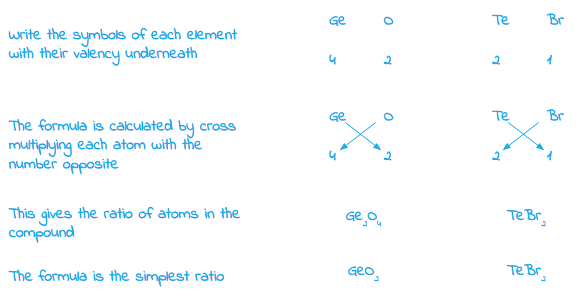

- *Both compounds can be formed with a different ratio of elements, as shown in the accepted answers, however, you are not expected to know these or work these out*
c) The formula of the ions is:

i) Strontium:

- Sr2+;** [1 mark]**

ii) Fluorine;

- F-;** [1 mark]**

**[Total: 2 marks]**

- *For metals, the group number corresponds to the number of electrons it will lose to achieve a full outer shell and the charge of the metal ion*

  - *Strontium is in Group II so will lose 2 electrons to form a 2+ ion*
- *Non-metals in Group VII, such as fluorine, will gain 1 electron to form a 1- ion*

### Q10
a)

i) An element which is gaseous at room temperature and pressures is:

- Nitrogen / oxygen / fluorine / neon; **[1 mark]**

ii) An element which forms an oxide that is a reactant in photosynthesis is:

- Carbon; **[1 mark]**

iii) An element that is a product of photosynthesis is:

- Oxygen; **[1 mark]**

iv) An element that makes up approximately 78% by volume of the air is:

- Nitrogen; **[1 mark]**

v) An element which has atoms with a full outer shell of electrons is:

- Neon; **[1 mark]**

vi) An element which exists as both diamond and graphite is:

- Carbon; **[1 mark]**

vii) An element that reacts vigorously with cold water is:

- Lithium / fluorine; **[1 mark]**

viii) A soft metallic element which is stored in oil is:

- Lithium; **[1 mark]**

**[Total: 8 marks]**

- *This question tests your knowledge across many different topics in the course*
- *All of the non-metals in Group II are gases*
- *Part (ii) and (iii) test require you to recall the equation for photosynthesis:*

  - *carbon dioxide + oxygen → glucose + water*
  - *From this you can see that the oxide which is a reactant is carbon dioxide and oxygen is the only element that is a reactant*
- *The noble gases have a full outer shell of electrons*
b)

i) The formula of a compound that contains only boron and oxygen is:

- B2O3;** [1 mark]**

ii) The formula of a compound that contains only  lithium and nitrogen is:

- Li3N; **[1 mark]**

**[Total: 2 marks]**

- *To deduce the formula of a compound using valencies:*

  - *Write out the symbols of each element and write down their valencies underneath*
  - *The formula is calculated by cross multiplying each atom with the number opposite*
- *For the compound containing boron and oxygen:*

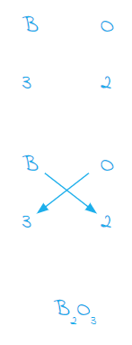

- *For the compound containing lithium and oxygen:*

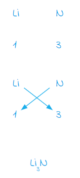

### Q11
a) One chemical property of sodium is:

- Reacts with water 
**OR** 
Reacts with chlorine 
**OR** 
Reacts with oxygen; **[1 mark]**

**[Total: 1 mark]**

- *Sodium will react with*

  - *water to form sodium hydroxide and hydrogen*
  - *chlorine to form sodium chloride *
  - *oxygen to form sodium oxide*
- *Remember: **All Group I metals react similarly due to having the same number of electrons in the outer shell*
b) The correct statement about the physical properties of sodium are:

- Sodium conducts electricity; **[1 mark]**
- Sodium is malleable; **[1 mark]**

**[Total: 2 marks]**

- *All metals are able to conduct electricity as they have delocalised electrons which are free to move and carry a charge throughout the structure*
- *Metals are also good conductors of heat*
- *Pure metals are malleable as their ions are arranged in layers which can slide over each other *
- *Sodium is a soft metal which can be cut with a knife, and floats when added to water so has a low density *

### Q12
a) The properties of titanium differ from those of scandium by:

Any **three** from:

- (It would have) more than one or variable oxidation number / oxidation state / valency; **[1 mark]**
- (Metal / element / titanium / it has a) high density; **[1 mark]**
- (It forms) coloured compounds / ions / solutions; **[1 mark]**
- (Element / compound act as) catalyst; **[1 mark]**
- It <u>forms </u>complex (ions); **[1 mark]**

**[Total: 3 marks]**

- *The properties above are those properties that are specific to transition elements*
- *Transition elements also typically have high melting points, but this is also a property of most metal so would not be accepted as a correct answer*
b) A diagram which shows the formula of scandium fluoride, the charges on the ions and the arrangement of the valency electrons around the negative ions is:

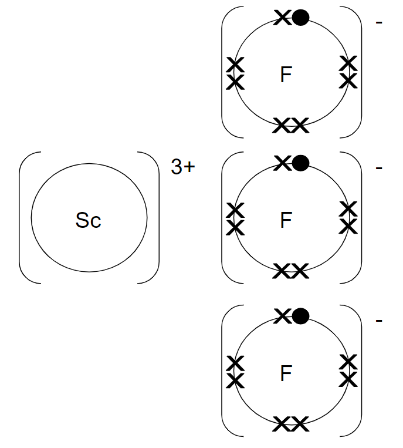

- ScF3; **[1 mark]**
- Correct charges on both ions; **[1 mark]**
- 8 electrons around (each) fluoride; **[1 mark]**

**[Total: 3 mark]**

- *As scandium has a valency of 3, this means that it will gain, lose or share 3 electrons*
- *When combined with the non-metal fluorine to form an ionic compound, it must form a positive ion so will lose 3 electrons to form a 3+ ion*
- *Each of the 3 fluorine atoms will gain one electron to form a 1- ion*
- *NOTE**: The outer electron shell of Sc is now empty as it has lost its 3 outer electrons*

  - *You can also show the next full shell on a dot and cross diagram, but this was not necessary in this question:*

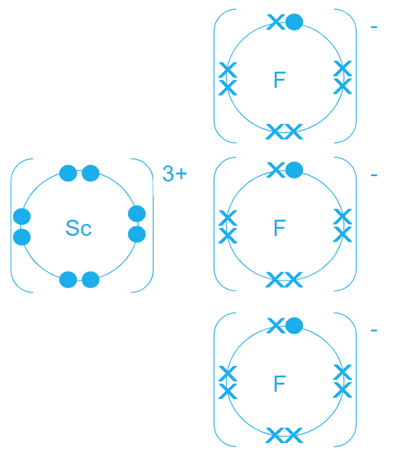
c) You could show that scandium oxide is an amphoteric oxide by:

- If it reacts with or neutralises both acid and base / alkali (then it is amphoteric); **[1 mark]**
- It dissolves / soluble in both (acid and alkali) or form solutions in both; **[1 mark]**
- <u>Name </u>or <u>formula </u>of strong acid and alkali; **[1 mark]**

**[Total: 3 marks]**

- *One mark is to name a strong acid and alkali, typical examples are:*
- *Strong acid: hydrochloric acid, sulfuric acid, nitric acid*
- *Strong alkali: sodium hydroxide, potassium hydroxide*
- *Amphoteric oxides can behave as both acidic and basic, depending on whether the other reactant is an acid or a base*
- *In both cases, salt and water are formed*

### Q13
a) A description of the bonding in sodium bromide and sulfur should include:

For bonding: Maximum of **three** from

- Sodium bromide – bonding is ionic; **[1 mark]**
- Sodium bromide – strong bonding (between ions); **[1 mark] **
- Sulfur – weak forces between molecules;** [1 mark] **
- Sulfur – covalent bonds within molecules; **[1 mark] **

For electrical conductivity: Maximum of **two** from* *

- Sodium bromide – conducts when molten / conducts in aqueous solution; **[1 mark] **
- Sodium bromide – does not conduct when solid;** [1 mark] **
- Sulfur – does not conduct;** [1 mark] **

For solubility in water: Maximum of **two** from** **

- Sodium bromide – soluble in water; **[1 mark] **
- Sulfur – insoluble in water; **[1 mark] **

**Final answer:** **[Total: 5 marks] **

- *You have been given three categories to describe but you do not need to include any explanations as to why the structures have different properties*
b) An element is:

- A substance containing only one type of atom / substance which cannot be broken down to simpler substances by chemical means; **[1 mark] **

**[Total: 1 mark]**

- *This is a standard definition that you should know *
c) The properties differ by:

Any **two** from the following**:**

- Co has high melting point / boiling point;** [1 mark]**
- Co has high density; **[1 mark]**
- Co has catalytic activity; **[1 mark]**
- Co forms coloured compounds;** [1 mark]**
- Co compounds have variable oxidation states / form ions with different charges; **[1 mark]**
- Co is hard / Co is strong;** [1 mark]**
- Co less reactive  /  Li reacts rapidly with water  /  Co does not react with water  /  Co reacts slowly with water; **[1 mark]**
- Co is magnetic; **[1 mark]**

**[Total: 2 marks]**

- *You can give the reverse arguments for lithium for each point to gain the marks*

### Q14
Two ways transition metals differ from Group I metals are:

Any **two** of the following

- Act as catalysts; **[1 mark] **
- Variable oxidation numbers; **[1 mark] **
- Form coloured compounds / coloured ions; **[1 mark]**
- Higher melting point; **[1 mark] **
- Higher density; **[1 mark] **
- Harder;** [1 mark]**

**[Total: 2 marks] **

> **[exam-tip]**
> Use comparative language. Write "higher melting point" or "harder," not just "high melting point" or "hard." The question asks how they differ, so your answer must compare.
> 
> Do not write properties common to all metals, such as "conducts electricity" or "is malleable." These do not distinguish transition metals from Group I.
> 
> State the observable property itself, not the reason behind it. "Stronger metallic bonds" does not score, but "higher melting point" does.
> 
> If the question specifies physical or chemical differences, stay within that category. If it says "properties" without restriction, both types are accepted.

### Q15
a) The number of electrons there are in the outer shell of a rubidium atom is:

- 1 / one; **[1 mark]**

**[Total: 1 mark]**

- *Rubidium is in Group I so will have one electron in its outer shell*
b) One physical property of rubidium which is the same as that of a transition element such as iron is:

Any **one** from the following:

- Conducts electricity or heat; **[1 mark]**
- Malleable; **[1 mark]**
- Ductile; **[1 mark]**
- Sonorous; **[1 mark]**
- Shiny; **[1 mark]**

**[Total: 1 mark]**

- *You need to know and compare the properties of both the Group I metals and the transition elements to identify those properties that they have in common*
- *The properties listed above are the general properties of metals*
c) Two physical properties of rubidium which are different to those of a transition element such as iron are:

Any **two** from the following:

- (Low) melting point / (low) boiling point; **[1 mark]**
- Hardness / softness / rubidium can be cut easily; **[1 mark]**
- Strength; **[1 mark]**
- (Low) density; **[1 mark]**

**[Total: 2 marks]**

- *Again, you need to compare the properties of Group I and the transition elements and identify those properties that differ*
- *The properties given above are those specific to Group I metals*
d)

i) Two observations that would be made when rubidium is added to cold water are:

Any **two **from:

- Bubbles / effervescence / fizzing;** [1 mark] **
- Flame / sparks / ignites;** [1 mark] **
- Movement;** [1 mark] **
- Dissolves / forms a solution / disappears / gets smaller;** [1 mark] **
- Floats;** [1 mark] **
- Rubidium melts / rubidium forms a ball;** [1 mark] **
- Explosion;** [1 mark] **

ii) The colour of the solution if methyl orange was added to it after the reaction would be:

- Yellow; **[1 mark]**

iii) A chemical equation for the reaction between rubidium and water is:

2Rb + 2H2O → 2RbOH + H2

- Formula of RbOH; **[1 mark]**
- Rest of the formula and correct balancing; **[1 mark]**

iv) The Group I elements in their order of reactivity with water, from the most reactive to the least reactive is:

- caesium → rubidium → potassium → sodium → lithium / Cs → Rb → K → Na → Li; **[1 mark]**

v) One safety measure that should be used when rubidium is added to cold water is:

Any **one** from:

- Googles / glasses; **[1 mark]**
- Gloves; **[1 mark]**
- Safety screen; **[1 mark]**
- Stand at a safe distance; **[1 mark]**
- Use tongs; **[1 mark]**
- Open space; **[1 mark]**

**[Total: 7 marks]**

- *Methyl orange is an indicator that is red in acidic solutions and yellow in alkaline solutions*
- *When Group I metals react with water, a Group I metal hydroxide is formed which is an alkaline solution, turning methyl orange yellow*
- *The Group I metals get more reactive as you go down the group, making caesium the most reactive Group I metal and lithium the least reactive*
e) The formula of rubidium phosphate is:

- Rb3PO4; **[1 mark]**

**[Total: 1 mark]**

- *Rubidium will form an ion with a 1+ charge as will lose its one outer electron*
- *For the compound to have no overall charge, the positive and negative charges must cancel each other out *
- *So, for every phosphate ion which has a 3- charge, 3 ions of rubidium are needed for the charges to cancel out *

  - *(3 x 1+) + 3- = 0*
- *The formula is therefore Rb**3**PO**4*

### Q16
a) The completed equation is:

Bromine + Potassium iodide → Iodine + Potassium bromide

- Bromine;** [1 mark] **
- Potassium iodide; **[1 mark]**

**[Total: 2 marks]**

- *Bromine is more reactive than iodine as it is above iodine in Group VII*
- *Therefore bromine will displace iodine from potassium iodide to form potassium bromide and iodine *
- *Careful:** If a Group VII element (halogen) is in an ionic compound such as potassium bromide, the name of the Group VII element must end in ___ide*

  - *This is because it has become an ion by gaining one electron*
  - *Therefore in this equation bromine becomes bromide *
b) Aqueous iodine does not react with aqueous potassium chloride because:

- Chlorine is more reactive than iodine / iodine is less reactive than chlorine; **[1 mark] **

**Final answer:** **[Total: 1 mark] **

- *The reactivity of Group VII elements increases as you move up the group*
- *Out of the three commonly used halogens, chlorine, bromine and iodine, chlorine is the most reactive and iodine is the least reactive*

  - *Chlorine > bromine > iodine*

### Q17
a) The metals form different ions because:

- Rb loses 1 electron / 1 electron in outer shell / 1 valency or valence electron; **[1 mark] **
- Sr loses 2 electrons / 2 electrons in outer shell / 2 valency or valence electrons; **[1 mark] **

**Final answer:** **[Total: 2 marks] **

- *In order for a metal to become an ion, it will lose electrons*
- *You must state how many electrons are lost*
- *If a 1+ ion is formed then 1 electron has been lost*
- *If a 2+ ion is formed then 2 electrons have been lost and so on*
b)

i) A method to prepare a pure sample of the insoluble salt, strontium carbonate, by precipitation is:

- (Mix solutions of) rubidium carbonate / Rb2CO3; **[1 mark] **
- Strontium chloride / SrCl2 
**OR **
Strontium nitrate / Sr(NO3)2 
**OR **
Strontium sulfate / SrSO4 
**OR **
Strontium hydroxide / Sr(OH)2; **[1 mark] **
- Filter / centrifuge / decant (the residue); **[1 mark] **
- Wash with water and dry/ press between filter paper / put in (low) oven / put on a (sunny) windowsill / put in sun / heat; **[1 mark] **

ii) The completed equation is:

- SrCO3 → SrO + CO2; **[1 mark] **

**[Total: 5 marks] **

- *Insoluble salts must be made from the precipitation reaction between two soluble salts *
- *Nitrate salts and group 1 salts are soluble, so these are always good options when having to name appropriate reactants*
- *The thermal decomposition of a metal carbonate produces the metal oxide and carbon dioxide*
- *A more familiar example is the thermal decomposition of calcium carbonate - this occurs in the blast furnace*

### Q18
a) Physical and chemical properties of caesium:

- PHYSICAL soft / can be cut (with a knife) / low density / light / low melting point / (good) conductor (heat or electricity) / shiny (when freshly cut) / malleable / ductile / tarnishes;** [1 mark]**
- CHEMICAL react with water (not steam) / (very) reactive / forms salts with halogens / react vigorously with acids (ignore concentration) / forms an alkaline or basic oxide / fixed oxidation state or oxidation number or valency of +1 / has one valency or outer shell electron not forms ionic compounds on its own; **[1 mark] **
*The properties should focus on a Group 1 metal and not just metals in general*

**[Total: 2 marks]**

- *Make sure you get the physical and chemical properties the correct way around! Chemical properties are to do with reactions and electrons only*
b) The properties of vanadium are:

- PHYSICAL hard / high density / dense / high mp or bp / (good) conductor (heat or electricity) / strong / malleable / ductile / silver or grey or lustrous or shiny solid; **[1 mark]**
- CHEMICAL more than one oxidation state or valency (accept many oxides) / forms coloured compounds or ions (not coloured on its own) / forms complex ions / behave as a catalyst / less reactive than Group 1; **[1 mark]**

*Properties should focus on a transition metal*

**[Total: 2 marks]**

- *The properties of transition metals include the properties of metals and also some special characteristics, such as forming coloured compounds, that you should be aware of*
c) Physical and chemical properties of fluorine are:

- PHYSICAL: colourless gas / yellow gas / low melting and boiling point / does not conduct electricity in any state; **[1 mark]**
- CHEMICAL: most reactive halogen / very reactive / forms ionic fluorides / bonds with metals / form covalent fluorides / bonds with non-metals / powerful oxidant / gains one electron (to be stable) / fixed oxidation state or valency of –1 / forms F– ions / forms acidic oxides / forms an acid when reacted with hydrogen / hydride is acidic; **[1 mark] **
*Allow decolourised when reacts with alkene Not diatomic molecules Not bleaching agents*

**[Total: 2 marks]**

- *Fluorine is a small simple molecule, so is a gas at room temperature*
- *It is in Group VII and so it is an extremely reactive element; it is not allowed in school so is not used in experiments but often comes up in exams so you can apply your Group VII knowledge in a slightly different context*

### Q19
a) A metal that reacts rapidly with cold water to form a compound of the type M(OH)2 and hydrogen is:

- Ca / calcium; **[1 mark]**

**[Total: 1 mark]**

- *The metal must form a 2+ ion as it forms an ionic compound with 2 hydroxide ions, OH**-*
- *Calcium is in Group II so will form a 2+ ion*
b) The element whose only oxidation state is 0 is:

- Kr / krypton; **[1 mark]**

**[Total: 1 mark]**

- *Oxidation state tells you how many electrons each atom of an element has gained, lost, or shared*
- *The oxidation state of an uncombined element is zero*
- *Krypton is the only element that only exists in elemental form so does not gain, lose or share electrons to form a compound*
- *Therefore its only oxidation state is zero*
- *Remember**: You may see the term oxidation state or oxidation number, at this level these terms are used interchangeably*
c) The element that has a macromolecular oxide, XO2, which has similar physical properties to those of diamond is:

- Ge / germanium; **[1 mark]**

**[Total: 1 mark]**

- *Germanium is in the same group as carbon which forms diamond*
- *Germanium is a metalloid so exhibits some properties of both metals and non-metals therefore it can form covalent bonds with oxygen*
- *Germanium oxide has four oxygen atoms around each germanium atom and two germanium atoms around each oxygen atom, similar to the arrangement in silicon(IV) oxide, giving a tetrahedral arrangement of atoms*
d) One of the metals alloyed with iron in stainless steel is:

- Ni / nickel or Cr / chromium;** [1 mark]**

**[Total: 1 mark]**

- *Carbon is another element that is alloyed with iron to make stainless steel*
- *This is not an acceptable answer though because it is not in Period 4, as specified in the question*
e) The element that can be reduced to an ion of the type X– is:

- Br / bromine / Br2; **[1 mark]**

**[Total: 1 mark]**

- *Reduction is the gain of electrons*
- *This element has gained one electron to form a 1- ion so has been reduced*
- *Elements in Group VII gain one electron to form a 1- ion*
- *The element in Period IV and Group VII is bromine*
f) The element that can form a covalent hydride having the formula H2X is:

- Se / selenium; **[1 mark]**

**[Total: 1 mark]**

- *X must have a valency of 2, so is either in Group II or Group VI*
- *As it forms a covalent compound, it must be a non-metal so in Group VI*
- *The element in Period 4, Group VI is selenium*

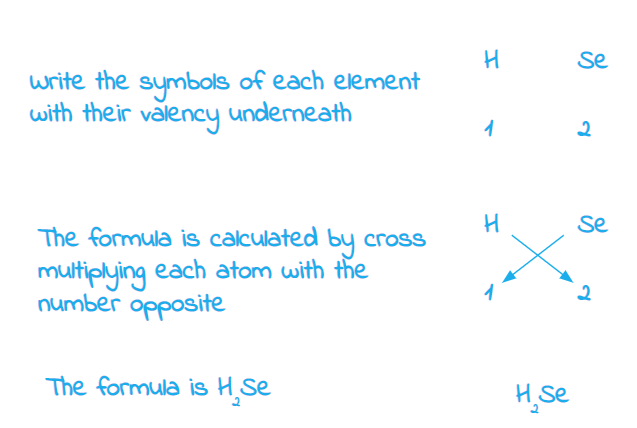
g) The element whose soluble salts are blue and its oxide is black is:

- Cu / copper; **[1 mark]**

**[Total: 1 mark]**

- *Copper oxide is a black insoluble base that will react with sulfuric acid to produce a blue solution which is copper sulfate solution*
- *You need to know how to prepare soluble salts, such as copper sulfate, from an insoluble base, such as copper oxide*
- *Both copper oxide and copper sulfate solution are common substances and their colours are expected knowledge*
h) The element that is liquid at room temperature is:

- Br / bromine / Br2; **[1 mark]**

**[Total: 1 mark]**

- *You should know all of the states of the halogens at room temperature*
- *There are only two elements on the Periodic Table that are liquid at room temperature: bromine and mercury*

### Q20
a)

i) The colour changes down the group by:

- Darker or actual colours;** [1 mark] **
*Chlorine yellow, yellow/green* *Bromine orange, brown, brownish red* *Iodine black grey, purple*

ii) The physical state changes down the group by:

- Changing from gas to liquid to solid; **[1 mark] ** 
*All three states are needed for the mark*

iii) The colour and the physical state of fluorine is:

- Colourless or (pale) yellow;** [1 mark] **
- Gas; **[1 mark] **

**Final answer:** **[Total: 4 marks] **

- *You need to be able to describe the trend in properties down Group VII in terms of *

  - *State*
  - *Reactivity*
  - *Density*
  - *Appearance *
b) You could distinguish between aqueous potassium bromide and aqueous potassium iodide by:

Alternative 1

- Test: Add chlorine water / bubble in chlorine gas; **[1 mark] **
- Result with bromide: Yellow or orange or brown; **[1 mark]**
- Result with iodide: Dark brown or grey crystals; **[1 mark] ** *(Accept colour that is darker than for bromide)*

Alternative 2

- Test: Add (acidified) silver nitrate (aq); **[1 mark] **
- Result with bromide: Off white  pale yellow / cream precipitate or soluble in aqueous ammonia; **[1 mark] **
- Result with iodide: Yellow precipitate insoluble in aqueous ammonia; **[1 mark] ** 
*Precipitate essential then either colour or solubility in aqueous ammonia*

Alternative 3

- Test: Add lead nitrate (aq); **[1 mark] **
- Result with bromide: Pale yellow / off white / cream precipitate;** [1 mark] **
- Result with iodide: Yellow precipitate insoluble in aqueous ammonia; **[1 mark] ** 
*Accept any test that could work – electrolysis, iron(III) salt Bromine, potassium dichromate, potassium manganate(VII) etc*.

**[Total: 3 marks] **

- *As you can see there are alternative ways for testing for a halide ion *
- *Make sure you know how to test for a halide ion using acidified silver nitrate as this is specific to the course *
- *Adding chlorine water is a displacement reaction but can also be used to distinguish between potassium bromide and potassium iodide*

  - *However, to test for a chloride ion it is best to use acidified silver nitrate*
c) The completed equation is:

I2 + 3Cl2 → 2ICl3

- 3Cl2;** [1 mark] **
- 2ICl3; **[1 mark] ***For having either reactants or products correct ONLY ***[1 mark] **

**[Total: 2 marks]**

- *It can help to place the values in the equation to help determine a ratio*
- *I**2** + 3Cl**2** → 2ICl**3*

  - *0.015 + 0.045 → 0.030 *
  - *We can then determine a ratio*
  - *1 + 3 → 2*
d) The gas that will diffuse faster is:

- Chlorine;** [1 mark] **
- Lower *M**r* or lower density **OR** Lighter molecules or molecules move faster; **[1 mark] ** 
*lighter or based on A**r **scores; ***[1 mark] **

**Final answer:** **[Total: 2 marks] **

- *At the same temperature, different gases do not diffuse at the same rate.*
- *This is due to the difference in their relative molecular masses *

  - *Cl**2 **has an** M**r** of 71*
  - *Bromine has an **M**r** **of 160*
  - *You don't need to look up these numbers, you just need to know the mass increases as you go down the group*
- *Lighter gas particles can travel faster and hence further, therefore the lower its relative mass the faster a gas will diffuse*

### Q21
a) The general trend in the boiling points of the Group I elements is:

- Decrease down the group / increase up the group;** [1 mark] **

**Final answer:** **[Total: 1 mark] **
b) It is difficult to predict the density of rubidium because:

- There is no trend in density (from lithium to potassium), the value (of density) goes up and down; **[1 mark] **

**Final answer:** **[Total: 1 mark] **

- *The numbers have no trend or pattern, so it is very difficult to predict the density *
- *The density firstly increases from lithium to sodium and then decreases from sodium to potassium*
- *Therefore we can not make a prediction for the density of rubidium based on the information given*
c) The state of rubidium at room temperature is:

- Liquid;** [1 mark] **
- 45°C / this temperature is between the melting and boiling points / boiling point above 45°C and melting point below 45°C;** [1 mark] **

**[Total: 2 marks]**

- *The melting point of rubidium is 39 °C, so at 45 °C rubidium will have melted *
- *This question is for 2 marks so make sure you give a reason for your answer *

### Q22
a) The element that is a brown liquid at room temperature is:

- Bromine / Br / Br2; **[1 mark] **

*NOTE: An incorrectly written symbol, e.g. NA or CL, should be penalised once in the whole question, parts a to g*

**[Total: 1 mark]**

- *You should know all of the states of the halogens*
- *Bromine is one of only two elements in the Periodic Table that is a liquid at room temperature, the other element is mercury*
b) The element that forms a compound with hydrogen having the formula XH4 is:

- Germanium / Ge; **[1 mark]**

**[Total: 1 mark]**

- *Germanium is in Group IV therefore will share a pair of electrons with each of the 4 hydrogen atoms to gain a full outer shell of electrons*
- *The resulting structure is similar to methane, CH**4*
c) A metal that reacts violently with cold water is:

- Potassium / K 
**OR** 
Calcium / Ca;** [1 mark]**

**[Total: 1 mark]**

- *More reactive metals (calcium and above) will react with cold water to form a metal hydroxide and water*
- *Potassium will react with water more vigorously than calcium as it is higher in the reactivity series*
d) The element that has a complete outer energy level is:

- Krypton / Kr; **[1 mark]**

**[Total: 1 mark]**

- *The noble gases, in Group VIII, have a complete outer shell of electrons making them very unreactive*
e) The element that has oxidation states of 2 and 3 only. is:

- Iron / Fe 
**OR** 
Cobalt / Co; **[1 mark]**

**[Total: 1 mark]**

- *Transition elements can form ions with different charges, therefore they exist in different oxidation states *
- *You should know that iron has can exist as:*

  - *Iron(II) where the ions have an oxidation number of 2 and formula Fe**2+*
  - *Iron(III) where the ions have an oxidation number of 3 and formula Fe**3+*
f) The element that can form an ion of the type X- is:

- Bromine / Br / Br2; **[1 mark]**

**[Total: 1 mark]**

- *Group VII elements have 7 electrons in their outer shell so when forming ions, they will gain 1 electron to achieve a full outer shell*
- *This resulting ion has a 1- charge*
g) The element whose oxide is the catalyst in the Contact Process is:

- Vanadium / V; **[1 mark]**

**[Total: 1 mark]**

- *You need to recall the equation, together with the temperature, pressure and catalyst needed for the main stage of the Contact process only*
- *The main stage of the Contact process is the oxidation of sulfur dioxide to sulfur trioxide using a vanadium(V) oxide, V**2**O**5**, catalyst*

### Q23
a) The competed table will contain:

- The colour of astatine: Black / grey-black; **[1 mark] **
- The boiling point of bromine: Any value between 0 and 177 °C; **[1 mark] **
- The state of iodine at 190 °C: Gas / vapour; **[1 mark] **

**Final answer:** **[Total: 3 marks] **

- *Careful: **You are asked for the state of iodine at 190 °C, not room temperature so you have to use the information in the table*
- *The boiling point of iodine is 184 °C which is lower than 190 °C, therefore iodine will be a gas*
- *The boiling point of bromine should be between 0 and 177 °C *

  - *The melting point of bromine is -7 °C so your value must be significantly higher than this*
  - *The boiling point of iodine is 184 °C so your value should be significantly lower than this*
  - *The simplest way is to pick a value that is half way between the boiling point of chlorine and iodine as this follows the trend*
  
    - *This would be around 110 °C*
  - *The actual value is 60 °C but you are not expected to know this, just the trend that boiling points of the halogens increase down the group*
b) The salt formed in the reaction is:

- Potassium chloride; **[1 mark] **

**[Total: 1 mark]**

- *Br**2 **and KCl are formed in this reaction, these are bromine and potassium chloride*
- *Potassium chloride is the salt as it is made up of a metal ion and a non-metal ion*
c) Aqueous bromine does **not** react with aqueous potassium chloride because:

- Chlorine is more reactive than bromine;** [1 mark] **

**Final answer:** **[Total: 1 mark] **

- *The reactivity of Group VII elements increases as you move up the group*
- *Out of the three commonly used halogens, chlorine, bromine and iodine, chlorine is the most reactive and iodine is the least reactive*

  - *Chlorine > bromine > iodine*
d) The completed dot cross diagram is:

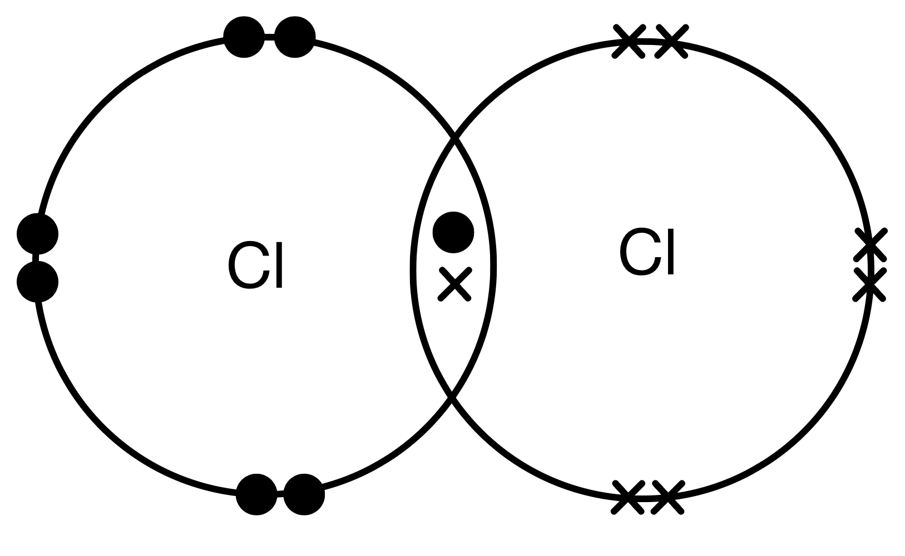

- Pair of electrons in overlap area between the atoms; **[1 mark] **
- Six un-bonded electrons on each Cl atom in the molecule; **[1 mark] **

**[Total: 2 marks]**

- *Each chlorine atom has 7 electrons in its outer most shell as it is in Group VII*
- *Therefore each atom requires 1 more electron in order to have a full outer shell *
- *Each shell overlaps to share a pair of electrons*
- *Check the remainder of the molecule to ensure there are the correct number of electrons in each atom*

### Q24
The monatomic structure is:

- **E** / Ar / argon; **[1 mark] **

**[Total: 1 mark] **

- *Group VIII (0) elements have a full outer shell of electrons*

  - *For example, argon has an electronic configuration of 2,8,8*
- *Therefore they do not need to form bonds to obtain a full outer shell like other elements*
- *This means they can exist as single atoms, or are monatomic *

### Q25
a) An element which reacts with cold water is:

- Rb / Sr; **[1 mark]**

**[Total: 1 mark]**

- *More reactive metals (calcium and above in the reactivity series) will react with cold water to form a metal hydroxide and hydrogen*
- *Iron is lower than calcium and will react slowly with steam so would not be accepted as an answer*
b) The element that is a solid at room temperature and exists as diatomic molecules, X2 is:

- I; **[1 mark]**

**[Total: 1 mark]**

- *From the list of given elements, iodine is the only one that exists as a diatomic molecule*
- *You should know all of the states of the halogens at room temperature*
c) The element that can form two oxides, XO and X2O3 is:

- Fe; **[1 mark]**

**[Total: 1 mark]**

- *The element X must exist as an X**2+** ion in XO and as an X**3+** ion in X**2**O**3 **so it can have different oxidation numbers*
- *The transition elements have more than one oxidation number, as they can lose a different number of electrons, depending on the chemical environment they are in*
- *Iron is the only transition element listed*
- *All of the other elements will form one ion and so have one oxidation number*
d) The element that has a hydride of the type XH3 is:

- P:** [1 mark]**

**[Total: 1 mark]**

- *Phosphorous will react with hydrogen to form a structure similar to ammonia, NH**3*
- *Both phosphorous and nitrogen are in Group V and have 5 outer shell electrons so will share a pair of electrons with each hydrogen atom to gain a full outer shell*
e) The element that has a macromolecular structure similar to that of carbon is:

- Si;** [1 mark]**

**[Total: 1 mark]**

- *Silicon forms covalent bonds with 4 oxygen atoms, each oxygen atom forms covalent bonds with 2 silicon atoms*
- *The resulting structure is a tetrahedron with one silicon atom and four oxygen atoms, similar to diamond*

### Q26
a)

i) The definition of the term diatomic is:

- (A substance with) <u>two atoms</u> per <u>molecule</u>; **[1 mark]**

ii) The electron distributions of the halogens all have:

- 7 electrons in their outer shell or level / the same number of outer electrons / (they all) need to gain one electron; **[1 mark]**

iii) The electron distributions of the halogens differ as:

- (Each halogen has a) different number of energy levels / different number of electrons; **[1 mark]**

iv) The completed table should be as follows:

| halogen | solid, liquid or gas  at room temperature | colour |
|---|---|---|
| chlorine | gas | yellow / yellow green / green |
| bromine | liquid | brown / red-brown / orange-brown **NOT**: red / orange |
| iodine | solid | black / grey / silver-grey / purple / violet **NOT**: blue-black |

- Each vertical column correct; **[1 mark]**

**[Total: 5 marks]**

- *Make sure you are specific with your colours as this can result in easy marks dropped*
- *For liquid bromine the colour must contain 'brown' to get the mark*
b) A diagram which shows the arrangement of the valency electrons in one molecule of the covalent compound arsenic trifluoride:

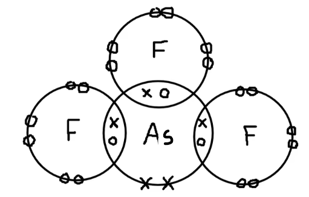

- correct formula, AsF3; **[1 mark]**
- 3 non-bond pairs and 1 bond pair around all 3 fluorine atoms; **[1 mark]**
- 3 bond pairs and 1 non-bond pair around arsenic atom; **[1 mark]**

**[Total: 3 marks]**

- *You are told the compound is arsenic** tri**flouride*

  - *This means for every 1 arsenic atom there will be 3 fluorine atoms*
- *Fluorine is in group 7 so has 7 outer shell electrons*
- *From the electron distribution of the arsenic atom we can tell that arsenic has 5 outer shell electrons*
- *The arsenic atom will form a single covalent bond to each fluorine atom allowing each atom to have a full outer shell*
- *Always do a final check of your structure to make sure each atom has 8 electrons *
c) Photochromic glass works by:

- (Increased) light increases / causes forward reaction / light causes AgCl reacts with CuCl; **[1 mark]**
- (Increased) light increases the amount of silver (and so darkens glass); **[1 mark]**
- A decrease in light reverses reaction / uses up silver/silver reacts (and so reduces darkness); **[1 mark]**

**[Total: 3 marks]**

- *Here you are given an unfamiliar example of a reversible reaction*
- *You can tell it is a reversible reaction from the reaction arrow *$\rightleftharpoons$
- *You should understand how changing the conditions of a reversible reaction can change the direction of the reaction from the examples covered in the notes*
- *We can apply the principle from these reactions to figure out what is going on here*
- *We are told in bright light the glass darkens*

  - *This must mean more Ag must be produced as it is black *
  - *This means bright light must trigger the forward reaction*
- *In less bright light we are told the glass becomes colourless*

  - *This must mean Ag is removed*
  - *This means less bright light must trigger the backward reaction, using up Ag*

### Q27
Three properties of iron that show it is a transition element and not a Group 1 element are:

Any **three** of the following

- High melting point / high boiling point
- High density
- Forms coloured compounds
- Forms ions with different charges / forms ions with variable valency / form ions with different oxidation numbers
- Forms complex ions
- Can be used as a catalyst

**Final answer:** **[Total: 3 marks] **

- *You should know the general properties of transition elements *
- *Group I elements are very reactive, have low density and relatively low melting points*
