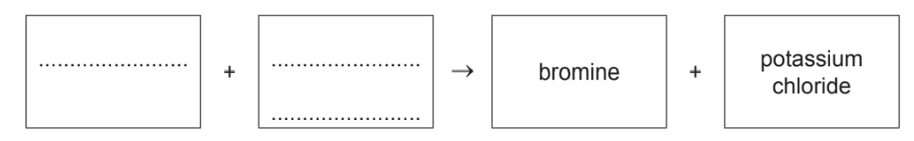
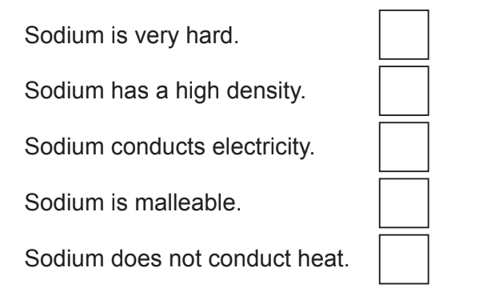
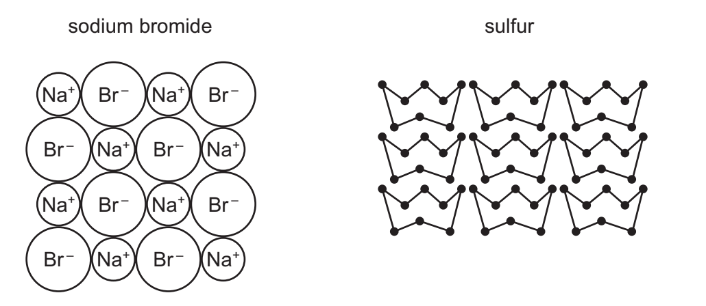
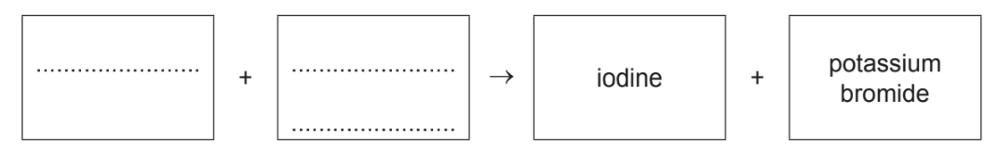
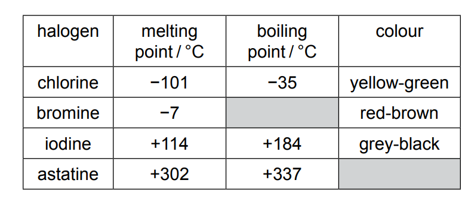
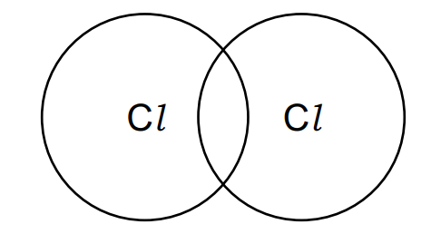
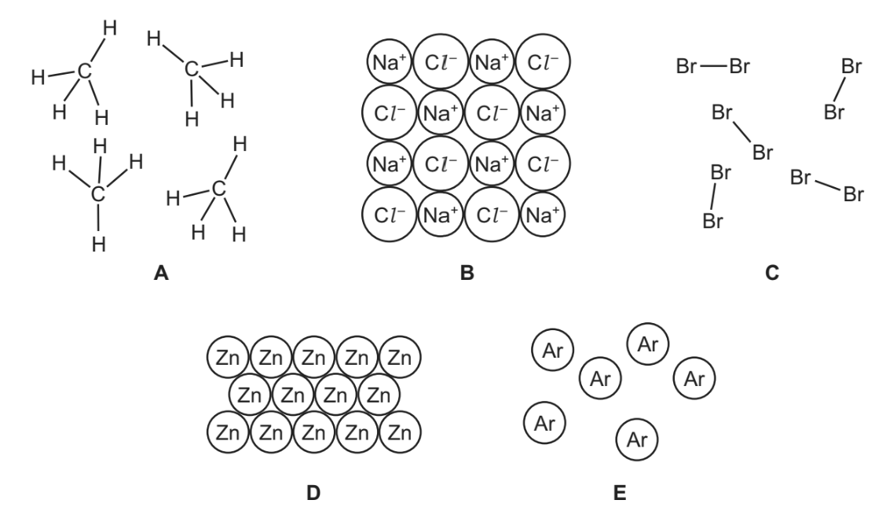

# Exam Questions — Group Properties & Trends
**8. The Periodic Table** · Cambridge (CIE) IGCSE chemistry (0620 & 0971)
> Source: [https://www.savemyexams.com/igcse/chemistry/cie/23/topic-questions/](https://www.savemyexams.com/igcse/chemistry/cie/23/topic-questions/) · 44 questions across 2 sets

## Multiple Choice Questions (29 questions)

### Q1 — medium — 1 marks

**Q1** [1 mark]

**X**, **Y** and **Z** are the halogens chlorine, bromine and iodine, but not necessarily in that order.

When aqueous **Y** is added to an aqueous solution containing ions of **Z**, a brown solution is formed. When aqueous **X** is added to an aqueous solution containing ions of **Z**, no reaction occurs

Which row correctly identifies halogens X, Y and Z?

|   | X | Y | Z |
|---|---|---|---|
| **A** | bromine | chlorine | iodine |
| **B** | iodine | chlorine | bromine |
| **C** | iodine | bromine | chlorine |
| **D** | chlorine | iodine | bromine |

### Q2 — hard — 1 marks

**Q2** [1 mark]

Four statements about Group I metals are shown.

1. They share similar physical properties because they have the same number of electrons in their outer shell.
2. Reactivity increases down the group because the outer electron is further from the nucleus and is more easily lost.
3. Transition elements have higher melting points than Group I metals because the metallic bonding in Group I metals is weaker.
4. Group I metals form soluble acidic oxides which dissolve in water to form solutions with a high pH.

Which statements are correct?

### Q3 — easy — 1 marks

**Q3** [1 mark]

The transition elements are used extensively as catalysts. Which statement explains why they are such good catalysts?

### Q4 — easy — 1 marks

**Q4** [1 mark]

Element X is an unreactive non-metal element. Where could this element be found on the Periodic table?

### Q5 — easy — 1 marks

**Q5** [1 mark]

Which of the following observations does not apply to Group I elements?

### Q6 — easy — 1 marks

**Q6** [1 mark]

Which row describes the properties of fluorine?

|   | **colour** | **state at r.t.p** | **more reactive than chlorine** |
|---|---|---|---|
| **A** | yellow | gas | yes |
| **B** | green | gas | no |
| **C** | brown | liquid | no |
| **D** | brown | gas | yes |

### Q7 — easy — 1 marks

**Q7** [1 mark]

Astatine is found below iodine in Group 7 of the periodic table.

What is its formula and state at room temperature?

|   | **Formula** | **State at room temperature ** |
|---|---|---|
| ** A** | At | gas |
| ** B** | At | solid |
| ** C** | At2 | liquid |
| ** D** | At2 | solid |

### Q8 — hard — 1 marks

**Q8** [1 mark]

The reactivity of the alkali metals increases moving down the group. Which statement explains this observation?

### Q9 — hard — 1 marks

**Q9** [1 mark]

Properties of four alkali metals labelled are shown in the table. Which one is placed lowest in the group?

|   | **melting point / ****o****C** | **density / g cm****-3** |
|---|---|---|
| **A** | 39 | 1.50 |
| **B** | 28.5 | 1.93 |
| **C** | 98 | 0.98 |
| **D** | 63.5 | 0.86 |

### Q10 — hard — 1 marks

**Q10** [1 mark]

Bromine and rubidium react together to form the compound rubidium bromide. Which row correctly describes the formula and colour of rubidium bromide?

|   | **formula** | **colour** |
|---|---|---|
| **A** | RbBr | dark grey |
| **B** | RbBr2 | dark grey |
| **C** | RbBr | white |
| **D** | RbBr2 | white |

### Q11 — hard — 1 marks

**Q11** [1 mark]

A solution of a lithium halide and a halogen are mixed together. A reaction occurs and the mixture darkens in colour.

What is present in the reaction mixture?

### Q12 — hard — 1 marks

**Q12** [1 mark]

Element Q is a halogen which reacts with aqueous potassium bromide, as shown in the reaction below:

Q2 + 2 KBr → 2 KQ + Br2

Which row describes element Q?

|   | **More reactive than bromine** | **Greater *****A*****r**** than bromine** |
|---|---|---|
| **A** | `✓` | `✓` |
| **B** | `✓` | $\times$ |
| **C** | $\times$ | `✓` |
| **D** | $\times$ | $\times$ |

### Q13 — medium — 1 marks

**Q13** [1 mark]

The reactivity of the halogens decreases moving down the group.

Which statement explains this observation?

### Q14 — medium — 1 marks

**Q14** [1 mark]

Which entry in the table matches the transition elements?

|   | **density** | **melting point** | **from coloured compounds** |
|---|---|---|---|
| **A** | high | low | no |
| **B** | high | high | yes |
| **C** | low | low | no |
| **D** | low | high | yes |

### Q15 — medium — 1 marks

**Q15** [1 mark]

Astatine is a radioactive Group VII element which is extremely unstable, making it difficult to study. The physical and chemical properties of astatine can only be estimated.

Which row most likely describes the properties of astatine?

|   | **State** | **Colour** | **Reaction with KI (aq)** |
|---|---|---|---|
| **A** | liquid | yellow | brown colour |
| **B** | solid | green | no reaction |
| **C** | gas | dark brown | brown colour |
| **D** | solid | black | no reaction |

### Q16 — medium — 1 marks

**Q16** [1 mark]

Which statement about the Alkali metals is correct?

### Q17 — medium — 1 marks

**Q17** [1 mark]

Which row describes the properties of a typical noble gas?

|   | **outer electrons** | **atom or molecule** | **boiling point** |
|---|---|---|---|
| **A** | full | atom | very low |
| **B** | 6 | molecule | low |
| **C** | 8 | atom | very high |
| **D** | 6 | molecule | high |

## Theory Questions (33 questions)

### Q1 — medium — 11 marks

**Q1** [1 mark]

This question is about the elements in Group VII of the Periodic Table, and their compounds.

State the general name given to the elements in Group VII.

**Q1** [3 marks]

Chlorine gas is bubbled through aqueous potassium bromide. A displacement reaction occurs.

(i) State one observation that is made during this reaction.

[1]

(ii) Predict whether a reaction would occur if aqueous iodine is added to aqueous potassium bromide instead of chlorine. Explain your reasoning.

**prediction**

**explanation**

[2]

**Q1** [4 marks]

Chlorine reacts with methane, CH4, in a substitution reaction.

i) State the essential condition required for this reaction to happen.

[1]

ii) The chemical equation for the reaction is shown.

CH4(g) + Cl2(g) → CH3Cl (g) + HCl (g)

Some bond energies are given in Table 5.1.

| bond | bond energy in kJ / mol |
|---|---|
| C–H | 410 |
| Cl–Cl | 240 |
| C–Cl | 340 |
| H–Cl | 430 |

Calculate the enthalpy change for this reaction. Show your working. Use the following steps:

- Calculate the energy needed to break the bonds.

energy = .............................. kJ/mol

- Calculate the energy released in forming the bonds.

energy = .............................. kJ/mol

- Determine the overall enthalpy change for the reaction.

enthalpy change =  .............................. kJ/mol

[3]

**Q1** [3 marks]

PVC is an addition polymer that contains chlorine.

i) State one use of PVC.

[1]

ii) The structure of PVC is shown in Fig 5.1

**Fig 5.1**

Draw the displayed formula of the monomer used to make PVC. Show all of the atoms and all of the bonds.

[2]

### Q2 — easy — 11 marks

**Q2** [1 mark]

A student investigates the reactivity of sodium with water.

Complete the word equation for the reaction between sodium and water.

sodium + water→  .................  +   hydrogen

**Q2** [3 marks]

**Extract:**

A student investigates the reactivity of sodium with water. Complete the word equation for the reaction between sodium and water. sodium + water→ ................. + hydrogen

The student measures the temperature of the reaction mixture. The temperature increases from 20 $\circ$C to 30 $\circ$C.

Complete Fig 4.1  to show the reaction pathway diagram for this reaction. Your diagram should include:

- labels for **reactants** and **products**
- an arrow representing the **enthalpy change**, labelled Δ*H*

**Fig 4.1**

**Q2** [2 marks]

**Extract:**

A student investigates the reactivity of sodium with water. sodium + water → sodium hydroxide + hydrogen

Hydrogen gas is produced in this reaction. Describe the test for hydrogen and the expected observation.

**Test: **

**Observation: **

**Q2** [2 marks]

Hydrogen reacts with nitrogen to form ammonia, NH3. It has a simple molecular structure and multiple industrial applications.

Complete the dot-and-cross diagram in Fig 4.2 to show the electron arrangement in a molecule of ammonia. **Show outer shell electrons only.**

**Fig 4.2**

**Q2** [3 marks]

Sodium is in Group I of the Periodic Table. Iron is a transition element. Sodium reacts rapidly with cold water, whereas iron does not.

i) State the electronic configuration of a sodium atom.

[1]

ii) Describe **two** other differences in the **chemical** properties of iron compared to sodium.

[2]

### Q3 — easy — 2 marks

**Q3** [2 marks]

Copper is a transition element. It has variable oxidation states.

State **two **other chemical properties of transition elements which make them different from Group I elements.

*Source:  Specimen0620/04 Q3A*

### Q4 — hard — 8 marks

**Q4** [4 marks]

This question is concerned with the elements in Period 5, Rb to Xe.

The electron distributions of some of these elements are given in the following list.

| Element **B** | 2 + 8 + 18 + 18 + 8 |
|---|---|
| Element **C** | 2 + 8 + 18 + 18 + 5 |
| Element **D** | 2 + 8 + 18 +18 + 6 |
| Element **E** | 2 + 8 + 18 + 18 + 4 |
| Element **F** | 2 + 8 + 18 + 18 + 7 |

i) Identify element **C**.

[1]

ii) Which element in the list does not form any compounds?

[1]

iii) Which element in the list forms a chloride of the type XCl2?

[1]

iv) Which two elements would react together to form a compound of the type XY4?

[1]

*Source: 2012 O32 Q1*

**Q4** [4 marks]

Predict two differences in physical properties and two differences in chemical properties between rubidium and the transition metal niobium.

*Source: 2012 O32 Q1*

### Q5 — medium — 15 marks

**Q5** [2 marks]

#### Extended Only

Use your copy of the periodic table to help you answer these questions.

Predict the formula of each of the following compounds.

i) barium oxide.

[1]

ii) boron oxide.

[1]

*Source: 2007 Ju31 Q4*

**Q5** [2 marks]

Give the formula of the following ions.

i) sulphide

[1]

ii) gallium

[1]

*Source: 2007 Ju31 Q4*

**Q5** [3 marks]

Draw a diagram showing the arrangement of the valency electrons in one molecule of the covalent compound nitrogen trichloride.

Use x to represent an electron from a nitrogen atom.

Use o to represent an electron from a chlorine atom.

*Source: 2007 Ju31 Q4*

**Q5** [4 marks]

Potassium and vanadium are elements in Period IV.

i) State **two** differences in their physical properties.

[2]

ii) Give **two** differences in their chemical properties.

[2]

*Source: 2007 Ju31 Q4*

**Q5** [4 marks]

Fluorine and astatine are halogens. Use your knowledge of the other halogens to predict the following:

i) The physical state of fluorine at r.t.p........ 
    The physical state of astatine at r.t.p........

[2]

ii) **Two** similarities in their chemical properties

[2]

*Source: 2007 Ju31 Q4*

### Q6 — easy — 3 marks

**Q6** [2 marks]

Complete the word equation to show the halogen and halide compound which react to form the products bromine and potassium chloride.

*Source: 2019 Ju0620/31/03 Q4C*

**Q6** [1 mark]

Explain, in terms of the reactivity of the halogens, why aqueous bromine will not react with aqueous potassium chloride.

*Source: 2019 Ju0620/31/03 Q4C*

### Q7 — medium — 5 marks

**Q7** [1 mark]

For each of the following, give the name of an element from Period 3 (sodium to argon), which matches the description.

An element which is gaseous at room temperature and pressure

*Source: 2015 Ja32 Q1*

**Q7** [1 mark]

**Extract:**

For each of the following, give the name of an element from Period 3 (sodium to argon), which matches the description.

An element that is added to water to kill bacteria.

*Source: 2015 Ja32 Q1*

**Q7** [1 mark]

**Extract:**

For each of the following, give the name of an element from Period 3 (sodium to argon), which matches the description.

An element that forms a basic oxide of the type XO.

*Source: 2015 Ja32 Q1*

**Q7** [1 mark]

**Extract:**

For each of the following, give the name of an element from Period 3 (sodium to argon), which matches the description.

#### Extended Only

An element that forms an amphoteric oxide.

*Source: 2015 Ja32 Q1*

**Q7** [1 mark]

**Extract:**

For each of the following, give the name of an element from Period 3 (sodium to argon), which matches the description.

An element that reacts vigorously with cold water to produce hydrogen.

*Source: 2015 Ja32 Q1*

### Q8 — medium — 11 marks

**Q8** [4 marks]

Three of the halogens in Group VII are listed below.

| chlorine |
|---|
| bromine |
| iodine |

i) How does their colour change down the Group?

[1]

ii) How do their melting points and boiling points change down the Group?

[1]

iii) Predict the colour and physical state (solid, liquid or gas) of astatine, At. colour ... physical state ...

[2]

*Source: 2012 Oct31 Q2*

**Q8** [5 marks]

A radioactive isotope of iodine, $I_{53}^{131}$, is used to treat cancer.

i) Define the term *isotope*.

[2]

ii) How many protons, electrons and neutrons are there in one atom of $I_{53}^{131}$

number of protons .............. number of electrons ............ number of neutrons ............

[2]

iii)When this isotope, $I_{53}^{131}$, emits radiation, a different element with a proton number of 54 is formed. What is the name of this element?

[1]

*Source: 2012 Oct31 Q2*

**Q8** [2 marks]

#### Extended Only

Fluorine, the most reactive halogen, forms compounds with the other halogens. It forms two compounds with bromine. Deduce their formulae from the following information.

compound 1 
The mass of one mole of this compound is 137 g. 
Its formula is .................................

[1]

compound 2 
0.02 moles of this compound contain 0.02 moles of bromine atoms and 0.1 moles of fluorine atoms. 
Its formula is .................................

[1]

*Source: 2012 Oct31 Q2*

### Q9 — medium — 9 marks

**Q9** [5 marks]

Use your copy of the Periodic Table to answer these questions.

Choose an element from the Periodic Table to match each description. You may give either the name or the symbol.

i) It is the most reactive metal.

[1]

ii) It is the only non-metal which is a liquid at r.t.p.

[1]

iii) This Group VII element is a solid at r.t.p.

[1]

iv) This element is in Group V and Period 4.

[1]

v) This unreactive gas is used to fill lamps.

[1]

*Source: 2011 O33 Q1*

**Q9** [2 marks]

**Extract:**

The formula of the compounds is

i) Germanium oxide:
- GeO~2~; [1 mark] 
*Allow GeO*

ii) Tellurium bromide:
- TeBr~2~; [1 mark] 
*Allow TeBr*~*4*~

- You can use valencies to work the formula out
- Valency tells you how many electrons an atom loses, gains or shares, to form a compound
- Valencies can be determined by the group the element is in:
- Group I and VII elements have a valency of 1
- Group II and VI elements have a valency of 2
- Group III and V elements have a valency of 3
- Group IV elements have a valency of 4
- Group VIII elements have a valency of 0

- Both compounds can be formed with a different ratio of elements, as shown in the accepted answers, however, you are not expected to know these or work these out

Predict the formula of each of the following compounds.

i) Germanium oxide

[1]

ii) Tellurium bromide

[1]

*Source: 2011 O33 Q1*

**Q9** [2 marks]

Give the formula of each of the following ions.

i) Strontium

[1]

ii) Fluoride

[1]

*Source: 2011 O33 Q1*

### Q10 — medium — 10 marks

**Q10** [8 marks]

#### Separate: Chemistry Only

For each of the following, give the name of an element from Period 2 (lithium to neon), which matches the description. 
Elements may be used once, more than once or not at all.

i) An element which is gaseous at room temperature and pressure

[1]

ii) An element which forms an oxide that is a reactant in photosynthesis

[1]

iii) An element that is a product of photosynthesis

[1]

iv) An element that makes up approximately 78% by volume of the air

[1]

v) An element which has atoms with a full outer shell of electrons

[1]

vi) An element which exists as both diamond and graphite

[1]

vii) An element that reacts vigorously with cold water

[1]

viii) A soft metallic element which is stored in oil

[1]

*Source: 2016 Ju42 Q1*

**Q10** [2 marks]

Give the formula of a compound that contains

i) only boron and oxygen,

[1]

ii) only lithium and nitrogen.

[1]

*Source: 2016 Ju42 Q1*

### Q11 — easy — 3 marks

**Q11** [1 mark]

Sodium can be extracted from sodium bromide by electrolysis.

Sodium is a metal in Group I of the Periodic Table.

Describe **one **chemical property of sodium.

*Source: 2020 0620/31 Q8C*

**Q11** [2 marks]

Which two of these statements about the physical properties of sodium are correct?

Tick **two **boxes.

*Source: 2020 0620/31 Q8C*

### Q12 — hard — 9 marks

**Q12** [3 marks]

Scandium, proton number 21, is not a typical transition element.

Scandium is a low density metal which has only one oxidation state in its compounds. Scandium compounds are white solids which form colourless solutions. Titanium, the next metal in the period, is a far more typical transition element.

How would the properties of titanium differ from those of scandium?

*Source: 2014 Ju32 Q6*

**Q12** [3 marks]

Scandium fluoride is an ionic compound. The valency of scandium in scandium fluoride is three.

Draw a diagram which shows the formula of this compound, the charges on the ions and the arrangement of the valency electrons around the negative ions.

Use × to represent an electron from a fluorine atom. 
Use ○ to represent an electron from a scandium atom.

*Source: 2014 Ju32 Q6*

**Q12** [3 marks]

Scandium oxide is insoluble in water. Describe how you could show that it is an amphoteric oxide.

*Source: 2014 Ju32 Q6*

### Q13 — medium — 8 marks

**Q13** [5 marks]

The diagram shows part of the structures of sodium bromide and sulfur.

Describe both sodium bromide and sulfur in terms of:

bonding

electrical conductivity

solubility in water

*Source: 2020 Ju0620/32 Q5C*

**Q13** [1 mark]

Sulfur is an element.

What is meant by the term element?

*Source: 2020 Ju0620/32 Q5C*

**Q13** [2 marks]

A coloured crystal of cobalt(II) chloride is placed at the bottom of a beaker containing water. Colour spreads throughout the water over time. **Figure 1** shows the spread of colour after two days.

**Figure 1**

Cobalt is a transition element. Lithium is a Group I element.

Describe** two** ways in which the properties of cobalt differ from those of lithium.

### Q14 — easy — 2 marks

**Q14** [2 marks]

Aluminium is extracted by electrolysis. Iron is extracted from its ore by reduction with carbon.

Iron is a transition element. Give **two **ways in which the properties of transition elements differ from the properties of Group I metals.

*Source: 2020 Ju [0620/43/04] Q3B*

### Q15 — easy — 12 marks

**Q15** [1 mark]

Rubidium, Rb, is a Group I element. It has similar physical and chemical properties to the other elements in Group I.

Predict how many electrons there are in the outer shell of a rubidium atom.

*Source: 2016 Ja42 Q2*

**Q15** [1 mark]

**Extract:**

Rubidium, Rb, is a Group I element. It has similar physical and chemical properties to the other elements in Group I.

Predict one physical property of rubidium which is the same as that of a transition element such as iron.

*Source: 2016 Ja42 Q2*

**Q15** [2 marks]

**Extract:**

Rubidium, Rb, is a Group I element. It has similar physical and chemical properties to the other elements in Group I.

Predict two physical properties of rubidium which are different to those of a transition element such as iron.

*Source: 2013 Ja42 Q2*

**Q15** [7 marks]

**Extract:**

Rubidium, Rb, is a Group I element. It has similar physical and chemical properties to the other elements in Group I.

When rubidium is added to cold water a reaction occurs.

i) Suggest two observations that would be made when rubidium is added to cold water.

[2]

ii) What would be the colour of the solution if methyl orange was added to it after the reaction?

[1]

iii) Write a chemical equation for the reaction between rubidium and water.

[2]

iv) Put the Group I elements, caesium, lithium, potassium, rubidium and sodium in their order of reactivity with water, from the most reactive to the least reactive.

[1]

v) Suggest one safety measure that should be used when rubidium is added to cold water.

[1]

*Source: 2016 Ja42 Q2*

**Q15** [1 mark]

**Extract:**

Rubidium, Rb, is a Group I element. It has similar physical and chemical properties to the other elements in Group I.
Predict how many electrons there are in the outer shell of a rubidium atom. Answer: 1 / one (Rubidium is in Group I so will have one electron in its outer shell)

#### Extended Only

The phosphate ion has the formula PO43–. Deduce the formula of rubidium phosphate.

*Source: 2016 Ja42 Q2*

### Q16 — easy — 3 marks

**Q16** [2 marks]

Complete the word equation to show the halogen and halide compound which react to form the products iodine and potassium bromide.

*Source: 2020 Ju0620/43/04 Q7E*

**Q16** [1 mark]

Explain, in terms of the reactivity of the halogens, why aqueous iodine does not react with aqueous potassium chloride.

*Source: 2019 Ju0620/31/03 Q3C*

### Q17 — hard — 7 marks

**Q17** [2 marks]

Rubidium and strontium are very reactive metals at the top of the reactivity series. Because their ions have different charges, their compounds behave differently when heated.

The formulae of the ions of these two elements are Rb+ and Sr2+.

Explain why these metals, which are in different groups, form ions which have different charges.

*Source: 2014 O33 Q6A*

**Q17** [5 marks]

Strontium carbonate is similar to calcium carbonate. It is insoluble in water and it decomposes when heated. Rubidium carbonate is soluble in water and does not decompose when heated.

i) Describe a method to prepare a pure sample of the insoluble salt, strontium carbonate, by precipitation.

[4]

ii) Complete the equation for the decomposition of strontium carbonate.

SrCO3 → ............ + ............

[1]

*Source: 2014 O33 Q6B*

### Q18 — easy — 6 marks

**Q18** [2 marks]

#### Extended Only

For each of the following unfamiliar elements predict one physical and one chemical property.

Caesium (Cs) Physical property .............................................................................................................. 
Chemical property .............................................................................................................

*Source: 2010 Ju32 Q1*

**Q18** [2 marks]

**Extract:**

For each of the following unfamiliar elements predict one physical and one chemical property.

Vanadium (V) Physical property .............................................................................................................. 
Chemical property .............................................................................................................

*Source: 2010 Ju32 Q1*

**Q18** [2 marks]

**Extract:**

For each of the following unfamiliar elements predict one physical and one chemical property.

Fluorine (F) Physical property .............................................................................................................. 
Chemical property .............................................................................................................

*Source: 2010 Oc32 Q1*

### Q19 — hard — 8 marks

**Q19** [1 mark]

For each of the following, select an element from Period 4, potassium to krypton, which matches the description.

A metal that reacts rapidly with cold water to form a compound of the type M(OH)2 and hydrogen.

*Source: 2012 O33 Q1*

**Q19** [1 mark]

**Extract:**

For each of the following, select an element from Period 4, potassium to krypton, which matches the description.

Its only oxidation state is 0.

*Source: 2012 O33 Q1*

**Q19** [1 mark]

**Extract:**

For each of the following, select an element from Period 4, potassium to krypton, which matches the description.

It has a macromolecular oxide, XO2, which has similar physical properties to those of diamond.

*Source: 2012 O33 Q1*

**Q19** [1 mark]

**Extract:**

For each of the following, select an element from Period 4, potassium to krypton, which matches the description.

This is one of the metals alloyed with iron in stainless steel.

*Source: 2012 O33 Q1*

**Q19** [1 mark]

**Extract:**

For each of the following, select an element from Period 4, potassium to krypton, which matches the description.

It can be reduced to an ion of the type X–.

*Source: 2012 O33 Q1*

**Q19** [1 mark]

**Extract:**

For each of the following, select an element from Period 4, potassium to krypton, which matches the description.

It can form a covalent hydride having the formula H2X.

*Source: 2012 O33 Q1*

**Q19** [1 mark]

**Extract:**

For each of the following, select an element from Period 4, potassium to krypton, which matches the description.

Its soluble salts are blue and its oxide is black.

*Source: 2012 O33 Q1*

**Q19** [1 mark]

**Extract:**

For each of the following, select an element from Period 4, potassium to krypton, which matches the description.

It is a liquid at room temperature.

*Source: 2012 O33 Q1*

### Q20 — hard — 11 marks

**Q20** [4 marks]

Three of the halogens in Group VII are:

**chlorine** 
**bromine** 
**iodine**

i) How does their colour change down the Group?

[1]

ii) How does their physical state (solid, liquid or gas) change down the Group?

[1]

iii) Predict the colour and physical state of fluorine.

Colour .................... 
Physical state ....................

[2]

*Source: 2005 Ju13 Q1A*

**Q20** [3 marks]

Describe how you could distinguish between aqueous potassium bromide and aqueous potassium iodide.

Test ....................

Result with bromide ............................................................

Result with iodide ............................................................

*Source: 2005 Ju13 Q1B*

**Q20** [2 marks]

**Extract:**

0.015 moles of iodine react with 0.045 moles of chlorine to form 0.030 moles of a single product.

0.015 moles of iodine react with 0.045 moles of chlorine to form 0.030 moles of a single product.

Complete the equation.

I2 + ............ Cl2 → ................................

*Source: 2005 Ju13 Q1C*

**Q20** [2 marks]

Traces of chlorine can be separated from bromine vapour by diffusion.

Which gas would diffuse the faster and why?

*Source: 2005 Ju13 Q1D*

### Q21 — medium — 4 marks

**Q21** [1 mark]

**Extract:**

The properties of the first four Group I elements are shown in the table.

| **element** | **density in g / cm****3** | **melting point / °C** | **boiling point / °C** |
|---|---|---|---|
| lithium | 0.53 | 181 | 1342 |
| sodium | 0.97 | 98 | 883 |
| potassium | 0.86 | 63 | 760 |
| rubidium |   | 39 | 686 |

The properties of the first four Group I elements are shown in the table.

| **element** | **density in g / cm****3** | **melting point / °C** | **boiling point / °C** |
|---|---|---|---|
| lithium | 0.53 | 181 | 1342 |
| sodium | 0.97 | 98 | 883 |
| potassium | 0.86 | 63 | 760 |
| rubidium |   | 39 | 686 |

Answer these questions using only the information in the table.

Describe the general trend in the boiling points of the Group I elements.

*Source: 2020 Ju0620/31 Q7G*

**Q21** [1 mark]

**Extract:**

The properties of the first four Group I elements are shown in the table.

| element | density in g/cm^3 | melting point / °C | boiling point / °C |
| lithium | 0.53 | 181 | 1342 |
| sodium | 0.97 | 98 | 883 |
| potassium | 0.86 | 63 | 760 |
| rubidium |   | 39 | 686 |

Answer these questions using only the information in the table.

Explain why it is difficult to predict the density of rubidium.

*Source: 2020 0620/41 Q4B*

**Q21** [2 marks]

**Extract:**

The properties of the first four Group I elements are shown in the table.

| element | density in g/cm3 | melting point / °C | boiling point / °C |
| lithium | 0.53 | 181 | 1342 |
| sodium | 0.97 | 98 | 883 |
| potassium | 0.86 | 63 | 760 |
| rubidium | | 39 | 686 |

Deduce the state of rubidium at 45 °C. Explain your answer.

*Source: 2020 0620/42/04 Q1B*

### Q22 — medium — 7 marks

**Q22** [1 mark]

For each of the following select an element from Period 4, potassium to krypton, that matches the description.

It is a brown liquid at room temperature.

*Source: 2008 Ju31 Q1*

**Q22** [1 mark]

**Extract:**

For each of the following select an element from Period 4, potassium to krypton, that matches the description.

It forms a compound with hydrogen having the formula XH4.

*Source: 2008 Ju31 Q1*

**Q22** [1 mark]

**Extract:**

For each of the following select an element from Period 4, potassium to krypton, that matches the description.

A metal that reacts violently with cold water.

*Source: 2008 Ju31 Q1*

**Q22** [1 mark]

**Extract:**

For each of the following select an element from Period 4, potassium to krypton, that matches the description.

It has a complete outer energy level.

*Source: 2008 Ju31 Q1*

**Q22** [1 mark]

**Extract:**

For each of the following select an element from Period 4, potassium to krypton, that matches the description.

#### Separate: Chemistry and Extended Only

It has oxidation states of 2 and 3 only.

*Source: 2008 Ju31 Q1*

**Q22** [1 mark]

**Extract:**

For each of the following select an element from Period 4, potassium to krypton, that matches the description.

It can form an ion of the type X-.

*Source: 2008 Ju31 Q1*

**Q22** [1 mark]

**Extract:**

For each of the following select an element from Period 4, potassium to krypton, that matches the description.

#### Separate: Chemistry and Extended Only

One of its oxides is the catalyst in the Contact Process.

*Source: 2008 Ju31 Q1*

### Q23 — medium — 7 marks

**Q23** [3 marks]

**Table 1 **shows some properties of some of the halogens. **                                                                  Table 1**

Use the information in **Table 1** to suggest:

- the colour of astatine ______________
- the boiling point of bromine ____________
- the state of iodine at 190 °C _______________

*Source:  Specimen0620/03 Q7A*

**Q23** [1 mark]

Aqueous chlorine reacts with aqueous potassium bromide as shown.

Cl2 + 2KBr → Br2 + 2KCl* *

Name the salt formed in this reaction.

**Q23** [1 mark]

**Extract:**

Aqueous chlorine reacts with aqueous potassium bromide as shown. Cl~2~ + 2KBr → Br~2~ + 2KCl

Explain why aqueous bromine does **not** react with aqueous potassium chloride.

*Source:  Specimen0620/03 Q7B*

**Q23** [2 marks]

Complete the dot-and-cross diagram in **Figure 1** of a molecule of chlorine. Show outer shell electrons only.

**Figure 1**

*Source:  Specimen0620/03 Q7B*

### Q24 — easy — 1 marks

**Q24** [1 mark]

The diagram shows part of the structures of five substances, **A**, **B**, **C**, **D** and **E**.

Which one of these structures, **A**, **B**, **C**, **D** or **E**, is monatomic?

*Source: 2019 Ju[0620/32/03] Q4C*

### Q25 — medium — 5 marks

**Q25** [1 mark]

Choose an element from the list below which best fits the description.

| **Rb** | **Fe** | **Si** | **I** | **P** | **Sr** |
|---|---|---|---|---|---|

An element which reacts with cold water.

*Source: 2011 Ju32 Q1*

**Q25** [1 mark]

**Extract:**

Choose an element from the list below which best fits the description.
| Rb | Fe | Si | I | P | Sr |

It is a solid at room temperature and exists as diatomic molecules, X2.

*Source: 2011 Ju32 Q1*

**Q25** [1 mark]

**Extract:**

Choose an element from the list below which best fits the description.

| Rb | Fe | Si | I | P | Sr |

#### Separate: Chemistry and Extended Only

It can form two oxides, XO and X2O3.

*Source: 2011 Ju32 Q1*

**Q25** [1 mark]

**Extract:**

Choose an element from the list below which best fits the description.

| Rb | Fe | Si | I | P | Sr |

This element has a hydride of the type XH3.

*Source: 2011 Ju32 Q1*

**Q25** [1 mark]

**Extract:**

Choose an element from the list below which best fits the description.

| Rb | Fe | Si | I | P | Sr |

#### Separate: Chemistry and Extended Only

It has a macromolecular structure similar to that of carbon.

*Source: 2011 Ju32 Q1*

### Q26 — hard — 11 marks

**Q26** [5 marks]

The halogens are a collection of diatomic non-metals in Group VII.

i) Define the term diatomic.

[1]

ii) What do the electron distributions of the halogens have in common?

[1]

iii) How do their electron distributions differ?

[1]

iv) Complete the table.

| halogen | solid, liquid or gas  at room temperature | colour |
|---|---|---|
| chlorine |   |   |
| bromine |   |   |
| iodine |   |   |

[2]

*Source: 2013 Oct32 Q2*

**Q26** [3 marks]

The halogens react with other non-metals to form covalent compounds.

Draw a diagram which shows the arrangement of the valency electrons in one molecule of the covalent compound arsenic trifluoride.

The electron distribution of an arsenic atom is 2 + 8 + 18 + 5. 
Use x to represent an electron from an arsenic atom. 
Use o to represent an electron from a fluorine atom.

*Source: 2013 Oct32 Q2*

**Q26** [3 marks]

Photochromic glass is used in sunglasses. In bright light, the glass darkens reducing the amount of light reaching the eye. When the light is less bright, the glass becomes colourless increasing the amount of light reaching the eye. 
Photochromic glass contains very small amounts of the halides silver(I) chloride and copper(I) chloride. 
The reaction between these two chlorides is photochemical.

AgCl           +             CuCl     $\rightleftharpoons$     Ag     +      CuCl2

colourless     colourless      black      colourless

How does photochromic glass work?

*Source: 2013 Oct32 Q2*

### Q27 — easy — 3 marks

**Q27** [3 marks]

Describe **three **properties of iron that show that it is a transition element and not a Group I element.

*Source: 2019 Ju[0620/32/03] Q4C*

