# Mark Schemes — Properties, Uses & Alloys of Metals
**9. Metals** · Cambridge (CIE) IGCSE chemistry (0620 & 0971)

## Alternative To Practical Questions (1 questions)

### Q1
a) The completed table is:

| solution of sulfuric acid | thermometer diagram | initial temperature / oC | thermometer diagram | highest temperature / oC | change in temperature / oC |
|---|---|---|---|---|---|
| **A** | 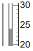 | 24 | 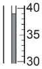 | 39 | 15 |
| **B** | 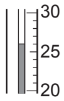 | 26 |  | 37 | 11 |
| **C** | 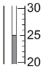 | 25 | 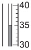 | 35 | 10 |
| **D** |  | 24 | 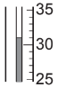 | 31 | 7 |
| **E** |  | 26 | 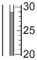 | 29 | 3 |

- Initial temperature boxes correctly completed; **[2 marks]**
- Highest temperature boxes correctly completed; **[2 marks]**
- Change in temperature boxes correctly completed; **[1 mark] **

**[Total: 5 marks]**

- *Careful:** The thermometer diagrams are not all on the same scale so take your time getting the correct values *
b) The labelled bar chart is:

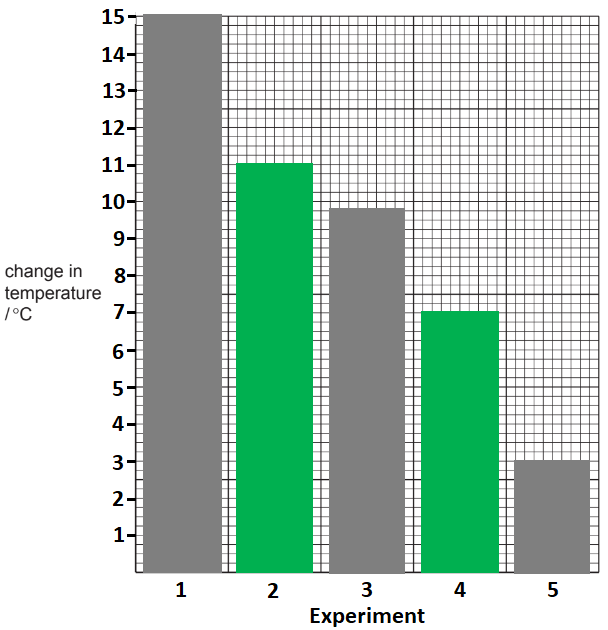

- All 5 bars correctly drawn; **[2 marks]** *Lose 1 mark for each incorrect bar*
- Bars correctly labelled in the centre **OR **x-axis correctly labelled; **[1 mark]**
- Correct / suitable scale on the y-axis; **[1 mark]** *Must cover at least half the y-axis on the grid*

**[Total: 4 marks]**

- *Graph drawing is an expected skill - get practising*
- *Although they are usually easier, bar charts are not that common in exam questions*
- *Make sure your bar charts are good:*

  - *Bars to the correct height*
  - *Bars that are the same width*
  - *Labels on your axes*
c) The type of chemical reaction that occurs when magnesium reacts with dilute sulfuric acid is:

- Exothermic 
**OR **
Displacement 
**OR **
Redox; **[1 mark] **
*Do not accept reduction, oxidation or neutralisation*

**[Total: 1 mark]**

- *From the results, you can see that the temperature of the reaction mixture increases, so the reaction is definitely exothermic*
d)

i) The Experiment that produced the largest temperature change is:

- 1 / A; **[1 mark]**

ii) This Experiment produced the largest temperature change because:

- The sulfuric acid is the most concentrated / strongest; **[1 mark]**

**[Total: 2 marks]**

- *From your graph or the results table, you should easily be able to identify that Experiment 1 / A has the greatest temperature change*
- *The first sentence of the overall question tells you that you are using **excess dilute sulfuric acid of different concentrations*

  - *For Experiment 1 / A to release the most (heat) energy, it must be the most concentrated*
e)

i) If equal masses of magnesium powder were used in the Experiments, the temperature changes would  be:

- Greater / higher; **[1 mark]** 
*Ignore references to the rate of reaction*

ii) If 40cm3 of dilute sulfuric acid was used in Experiment 1, the temperature would be:

- Half the value (from the table) 
**OR **
Lower / less; **[1 mark]** 
*7.5 as a temperature change or 31.5 as a final temperature are accepted*

iii) The reason for the answer to (e)(ii) is:

- There is a larger volume / more acid (to heat); **[1 mark]**

**[Total: 3 marks]**

- *Using powder increases the surface area of the magnesium*

  - *This increases the rate of reaction which is not a marking point*
  - *But, as a consequence more heat is released at once so the temperature change is faster and will be higher*
- *When the volume of acid is doubled, there is a greater volume for the acid to heat up*

  - *Consequently, the temperature rise is not as big*
f) **One **possible source of experimental error in this investigation is:

- Heat losses 
**OR **
Use of low accuracy measuring cylinders 
**OR **
Magnesium pieces vary in length or mass; **[1 mark]**

**[Total: 1 mark]**

- *The best way to identify potential errors is to work through the method of an experiment looking for anything linked to measurements in the equipment and the results*

## Multiple Choice Questions (29 questions)

### Q1
**Final answer:** **The correct answer is D**

- Pure metals have a regular arrangement of identical atoms in layers that can easily slide over each other when a force is applied
- An **alloy** is a mixture of a metal with other elements, in which the extra elements are added in the spaces between the positive metal ions from the lattice
- Because these added elements have different sized atoms, they disrupt the regular lattice arrangement
- This means the layers can no longer slide over each other, which makes the alloy harder and stronger than the pure metal

**A** is incorrect as metals and alloys are held together by **metallic bonding**, not covalent bonds

**B** is incorrect as the primary reason for the physical hardness of an alloy is the disruption of the layers (a structural change), not a change in the electrostatic strength of the metallic bonds

**C** is incorrect as introducing different sized atoms into a lattice usually disrupts the neat structure; it does not necessarily pack them more tightly together

### Q2
**Final answer:** **The correct answer is A**

- **Melting point**

  - Iron is a transition element, which are characterised by having very high melting points compared to non-transition metals like magnesium
  - Therefore, the melting point of iron > magnesium
- **Gas produced:**

  - Both magnesium and iron are above hydrogen in the reactivity series
  - They both react with dilute acids to produce a salt and **hydrogen** gas
- **Electrical conductivity**

  - All metals are formed by a positive lattice of metal ions attracted by a "sea" of mobile, delocalised electrons
  - The free movement of electrons allow metals to by **good conductors of electricity**

**B **is incorrect as when metals react with an acid the products are **salt and hydrogen**

**C **& **D **are incorrect as even though they are both metals, transition metals have stronger metallic lattices, therefore, iron has a higher melting point

### Q3
**Final answer:** **The correct answer is C**

- Statement 1 is incorrect

  - Aluminium is used for aircraft due to its low density, not high density, even though it has good resistance
- Statement 2 is incorrect

  - Metals react with acids to form salt and hydrogen, not water
- Statement 3 is correct

  - Copper is malleable and a good conductor of electricity
  
    - These properties allow copper to be used in electrical wiring
- Therefore, only statement 3 is correct

### Q4
**Final answer:** **The correct answer is A**

- In alloys, atoms of different elements are **mixed irregularly**
- **Small carbon atoms fit into the gaps** between larger iron atoms

  - These atoms distort the metallic lattice forcing a random arrangement
- There is **no fixed or repeating pattern**

**B **is incorrect because it shows a regular iron lattice surrounded by carbon atoms

**C **is incorrect because it shows a repeating pattern suggesting a compound with a fixed ratio, which steel is not

**D** is incorrect because it shows carbon atoms clumped together.  In steel, carbon atoms are spread throughout the iron lattice without a pattern

### Q5
**Final answer:** **The correct answer is ****C**** because:**

- Alloys are mixtures of metals
- The different metals have different sized atoms which means the atoms are no longer arranged in rows
- The layers of atoms become distorted so that if pressure is applied, the layers cannot slide over each other making the alloy harder and stronger

**A** is incorrect as they are harder because of the distorted layers of atoms

**B** is incorrect as the atoms of each element in the alloy are of different sizes

**D **is incorrect as the properties of each element have not been combined

### Q6
**Final answer:** **The correct answer is ****A**** because:**

- An alloy is a mixture of metals or metals and non-metals that have been mixed together for a purpose.
- They are not chemically combined.

**B **is incorrect as this shows two elements that are not mixed.

**C **is incorrect as this shows a regular pattern of atoms; alloys contain elements with different sized atoms that distort this regular pattern.

**D **is incorrect as this shows an element.

### Q7
**Final answer:** **The correct answer is ****A ****because:**

- An alloy is a mixture of metals or a mixture of a metal and a nonmetal.
- Brass is an alloy that contains copper and zinc.
- The bucket is plated with zinc; plating a metal with zinc will help prevent corrosion.
- The plating is done by electroplating, the metals are not combined or mixed.

All the other options are incorrect as they do not describe the uses of zinc either for plating or as an alloy.

### Q8
**Final answer:** **The correct answer is ****C**** because:**

- Cooking utensils are exposed to water and other substances so they need to be very resistant to corrosion.
- Cooking utensils such as pans need to be good conductors of heat to transfer the heat energy to the food.
- Copper is resistant to corrosion and a good conductor of heat.

### Q9
**Final answer:** **The correct answer is ****C**** because:**

- Metals are **malleable** meaning they can be beaten into different shapes.
- Metals also **conduct heat** and **electricity.**

**A, B** and **D** are incorrect as metals have both of these properties due to the **close packing** of the metal ions and the **delocalised electrons.** Non-metals cannot conduct heat or electricity.

### Q10
**Final answer:** **The correct answer is ****A**** because:**

- **K** is a metal as it acts as a catalyst, which is a common use of transition metals, and it forms a basic oxide which reacts with an acid
- **L **is not a metal as it has a dull appearance not typical of metals; it is likely to be graphite due to its electrical conductivity and high melting point
- **M** is a metal as it is malleable and has a high density which are typical properties of metals
- **N** is not a metal as it has a low melting point and it does not form a basic oxide

### Q11
**Final answer:** **The correct answer is ****A**** because:**

- Element **Y** is a metal as it is malleable and ductile
- Metals conduct electricity as a solid and when molten

  - 1 and 2 both conduct electricity when solid and when molten
- Most metals have high melting points, however, some have low melting points, e.g. Group I metals

  - 1 has a high melting point, 2 has a lower melting point so could be a Group I metal

**B**, **C** and **D** are incorrect as they contain 3 as an option which is not a metal as it does not conduct electricity when it is solid, only when it is molten. It has a high melting point so this is likely to be an ionic compound

### Q12
**Final answer:** **The correct answer is ****D**** because:**

- 1 is not correct as copper reacts slowly with oxygen to form copper oxide because it is towards the bottom of the reactivity series
- 2 is not correct as copper can be reduced using carbon because copper is lower than carbon in the reactivity series
- 3 is correct as copper is used in electrical wiring due to its good electrical conductivity

### Q13
**Final answer:** **The correct answer is ****D**** because:**

- Brass is an alloy of copper and zinc
- Zinc is above hydrogen in the reactivity series so will react with dilute hydrochloric acid and will completely dissolve
- Copper is below hydrogen in the reactivity series so will not react with dilute hydrochloric acid

**A** is incorrect as Copper in the alloy will not dissolve in dilute hydrochloric acid as copper is lower than hydrogen in the reactivity series

**B** is incorrect as Alloys are mixtures that do not involve a chemical reaction

**C** is incorrect as Alloys are mixtures, not compounds, so cannot be represented by a chemical formula

### Q14
**Final answer:** **The correct answer is ****C**** because:**

- Metals have high melting points as they have strong **metallic bonds.**
- Metals are able to conduct electricity when in a Option and **molten** state due to the presence of delocalised electrons.

**A** is incorrect as the melting point is below zero. This is too low to be a metal.

**B** is incorrect as metals conduct electricity when molten and in the solid state.

**D** is incorrect as the electrical conductivity of metals will be high both in a solid and liquid state.

### Q15
**Final answer:** **The correct answer is ****C**** because:**

- Metals do not form acidic oxides, **metal** **oxides** have **basic** properties. So Q is not a metal.
- All the other elements are metals

  - **P** has a high density and is **ductile** (can be drawn into wires)
  - **R** acts as a catalyst; many of the transition metals are used as catalysts in reactions. It also forms an oxide that reacts with acids so has basic properties.
  - **S** is a solid used to make alloys. Alloys are metallic mixtures of two or more metals or a metal and a nonmetal.

### Q16
**Final answer:** **The correct answer is ****B**** because:**

- Brass is an alloy; it is 70% copper and 30% zinc.
- Copper is used for electrical wiring as it has low resistance which makes it a good conductor of electricity.
- Zinc is used in galvanising steel as it is more reactive and will oxidise before the steel does (sacrificial protection!).

**A **is incorrect as aircraft are made from aluminium, a metal not found in brass. Aluminum is light which makes it suitable for building airplanes.

**C **is incorrect as aluminium would be used to make aircraft and stainless steel (alloy of carbon) is used to make cutlery.

**D **is incorrect as cooking pans are made from copper as it is a good conductor of heat. Electrical wiring is also made from copper due to its low resistance

### Q17
**The correct answer is ****A**** because** the distortment caused by the irregular sizes of the atoms makes it harder to force the layers of atoms in metals to slide over each other.

**B** is incorrect as bonding is not involved as an alloy is a mixture.

**C** is incorrect as the atoms in the mixture have irregular sizes while the pure metal structure consists of a regular pattern.

**D** is incorrect as in pure metals there are no intermolecular forces, only metallic bonding.

### Q18
**Final answer:** **The correct answer is ****B**** because:**

- Aircraft need the metals that they are constructed from to have specific properties.
- These properties include:

  - Low density to decrease mass and so conserve fuel.
  - High strength to withstand high forces.
  - High resistance to corrosion; so that they last longer and to save money on corrosion prevention (for example painting)

The other options do not meet all the requirements to make aircraft.

### Q19
**Final answer:** **The correct answer is ****D**** because:**

- The properties of metals included that they are **shiny**, **lustrous** and have **high melting points **due to the metallic bonding.
- They are able to conduct heat and electricity due to delocalised electrons.
- They form layers of atoms which can slide over each other, this means that they are **malleable** and can be **bent** or **hammered** into shape.

**A** and **B **are incorrect as metals conduct electricity.

**C **Is incorrect as metals have a much higher melting point than 25℃

## Theory Questions (17 questions)

### Q1
a)

i)  A bronze axe was better than a copper axe because:

- It is harder / stronger 
**OR** 
Any sensible suggestion which relates to better properties for purpose; **[1 mark]**

ii)  The other metal in brass is :

- Zinc; **[1 mark]**

**[Total: 2 marks]**

- *Often an alloy is used because its properties are enhanced from the pure metal*
b)

i) The name given to a regular arrangement of particles in a crystalline solid is a:

- Lattice; **[1 mark]**

ii) A diagram which shows the arrangement of particles in an alloy is:

- Two different atoms; **[1 mark]**
- Different sizes; **[1 mark]**

iii) Malleable means:

- It can change shape by force 
**OR**
It can be hammered into shape / can bend; **[1 mark]**

iv) Metals are malleable because:

- Particles / ions / atoms / layers; **[1 mark]**
- Can slide past each other; **[1 mark]**

**[Total: 6 marks]**

- *Metals are malleable because the atoms are in layers which can slide*
- *When more than one metal is mixed together, the atoms being different sizes distorts the layers *
- *You need to be able to draw the diagrams for both a pure metal and an alloy *
c)

i) A word equation for the reduction of tin(IV) oxide by carbon is:

- tin(IV) oxide + carbon → tin + carbon dioxide;** [1 mark]**

ii) One use of copper, other than making alloys is:

Any **one** from:

- Wires; **[1 mark]**
- Pipes;** [1 mark]**
- Jewellery;** [1 mark]**
- Nails; **[1 mark]**
- Roofing; **[1 mark]**
- Ammunition;** [1 mark]**
- Coins; **[1 mark]**
- Cookware;** [1 mark]**
- Catalyst; **[1 mark]**

**[Total: 5 marks]**

- *Reduction is the removal of oxygen, so your products should end up with the metal and carbon dioxide *
- *You are expected to know how to write equations for reduction reactions *
- *Make sure you can give at least two uses of different metals within the specification and why the metals are adapted for this use *

### Q2
a) The balanced symbol equation is:

WO3 + 3H2 → W + 3H2O

- Correct chemical formulae; **[1 mark]**
- Correctly balanced equation; **[1 mark] **

**Final answer:** **[Total: 2 marks] **

- *Construct the unbalanced equation from the information given in the question*

  - *WO**3** + H**2** → W + H**2**O *
- *There are 3 oxygen atoms on the left-hand side and 1 on the right, so balance the oxygen atoms:*

  - *WO**3** + H**2** → W + **3**H**2**O *
- *There are now 3 oxygen atoms on each side of the equation, but 6 hydrogen atoms on the right-hand side and 2 on the left-hand side, so balance the hydrogen atoms:*
- *WO**3** + **3**H**2** → W + **3**H**2**O *

  - *The equation is now balanced*
b) The species that has been reduced is:

- WO3 ; **[1 mark]**
- Because it has lost oxygen (atoms / ions); **[1 mark] ** 
**OR**
- **W / tungsten ****ions****; [1 mark] **
- **Because they have gained electrons / decreased in oxidation number; [1 mark] **

**[Total: 2 marks] **

- *You would not gain the mark for simply saying 'it' loses oxygen or gains electrons*

  - *You must be specific about what is occurring*
- *If giving your answer in terms of electrons you must say W ions are gaining electrons*

  - *The half equation would be:*
  - *W**6+** + 6e**–** → W*
- *If W atoms were gaining electrons you would end up with a negatively charged ion*
- *NOTE**: Core students only need to be able to define oxidation and reduction in terms of the gain / loss of oxygen*
c) The alloy is stronger because:

- Pure metals have a regular lattice arrangement 
**OR **
All of the atoms / ions in a pure metal are the same size; **[1 mark]**
- Alloys contain atoms that are different sizes; **[1 mark]**
- So, the layers cannot slide over each other (easily); **[1 mark]**

**Final answer:** **[Total: 3 marks] **

- *The bonding in pure metals has a regular arrangement so the layers can slide over one another easily*
- *This means that pure metals are malleable and ductile*
- *An alloy contains different elements which will be different sizes which disrupt the regular arrangement of the pure metal*

  - *More force is therefore needed to change the shape of the metal alloy*

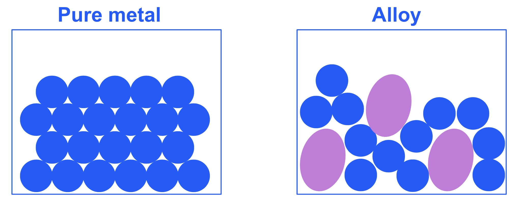
d) To calculate the empirical formula of the ore:

- % of oxygen = 100 - (13.9 + 63.9) = 22.2%;** [1 mark] **
- Ca = $\frac{13.9}{40}$ = 0.348 
**AND **
W = $\frac{63.9}{184}$= 0.347 
**AND **
O = $\frac{22.2}{16}$ = 1.39; **[1 mark]**
- Ca = $\frac{0.348}{0.347}$= 1 
**AND **
W = $\frac{0.347}{0.347}$= 1 
**AND **
O = $\frac{1.39}{0.347}$ = 4; **[1 mark]**
- Empirical formula = CaWO4;** [1 mark]**

**[Total: 4 marks]**

- *Work through your calculation one step at a time *

  - *Calculate the missing mass of oxygen*
  - *Calculate the moles of each element by dividing by the % by the **A**r*
  - *Calculate the ratio of elements by dividing by the smallest number of moles present*
  - *Give your final answer*
- *This way your work will be given credit even if you make a mistake*
- *Many students will miss the last marking point of actually writing the empirical formula of the tungsten ore *

### Q3
a) An alloy is a :

- Mixture of metal and other elements; **[1 mark]**

**[Total: 1 mark]**

- *Make sure you include the word 'mixture' in your definition or you will not score the mark*
b) An alloy of copper is used to make coins instead of using pure copper because:

- The alloy is stronger / harder 
**OR** 
More resistant to corrosion; **[1 mark]**

**[Total: 1 mark]**

- *Remember: **Pure metals are much softer than alloys because they have their atoms arranged in layers which can slide over each other *
- *In an alloy, the atoms are different sizes so the layers become distorted *
- *Other desirable properties of the alloy include they are resistant to corrosion*
c) The solid which conducts when solid is:

- C / iron / Fe; **[1 mark]**

**[Total: 1 mark]**

- *Metals conduct electricity as there are delocalised electrons which are free to move and carry a charge throughout the structure*
- *Only C shows a metal *

### Q4
a)

i) The other metal in brass is:

- Copper; **[1 mark] **

ii) An alloy such as brass is preferred to either of its constituent metals because:

Any **two **from:

- Hard(er) / less malleable; **[1 mark] **
- Strong(er); **[1 mark] **
- (Better) appearance;** [1 mark] **
- (More) resistant to corrosion;** [1 mark] **

**[Total: 3 marks]**

- *Alloys are stronger than the metallic element because:*
- *Alloys contain atoms of different sizes, which distorts the normally regular arrangements of atoms in metals*
- *This makes it more difficult for the layers to slide over each other, so alloys are usually much harder than the pure metal*
b)

i) The uncoated piece started to rust because:

- Steel (or iron) is exposed to oxygen and water;** [1 mark] **

ii) The piece of steel coated with zinc still did not rust but the copper-coated piece of steel rusted very rapidly because:

- Zn more reactive than Fe (allow steel);** [1 mark] **
- Zn loses / transfers electrons (more readily) and forms (+ve) ions (in preference to Fe);** [1 mark] **
- Fe (allow steel) is more reactive than Cu; **[1 mark] **
- Fe loses / transfers electrons (more readily) and forms (+ve) ions (in preference to Cu);** [1 mark] **

**[Total: 5 marks] **

- *Remember: **that if it is higher in the reactivity series than iron, it will be suitable for sacrificial protection as it will be oxidised instead of iron*
- *If it is lower in the reactivity series than iron, it would not be suitable as iron would be oxidised, causing it to rust*

### Q5
a) The completed table should include:

- For $V_{23}^{51}$: 23p 23e 28n; **[1 mark]**
- For $\mathrm{V} pre_{23} pre^{51^{3} +}$: 23p 20e 28n; **[1 mark]**
- For `V _ 23 ^ 50`: 23p 23e 27n; **[1 mark]**

**[Total: 3 marks]**

- *The two atoms should be an easy line to fill; for the V**3+** ion remember that this charge means 3 fewer electrons and no change for the protons or neutrons*
b)

i) The phrase 'steel alloys' means:

- (Contains) iron; **[1 mark]**
- With other element(s) / compounds / suitable named element; **[1 mark] ***If iron is absent = 0*

ii) The name and use of another steel alloy are:

- Stainless steel; **[1 mark]**
- Cutlery / chemical plant / jewellery / (kitchen) utensils / named kitchen utensil / in cars / surgical equipment / car exhausts etc.; **[1 mark] ***Not vanadium steel (as this is in the question)*

**OR**

- Mild steel; **[1 mark]**
- Cars / fridges / white goods / construction etc; **[1 mark] ***Credit any sensible suggestion e.g. roofing, nails, screws, radiators*

**[Total: 4 marks]**

- *Stainless steel is named on the specification, but mild steel is hinted at as well so either are valid*
- *Try to give specific examples rather than general ones for the uses*
c)

i) The formula of vanadium(III) oxide and of vanadium(IV) oxide are:

- V2O3; **[1 mark]**
- VO2; **[1 mark]**

ii) You would obtain a sample of vanadium(III) oxide from a mixture of these two oxides by:

- Adding sodium hydroxide(aq) or other named alkali; **[1 mark]**
- Vanadium(IV) oxide dissolves / reacts; **[1 mark]**
- Filter (to remove vanadium(III) oxide); **[1 mark]**

*Do not allow ammonia*

**[Total: 5 marks]**

- *The Roman numerals after the metals show the charge on the metal ion, which allows you to work out the formulae*
- *Vanadium(III) oxide is basic, and vanadium(IV) oxide is amphoteric, which means it can act as an acid and as a base, so the vanadium(IV) oxide will react with an alkali to form a salt and water*
- *The mixture will then only contain vanadium(III) oxide solid, which can be filtered off*

### Q6
a)

i) The completed table should look as follows:

| particle | protons | electrons | neutrons |
|---|---|---|---|
| $\text{Sr} pre_{ } pre^{88}$ | 38 | 38 | 50 |
| $\text{Sr} pre_{ } pre^{90}$ | 38 | 38 | 52 |
| $\text{Zn} pre_{ } pre^{65^{2} +}$ | 30 | 28 | 35 |

- Each correct row; **[1 mark]**

ii) $\text{Sr} pre_{ } pre^{90}$ and $\text{Sr} pre_{ } pre^{88}$ are isotopes because:

- (They have the) same number of protons and different number of neutrons; **[1 mark]**

**[Total: 4 marks]**

- *You can determine the number of protons by looking at which element it is*

  - *Strontium, Sr, has 38 protons*
  - *Zinc, Zn, has 30 protons*
- *Mass number (larger number) = number of protons + number of neutrons*

  - *Sr-88*
  
    - *88 = 38 + neutrons*
    - *neutrons = 88 - 38*
  - *Sr-90*
  
    - *90 = 38 + neutrons*
    - *neutrons = 90 - 38*
  - *Zinc*
  
    - *65 = 30 + neutrons*
    - *neutrons = 65 - 30*
- *Both isotopes of Sr have no charge*

  - *Therefore number of protons = number of electrons*
- *Zn has a 2+ charge*

  - *Therefore Zn must have two more protons than electrons*
b)

i) The reagent that will react with the carbonate to form the chloride is:

- Hydrochloric acid; **[1 mark]**

ii)The ionic equations at the electrodes for the electrolysis of molten strontium chloride are:

Negative electrode (cathode)

- Sr2+ + 2e → Sr; **[1 mark]**

Positive electrode (anode)

- 2Cl- – 2e → Cl2 **OR **2Cl– → Cl2 + 2e; **[1 mark]**

iii) The other two products of the electrolysis of concentrated aqueous strontium chloride are:

- Hydrogen; **[1 mark]**
- Strontium hydroxide; **[1 mark]**

**[Total: 5 marks]**

- *For the electrolysis of **molten** strontium chloride*
- *At the **anode**, negatively charged ions **lose** **electrons** and are thus oxidised*

  - *Chloride is the negatively charged ion so will lose electrons to form chlorine*
- *At the **cathode,** the positively charged ions **gain electrons** and are thus reduced*

  - *Strontium is a Group II metal so forms a positively charged 2+ ion*
  - *Strontium ions will gain electrons to form strontium atoms*
- *For the electrolysis of** aqueous** strontium chloride*

  - *Negative electrode (cathode) *
  
    - *From the reactivity series we know that both potassium and sodium are more reactive than hydrogen*
    - *Both of these are Group I metals*
    - *As strontium is also a Group I metal we can assume it has similar chemical properties and will also be more reactive than hydrogen*
    - *This means that hydrogen will be produced at the negative electrode (cathode)*
  - *Positive electrode (anode)*
  
    - *We are told one of the products is chlorine so this must be produced at the positive electrode*
  - *This means there are both strontium ions (from the strontium chloride) and hydroxide ions (from the water) present in the solution*
  - *Hence the other product will be strontium hydroxide*
c)

i) The word equation for the reaction of zinc and water is:

- Zinc + water → zinc oxide + hydrogen; **[1 mark]**

The reaction conditions are:

- Heat; **[1 mark]**
- Steam; **[1 mark]**

ii) The equation for the reaction of strontium with water is:

Sr + 2H2O → Sr(OH)2 + H2

- Correct chemical formulae; **[1 mark]**
- Correct balancing; **[1 mark]**

The reaction condition is:

- Cold water; **[1 mark]**

**[Total: 6 marks]**

- *As a general rule:*

  - *Metals in Groups I, II and III react with water to produce metal hydroxides*
  - *Transition metals react with water to produce metal oxides*

### Q7
a) Three physical properties that are characteristic of metals are:

Any **three** from:

- Conduct electricity; **[1 mark]**
- Conduct heat; **[1 mark]**
- Malleable; **[1 mark]**
- Ductile; **[1 mark]**
- Shiny / lustrous; **[1 mark]**

**[Total: 3 marks]**

- *You need to know the standard characteristics / properties of all metals*
- *You also need to know the characteristics / properties of specific metals, such as the transition metals and group 2 metals *
b) **Two** other substances which react with iron are:

Any **two** from:

- Oxygen; **[1 mark]**
- Steam; **[1 mark]**
- Acid; **[1 mark]**

**[Total: 2 marks]**

- *Iron can react with oxygen to form iron oxides*
- *Iron can react with steam to form iron oxide and hydrogen gas *
- *Iron can react with acids to produce salts*

### Q8
a)

i) The metal from the box that burns with a bright white flame is:

- Magnesium; **[1 mark]**

ii) The metal most likely to be found as an uncombined element is:

- **Silver; [1 mark]**
- **Because it is the least reactive (of the metals); [1 mark] **

**[Total: 3 marks] **

- *You should know that magnesium burns with a bright white flame *
- *Un-reactive elements will remain in their elemental form*
b) The metals from the list in part (a) that will react readily in oxygen are:

- Calcium / Ca;** [1 mark] **
- Magnesium / Mg; **[1 mark] **

ii) An equation for a metal reacting with oxygen is:

2Ca (s) + O2 (g) → 2CaO (s)  
**OR  ** 
2Mg (s) + O2 (g) → 2MgO (s)

- Correct formulae;** [1 mark] **
- Correct balancing;** [1 mark] **

**[Total: 4 marks] **

- *The metals that react readily in oxygen are the more reactive metals, any metal above carbon in the reactivity series will react readily with oxygen*
- *Careful**: Whilst zinc, silver, iron and copper do react with oxygen, the reactions are much slower and not described as reacting readily*
- *The resulting metal oxides are solid*
c) Alloys are harder than pure metals because:

Pure metal:

- (Particles / ions / atoms are the same size in a regular arrangement so) layers can easily slide over each other; **[1 mark] **

Alloy*:*

- Diagram of alloy structure showing a minimum of three layers with at least one different-sized circle; **[1 mark]**
- (Having different sized particles / ions / atoms) disrupts / breaks up the regular arrangement; **[1 mark]**
- So, it is hard(er) for layers to slide over each other;** [1 mark] **

**[Total: 4 marks]**

- *You can be given marks for stating*

  - *disrupts the lattice / layers / rows (of particles / ions / atoms)*
  - *layers cannot slide over each other*
- *But will not be credited for:*

  - *references to strength / breaking of forces / (metallic) bonds - this is because alloys are mixtures*
- *Your diagram could look like this*

  - *Note there are three layers of metal ions*
  - *There is at least one different-sized atom included as well*

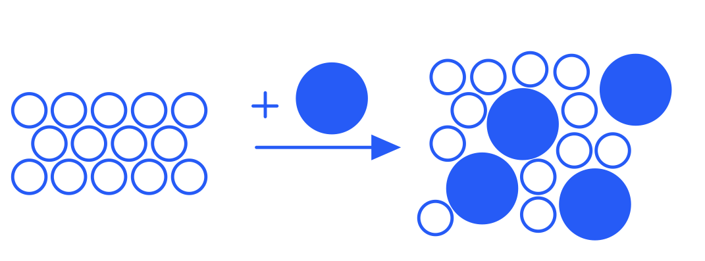
d) The names of two alloys, and the elements used to make them are:

- Alloy name: Brass; **[1 mark]**
- Elements made from: Copper **AND** zinc; **[1 mark]**
- Alloy name: Stainless steel; **[1 mark]**
- Elements made from: Iron **AND** chromium / nickel / carbon; **[1 mark]**

**[Total: 4 marks]**

- *Brass and stainless steel are the two alloys that you specifically need to know the composition of*
- *If you named other alloys and gave their elements, you would be given credit for them*
- *Common examples include:*

  - *Bronze (copper and tin)*
  - *Magnalium (aluminium and magnesium)*
  - *Mild steel (iron and carbon)*
- *This is not an exhaustive list as there are many examples of alloys*

### Q9
a) The diagrams which best represents the structure of the alloy is:

- D; **[1 mark]**

**[Total: 1 mark]**

- *An alloy is a mixture of metals so the atoms will be randomly mixed together*
- *You are told in the question that cobalt, chromium and molybdenum are used to make cutlery so the diagram should contain three different elements *
b) The substance used to make cutlery is:

- Stainless steel; **[1 mark]**

**[Total: 1 mark]**

- *Stainless steel is a mixture of iron and other elements such as chromium and nickel*
- *It is hard and resistant to corrosion making it ideal for this use*
c)** **An alloy is a:

- Mixture of metal with other element(s); **[1 mark]**

**[Total: 1 mark]**

- *You must have the word 'mixture' in your answer or you will not score the mark*
d) The alloy formed when zinc is mixed with copper is:

- Brass; **[1 mark]**

**[Total: 1 mark]**

- *Brass is used in musical instruments, ornaments and door knobs*

### Q10
a)

i) The structure and bonding in a metallic element is:

- Positive ions / cations (labelled or named in text); **[1 mark]**
- (Delocalised / mobile / free) electrons;** [1 mark]**
- Attraction between positive ions and negative electrons; **[1 mark] **

ii) Metallic elements such as gallium are good conductors of electricity because:

- The electrons are mobile / can move;** [1 mark] **

**[Total: 4 marks] **

- *The structure and bonding in a metallic element does not change, therefore it does not matter which metal you are asked about *
- *The diagram should include the following*

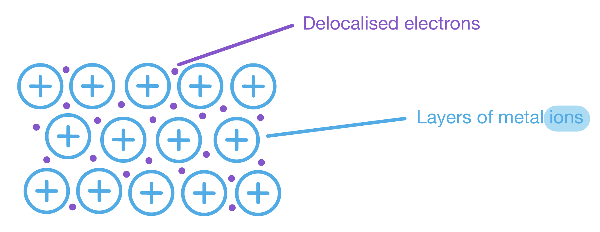
b) The formulas are:

- Gallium(III) chloride: GaCl3;** [1 mark] **
- Gallium(III) sulfate: Ga2(SO4)3; **[1 mark]**

**[Total: 2 marks] **

- *You can use the 'swap and drop' method to determine the formula of gallium(III) chloride and gallium(III) sulfate *

  - *The roman numeral number in brackets tells us that gallium has a charge 3+ *
  - *Chloride ions have a charge of 1-*
  - *Sulfate ions have a charge of 2-*
- *The swap and drop method is:*

  - *Ga**3+ **and Cl**- **(swap and drop charges)*
  - *Ga**–**Cl**3+ **(remove charges)*
  - *GaCl**3 **(remove charges)*
- *Remember to add brackets for polyatomic ions*

  - *Ga**2**(SO**4**)**3 **is different from Ga**2**SO**43*
c)

i) The reaction between gallium(III) oxide and dilute nitric acid to form a salt and water only is:

Ga2O3 + 6HNO3 → 2Ga(NO3)3 + 3H2O

- Formula of Ga(NO3)3;** [1 mark] **
- All formulae correct 
**AND **
Balancing correct; **[1 mark] **

ii) The reaction between gallium(III) oxide and sodium hydroxide solution forms only water and a salt containing the negative ion Ga2O42– is:

Ga2O3 + 2NaOH → Na2Ga2O4 + H2O

- **Formula of Na****2****Ga****2****O****4****; [1 mark] **
- All formulae correct 
**AND **
Balancing correct; **[1 mark] **

**[Total: 4 marks] **

- *Amphoteric oxides will react with acids** and** alkalis to form a salt and water *
d) **Two** reasons why alloys of gallium are more useful than the metallic element:

Any **two** from the following:

- (Do not) corrode; **[1 mark]**
- Stronger; **[1 mark]**
- Harder;** [1 mark]**
- (Improved) appearance;** [1 mark] **

**[Total: 2 marks] **

- *Alloys contain atoms of different sizes, which distorts the normally regular arrangements of atoms in metals*
- *This makes it more difficult for the layers to slide over each other, so alloys are usually much harder than the pure metal*

### Q11
a) Compare the properties of metals and non-metals:

Any **four **of the following:

- Metals conduct heat and electricity 
**AND ** 
Non-metals do not conduct heat and electricity; **[1 mark]**
- Metals are malleable / ductile 
**AND** 
Non-metals are brittle; **[1 mark]**
- Metals are lustrous / shiny 
**AND** 
Non-metals are dull / non-reflective; **[1 mark]**
- Metals have high density 
**AND** 
Non-metals have low density; **[1 mark]**
- Metals have high melting points 
**AND** 
Non-metals have low melting points; **[1 mark]**
- Metals form positive ions 
**AND** 
Non-metals form negative ions; **[1 mark]**
- Metals form basic oxides 
**AND** 
Non-metals form acidic oxides; **[1 mark]**

**[Total: 4 marks]**

- *The command word in this question is **compare**, so you must need to refer to both metals and non-metals when giving the properties*
- *If you don't, you will not gain the mark*
b) An example of a property that Group I metals exhibit but that is different from other metals is:

Any **one **from the following:

- Low density; **[1 mark]**
- Low melting point; **[1 mark]**
- Soft; **[1 mark]**

**[Total: 1 mark]**

- *You should know the properties of Group I elements and the properties of metals in general*
- *To answer this, you just need to state a property of Group I metals that does not match the properties of metals in general*
c) Identifying a use of the metals and stating the most important property of the metal that makes it suitable for that use:

Aluminium - any **one **use and most important property pair from the following:

- Use: Aeroplane body; **[1 mark]**
- Property: High strength-to-weight ratio / low density;**[1 mark]**

**OR**

- Use: Overhead power cables; **[1 mark]**
- Property: Good conductor of electricity / low density; **[1 mark]**

**OR**

- Use: Saucepans; **[1 mark]**
- Property: Good conductor of heat; **[1 mark]**

**OR**

- Use: Food cans; **[1 mark]**
- Property: Non-toxic / resistant to corrosion / resistant to acidic foods; **[1 mark]**

**OR**

- Use: Window frames; **[1 mark]**
- Property: Resistant to corrosion; **[1 mark]**

Copper- any **one **use and most important property pair from the following:

- Use: Electrical wires; **[1 mark]**
- Property: Good conductor of electricity / malleable; **[1 mark]**

**OR**

- Use: Water pipes; **[1 mark]**
- Property: Easy to bend / non-toxic / unreactive with water; **[1 mark]**

**[Total: 4 marks]**

- *You should be able to connect the use of a metal with its property that makes it suitable for its use*
- *These are not exhaustive lists, so if you give an answer which gives a correct use together with the property that is important, examiners are able to award marks, even if the answer is not on the mark scheme*
d) Calculating the number of moles of magnesium and silicon:

- Mass of magnesium present = 17 x $\frac{0.7}{100}$ = 0.119 (kg) / 119 (g); **[1 mark]**
- Mass of silicon present = 17 x $\frac{0.4}{100}$ = 0.068 (kg) / 68 (g); **[1 mark]**
- Moles of magnesium = 119 ÷ 24 = 4.96 (moles); **[1 mark]**
- Moles of silicon = 68 ÷ 28 = 2.43 (moles); **[1 mark]**

**[Total: 4 marks]**

- *To calculate the mass of each element in the mast, multiply 17 kg by the percentage and divide by 100*
- *You can give your answer in kg or g*
- *When using the equation moles = mass ÷ **A**r**, the mass must be in grams*
- *To convert from kg to g, multiply by 1000*

### Q12
a) Two other properties that make plastic useful for insulating electrical cables are:

Any **two** of the following:

- Flexible / easily form different shapes / easily moulded / bends (without cracking); **[1 mark]**
- Non-biodegradable / unreactive / don’t corrode / prevent corrosion / prevent oxidation (of the conducting metal); **[1 mark] **
- Water resistant / waterproof;** [1 mark] **

**[Total: 2 marks] **

- *Plastics are incredibly useful materials, though it is very hard to dispose of them in an environmentally friendly manner*
- *They are non-biodegradable so microorganisms cannot break them down*
b)  Two reasons why chromium is used to electroplate steel are:

- To improve the appearance / decorative / makes appearance shiny; **[1 mark]**
- To prevent corrosion / rusting 
**OR **
To protect the steel 
**OR **
Chromium will not corrode / is not oxidised / is protected by an oxide layer; **[1 mark] **

**[Total: 2 marks] **

- *Chromium has a shiny appearance. It does not corrode and resists scratches*
- *However, chromium is expensive so making a whole object out of it would not be feasible *
- *Therefore the object is a cheaper metal and covered with only a thin coating of chromium*
- *A chrome-plated item is simply called 'chrome' *
c) Aluminium is used extensively in the manufacture of aeroplanes because:

Any **two** of the following:

- Low density / light; **[1 mark] **
- Protected by an oxide layer 
**OR **
No need to paint 
**OR **
Resists corrosion; **[1 mark] **
- (High) Strength / strong; **[1 mark] **

**[Total: 2 marks] **

- *An answer of it has a high strength-to-weight ratio scores both marks*
d) Copper is a suitable material from which to make cooking utensils because:

Any **two** of the following:

- High melting point 
**OR **
Withstands high temperature;** [1 mark]**
- Good conductor (of heat); **[1 mark] **
- Heats up quickly; **[1 mark] **
- Malleable; **[1 mark] **
- Ductile; **[1 mark] **
- Resists corrosion; **[1 mark] **
- Good appearance; **[1 mark]**
- Unreactive (or example of lack of reactivity e.g. does not react with food or water or acid or air);** [1 mark] **

**[Total: 2 marks] **

- *You should be able to describe why a particular metal is 'fit for purpose', or in other words, which properties make it ideal for a particular use*
- *If used for cooking or then the metal must be unreactive to prevent contamination *
e) The bonding in a typical metal is:

- (Lattice) positive ions / cations / metal ions 
**AND **
A sea of (delocalised) electrons 
**OR **
delocalised / free / mobile / moving electrons;** [1 mark]**
- Attraction between positive ions and electrons;** [1 mark] **

**[Total: 2 marks] **

- *This is a common question - make sure you state that there are metal ions, not atoms in the structure (some other courses allow metal atoms, but this course does not!)*
- *This question could lead onto:*

  - *Explain why metals are malleable*
  
    - *Layers of metal ions can slide over one another*
  - *How the structure of alloys makes the metal much harder*
  
    - *Different-sized atoms in the alloy make it harder for layers of metal ions to slide over one another *

### Q13
a) The  property of aluminium given in **Table 1.1** which makes it suitable for the manufacture of aircraft. is:

- (Low) density;** [1 mark]**

**[Total: 1 mark]**

- *Aircraft need to be lightweight*
- *Aluminium has a low density which makes it relatively lightweight compared to other materials *
b) Two  properties of aluminium that make it suitable for use in overhead electricity cables are:

Any **two** from:

- Ductile / malleable; **[1 mark]**
- Conducts (electricity); **[1 mark]**
- Low density; **[1 mark]**
- Protective oxide layer; **[1 mark]**

**[Total: 2 marks]**

- *Think sensibly when answering this type of question and think of the desirable characteristics of overhead wires*

  - *You don't want them to be too heavy because they will fall down so a lower density is needed*
  - *They must conduct electricity as this is their sole purpose *
  - *Forming an oxide layer means they will not corrode and need replacing regularly *
  - *Being malleable means it can be changed into different shapes*
c) The structure used in electrical wiring is:

- D / zinc / Zn; **[1 mark]**

**[Total: 1 mark]**

- *Since zinc is a metal, it will be a good conductor of electricity as well as being ductile so it can be drawn into wires*

### Q14
a)

i) Steel alloys are used in preference to iron because:

Any **one **of the following sensible suggestions:

- Harder; **[1 mark] **
- Stronger; **[1 mark] **
- It can be tailored for a specific use; **[1 mark] **
- It is more resistant to corrosion;** [1 mark]**
- Any other sensible suggestion; **[1 mark] **

ii) A use of stainless steel is:

Any **one **of the following:

- Chemical plants; **[1 mark] **
- Cooking utensils; **[1 mark] **
- Jewellery; **[1 mark] **
- Cutlery; **[1 mark] **
- Surgical equipment; **[1 mark] **
- Kitchen sinks; **[1 mark] **
- Pipes; **[1 mark] **
- Any other sensible suggestion; **[1 mark] **

**[Total: 2 marks]**

- *Ensure you learn some of the uses of stainless steel and what properties make it suitable for that application*

  - *The use mentioned in the specification is its use in cutlery because of its hardness and its resistance to rusting*
- *You would not gain the mark for part (i) for saying steel does not rust*

  - *This is because over time stainless steel will rust*
b)

i) Metals have a typical high melting point because

- There are strong attractive forces / strong bonds that require a lot of energy to break 
**OR **
There are strong attractive forces / strong bonds that are hard to break; **[1 mark]**
- The forces / bonds are between positive ions and (negative) electrons; **[1 mark] **

ii) Steel changes its shape because:

- The layers / lattice / rows of ions / cations; **[1 mark]**
- Can move / slip / slide past each other; **[1 mark] **

**[Total: 4 marks] **

- *In the question you are given the information that both iron and steel have the same structure, so you can apply your knowledge of metallic bonding to this question *
c) The correct statement is:

- One of the metals in the alloy will dissolve in dilute hydrochloric acid; **[1 mark]**

**[Total: 1 mark] **

- *Zinc is above hydrogen in the reactivity series so will react with dilute hydrochloric acid and will completely dissolve*
- *Copper is below hydrogen in the reactivity series so will not react with dilute hydrochloric acid*
- *Copper in the alloy will not dissolve in dilute hydrochloric acid as copper is lower than hydrogen in the reactivity series*
- *Alloys are mixtures, not compounds, so cannot be represented by a chemical formula*

  - *Remember**: Alloys are not chemically combined*
d) The percentage composition by mass of aluminium in the 3.00 g sample of aluminium alloy is:

- Number of moles of aluminium ions in 250 cm3 solution = 0.36 x $\frac{250}{1000}$ = 0.09 moles; **[1 mark]**
- Mass of aluminium = 0.09 x 27 = 2.43 (g); **[1 mark]**
- Percentage composition of aluminium in alloy = $\frac{2.43}{3.00}$ x 100 = 81%; **[1 mark]**

**[Total: 3 marks]**

- *Don't be put off this question by the unfamiliar method of acid digestion*
- *If you know the concentration and volume of aluminium ions, then you can calculate the number of moles using the equation:*

  - *moles = concentration x volume in dm**3*
  - *To convert from cm**3** to dm**3**, divide by 1000*
- *The aluminium ions that are in this 250 cm**3** solution all came from the aluminium alloy that underwent acid digestion*

  - *Therefore, the number of moles of aluminium ions = the number of moles of aluminium in the alloy*
- *You can then work out the mass of the aluminium in the alloy using the equation:*

  - *mass = moles x **A**r*
- *As you need to calculate the percentage composition by mass, you can work out what this mass is as a percentage of the 3.00 g mass of the alloy*

### Q15
a) The percentage of carbon is reduced and how the silicon is removed by:

Any** four** from:

- Carbon forms carbon dioxide / carbon monoxide; **[1 mark] **
- This is a gas which escapes / is blown out / diffuses; **[1 mark] **
- Silicon forms silicon(IV) oxide / silica / silicon(IV) oxide present in impure iron; **[1 mark]  **
- Silicon(IV) oxide reacts with calcium oxide to form slag or calcium silicate; **[1 mark] **
- Slag removed from surface / skimmed / syphoned / poured off;** [1 mark]**

**[Total: 4 marks]**

- *Correct formula and equations are accepted for the marks*
- *Make sure you state that silicon dioxide is present, not just silicon*
- *The slag formed is solidified by cooling, crushed and used as aggregate for asphalt mixtures *
b)

i) Steel alloys are used in preference to iron because:

Any **one **from:

- Harder / stronger;** [1 mark]**
- It can be tailored for a specific use;** [1 mark]**
- It is (more) resistant to corrosion;** [1 mark]**

ii) A use of stainless steel is:

Any **one **from:

- Chemical plants; **[1 mark]**
- Cooking utensils / cutlery  ; **[1 mark]**
- Jewellery; **[1 mark]**
- Surgical equipment; **[1 mark]**
- Kitchen sinks / pipes; **[1 mark]**
- Any other sensible and correct suggestion; **[1 mark] **

**[Total: 2 marks]**

- *Ensure you learn some of the uses of stainless steel and what properties make it suitable for that application*
- *The use mentioned in the specification is its use in cutlery because of its hardness and its resistance to rusting*
c)

i) Metals have a typical high melting point because:

- They have strong attractive forces / bonds 
**OR **
The attractive forces / bonds are hard to break 
**OR **
The attractive forces / bonds require a lot of energy to break; **[1 mark]**
- Between positive ions and (negative) electrons 
**OR **
Opposite charges attract;** [1 mark] **

ii) Steel changes its shape because:

- The layers / sheets / lattice / rows of ions or cations; **[1 mark]**
*Ignore  atoms / molecules / protons / nuclei*
- Can move / slip / slide past each other; **[1 mark] **

**Final answer:** **[Total: 4 marks] **

- *In the question you are given the information that both iron and steel have the same structure, so you can apply your knowledge of metallic bonding in this question *

### Q16
a) The balanced symbol equation for the reaction of calcium reacting with water is:

Ca (s) + 2H2O (l) → Ca(OH)2 (aq) + H2 (g)

- Correct formulae; **[1 mark]**
- Correct balancing; **[1 mark]**

**[Total: 2 marks]**

- *You should be able to give the equations for metals reacting with water*
- *A metal hydroxide and hydrogen are formed*
- *The formula of the metal hydroxide depends on the group the metal belongs to:*

  - *Group I metals will form a hydroxide with the formula MOH, where M represents a metal*
  - *Group II metals will form a hydroxide with the formula M(OH)**2*
b) To show that calcium is oxidised during the reaction with water:

- The oxidation number of Ca increases; **[1 mark]**
- From 0 (in Ca); **[1 mark]**
- To +2 (in Ca(OH)2); **[1 mark]**

**[Total: 3 marks]**

- *Remember**: Oxidation number increases when oxidation occurs and decreases when reduction occurs*
- *The oxidation number of an uncombined element, such as Ca, is zero*
- *The oxidation number of an element in a mono-atomic ion is always the same as its charge*

  - *The charge on the calcium ion in Ca(OH)**2** is +2, therefore its oxidation number is +2*
c) Comparing the reaction of calcium with HCl and magnesium with HCl:

- The student would see effervescence / bubbles / fizzing in both boiling tubes 
**OR** 
The student would see effervescence / bubbles / fizzing with calcium and magnesium; **[1 mark]**
- The solid would dissolve / disappear in both boiling tubes; **[1 mark]**
- The reaction would be more vigorous / violent with calcium
**OR** 
The solid would dissolve / disappear faster with calcium; **[1 mark]**

**[Total: 3 marks]**

- *You must be able to describe the reactions of different metals with acid, comparing them to each other and must be able to provide reaction equations *
- *When acids react with metals, a salt and hydrogen are formed:*

  - *M**etal + **A**cid → **S**alt + **H**ydrogen (think **MASH**)*
- *When giving observations, think about the states of the reactants and prdocuts*
- *The metal is a solid, so as it reacts, it will be used up and you will see it disappear*
- *Hydrogen is a gas, so as it is produced you will see bubbles of gas*

  - *Careful**: When asked for observations, do not state that 'a gas / hydrogen is produced', as this is not an observation, you need to explain what you see, i.e. the bubbles*
- *Calcium is further up the reactivity series than magnesium, so the reaction of calcium with acid is more vigorous than of magnesium with acid*
d) The reason for this observation is:

- Magnesium reacts with water producing hydrogen / H2;** [1 mark]**
- The reaction between magnesium and water is a lot slower (than the reaction between magnesium and acid); [1 mark]
- Mg + 2H2O → Mg(OH)2  + H2 ; [1 mark]

**[Total: 3 marks]**

- *Water is present in the aqueous solution of hydrochloric acid*
- *Once the hydrochloric acid has been used up, magnesium will continue to react with the water*
- *The reaction between water and magnesium is very slow, magnesium will react readily with steam*
