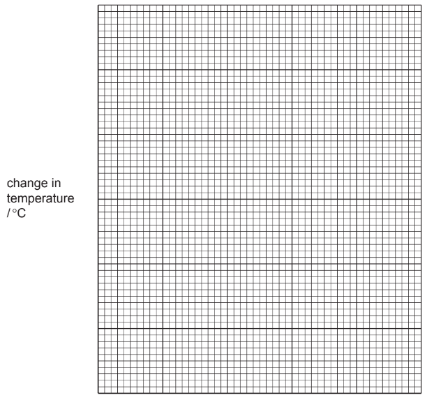
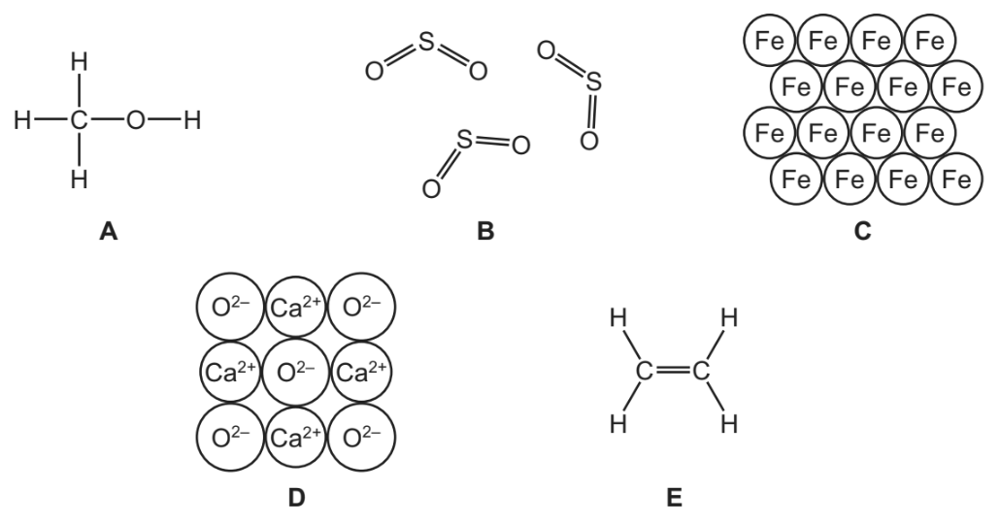
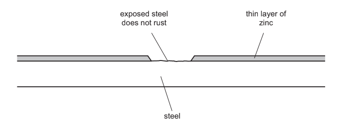
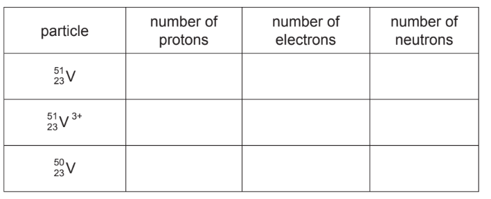
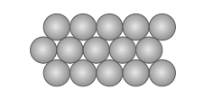
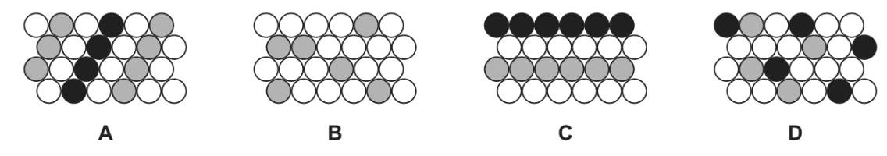
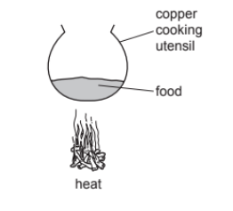
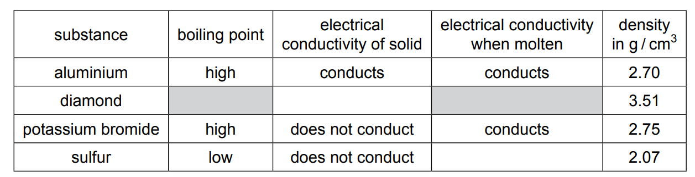

# Exam Questions — Properties, Uses & Alloys of Metals
**9. Metals** · Cambridge (CIE) IGCSE chemistry (0620 & 0971)
> Source: [https://www.savemyexams.com/igcse/chemistry/cie/23/topic-questions/](https://www.savemyexams.com/igcse/chemistry/cie/23/topic-questions/) · 36 questions across 3 sets

## Alternative To Practical Questions (1 questions)

### Q1 — medium — 16 marks

**Q1** [5 marks]

A student investigated the temperature change produced when equal lengths of magnesium ribbon reacted with excess dilute sulfuric acid of different concentrations (labelled solutions **A**, **B**, **C**, **D** and **E**).

Five experiments were carried out.

***Experiment 1***

Using a measuring cylinder, 20 cm3 of sulfuric acid solution **A** was poured into a beaker. The initial temperature of the solution was measured. A length of magnesium ribbon was added to the solution and stirred. The highest temperature reached was measured.

***Experiment 2***

Experiment 1 was repeated using solution **B** instead of solution **A**. The initial and highest temperatures were measured as before.

***Experiment 3***

Experiment 1 was repeated using solution **C**. The initial and highest temperatures were measured.

***Experiment 4***

Experiment 1 was repeated using solution **D**. The initial and highest temperatures were measured.

***Experiment 5***

Experiment 1 was repeated using solution **E**. The initial and highest temperatures were measured.

Use the thermometer diagrams in the table, to record the initial and highest temperatures in each experiment.

| solution of sulfuric acid | thermometer diagram | initial temperature / oC | thermometer diagram | highest temperature / oC | change in temperature / oC |
|---|---|---|---|---|---|
| **A** |  |   |  |   |   |
| **B** |  |   |  |   |   |
| **C** |  |   |  |   |   |
| **D** |  |   |  |   |   |
| **E** |  |   |  |   |   |

Work out the temperature change for each experiment and record the values in the table.

*Source: 2008 6 Q4*

**Q1** [4 marks]

**Extract:**

| solution of sulfuric acid | change in temperature / °C |
| A | 15 |
| B | 11 |
| C | 10 |
| D | 7 |
| E | 3 |

(Experiment 1 used solution A, Experiment 2 used solution B, Experiment 3 used solution C, Experiment 4 used solution D, Experiment 5 used solution E.)

Draw a labelled bar chart of the results for Experiments 1, 2, 3, 4 and 5 on the grid below.

*Source: 2009 6 Q4*

**Q1** [1 mark]

**Extract:**

A student investigated the temperature change produced when equal lengths of magnesium ribbon reacted with excess dilute sulfuric acid of different concentrations (labelled solutions A, B, C, D and E). Using a measuring cylinder, 20 cm^3 of sulfuric acid solution was poured into a beaker. The initial temperature of the solution was measured. A length of magnesium ribbon was added to the solution and stirred. The highest temperature reached was measured. The results showed the temperature of the reaction mixture increases in each experiment.

Use the results and observations to answer the following questions.

What type of chemical reaction occurs when magnesium reacts with dilute sulfuric acid?

*Source: 2009 6 Q4*

**Q1** [2 marks]

**Extract:**

A student investigated the temperature change produced when equal lengths of magnesium ribbon reacted with excess dilute sulfuric acid of different concentrations (labelled solutions A, B, C, D and E). Five experiments were carried out. Experiment 1 used solution A, Experiment 2 used solution B, Experiment 3 used solution C, Experiment 4 used solution D, Experiment 5 used solution E. The change in temperature values were: A = 15, B = 11, C = 10, D = 7, E = 3 (°C).

i) Which Experiment produced the largest temperature change?

[1]

ii) Suggest why this Experiment produced the largest temperature change.

[1]

*Source: 2009 6 Q4*

**Q1** [3 marks]

**Extract:**

A student investigated the temperature change produced when equal lengths of magnesium ribbon reacted with excess dilute sulfuric acid of different concentrations (labelled solutions A, B, C, D and E).

Experiment 1: Using a measuring cylinder, 20 cm^3 of sulfuric acid solution A was poured into a beaker. The initial temperature of the solution was measured. A length of magnesium ribbon was added to the solution and stirred. The highest temperature reached was measured.

Completed table results: Solution A: initial temperature 24°C, highest temperature 39°C, change in temperature 15°C. Solution B: 26, 37, 11. Solution C: 25, 35, 10. Solution D: 24, 31, 7. Solution E: 26, 29, 3.

Predict the effect on the temperature changes that would happen if

i) equal masses of magnesium powder were used in the Experiments.

[1]

ii) 40cm3 of dilute sulfuric acid was used in Experiment 1.

[1]

iii) Explain your answer to (e)(ii).

[1]

*Source: 2009 6 Q4*

**Q1** [1 mark]

**Extract:**

A student investigated the temperature change produced when equal lengths of magnesium ribbon reacted with excess dilute sulfuric acid of different concentrations (labelled solutions A, B, C, D and E). Five experiments were carried out. Experiment 1: Using a measuring cylinder, 20 cm^3 of sulfuric acid solution A was poured into a beaker. The initial temperature of the solution was measured. A length of magnesium ribbon was added to the solution and stirred. The highest temperature reached was measured. Experiments 2-5 repeated Experiment 1 using solutions B, C, D and E instead, measuring initial and highest temperatures as before.

Give **one **possible source of experimental error in this investigation.

*Source: 2009 6 Q4*

## Multiple Choice Questions (29 questions)

### Q1 — medium — 1 marks

**Q1** [1 mark]

Which statement explains why alloys are harder and stronger than pure metals?

### Q2 — medium — 1 marks

**Q2** [1 mark]

Iron is a transition element and magnesium is a Group II element. Both are metals.

Which row shows the correct properties for both metals?

|   | melting point | gas produced when reacted with dilute hydrochloric acid | electrical conductivity |
|---|---|---|---|
| **A** | iron > magnesium | hydrogen | good |
| **B** | iron > magnesium | chlorine | good |
| **C** | iron = magnesium | hydrogen | poor |
| **D** | iron = magnesium | chlorine | poor |

### Q3 — easy — 1 marks

**Q3** [1 mark]

Three statements about metals are listed.

1. Aluminium is used for aircraft because of its high resistance and high density.
2. Metals react with acids to form salt and water.
3. Copper is used in electrical wires because of its malleable and a good electricity conductor

Which statements are correct?

### Q4 — easy — 1 marks

**Q4** [1 mark]

Steel is an alloy of iron and carbon.

Which diagram represents steel correctly?

### Q5 — easy — 1 marks

**Q5** [1 mark]

#### Extended Only

Why are alloys harder than the pure metals from which they are made?

### Q6 — easy — 1 marks

**Q6** [1 mark]

Which diagram shows an alloy?

### Q7 — easy — 1 marks

**Q7** [1 mark]

Zinc has many uses in the home. The diagram shows two items that contain zinc.

In which of these items is zinc used as an alloy?

|   | **bucket** | **door-knocker** |
|---|---|---|
| **A** | $\times$ | `✓` |
| **B** | `✓` | `✓` |
| **C** | $\times$ | $\times$ |
| **D** | `✓` | $\times$ |

### Q8 — easy — 1 marks

**Q8** [1 mark]

Copper is sometimes used to make cooking utensils and pans.

Three properties of copper are shown below:

| **1** | Good conductor of electricity. |
|---|---|
| **2** | Corrosion resistant. |
| **3** | Good conductor of heat. |

Which of these properties make it good for making cooking utensils?

### Q9 — easy — 1 marks

**Q9** [1 mark]

Most of the elements on the Periodic Table are metals. Metals can be distinguished from non-metals by differences in their physical properties.

Which row correctly describes a metal?

|   | **Malleability** | **Heat & electrical conductivity** |
|---|---|---|
| **A** | $\times$ | `✓` |
| **B** | `✓` | $\times$ |
| **C** | `✓` | `✓` |
| **D** | $\times$ | $\times$ |

### Q10 — hard — 1 marks

**Q10** [1 mark]

Some properties of elements **K**, **L**, **M** and **N** are given.

| 1 | **K** acts as a catalyst and its oxide reacts with hydrochloric acid |
|---|---|
| 2 | **L** is a dull dark grey solid that conducts electricity and has a melting point of 3600 oC |
| 3 | **M** is easily hammered into shape and has a high density |
| 4 | **N** has a melting point of 113 oC and forms an acidic oxide |

Which of the elements are metals?

### Q11 — hard — 1 marks

**Q11** [1 mark]

Element **Y** is malleable and ductile.

Which correctly describes the properties of element **Y**?

|   | **Electrical conductivity (solid)** | **Electrical conductivity (molten)** | **Melting Point / ****o****C** |
|---|---|---|---|
| **1** | ✓ | ✓ | 2861 |
| **2** | ✓ | ✓ | 63 |
| **3** | ✗ | ✓ | 801 |

### Q12 — hard — 1 marks

**Q12** [1 mark]

The three statements below about aluminium are all correct.

1. Aluminium reacts readily to form aluminium oxide.
2. Aluminium is extracted from its ore by electrolysis as it cannot be extracted by reduction with carbon.
3. Aluminium is used in electrical wiring because of its good electrical conductivity.

In which of these statements can '**aluminium**' be replaced by '**copper**' and still be correct?

|   | **1** | **2** | **3** |
|---|---|---|---|
| **A** | **✓** | **✓** | **✓** |
| **B** | **✗** | **✓** | **✗** |
| **C** | **✓** | **✗** | **✓** |
| **D** | **✗** | **✗** | **✓** |

### Q13 — hard — 1 marks

**Q13** [1 mark]

Brass is an alloy of two metals

Which is the correct statement?

### Q14 — hard — 1 marks

**Q14** [1 mark]

Properties of four elements are shown below.

Which of these elements is a metal?

|   | **electrical conductivity when solid** | **electrical conductivity when liquid** | **melting point ℃** |
|---|---|---|---|
| **A** | low | low | -7 |
| **B** | high | low | 801 |
| **C** | high | high | 1535 |
| **D** | low | low | 3550 |

### Q15 — medium — 1 marks

**Q15** [1 mark]

Some of the properties of four different elements Q, P, R and S are listed below:

| **1** | Q melts at 1410 °C and forms an acidic oxide. |
|---|---|
| **2** | P has a high density and is easily drawn into wires. |
| **3** | R acts as a catalyst and its oxide reacts with acids |
| **4** | S is a red-brown solid used to make alloys. |

Which of the elements are metals?

### Q16 — medium — 1 marks

**Q16** [1 mark]

Brass is an alloy of two metals.

Which row describes the correct use of the two metals that brass is made from?

|   | **metal 1** | **metal 2** |
|---|---|---|
| **A** | galvanising steel | making aircraft |
| **B** | electrical wiring | galvanising steel |
| **C** | making aircraft | making cutlery |
| **D** | making cooking pans | electrical wiring |

### Q17 — medium — 1 marks

**Q17** [1 mark]

The structure of an alloy is shown below. Alloys are mixtures of metals with other metals or non-metals.

They are usually much stronger and harder than pure metals. Which statement explains these features?

### Q18 — medium — 1 marks

**Q18** [1 mark]

The table shows some properties of four metals

Which of the four metals would be the most suitable for aircraft construction?

|   | **density** | **strength** | **resistance to corrosion** |
|---|---|---|---|
| **A** | high | low | low |
| **B** | low | high | high |
| **C** | high | high | low |
| **D** | low | low | high |

### Q19 — medium — 1 marks

**Q19** [1 mark]

A sample of element Y is shiny and can be shaped by hammering.

Which row of the table corresponds to the properties of element Y?

|   | **conducts electricity** | **melts below 25℃** |
|---|---|---|
| **A** | $\times$ | `✓` |
| **B** | $\times$ | $\times$ |
| **C** | `✓` | `✓` |
| **D** | `✓` | $\times$ |

## Theory Questions (17 questions)

### Q1 — easy — 10 marks

**Q1** [2 marks]

About 4000 years ago the Bronze Age started in Britain. Bronze is an alloy of copper and tin.

i) Suggest a reason why a bronze axe was better than a copper axe.

[1]

ii) Brass is another copper alloy. Name the other metal in brass.

[1]

*Source: 2010 O13 Q2*

**Q1** [6 marks]

#### Extended Only

The diagram below shows the arrangement of particles in a pure metal.

i) What is the name given to a regular arrangement of particles in a crystalline solid?

[1]

ii) Draw a diagram which shows the arrangement of particles in an alloy.

[2]

iii) Explain the term malleable.

[1]

iv) Why are metals malleable?

[2]

*Source: 2010 O13 Q2*

**Q1** [2 marks]

The common ore of tin is tin(IV) oxide and an ore of copper is malachite, CuCO3.Cu(OH)2.

i) Write a word equation for the reduction of tin(IV) oxide by carbon.

[1]

ii) Give **one** use of copper, other than making alloys.

[1]

*Source: 2010 O13 Q2*

### Q2 — hard — 11 marks

**Q2** [2 marks]

Tungsten is a useful metal. It has the chemical symbol W.

One method of extracting tungsten involves heating a tungsten compound, WO3, with hydrogen. Water is also produced. Write the balanced symbol equation for this reaction.

**Q2** [2 marks]

**Extract:**

Tungsten is a useful metal. It has the chemical symbol W. One method of extracting tungsten involves heating a tungsten compound, WO~3~, with hydrogen. Water is also produced. The balanced symbol equation is: WO~3~ + 3H~2~ → W + 3H~2~O

Identify what has been reduced. Give a reason for your answer.

**Q2** [3 marks]

**Extract:**

The alloy is stronger because:
- Pure metals have a regular lattice arrangement 
OR
All of the atoms / ions in a pure metal are the same size;
- Alloys contain atoms that are different sizes;
- So, the layers cannot slide over each other (easily);

The bonding in pure metals has a regular arrangement so the layers can slide over one another easily. This means that pure metals are malleable and ductile. An alloy contains different elements which will be different sizes which disrupt the regular arrangement of the pure metal. More force is therefore needed to change the shape of the metal alloy.

#### Extended Only

Tungsten alloyed with nickel and copper can be used to make protective covers for electrical sensors and missile guidance systems. Explain why this alloy is stronger than pure titanium.

**Q2** [4 marks]

#### Separate: Chemistry and Extended Only

An ore of tungsten is Scheelite. The composition of this ore is 13.9% of calcium, 63.9% of tungsten and the remainder is oxygen. Calculate the empirical formula for this ore of tungsten.

### Q3 — easy — 3 marks

**Q3** [1 mark]

Alloys of copper are used to make coins.

What is meant by the term alloy?

**Q3** [1 mark]

Suggest why an alloy of copper is used to make coins instead of using pure copper.

**Q3** [1 mark]

**Extract:**

The diagrams show part of the structures of five substances, A, B, C, D and E.

A: H   H
      |    |
   H–C–O–H
      |    |
      H   H

B: (shows two molecules, each with S and O atoms in a ring/chain)

C: A lattice of Fe atoms (metallic structure)

D: A lattice of Ca2+ and O2– ions (ionic structure)

E: H   H
      |    |
   H–C=C–H
      |    |
      H   H

The diagrams show part of the structures of five substances, A, B, C, D and E.

State which one of these structures, conducts electricity when solid.

### Q4 — medium — 8 marks

**Q4** [3 marks]

Brass is an alloy which contains zinc.

i) Name the other metal in brass.

[1]

ii) Suggest** two **reasons why an alloy such as brass is preferred to either of its constituent metals.

[2]

*Source: 2015 O32 Q3D*

**Q4** [5 marks]

#### Extended Only

In an experiment to investigate the rate of rusting of steel, three pieces of steel were used. One piece of steel was completely coated with copper, one piece was completely coated with zinc and the third piece was left uncoated. All three pieces were left exposed to the atmosphere.

i) Explain why the uncoated piece started to rust.

[1]

ii) The coating on both of the other two pieces was scratched, exposing the steel.

The piece of steel coated with zinc still did not rust but the copper-coated piece of steel rusted very rapidly.

Explain these observations in terms of the formation of ions and the transfer of electrons.

[4]

*Source: 2015 O32 Q3E*

### Q5 — medium — 12 marks

**Q5** [3 marks]

Vanadium is a transition element.

An atom of the most common isotope of vanadium can be represented as $V_{23}^{51}$.

Complete the following table to show the number of protons, electrons and neutrons in each particle.

*Source: 2010 Oc33 Q2*

**Q5** [4 marks]

The major use of vanadium is to make vanadium steel alloys.

i) Explain the phrase steel alloys.

[2]

ii) State the name and use of another steel alloy.

[2]

*Source: 2010 Ju33 Q2*

**Q5** [5 marks]

Two of the oxidation states of vanadium are +3 and +4.

i) Write the formula of vanadium(III) oxide and of vanadium(IV) oxide.

[2]

ii) Vanadium(III) oxide is basic and vandium(IV) oxide is amphoteric. Describe how you would obtain a sample of vanadium(III) oxide from a mixture of these two oxides.

[3]

*Source: 2010 Oc33 Q2*

### Q6 — medium — 14 marks

**Q6** [3 marks]

Strontium and zinc are both metals with a valency of 2. Strontium is more reactive than zinc. Its chemistry is similar to that of calcium.

i) Complete the following table that shows the number of protons, electrons and neutrons in each particle.

| particle | protons | electrons | neutrons |
|---|---|---|---|
| $\text{Sr} pre_{ } pre^{88}$ |   |   |   |
| $\text{Sr} pre_{ } pre^{90}$ |   |   |   |
| $\text{Zn} pre_{ } pre^{65^{2} +}$ |   |   |   |

[3]

ii) Explain why $\text{Sr} pre_{ } pre^{88}$ and $\text{Sr} pre_{ } pre^{90}$ are isotopes.

[1]

*Source: 2005 Oct31 Q5*

**Q6** [5 marks]

#### Extended Only

The major ore of strontium is its carbonate, SrCO3. Strontium is extracted by the electrolysis of its molten chloride.

i) Name the reagent that will react with the carbonate to form the chloride.

[1]

ii) The electrolysis of molten strontium chloride produces strontium metal and chlorine. Write ionic equations for the reactions at the electrodes.

negative electrode (cathode) .............. positive electrode (anode) ................

[2]

iii) One of the products of the electrolysis of concentrated aqueous strontium chloride is chlorine. Name the other two.

[2]

*Source: 2005 Oct31 Q5*

**Q6** [6 marks]

**Extract:**

Strontium and zinc are both metals with a valency of 2. Strontium is more reactive than zinc. Its chemistry is similar to that of calcium.

Both metals react with water.

i) Write a word equation for the reaction of zinc and water and state the reaction conditions.

word equation .........

[1]

conditions ............

[2]

ii) Write an equation for the reaction of strontium with water and give the reaction condition.

equation .........

[2]

condition .........

[1]

*Source: 2005 Oct31 Q5*

### Q7 — easy — 5 marks

**Q7** [3 marks]

Iron is a metal.

Give **three** physical properties that are characteristic of metals.

**Q7** [2 marks]

Iron reacts with chlorine and other halogens.

Name **two** other substances which react with iron.

### Q8 — hard — 15 marks

**Q8** [3 marks]

The list shows the names of some metals.

**calcium**

**copper**

**iron**

**magnesium**

**silver **

**zinc**

i) Identify the metal from the box that burns with a bright white flame.

[1]

ii) In the Earth, metals are found either in ores or as uncombined elements. Explain which metal from the box is most likely to be found as an uncombined element.

[2]

*Source: 2020 Nov2C Q3A*

**Q8** [4 marks]

**Extract:**

The list shows the names of some metals.

calcium
copper
iron
magnesium
silver
zinc

i) Which metal or metals from the list in part (a) will react readily in oxygen?

[2]

ii) Give an equation to show a metal reacting with oxygen. Include state symbols.

[2]

*Source: 2020 Nov2C Q3B*

**Q8** [4 marks]

#### Extended Only

The diagram shows the arrangement of the particles in a pure metal.

Metals are often made into alloys to make them harder.

Explain why alloys are harder than pure metals.

Draw a diagram to support your answer.

**Q8** [4 marks]

Complete the table by naming **two **alloys and giving the elements used to make each alloy.

| **Alloy name** | **Elements used to make alloy** |
|---|---|
|   |   |
|   |   |

### Q9 — easy — 4 marks

**Q9** [1 mark]

An alloy of cobalt, chromium and molybdenum is used to make cutlery.

Which one of the following diagrams best represents the structure of the alloy?

Draw a circle around the correct answer.

**Q9** [1 mark]

**Extract:**

An alloy of cobalt, chromium and molybdenum is used to make cutlery.

Which one of these substances is also used to make cutlery?

Tick **one **box.

| mercury |   |
|---|---|
| sodium |   |
| stainless steel |   |
| graphite |   |

**Q9** [1 mark]

An alloy contains zinc, copper and aluminium. What is meant by the term *alloy*?

**Q9** [1 mark]

Zinc and copper are elements next to each other in the Periodic Table.

Name the alloy formed when zinc is mixed with copper.

### Q10 — medium — 12 marks

**Q10** [4 marks]

#### Extended Only

Gallium is a metallic element in Group III. It has similar properties to aluminium.

i) Describe the structure and bonding in a metallic element. You should include a labelled diagram in your answer.

[3]

ii) Explain why metallic elements such as gallium are good conductors of electricity.

[1]

*Source: 2016 Ju42 Q3A*

**Q10** [2 marks]

**Extract:**

Gallium is a metallic element in Group III. It has similar properties to aluminium.

#### Extended Only

Give the formula of

Gallium(III) chloride ......................................

Gallium(III) sulfate ........................................

*Source: 2016 Ju42 Q3B*

**Q10** [4 marks]

#### Extended Only

Gallium(III) oxide, Ga2O3, is amphoteric.

i) Write the chemical equation for the reaction between gallium(III) oxide and dilute nitric acid to form a salt and water only.

[2]

ii) The reaction between gallium(III) oxide and sodium hydroxide solution forms only water and a salt containing the negative ion Ga2O42–.

Write the chemical equation for this reaction.

[2]

*Source: 2016 Ju42 Q3C*

**Q10** [2 marks]

Alloys of gallium and other elements are often more useful than the metallic element itself.

Suggest **two** reasons why alloys of gallium are more useful than the metallic element.

*Source: 2016 Ju42 Q3D*

### Q11 — hard — 13 marks

**Q11** [4 marks]

This question is about metals and non-metals.

Compare the properties of metals and non-metals.

**Q11** [1 mark]

The Group I metals exhibit some properties that the majority of metals do not share.

Give **one** example of a property of Group I metals that is different from most other metals.

**Q11** [4 marks]

For each of the metals below, complete the table to identify a use of the metals and state the most important property of the metal that makes it suitable for that use.

| **Metal** | **Use** | **Most important property** |
|---|---|---|
| Aluminium |   |   |
| Copper |   |   |

**Q11** [4 marks]

#### Extended Only

An aluminium alloy containing 0.7% magnesium and 0.4% silicon by mass is used for making masts for sailing boats.

Calculate the number of moles of magnesium and silicon present in a mast with a mass of 17 kg.

[*A*r (Mg) = 24;      *A*r (Si) = 28]

### Q12 — easy — 10 marks

**Q12** [2 marks]

#### Separate: Chemistry Only

The uses of a substance are determined by its properties.

Plastics are poor conductors of electricity. They are used as insulation for electric cables. Which other two properties of plastics make them suitable for this purpose?

*Source: 2012 Ju31 Q3A*

**Q12** [2 marks]

#### Separate: Chemistry Only

Chromium is a hard, shiny metal. Suggest two reasons why chromium is used to electroplate steel.

*Source: 2012 Ju31 Q3B*

**Q12** [2 marks]

Why is aluminium used extensively in the manufacture of aeroplanes?

*Source: 2012 Ju31 Q3C*

**Q12** [2 marks]

Why is copper a suitable material from which to make cooking utensils?

*Source: 2012 Ju31 Q3D*

**Q12** [2 marks]

#### Extended Only

Describe the bonding in a typical metal.

*Source: 2012 Ju31 Q3E*

### Q13 — easy — 4 marks

**Q13** [1 mark]

**Table 1.1** shows the properties of four substances. **                         **

**Table 1.1**

State the property of aluminium given in **Table 1.1** which makes it suitable for the manufacture of aircraft.

**Q13** [2 marks]

Aluminium is used in overhead electricity cables.

Give **two** properties of aluminium that make it suitable for use in overhead electricity cables.

**Q13** [1 mark]

The diagrams show part of the structures of five substances, A, B, C, D and E.

Which one of these structures, **A**, **B**, **C**, **D** or **E**,  is used in electrical wiring?

### Q14 — hard — 10 marks

**Q14** [2 marks]

Steel is formed from iron and carbon and is widely used in the construction industry.

i) Explain why steel alloys are used in preference to iron.

[1]

ii) State a use of stainless steel.

[1]

*Source: 2011 Ju31 Q3B*

**Q14** [4 marks]

#### Extended Only

Both iron and steel have typical metallic structures - a lattice of positive ions and a sea of electrons.

i) Explain why iron and steel have high melting points.

[2]

ii) Explain why, when a force is applied to a piece of steel, it does not break but changes its shape.

[2]

*Source: 2011 Ju31 Q3C*

**Q14** [1 mark]

Brass is an alloy of two metals, copper and zinc.

Which statement is correct?

Tick **one **box.

| Brass dissolves fully in hydrochloric acid |   |
|---|---|
|   |   |
| Brass has a chemical formula of CuZn |   |
|   |   |
| Brass is formed by a chemical reaction between two metals |   |
|   |   |
| One of the metals in the alloy will dissolve in dilute hydrochloric acid |   |

**Q14** [3 marks]

#### Separate: Chemistry and Extended Only

Acid digestion is a method used to dissolve metals into a solution which can then be analysed to determine the composition of the metal.

A 3.00 g sample of an aluminium alloy was reacted with an excess of concentrated nitric acid. The resulting mixture was made up to 250 cm3 with distilled water and analysed. The concentration of aluminium ions in the 250 cm3 solution was found to be 0.36 mol/dm3.

Calculate the percentage composition by mass of aluminum in the 3.00 g sample of aluminum alloy.

[*A*r (Al) = 27]

### Q15 — medium — 10 marks

**Q15** [4 marks]

Iron from the blast furnace is impure. It contains about 4% carbon and 0.5% silicon. Most of this impure iron is used to make mild steel, an alloy of iron containing less than 0.25% carbon.

A jet of oxygen is blown through the molten iron in the presence of a base, usually calcium oxide. Explain how the percentage of carbon is reduced and how the silicon is removed.

*Source: 2011 Ju31 Q3A*

**Q15** [2 marks]

i) Why are steel alloys used in preference to iron?

[1]

ii) State a use of the following alloy.

Stainless steel

[1]

*Source: 2011 Ju31 Q3B*

**Q15** [4 marks]

#### Extended Only

Both iron and steel have typical metallic structures - a lattice of positive ions and a sea of electrons.

i) Suggest an explanation for why they have high melting points.

[2]

ii) Explain why, when a force is applied to a piece of steel, it does not break but just changes its shape.

[2]

*Source: 2011 Ju31 Q3C*

### Q16 — hard — 11 marks

**Q16** [2 marks]

Some metals react with cold water.

Give the balanced symbol equation for the reaction of calcium reacting with water. Include state symbols.

**Q16** [3 marks]

**Extract:**

Some metals react with cold water. Give the balanced symbol equation for the reaction of calcium reacting with water. Ca (s) + 2H~2~O (l) → Ca(OH)~2~ (aq) + H~2~ (g)

#### Separate: Chemistry and Extended Only

Using oxidation numbers, show that calcium is oxidised during the reaction with water.

**Q16** [3 marks]

A student added 20 cm3 of dilute hydrochloric acid to two boiling tubes. To one of the boiling tubes they added a small piece of calcium and to the other they added a small piece of magnesium.

State **two **observations that the student would make and how the observations would differ between the two boiling tubes.

**Q16** [3 marks]

**Extract:**

A student added 20 cm^3^ of dilute hydrochloric acid to two boiling tubes. To one of the boiling tubes they added a small piece of calcium and to the other they added a small piece of magnesium.

The student had added the exact amount of magnesium required to react with the hydrochloric acid used. After carrying out the experiment, the student accidentally added some more magnesium. The student was surprised that the extra magnesium still reacted although the reaction was a lot slower.

Explain these observations. Include an equation in your answer.
