# Mark Schemes — Reactivity Series & Corrosion of Metals
**9. Metals** · Cambridge (CIE) IGCSE chemistry (0620 & 0971)

## Alternative To Practical Questions (4 questions)

### Q1
a) The completed table is:

| metal added | initial temperature / oC | maximum temperature / oC | temperature difference / oC | observations |   |   |
|---|---|---|---|---|---|---|
| zinc | 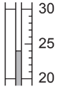 | 24 | 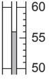 | 56 | 32 | moderate effervescence, solution paler brown solid |
| iron | 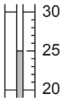 | 25 | 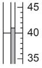 | 41 | 16 | little effervescence, brown solid |
| magnesium | 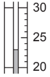 | 23 | 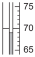 | 69 | 46 | rapid effervescence, pops with lighted splint, brown solid |

- All initial temperatures correct **AND **All final temperatures correct; **[3 marks]** *One mark is lost for each incorrect value*
- All temperature differences correct; **[1 mark]**

**[Total: 4 marks]**

- *Take your time reading the scales correctly*
b)

i) The metal that is most reactive with aqueous copper(II) sulfate is:

- Magnesium; **[1 mark]**

ii) **Two **reasons for this are:

- Gas evolves rapidly;** [1 mark]**
- Greatest temperature change / difference; **[1 mark]**

iii) The gas given off when magnesium reacts with aqueous copper(II) sulfate is

- Hydrogen; **[1 mark]**

**[Total: 4 marks]**

- *You can determine the most reactive metal with copper(II) sulfate by looking at the results table*

  - *Only one pops with a lighted splint and has **rapid** effervescence*
  - *This one also has the greatest temperature change*
- *You can deduce that the gas is hydrogen as the observations tell you that it **pops with a lighted splint** **- this is the gas test for hydrogen*
c) The completed table is:

| time / seconds | temperature / oC |   |   |   |
|---|---|---|---|---|
| Experiment 2 | Experiment 3 |   |   |   |
| 0 |  | 24 | 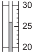 | 26 |
| 10 | 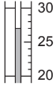 | 27 | 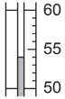 | 54 |
| 20 | 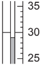 | 29 | 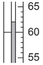 | 62 |
| 30 | 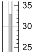 | 33 | 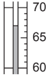 | 67 |
| 40 | 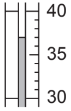 | 37 | 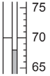 | 68 |
| 50 | 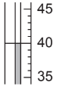 | 40 |  | 67 |
| 60 | 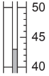 | 43 | 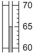 | 65 |

- All temperatures correct; **[6 marks]** 
*Each incorrect temperature loses 1 mark*

**[Total: 6 marks]**

- *Take your time to make sure you read the values correctly *
d) The completed graph is:

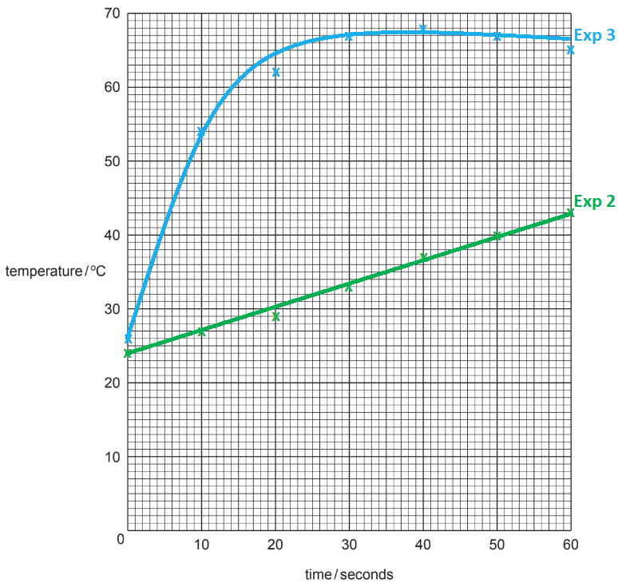

- <u>All</u> points plotted correctly; **[2 marks]** *One mark is lost per incorrect point to a maximum of 2 lost marks*
- Two smooth lines of best fit; **[1 mark]**
- Correct labels on best fit lines; **[1 mark] ***Labels can be chemical symbols, words or experiment 2 / 3*

**[Total: 4 marks]**

- *Graph drawing is an expected skill*
- *For graphs like these, it is best to plot one set of data at a time *
- *Remember: **A line or curve of best fit does not have to have any points on it at all*
- *Careful: **Don't include anomalous results when drawing your line or curve of best fit*
e) The temperature of the reaction mixture in Experiment 2 after 5 seconds is:

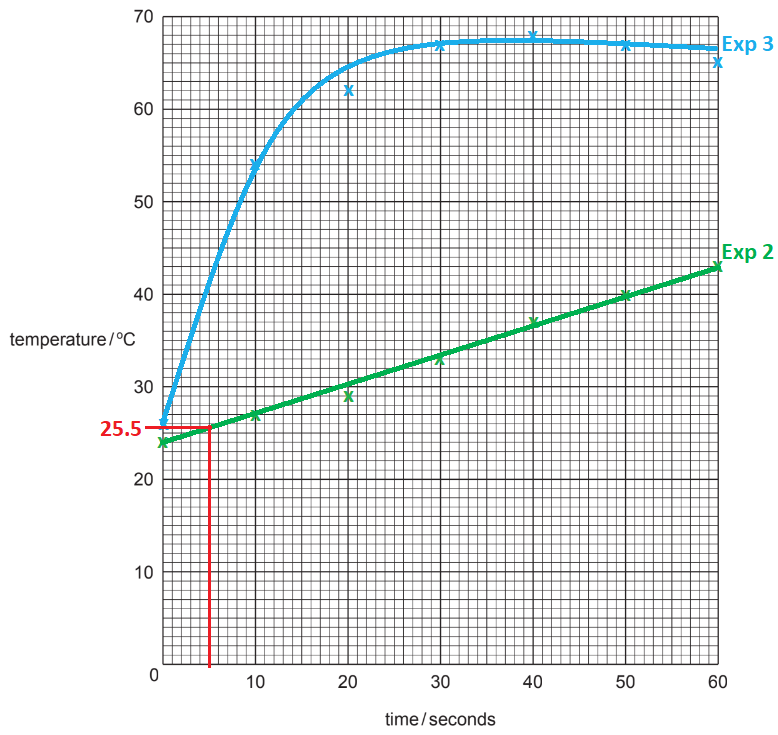

- Clear evidence of extrapolation on graph; **[1 mark]**
- 25 - 26 oC ± 0.5 oC; **[1 mark]**

**[Total: 2 marks]**

- *Draw a line up from x = 5 seconds to your line for Experiment 2 (zinc)*
- *Draw a line across from that point to the y-axis*
- *Read the value off the x-axis*
- *Careful: **Make sure you use the correct line of best fit for your answer*
f) The lines to show the predicted results are:

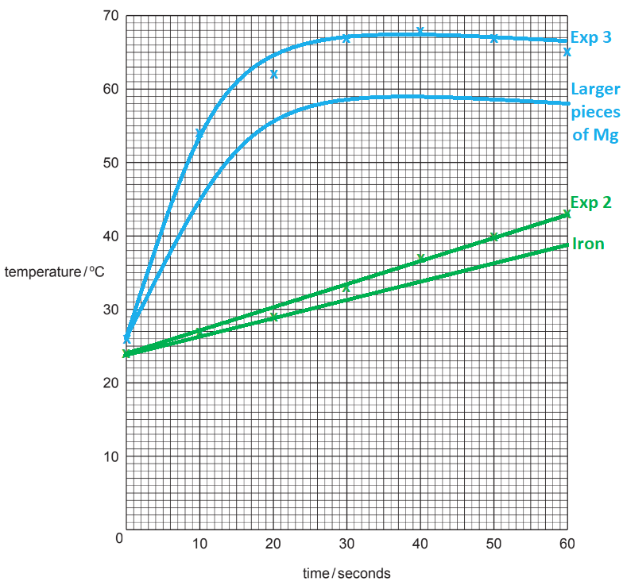

- Sketch line for larger pieces of magnesium below experiment 3; **[1 mark]**
- Sketch line for iron powder below experiment 2; **[1 mark] ***Allow a maximum of 1 mark if the graphs are incorrectly labelled*

**[Total: 2 marks]**

- *Larger pieces of magnesium means that the reaction is slower compared to magnesium powder because there is a decreased surface area*
- *Iron is less reactive than zinc so the line for iron should be below the line for zinc*
g) A polystyrene cup is used instead of a glass container because:

- It prevents / reduces heat loss 
**OR **
It provides insulation; **[1 mark]**

**[Total: 1 mark]**

- *The main reason for using a polystyrene cup as the container for an experiment is going to be about the insulating properties of the polystyrene*
h) **One **improvement to the method in Experiment 2 is:

- Use a burette / pipette to measure solution 
**OR **
Use a lid; **[1 mark]**

**[Total: 1 mark]**

- *When looking for improvements, you should first consider the independent, dependent and control variables*
- *Focus on the equipment and measurements*

  - *Is there more precise equipment that you could use?*
  - *Is there anything that could affect the results? Can you stop it from affecting the results?*

### Q2
a)

i) The completed results table is:

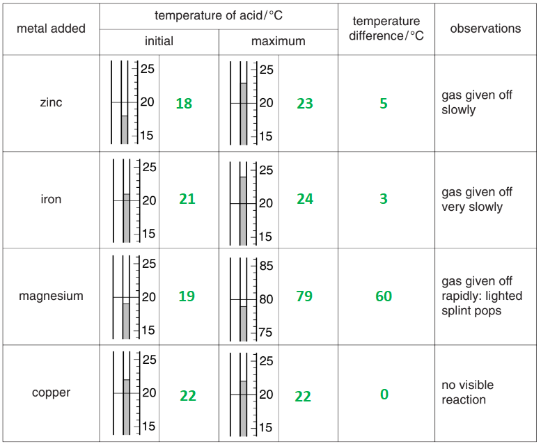

- All initial temperatures correct;** [2 marks]** 
*One mark lost per incorrect reading *
- All maximum temperatures correct; **[2 marks]** 
*One mark lost per incorrect reading *
- All temperature differences correct; **[2 marks]** 
*One mark lost per incorrect reading *

ii) The metal that is most reactive with sulfuric acid is:

- Magnesium; **[1 mark]**

iii) **Two **reasons for choosing this metal are:

- It has the greatest temperature change; **[1 mark]**
- It has the strongest / most violent observations **OR **It gives off gas the most rapidly;** [1 mark]**

iv) The gas given off is:

- Hydrogen; **[1 mark]**

v) The completed results table is:

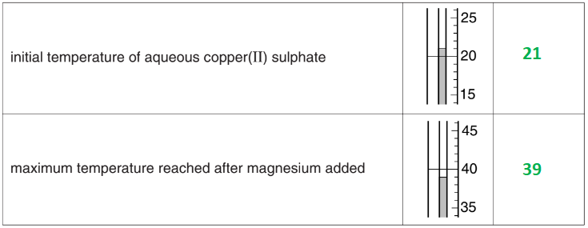

- 21; **[1 mark]**
- 39; **[1 mark]**

**[Total: 12 marks]**

- *This question uses a lot of data, which means that you should score well if you take your time to carefully read the temperatures from the diagrams*
- *It should not be surprising that magnesium is the most reactive of the given metals*

  - *You should be sure to use the data given to answer the question*
- *Remember: **metal + acid → salt + hydrogen*
b) The observations show that the reaction of magnesium with aqueous copper(II) sulphate is exothermic because:

- The temperature increases; **[1 mark]**

**[Total: 1 mark]**

- *Remember: **Exothermic reactions release (heat) energy to the surroundings which results in the temperature of the solution increasing*
c) Using the results from Experiments 1 and 2, the four metals in order of reactivity are:

- | Least reactive: | Copper |
|---|---|
|   | Iron |
|   | Zinc |
| Most reactive: | Magnesium |
- Metals in the correct order (as shown); **[1 mark]**

**[Total: 1 mark]**

- *You can use the temperature changes or the observations to deduce the order*

  - *You might be able to suggest it from your knowledge but you should double-check this against the information that you are given*

### Q3
a)

The completed table is:

| time / min | thermometer diagram | temperature / oC |
|---|---|---|
| 0.0 | 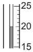 | 20 |
| 0.5 | 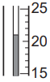 | 21 |
| 1.0 |  | 21 |
| 1.5 | 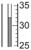 | 32 |
| 2.0 | 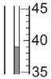 | 39 |
| 2.5 | 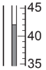 | 42 |
| 3.0 | 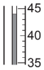 | 44 |
| 3.5 | 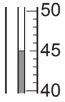 | 45 |
| 4.0 |  | 45 |

- All readings correct; **[3 marks]** 
*One mark lost per incorrect reading*

**[Total: 3 marks]**

- *Careful: **The thermometers have a mixture of different scales, so make sure you take your time to read them correctly*
b)

The completed table is:

| time / min | thermometer diagram | temperature / oC |
|---|---|---|
| 0.0 |  | 20 |
| 0.5 |  | 21 |
| 1.0 |  | 21 |
| 1.5 |  | 24 |
| 2.0 |  | 32 |
| 2.5 | 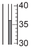 | 36 |
| 3.0 | 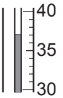 | 37 |
| 3.5 | 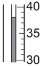 | 38 |
| 4.0 |  | 38 |

- All readings correct; **[3 marks]** 
*One mark lost per incorrect reading*

**[Total: 3 marks]**

- *Careful: **The thermometers have a mixture of different scales, so make sure you take your time to read them correctly*
c) The plotted graphs are:

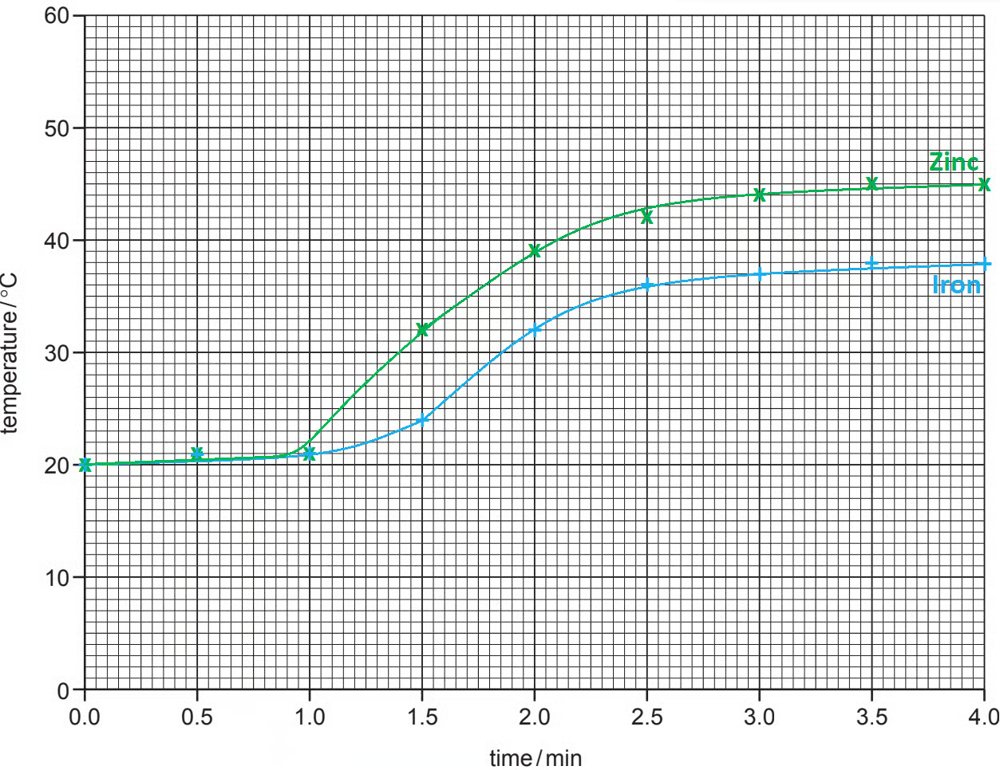

- All points correctly plotted; **[3 marks]** 
*One mark is lost for each incorrectly plotted / missing point*
- Best fit smooth line for zinc (green line) 
**AND **
Best fit smooth line for iron (blue line); **[1 mark]**
- <u>Both</u> best fit lines are labelled; **[1 mark]**

**[Total: 5 marks]**

- *Take your time plotting the graph so that you don't lose marks for missing points or incorrect points*
- *More recent papers will sometimes allow a tolerance of ± 0.5 squares but you cannot rely on this, especially when graphs are a relatively common question in exam papers *
d) The temperature of the reaction mixture in Experiment 1 after 1 minute 15 seconds is:

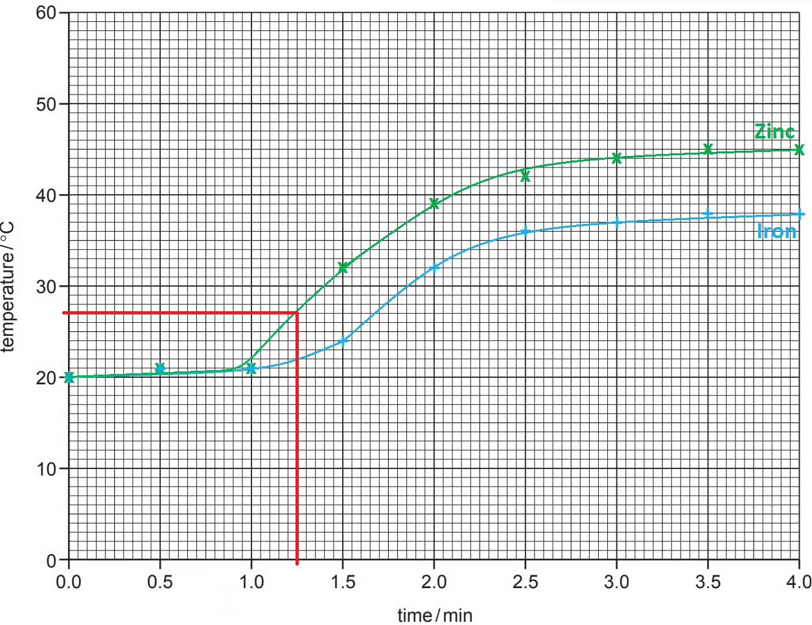

- Clear evidence of extrapolation on graph (red lines); **[1 mark]**
- Value = 27; **[1 mark]** 
*Allow answers based on best fit lines - expected in the range of 25 - 29*
- Units = oC; **[1 mark]**

**[Total: 3 marks]**

- *Since the question states to show your workings on the graph, you must do this to achieve full marks*
- *It is always good practice to include units *

  - *In this particular question, the units do score a mark*
e) The type of chemical process that occurs when zinc and iron react with aqueous copper(II) sulfate is:

- Exothermic 
**OR **
Redox 
**OR **
Displacement; **[1 mark]**

**[Total: 1 mark]**

- *Since the temperature in the results is increasing, you can deduce that the reaction is exothermic*
- *Zinc and iron are both more reactive than copper, so they will displace copper out of solution*

  - *This displacement involves the copper(II) ions gaining electrons while the zinc / iron ions lose electrons, so this is also a redox reaction*
f)

i) Comparing the temperature changes in Experiments 1 and 2:

- The temperature rises greater / faster in experiment 1;** [1 mark]** 
*Accept the reverse argument for experiment 2*

ii) The reason for the difference in temperature changes could be:

- Zinc is more reactive (than iron);** [1 mark]** 
*Accept the reverse argument for iron being less reactive*

**[Total: 2 marks]**

- *Experiment 1, using zinc, has a greater and faster temperature change which matches with the fact that zinc is more reactive than iron*
g) How the temperature changes would differ in the experiments if 12.5 cm3 of copper(II) sulfate solution were used:

Alternative 1:

- The temperature change would be greater;** [1 mark]**
- (Because,) there is a lower volume / less being heated by the reaction;** [1 mark]**

Alternative 2:

- The temperature change would be the same; **[1 mark]**
- (Because,) the metal is in excess; **[1 mark]**

**[Total: 2 marks]**

- *These questions always prove tricky to answer*
- *The easiest way to think about it is that the same reaction releasing heat energy is happening*

  - *But, there is less liquid to heat up*
  - *Therefore, the temperature change will be greater*
h) The effect of using lumps of zinc in Experiment 1 would be:

- The solid would react slower 
**OR **
The temperature rise would be slower; **[1 mark]**
- (Because the lumps have a) smaller surface area; **[1 mark]** *Allow the reverse argument for zinc powder as long as there is a comparison*

**[Total: 2 marks]**

- *Using lumps, compared to powder, always gives a slower reaction because of the decreased surface area*

### Q4
a) A line of best fit on the graph:

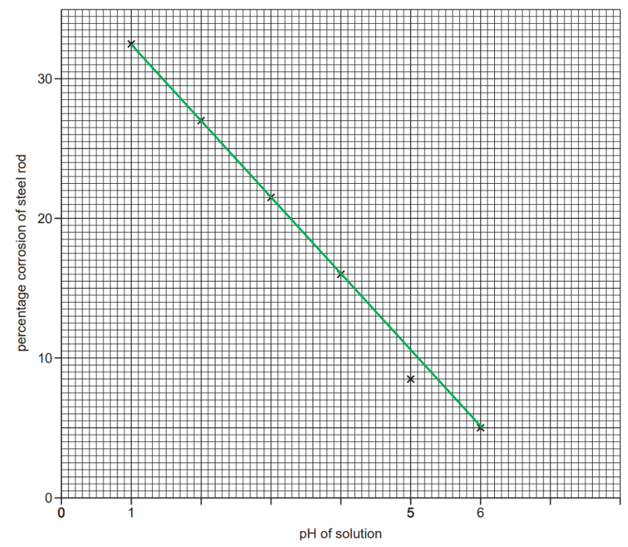

- Straight line drawn with a ruler through all points missing point at pH 5; **[1 mark]**

**[Total: 1 mark]**

- *Remember**: Discard any anomalous points before drawing a line of best fit*
- *If it is a straight line, always draw it with a ruler!*
b) The steel rods were the same size to:

- Make it a fair test / so results can be compared;** [1 mark]**

**[Total: 1 mark]**
One other variable which should have been kept constant is:

Any **one **from:

- Temperature
- Size / thickness / dimensions of the rod
- Concentration / volume of the solutions
- Time left in solution

**[1 mark]**

**[Total: 1 mark]**

- *A common error in question to identify control variables is to give either the independent or dependent variable *
- *If the variable is in a results table or a label on a graph, it will vary during the course of the experiment so should not be controlled*
d) One conclusion that could be drawn from the results is:

- The lower the pH the greater the % corrosion / or converse / pH 1 is most corrosive;** [1 mark]**

**[Total: 1 mark]**

- *A straight line graph with a negative gradient, such as this one, shows that the variables are inversely proportional*
- *Other common relationships to look for are:*

  - *A straight line graph with a positive gradient shows the variables are proportional*
  - *A straight line graph that goes through the origin shows the variables are directly proportional*
e) The percentage corrosion of a steel rod in a solution of pH 6.5 is:

- 2.5%; **[1 mark]**

**[Total: 1 mark]**

- *To find the percentage corrosion of a steel rod in a solution of pH 6.5:*

  - *Extrapolate your line of best fit so that it extends to at least a pH of 6.5*
  - *Draw a line from pH 6.5 on the x-axis to where it intersects your line of best fit*
  - *Then, draw a line from this intersection to meet the y-axis and read off the percentage corrosion this corresponds to*
  - *Remember to use a ruler:*

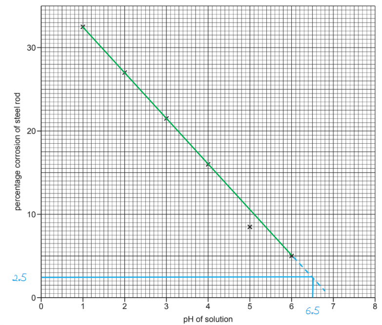

## Multiple Choice Questions (27 questions)

### Q1
**Final answer:** **The correct answer is A**

This question is based on the principle that **a more reactive metal will displace another**. Therefore,  according to the reactivity series of metals in decreasing order of reactivity: **magnesium > aluminium > zinc > iron > copper**.

- **Copper**

  - Copper is less reactive than iron, so it cannot displace iron from its aqueous salt. **No reaction (**×**)**
- **Magnesium**

  - Magnesium is more reactive than iron, so a displacement reaction occurs. **Reaction (**✓**)**
- **Zinc**

  - Zinc is more reactive than iron, so a displacement reaction occurs. **Reaction (**✓**)**
- **Aluminium**

  - Aluminium is more reactive than iron, so a displacement reaction occurs. **Reaction (**✓**)**

### Q2
**Final answer:** **The correct answer is B**

- Rusting is an oxidation reaction

  - Iron reacts with oxygen in the presence of** water **and** air**
  
    - Both of them are necessary, otherwise, the rusting process will not occur
  - The chemical name of rust is **hydrated iron(III) oxide**
  
    - Iron is oxidized and water allow the reaction to happen
    - loses electrons to oxygen forming iron(III) ions
- Therefore the correct word equation is

  - iron + water + oxygen → hydrated iron(III) oxide

**A **& **C **are incorrect because hydrogen is not involved in rusting, it is oxygen which is needed for the oxidation process

**D** is incorrect because the chemical name of rust is not hydrated iron(II) oxide

### Q3
**Final answer:** **The correct answer is C**

- Considering the reactivity series:

  - **K > Al > Fe > H > Ag**
  - A metal above hydrogen reacts with hydrochloric acid, and the higher it is, the faster the reaction

- Potassium reacts very violently with hydrochloric acid because it is at the top of the reactivity series, so **X must be potassium**. Silver does not react with hydrochloric acid at all because it is below hydrogen in the reactivity series, so **Z must be silver**
- Aluminium and iron are both above hydrogen, so they do react with hydrochloric acid, but aluminium is more reactive than iron. This means aluminium reacts faster than iron. Therefore, **W (slow reaction) is aluminium** and **Y (very slow reaction) is iron**

**A** is incorrect because silver would not show a very slow reaction, **it does not react at all**

**B** is incorrect because aluminium reacts faster than iron, not slower

**D** is incorrect because silver should not react with acid at all; iron does react, so "no reaction" for iron is wrong

### Q4
**Final answer:** **The correct answer is ****D**** because: **

- The reaction that occurs is:

copper(II) sulfate + zinc  →   zinc sulfate + copper

- Copper forms the orange/brown deposits on the metal (zinc)
- Copper ions are blue and therefore as the copper in the copper(II) sulfate is displaced by the zinc, the shade of blue will get lighter

### Q5
**Final answer:** **The correct answer is ****A**** because:**

- When a metal is added to an acid, a salt and hydrogen gas are formed
- The hydrogen will form bubbles
- The more reactive the metal, the more bubbles of hydrogen will be produced
- **W** produces the most bubbles so is, therefore, the most reactive metal
- **X** produces no bubbles, so it is the least reactive metal

**B** is incorrect as the most reactive and least reactive metals are the wrong way around

**C** is incorrect as **Y** is the second most reactive metal

**D** is incorrect as **Z** is the second least reactive metal

### Q6
**Final answer:** **The correct answer is ****A**** because:**

- Rusting occurs when oxygen and water are present.
- The equation for rusting is:

  - ·4Fe(s) + 3 O2(g) + x H2O(l) → 2 Fe2O3.H2O(s)
- The iron in the hinges on the gate is more likely to rust as it has no protection from either water or oxygen.

**B **is incorrect as the metal fence is painted, preventing both oxygen and water getting to the iron.

**C **is incorrect as the bucket is electroplated, preventing the oxygen and water reaching the iron.

**D **is incorrect as the cables are coated in aluminum, preventing oxygen and water from getting to the iron.

### Q7
**Final answer:** **The correct answer is**** A**** because:**

- Rusting is the corrosion of iron in the presence of **oxygen** and **water** to produce **iron** **oxide**:

  - 4 Fe(s) + 3 O2(g) + *x*H2O(l) → 2 Fe2O3●H2O(s)
- Both oxygen and water **must** be present and in contact with the surface of the nail for it to rust.
- Nail A will rust quite quickly as there is nothing protecting its surface.

**B** and **C** are incorrect as these nails will not rust as the paint and grease coatings act as **protective barriers**, so oxygen and water cannot get into contact with the surface of the nail.

**D** is incorrect as zinc is a more **reactive metal** and more likely to lose electrons than iron. It readily donates its electrons to any iron ions that might have formed, stopping them from corroding.

### Q8
**Final answer:** **The correct answer is**** B**** because:**

- Iron oxide (rust) is formed, using up the **oxygen** inside the tube:
- 4 Fe(s) + 3 O2(g) + xH2O(l) → 2 Fe2O3●H2O(s)
- The amount of oxygen decreases and is not replenished as the set-up represents a **closed system**.
- The pressure inside the tube thus **decreases **and the water level rises as the pressure balance** **is re-established.

**A** and **D** are incorrect as these compounds are not produced in the reaction.

**C** is incorrect as the water temperature was not adjusted.

### Q9
**Final answer:** **The correct answer is ****B**** because:**

- Metals that are reactive will react with cold water.
- A reactive metal oxide is therefore not going to be reactive with carbon, carbon is not going to reduce the metal as carbon is less reactive.
- Q is the least reactive as it will not react with water and it is lower than carbon in the reactivity series so its oxide will react with carbon.
- P is the next reactive metal in the reactivity series as it doesn’t react with water and its oxide will not react with carbon so is higher in the reactivity series than carbon.
- R is the most reactive as it reacts with cold water and its oxide can’t be reduced by carbon.

### Q10
**Final answer:** **The correct answer is**** C**** because:**

- **Sacrificial rust protection **works by using a metal placed **higher** up on the reactivity series and connecting it to the object that needs to be protected.
- Zinc is a more reactive metal so is more likely to **lose** **electrons** (and become oxidised) than iron and it readily donates its electrons to any iron ions that might have formed, stopping them from corroding.
- The zinc metal will be **corroded** **in** **preference** to the steel hull, hence preventing it from rusting.

**A**, **B** and **D** are incorrect as the sacrificial metal must be **above iron** on the reactivity series to be able to oxidise before the iron atoms do.

### Q11
**Final answer:** **The correct answer is ****A**** because:**

- A more reactive metal will displace (take the place of) a less reactive metal when added to an aqueous solution of its ions.
- **Q** displaces all the other metals so is the most reactive
- **P** is next as it displaces everything except **Q**.
- **S** is the third most reactive as it displaces **R**.
- **R** is the least reactive as it will not displace any other metal.

### Q12
**The correct answer is ****C**** because **Y is above hydrogen in the reactivity series so can displace hydrogen from hydrochloric acid.

**A **is incorrect as copper (Cu) is a weak oxidizing agent and can’t oxidise Y.

**B **is incorrect as iron (Fe) is above Y in the reactivity series so Y can’t displace iron.

**D **is incorrect as Y is more reactive than copper so will not be reduced by copper (Cu)

### Q13
**Final answer:** **The correct answer is C because:**

- When a metal reacts with an acid it produces a metal salt and hydrogen gas.

  - M(metal) + H2SO4 → MSO4 + H2
- The more reactive the metal the more hydrogen gas will be produced in the same amount of time.
- The bar chart shows that metal T is the most reactive as this reaction produces the largest volume of gas, followed by Q.
- The bar chart then shows the order of reactivity by the decreasing volume of hydrogen gas produced.

### Q14
**The correct answer is ****C**** because **both magnesium and calcium are reactive enough to react with hot water.

**A **is incorrect as magnesium is more reactive than iron so would burn in steam producing magnesium oxide and H2 gas.

**B **is incorrect as copper does not react with dilute hydrochloric acid

**D **is incorrect as iron (II) oxide is **reduced** with carbon in a blast furnace

### Q15
**Final answer:** **The correct answer is ****D**** because:**

- Magnesium will react with dilute hydrochloric acid to produce magnesium chloride and hydrogen gas.
- Magnesium will react slowly with cold water
- Magnesium burns in steam to produce magnesium oxide and hydrogen gas.

**A **is incorrect as copper will not react with dilute hydrochloric acid.

**B **is incorrect as calcium will react with dilute hydrochloric acid and slowly with cold water

**C **is incorrect as zinc will react with steam to produce zinc oxide and hydrogen gas.

### Q16
**Final answer:** **The correct answer is ****A**** because:**

- The number of bubbles of hydrogen gas produced indicates the order of reactivity of the metal
- Metal **W** is the most reactive as it produces the most gas bubbles, followed by **Y**, **Z** and then** X** is the least reactive as it produces no gas bubbles
- Of the four metals listed, calcium is the most reactive (metal **W**), followed by magnesium (metal **Y**), then zinc (metal **Z**) with copper (metal **X**) being the least reactive

**B**, **C** and **D** are incorrect as the amount of hydrogen gas produced does not correspond to the correct order of reactivity

### Q17
**Final answer:** **The correct answer is ****B**** because:**

- Sodium and zinc are above hydrogen in the reactivity series so will both react with dilute hydrochloric acid
- Sodium is higher than zinc in the reactivity series than zinc so will react more violently

  - Metal **Q** could be sodium and metal **R** could be zinc
- Metal **S** does not react with cold water, therefore is lower in the reactivity series

  - Metal **S** could be copper

**A** is incorrect as magnesium would react with cold water

**C** is incorrect as silver would not react with cold water

**D** is incorrect as copper does not react with cold water, steam or dilute hydrochloric acid

### Q18
**Final answer:** **The correct answer is ****A**** because:**

- The limewater water has turned cloudy, this shows that a reaction has taken place and that carbon dioxide has been produced.
- Metals that are below carbon in the reactivity series are reduced with carbon. The only metal in the list above that is below carbon in the reactivity series is copper. The equation is:

  - 2 CuO + C → 2 Cu + CO2

**B, C** and **D **are incorrect as they are all more reactive metals than carbon, so carbon will not reduce them.

## Theory Questions (19 questions)

### Q1
a)

i) A possible equation could be:

- Na → Na+ + e–; **[1 mark] ** 
*Correct equation with a more reactive metal*

ii) Oxidation in terms of electron transfer:

- Electron loss; **[1 mark] **

iii) The positive ions are likely to be oxidising agents:

- Because they can accept electrons or take electrons; **[1 mark] **

iv) The positive ion(s) that can oxidise mercury metal (Hg):

- Silver / silver(I);** [1 mark] **

**[Total: 4 marks] **

- *Part i) is asking for an ionic half equation for a more reactive metal than Zn, so any acceptable answer will be credited*

  - *Just make sure that the charge on the ion is correct*
  - *So if you chose a Group I metal, the charge on the ion is 1+ and a Group II metal will have a 2+ charge and lose 2 electrons, e.g. Mg → Mg**2+** + 2e**-*
- *An oxidising agent will itself become reduced, which means that it has gained electrons *
- *Oxidation is the loss of electrons and reduction is the gain of electrons*
b)

i) The voltage of the cell would:

- Increase;** [1 mark] **

ii) The electrode that would generate positive ions would be:

- Zinc 
**AND** 
As it loses electrons more easily / it is more reactive;** [1 mark] **

iii) The flow of electrons would be:

- From the more reactive to the less reactive;** [1 mark] **

**[Total: 3 marks]**

- *The question asks you how would you predict the flow of electrons in a cell like this*
- *So, you need to think about two points*

  - *The type of cell - there in no battery involved*
  - *The difference in reactivity *
- *Electrons will flow from the more reactive metal (which is oxidised) to the less reactive metal which is reduced*
- *You could be asked for the ionic equation as well which would be*

  - *Zn + Sn**2+ **→ Zn**2+** + Sn*

### Q2
a) The four metals in order of their reactivity, with the least reactive first are:

- (Least reactive) copper < zinc < magnesium < sodium (most reactive); **[2 marks]**

**[Total: 2 marks]**

- *Make sure you read the question carefully and start with the least reactive*
- *You can score 1 mark if you have one pair correct but the other incorrect *
- *You can score 1 mark if you have the correct order but the wrong way around*
b) One method of preventing iron from rusting is:

- Painting / greasing / putting plastic layer over iron / galvanising; **[1 mark]**
- Prevents oxygen (or air) from getting to the iron / prevents water getting to the iron / acts as a barrier to oxygen (or air) / acts as a barrier to water; **[1 mark]**

**[Total: 2 marks]**

- *You will not score both marks for giving more than one method*
- *You must state your method AND then explain it for the second mark *
- *Galvanising involves protecting the iron with a layer of zinc- if you have given this description instead of the name of the method you would also score the mark *

### Q3
i) The two metals that would not react with dilute hydrochloric acid are:

- Cu / copper;** [1 mark]**
- Pd / palladium;** [1 mark]**

ii) The two unfamiliar metals that would react with cold water are:

- Ba / barium;** [1 mark]**
- La / lanthanum;** [1 mark]**

iii) The oxidation state of barium is:

- +2;** [1 mark]** *Allow 2+ or Ba**2+*

iv) An unfamiliar metal whose oxide cannot be reduced by carbon is:

- Ba / barium 
**OR** 
La / lanthanum;** [1 mark]**

v) You should be able to predict that metals such as iron and chromium have more than one oxidation state because:

- It is a transition metal / element / a d block element;** [1 mark]**

**[Total: 7 marks]**

- *Metals above hydrogen in the reactivity series will react with dilute acids*
- *Hydrogen lies between iron and copper, so anything from copper and below (Cu and Pd) will not react with dilute hydrochloric acid*

  - *Metals above magnesium in the reactivity series will react with cold water, therefore Ba and La will react with cold water*
- *The oxidation state/number shows the number of electrons that an atom has lost, gained or shared in forming a compound*

  - *Barium is in Group II so will lose 2 electrons when it forms a compound to give the Ba2+ ion, therefore its oxidation number is +2*
- *Anything above carbon in the reactivity series can not be extracted from its oxide using carbon*

  - *Carbon is just above zinc in the reactivity series so the metals above zinc cannot be extracted in this way*
- *A property of transition elements is that they can have more than one oxidation number, as they can lose a different number of electrons, depending on the chemical environment they are in*

### Q4
a) The metals are:

**Max 5 **marks from:

- Metal **A** is magnesium;** [1 mark]**
- Conditional on stating fastest reaction; **[1 mark] **
- Metal **B** is aluminium;** [1 mark] **
- Conditional on stating faster reaction after removal of oxide layer / it would give more hydrogen / aluminium;** [1 mark] **
- more reactive than zinc; **[1 mark] **
- Metal **C** is zinc;** [1 mark] **

**[Total: 5 marks] **

- *The unusual curve here is metal **B**, which is aluminium*
- *The reason why the curve starts shallow and then gets steeper is the fact the oxide layer must first be removed before the reactive aluminium itself can react*
- *Aluminium is higher up in the reactivity series than zinc, so will form hydrogen more quickly leading to a steeper curve *
b) Two of the metals form the same volume of hydrogen but the third metal forms a larger volume.

- Magnesium and zinc both form the same volume of hydrogen; **[1 mark]**
- Because they both have valency of 2 / are 2+  
**OR **
1 mole of metal gives 1 mole of hydrogen / 1 mole of metal reacts with 2 moles of acid;** [1 mark]**
- There is a bigger volume for aluminium because it has a valency of 3 / is 3+ 
**OR **
There is a bigger volume for aluminium because 1 mole of aluminium gives 1.5 moles of hydrogen / 1 mole of metal reacts with 3 moles of acid; **[1 mark] **

**[Total: 3 marks] **

- *The balanced equations are acceptable answers*

  - *Magnesium: Mg + 2HCl → MgCl**2** + H**2*
  - *Zinc: Zn + 2HCl → ZnCl**2** + H**2*
  - *Aluminium: Al + 3HCl → AlCl**3** + 1½H**2*

### Q5
a)

i) The order of reactivity of these metals (least reactive first) is:

- Silver, tin;** [1 mark] **
- Cobalt and magnesium not possible to decide; **[1 mark] **

ii) The additional experiment needs to be done to put all four metals in order of reactivity is:

- Magnesium and cobalt salt / compound / ions 
**OR** 
Cobalt and magnesium salt / compound / ions;** [1 mark] **

iii) The ionic equation for the reaction between tin atoms and silver(I) ions. Indicate on the equation the change which is oxidation is:

Sn + 2Ag+ → Sn2+ + 2Ag

- Correct species; **[1 mark] **
- Correct balancing;** [1 mark] **
- Sn to Sn2+ is oxidation 
**OR** 
Sn → Sn2+ + 2e- is oxidation;** [1 mark]**

**Final answer:** **[Total: 6 marks] **

- *In order to determine the reactivity of these four metals, we need to do the following reactions:*

| > *Metal solutions containing * | > *Magnesium * | > *Tin* | > *Silver* | > *Cobalt * |
|---|---|---|---|---|
| > *Magnesium nitrate* | > *-* | > * * | > * * | > * * |
| > *Tin nitrate* | > *Grey deposit on magnesium* | > *-* | > * * | > * * |
| > *Silver nitrate* | > * * | > *Silvery layer on tin* | > *-* | > * * |
| > *Cobalt nitrate* | > * * | > *No reaction* | > * * | > *-* |

- *As we can see there is no data for cobalt metal or magnesium nitrate*
- *Therefore we could add magnesium with cobalt to see if there is a reaction*
- *If we see a metal deposit then we know that cobalt has displaced magnesium from solution *

  - *This would mean cobalt is more reactive than magnesium*
- *If we see no reaction then this would be that magnesium is more reactive than cobalt as cobalt can not displace magnesium from magnesium nitrate *
- *The overall reaction for tin and silver nitrate is*

  - *Sn + AgNO**3 **→ SnNO**3 **+ Ag*
- *Breaking this down into ions (you are told in the question that tin has a 2+ charge through the name tin(II) nitrate and silver has a 1+ charge as the name is silver(I) nitrate*

  - *Sn**2+ **+ Ag + NO**3**– **→ Sn + Ag**+** + NO**3**–*
- *Cancelling out the spectator ions the ionic equation can be revealed*

  - *Sn**2+ **+ Ag → Sn + Ag**+** *
b)

i) The more reactive metal is the negative electrode because:

- It forms positive ions / loses or gives electrons; **[1 mark]**
- Electrons move / flow from this electrode / enter the circuit / electrons flow from negative to positive (so it is negative);** [1 mark] **

ii) Zinc is more reactive than tin because:

- Bigger voltage of Zn / Cu cell than Sn / Cu cell 
**OR** 
Zinc is negative relative to tin (in the third cell);** [1 mark] **

iii) You change the zinc/copper cell to have a voltage greater than 1.1 V by:

- Magnesium / more reactive metal (must be named) instead of zinc 
**OR** 
Silver / less reactive metal (must be named) instead of copper 
**OR** 
Use (more) concentrated acid; **[1 mark] **

iv) The labelling of the zinc/tin cell

- Polarities correct that is Zn - and Sn +; **[1 mark] **
- 0.6 V; **[1 mark] **

**[Total: 6 marks]**** **

- *The more reactive metal is always the negative electrode*
- *This is because electrons are donated from the more reactive metal and flow to the less reactive metal *

  - *The electrode at which oxidation takes place is called the anode*
  - *You can remember this by thinking of 'An Ox' *
  - *The electrode at which reduction occurs is the cathode - think of a 'Red Cat' *
- *For part iv) you can work out that zinc is the more negative electrode (more reactive metal) as the difference between the cell potential for the zinc/copper is greater than the cell potential tin/copper cell*

### Q6
a)

i) The completed table is:

|   | metal |   |   |   |
|---|---|---|---|---|
| aqueous solution | lead Pb | magnesium Mg | zinc Zn | silver  Ag |
| lead(II) nitrate |   | **Y** | **Y** | **N** |
| magnesium nitrate | **N** |   | **N** | **N** |
| zinc  nitrate | **N** | **Y** |   | **N** |
| silver nitrate | **Y** | **Y** | **Y** |   |

- Magnesium nitrate row correct; **[1 mark]**
- Zinc nitrate row correct;** [1 mark]**
- Silver nitrate row correct; **[1 mark]**

ii) The labelled points on the following equation are:

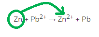

- Zn circled; **[1 mark]**
- Arrow from Zn to Zn2+; **[1 mark] **

iii) The completed ionic equation is:

- Zn + 2Ag+ → Zn2+ + 2Ag; **[1 mark]**

**[Total: 6 marks]**** **

- *To complete the table, you need to use the reactivity series that you are given*

  - *Magnesium is the most reactive metal so:*
  
    - *Magnesium metal will react with all of the other solutions *
    - *None of the other metals will displace magnesium out of magnesium nitrate solution*
  - *Silver is the least reactive metal so:*
  
    - *Silver metal will react with none of the other solutions *
    - *All of the other metals will displace silver out of silver nitrate solution *
  - *That leaves lead and zinc*
  
    - *Since lead is less reactive than zinc, it will not displace the zinc out of zinc nitrate solution*

|   | > *metal* |   |   |   |
|---|---|---|---|---|
| *aqueous* *solution* | *lead* *Pb* | *magnesium* *Mg* | *zinc* *Zn* | *silver * *Ag* |
| *lead(II)* *nitrate* |   | > *Y* | > *Y* | > *N* |
| > *magnesium nitrate* | > *N* |   | > *N* | > *N* |
| *zinc * *nitrate* | > *N* | > *Y* |   | > *N* |
| *silver* *nitrate* | > *Y* | > *Y* | > *Y* |   |

- *Remember: **A reducing agent causes reduction in another chemical whilst being oxidised itself*

  - *Oxidation is loss of electrons (OIL-RIG)*
  - *This is happening to the zinc as it forms the zinc 2+ ion / Zn**2+** *
  - *So, zinc is the reducing agent and the arrow showing oxidation should go to the zinc ion*
- *The ionic equation shows the displacement reaction of zinc with silver ions*

  - *The zinc will lose two electrons and become the Zn**2+** ion*
  - *Each silver ion will gain one electron forming silver atoms*
  - *Careful: **When you describe/explain these types of reactions make sure you are clear if you are talking about atoms or ions at each and every stage*
b)

i) The electron flow is:

- Correct direction from zinc to lead; **[1 mark] **

ii) The more reactive metal is always the negative electrode because:

- Metals react by losing electrons;** [1 mark] **
- The more reactive metal/ zinc will lose electrons more readily (making the electrode negatively charged); **[1 mark] **

iii) The information that can be gathered about the order of reactivity from the table is:

- Manganese and zinc are more reactive than lead (and/or copper); **[1 mark] **
- Lead is more reactive than copper; **[1 mark] **

iv) The additional information required is:

- The polarity of a Mn/Zn (cell) 
**OR** 
The voltages of Zn/Pb and Mn/Pb (cells); **[1 mark] **

**[Total: 6 marks] **

- *Electrons travel from an area of negative charge to an area of positive charge - remember that this cell has no battery, just a voltmeter*
- *The electrons will therefore travel from the negative electrode which is made of zinc, to the positive lead electrode*
- *The more reactive metal will be the negative electrode  *
- *This is how you can deduce the order of reactivity from the table*

  - *For example, when zinc and lead are placed in a cell, zinc becomes the negative electrode as it is more reactive*
  - *Electrons will flow from zinc to lead *
  
    - *Zn + Pb**2+** → Zn**2+** + Pb*
    - *Zn has been oxidised and Pb**2+ **has been reduced*

### Q7
a) The two metals will react most vigorously with cold water are:

- Na / sodium and Li / lithium;** [1 mark] **

**[Total: 1 mark] **

- *The most reactive metals will react with water *
- *Unreactive metals such as copper will not react with water*
b) The two metals will not react with dilute hydrochloric acid are:

- Cu / copper **AND** Rh / rhodium;** [1 mark] **

**[Total: 1 mark] **

- *Unreactive metals will not react with acid *
- *You are asked to name two metals so the two least reactive should be stated *
c) The formula of iron(III) sulfate is:

- Fe2(SO4)3; **[1 mark] **

**[Total: 1 mark] **

- *The charge of the iron ion is iron(III) sulfate is Fe**3+*
- *This can be deduced from the roman numerals, (III)*
- *Sulfate ions have a charge of 2-, SO**4**2–*
- *We can use swap and drop method to determine the formula:*

  - *Fe**3+** and SO**4**2–** (swap and drop the charges)*
  - *Fe**2–** and SO**43+** (remove - and +)*
  - *Fe**2**SO**43** (add brackets) *
  - *Fe**2**(SO**4**)**3*
d) The formula of a magnesium ion is:

- Mg2+; **[1 mark] **

**[Total: 1 mark] **

- *Magnesium is in Group II, *
- *Metals in Group II form 2+ ions *
e) A test-tube experiment which will show that manganese is more reactive than copper is:

Alternative 1

- Copper sulfate (solution); **[1 mark] **
- Add manganese / Mn to solution; **[1 mark] **
- Copper displaced or forms / blue colour changes; **[1 mark] **

Alternative 2

- (A solution of) an iron salt or a zinc salt; **[1 mark] **
- Add copper and manganese to each; **[1 mark] **
- Only manganese reacts / displaces; **[1 mark] **

Alternative 3

- (A solution of a) manganese salt and a copper salt; **[1 mark] **
- Add, e.g. iron / zinc; **[1 mark] **
- Copper (displaced) and manganese not; **[1 mark] **

Alternative 4

- To a (dilute) acid / any named acid / water / steam; **[1 mark] **
- Add Mn and Cu / both metals to the liquid; **[1 mark]**
- Rate faster or shorter time or more bubbles or more hydrogen or more gas with Mn or with the more reactive metal / reaction only with Mn or with the more reactive metal; **[1 mark] **

Alternative 5

- Copper oxide; **[1 mark] **
- Add manganese and heat; **[1 mark] **
- Evidence of reaction; **[1 mark] **

Alternative 6

- Burn manganese and copper / both elements; **[1 mark] **
- In air/ oxygen; **[1 mark] **
- Mn or more reactive metal burns brighter / only Mn or more reactive metal burns / evidence that manganese reacts faster; **[1 mark] **

Alternative 7

- Add carbon; **[1 mark] **
- To both metal oxides and heat; **[1 mark] **
- Evidence that reaction occurs with copper oxide more readily / least reactive metal oxide; **[1 mark] **

Alternative 8

- Both metal nitrates or carbonates; **[1 mark] **
- Heat; **[1 mark] **
- Evidence that manganese compound is most stable / most reactive compound is most stable;** [1 mark] **

Alternative 9

- (Electrochemical) cell/ use of voltmeter / electrolyte;** [1 mark] **
- Copper and manganese (as electrodes); **[1 mark] **
- Manganese is the negative terminal;** [1 mark] **

**[Total: 3 marks] **

- *You are asked to describe a method to distinguish between the reactivity of each metal *
- *Make sure you include how to tell the metals apart in terms of reactivity*
f) **Three** physical and **two** chemical properties of manganese are:

Physical properties

Any **three** from the following:

- Hard; **[1 mark] **
- Strong; **[1 mark] **
- High density; **[1 mark] **
- Malleable; **[1 mark] **
- Ductile; **[1 mark] **
- Sonorous; **[1 mark] **
- Shiny; **[1 mark] **
- High melting point/ high boiling point;** [1 mark] **
- (Good) conductor (of heat/electricity); **[1 mark] **
- Forms coloured compounds / coloured ions / coloured salts; **[1 mark] **

Chemical properties

Any **two** from the following:

- Catalytic behaviour; **[1 mark] **
- More than one or different or variable oxidation state or oxidation number or valency / variable; **[1 mark] ** charges / many differently charged ions; **[1 mark] **
- Forms complex (ions); **[1 mark] **
- Forms coloured compounds / coloured ions / coloured salts; **[1 mark] ** amphoteric oxide/ amphoteric / basic oxide/alkaline oxides /acidic oxide; (other metallic reactions) with acids /water/ steam; **[1 mark]**
- Reducing agent / electron donor / reacts with non-metal to form ionic compound/ forms positive ions; **[1 mark] **

**[Total: 5 marks] **

- *There are many physical and chemical properties that you could give, you don't need to learn all of these, but knowing a minimum of three of each is beneficial*

### Q8
a)

i) The other metal in brass is:

- Copper; **[1 mark]**

ii) **Two** reasons why an alloy such as brass is preferred to either of its constituent metals are:

Any **two **from:

- Hard(er)/ less malleable; **[1 mark]**
- Strong(er); **[1 mark]**
- (Better) appearance; **[1 mark]**
- (More) resistant to corrosion; **[1 mark]**

**[Total: 3 marks]**

- *Remember:** In a pure metal, the atoms are arranged in layers which can slide over each other making a metal malleable*
- *When metals are mixed together to form an alloy, the atoms are different sizes and so the layers are distorted *
- *The atoms cannot slide making the alloy harder*
b)

i)  The uncoated piece started to rust because:

- It was exposed to oxygen 
**AND**
Water; **[1 mark]**

ii) The piece of steel coated with zinc still did not rust but the copper-coated piece of steel rusted very rapidly because:

- Zn more reactive than Fe (allow steel); **[1 mark]**
- Zn loses / transfers electrons (more readily) 
**AND** 
Forms (+ve) ions (in preference to Fe); **[1 mark]**
- Fe (allow steel) is more reactive than Cu; **[1 mark]**
- Fe loses / transfers electrons (more readily) 
**AND** 
Forms (+ve) ions (in preference to Cu); **[1 mark]**

**[Total: 5 marks]**

- *Remember: For rust to occur, both oxygen and water must be present *
- *Students often miss this mark as they only state one of the two *
- *To prevent steel rusting, a more reactive metal but be used as it will oxidise (lose electrons) first in a process known as sacrificial protection *
- *Zinc is more reactive than iron (in steel) and so can be used for this process, but copper is less reactive so cannot be used*

### Q9
a)

i) The table of results should show:

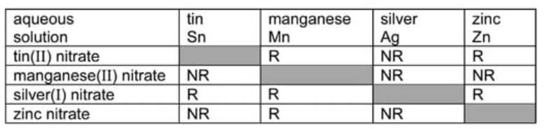

- Manganese(II) nitrate row reads NR / blank / NR / NR; **[1 mark]**
- Silver(I) nitrate now reads R / R / blank / R; **[1 mark]**
- Zinc nitrate row reads NR / R / NR / blank; **[1 mark] **
*Ignore anything written in blank space*

ii) The ionic equation for the reaction between tin atoms and silver(I) ions is:

Sn + 2Ag+  $\rightarrow$ Sn2+ + 2Ag

- All species correct; **[1 mark]**
- Balancing correct; **[1 mark] ***Accept an equation with Sn**4+*

iii) The change which is oxidation is:

- Mn to Mn2+ (need both species); **[1 mark]**
- As it shows electron loss / oxidation number increases; **[1 mark]**

iv) Experiments of this type cannot be used to find the position of aluminium in the reactivity series as:

- (Aluminium) is covered with oxide layer; **[1 mark]**
- Makes it unreactive or protects / aluminium oxide unreactive; **[1 mark]**

**[Total: 9 marks]**

- *When a displacement reaction occurs, it means that the metal being added is more reactive than the metal in the compound which is being displaced.*

  - *The less reactive metal ends up alone and is what is reduced*
  - *The more reactive metal ends up in the compound and is what is oxidised*
- *The order of reactivity is given at the start of the question, so make sure you use that information to speed up your ability to identify which metal is oxidised and reduced in each example*
- *Aluminium forms an unusual oxide that protects the aluminium below from further reactions, masking its true reactivity unless the surface of the aluminium is scratched just before it is placed in the solution *
b) The ions have different charges as:

- Potassium has one outer / valency electron 
**OR** 
Loses one electron;** [1 mark]**
- Calcium has two outer / valency electrons 
**OR** 
Loses two electrons; **[1 mark]**

**[Total: 2 marks]**

- *Group I metals have one electron in the valence shell, so form 1+ ions*
- *Group II metals have two electrons in the valence shell, so form 2+ ions*

### Q10
a)

i) The main ore of aluminium is:

- Bauxite; **[1 mark]**

ii) the molten electrolyte contains cryolite:

- To reduce the melting point  
**OR** 
To improve conductivity; **[1 mark]**

iii) Another gas which is given off at this electrode is:

- Carbon dioxide  
**OR** 
Carbon monoxide 
**OR** 
Fluorine; **[1 mark]**

**[Total: 3 marks]**

- *Aluminium oxide is an ionic compound with a high melting point so cryolite is used to lower it and reduce energy usage and cost *
- *It won't conduct electricity when solid due to the ions being unable to move and carry a charge so cryolite allows the ions to move *
- *The electrodes are made from carbon, the oxygen that forms there reacts with the carbon to form carbon dioxide*
- *As a result the electrodes wear away and need replacing regularly *
b)

i) The metal with the greater tendency to form ions is:

- Aluminium; **[1 mark]**

ii) When this reaction occurs you would see:

- The solution goes colourless 
**OR** 
Copper is formed 
**OR** 
A brown solid is formed; **[1 mark]**

iii) Aluminium reacts so slowly because

- It is covered with an oxide layer; **[1 mark]**

**[Total: 3 marks]**

- *The tendency to form ions determines an elements reactivity*
- *More reactive elements have a greater tendency to form positive ions*
- *Aluminium is more reactive than copper so has a greater tendency to form positive ions*
- *Copper sulfate solution is a blue colour*

  - *As the copper gets displaced from the copper sulfate and forms copper metal, the solution will lose the blue colour and become colourless*
c) The completed table is:

| **oxide** | **type of oxide** | **reaction with acid** | **reaction with alkali** |
|---|---|---|---|
| magnesium | basic | reaction; **[1 mark]** | no reaction; **[1 mark]** |
| aluminium | amphoteric | reaction; **[1 mark]** | reaction; **[1 mark]** |

**[Total: 4 marks]**

- *Amphoteric oxides will react with both acids and alkalis to produce a salt and water*

### Q11
a) The steel does not rust because:

- Zinc is more reactive than iron / zinc is higher in the reactivity series than iron; **[1 mark]**
- Zinc loses electrons; **[1 mark]**
- Iron / steel / oxygen / air / water gains electrons 
**OR** 
Electrons move to iron / steel / oxygen / air / water; **[1 mark]**
- (Therefore) iron does not lose electrons / get oxidised / form iron(II) / form iron(III); **[1 mark] **

**Final answer:** **[4 marks] **

- *This is known as sacrificial protection *

  - *A more reactive metal can be attached to a less reactive metal*
  - *The more reactive metal will oxidise and therefore corrode first, protecting the less reactive metal from corrosion*
  - *In this case, the zinc will react instead of the iron in the steel*
  - *You could be asked the half equation that occurs *
  - *This would be *
  
    - *Zn → Zn**2+** + 2e**-*
    - *This shows zinc is undergoing oxidation and is losing 2 electrons*
b)

i) The completed table is:

|   | Iron(II) chloride solution | Iron(III) chloride solution |
|---|---|---|
| Aqueous sodium hydroxide | Green precipitate; **[1 mark]** | Red-brown/brown/orange precipitate; **[1 mark]** |

ii) The types of substance cause potassium iodide solution to turn from colourless to brown are:

- Oxidant / oxidising agent; **[1 mark] **

iii) The types of substance cause acidified potassium manganate(VII) solution to turn from purple to colourless are:

- Reductant / reducing agent; **[1 mark] **

iv) The ion in iron(III) chloride solution causes potassium iodide solution to turn from colourless to brown is:

- Iron(III) / Fe3+; **[1 mark] **

v) The ion in iron(II) chloride solution causes acidified potassium manganate(VII) solution to turn from purple to colourless is:

- Iron(II) / Fe2+; **[1 mark] **

**[Total: 6 marks] **

- *If there is no change, then there has not been a reaction*
- *If there is a colour change, then a reaction will have occurred*
- *The two reactions you are being asked about are:*

  - *Potassium iodide turning from colourless to brown*
  - *KI to I**2** or I**–** → I**2** + 2e**–*
  - *This is oxidation as electrons have been lost *
  - *Potassium manganate(VII) solution turning from purple to colourless *
  - *KMnO**4** to Mn**2+*
  - *This is reduction as electrons are being gained *

### Q12
a) The order of reactivity is (most reactive first):

X > W > Z > Y

- All in correct order; **[2 marks]** 
*For most reactive X and least Y award ***[1 mark] **** **
*All other responses score ***0 marks**

**[Total: 2 marks] **

- *Given that Y does not react with either water or acid this must be the least reactive*
- *X reacts explosively unlike metals W, Y and Z therefore this must the most reactive*
- *Z is less reactive than X because Z will only react with steam, not cold water*

  - *X will react with water *
b) The metals are:

- Magnesium; W; **[1 mark] **
- Copper; Y; **[1 mark] **

**[Total: 2 marks] **

- *Copper does not react with water or acid*
- *In order for magnesium to react with water, the water must be heated so it turns to steam*
c)

i) The test you would use to show that the gas evolved is hydrogen:

- Goes "pop" with burning splint 
**OR** 
Mixed with air and ignited goes pop;** [1 mark] ** 
*NOT glowing splint*

ii) You could show that the water contained a compound of the type XOH by:

Test and observable result scores **[2 marks] **

- Universal indicator goes blue 
**OR** 
pH paper goes blue 
**OR**
High pH, accept 13, 14 
**OR ** 
Ammonium ion gives off ammonia 
**OR ** 
With metallic cations forms a precipitate** **

iii) The group in which group of the Periodic Table does metal X belong:

- Group I / 1;** [1 mark] **

iv) The metal X could be extracted from its chloride:

- Electrolysis; **[1 mark] **
- **Molten chloride; [1 mark] **

**[Total: 6 marks] **

- *X is the most reactive of the metals given, so electrolysis is required to extract *
- *We can tell it is highly reactive by looking at the table; it melts when reacted with water*
- *Hydroxide ions have a charge of 1-*

  - *As the metal hydroxide has a formula of XOH, so X must have a charge of 1+ *
  - *Therefore the metal is in Group I*

### Q13
a) The completed equations are:

Calcium carbonate → calcium oxide + carbon dioxide** **

- Calcium oxide + carbon dioxide; **[1 mark] **

Ca(OH)2 → CaO + H2O

- CaO + H2O; **[1 mark] **

**[Total: 2 marks] **

- *Thermal decomposition means the breakdown of a substance using heat*
- *Calcium carbonate will break up into calcium oxide and carbon dioxide, this occurs in the blast furnace *
- *Calcium hydroxide can be formed by addition of water to calcium oxide*
- *This is called slaked lime*
- *If heated it will break up into calcium oxide and water*
b) The metals in the list have oxides which are not reduced by carbon are:

- Na 
**OR** 
Ca; **[1 mark] **

**[Total: 1 mark] **

- *As sodium and calcium are above carbon in the reactivity series, they can not be reduced by it *
- *The metals below carbon can be, which means, zinc, copper and silver can be*
- *If we heated zinc oxide with carbon zinc would be displaced *

  - *2ZnO + C → 2Zn + CO**2*
c) Metals whose ions would react with zinc are:

- Silver / Ag; **[1 mark] ** 
Copper / Cu;** [1 mark] ** 
*Accept Ag**+ **or Cu**2+ *

**[Total: 2 marks] **

- *The ions of copper and silver would be a part of a compound and zinc metal would react with these as it is more reactive*
- *For example, zinc will displace copper ions as it is more reactive*

  - *Zinc + copper oxide *$\overset{\mathrm{heat}}{\rightarrow}$* Zinc oxide + copper * *OR*
  - *Zn + CuO *$\overset{\mathrm{heat}}{\rightarrow}$*ZnO + Cu* *OR*
  - *Zn + Cu**2+ *$\overset{\mathrm{heat}}{\rightarrow}$* Zn + Cu**2+ *
- *If asked how to carry out this reaction you must mention heat, simply mixing the two substances will not cause a reaction to occur*

### Q14
a) Three differences in physical properties between the Group I metal, potassium, and the transition element, iron are:

Any **three **from:

- Iron is harder; **[1 mark]**
- Iron has higher density; **[1 mark] ***ACCEPT: heavier or potassium lighter*
- Iron has higher melting / boiling point; **[1 mark]**
- Iron has higher tensile strength or stronger; **[1 mark]**
- Iron has magnetic properties; **[1 mark]**

*NOTE: has to be comparison, e.g. iron is hard [0 marks] but iron is harder [1 mark]*

*NOT: appearance e.g. shiny*

*ACCEPT: comparative statements relating to potassium*

**[Total: 3 marks]**

- *Most metals share some properties, such as conduct electricity or are shiny, but the Group I metals and transition elements have their own properties which can be used to distinguish them*
- *This question relies on you knowing the properties for both Group I metals and transition elements and identifying the differences*
- *NOTE**: As the question asks for you to give differences, it is very important that your answer reflects this by using comparative statements*
b) The products of the reaction for those metals which react with water or steam are:

With potassium:

- Hydrogen; **[1 mark]**
- Potassium hydroxide; **[1 mark]**

With zinc:

- Hydrogen; **[1 mark]**
- Zinc oxide; **[1 mark]**

With copper:

- No reaction; **[1 mark]**

**[Total: 5 marks]**

- *Metals above hydrogen in the reactivity series will react with water or steam*
- *Copper is below hydrogen so will not react with water or steam*
- *Potassium and other reactive metals will react with water according to the general formula:*

  - *metal + water → metal hydroxide + hydrogen*
- *Zinc will only react very slowly with water as it is not reactive enough, however it will react with steam giving zinc oxide and hydrogen*

### Q15
a) The four metals in order of their reactivity are:

- ( Least reactive) cobalt < zinc < magnesium < barium (Most reactive); **[2 marks]**

**[Total: 2 marks]**

- *Make sure you compare the reaction of each metal with both water and steam before deducing your order*
- *You can score 1 mark if you have one pair correct but the other incorrect *
- *You can score 1 mark if you have the correct order but the wrong way around*
b) This displacement reaction takes place because:

- Iron is more reactive than copper; **[1 mark]**

**[Total: 1 mark]**

- *By definition, displacement is where a more reactive substance takes the place of a less reactive substance *
- *The word equation for the reaction would be:*

  - *iron  +  copper(II) sulfate    →     iron(II) sulfate + copper*
c) A symbol equation for the reaction between iron and aqueous copper(II) sulfate is:

- Fe + CuSO4 → Cu + FeSO4; **[1 mark]**

**[Total: 1 mark]**

- *You are expected to know or be able to work out the formula for compounds such as copper(II) sulfate*

  - *The roman numbers mean the ions have a 2+ charge*
  - *Sulfate ions, SO**4**2-** have a 2- charge*
  - *To give the compound an overall charge of 0 one of each ion is needed *
- *For the purpose of displacement equations in this context, you can assume the metal ion has a 2+ charge so the metal symbols just need swapping around when you complete the equation*
d) Another method for obtaining copper metal from aqueous copper(II) sulfate is:

- Electrolysis; **[1 mark]**

**[Total: 1 mark]**

- *Displacement would be the preferred method of extraction*
- *Electrolysis requires large amount of energy and as a result is very expensive to carry out *

### Q16
a) The reducing agent in the displacement reaction is:

- Ni / Nickel; **[1 mark]**
- It loses / donates electrons; **[1 mark]**

**[Total: 2 marks]**

- *Remember: **A reducing agent is one which causes another species to be reduced (gain electrons) *

  - *The nickel loses electrons and donates them to the lead*
  - *The nickel is therefore the reducing agent and the lead is reduced*
  - *The reducing agent is itself oxidised (loses electrons)*
b) The general term given to the type of reaction in which electrons are transferred from one species to another is:

- Redox;** [1 mark]**

**[Total: 1 mark]**

- *You should know the definition of the term redox *
- *One species is **red**uced i.e. gains electrons*
- *Another species is **ox**idised, i.e. loses electrons*
- *Reduction and oxidation always occur in the same reaction, you cannot have a reduction reaction without oxidation and vice versa*
c) Two ionic half-equations for this reaction are:

- Pb → Pb2+ + 2e(–); **[1 mark]**
- Ag+ + e(–) → Ag; **[1 mark]**

**[Total: 2 marks]**

- *Half equations show a species losing or gaining electrons *
- *These can be deduced from the ionic equation:*

  - *Pb (s) + 2Ag**+ **(aq) →  2Ag (s) + Pb**2+**( aq)*
  - *The element lead forms an ion with a 2+ charge*
  
    - *To do this it must lose two electrons so Pb → Pb**2+** + 2e(**–**)*
    - *The lead has been oxidised*
    - *You would also score the mark for writing Pb - 2 e(**-**) → Pb**2+** but the preferred method shows the electrons on the right-hand side*
  - *The silver ions form silver as an element *
  
    - *To do this they must each gain an electron so Ag**+** + e(**–**) → Ag*
    - *The silver ions have been reduced *
- *It is good practice to show the negative charge on the electron but you will not lose marks if you don't include it*
d) The three metals in order of their reactivity are:

- (Most reactive) nickel / Ni 
lead / Pb 
(Least reactive) silver / Ag; **[1 mark]**

**[Total: 1 mark]**

- *In part a) we established that nickel was the reducing agent and had lost electrons*
- *More reactive metals more readily lose electrons than less reactive metals so we can deduce that nickel is more reactive than lead *
- *In part c) you were given this equation:*

  - *Pb(s) + 2Ag**+**(aq) →  2Ag(s) + Pb**2+**(aq)*
  - *This shows the silver ions in solution being displaced by lead*
  - *The lead atoms lose electrons to form lead ions*
  - *The silver ions gain electrons to form silver atoms *
  - *The more reactive the metal, the better it is at losing electrons so lead is more reactive than silver*

### Q17
a) The four metals in order of their reactivity, with the least reactive are:

- (Least reactive) Tungsten < nickel < iron < magnesium (Most reactive);** [2 marks]**

**[Total: 2 marks]**

- *Make sure you read the question carefully and start with the least reactive*
- *You can score 1 mark if you have one pair correct but the other incorrect *
- *You can score 1 mark if you have the correct order but the wrong way around*
b) The four metals in order of their reactivity with the least reactive are:

- (Least reactive) lead < tin < manganese < calcium (most reactive); **[2 marks]**

**[Total: 2 marks]**

- *Make sure you read the question carefully and start with the least reactive*
- *You can score 1 mark if you have one pair correct but the other incorrect *
- *You can score 1 mark if you have the correct order but the wrong way around*

### Q18
a)

i) The two substances required are:

- Water / moisture / salty water;** [1 mark]**
- Air / oxygen;** [1 mark] **

ii)  T**wo** other methods to prevent steel from rusting are:

Any **two** from the following:

- Galvanising / coat with zinc;** [1 mark] **
- Tin plate;** [1 mark] **
- Chromium plate;** [1 mark] **
- Nickel plate;** [1 mark] **
- Cobalt plate;** [1 mark] **
- Copper plate;** [1 mark] **
- Cover with aluminium;** [1 mark] **
- Anodic protection or sacrificial protection;** [1 mark] **
- Cathodic protection;** [1 mark] **
- Cover with plastic;** [1 mark] **
- Alloying (ignore any named metal);** [1 mark] **

**[Total: 3 marks]**

- *If naming sacrificial protection, make sure you name the metal that is required e.g. zinc*
b)

i) A reagent that can reduce iron(III) oxide to iron is:

- Hydrogen / carbon / carbon monoxide / methane 
**OR **
More reactive metal (not a Group I metal); **[1 mark] **

ii) A symbol equation for the reduction of iron(III) oxide, Fe2O3, to iron is:

Fe2O3 (s)  +  3CO (g)  →  2Fe (I)  +  3CO2 (g)

2Fe2O3 (s)  +  3C (g)  →  4Fe (I)  +  3CO2 (g)

Fe2O3 (s)  + 3H2 (g) → 2Fe (s) + 3H2O (l)

Fe2O3 (s) + 3Mg (s) → 2Fe (s) + 3MgO (s)

4Fe2O3 (s) + 3CH4  → 8Fe (s) + 6H2O (l) + 3CO2 (g)

- Correct species; **[1 mark] **
- Correct balancing; **[1 mark] **

**Final answer:** **[Total: 3 marks] **

- *State symbols are not essential here, and would be ignored*
- *Note that the Fe formed when reduced by carbon or carbon monoxide would be molten due to the high temperature required*
- *It would not be financially viable to reduce iron(III) oxide to iron using a more reactive metal as extracting highly reactive metals requires expensive methods such as electrolysis *
c)

i) The mass of one mole of Fe2O3.2H2O is:

- 196 (g); **[1 mark] **

ii) To calculate the percentage of iron in rust

- $\frac{112}{196}$ × 100; **[1 mark]**
- 57(.1)% / 57%; **[1 mark] **

**[Total: 3 marks] **

- *To calculate the mass of one mole of Fe**2**O**3**.2H**2**O you need to calculate the **M**r*

  - *Fe**2**O**3**.2H**2**O: (2 x Fe) + (3 x O) + (4 x H) + (2 x O)*
  - *(2 x 56) + (3 x 16) + (4 x 1) + (2 x 16)*
  - *112 + 48 + 4 + 32 = 196*
- *Remember calculating the % of iron requires the total amount of iron so 2 x 56 is required*
d)

i) The addition of oxygen removes carbon by:

- Forms carbon dioxide / carbon monoxide (which escapes); **[1 mark] **

ii) The addition of oxygen and calcium oxide removes silicon by:

- Forms silicon(IV) oxide or silicon oxide or silica 
**OR** 
CaO reacts with SiO2; **[1 mark] **
- To form slag or calcium silicate; **[1 mark]**

**[Total: 3 marks] **

- *The removal of carbon completed by the reaction of carbon and oxygen forming a gas*
- *The acidic oxide silicon oxide is removed by the neutralisation reaction with calcium oxide which is a base*

### Q19
a)

i) The following would occur:

Copper equation:

- Cu + Sn2+ → No reaction; **[1 mark]**

Iron equations: Fe + Sn2+ →  Fe2+ + Sn 
**OR **
2Fe + 3Sn2+ →  2Fe3+ + 3Sn

- Identifying a reaction has occurred / some products given; **[1 mark]**
- Correct equation; **[1 mark]**

Tin equation:

- Sn + Zn2+ → No reaction; **[1 mark]**

ii) The **three** products formed when tin(II) nitrate is heated are:

Tin oxide / SnO    Nitrogen dioxide / nitrogen(IV) oxide / NO2 / dinitrogen tetroxide / N2O4     Oxygen / O2

- All **three **products;** [2 marks]**
- Any **two** correct products; **[1 mark]**

**[Total: 6 marks]**

- *For part (i), you need to know the reactivity series*

  - *Cu + Sn**2+ **do not react because copper is less reactive than tin*
  - *Sn + Zn**2+ **do not react because tin is less reactive than zinc*
  - *For Fe + Sn**2+ **the iron would displace the tin as it is more reactive forming an ion*
- *For part (ii), the question tells you that tin(II) nitrate is being heated to form three products*

  - *Therefore, this is a decomposition reaction  *
  - *Tin(II) nitrate → tin(II) oxide + nitrogen dioxide + oxygen*
b)

i) The product at the negative electrode (cathode) is:

- Tin; **[1 mark]**

ii) The equation for the reaction at the positive electrode (anode):

4OH– → O2 + 2H2O + 4e–;

- Correct formulae for reactants and products; **[1 mark]**
- Correctly balanced;** [1 mark]**

iii) The acid formed in this electrolysis:

- Sulfuric acid; **[1 mark]**

**[Total: 4 marks]**

- *Although this might not be a specific example you have studied, the question tells you that it is similar to the electrolysis of copper(II) sulfate*
- *During this, the metal (copper) is formed at the cathode and oxygen is formed at the anode*
- *Therefore in the question, tin will be formed at the cathode and oxygen at the anode *
- *This leaves the ions, H**+ **and SO**4**2-** remaining in the solution to form sulfuric acid*
- *The half equation for the formation is one that you need to learn *
c)  Zinc will not rust but tin will because;

- Zinc is more reactive than iron /steel; **[1 mark]**
- Tin is less reactive than iron / steel; **[1 mark]**
- Zinc corrodes / reacts / loses electrons / provides sacrificial protection; **[1 mark]**
- Iron / steel corrodes in preference to tin;** [1 mark]**

**[Total: 4 marks]**

- *Alloys such as steel will be coated in a more reactive metal so that it will corrode first, protecting the metal underneath*
- *It is called sacrificial protection, as the more reactive metal is essentially sacrificed for the metal underneath*
- *Tin is not more reactive than steel so cannot be used in this way*
