# Exam Questions — Reactivity Series & Corrosion of Metals
**9. Metals** · Cambridge (CIE) IGCSE chemistry (0620 & 0971)
> Source: [https://www.savemyexams.com/igcse/chemistry/cie/23/topic-questions/](https://www.savemyexams.com/igcse/chemistry/cie/23/topic-questions/) · 41 questions across 3 sets

## Alternative To Practical Questions (4 questions)

### Q1 — medium — 24 marks

**Q1** [4 marks]

An investigation was carried out into the reactions of aqueous copper(II) sulphate with magnesium, iron and zinc.

<u>**Experiment 1**</u>

By using a measuring cylinder, 5 cm3 of aqueous copper(II) sulphate was added to each of three test-tubes. The initial temperature of the solution was measured. Zinc powder was added to the first test-tube, iron powder to the second tube and magnesium powder to the third tube. The mixtures were stirred with the thermometer. All the observations were recorded and the maximum temperature reached measured.

Use the thermometer diagrams to complete the results table.

<u>**Table of results**</u>

| metal added | initial temperature / oC | maximum temperature / oC | temperature difference / oC | observations |   |   |
|---|---|---|---|---|---|---|
| zinc |  |   |  |   |   | moderate effervescence, solution paler brown solid |
| iron |  |   |  |   |   | little effervescence, brown solid |
| magnesium |  |   |  |   |   | rapid effervescence, pops with lighted splint, brown solid |

*Source: 2006 6 Q4*

**Q1** [4 marks]

**Extract:**

An investigation was carried out into the reactions of aqueous copper(II) sulphate with magnesium, iron and zinc. Experiment 1: 5 cm^3 of aqueous copper(II) sulphate was added to each of three test-tubes. Zinc powder was added to the first test-tube, iron powder to the second tube and magnesium powder to the third tube. Table of results (completed):
| metal added | initial temperature / °C | maximum temperature / °C | temperature difference / °C | observations |
| zinc | 24 | 56 | 32 | moderate effervescence, solution paler brown solid |
| iron | 25 | 41 | 16 | little effervescence, brown solid |
| magnesium | 23 | 69 | 46 | rapid effervescence, pops with lighted splint, brown solid |

Use your results and observations to answer the following questions.

i) Which metal is most reactive with aqueous copper(II) sulfate?

[1]

ii) Give **two **reasons why you chose this metal.

1 ....................................................................................................

2 ....................................................................................................

[2]

iii) Identify the gas given off when magnesium reacts with aqueous copper(II) sulfate.

[1]

*Source: 2006 6 Q4*

**Q1** [6 marks]

**Extract:**

An investigation was carried out into the reactions of aqueous copper(II) sulphate with magnesium, iron and zinc.

<u>**Experiment 1**</u>

By using a measuring cylinder, 5 cm3 of aqueous copper(II) sulphate was added to each of three test-tubes. The initial temperature of the solution was measured. Zinc powder was added to the first test-tube, iron powder to the second tube and magnesium powder to the third tube. The mixtures were stirred with the thermometer. All the observations were recorded and the maximum temperature reached measured.

The reactions of magnesium and zinc with aqueous copper(II) sulphate were investigated in more detail.

<u>**Experiment 2**</u>

By using a measuring cylinder 10 cm3 of aqueous copper(II) sulphate was poured into a polystyrene cup. The initial temperature of the solution was measured.

A 1 g sample of zinc powder was added to the cup and the temperature measured every 10 seconds for 1 minute.

Use the thermometer diagrams to complete the results table.

<u>**Experiment 3**</u>

Experiment 2 was repeated using magnesium powder instead of zinc.

Use the thermometer diagrams to complete the results table.

| time / seconds | temperature / oC |   |   |   |
|---|---|---|---|---|
| Experiment 2 | Experiment 3 |   |   |   |
| 0 |  |   |  |   |
| 10 |  |   |  |   |
| 20 |  |   |  |   |
| 30 |  |   |  |   |
| 40 |  |   |  |   |
| 50 |  |   |  |   |
| 60 |  |   |  |   |

*Source: 2006 6 Q4*

**Q1** [4 marks]

**Extract:**

Experiment 2: 10 cm^3 of aqueous copper(II) sulphate poured into a polystyrene cup, initial temperature measured, 1 g zinc powder added and temperature measured every 10 seconds for 1 minute. Experiment 3 repeated with magnesium powder.

Completed results table (time / seconds : Experiment 2 temp / Experiment 3 temp in °C):
0 : 24 / 26
10 : 27 / 54
20 : 29 / 62
30 : 33 / 67
40 : 37 / 68
50 : 40 / 67
60 : 43 / 65

Plot the results of both Experiments on the grid below. Draw two smooth line graphs.

Clearly label the graphs.

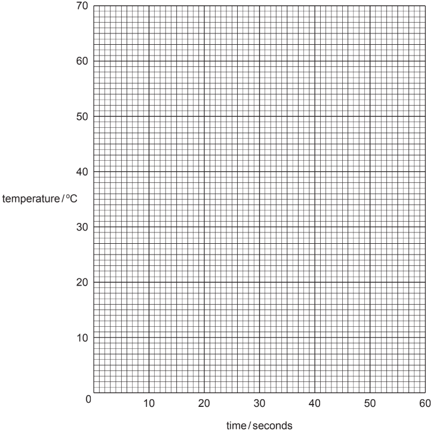

*Source: 2006 6 Q4*

**Q1** [2 marks]

**Extract:**

Experiment 2: By using a measuring cylinder 10 cm^3 of aqueous copper(II) sulphate was poured into a polystyrene cup. The initial temperature of the solution was measured. A 1 g sample of zinc powder was added to the cup and the temperature measured every 10 seconds for 1 minute.

Experiment 2 temperatures (time / seconds : temperature / °C): 0:24, 10:27, 20:29, 30:33, 40:37, 50:40, 60:43.

Plot the results of both Experiments on the grid. Draw two smooth line graphs. Clearly label the graphs.

**Use your graph** to estimate the temperature of the reaction mixture in Experiment 2 after 5 seconds. Indicate **clearly **on the graph how you obtained your answer.

*Source: 2006 6 Q4*

**Q1** [2 marks]

**Extract:**

Experiment 2: By using a measuring cylinder 10 cm^3 of aqueous copper(II) sulphate was poured into a polystyrene cup. The initial temperature of the solution was measured. A 1 g sample of zinc powder was added to the cup and the temperature measured every 10 seconds for 1 minute. Experiment 3: Experiment 2 was repeated using magnesium powder instead of zinc.
Plot the results of both Experiments on the grid below. Draw two smooth line graphs.

Sketch lines on the grid to show the predicted results if Experiment 2 were repeated using:

i) larger pieces of magnesium;

ii) iron powder.

Clearly label the lines.

*Source: 2006 6 Q4*

**Q1** [1 mark]

**Extract:**

Experiment 2: By using a measuring cylinder 10 cm^3 of aqueous copper(II) sulphate was poured into a polystyrene cup. The initial temperature of the solution was measured. A 1 g sample of zinc powder was added to the cup and the temperature measured every 10 seconds for 1 minute.

Why is a polystyrene cup used instead of a glass container?

*Source: 2006 6 Q4*

**Q1** [1 mark]

**Extract:**

Experiment 2

By using a measuring cylinder 10 cm^3 of aqueous copper(II) sulphate was poured into a polystyrene cup. The initial temperature of the solution was measured.

A 1 g sample of zinc powder was added to the cup and the temperature measured every 10 seconds for 1 minute.

Suggest **one **improvement to the method in Experiment 2.

*Source: 2006 6 Q4*

### Q2 — medium — 14 marks

**Q2** [12 marks]

An investigation was carried out on the reactions of four different metals. Equal masses of copper, magnesium, iron and zinc were used.

*Experiment 1*

A 15 cm3 sample of dilute sulfuric acid was added to each of four boiling tubes. The initial temperature of the acid was measured. Zinc was added to the first tube, iron to the second tube, magnesium to the third tube and copper to the fourth tube.

The maximum temperature reached in each tube was measured and any observations were recorded in the table.

i) Use the thermometer diagrams to complete the results table.

*Table of results *

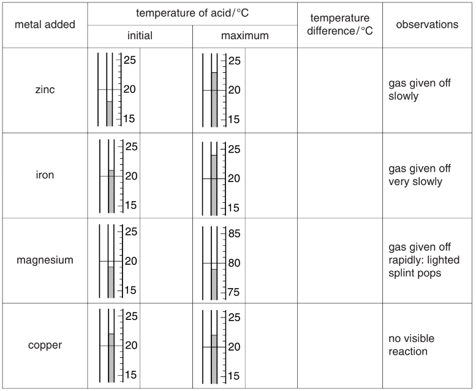

[6]

ii) Which metal is most reactive with sulfuric acid?

[1]

iii) Give **two **reasons why you chose this metal.

1. ....................................................................................................

2. ....................................................................................................

[2]

iv) Name the gas given off.

[1]

*Experiment 2*

A 5 cm3 sample of aqueous copper(II) sulfate was measured into a test-tube. The initial temperature of the solution was measured.

Magnesium powder was added to the test-tube and the maximum temperature reached was measured.

v) Use the thermometer diagrams to complete the results table.

*Table of results*

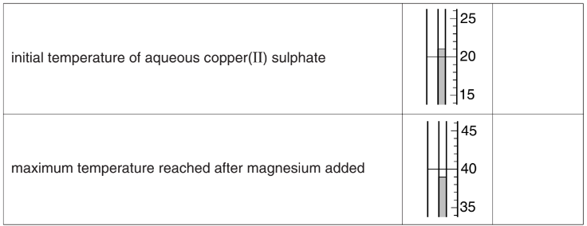

[2]

*Source: 2002 6 Q4*

**Q2** [1 mark]

**Extract:**

Experiment 2: A 5 cm^3 sample of aqueous copper(II) sulfate was measured into a test-tube. The initial temperature of the solution was measured. Magnesium powder was added to the test-tube and the maximum temperature reached was measured. Results: initial temperature 21, maximum temperature 39.

How do your observations show that the reaction of magnesium with aqueous copper(II) sulphate is exothermic?

*Source: 2002 6 Q4*

**Q2** [1 mark]

**Extract:**

An investigation was carried out on the reactions of four different metals. Equal masses of copper, magnesium, iron and zinc were used.

*Experiment 1*

A 15 cm^3^ sample of dilute sulfuric acid was added to each of four boiling tubes. The initial temperature of the acid was measured. Zinc was added to the first tube, iron to the second tube, magnesium to the third tube and copper to the fourth tube. The maximum temperature reached in each tube was measured and any observations were recorded in the table.

*Experiment 2*

A 5 cm^3^ sample of aqueous copper(II) sulfate was measured into a test-tube. The initial temperature of the solution was measured. Magnesium powder was added to the test-tube and the maximum temperature reached was measured.

Use your results from Experiments 1 and 2 to put the four metals in order of reactivity.

least reactive ..............................................................................

....................................................................................................

....................................................................................................

most reactive ..............................................................................

*Source: 2002 6 Q4*

### Q3 — medium — 21 marks

**Q3** [3 marks]

A student investigated the reaction between aqueous copper(II) sulfate and two different metals, zinc and iron. Two experiments were carried out.

***Experiment 1***

Using a measuring cylinder, 25 cm3 of aqueous copper(II) sulfate was poured into a polystyrene cup. The temperature of the solution was measured. The timer was started and the temperature was measured every half a minute for one minute.

At 1 minute, 5 g of zinc powder was added to the cup and the mixture stirred with the thermometer. The temperature of the mixture was measured every half minute for an additional three minutes.

Use the thermometer diagrams in the table to record the temperatures.

| time / min | thermometer diagram | temperature / oC |
|---|---|---|
| 0.0 |  |   |
| 0.5 |  |   |
| 1.0 |  |   |
| 1.5 |  |   |
| 2.0 |  |   |
| 2.5 |  |   |
| 3.0 |  |   |
| 3.5 |  |   |
| 4.0 |  |   |

*Source: 2011 O61 Q4*

**Q3** [3 marks]

**Extract:**

A student investigated the reaction between aqueous copper(II) sulfate and two different metals, zinc and iron. Two experiments were carried out.

***Experiment 1***

Using a measuring cylinder, 25 cm^3^ of aqueous copper(II) sulfate was poured into a polystyrene cup. The temperature of the solution was measured. The timer was started and the temperature was measured every half a minute for one minute.

At 1 minute, 5 g of zinc powder was added to the cup and the mixture stirred with the thermometer. The temperature of the mixture was measured every half minute for an additional three minutes.

***Experiment 2***

Experiment 1 was repeated using 5 g of iron powder instead of the zinc powder.

Use the thermometer diagrams in the table to record the temperatures.

| time / min | thermometer diagram | temperature / oC |
|---|---|---|
| 0.0 |  |   |
| 0.5 |  |   |
| 1.0 |  |   |
| 1.5 |  |   |
| 2.0 |  |   |
| 2.5 |  |   |
| 3.0 |  |   |
| 3.5 |  |   |
| 4.0 |  |   |

*Source: 2011 O61 Q4*

**Q3** [5 marks]

**Extract:**

Experiment 1 (zinc): time/min vs temperature/°C: 0.0=20, 0.5=21, 1.0=21, 1.5=32, 2.0=39, 2.5=42, 3.0=44, 3.5=45, 4.0=45.

Experiment 2 (iron, 5 g iron powder instead of zinc): time/min vs temperature/°C: 0.0=20, 0.5=21, 1.0=21, 1.5=24, 2.0=32, 2.5=36, 3.0=37, 3.5=38, 4.0=38.

Plot the results of both experiments on the grid below. Draw two smooth line graphs.

Clearly label your graphs.

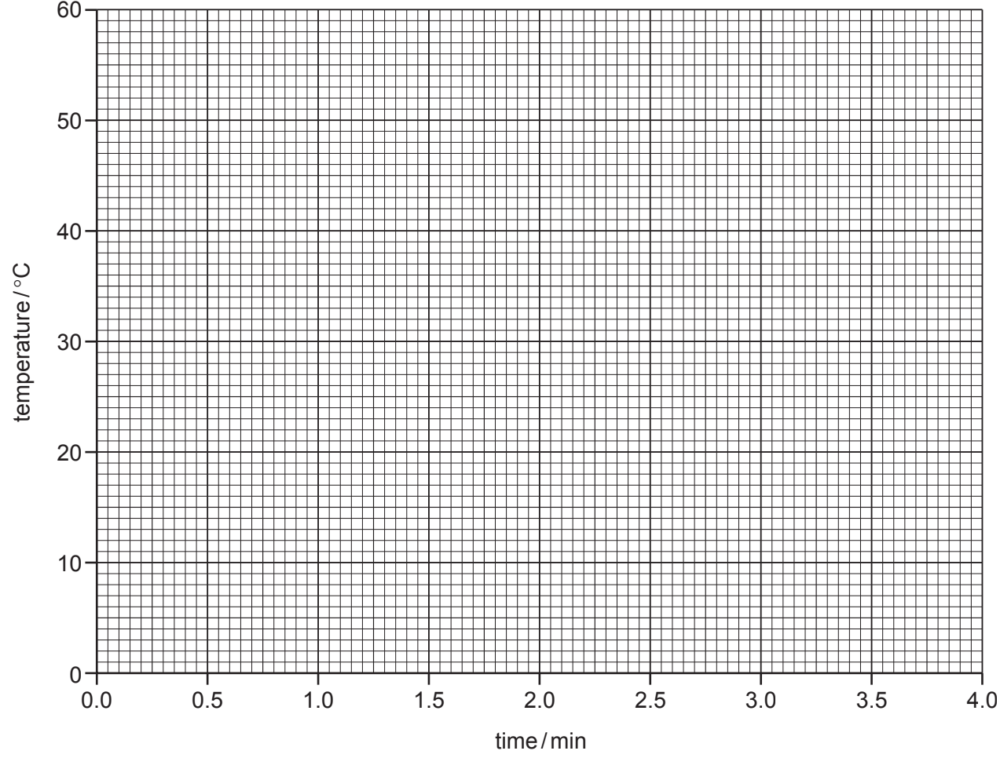

*Source: 2011 O61 Q4*

**Q3** [3 marks]

**Extract:**

A student investigated the reaction between aqueous copper(II) sulfate and two different metals, zinc and iron. Two experiments were carried out.

Experiment 1

Using a measuring cylinder, 25 cm^3 of aqueous copper(II) sulfate was poured into a polystyrene cup. The temperature of the solution was measured. The timer was started and the temperature was measured every half a minute for one minute. At 1 minute, 5 g of zinc powder was added to the cup and the mixture stirred with the thermometer. The temperature of the mixture was measured every half minute for an additional three minutes.

Experiment 1 (zinc) temperatures: 0.0 min = 20; 0.5 = 21; 1.0 = 21; 1.5 = 32; 2.0 = 39; 2.5 = 42; 3.0 = 44; 3.5 = 45; 4.0 = 45.

Plot the results of both experiments on the grid below. Draw two smooth line graphs.

**From your graph**, work out the temperature of the reaction mixture in Experiment 1 after 1 minute 15 seconds. Show clearly **on the graph** how you worked out your answer.

*Source: 2011 61 Q4*

**Q3** [1 mark]

**Extract:**

A student investigated the reaction between aqueous copper(II) sulfate and two different metals, zinc and iron. Two experiments were carried out. Experiment 1: Using a measuring cylinder, 25 cm^3 of aqueous copper(II) sulfate was poured into a polystyrene cup. The temperature of the solution was measured... At 1 minute, 5 g of zinc powder was added to the cup and the mixture stirred with the thermometer. The temperature of the mixture was measured every half minute for an additional three minutes. (Temperatures rose from 20°C to 45°C.)

What type of chemical process occurs when zinc and iron react with aqueous copper(II) sulfate?

*Source: 2011 61 Q4*

**Q3** [2 marks]

**Extract:**

A student investigated the reaction between aqueous copper(II) sulfate and two different metals, zinc and iron. Two experiments were carried out.

Experiment 1: Using a measuring cylinder, 25 cm^3 of aqueous copper(II) sulfate was poured into a polystyrene cup... At 1 minute, 5 g of zinc powder was added to the cup and the mixture stirred. Temperatures recorded: 0.0 min = 20, 0.5 = 21, 1.0 = 21, 1.5 = 32, 2.0 = 39, 2.5 = 42, 3.0 = 44, 3.5 = 45, 4.0 = 45.

Experiment 2: Experiment 1 was repeated using 5 g of iron powder instead of the zinc powder. Temperatures recorded: 0.0 min = 20, 0.5 = 21, 1.0 = 21, 1.5 = 24, 2.0 = 32, 2.5 = 36, 3.0 = 37, 3.5 = 38, 4.0 = 38.

i) Compare the temperature changes in Experiments 1 and 2.

[1]

ii) Suggest an explanation for the difference in temperature changes.

[1]

*Source: 2011 61 Q4*

**Q3** [2 marks]

**Extract:**

Using a measuring cylinder, 25 cm^3 of aqueous copper(II) sulfate was poured into a polystyrene cup. The temperature of the solution was measured. The timer was started and the temperature was measured every half a minute for one minute. At 1 minute, 5 g of zinc powder was added to the cup and the mixture stirred with the thermometer. The temperature of the mixture was measured every half minute for an additional three minutes.

Explain how the temperature changes would differ in the experiments if 12.5 cm3 of copper(II) sulfate solution were used.

*Source: 2011 61 Q4*

**Q3** [2 marks]

**Extract:**

***Experiment 1***

Using a measuring cylinder, 25 cm^3 of aqueous copper(II) sulfate was poured into a polystyrene cup. The temperature of the solution was measured. The timer was started and the temperature was measured every half a minute for one minute.

At 1 minute, 5 g of zinc powder was added to the cup and the mixture stirred with the thermometer. The temperature of the mixture was measured every half minute for an additional three minutes.

Predict the effect of using lumps of zinc in Experiment 1. Explain your answer.

*Source: 2011 61 Q4*

### Q4 — medium — 5 marks

**Q4** [1 mark]

Eight steel rods of the same size were placed in solutions of different pH for one week.

The percentage corrosion of the rods was measured and the results plotted on the grid below.

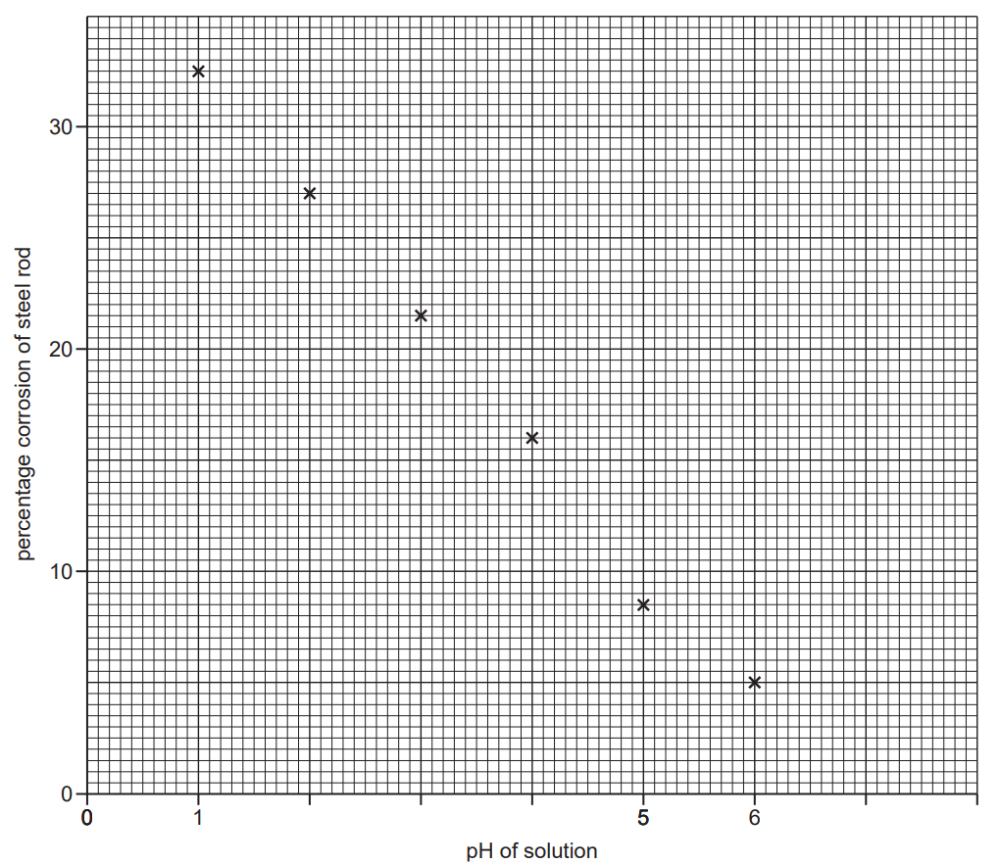

Draw a best fit straight line through the points.

*Source: 2013 O61 Q2*

**Q4** [1 mark]

**Extract:**

Eight steel rods of the same size were placed in solutions of different pH for one week. The percentage corrosion of the rods was measured and the results plotted on the grid below.

Why were the steel rods the same size?

*Source: 2013 O61 Q2*

**Q4** [1 mark]

**Extract:**

Eight steel rods of the same size were placed in solutions of different pH for one week. The percentage corrosion of the rods was measured and the results plotted on the grid below.

State **one **other variable which should have been kept constant.

*Source: 2013 O61 Q2*

**Q4** [1 mark]

**Extract:**

Eight steel rods of the same size were placed in solutions of different pH for one week. The percentage corrosion of the rods was measured and the results plotted on the grid below.

State one conclusion that could be drawn from the results.

*Source: 2013 O61 Q2*

**Q4** [1 mark]

**Extract:**

Eight steel rods of the same size were placed in solutions of different pH for one week. The percentage corrosion of the rods was measured and the results plotted on the grid below. Draw a best fit straight line through the points.

Determine the percentage corrosion of a steel rod in a solution of pH 6.5.

*Source: 2013 O61 Q2*

## Multiple Choice Questions (27 questions)

### Q1 — medium — 1 marks

**Q1** [1 mark]

A student investigates the reactivity of four different metals by adding a small piece of each metal to separate test-tubes containing aqueous iron(II) chloride.

A tick (✓) indicates a reaction occurs. A cross (×) indicates no reaction occurs.

Which row correctly predicts the results of the student's investigation?

|   | copper | magnesium | aluminium | zinc |
|---|---|---|---|---|
| **A** | × | ✓ | ✓ | ✓ |
| **B** | ✓ | × | × | × |
| **C** | × | ✓ | × | ✓ |
| **D** | × | ✓ | ✓ | × |

### Q2 — easy — 1 marks

**Q2** [1 mark]

Which word equation represents the rusting of iron?

### Q3 — easy — 1 marks

**Q3** [1 mark]

W, X, Y and Z are metals.

A student investigates the reactivity of these elements with dilute hydrochloric acid. The table shows the observations at room temperature.

| metal | observation |
|---|---|
| W | Slow reaction |
| X | Violent reaction |
| Y | Very slow reaction |
| Z | No reaction |

Which row correctly identifies W, X, Y and Z?

|   | W | X | Y | Z |
|---|---|---|---|---|
| **A** | iron | potassium | silver | aluminium |
| **B** | iron | potassium | aluminium | silver |
| **C** | aluminium | potassium | iron | silver |
| **D** | aluminium | potassium | silver | iron |

### Q4 — easy — 1 marks

**Q4** [1 mark]

#### Extended Only

A student observed the reaction between copper(II) sulfate solution and zinc.

Which observations are correct for this reaction?

|   | **Observation 1** | **Observation 2 ** |
|---|---|---|
| **A** | solution colour stays the same | pale grey crystals forming |
| **B** | solution turns darker blue | grey residue on the metal |
| **C** | solution turns orange/brown | blue crystals form on the metal |
| **D** | solution turns paler blue | orange / brown residue on the metal |

### Q5 — easy — 1 marks

**Q5** [1 mark]

A student was investigating the reactivity of four different metals, **W**, **X**, **Y** and **Z**, in hydrochloric acid.

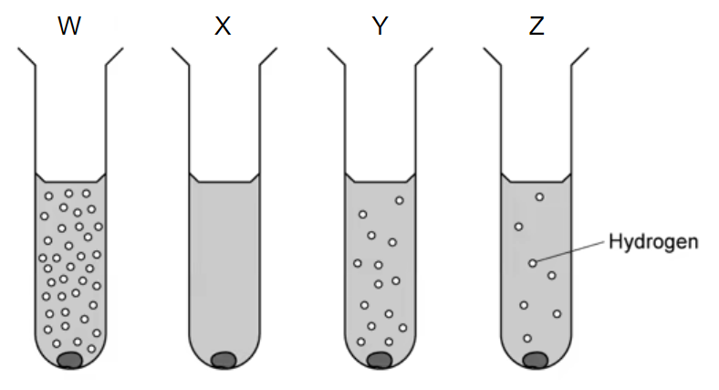

Which is the most reactive metal and which is the least reactive metal?

|   | **Most reactive metal** | **Least reactive metal** |
|---|---|---|
| **A** | W | X |
| **B** | X | W |
| **C** | Y | X |
| **D** | W | Z |

### Q6 — easy — 1 marks

**Q6** [1 mark]

The diagrams below show some of the uses of iron.

In which of these uses is iron most likely to rust?

### Q7 — easy — 1 marks

**Q7** [1 mark]

A student prepared four iron nails as explained below in an experiment to investigate rusting. She allowed the nails to rest in individual test tubes in a laboratory for one week.

Which nail will show the greatest amount of rust?

### Q8 — easy — 1 marks

**Q8** [1 mark]

The diagram shows the experimental set-up a student used to investigate the composition of air. The student left the apparatus in the laboratory and observed that the water level had risen inside the test tube after one week.

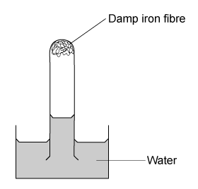

Which statement explains why the water level rose?

### Q9 — hard — 1 marks

**Q9** [1 mark]

Reactions of three metals and their oxides are shown in the table.

| **metal** | **reacts with cold water** | **metal oxide reacts with carbon** |
|---|---|---|
| P | no | no |
| Q | no | yes |
| R | yes | no |

What is the order of reactivity of the metals?

|   | **Least reactive** | → | **Most reactive** |
|---|---|---|---|
| **A** | P | Q | R |
| **B** | Q | P | R |
| **C** | Q | R | P |
| **D** | R | P | Q |

### Q10 — hard — 1 marks

**Q10** [1 mark]

Small blocks of zinc are attached to ship hulls which are commonly made from steel, an alloy of iron. This is done to prevent the hull from rusting.

Which statement explains this process?

### Q11 — hard — 1 marks

**Q11** [1 mark]

Four different metals **P**, **Q**, **R** and** S** were added to different aqueous solutions of their ions.

The results are shown in the table below.

| **Metal** | P2+ | Q2+ | R2+ | S2+ |
|---|---|---|---|---|
| **P** | ✗ | ✗ | ✓ | ✓ |
| **Q** | ✓ | ✗ | ✓ | ✓ |
| **R** | ✗ | ✗ | ✗ | ✗ |
| **S** | ✗ | ✗ | ✓ | ✗ |

Key: **✗** = no reaction, **✓** = reaction

What is the order of reactivity of the metals from most reactive to least reactive?

|   | **most reactive** | **→** | **→** | **least reactive** |
|---|---|---|---|---|
| **A** | Q | P | S | R |
| **B** | Q | S | P | R |
| **C** | R | P | S | Q |
| **D** | R | S | P | Q |

### Q12 — hard — 1 marks

**Q12** [1 mark]

The following section of the reactivity series shows a newly discovered element, Y. The only oxide of Y has the formula YO.

Ca

Mg

Fe

Y

H

Cu

Which of the equations shows a reaction which would take place?

### Q13 — hard — 1 marks

**Q13** [1 mark]

Five different metals **P**, **Q**, **R**, **S** and** T** were reacted with dilute hydrochloric acid.

The volume of hydrogen gas produced after one minute was measured. The results are shown in the bar chart below:

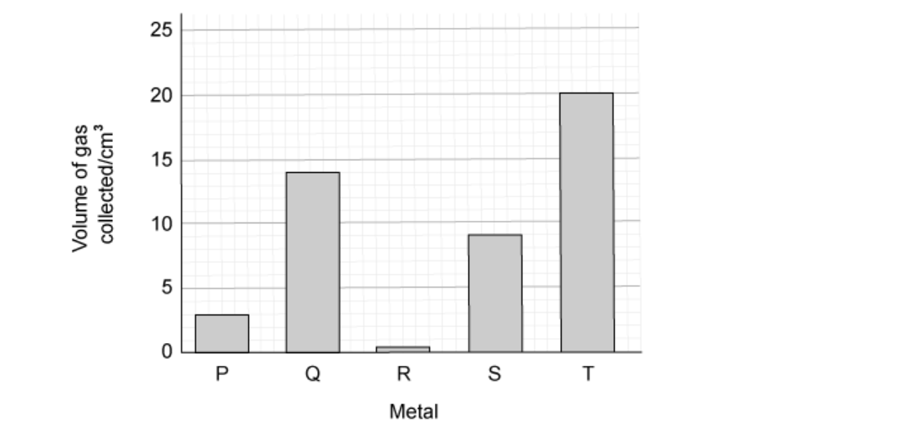

What is the order of reactivity of the metals?

|   | **most reactive** | **→** | **→** | **→** | **least reactive** |
|---|---|---|---|---|---|
| **A** | P | Q | R | S | T |
| **B** | R | P | S | Q | T |
| **C** | T | Q | S | P | R |
| **D** | T | S | R | Q | P |

### Q14 — medium — 1 marks

**Q14** [1 mark]

Calcium, copper, iron and magnesium are metals. They can be placed in order of reactivity.

Which of the following statements about these metals is correct?

### Q15 — medium — 1 marks

**Q15** [1 mark]

Which row in the table below shows how the metal will react?

|   | **metal** | **reacts with dilute acid** | **reacts rapidly with cold water** | **reacts with steam** |
|---|---|---|---|---|
| **A** | copper | `✓` | $\times$ | $\times$ |
| **B** | calcium | $\times$ | `✓` | `✓` |
| **C** | zinc | `✓` | $\times$ | $\times$ |
| **D** | magnesium | `✓` | $\times$ | `✓` |

### Q16 — medium — 1 marks

**Q16** [1 mark]

A student was investigating the reactivity of different metals in hydrochloric acid.

The diagrams show what happens when each metal was added to dilute hydrochloric acid.

What are **W**, **X**, **Y** and **Z**?

|   | **W** | **X** | **Y** | **Z** |
|---|---|---|---|---|
| **A** | Calcium | Copper | Magnesium | Zinc |
| **B** | Copper | Zinc | Calcium | Magnesium |
| **C** | Magnesium | Calcium | Zinc | Copper |
| **D** | Zinc | Magnesium | Copper | Calcium |

### Q17 — medium — 1 marks

**Q17** [1 mark]

**Q**, **R** and **S** are metals.

| **Metal** | **Reacts with cold water** | **Reacts with steam** | **Reacts with dilute hydrochloric acid** |
|---|---|---|---|
| **Q** | yes | yes | violently |
| **R** | very slowly | slowly | less strongly |
| **S** | no | no | no |

What are the possible identities of the metals **Q**, **R** and **S**?

|   | **Q** | **R** | **S** |
|---|---|---|---|
| **A** | Potassium | Iron | Magnesium |
| **B** | Sodium | Zinc | Copper |
| **C** | Silver | Aluminium | Iron |
| **D** | Calcium | Copper | Gold |

### Q18 — medium — 1 marks

**Q18** [1 mark]

Compound Y is thermally decomposed with carbon using the apparatus below:

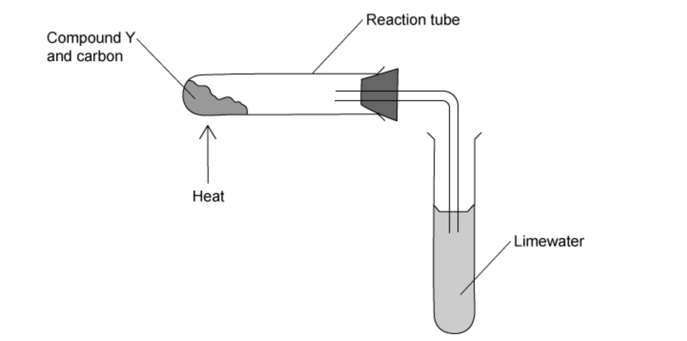

A brown solid is formed in the reaction tube and the limewater turns cloudy.

What is compound Y?

## Theory Questions (19 questions)

### Q1 — hard — 7 marks

**Q1** [4 marks]

#### Extended Only

In the following list of ionic equations, the metals are in order of reactivity.

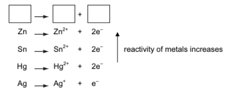

i) In the space at the top of the series, write an ionic equation that includes a more reactive metal.

[1]

ii) Define oxidation in terms of electron transfer.

[1]

iii) Explain why the positive ions are likely to be oxidising agents.

[1]

iv) Which positive ion(s) can oxidise mercury metal (Hg)?

[1]

*Source: 2004 O31 Q4B*

**Q1** [3 marks]

#### Extended Only

The following diagram shows a simple cell.

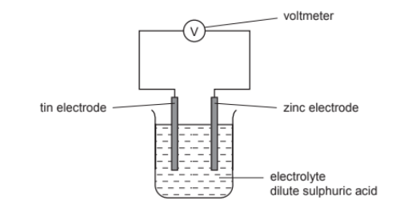

i) Predict how the voltage of the cell would change if the tin electrode was replaced with a silver one.

[1]

ii) Which electrode would go into the solution as positive ions? Give a reason for your choice.

[1]

iii) State how you can predict the direction of the electron flow in cells of this type.

[1]

*Source: 2004 O31 Q4B*

### Q2 — easy — 4 marks

**Q2** [2 marks]

Many compounds have important uses.

The table compares the reactions of four metals with steam.

| **metal** | **reaction with steam** |
|---|---|
| copper | does not react |
| magnesium | reacts rapidly |
| sodium | reacts explosively |
| zinc | reacts slowly when warmed |

Put the four metals in order of their reactivity. Put the least reactive metal first.

*Source: 2020 0620/32 Q3B*

**Q2** [2 marks]

Rust contains hydrated iron(III) oxide.

Describe and explain one method of preventing iron from rusting.

*Source: Specimen 0620/32 Q6E*

### Q3 — medium — 7 marks

**Q3** [7 marks]

The reactivity series of metals given below contains both familiar and unfamiliar elements. For most of the unfamiliar elements, which are marked *, their common oxidation states are given.

| barium * | Ba |
|---|---|
| lanthanum * | La   (+3) |
| magnesium |   |
| zinc |   |
| chromium * | Cr   (+2), (+3), (+6) |
| iron |   |
| copper |   |
| palladium * | (+2) |

Choose metal(s) from the above list to answer the following questions.

i) Which **two **metals would not react with dilute hydrochloric acid?

[2]

ii) Which **two **unfamiliar metals (*) would react with cold water?

[2]

iii) What is the oxidation state of barium?

[1]

iv) Name an unfamiliar metal (*) whose oxide cannot be reduced by carbon.

[1]

v) Why should you be able to predict that metals such as iron and chromium have more than one oxidation state?

[1]

*Source: 2009 Ju31 Q4*

### Q4 — hard — 8 marks

**Q4** [5 marks]

#### Extended Only

Excess hydrochloric acid was added to powdered zinc. The hydrogen evolved was collected and its volume measured every 20 seconds. The experiments were repeated at the same temperature using the same number of moles of powdered magnesium and aluminium.

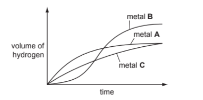

Identify metals A, B and C by choosing from zinc, magnesium and aluminium. Give a reason for each choice.

Metal **A**

Metal **B**

Metal **C**

*Source: 2011 Ju31 Q7A*

**Q4** [3 marks]

**Extract:**

Excess hydrochloric acid was added to powdered zinc. The hydrogen evolved was collected and its volume measured every 20 seconds. The experiments were repeated at the same temperature using the same number of moles of powdered magnesium and aluminium.

#### Extended Only

Using ‘moles’, explain why two of the metals form the same volume of hydrogen but the third metal forms a larger volume.

*Source: 2011 Ju31 Q7B*

### Q5 — hard — 12 marks

**Q5** [6 marks]

#### Extended Only

The reactions of a metal and the thermal stability of some of its compounds are determined by the position of the metal in the reactivity series.

To find the order of reactivity of the metals, cobalt, magnesium, silver and tin, the following experiments were carried out.

| **Experiment** | **Result** |
|---|---|
| Tin plus silver(I) nitrate solution | Silvery layer on tin |
| Magnesium plus tin(II) nitrate solution | Grey deposit on magnesium |
| Tin plus cobalt nitrate solution | No reaction |

i) Give as far as possible the order of reactivity of these metals.

Write the least reactive first.

[2]

ii) What additional experiment needs to be done to put all four metals in order of reactivity?

[1]

iii) Write an ionic equation for the reaction between tin atoms and silver(I) ions. Indicate on the equation the change which is oxidation.

[3]

*Source: 2010 O33 Q3A*

**Q5** [6 marks]

#### Extended Only

A cell consists of two different metal electrodes in an electrolyte. Three possible cells are shown below.

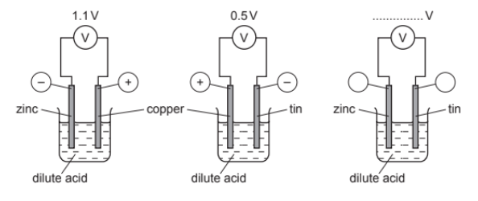

i) Why is the more reactive metal the negative electrode?

[2]

ii) How can you deduce that zinc is more reactive than tin?

[1]

iii) How could you change the zinc / copper cell to have a voltage greater than 1.1V?

[1]

iv) Complete the labelling of the zinc/tin cell.

[2]

*Source: 2010 O33 Q3B*

### Q6 — hard — 12 marks

**Q6** [6 marks]

#### Separate: Chemistry and Extended Only

One way of establishing a reactivity series is by displacement reactions.

A series of experiments was carried out using the metals lead, magnesium, zinc and silver.

Each metal was added in turn to aqueous solutions of the metal nitrates.

The order of reactivity was found to be:

| magnesium  zinc  lead  silver | most reactive    least reactive |
|---|---|

i) Complete the table.

Y = reacts

N = does not react

|   | metal |   |   |   |
|---|---|---|---|---|
| aqueous solution | lead Pb | magnesium Mg | zinc Zn | silver  Ag |
| lead(II) nitrate |   | **Y** | **Y** | **N** |
| magnesium nitrate |   |   |   |   |
| zinc  nitrate |   |   |   |   |
| silver nitrate |   |   |   |   |

[3]

ii) Displacement reactions are redox reactions.

On the following equation, draw a **ring **around the reducing agent and an **arrow **to show the change which is oxidation.

Zn + Pb2+ → Zn2+ + Pb

[2]

iii) Complete the following ionic equation.

Zn + 2Ag+ → ....... + .......

[1]

*Source: 2014 Ju31 Q7*

**Q6** [6 marks]

#### Extended Only

Another way of determining the order of reactivity of metals is by measuring the voltage and polarity of simple cells. The polarity of a cell is shown by which metal is the positive electrode and which metal is the negative electrode. An example of a simple cell is shown below.

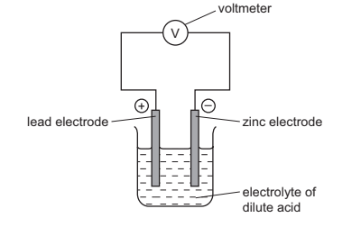

i) Mark on the above diagram the direction of the electron flow.

[1]

ii) Explain, in terms of electron transfer, why the more reactive metal is always the negative electrode.

[2]

The following table gives the polarity of cells using the metals zinc, lead, copper and manganese.

| Cell | Electrode 1 | Polarity | Electrode 2 | Polarity |
|---|---|---|---|---|
| A | Zinc | – | Lead | + |
| B | Manganese | – | Lead | + |
| C | Copper | + | Lead | – |

iii) What information about the order of reactivity of these four metals can be deduced from the table?

[2]

iv) What additional information is needed to establish the order of reactivity of these four metals using cells?

[1]

*Source: 2014 Ju31 Q7B*

### Q7 — easy — 12 marks

**Q7** [1 mark]

A reactivity series of metals is given below.

|   | **Metal name ** | **Symbol ** |
|---|---|---|
| Most reactive | Sodium | Na |
|   | Lithium | Li |
|   | Magnesium | Mg |
|   | Zinc | Zn |
|   | Manganese | Mn |
|   | Iron | Fe |
|   | Copper | Cu |
| Least reactive | Rhodium | Rh |

Which two metals will react most vigorously with cold water?

*Source: 2015 O33 Q6A*

**Q7** [1 mark]

**Extract:**

A reactivity series of metals is given below.

| | Metal name | Symbol |
| Most reactive | Sodium | Na |
| | Lithium | Li |
| | Magnesium | Mg |
| | Zinc | Zn |
| | Manganese | Mn |
| | Iron | Fe |
| | Copper | Cu |
| Least reactive | Rhodium | Rh |

Which two metals will not react with dilute hydrochloric acid?

*Source: 2015 O33 Q6B*

**Q7** [1 mark]

#### Extended Only

Deduce the formula of iron(III) sulfate.

*Source: 2015 O33 Q6C*

**Q7** [1 mark]

What is the formula of a magnesium ion?

*Source: 2015 O33 Q6D*

**Q7** [3 marks]

Describe a test-tube experiment which will show that manganese is more reactive than copper.

*Source: 2015 O33 Q6E*

**Q7** [5 marks]

Manganese is a typical transition metal.

Predict** three** physical and **two **chemical properties of this metal.

Physical properties

Chemical properties

*Source: 2014 O33 Q6F*

### Q8 — hard — 8 marks

**Q8** [3 marks]

This question is about alloys.

Brass is an alloy which contains zinc.

i) Name the other metal in brass.

[1]

ii) Suggest **two** reasons why an alloy such as brass is preferred to either of its constituent metals.

[2]

*Source: 2015 O23 Q3*

**Q8** [5 marks]

In an experiment to investigate the rate of rusting of steel, three pieces of steel were used.

One piece of steel was completely coated with copper, one piece completely coated with zinc and the third piece was left uncoated. All three pieces were left exposed to the atmosphere.

i) Explain why the uncoated piece started to rust.

[1]

ii) The coating on both of the other two pieces was scratched, exposing the steel.

The piece of steel coated with zinc still did not rust but the copper-coated piece of steel rusted very rapidly. Explain these observations in terms of the formation of ions and the transfer of electrons.

[4]

*Source: 2015 O23 Q3*

### Q9 — medium — 11 marks

**Q9** [9 marks]

The reactivity series lists metals in order of reactivity.

To find out which is the more reactive metal, zinc or tin, the following experiment could be carried out.

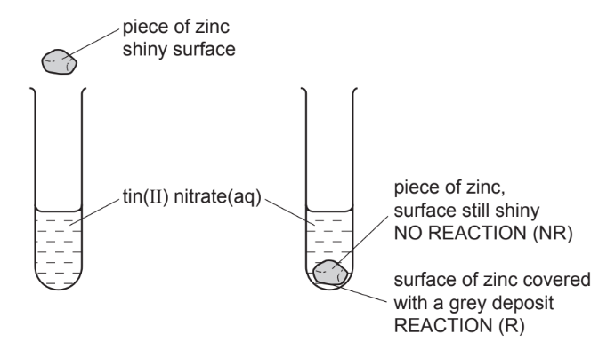

This experiment could be carried out with other metals and the results are recorded in a table. Then the order of reactivity can be deduced.

i) The order was found to be: 
manganese  - most reactive 
zinc 
tin 
silver - least reactive

Complete the table of results from which this order was determined.

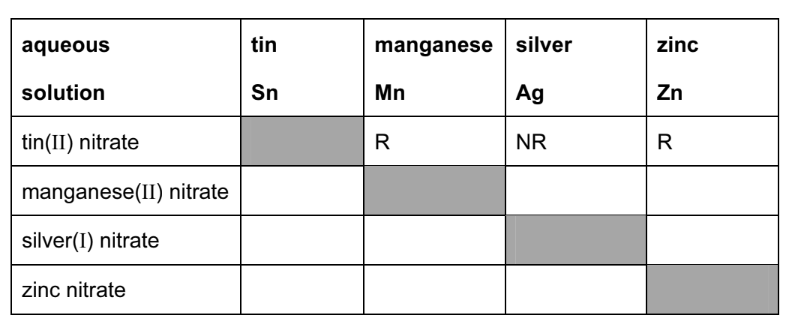

[3]

ii) Write the ionic equation for the reaction between tin atoms and silver(I) ions.

[2]

iii) The following is a redox reaction.

Mn + Sn2+ $\rightarrow$Mn2+ + Sn

Indicate on the equation the change which is oxidation. Give a reason for your choice.

[2]

iv) Explain why experiments of this type cannot be used to find the position of aluminium in the reactivity series.

[2]

*Source: 2008 Oc31 Q6*

**Q9** [2 marks]

Potassium and calcium are very reactive metals at the top of the series. Because their ions have different charges, K+ and Ca2+, their compounds behave differently when heated.

Explain why the ions have different charges.

*Source: 2008 Oc31 Q6*

### Q10 — medium — 10 marks

**Q10** [3 marks]

#### Extended Only

The position of aluminium in the reactivity series of metals is shown below.

magnesium 
aluminium 
zinc 
copper

Aluminium is extracted by the electrolysis of its molten oxide.

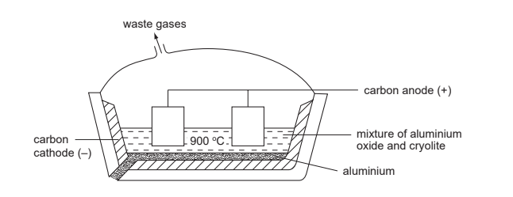

i) Name the main ore of aluminium.

[1]

ii) Why does the molten electrolyte contain cryolite?

[1]

iii) Oxygen is produced at the positive electrode (anode). Name another gas which is given off at this electrode.

[1]

*Source: 2005 Ju31 Q6*

**Q10** [3 marks]

#### Extended Only

Aluminium reacts very slowly with aqueous copper(II) sulphate.

2Al(s) + 3CuSO4(aq)  → Al2(SO4)3(aq) + 3Cu(s)

i) Which of the two metals has the greater tendency to form ions?

[1]

ii) Describe what you would see when this reaction occurs.

[1]

iii) Explain why aluminium reacts so slowly.

[1]

*Source: 2005 Ju31 Q6*

**Q10** [4 marks]

#### Extended Only

Complete the following table by writing “reaction” or “no reaction” in the spaces provided.

| **oxide** | **type of oxide** | **reaction with acid** | **reaction with alkali** |
|---|---|---|---|
| magnesium | basic |   |   |
| aluminium | amphoteric |   |   |

*Source: 2005 Ju31 Q6*

### Q11 — medium — 10 marks

**Q11** [4 marks]

Rusting of steel can be prevented by coating the steel with a layer of zinc.

Explain, in terms of electron transfer, why steel does not rust even if the layer of zinc is scratched so that the steel is exposed to air and water.

*Source: 2016 Ju42 Q6C*

**Q11** [6 marks]

When a sample of steel is added to dilute hydrochloric acid, an aqueous solution of iron(II) chloride, FeCl2, is formed.

When a sample of rust is added to dilute hydrochloric acid, an aqueous solution of iron(III) chloride, FeCl3, is formed.

i) Aqueous sodium hydroxide is added to the solutions of iron(II) chloride and iron(III) chloride.

Complete the table below, showing the observations you would expect to make.

|   | Iron(II) chloride solution | Iron(III) chloride solution |
|---|---|---|
| Aqueous sodium hydroxide |   |   |

[2]

Solutions of iron(II) chloride and iron(III) chloride were added to solutions of potassium iodide and acidified potassium manganate(VII). The results are shown in the table.

|   | Iron(II) chloride solution | Iron(III) chloride solution |
|---|---|---|
| Potassium iodide solution | No change | Solution turns from colourless to brown |
| Acidified potassium manganate(VII) solution | Solution turns from purple to colourless | No change |

ii) What types of substance cause potassium iodide solution to turn from colourless to brown?

[1]

iii) What types of substance cause acidified potassium manganate(VII) solution to turn from purple to colourless?

[1]

iv) Which ion in iron(III) chloride solution causes potassium iodide solution to turn from colourless to brown?

[1]

v) Which ion in iron(II) chloride solution causes acidified potassium manganate(VII) solution to turn from purple to colourless?

[1]

*Source: 2016 Ju42 Q6D*

### Q12 — medium — 10 marks

**Q12** [2 marks]

Some reactions of metals W, X, Y and Z are given below.

| **metal** | **reaction with water ** | **reaction with hydrochloric acid** |
|---|---|---|
| **W** | A few bubbles form slowly in cold water. | Vigorous reaction. Gas given off. |
| **X** | Vigorous reaction. Metal melts. Gas given off. | Explosive reaction. Should not be attempted. |
| **Y** | No reaction. | No reaction. |
| **Z** | Does not react with cold water. Hot metal reacts with steam. | Steady fizzing. |

Arrange these metals in order of reactivity.

| Most reactive | ............................................ |
|---|---|
|   | ............................................ |
|   | ............................................ |
| Least reactive | ............................................ |

*Source: 2006 Ju31 Q2A*

**Q12** [2 marks]

**Extract:**

Some reactions of metals W, X, Y and Z are given below.
| metal | reaction with water | reaction with hydrochloric acid |
| W | A few bubbles form slowly in cold water. | Vigorous reaction. Gas given off. |
| X | Vigorous reaction. Metal melts. Gas given off. | Explosive reaction. Should not be attempted. |
| Y | No reaction. | No reaction. |
| Z | Does not react with cold water. Hot metal reacts with steam. | Steady fizzing. |

Which of these metals could be?

Magnesium ................

[1]

Copper ................

[1]

*Source: 2006 Ju31 Q2B*

**Q12** [6 marks]

**Extract:**

Some reactions of metals W, X, Y and Z are given below.
| metal | reaction with water | reaction with hydrochloric acid |
| W | A few bubbles form slowly in cold water. | Vigorous reaction. Gas given off. |
| X | Vigorous reaction. Metal melts. Gas given off. | Explosive reaction. Should not be attempted. |
| Y | No reaction. | No reaction. |
| Z | Does not react with cold water. Hot metal reacts with steam. | Steady fizzing. |

The equation for the reaction of X with cold water is given below.

2X (s) + 2H2O (l) → XOH (aq) + H2 (g)

i) Describe the test you would use to show that the gas evolved is hydrogen.

[1]

ii) How could you show that the water contained a compound of the type XOH?

[2]

iii) In which group of the Periodic Table does metal X belong?

[1]

iv) The ore of X is its chloride. Suggest how metal X could be extracted from its chloride.

[2]

*Source: 2006 Ju31 Q2C*

### Q13 — easy — 5 marks

**Q13** [2 marks]

Reactive metals tend to have unreactive compounds. The following is part of the reactivity series.

| Sodium | Most reactive |
|---|---|
| Calcium |   |
| Zinc |   |
| Copper |   |
| Silver | Least reactive |

Sodium hydroxide and sodium carbonate do not decompose when heated. The corresponding calcium compounds do decompose when heated. Complete the following equations.

Calcium carbonate → ................... ...................... + .................. ......................

Ca(OH)2 → ................ + ................

*Source: 2012 Ju31 Q5A*

**Q13** [1 mark]

**Extract:**

Reactive metals tend to have unreactive compounds. The following is part of the reactivity series.

| Sodium | Most reactive |
| Calcium |   |
| Zinc |   |
| Copper |   |
| Silver | Least reactive |

Which of the metals in the list have oxides which are not reduced by carbon?

*Source: 2012 Ju31 Q5C*

**Q13** [2 marks]

**Extract:**

Reactive metals tend to have unreactive compounds. The following is part of the reactivity series.

| Sodium | Most reactive |
| Calcium | |
| Zinc | |
| Copper | |
| Silver | Least reactive |

Choose from the list metals whose ions would react with zinc.

*Source: 2012 Ju31 Q5D*

### Q14 — medium — 8 marks

**Q14** [3 marks]

Give three differences in physical properties between the Group I metal, potassium, and the transition element, iron.

*Source: 2013 O31 Q2*

**Q14** [5 marks]

The following metals are in order of reactivity.

potassium 
zinc 
copper

For those metals which react with water or steam, name the products of the reaction, otherwise write ‘no reaction’.

Potassium:        
Zinc:       
Copper:

*Source: 2013 O31 Q2*

### Q15 — easy — 5 marks

**Q15** [2 marks]

**Table 1.1** compares the reactivity of cobalt with that of three other metals.

**Table 1.1**

| **metal** | **reactivity with cold water** | **reactivity with steam** |
|---|---|---|
| barium | reacts rapidly |   |
| cobalt | no reaction | reacts slowly when heated |
| magnesium | reacts very slowly | reacts rapidly |
| zinc | no reaction | reacts easily when heated |

Use this information to put the four metals in order of their reactivity. Put the least reactive metal first.

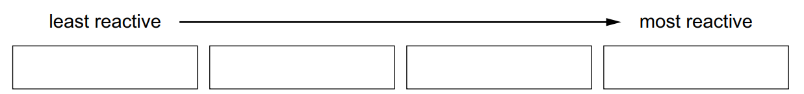

*Source: Specimen 0620/03 Q3C*

**Q15** [1 mark]

#### Extended Only

Copper metal is obtained when scrap iron is added to aqueous copper(II) sulfate.

The reaction between iron and aqueous copper(II) sulfate is a displacement reaction.

State why this displacement reaction takes place.

*Source: Specimen 0620/04 Q3C*

**Q15** [1 mark]

**Extract:**

Copper metal is obtained when scrap iron is added to aqueous copper(II) sulfate. The reaction between iron and aqueous copper(II) sulfate is a displacement reaction.

#### Extended Only

Write a symbol equation for the reaction between iron and aqueous copper(II) sulfate.

*Source: Specimen 0620/04 Q3C*

**Q15** [1 mark]

A displacement reaction is one method for obtaining copper metal from aqueous copper(II) sulfate.

Identify **another** method for obtaining copper metal from aqueous copper(II) sulfate.

*Source: Specimen 0620/04 Q3C*

### Q16 — hard — 6 marks

**Q16** [2 marks]

#### Separate: Chemistry and Extended Only

Displacement reactions occur between metals and metal ions. Displacement reactions can be used to determine the order of reactivity of metals such as lead (Pb), nickel (Ni), and silver (Ag).

The ionic equation for a displacement reaction is shown.

Ni (s) + Pb2+ (aq) $\rightarrow$Pb (s) + Ni2+ (aq)

The ionic half-equations for this reaction are shown.

Ni (s) $\rightarrow$ Ni2+ (aq) + 2e–

Pb2+ (aq) + 2e–$\rightarrow$ Pb (s)

The ionic half-equations show that electrons are donated by nickel atoms and accepted by lead ions.

Identify the reducing agent in the displacement reaction. Give a reason for your answer. reducing agent _________________________________________ reason_________________________________________________

*Source: 2019 0620/42/04 Q7A*

**Q16** [1 mark]

#### Extended Only

What is the general term given to the type of reaction in which electrons are transferred from one species to another?

*Source: 2019 0620/42/04 Q7A*

**Q16** [2 marks]

#### Extended Only

The ionic equation for another displacement reaction is shown.

Pb (s) + 2Ag+ (aq) $\rightarrow$ 2Ag (s) + Pb2+ (aq)

Write the two ionic half-equations for this reaction.

*Source: June 2019 0620/42/04 Q7B*

**Q16** [1 mark]

**Extract:**

Ni (s) + Pb^2+ (aq) → Pb (s) + Ni^2+ (aq). The ionic half-equations: Ni (s) → Ni^2+ (aq) + 2e^–; Pb^2+ (aq) + 2e^– → Pb (s). The reducing agent is nickel because it loses/donates electrons.

The ionic equation for another displacement reaction: Pb (s) + 2Ag^+ (aq) → 2Ag (s) + Pb^2+ (aq). Half-equations: Pb → Pb^2+ + 2e^–; Ag^+ + e^– → Ag.

Use the information in (a) and (c) to put the three metals lead, nickel and silver in order of reactivity.

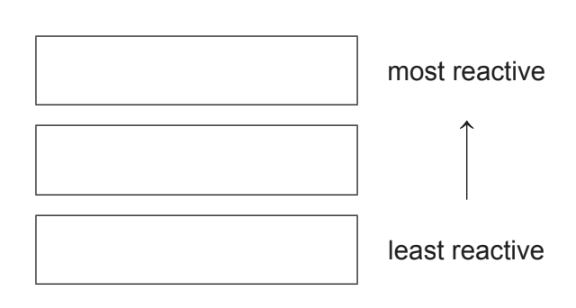

*Source: June 2019 0620/42/04 Q7C*

### Q17 — easy — 4 marks

**Q17** [2 marks]

The table shows some observations about the reactivity of four metals with dilute sulfuric acid.

| **metal** | **reaction with sulfuric acid** |
|---|---|
| iron | a slow stream of bubbles is seen |
| magnesium | a rapid stream of bubbles is seen |
| nickel | a few bubbles slowly form |
| tungsten | no bubbles are seen |

Use the information in the table to put the four metals in order of their reactivity.

Put the least reactive metal first.

*Source: 2019 0620/31/03 Q8D*

**Q17** [2 marks]

The table shows some observations about the reactivity of four metals with dilute hydrochloric acid.

| **metal** | **reaction with hydrochloric acid** |
|---|---|
| calcium | a rapid stream of bubbles is seen |
| lead | no bubbles are seen |
| manganese | a slow stream of bubbles is seen |
| tin | a few bubbles slowly form |

Use the information in the table to put the four metals in order of their reactivity.

Put the least reactive metal first.

*Source: 2019 0620/31/03 Q8C*

### Q18 — medium — 13 marks

**Q18** [4 marks]

Steel is an alloy made from impure iron.

Both iron and steel rust. The formula for rust is Fe2O3.2H2O. It is hydrated iron(III) oxide.

i) Name the two substances that must be present for rusting to occur.

[2]

ii) Painting and coating with grease are two methods of preventing iron or steel from rusting. Give **two** other methods.

[2]

*Source: 2008 O31 Q3A*

**Q18** [3 marks]

i) Name a reagent that can reduce iron(III) oxide to iron.

[1]

ii) Write a symbol equation for the reduction of iron(III) oxide, Fe2O3, to iron.

[2]

*Source: 2008 O31 Q3B*

**Q18** [3 marks]

**Extract:**

Both iron and steel rust. The formula for rust is Fe~2~O~3~.2H~2~O. It is hydrated iron(III) oxide.

i) Calculate the mass of one mole of Fe2O3.2H2O.

[1]

ii) Use your answer to (i) to calculate the percentage of iron in rust.

[2]

*Source: 2008 O31 Q3C*

**Q18** [3 marks]

Iron from the blast furnace is impure. Two of the impurities are carbon and silicon. These are removed by blowing oxygen through the molten iron and adding calcium oxide.

i) Explain how the addition of oxygen removes carbon.

[1]

ii) Explain how the addition of oxygen and calcium oxide removes silicon.

[2]

*Source: 2008 O31 Q3C*

### Q19 — hard — 14 marks

**Q19** [6 marks]

Tin is an element in Group IV.

The position of tin in the reactivity series is:

zinc

iron

tin

copper

i) For each of the following, decide if a reaction would occur. If there is a reaction, complete the equation, otherwise write ‘no reaction’.

Cu + Sn2+ → ..........................................

Fe + Sn2+ → ..........................................

Sn + Zn2+ → ..........................................

[4]

ii) Name the **three **products formed when tin(II) nitrate is heated.

[2]

*Source: 2011 Ju32 Q2*

**Q19** [4 marks]

#### Extended Only

Aqueous tin(II) sulfate is electrolysed using carbon electrodes. This electrolysis is similar to that of aqueous copper(II) sulfate using carbon electrodes.

i) What is the product at the negative electrode (cathode)?

[1]

ii) Write the equation for the reaction at the positive electrode (anode).

[2]

iii) Name the acid formed in this electrolysis.

[1]

*Source: 2011 Ju32 Q2*

**Q19** [4 marks]

**Extract:**

Tin is an element in Group IV. The position of tin in the reactivity series is: zinc, iron, tin, copper

Steel articles can be plated with tin or zinc to prevent rusting.

When the zinc layer is damaged exposing the underlying steel, it does not rust, but when the tin layer is broken the steel rusts. Explain.

*Source: 2011 Ju32 Q2*

