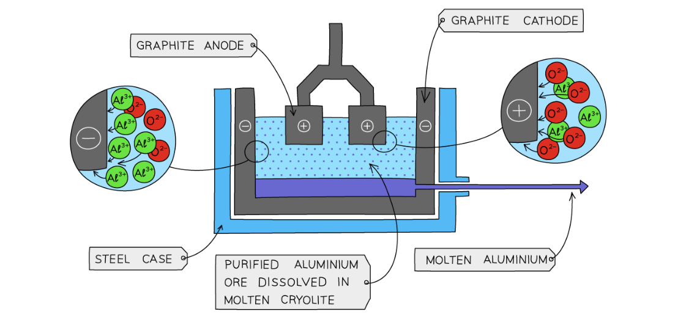

# Mark Schemes — Extraction of Metals
**9. Metals** · Cambridge (CIE) IGCSE chemistry (0620 & 0971)

## Multiple Choice Questions (27 questions)

### Q1
**Final answer:** **The correct answer is D**

The flow of gases rise from the bottom of the furnace to the top

- **Zone Z (bottom)**

  - Hot air (oxygen) is blasted into the bottom of the furnace, where it reacts with the carbon (coke) in a highly exothermic reaction to provide the heat for the furnace
  - The highly exothermic combustion provides the heat needed for the furnace
  - The CO2 produced then rises to react with more coke
  
    - The equation is: C + O2 → CO2
- **Zone Y (middle)**

  - As the carbon dioxide rises, it reacts with more carbon (coke) to form carbon monoxide.
  
    - The equation is: C + CO2→ 2CO
- **Zone X (top)**

  - The carbon monoxide continues to rise to the top of the furnace, where it acts as the reducing agent, reducing the descending iron(III) oxide (hematite) to form iron.
  
    - The equation is: Fe2O3 + 3CO → 2Fe + 3CO2

**A **& **B **are incorrect as zone X is where the reduction of iron (III) oxide occurs, not the formation of carbon dioxide

**C **is incorrect as the zone Z  is where the carbon dioxide is produced

### Q2
**Final answer:** **The correct answer is D**

- **Zone Z (bottom)**

  - Hot air is blown into the furnace
  - Coke burns in oxygen carbon + oxygen → carbon dioxide
  - This reaction produces a lot of heat and does not reduce the iron ore
  - The purpose of this zone is to generate heat and carbon dioxide
- **Zone Y (middle)**

  - Carbon dioxide rises and reacts with more hot coke carbon dioxide + carbon → carbon monoxide
  - This produces carbon monoxide
  
    - Carbon monoxide is the key reducing agent
    - The reducing agent will remove oxygen from the iron oxide (iron ore) to form pure iron
  - No iron is produced yet
- **Zone X (upper region)**

  - Iron(III) oxide from hematite meets rising carbon monoxide
  - The main reduction reaction happens iron (III) oxide  + carbon monoxide → iron + carbon dioxide
  - Carbon monoxide removes oxygen from iron(III) oxide
  
    - Iron(III) oxide is reduced to iron
    - Carbon monoxide is oxidised to carbon dioxide
- Reduction requires carbon monoxide
- Carbon monoxide reacts with iron(III) oxide in zone X
- Therefore, iron(III) oxide is reduced in X

**A **& **B **are incorrect because carbon dioxide is used up in Y, not produced. Therefore, carbon dioxide is not a product in both Y and Z

**C **is incorrect because the reduction of iron (III) oxide requires carbon monoxide. In Zone Y, carbon monoxide is being formed, not used. Iron(III) oxide is reduced above this zone, where carbon monoxide reacts with the ore. Therefore, iron(III) oxide is not reduced in Y

### Q3
**Final answer:** **The correct answer is B**

- Metals above carbon in the reactivity series cannot be extracted by reduction with carbon or carbon monoxide

  - These metals require large amount of electricity, and they are often extracted through electrolysis
- Metals below carbon can be extracted this way
- Iron is below carbon in the reactivity series

  - Iron oxide can be reduced by carbon monoxide in a blast furnace
  - Therefore,** iron can be extracted this way**
- Magnesium is above carbon in the reactivity series

  - Carbon cannot remove oxygen from magnesium oxide
  - Therefore, **magnesium cannot be extracted this way**
  
    - Magnesium must be extracted by electrolysis
- Aluminium is above carbon in the reactivity series

  - Carbon cannot remove oxygen from aluminium oxide
  - Therefore, **aluminium cannot be extracted this way**
  
    - Aluminium must be extracted by electrolysis
- Therefore, the **metals that cannot** be extracted using carbon are magnesium and aluminium, so 2 and 3 only

### Q4
**Final answer:** **The correct answer is**** A**** because:**

- Limestone is added to remove **sand impurities** in hematite.
- It reacts with the impurities forming a **slag** which is tapped off separately from the molten iron.

**B **is incorrect as the furnace is heated by the combustion of carbon and hot air that is blasted into the furnace.

**C **is incorrect as the hematite is reduced by carbon monoxide:

Fe2O3 + 2CO → 2Fe + 3CO2

**D **is incorrect as the waste gases are piped to a heat exchanger to heat the incoming air.

### Q5
**Final answer:** **The correct answer is ****B**** because:**

- Impure iron contains impurities of carbon, phosphorus, silicon and sulfur.
- Oxygen is blown in to **oxidise** the impurities to their oxides in a basic oxygen converter.
- Calcium oxide is used to remove the silicon and phosphorus oxides to produce slag:

  - SiO2 + CaO → CaSiO3
- The slag floats to the surface of the molten iron and is removed.

**A **is incorrect as carbon reacts with oxygen in a combustion reaction, heating the blast furnace forming carbon dioxide: C + O2 → CO2

**C **is incorrect as carbon dioxide is produced in the reaction of carbon with oxygen.

**D **is incorrect as oxygen reacts with carbon in a combustion reaction, heating the blast furnace forming carbon dioxide:  C + O2 → CO2

### Q6
**Final answer:** **The correct answer is**** D ****because:**

- Only metals below carbon in the reactivity series can be extracted by reduction
- Elements above carbon, such as lithium are extracted using electrolysis

### Q7
**Final answer:** **The answer is ****B**** because:**

- This is the name given to the unreactive metals found in the earth that do not require extracting from an ore

**A, C** and **D** are incorrect as these metals are found in ores

### Q8
**Final answer:** **The correct answer is ****C**** because**

- Aluminium is more reactive than carbon.
- The method used to extract a metal from its ore depends on the reactivity of the metal in the **reactivity series**.
- Metals lower than **carbon **in the reactivity series can be reduced by heating with carbon.
- Metals above carbon in the reactivity series will either need to be reduced by another more reactive element or extracted via electrolysis.
- Extraction by electrolysis is used to extract aluminium.

**A,** **B** and **D **are incorrect as zinc, copper and iron are all below carbon in the reactivity series and can be extracted by reduction with carbon.

### Q9
**Final answer:** **The correct answer is ****B**** because:**

- Reaction A occurs at the cathode.
- Reaction C occurs at the anode.
- Reaction D occurs at the anode and is a result of hot oxygen bubbles reacting with the carbon electrodes.
- Reaction B does not occur.

### Q10
**Final answer:** **The correct answer is ****D**** because:**

- Tin is a hard and shiny metal
- Tin is less reactive than carbon, so carbon can be used to reduce it.

Statement 1 is incorrect because tin is a metal; metallic bonding in metals has delocalised electrons that allow the metal to conduct electricity.

### Q11
**Final answer:** **The correct answer is ****B**** because:**

- Iron is found as an oxide in the ore haematite as the compound Fe2O3
- Iron is less reactive than carbon and can be extracted in a blast furnace. So electrolysis is not used to extract it from its ore.
- Iron is used to make cooking utensils when made into the alloy stainless steel.

**A** and **C **are incorrect as iron is extracted using displacement in a blast furnace as it is less reactive than carbon.

**D **is incorrect as iron can be made into the alloy stainless steel, which gives it the properties needed to make cooking utensils

### Q12
**Final answer:** **The correct answer is ****D ****because:**

- When oxygen is blown into the furnace it reacts with carbon to form carbon dioxide
- The carbon dioxide reacts with more carbon forming carbon monoxide which can reduce iron(III) oxide to iron
- Calcium oxide is formed from the thermal decomposition of calcium carbonate (which is added to remove impurities in the ore)
- The calcium oxide will react with acidic impurities such as silicon dioxide to form calcium silicate, or slag which can be removed

**A **is incorrect as calcium oxide will not react with basic impurities as it is a basic oxide itself

**B** is incorrect as oxygen reacts with carbon, not iron, and slag is formed as a result of calcium oxide reacting with acidic impurities

**C** is incorrect as oxygen reacts with carbon not iron

### Q13
**Final answer:** **The correct answer is ****A**** because:**

- The cathode is not burnt away during the reaction.
- The anode needs to be replaced regularly because it is degraded over time due to the reaction of the carbon in the graphite with oxygen gas into carbon dioxide.

All the other statements are correct statements about electrolysis of aluminium oxide.

### Q14
**Final answer:** **The correct answer is ****C**** because:**

- The melting point of aluminium oxide is 2030ºC.
- By dissolving it in molten cryolite, the melting point is reduced to 900 - 1000ºC.
- The lower temperature is more cost effective and safer to operate.
- The aluminium ions are positively charged and are deposited at the negatively charged electrode, the cathode.

**A** and **B **are incorrect as the cryolite is molten and not aqueous.

**D **is incorrect as the anode is the positively charged electrode and repels the aluminium cations since like charges repel.

### Q15
**Final answer:** **The correct answer is ****C**** because: **

- Iron is higher up the reactivity series than copper
- The higher up the metal is, the harder it is to extract from its ore due to stronger bonds with its oxide

**A **is incorrect as iron is less reactive than carbon so can be extracted by reduction with carbon

**B** is incorrect as iron is easier to extract than zinc as it is lower in the reactivity series

**D **is incorrect as iron ore is called haematite

### Q16
**Final answer:** **The correct answer is ****A**** because**

- The carbon monoxide is **oxidised** as it gains oxygen:

  - 3CO → 3CO2
- Iron (III) oxide is **reduced **as it loses oxygen:

  - Fe2O3 → 2Fe

**B **is incorrect as carbon monoxide is oxidised, oxygen is added to make it carbon dioxide and iron (III) oxide is reduced as oxygen is removed.

**C **is incorrect as iron (III) oxide is reduced as oxygen is removed

**D **is incorrect as carbon monoxide is oxidised; oxygen is added to make it carbon dioxide.

### Q17
**Final answer:** **The correct answer is ****D**** because:**

- In the electrolysis of aluminium, both electrodes are made from graphite.
- Graphite is an allotrope of carbon which is chemically inert and resistant to corrosion but does conduct heat and electricity, so the flow of electricity and heat is maintained while the electrodes do not interfere with the chemistry of the process.

**A, B** and **C** are incorrect as aluminium is a metal which has different properties than graphite and would participate in the chemistry of the process and hence interrupt the extraction.

### Q18
**Final answer:** **The correct answer is ****D ****because:**

- The reaction at the cathode (-) is:

  - Al3+    +    3e–    →    Al
- The reaction at the anode (+) is:

  - 2O2-   →    O2    +    4e–

**A **is incorrect as oxygen ions are negatively charged so are attracted to the positive electrode (anode) and aluminium ions are positively charged so are attracted to the negative electrode (cathode).

**B** and **C **are incorrect as chlorine is not involved in the extraction of aluminium.

Use the **PANIC** mnemonic to remember which electrode is the positive and which is the negative.

**P**ositive is

**A**node

**N**egative

**I**s

**C**athode
