# Exam Questions — Extraction of Metals
**9. Metals** · Cambridge (CIE) IGCSE chemistry (0620 & 0971)
> Source: [https://www.savemyexams.com/igcse/chemistry/cie/23/topic-questions/](https://www.savemyexams.com/igcse/chemistry/cie/23/topic-questions/) · 44 questions across 3 sets

## Alternative To Practical Questions (1 questions)

### Q1 — medium — 6 marks

**Q1** [6 marks]

Malachite is a naturally occurring form of copper carbonate. Outline how a sample of copper metal could be obtained from large lumps of malachite in the laboratory.

Copper is one of the least reactive metals.

Your answer should include any chemicals used and conditions.

*Source: 2010 61 Q7*

## Multiple Choice Questions (27 questions)

### Q1 — hard — 1 marks

**Q1** [1 mark]

The diagram shows a blast furnace for the extraction of iron from hematite

Which row shows the correct balanced equations for the main reactions occurring in zones X, Y and Z?

|   | zone X | zone Y | zone Z |
|---|---|---|---|
| **A** | C + O2 → CO2 | C + CO2→ 2CO | Fe2O3 + 3CO → 2Fe + 3CO2 |
| **B** | C + O2 → CO2 | CaCO3→ CaO+CO2 | Fe2O3 + 3CO → 2Fe + 3CO2 |
| **C** | Fe2O3 + 3CO → 2Fe + 3CO2 | C + O2 → CO2 | C + CO2→ 2CO |
| **D** | Fe2O3 + 3CO → 2Fe + 3CO2 | C + CO2→ 2CO | C + O2 → CO2 |

### Q2 — medium — 1 marks

**Q2** [1 mark]

The diagram shows a blast furnace for the extraction of iron from hematite

Which statement is correct for the zones X, Y and Z?

### Q3 — easy — 1 marks

**Q3** [1 mark]

Useful metals are usually found as ores in the nature. Metal ores are rocks that contain enough of the metal to extract it through a chemical process.

Which metals **cannot** be extracted from their ore, by heating them with carbon or carbon monoxide in a blast furnace?

1. iron
2. magnesium
3. aluminium

### Q4 — easy — 1 marks

**Q4** [1 mark]

Iron is extracted from hematite, Fe2O3, in a blast furnace. Limestone is also added to the furnace.

What is the purpose of the limestone?

### Q5 — easy — 1 marks

**Q5** [1 mark]

The blast furnace is used to extract iron from haematite.

The haematite contains silica as an impurity

What is used to react with the impurity and remove it?

### Q6 — easy — 1 marks

**Q6** [1 mark]

Which of the following metals can **not** be extracted from its ore by reduction?

### Q7 — easy — 1 marks

**Q7** [1 mark]

Some metals are unreactive and exist on their own in the earth.

What are these metals known as?

### Q8 — easy — 1 marks

**Q8** [1 mark]

Many metals can be extracted from their ores by heating the metal oxide with carbon.

Which of these metals can’t be extracted using carbon?

### Q9 — hard — 1 marks

**Q9** [1 mark]

Which reaction does **not** occur in the extraction of aluminium?

### Q10 — hard — 1 marks

**Q10** [1 mark]

Tin is less reactive than iron and the metal is extracted from its ore cassiterite, SnO2.

Which of the following statements are correct?

1. Tin does not conduct electricity.
2. Tin is hard and shiny
3. Tn can be extracted from cassiterite using carbon.

### Q11 — hard — 1 marks

**Q11** [1 mark]

The three statements about aluminium are all correct.

1. Aluminium has an oxide ore.
2. Aluminium is extracted from its ore by electrolysis.
3. Aluminium is used to make cooking utensils.

Which of the statements would still be correct if aluminium was replaced with iron?

|   | **1** | **2** | **3** |
|---|---|---|---|
| **A** | x | `✓` | `✓` |
| **B** | `✓` | x | `✓` |
| **C** | `✓` | `✓` | `✓` |
| **D** | `✓` | x | x |

### Q12 — hard — 1 marks

**Q12** [1 mark]

Iron is produced in a blast furnace.

This process involves blowing oxygen into impure molten iron and adding calcium oxide.

What are the reasons for blowing in oxygen and adding calcium oxide?

|   | **blowing in oxygen** | **adding calcium oxide** |
|---|---|---|
| **A** | reacts with carbon so removes it | removes basic impurities making slag |
| **B** | oxygen reacts with iron | reacts with slag and so removes it |
| **C** | oxygen reacts with iron | removes acidic impurities making slag |
| **D** | reacts with carbon so removes it | removes acidic impurities making slag |

### Q13 — hard — 1 marks

**Q13** [1 mark]

Aluminium can be manufactured using electrolysis.

The diagram below shows the electrolysis cell.

Which of these statements is not correct about electrolysis of aluminium?

### Q14 — medium — 1 marks

**Q14** [1 mark]

Aluminium is extracted from its oxide by electrolysis.

The oxide is dissolved in ……**1**…… cryolite and aluminium is deposited at the ……**2**……

Which words correctly complete gaps 1 and 2?

|   | **1** | **2** |
|---|---|---|
| **A** | aqueous | cathode |
| **B** | aqueous | anode |
| **C** | molten | cathode |
| **D** | molten | anode |

### Q15 — medium — 1 marks

**Q15** [1 mark]

Which statement about the extraction of iron from its ore is **not **correct?

### Q16 — medium — 1 marks

**Q16** [1 mark]

In a blast furnace, iron (III) oxide is converted into iron and carbon monoxide is converted into carbon dioxide, as shown in the equation:

Fe2O3  + 3CO → 2 Fe + 3 CO2

What happens to each of these reactants?

### Q17 — medium — 1 marks

**Q17** [1 mark]

The diagram shows how aluminium is manufactured by electrolysis.

What are the anode and cathode made of?

|   | **anode** | **cathode** |
|---|---|---|
| **A** | aluminium | aluminium |
| **B** | aluminium | graphite |
| **C** | graphite | aluminium |
| **D** | graphite | graphite |

### Q18 — medium — 1 marks

**Q18** [1 mark]

What are the products at each electrode in the extraction of aluminium?

|   | **cathode** | **anode** |
|---|---|---|
| **A** | oxygen | aluminium |
| **B** | chlorine | aluminium |
| **C** | aluminium | chlorine |
| **D** | aluminium | oxygen |

## Theory Questions (27 questions)

### Q1 — hard — 15 marks

**Q1** [1 mark]

Aluminium is extracted from its purified ore by electrolysis.

Name the main ore of aluminium.

**Q1** [1 mark]

A diagram of an electrochemical cell for the extraction of aluminium is shown in Fig. 4.1.

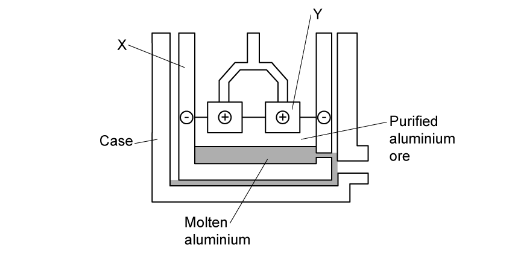

**Fig. 4.1**

The electrodes are labelled as **X** and **Y**, and they are made of graphite.

State **one** physical property of graphite that makes it suitable for use as an electrode in this process

**Q1** [2 marks]

**Extract:**

A diagram of an electrochemical cell for the extraction of aluminium is shown in Fig. 4.1.

Electrolysis cell for aluminium extraction. Outer case with molten aluminium at bottom. Purified aluminium ore above. Negative electrode at X surrounding the mixture of aluminium and aluminium ore; positive carbon electrodes at Y dipping into melt.

Fig. 4.1

The electrodes are labelled as X and Y, and they are made of graphite.

Using Fig 4.1, write the ionic half-equation for the reaction occurring at electrode X.

**Q1** [6 marks]

Aluminium reacts with iron(III) oxide in the thermite reaction.

2Al + Fe2O3 → 2Fe + Al2O3

10.0 g of aluminium is reacted with 15.0 g of iron(III) oxide.

i) Calculate the number of moles of aluminium and iron(III) oxide used.

[Relative atomic masses, *A*r: Al = 27; Fe = 56; O = 16]

moles of Al = .............mol

moles of Fe2O3 = ............. mol

[2]

ii) Determine which reactant is the limiting reactant. Show your reasoning.

limiting reactant:

reasoning:

[1]

iii) Calculate the maximum mass of iron that can be produced in this reaction.

moles of iron produced = ........... mol

mass of iron produced = ............... g

[2]

iv) In an experiment, the actual mass of iron produced is 8.40 g. Calculate the percentage yield of iron.

percentage yield = ....................%

[1]

**Q1** [3 marks]

Iron from the blast furnace can be mixed with carbon to form an alloy, **P**.

i) Name alloy **P**.

[1]

ii) Explain, in terms of their structure, why alloy **P** is harder and stronger than pure iron.

[2]

**Q1** [2 marks]

Iron undergoes rusting to form hydrated iron(III) oxide.

i) State **one** condition required for iron to rust.

[1]

ii) State **one** barrier method used to prevent iron from rusting.

[1]

### Q2 — easy — 10 marks

**Q2** [3 marks]

Crystals of hydrated copper(II) sulfate are placed in a beaker of water, as shown in Fig 5.1

**Fig 5.1**

After 3 hours, the solid has disappeared and the solution in the beaker has turned blue. Explain, using the kinetic particle model, why the solution has turned blue.

**Q2** [3 marks]

**Extract:**

Crystals of hydrated copper(II) sulfate are placed in a beaker of water, as shown in Fig 5.1. After 3 hours, the solid has disappeared and the solution in the beaker has turned blue.

The solution is heated until all the water has evaporated. A white solid, **X**, remains. Describe the structure of solid **X** in terms of:

- **separation of particles**
- **arrangement of particles**
- **type of motion**

**Q2** [2 marks]

**Extract:**

The solution is heated until all the water has evaporated. A white solid, X, remains.

Solid **X** can be turned back into hydrated copper(II) sulfate by adding water.

Complete the word equation for this reaction with the name of **X**. Include the symbol for a reversible reaction

**..........** + water  .............  hydrated copper (II) sulphate

**Q2** [2 marks]

**Extract:**

The solution is heated until all the water has evaporated. A white solid, X, remains.

Solid X can be turned back into hydrated copper(II) sulfate by adding water. The missing reactant is anhydrous copper(II) sulfate + water ⇌ hydrated copper(II) sulfate.

Solid **X** is used to test for the presence of water. State the name of **one other** substance that can be used to test for the presence of water and the observation made.

**Substance:**

**Observation:**

### Q3 — medium — 16 marks

**Q3** [2 marks]

#### Extended Only

No one knows where iron was first isolated. It appeared in China, the Middle East and in Africa. It was obtained by reducing iron ore with charcoal.

Complete the following equation.

| Fe2O3 | + | ........................ | → | ........................ | + | ........................ |
|---|---|---|---|---|---|---|
| **(iron ore)** |   | **(charcoal)** |   |   |   |   |

*Source: 2003 Ju31 Q1A*

**Q3** [3 marks]

#### Extended Only

In 1705 Abraham Darby showed that iron ore could be reduced using coke in a blast furnace.

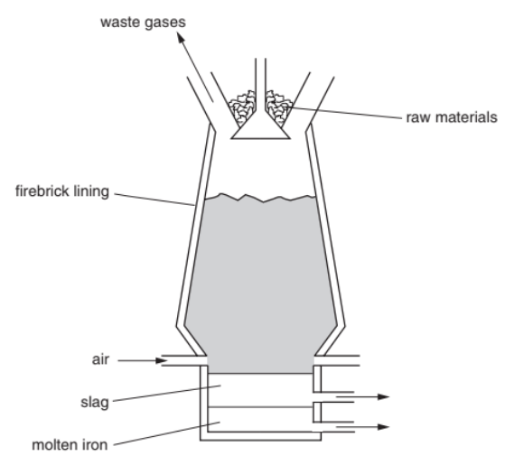

i) The temperature in the furnace rises to 2000 °C. Write an equation for the exothermic reaction that causes this high temperature.

[1]

ii) In the furnace, the ore is reduced by carbon monoxide. Explain how this is formed.

[2]

*Source: 2003 Ju31 Q1B*

**Q3** [2 marks]

**Extract:**

In 1705 Abraham Darby showed that iron ore could be reduced using coke in a blast furnace.

#### Extended Only

The formation of slag removes an impurity in the ore.

Write a **word** equation for the formation of the slag.

*Source: 2003 Ju31 Q1C*

**Q3** [6 marks]

**Extract:**

Calcium carbonate in the form of limestone is added to the blast furnace where it decomposes to form calcium oxide and carbon dioxide. Calcium oxide + silicon(IV) oxide → calcium silicate. The formation of slag removes an impurity in the ore.

#### Extended Only

Stainless steel is an alloy of iron. It contains iron, other metals and about 0.5% of carbon.

i) State a use of stainless steel.

[1]

ii) Name a metal, other than iron, in stainless steel.

[1]

iii) The iron from the blast furnace is impure. It contains about 5% of carbon and other impurities, such as silicon and phosphorus.

Describe how the percentage of carbon is reduced and the other impurities are removed.

[4]

*Source: 2003 Ju31 Q1D*

**Q3** [3 marks]

#### Separate: Chemistry Only

One of the methods used to prevent iron or steel from rusting is to electroplate it with another metal, such as tin. Complete the following.

The anode is made of ...............................................

The cathode is made of .............................................

The electrolyte is a solution of ...................................

*Source: 2003 Ju31 Q1E*

### Q4 — medium — 8 marks

**Q4** [3 marks]

Iron from the blast furnace is impure. It contains 5% of impurities, mainly carbon, sulfur, silicon and phosphorus. Almost all of this impure iron is converted into the alloy, mild steel.

i) State a use of mild steel.

[1]

ii) Name and give a use of another iron-containing alloy.

[2]

*Source: 2013 Ju33 Q3A*

**Q4** [5 marks]

**Extract:**

Iron from the blast furnace is impure. It contains 5% of impurities, mainly carbon, sulfur, silicon and phosphorus. Almost all of this impure iron is converted into the alloy, mild steel.

The oxides of carbon and sulfur are gases. The oxides of silicon and phosphorus are not.

Explain how these impurities are removed from the impure iron when it is converted into mild steel.

*Source: 2013 Ju33 Q3B*

### Q5 — hard — 13 marks

**Q5** [5 marks]

#### Separate: Chemistry and Extended Only

Aluminium is extracted by the electrolysis of a molten mixture of alumina, which is aluminium oxide, and cryolite.

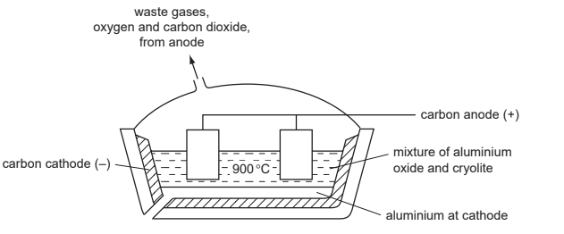

Alumina is obtained from the main ore of aluminium.

i) Name this ore.

[1]

ii) Explain why it is necessary to use a mixture, alumina and cryolite, rather than just alumina.

[2]

iii) Copper can be extracted by the electrolysis of an aqueous solution.

Suggest why the electrolysis of an aqueous solution cannot be used to extract aluminium.

[2]

*Source: 2011 O31 Q3*

**Q5** [4 marks]

**Extract:**

Aluminium is extracted by the electrolysis of a molten mixture of alumina, which is aluminium oxide, and cryolite. electrolysis-of-aluminium-oxide-2 (diagram showing products: aluminium, oxygen, carbon dioxide, with carbon electrodes)

#### Separate: Chemistry and Extended Only

The ions which are involved in the electrolysis are Al3+ and O2–. The products of this electrolysis are given on the diagram.

Explain how they are formed. Use equations where appropriate.

*Source: 2011 O31 Q3*

**Q5** [4 marks]

The uses of a metal are determined by its properties.

i) Foods which are acidic can be supplied in aluminium containers.

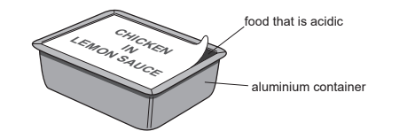

Explain why the acid in the food does not react with the aluminium.

[1]

ii) Explain why overhead electrical power cables are made from aluminium with a steel core.

[3]

*Source: 2011 O31 Q3*

### Q6 — medium — 11 marks

**Q6** [1 mark]

Iron is extracted from its ore, hematite, in the blast furnace.

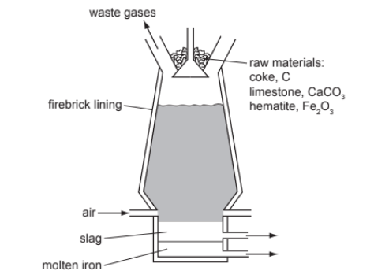

The temperature inside the blast furnace can rise to 2000 °C. Write an equation for the exothermic reaction which causes this high temperature.

*Source: 2012 O32 Q4A*

**Q6** [4 marks]

**Extract:**

Iron is extracted from its ore, hematite, in the blast furnace. The equation for the exothermic reaction which causes this high temperature is: C + O2 → CO2

Carbon monoxide is formed in the blast furnace. This reduces the ore hematite, Fe2O3, to iron.

i) Explain how carbon monoxide is formed in the blast furnace.

[2]

ii) Write an equation for the reduction of hematite by carbon monoxide.

[2]

*Source: 2012 O32 Q4B*

**Q6** [3 marks]

**Extract:**

Iron is extracted from its ore, hematite, in the blast furnace.

Explain why it is necessary to add limestone, calcium carbonate, to the blast furnace. Include an equation in your explanation.

*Source: 2012 O32 Q4C*

**Q6** [3 marks]

#### Extended Only

Most of the iron from the blast furnace is converted into mild steel. A method of preventing the steel from rusting is coating it with zinc.

i) What is the name of this method of rust prevention?

[1]

ii) Explain, using the idea of electron transfer, why zinc-coated steel does not rust even when the coating is scratched and the steel is in contact with oxygen and water.

[2]

*Source: 2012 O32 Q4D*

### Q7 — medium — 14 marks

**Q7** [8 marks]

Iron from a blast furnace contains about 5% of the impurities – carbon, silicon, phosphorus and sulfur. Most of this impure iron is used to make steels, such as mild steel, and a very small percentage is used to make pure iron.

i) Calcium oxide and oxygen are used to remove the impurities from the iron produced in the blast furnace.

State how these chemicals are manufactured.

calcium oxide ......................... 
oxygen .................................

[3]

ii) Describe how these two chemicals remove the four impurities. Include at least one equation in your answer.

[5]

*Source: 2014 Ju33 Q6A*

**Q7** [6 marks]

i) Describe the structure of a typical metal such as iron. You may include a diagram.

[2]

ii) Explain why pure iron is malleable.

[2]

iii) Mild steel is an alloy of iron and carbon. Suggest why mild steel is harder than pure iron.

[2]

*Source: 2014 O33 Q6B*

### Q8 — hard — 5 marks

**Q8** [5 marks]

#### Extended Only

Iron is extracted from its ore, hematite, in the blast furnace.

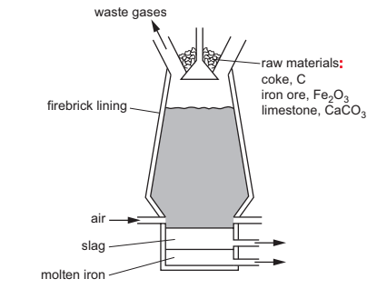

Describe the reactions involved in this extraction. Include one equation for a redox reaction and one for an acid/base reaction.

*Source: 2016 Specimen4 Q5A*

### Q9 — hard — 13 marks

**Q9** [6 marks]

#### Extended Only

For centuries, iron has been extracted from its ore in the blast furnace. The world production of pig iron is measured in hundreds of million tonnes annually.

The following raw materials are supplied to a modern blast furnace.

- iron ore which is hematite, Fe2O3
- limestone which is calcium carbonate
- carbon in the form of coke
- air

Describe the essential reactions in the blast furnace. Each of the four raw materials must be mentioned at least once.

Give the equation for the reduction of hematite.

*Source: 2013 O32 Q4*

**Q9** [7 marks]

#### Extended Only

Each year, blast furnaces discharge millions of tonnes of carbon dioxide into the atmosphere. This will increase the percentage of atmospheric carbon dioxide.

i) Explain why this increased percentage of carbon dioxide may cause problems in the future.

[2]

ii) Until the early eighteenth century, charcoal, not coke, was used in the blast furnace. Charcoal is made from wood but coke is made from coal. Explain why the use of charcoal would have a smaller effect on the level of atmospheric carbon dioxide

[2]

iii) A method being developed to produce iron with lower emissions of carbon dioxide is by electrolysis. Hematite, Fe2O3, is dissolved in molten lithium carbonate and electrolysed. The ore is spilt into its constituent elements. Write an equation for the reaction at the negative electrode (cathode). Complete the equation for the reaction at the positive electrode (anode).

........O2– → ............... + ...............

[3]

*Source: 2013 O32 Q4*

### Q10 — hard — 19 marks

**Q10** [4 marks]

Iron is extracted from the ore hematite in the Blast Furnace.

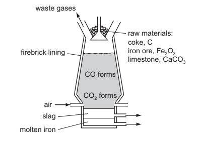

The coke reacts with the oxygen in the air to form carbon dioxide.

C + O2 → CO2

i) Explain why carbon monoxide is formed higher in the Blast Furnace.

[2]

ii) Write an equation for the reduction of hematite, Fe2O3, by carbon monoxide.

[2]

*Source: 2014 O31 Q4A*

**Q10** [6 marks]

**Extract:**

Iron is extracted from the ore hematite in the Blast Furnace.

Limestone decomposes to form two products, one of which is calcium oxide.

i) Name the other product

[1]

ii) Calcium oxide reacts with silicon(IV) oxide, an acidic impurity in the iron ore, to form slag. Write an equation for this reaction.

[2]

iii) Explain why the molten iron and the molten slag form two layers and why molten iron is the lower layer.

[1]

iv) Suggest why the molten iron does not react with the air.

[2]

*Source: 2014 O31  Q4B*

**Q10** [2 marks]

Iron and steel rust. Iron is oxidised to hydrated iron(III) oxide, Fe2O3.2H2O, which is rust.

i) Name the two substances which cause iron to rust.

[1]

ii) Explain why an aluminium article coated with aluminium oxide is protected from further corrosion but a steel article coated with rust continues to corrode.

[1]

*Source: 2014 O31 Q4C*

**Q10** [7 marks]

#### Extended Only

There are two electrochemical methods of rust prevention.

i) The first method is sacrificial protection. Explain why the steel article does not rust.

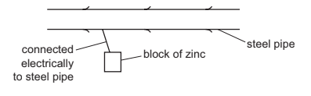

[4]

ii) The second method is to make the steel article the cathode in a circuit for electrolysis.

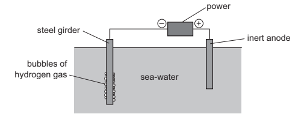

Mark on the diagram the direction of the electron flow.

[1]

iii) The steel girder does not rust because it is the cathode. Reduction takes place at the cathode. Give the equation for the reduction of hydrogen ions.

[2]

*Source: 2014 O31 Q4D*

### Q11 — easy — 12 marks

**Q11** [5 marks]

#### Extended Only

The diagram shows a blast furnace.

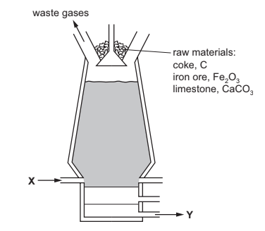

The following equations represent reactions which take place in the blast furnace.

A    C + O2 → CO2    
B    CaCO3 → CaO + CO2    
C    CaO + SiO2 → CaSiO3    
D    CO2 + C → 2CO    
E    Fe2O3 + 3CO → 2Fe + 3CO2

i) Which reaction is used to increase the temperature inside the blast furnace?

[1]

ii) Which reaction is an example of thermal decomposition?

[1]

iii) In which reaction is carbon both oxidised and reduced?

[1]

iv) Which equation shows the removal of an impurity from the iron?

[1]

v) Which equation shows the reaction of an acidic substance with a basic substance?

[1]

*Source: 2016 Ju43 Q1*

**Q11** [4 marks]

**Extract:**

The diagram shows a blast furnace.

Use the diagram of the blast furnace to help you answer these questions.

i) What enters the blast furnace at X?

[1]

ii) What leaves the blast furnace at Y?

[1]

iii) Name two waste gases that leave the blast furnace.

1. ............................................................................................

2. ...........................................................................................

[2]

*Source: 2016 Ju43 Q1B*

**Q11** [3 marks]

#### Extended Only

The graph shows how the malleability of iron changes as the percentage of carbon in the iron changes.

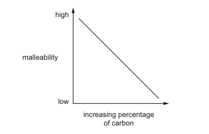

i) Describe how the malleability of iron changes as the percentage of carbon changes.

[1]

ii) Iron obtained from the blast furnace contains high levels of carbon. Explain how the amount of carbon in the iron can be decreased.

[2]

*Source: 2016 Ju43 Q1C*

### Q12 — easy — 12 marks

**Q12** [3 marks]

Iron is a transition element.

Which of the following statements about transition elements are correct?

Tick **three **boxes.

| The metals are highly coloured e.g. yellow, green, blue. |   |
|---|---|
| The metals have low melting points. |   |
| Their compounds are highly coloured. |   |
| Their compounds are colourless. |   |
| The elements and their compounds are often used as catalysts. |   |
| They have more than one oxidation state. |   |

*Source: 2006 Ju31 Q1*

**Q12** [3 marks]

i) In which Period in the Periodic Table is iron to be found?

[1]

ii) Use the Periodic Table to work out the number of protons and the number of neutrons in one atom of iron. Number of protons = Number of neutrons =

[2]

*Source: 2006 Ju31 Q1*

**Q12** [3 marks]

Iron is extracted in a blast furnace. The list below gives some of the substances used or formed in the extraction.

| **carbon monoxide** | **coke** | **iron ore** | **limestone** | **slag** |
|---|---|---|---|---|

i) Which substance is a mineral containing largely calcium carbonate?

[1]

ii) Which substance is formed when impurities in the ore react with calcium oxide?

[1]

iii) Which substance is also called hematite?

[1]

*Source: 2006 Ju31 Q1*

**Q12** [2 marks]

**Extract:**

Iron is extracted in a blast furnace. The list below gives some of the substances used or formed in the extraction.

carbon monoxide | coke | iron ore | limestone | slag

State **two **functions of the coke used in the blast furnace.

*Source: 2006 Ju31 Q1*

**Q12** [1 mark]

Some of the iron is converted into stainless steel. Give one use for stainless steel.

*Source: 2006 Ju31 Q1*

### Q13 — medium — 4 marks

**Q13** [1 mark]

This question is about oxides.

The names of eight substances are given.

| **aluminium oxide** | **calcium oxide** | **ethanol** | **nitrogen** |
|---|---|---|---|
| **iron(III) oxide** | **methane** | **oxygen** | **silicon(IV) oxide** |

State which substance is the main constituent of bauxite.

**Q13** [1 mark]

Give the name of the process that is used to extract aluminium from aluminium oxide.

**Q13** [2 marks]

**Extract:**

| metal    oxide | ease of reduction with carbon |
| bismuth(III) oxide | reduced by carbon only above 250°C |
| chromium(III) oxide | reduced by carbon only above 1200 °C |
| lead(II) oxide | reduced by carbon only above 440 °C |
| zinc oxide | reduced by carbon only above 990°C |

The table shows how easy it is to reduce four metal oxides with carbon.

| **metal    oxide** | **ease of reduction with carbon** |
|---|---|
| bismuth(III) oxide | reduced by carbon only above 250°C |
| chromium(III) oxide | reduced by carbon only above 1200 °C |
| lead(II) oxide | reduced by carbon only above 440 °C |
| zinc oxide | reduced by carbon only above 990°C |

Use the information in the table to put the four metals in order of their reactivity.

Put the least reactive metal first.

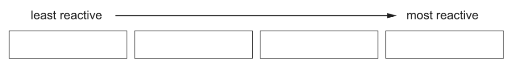

### Q14 — hard — 13 marks

**Q14** [1 mark]

#### Separate: Chemistry and Extended Only

Aluminium and iron are extracted from their ores by different methods.

Aluminium is extracted from its purified oxide ore by electrolysis.

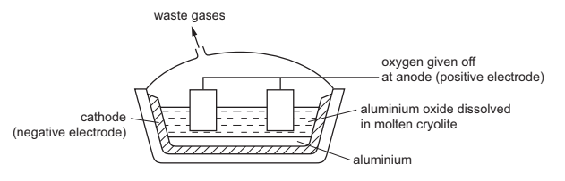

What is the name of the ore of aluminium which consists mainly of aluminium oxide?

*Source: 2015 Ja32 Q5A*

**Q14** [1 mark]

**Extract:**

Aluminium and iron are extracted from their ores by different methods. Aluminium is extracted from its purified oxide ore by electrolysis.

#### Separate: Chemistry and Extended Only

The electrodes are both made of the same substance.

Name this substance.

*Source: 2015 Ja32 Q5B*

**Q14** [2 marks]

#### Separate: Chemistry and Extended Only

Aluminium oxide is dissolved in molten cryolite before it is electrolysed.

Give two reasons why aluminium oxide dissolved in molten cryolite is electrolysed rather than molten aluminium oxide alone.

*Source: 2015 Ja32 Q5C*

**Q14** [2 marks]

**Extract:**

Aluminium and iron are extracted from their ores by different methods. Aluminium is extracted from its purified oxide ore by electrolysis.

#### Separate: Chemistry and Extended Only

Write the ionic equations for the reactions at the electrodes in this electrolysis.

Anode (positive electrode)

Cathode (negative electrode)

*Source: 2015 Ja32 Q5D*

**Q14** [2 marks]

Iron is extracted from its oxide ore by reduction using carbon in a blast furnace.

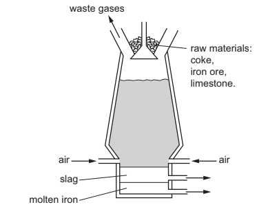

i) Place the elements aluminium, carbon and iron in order of reactivity with the least reactive element first.

[1]

ii) Use your answer to (e)(i) to explain why iron is extracted by reduction using carbon but aluminium is not.

[1]

*Source: 2015 Ju32 Q5E*

**Q14** [1 mark]

What is the name of the ore of iron which consists mainly of iron(III) oxide?

*Source: 2015 Ju32 Q5F*

**Q14** [4 marks]

**Extract:**

Iron is extracted from its oxide ore by reduction using carbon in a blast furnace.

#### Extended Only

Write balanced equations for the reactions occurring in the blast furnace which involve

i) The complete combustion of coke (carbon)

[1]

ii) The production of carbon monoxide from carbon dioxide

[1]

iii) The reduction of iron(III) oxide

[1]

iv) The formation of slag

[1]

*Source: 2015 Ju32 Q5G*

### Q15 — medium — 8 marks

**Q15** [1 mark]

Aluminium was first isolated in 1827 using sodium.

AlCl3 + 3Na → Al + 3NaCl

Aluminium, obtained by this method, was more expensive than gold.

Suggest an explanation why aluminium was so expensive.

*Source: 2010 J32 Q7*

**Q15** [5 marks]

#### Separate: Chemistry and Extended Only

The modern method for extracting aluminium is the electrolysis of a molten electrolyte, aluminium oxide dissolved in cryolite. The aluminium oxide decomposes.

2Al2O3  → 4Al + 3O2

i) Both electrodes are made of carbon.

Give **two r**easons why the oxide is dissolved in cryolite.

[2]

ii) Complete the ionic equation for the reaction at the anode.

.......... O2– → O2 + ......... e-

[2]

iii) Why do the carbon anodes need to be replaced frequently?

[1]

*Source: 2010 Ju32 Q7*

**Q15** [2 marks]

The electrolysis of a molten electrolyte is one method of extracting a metal from its ore.

Other methods are the electrolysis of an aqueous solution and the reduction of the oxide by carbon.

Explain why these last two methods cannot be used to extract aluminium.

electrolysis of an aqueous solution ...................................................................................................

using carbon .....................................................................................................

*Source: 2010 Ju32 Q7*

### Q16 — medium — 12 marks

**Q16** [4 marks]

Complete the labelling of the diagram.

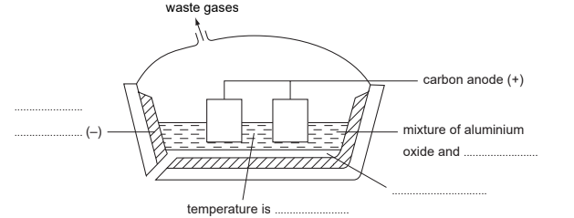

*Source: 2007 Ju31 Q6*

**Q16** [4 marks]

#### Separate: Chemistry and Extended Only

The ions that are involved in the electrolysis are Al3+ and O2-.

i) Write an equation for the reaction at the cathode.

[2]

ii) Explain how carbon dioxide is formed at the anode.

[2]

*Source: 2007 Ju31 Q6*

**Q16** [4 marks]

Give an explanation for each of the following.

i) Aluminium is used extensively in the manufacture of aircraft.

[1]

ii) Aluminium is used to make food containers.

[2]

iii) Aluminium electricity cables have a steel core.

[1]

*Source: 2007 Ju31 Q6*

### Q17 — medium — 19 marks

**Q17** [2 marks]

#### Separate: Chemistry and Extended Only

Aluminium is obtained by the reduction of aluminium ions to aluminium atoms.

Write an ionic equation for the reduction of an aluminium ion to an aluminium atom.

*Source: 2014 O32 Q2A*

**Q17** [4 marks]

#### Separate: Chemistry and Extended Only

The original method of extracting aluminium involved the reduction of aluminium chloride using the reactive metal sodium. Aluminium obtained by this method was very expensive due to the high cost of extracting sodium from sodium chloride.

i) Complete the equation for this reduction.

AlCl3 + .......Na → ........... + ...........

[2]

ii) How can sodium metal be obtained from sodium chloride?

[2]

*Source: 2014 O32 Q2B*

**Q17** [10 marks]

#### Separate: Chemistry and Extended Only

In the modern method, aluminium is obtained by the electrolysis of aluminium oxide (alumina) dissolved in molten cryolite, Na3AlF6.

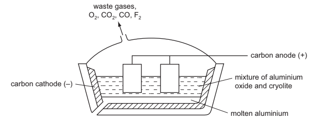

i) The major ore of aluminium is impure aluminium oxide. What is the name of this ore?

[2]

ii) This ore is a mixture of aluminium oxide, which is amphoteric, and iron(III) oxide which is basic.

Explain how these two oxides can be separated by the addition of aqueous sodium hydroxide.

[2]

iii) Give two reasons why the electrolyte contains cryolite.

[2]

iv) The mixture of gases evolved at the positive electrode includes:

carbon dioxide 
carbon monoxide 
fluorine 
oxygen

Explain the presence of these gases in the gaseous mixture formed at the positive electrode. Include at least one equation in your explanation.

[4]

*Source: 2014 O32 Q2C*

**Q17** [3 marks]

#### Extended Only

A major use of aluminium is the manufacture of pots and pans. One reason for this is its resistance to corrosion.

i) xplain why aluminium, a reactive metal, is resistant to corrosion.

[1]

ii) Suggest two other reasons why aluminium is suitable for making pots and pans.

[2]

*Source: 2014 O32 Q2D*

### Q18 — easy — 7 marks

**Q18** [1 mark]

This question is about iron and iron compounds.

Name the main ore of iron.

**Q18** [2 marks]

In a blast furnace used for the extraction of iron, carbon reacts with oxygen from the air to form carbon monoxide.

Complete the chemical equation for this reaction.

.....C + ..... → 2CO

**Q18** [1 mark]

In the hotter parts of the furnace, carbon reacts with the iron(III) oxide present in the iron ore.

3C + Fe2O3 → 3CO + 2Fe

How does this equation show that carbon is oxidised?

**Q18** [1 mark]

Limestone is added to the blast furnace. The limestone is converted into calcium oxide and carbon dioxide. The reaction is endothermic.

CaCO3 $\overset{\mathrm{heat}}{\rightarrow}$ CaO + CO2

What type of chemical reaction is this?

**Q18** [2 marks]

What type of oxide is calcium oxide?

Give a reason for your answer.

### Q19 — easy — 4 marks

**Q19** [1 mark]

This question is about iron and iron compounds.

Iron can be extracted from iron ore by reduction with carbon in a blast furnace.

Which one of these substances is an ore of iron?

Draw a circle around the correct answer.

** **

**bauxite         graphite         hematite          limestone**

**Q19** [1 mark]

The equation shows one of the reactions occurring in the blast furnace.

2Fe2O3 + 3C → 4Fe + 3CO2

How does this equation show that Fe2O3 is reduced?

**Q19** [1 mark]

The carbon dioxide formed can be reduced by carbon.

CO2 + C $\rightarrow$2CO

The energy level diagram for this reaction is shown.

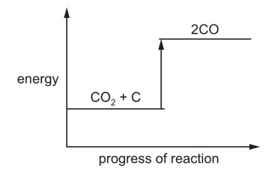

Explain how this diagram shows that the reaction is endothermic.

**Q19** [1 mark]

Explain why iron is extracted by reduction with carbon and not by electrolysis.

Refer to the position of iron in the reactivity series in your answer.

### Q20 — medium — 10 marks

**Q20** [5 marks]

#### Separate: Chemistry and Extended Only

Aluminium is an important metal with a wide range of uses.

Aluminium is obtained by the electrolysis of aluminium oxide dissolved in molten cryolite.

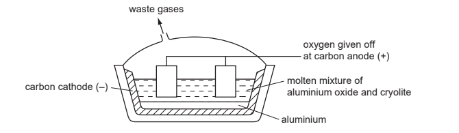

i) Solid aluminium oxide is a poor conductor of electricity. It conducts either when molten or when dissolved in molten cryolite. Explain why.

[2]

ii) Why is a solution of aluminium oxide in molten cryolite used rather than molten aluminium oxide?

[1]

iii) Explain why the carbon anodes need to be replaced periodically.

[1]

iv) One reason why graphite is used for the electrodes is that it is a good conductor of electricity. Give another reason.

[1]

*Source: 2013 Ju32 Q6*

**Q20** [2 marks]

Aluminium is used to make food containers because it resists corrosion. 
Explain why it is not attacked by the acids in food.

*Source: 2013 Ju32 Q4*

**Q20** [3 marks]

Aluminium is used for overhead power (electricity) cables which usually have a steel core.

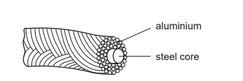

i) Give two properties of aluminium which make it suitable for this use.

[2]

ii) Explain why the cables have a steel core.

[1]

*Source: 2013 Ju32 Q4*

### Q21 — hard — 15 marks

**Q21** [5 marks]

Zinc is extracted from an ore called zinc blende, which consists mainly of zinc sulfide, ZnS. The zinc sulfide in the ore is first converted into zinc oxide.

Zinc oxide is converted into zinc. Zinc oxide and coke are fed into a furnace. Hot air is blown into the bottom of the furnace. The process is similar to the extraction of iron from iron oxide in a blast furnace.

Zinc has a melting point of 420 °C and a boiling point of 907 °C. The temperature inside the furnace is over 1000 °C.

i) Explain how zinc oxide is converted into zinc. Your answer should include details of how the heat is produced and equations for all the reactions you describe.

[3]

ii) Explain why the zinc produced inside the furnace is a gas.

[1]

iii) State the name of the physical change for the conversion of gaseous zinc into molten zinc.

[1]

*Source: 2016 Ju42 Q6*

**Q21** [4 marks]

#### Extended Only

Rusting of steel can be prevented by coating the steel with a layer of zinc.

Explain, in terms of electron transfer, why steel does not rust even if the layer of zinc is scratched so that the steel is exposed to air and water.

*Source: 2016 Ju42 Q6*

**Q21** [6 marks]

#### Separate: Chemistry and Extended Only

When a sample of steel is added to dilute hydrochloric acid, an aqueous solution of iron(II) chloride, FeCl2, is formed.

When a sample of rust is added to dilute hydrochloric acid, an aqueous solution of iron(III) chloride, FeCl3, is formed.

i) Aqueous sodium hydroxide is added to the solutions of iron(II) chloride and iron(III) chloride.

Complete the table below, showing the observations you would expect to make.

|   | **iron(II) chloride solution** | ** iron(III) chloride solution** |
|---|---|---|
| **aqueous sodium hydroxide** |   |   |

[2]

Solutions of iron(II) chloride and iron(III) chloride were added to solutions of potassium iodide and acidified potassium manganate(VII). The results are shown in the table.

|   | **iron(II) chloride solution** | **iron(III) chloride solution** |
|---|---|---|
| **potassium iodide solution** | no change | solution turns from colourless to brown |
| **acidified potassium manganate(VII) solution** | solution turns from purple to colourless | no change |

ii) What types of substance cause potassium iodide solution to turn from colourless to brown?

[1]

iii) What types of substance cause acidified potassium manganate(VII) solution to turn from purple to colourless?

[1]

iv) Which ion in iron(III) chloride solution causes potassium iodide solution to turn from colourless to brown?

[1]

v) Which ion in iron(II) chloride solution causes acidified potassium manganate(VII) solution to turn from purple to colourless?

[1]

*Source: 2016 Ju42 Q6*

### Q22 — medium — 2 marks

**Q22** [1 mark]

A list of symbols and formulae is shown.

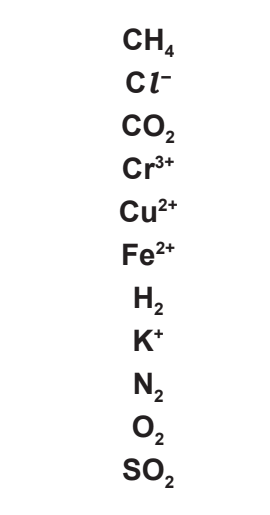

Which symbol or formula represents a compound produced by the thermal decomposition of calcium carbonate?

**Q22** [1 mark]

The diagram shows part of the structures of caesium chloride and carbon dioxide.

Explain why caesium is not extracted from caesium oxide by heating with carbon.

### Q23 — medium — 12 marks

**Q23** [5 marks]

Iron from the Blast Furnace is impure. It contains about 5% of impurities, mainly carbon, sulfur, silicon and phosphorus, which have to be removed when this iron is converted into steel.

Explain how the addition of oxygen and calcium oxide removes these impurities. Include an equation for a reaction of oxygen and a word equation for a reaction of calcium oxide in this process.

*Source: 2015 Ju31 Q5A*

**Q23** [7 marks]

Mild steel is the most common form of steel. Mild steel contains a maximum of 0.3% of carbon.

High carbon steel contains 2% of carbon. It is less malleable and much harder than mild steel.

i) Give a use of mild steel.

[1]

ii) Suggest a use of high carbon steel.

[1]

iii) Explain why metals are malleable.

[3]

iv) Suggest an explanation why high carbon steel is less malleable and harder than mild steel.

[2]

*Source: 2015 Ju31 Q2B*

### Q24 — easy — 6 marks

**Q24** [1 mark]

Aluminium is extracted by electrolysis. Iron is extracted from its ore by reduction with carbon.

Name the main ore of aluminium.

**Q24** [1 mark]

**Extract:**

Aluminium is extracted by electrolysis. Iron is extracted from its ore by reduction with carbon.

Explain why aluminium cannot be extracted by reduction with carbon.

**Q24** [1 mark]

#### Separate: Chemistry and Extended Only

Describe why cryolite is used in the extraction of aluminium by electrolysis.

**Q24** [1 mark]

**Extract:**

Aluminium is extracted by electrolysis. Iron is extracted from its ore by reduction with carbon.
Name the main ore of aluminium. (The main ore of aluminium is bauxite; the main constituent of bauxite is aluminium oxide.)

#### Separate: Chemistry and Extended Only

Name the product formed at the positive electrode.

**Q24** [1 mark]

**Extract:**

Aluminium is extracted by electrolysis. Iron is extracted from its ore by reduction with carbon.

#### Separate: Chemistry and Extended Only

Write the ionic half-equation for the reaction at the negative electrode.

**Q24** [1 mark]

Iron is a transition element.

Iron forms hydrated iron(III) oxide when it rusts.

Write a word equation to represent the formation of rust.

### Q25 — medium — 10 marks

**Q25** [2 marks]

Iron is extracted from its ore, hematite, in a blast furnace.

Substances added to the furnace are:

- Iron ore, hematite, containing impurities such as silica, SiO2
- Air
- Coke, C
- Limestone, CaCO3

Substances formed in the blast furnace are:

- Molten iron
- Molten slag
- Waste gases such as carbon dioxide

State the** two** functions of the coke used in the blast furnace.

*Source: 2015 O32 Q5A*

**Q25** [2 marks]

**Extract:**

Iron is extracted from its ore, hematite, in a blast furnace. Substances added to the furnace are: Iron ore, hematite, containing impurities such as silica, SiO2; Air; Coke, C; Limestone, CaCO3. Substances formed in the blast furnace are: Molten iron; Molten slag; Waste gases such as carbon dioxide.

Write an equation for the conversion of hematite, Fe2O3, to iron.

*Source: 2015 O32 Q5B*

**Q25** [3 marks]

**Extract:**

Iron is extracted from its ore, hematite, in a blast furnace. Substances added to the furnace are:
- Iron ore, hematite, containing impurities such as silica, SiO~2~
- Air
- Coke, C
- Limestone, CaCO~3~
Substances formed in the blast furnace are:
- Molten iron
- Molten slag
- Waste gases such as carbon dioxide

Explain how the silica impurity is removed and separated from the molten iron.

*Source: 2015 O32 Q5C*

**Q25** [3 marks]

**Extract:**

Iron is extracted from its ore, hematite, in a blast furnace. Substances added to the furnace are: Iron ore, hematite, containing impurities such as silica, SiO~2~; Air; Coke, C; Limestone, CaCO~3~. Substances formed in the blast furnace are: Molten iron; Molten slag; Waste gases such as carbon dioxide.

The molten iron from the furnace is impure. It contains impurities which include the element carbon. Explain how the carbon is removed. Include an equation in your answer.

*Source: 2015 O32 Q5D*

