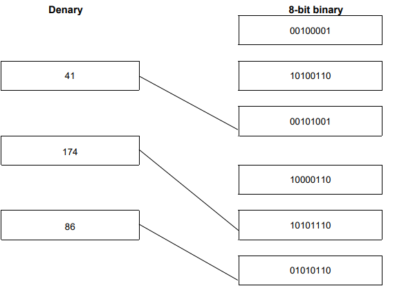

# Mark Schemes — Number Systems
**1. Data Representation** · Cambridge (CIE) IGCSE computer-science (0478 & 0984)

## Exam Questions (17 questions)

### Q1
The result of a logical left shift of three places on the binary number would be:

- `0001 1000` **[1 mark]**
**Final answer:** **The correct answer is D**

- D is correct as each left shirt doubles (x2) the original number, so 2 places would multiply the number by 4 (x4) **[1 mark]**
- A is incorrect as dividing the number by 2 is the result of logical right shift of one place
- B is incorrect as multiplying the number by 2 is the result of a logical left shift of one place
- C is incorrect as dividing the number by 4 is the result of a logical right shift of two places
- The correct answer is **-93** **[1 mark]**
- Any valid example of working **[1 mark]**

**e.g.**

- `10100011` → `01011100 (invert the bits)`
- `01011100 (add 1)`
`+ 1`
`= 01011101`

- `(0 × 128) + (1 × 64) + (0 × 32) + (1 × 16) + (1 × 8) + (1 × 4) + (0 × 2) + (1 × 1)`
`= 0 + 64 + 0 + 16 + 8 + 4 + 0 + 1`
`= 93 (convert to denary)`

- `-93 (apply the negative)`

> **[exam-tip]**
> A leading 1 means the number is negative — never sum all the place values as if it were unsigned binary.
> 
> Always show your full working, as marks are awarded for the method as well as the final answer.

### Q2
The denary numbers converted to hexadecimal are:

- 14 **[1 mark]**
- 20 **[1 mark]**
- A5 **[1 mark]**

### Q3
**Final answer:** **The correct answer is C**

- C is correct as hexadecimal is base 16 number system, denary is an example of base 10 number system **[1 mark]**
- A, B & D are all incorrect as they are characteristics associated with hexadecimal

### Q4
The 8-bit binary register for the denary number -78 is:

- 10110010 **[1 mark]**
- Full method of working e.g. conversion to binary then flipping and adding 1 **[1 mark]**

### Q5
The 8-bit binary values for each pair of hexadecimal digits is:

**2F**

- 0010**[1 mark] **1111 **[1 mark]**

**15**

- 0001 **[1 mark] **0101 **[1 mark]**

**D6**

- 1101 **[1 mark] **0110 **[1 mark]**

### Q6
The overflow error occurred due to:

- The result of the calculation is larger than can be stored in the register / memory location *accept: the result is greater than 255 / larger than 8 bits can hold, where a register size is assumed* **[1 mark]**
- A register has a predetermined/fixed number of bits and the result requires more bits than are available *accept: an extra/carry bit is generated that cannot be stored* **[1 mark]**

**[Total: 2 marks]**

> **[exam-tip]**
> For 2 marks make two distinct points, not one idea reworded
> 
> Overflow is about a fixed-size register, not data loss during transmission

### Q7
The binary register for the denary value -54 is:

- 11001010 **[1 mark]**
- Any valid working **[1 mark]**

> **[mark-scheme]**
> - Valid working could include conversion to binary then flipping and adding 1.

### Q8
The name of the error generated is:

- Overflow **[1 mark]**

It is caused due to:

- The value is **larger **than 255 (accept: exceeds the maximum value / exceeds the range of an 8-bit register) **[1 mark]**
- So all the bits required to represent the value **cannot fit** in the 8-bit register (accept: more bits are needed than the 8-bit register has / the result requires more than 8 bits) **[1 mark]**

> **[exam-tip]**
> The largest value an 8-bit register can store is 255, not 256
> 
> Quantify the limit rather than saying the result simply 'won't be displayed'

### Q9
**Final answer:** **The correct answer is B**

- **B** is correct as binary is a base 2 number system (1s/0s) **[1 mark]**
- **A, C & D **are incorrect as they are examples of other number systems such as denary (base 10) & hexadecimal (base 16)
The denary numbers converted to 8-bit binary numbers are:

**50 **

- 00110010 **[1 mark]**

**102**

- 01100110 **[1 mark]**

**221**

- 11011101 **[1 mark]**
Adding the two 8-bit binary numbers gives an answer of:

- 1001 **[1 mark] **0100 **[1 mark]**

*Working ***[1 mark]**

`_ _ charalign center stackalign right end 00110011 | + 01100001 end | horizontal line 10010100 | 11 none none none 11 none end | end end _`

> **[mark-scheme]**
> - One mark per each correct nibble
> - One mark for correct working in binary (showing 4 correct carries)

### Q10
Examples of where hexadecimal can be used in Computer Science include:

Any **two **of the following:

- IP address **[1 mark]**
- Error messages/codes **[1 mark]**
- Assembly language **OR** low-level language **[1 mark]**
- URL **OR** web address **[1 mark]**
- Memory dumps **[1 mark]**
- Locations in memory **[1 mark]**

### Q11

> **[mark-scheme]**
> - **One **mark for each correct line
The 12-bit binary value converted to denary is:

- 343 **[1 mark]**
- Any valid correct working **[1 mark]**

> **[mark-scheme]**
> Working e.g.
> 
> - $256+64+16+4+2+1$

### Q12
A computer can only process binary data as:

- Computers consist of **transistors **/ **logic circuits**/**gates ****[1 mark]**
- … that can only store/process data **in two states** / high-low / on-off / 1 and 0 **[1 mark]**

> **[exam-tip]**
> Both marks are linked: name the hardware (transistors/logic gates) AND explain it has only two states
> 
> Describe the two states precisely as on/off, high/low or 1 and 0 — not '1 state' or values other than 0 and 1
The 8-bit binary value for each denary value is:

- 64 = 01000000 **[1 mark]**
- 101 = 01100101 **[1 mark]**
- 242 = 11110010 **[1 mark]**
The binary value for each hexadecimal value is:

**42**

- 0100 **[1 mark] **0010 **[1 mark]**

**CE**

- 1100 **[1 mark] **1110 **[1 mark]**

### Q13
**Final answer:** **The correct answer is B**

- **B** is correct as 00110010 = 32+16+2 = 50 **[1 mark]**
- **A **is incorrect as 00101010 = 32+8+2 = 42
- **C **is incorrect as 01001100 = 64+8+4 = 76
- **D **is incorrect as 01010000 = 64+16 = 80
**Final answer:** **The correct answer is C**

- **C** is correct as 1001 = 8+1 = 9 and 0000 = 0 (90) **[1 mark]**
- **A **is incorrect as 0000 = 0 and 1001 = 8+1 = 9 (09)
- **B **is incorrect as 0101 = 4+1 = 5 and 1010 = 8+2 = 10 (5A)
- **D **is incorrect as 0110 = 4+2 = 6 and 0100 = 4 (64)
A computer system can only process data in binary form as:

- Data is processed in a computer by** using logic gates** **[1 mark]**
- That only have** two states** (**0 or 1**) **[1 mark]**
Adding the two 8-bit binary values gives an answer of:

- **10000011**
- *1 mark per nibble (1000 ***[1 mark] ***& 0011 ***[1 mark]***)*
- *1 mark for correct working in binary (showing carries) ***[1 mark]**

***Working***

$0^{1}0^{1}1^{1}1^{1}1001\,+01001010\,\overline{10000011}$

### Q14
The completed table showing 12-bit binary and denary values is:

| **Hexadecimal ** **ticket number** | **12-bit binary value** | **Denary value** |
|---|---|---|
| 028 | ***0000 0010 1000 *****[1 mark]***** *** | ***40 *****[1 mark]** |
| 1A9 | ***0001 1010 1001 *****[1 mark]** | ***425 *****[1 mark]** |
| 20C | ***0010 0000 1100 *****[1 mark]** | ***524 *****[1 mark]** |

### Q15
The binary registers for the two pairs of digits are:

**97 - **10010111

- 1001 **[1 mark]**
- 0111 **[1 mark]**

**5C - **01011100

- 0101 **[1 mark] **
- 1100** [1 mark]**

> **[mark-scheme]**
> - **One **mark per each correct nibble (4-bits)
Examples of the use of hexadecimal in Computer Science include:

Any** two **from the following:

- colour codes **OR** colour in HTML/CSS **[1 mark]**
- error messages **[1 mark]**
- locations in memory **[1 mark]**
- memory dump // debugging **[1 mark]**
- IP(v6) address **[1 mark]**
- ASCII **OR** Unicode **[1 mark]**
- assembly language **[1 mark]**
- URL **[1 mark]**
The binary register after performing a logical left shift of two places is:

- 01001000 **[1 mark]**
The effect of this logical shift is:

- The value becomes incorrect because the left most bits are lost** [1 mark]**

> **[exam-tip]**
> The question asks for the effect on the value, so describe what happens to the value, not the process of moving digits
> 
> Be precise: vague answers like 'less accurate' or 'it divides the value' will not earn the mark
