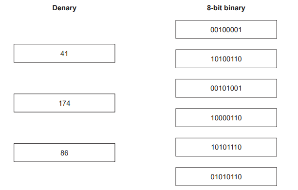

# Exam Questions — Number Systems
**1. Data Representation** · Cambridge (CIE) IGCSE computer-science (0478 & 0984)
> Source: [https://www.savemyexams.com/igcse/computer-science/cie/23/topic-questions/](https://www.savemyexams.com/igcse/computer-science/cie/23/topic-questions/) · 15 questions across 1 sets

## Exam Questions (17 questions)

### Q1 — easy — 4 marks

**Q1** [1 mark]

The binary number `10100011` is stored in random access memory (RAM).

A logical left shift of three places is performed on the binary number.

**Give **the 8-bit binary number that will be stored after the shift has taken place.

*Source: June 2024 0478/11 Q3A*

**Q1** [1 mark]

**Tick (✓) one **box to show which statement about a logical left shift of **two **places is correct.

*Source: June 2024 0478/11 Q3B*

**Q1** [2 marks]

**Extract:**

- Accept the direct weighted place-value method as valid working, e.g. -128+32+2+1 = -93 (MSB has weight -128).
- Award the working mark for any correct method that arrives at -93, not only invert-and-add-one.

`10100011` can be stored as a two’s complement integer.

**Convert **the two’s complement integer `10100011` to denary.

Show **all **your working.

*Source: June 2024 0478/11 Q3C*

### Q2 — medium — 3 marks

**Q2** [3 marks]

Denary numbers can be converted to hexadecimal.

Convert the **three **denary numbers to hexadecimal

- **20**
- **32**
- **165**

*Source: June 2024 0478/11 Q2B*

### Q3 — easy — 1 marks

**Q3** [1 mark]

Hypertext markup language (HTML) colour codes can be represented as hexadecimal.

**Tick (✓)** **one **box to show which statement about the hexadecimal number system is incorrect

*Source: June 2024 0478/11 Q2A*

### Q4 — medium — 2 marks

**Q4** [2 marks]

Binary numbers are stored in registers.

Negative denary numbers can be represented as binary using two’s complement.

**Complete the binary register** for the **denary **number **–78**

You **must** show all your **working**.

*Source: June 2023 0478/11 Q1C*

### Q5 — medium — 6 marks

**Q5** [6 marks]

Hexadecimal is used for Hypertext Markup Language (HTML) colour codes.

An HTML colour code is:

#2F15D6

Each pair of digits is stored as binary in an 8‑bit register.

**Give the 8‑bit binary value** that would be stored for each pair of hexadecimal digits.

- **2F**
- **15**
- **D6**

*Source: June 2022 0478/12 Q2A*

### Q6 — medium — 2 marks

**Q6** [2 marks]

Two binary numbers are added by a computer and an overflow error occurs.

**Explain **why the overflow error occurred.

*Source: Specimen 2023 0478/11 Q1E*

### Q7 — medium — 2 marks

**Q7** [2 marks]

Negative **denary** numbers can also be represented as binary using **two’s complement**.

**Complete the binary register** for the denary value **−54**.

You must show all your **working**.

| **Register:** |   |   |   |   |   |   |   |   |
|---|---|---|---|---|---|---|---|---|

*Source: Specimen 2023 1A Q1E*

### Q8 — medium — 3 marks

**Q8** [3 marks]

**Extract:**

- Accept "256" for the maximum value on the second point (larger than 255).
- Do not accept "the number won't be displayed" alone for the third point.

Binary is a number system used by computers.

Two 8-bit binary values are added.

The result of this calculation needs to be stored in an 8-bit register.

The denary result of this calculation is 301.

**This generates an error**

**State **the name of this type of error and **explain **why this error occurs.

*Source: Specimen 2023 1B Q1D*

### Q9 — easy — 7 marks

**Q9** [1 mark]

Binary is a number system used by computers.

**Tick (✓) one box** to show which statement about the binary number system is correct.

*Source: June 2023 0478/11 Q1A*

**Q9** [3 marks]

Denary numbers are converted to binary numbers to be processed by a computer.

**Convert **these three **denary numbers** to **8‑bit binary numbers**.

50 ...............................

102 ..............................

221 ...............................

*Source: June 2023 0478/11 Q1B*

**Q9** [3 marks]

Two 8‑bit binary numbers are given.

**Add **the two 8‑bit binary numbers using binary addition.

Give your **answer in binary**. Show all your **working**.

`Error converting from MathML to accessible text.`

*Source: June 2023 0478/11 Q1D*

### Q10 — easy — 2 marks

**Q10** [2 marks]

Hexadecimal is used for Hypertext Markup Language (HTML) colour codes.

An HTML colour code is:

#2F15D6

HTML colour codes and Media Access Control (MAC) addresses are two examples of where hexadecimal is used in Computer Science.

**Give two other examples** of where hexadecimal can be used in Computer Science.

*Source: June 2022 0478/12 Q2B*

### Q11 — easy — 5 marks

**Q11** [3 marks]

Denary values are converted to binary values to be processed by a computer.

**Draw one line** from each denary value to the correctly converted 8‑bit binary value.

*Source: June 2022 0478/12 Q1A*

**Q11** [2 marks]

Binary values can also be converted to denary values.

**Give **the correct denary value for the 12‑bit binary value 000101010111 

**Show **all your working.

*Source: June 2022 0478/12 Q1B*

### Q12 — easy — 9 marks

**Q12** [2 marks]

All data needs to be converted to binary data so that it can be processed by a computer.

**Explain **why a computer can only process binary data.

*Source: June 2022 0478/11 Q4A*

**Q12** [3 marks]

The denary values 64, 101 and 242 are converted to 8‑bit binary values.

**Give the 8‑bit binary value** for each denary value.

64 ................................

101 ................................

242 ................................

*Source: June 2022 0478/11 Q4B*

**Q12** [4 marks]

The hexadecimal values 42 and CE are converted to binary. 

**Give the binary value** for each hexadecimal value.

42 .................

CE ..................

*Source: June 2022 0478/11 Q4C*

### Q13 — easy — 7 marks

**Q13** [1 mark]

Binary is a number system used by computers.

Four 8-bit binary values are given.

**Tick (✓) one box** to show which 8-bit binary value is the correct conversion for the **denary value** 50.

*Source: Specimen 2023 0478/01 Q1A(I)*

**Q13** [1 mark]

Four 8-bit binary values are given.

**Tick (✓) one box **to show which 8-bit binary value is the correct conversion for the **hexadecimal value** 90.

*Source: Specimen 2023 0478/01 Q1A(II)*

**Q13** [2 marks]

**Explain **why a computer system can only process data in binary form

*Source: Specimen 2023 0478/01 Q1B*

**Q13** [3 marks]

Two 8-bit binary values are given.

**Add **the two 8-bit binary values.

Give your answer** in binary**. Show all your **working**.

$00111001\,+01001010\,\overline{}$

*Source: Specimen 2023 0478/01 Q1C*

### Q14 — hard — 6 marks

**Q14** [6 marks]

Ron is attending a music concert. He has bought three tickets.

Each ticket number is displayed as a hexadecimal number.

**Complete the table** to show the **12-bit binary** values and the **denary **values for each Hexadecimal ticket number

| **Hexadecimal ** **ticket number** | **12-bit binary value** | **Denary value** |
|---|---|---|
| 028 |   |   |
| 1A9 |   |   |
| 20C |   |   |

*Source: Nov 2020 0478/11  Q2A*

### Q15 — easy — 8 marks

**Q15** [4 marks]

A school network has several computers.

Each computer in the network has a media access control (MAC) address.

Hexadecimal is used for MAC addresses.

Part of a MAC address is given.

**97–5C–E1**

Each pair of digits is stored as binary in an 8-bit register.

**Complete the binary register** for these two pairs of digits.

| **97** |   |   |   |   |   |   |   |   |
|---|---|---|---|---|---|---|---|---|

| **5C** |   |   |   |   |   |   |   |   |
|---|---|---|---|---|---|---|---|---|

*Source: Specimen 2023 Paper 1 Q1A*

**Q15** [2 marks]

**Give two **other uses of hexadecimal in Computer Science.

*Source: Specimen  2023 Paper 1 Q1C*

**Q15** [1 mark]

Another value is stored as binary in a register.

| 0 | 1 | 0 | 1 | 0 | 0 | 1 | 0 |
|---|---|---|---|---|---|---|---|

A **logical left shift **of** two places** is performed on the binary value.

**Complete **the binary register** **to show its contents after this logical left shift.

*Source: Specimen 2023 Paper 1 Q1D(I)*

**Q15** [1 mark]

**Extract:**

A logical left shift of two places is performed on the binary value.

The binary register after performing a logical left shift of two places is:

- 01001000 [1 mark]

**State one** effect this logical shift has on the binary value.

*Source: Specimen 2023 Paper 1 Q1D(II)*

