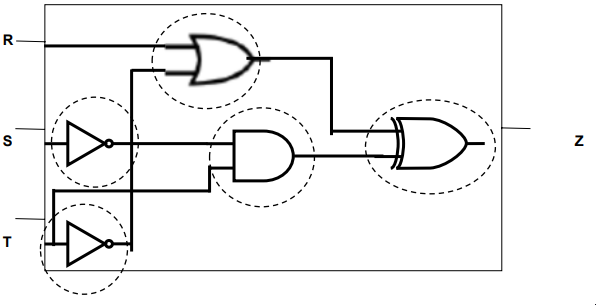
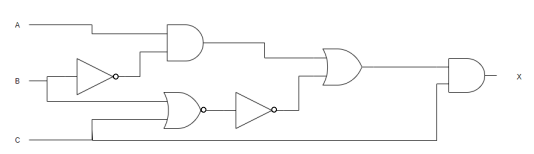
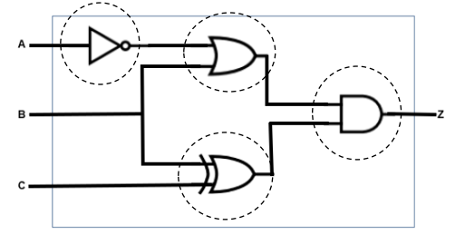
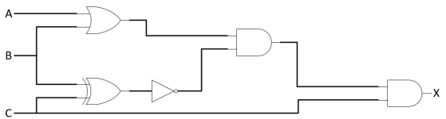
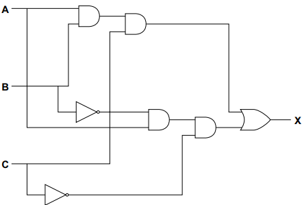
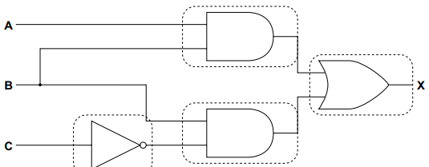
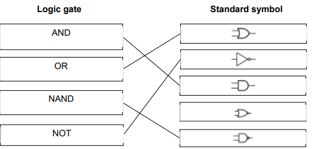

# Mark Schemes — Boolean Logic
**10. Boolean Logic** · Cambridge (CIE) IGCSE computer-science (0478 & 0984)

## Exam Questions (11 questions)

### Q1

- **Each **correct gate, with the correct input(s) as shown **[1 mark]**
| `R` | `S` | `T` | `Z` |
|---|---|---|---|
| `0` | `0` | `0` | `1` |
| `0` | `0` | `1` | `1` |
| `0` | `1` | `0` | `1` |
| `0` | `1` | `1` | `0` |
| `1` | `0` | `0` | `1` |
| `1` | `0` | `1` | `0` |
| `1` | `1` | `0` | `1` |
| `1` | `1` | `1` | `1` |

- Eight correct outputs **[4 marks]**
- Six or seven correct outputs **[3 marks]**
- Four or five correct outputs **[2 marks]**
- Two or three correct outputs **[1 marks]**

### Q2
The Boolean expression for the logic diagram can be expressed as:

- `P = (A AND B) OR (NOT C)` **OR  **`P = (A ^ B) V (¬C)`
- `(A AND B)` **[1 mark]**
- `(NOT C)` **[1 mark]**
- `(A AND B) OR (NOT C)` **[1 mark]**

> **[exam-tip]**
> Use parentheses to group each gate's output so the operator precedence is unambiguous
> 
> Match each gate exactly — an OR gate is an inclusive OR, not XOR

### Q3
The completed logic circuit is:

- Each correct logic gate with correct input(s) **[1 mark]**
The completed truth table is:

| **A** | **B** | **C** | **X** |
|---|---|---|---|
| 0 | 0 | 0 | **0** |
| 0 | 0 | 1 | **1** |
| 0 | 1 | 0 | **0** |
| 0 | 1 | 1 | **1** |
| 1 | 0 | 0 | **0** |
| 1 | 0 | 1 | **1** |
| 1 | 1 | 0 | **0** |
| 1 | 1 | 1 | **1** |

- 8 correct outputs **[4 marks]**
- 6/7 correct outputs **[3 marks]**
- 4/5 correct outputs **[2 marks]**
- 2/3 correct outputs **[1 mark]**

### Q4
The completed truth table is:

| **A** | **B** | **C** | **X** |
|---|---|---|---|
| 0 | 0 | 0 | **0** |
| 0 | 0 | 1 | **0** |
| 0 | 1 | 0 | **0** |
| 0 | 1 | 1 | **0** |
| 1 | 0 | 0 | **0** |
| 1 | 0 | 1 | **1** |
| 1 | 1 | 0 | **0** |
| 1 | 1 | 1 | **0** |

- 8 correct outputs **[4 marks]**
- 6/7 correct outputs **[3 marks]**
- 4/5 correct outputs **[2 marks]**
- 2/3 correct outputs **[1 mark]**

### Q5
The completed logic circuit is:

- Each correct gate, with the correct input(s) as shown **[1 mark]**
The completed truth table is:

| **A** | **B** | **C** | **X** |
|---|---|---|---|
| 0 | 0 | 0 | 0 |
| 0 | 0 | 1 | 1 |
| 0 | 1 | 0 | 1 |
| 0 | 1 | 1 | 0 |
| 1 | 0 | 0 | 0 |
| 1 | 0 | 1 | 0 |
| 1 | 1 | 0 | 1 |
| 1 | 1 | 1 | 0 |

- Eight correct outputs **[4 marks]**
- Six or seven correct outputs **[3 marks]**
- Four or five correct outputs **[2 marks]**
- Two or three correct outputs **[1 mark]**

### Q6
The completed logic circuit is:

- Each correct logic gate with correct input(s) **[1 mark]**
The completed truth table is:

| **A** | **B** | **C** | **X** |
|---|---|---|---|
| 0 | 0 | 0 | **0** |
| 0 | 0 | 1 | **0** |
| 0 | 1 | 0 | **0** |
| 0 | 1 | 1 | **1** |
| 1 | 0 | 0 | **0** |
| 1 | 0 | 1 | **0** |
| 1 | 1 | 0 | **0** |
| 1 | 1 | 1 | **1** |

- 8 correct outputs **[4 marks]**
- 6/7 correct outputs **[3 marks]**
- 4/5 correct outputs **[2 marks]**
- 2/3 correct outputs **[1 mark]**

### Q7
The completed logic circuit would be:

- Each correct** NOT gate** and **OR gate** with correct direction of input(s) **[4 marks]**
- Four correct** AND** gates **[3 marks]** 
or
- Three correct **AND **gates **[2 marks]** 
or
- Two correct **AND **gates with correct direction of inputs **[1 mark]**
The logic expression would be:

- `X = ((A AND NOT B AND NOT C) OR (A AND B AND C)) `
- `(A AND NOT B AND NOT C) `**[1 mark]**
- `OR `**[1 mark]**
- `(A AND B AND C)` **[1 mark]**

### Q8
The completed logic circuit would be:

- each correct gate, with the correct input(s) as shown** [1 mark]**
| **A** | **B** | **C** | **X** |
|---|---|---|---|
| 0 | 0 | 0 | **0** |
| 0 | 0 | 1 | **0** |
| 0 | 1 | 0 | **1** |
| 0 | 1 | 1 | **0** |
| 1 | 0 | 0 | **0** |
| 1 | 0 | 1 | **0** |
| 1 | 1 | 0 | 1 |
| 1 | 1 | 1 | **1** |

- Eight correct outputs **[4 marks]**
- Six or seven correct outputs **[3 marks]**
- Four or five correct outputs **[2 marks]**
- Two or three correct outputs **[1 mark]**

### Q9

### Q10
| **A** | **B** | **P** |
|---|---|---|
| 0 | 0 | 1 |
| 0 | 1 | **1 ****[1 mark]** |
| 1 | 0 | **1 ****[1 mark]** |
| 1 | 1 | 0 |
| **A** | **B** | **Q** |
|---|---|---|
| 0 | 0 | 0 |
| 0 | 1 | 1 |
| **1 ****[1 mark]** | 0 | **1 ****[1 mark]** |
| 1 | **1 ****[1 mark]** | **1 ****[1 mark]** |

**Final answer:** **[Total: 4 marks]**
