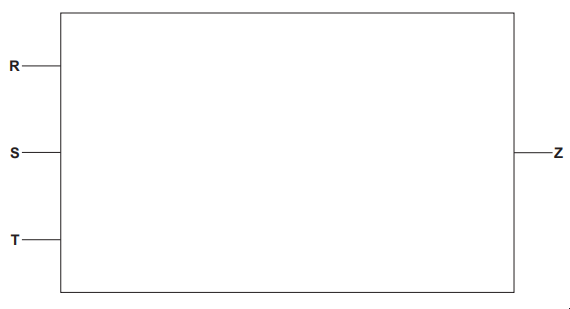
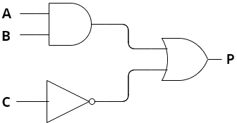
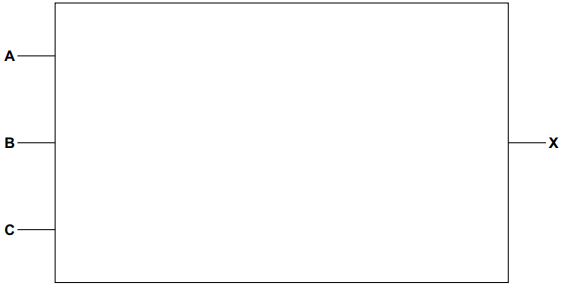
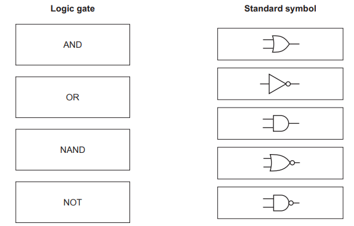
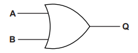

# Exam Questions — Boolean Logic
**10. Boolean Logic** · Cambridge (CIE) IGCSE computer-science (0478 & 0984)
> Source: [https://www.savemyexams.com/igcse/computer-science/cie/23/topic-questions/](https://www.savemyexams.com/igcse/computer-science/cie/23/topic-questions/) · 10 questions across 1 sets

## Exam Questions (11 questions)

### Q1 — medium — 9 marks

**Q1** [5 marks]

Consider the logic expression:

**Z** = (**R** OR NOT **T**) XOR (NOT **S** AND** T**)

**Draw **a logic circuit for this logic expression.

Each logic gate must have a maximum of **two **inputs.

**Do not** simplify this logic expression.

*Source: June 2024 0478/21 Q8A*

**Q1** [4 marks]

**Extract:**

Z = (R OR NOT T) XOR (NOT S AND T)

**Complete** the truth table from the given logic expression.

| `R` | `S` | `T` | `Working space` | `Z` |
|---|---|---|---|---|
| `0` | `0` | `0` |   |   |
| `0` | `0` | `1` |   |   |
| `0` | `1` | `0` |   |   |
| `0` | `1` | `1` |   |   |
| `1` | `0` | `0` |   |   |
| `1` | `0` | `1` |   |   |
| `1` | `1` | `0` |   |   |
| `1` | `1` | `1` |   |   |

*Source: June 2024 0478/21 Q8B*

### Q2 — medium — 3 marks

**Q2** [3 marks]

**Extract:**

- Accept a correct expression without the "P =" label (e.g. "(A AND B) OR NOT C") for full marks.
- Accept symbol notation (^ for AND, V for OR, \u00acC or NOT C) interchangeably.

**Write **the **Boolean expression **represented by the logic diagram below:

### Q3 — hard — 10 marks

**Q3** [6 marks]

Consider the following logic statement:

**X** = (((**A** AND NOT** B**) OR (NOT (**B** NOR **C**))) AND **C**)

**Draw a logic circuit** to represent the given logic statement.

Do **not **attempt to simplify the logic statement. All logic gates must have a maximum of two inputs.

*Source: June 2022 0478/11 Q8A*

**Q3** [4 marks]

**Extract:**

X = (((A AND NOT B) OR (NOT (B NOR C))) AND C)

**Complete the truth table** for the given logic statement.

| **A** | **B** | **C** | **Working space** | **X** |
|---|---|---|---|---|
| 0 | 0 | 0 |   |   |
| 0 | 0 | 1 |   |   |
| 0 | 1 | 0 |   |   |
| 0 | 1 | 1 |   |   |
| 1 | 0 | 0 |   |   |
| 1 | 0 | 1 |   |   |
| 1 | 1 | 0 |   |   |
| 1 | 1 | 1 |   |   |

*Source: June 2022 0478/11 Q8B*

### Q4 — hard — 4 marks

**Q4** [4 marks]

Consider this logic expression.

**X** = (**A **OR **B**) AND (NOT **B** AND **C**)

**Complete the truth table** for this logic expression.

| **A** | **B** | **C** | **Working space** | **X** |
|---|---|---|---|---|
| 0 | 0 | 0 |   |   |
| 0 | 0 | 1 |   |   |
| 0 | 1 | 0 |   |   |
| 0 | 1 | 1 |   |   |
| 1 | 0 | 0 |   |   |
| 1 | 0 | 1 |   |   |
| 1 | 1 | 0 |   |   |
| 1 | 1 | 1 |   |   |

*Source: June 2022 0478/22 Q8*

### Q5 — hard — 8 marks

**Q5** [4 marks]

Consider this logic expression.

**Z** = (NOT **A** OR **B**) AND (**B** XOR **C**)

**Draw a logic circuit** for this logic expression.

Each logic gate must have a maximum of **two **inputs.

Do **not **simplify this logic expression.

*Source: June 2023 0478/21 Q9A*

**Q5** [4 marks]

**Extract:**

Z = (NOT A OR B) AND (B XOR C)

**Complete the truth table** from the given logic expression.

| **A** | **B** | **C** | **Working space** | **X** |
|---|---|---|---|---|
| 0 | 0 | 0 |   |   |
| 0 | 0 | 1 |   |   |
| 0 | 1 | 0 |   |   |
| 0 | 1 | 1 |   |   |
| 1 | 0 | 0 |   |   |
| 1 | 0 | 1 |   |   |
| 1 | 1 | 0 |   |   |
| 1 | 1 | 1 |   |   |

*Source: June 2023 0478/21 Q9B*

### Q6 — hard — 9 marks

**Q6** [5 marks]

Consider the following logic statement:

**X** = ((**A** OR **B**) AND (NOT (**B** XOR **C**)) AND **C**)

**Draw a logic circuit** to represent the given logic statement.

Do not attempt to simplify the logic statement. All logic gates must have a maximum of two inputs.

*Source: June 2022 0478/12 Q5A*

**Q6** [4 marks]

**Extract:**

X = ((A OR B) AND (NOT (B XOR C)) AND C)

**Complete the truth table** for the given logic statement.

| **A** | **B** | **C** | **Working space** | **X** |
|---|---|---|---|---|
| 0 | 0 | 0 |   |   |
| 0 | 0 | 1 |   |   |
| 0 | 1 | 0 |   |   |
| 0 | 1 | 1 |   |   |
| 1 | 0 | 0 |   |   |
| 1 | 0 | 1 |   |   |
| 1 | 1 | 0 |   |   |
| 1 | 1 | 1 |   |   |

*Source: June 2022 0478/12 Q5B*

### Q7 — hard — 9 marks

**Q7** [6 marks]

Consider the truth table:

| **A** | **B** | **C** | **X** |
|---|---|---|---|
| 0 | 0 | 0 | 0 |
| 0 | 0 | 1 | 0 |
| 0 | 1 | 0 | 0 |
| 0 | 1 | 1 | 0 |
| 1 | 0 | 0 | 1 |
| 1 | 0 | 1 | 0 |
| 1 | 1 | 0 | 0 |
| 1 | 1 | 1 | 1 |

**Draw a logic circuit** to represent the given truth table.

Each logic gate should have** maximum** of two inputs.

**Do not** simplify the logic circuit.

*Source: Specimen 2023 0478/02 2B Q7A*

**Q7** [3 marks]

**Extract:**

| **A** | **B** | **C** | **X** |
| --- | --- | --- | --- |
| 0 | 0 | 0 | 0 |
| 0 | 0 | 1 | 0 |
| 0 | 1 | 0 | 0 |
| 0 | 1 | 1 | 0 |
| 1 | 0 | 0 | 1 |
| 1 | 0 | 1 | 0 |
| 1 | 1 | 0 | 0 |
| 1 | 1 | 1 | 1 |

**Write a logic expression** for the given truth table.

Do **not **simplify the logic expression.

*Source: Specimen 2023 0478/02 2B Q7B*

### Q8 — medium — 8 marks

**Q8** [4 marks]

Consider this logic expression.

**X** = ( **A** AND **B** ) OR ( **B** AND NOT **C** )

**Draw a logic circuit** for this logic expression.

Each logic gate must have a maximum of **two **inputs.

Do **not **simplify this logic expression.

*Source: Specimen 2023 0478/02 2A Q6A*

**Q8** [4 marks]

**Extract:**

X = (A AND B) OR (B AND NOT C)

**Complete **the truth table from the given logic expression.

| **A** | **B** | **C** | **Working space** | **X** |
|---|---|---|---|---|
| 0 | 0 | 0 |   |   |
| 0 | 0 | 1 |   |   |
| 0 | 1 | 0 |   |   |
| 0 | 1 | 1 |   |   |
| 1 | 0 | 0 |   |   |
| 1 | 0 | 1 |   |   |
| 1 | 1 | 0 |   |   |
| 1 | 1 | 1 |   |   |

*Source: Specimen 2023 0478/02 2A Q6B*

### Q9 — easy — 4 marks

**Q9** [4 marks]

**Four **logic gates and **five **standard symbols for logic gates are shown

**Draw one line** to link each logic gate to its standard symbol. Not all standard symbols will be used.

*Source: June 2023 0478/22 Q2*

### Q10 — easy — 6 marks

**Q10** [2 marks]

**Complete **the truth table in** Fig. 1 **for the Boolean statement` P = NOT(A AND B)`.

| **A** | **B** | **P** |
|---|---|---|
| 0 | 0 | 1 |
| 0 | 1 |   |
| 1 | 0 |   |
| 1 | 1 | 0 |

**Fig. 1**

**Q10** [4 marks]

**Complete **the truth table for the following logic gate.

| **A** | **B** | **Q** |
|---|---|---|
| 0 | 0 | 0 |
| 0 | 1 | 1 |
|   | 0 |   |
| 1 |   |   |
