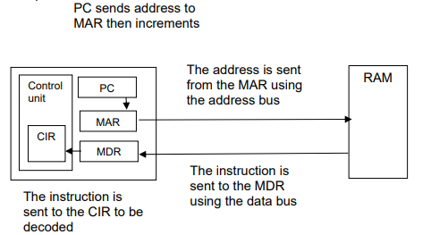

# Mark Schemes — Computer Architecture
**3. Hardware** · Cambridge (CIE) IGCSE computer-science (0478 & 0984)

## Exam Questions (13 questions)

### Q1
The clock speed affects the performance of both CPU configurations as:

- Clock speed determines how many instructions can be executed per second (accept: number of fetch-decode-execute cycles per second) **[1 mark]**
- Higher clock speed means faster processing of individual instructions **[1 mark]**

> **[exam-tip]**
> Answer about the clock speed itself, not the benefit of having two cores
> 
> Both CPUs share the same 2 GHz clock speed, so do not claim dual-core lowers it

### Q2

Any **four **of the following:

- The diagram shows:

  - The registers MAR, MDR and PC **[1 mark]**
  - Address sent from PC to MAR **[1 mark]**
  
    - … using address bus (*award anywhere for correct use of address bus*) **[1 mark]**
    - … PC is incremented **[1 mark]**
  - Address sent from MAR to RAM **[1 mark]**
  - Data/instruction sent from RAM to MDR **[1 mark]**
  
    - … using data bus (*award anywhere for correct use of data bus*) **[1 mark]**
  - Data/instruction sent from MDR to CIR/CU **[1 mark]**
  - Control unit sending control signal for any part of the process **[1 mark]**
  
    - … using control bus (*award anywhere for correct use of control bus*) **[1 mark]**

### Q3
During the execution of the program the following instructions are carried out:

- **LDA**: Loads the value (5) from a memory location into the accumulator **[1 mark]**
- **ADD**: Adds the value (3) to the value currently stored in the accumulator, resulting in 8 **[1 mark]**
- **STA**: Stores the value (8) from the accumulator into a specific memory location **[1 mark]**
- **HLT**: Stops the execution of the program **[1 mark]**

> **[exam-tip]**
> Watch the direction of data transfer: STA copies from the accumulator into memory, not the other way round
> 
> Explain every instruction in the sequence in order, including the initial load step

### Q4
Examples of how a sensor and microprocessor are used in an automated lighting system include:

Any **six **of the following:

- Sensor sends data/signal to microprocessor **[1 mark]**
- Data/Signal is converted from analogue data to digital data (using ADC) **[1 mark]**
- Value to compared to stored value(s) **[1 mark]**
- If value is outside range / matches **[1 mark]**
- … microprocessor sends signal to switch lights on **[1 mark]**
- … actuator used to switch light on/off **[1 mark]**
- … timer is set for 2 minutes **[1 mark]**
- Every time movement is detected the timer is reset **[1 mark]**
- When timer reaches 0/120/times out microprocessor sends signal to switch lights off **[1 mark]**
- Process is continuous **[1 mark]**

> **[exam-tip]**
> - An example of a six mark response could be:
> 
> *In an automated lighting system, a sensor detects movement and sends a signal to the microprocessor. This signal is converted from analogue to digital form. The microprocessor compares the signal to stored values. If movement is detected, the microprocessor sends a command to turn the lights on. A timer is set for two minutes, and if no movement is detected when the timer reaches zero, the microprocessor sends a command to turn the lights off.*

### Q5
The names of the second and third stages in the cycle are:

**Second stage **

- Decode **[1 mark]**

**Third stage **

- Execute **[1 mark]**
Examples of components within the CPU are:

Any **two **of the following:

- Memory address register **OR **MAR **[1 mark]**
- Memory data register **OR **MDR **[1 mark]**
- Program counter **OR** PC **[1 mark]**
- Control unit **OR** CU **[1 mark]**
- Address bus **[1 mark]**
- Data bus **[1 mark]**
- Control bus **[1 mark]**

### Q6
A microprocessor is described as a:

- Type of **integrated circuit** **[1 mark]**
- … that is contained on a **single chip** **[1 mark]**

### Q7
The MDR and ALU are used in the fetch-decode-execute cycle by:

Any **five **of the following:

- Data fetched from RAM is stored in the MDR **[1 mark]**
- Data from MDR is sent to ALU to be executed **[1 mark]**
- ALU performs calculation and logical operations on data **[1 mark]**
- ALU has a built-in register **[1 mark]**
- … where it stores interim results of calculations **[1 mark]**
- After calculations, ALU sends data to MDR **[1 mark]**
- Data is sent from MDR to be written to RAM **[1 mark]**

> **[exam-tip]**
> Describe the flow of data between components, not just what each one does in isolation
> 
> Be specific about roles rather than saying a component simply 'stores data'

### Q8
The upgrade to a dual core CPU can affect the performance of the computer as:

- It can now process two instructions simultaneously/at the same time **[1 mark]**
- … increasing the performance **[1 mark]**

### Q9
The purpose of the control unit (CU) within a computer is:

Any **two **of the following:

- It sends control signals **[1 mark]**
- That manage the transfer of data and instructions within the CPU **[1 mark]**
- It decodes an instruction **[1 mark]**
- Using an instruction set **[1 mark]**

### Q10
An embedded system can be described as:

Any **two** of the following:

- it is built into a device **[1 mark]**
- it has a single purpose/limited/dedicated function **[1 mark]**
- it runs on firmware **[1 mark]**
- it does not have additional peripherals **[1 mark]**

> **[exam-tip]**
> Two marks means two distinct characteristics, so avoid padding one point with extra detail like 'has a CPU' or 'dedicated hardware'
> 
> An embedded system is a dedicated controller built into a device, not general-purpose software installed on a computer

### Q11
The purpose of a core in a CPU is:

Any **one **of the following:

- to process an instruction **[1 mark]**
- to carry out a fetch-decode-execute (FDE) cycle **[1 mark]**

### Q12
The three components that are part of the CPU are:

- Accumulator (ACC) **[1 mark]**
- Program counter (PC) **[1 mark]**
- Memory address register (MAR) **[1 mark]**
