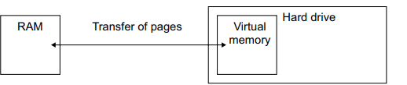

# Mark Schemes — Data Storage
**3. Hardware** · Cambridge (CIE) IGCSE computer-science (0478 & 0984)

## Exam Questions (13 questions)

### Q1
Three examples of optical storage are:

- Compact disk (CD) **[1 mark]**
- Digital versatile disk (DVD) **[1 mark]**
- Blu-ray disk **[1 mark]**
Examples of why a computer needs RAM include:

Any **three **of the following:

- To store data temporarily **[1 mark]**
- To store data currently in use **[1 mark]**
- To store software currently in use **[1 mark]**
- Data can be accessed faster (than secondary storage) **[1 mark]**
- To speed up the fetch stage (of the fetch-execute cycle) **[1 mark]**

### Q2
The purpose of secondary storage is:

- To store data/files/software **permanently ****[1 mark]**

### Q3
Virtual memory is created and used by:

Any **four **of the following:

- The hard drive is partitioned to create virtual memory **[1 mark]**
- When RAM is full **[1 mark]**
- … pages of data that are not required  **[1 mark]**
- … are transferred from RAM to virtual memory **[1 mark]**
- When the data is required again the pages are transferred back to RAM **[1 mark]**

### Q4
The diagram shows:

- Secondary storage** [1 mark]**
- The secondary storage portioned in some way to create virtual memory **[1 mark]**
- RAM **[1 mark]**
- An indication of pages transferred between the RAM and the virtual memory **[1 mark]**

Virtual memory would be used to:

- Extend the RAM capacity **[1 mark]**
- … to stop the 3D modelling software from freezing/crashing when the physical RAM is full **[1 mark]**
- Allow the computer to process the large amount of data required for 3D modelling **[1 mark]**

### Q5
Examples of why SSD is the most suitable include:

Any **three **of the following:

- It is small in size **OR **compact **OR** lightweight **OR** portable **[1 mark]**
- It has low power consumption **[1 mark]**
- It runs quietly **[1 mark]**
- It runs at a cool temperature **[1 mark]**
- It is robust when dropped **OR** durable **[1 mark]**
- Fast access/read/write speed **[1 mark]**
- High capacity **[1 mark]**
- Not affected by magnets **[1 mark]**

### Q6
A laser is used to store and read data on a disk by:

Any **three **of the following:

- A laser is shone at the disk **[1 mark]**
- An (arm/head) moves the laser across the surface of the disk **[1 mark]**
- The laser burns pits onto the surface of the disk **[1 mark]**
- The laser is used to read the pits and lands on the surface of the disk **[1 mark]**
- The reflected light from the laser shining on the disk is captured (by a sensor) **[1 mark]**

### Q7
The three components that are secondary storage devices are:

- Compact disk (CD) **[1 mark]**
- Solid-state drive (SSD) **[1 mark]**
- Hard disk drive (HDD) **[1 mark]**
**Final answer:** **The correct answer is C**

- **C **is correct as secondary storage permanently stores software and data files **[1 mark]**
- **A **is incorrect as primary storage is directly accessed by the CPU
- **B **is incorrect as optical and solid-state are also secondary storage
- **D **is incorrect as as secondary storage is non-volatile

### Q8
Three examples of optical data storage are:

- CD **[1 mark]**
- DVD **[1 mark]**
- Blu-ray **[1 mark]**

> **[exam-tip]**
> - Any variation of each are acceptable i.e. DVD-RW
| **Statement** | **Magnetic (✓)** | **Optical (✓)** | **Solid state (✓)** |
|---|---|---|---|
| this storage has no moving parts |   |   | **✓** |
| this storage uses a laser to read and write data |   | **✓** |   |
| this storage uses a read/write head | **✓** | **✓** |   |
| this storage burns pits onto a reflective surface |   | **✓** |   |
| this storage uses NAND and NOR technology |   |   | **✓** |
| this storage stores data in tracks and sectors | **✓** | **✓** |   |

> **[mark-scheme]**
> - **Must **have both ticks on row 3 & 6 for mark

### Q9
Examples of solid-state storage include:

Any **one **of the following:

- SD card **[1 mark]**
- USB flash memory drive (accept: USB, USB stick, USB pen drive) **[1 mark]**
- Random access memory **OR** RAM **[1 mark]**

> **[exam-tip]**
> Remember a hard disk drive (HDD) is magnetic storage, not solid-state, so it will not be credited here

### Q10
Data is fetched from:

- Random access memory **OR** RAM **[1 mark]**

### Q11
A second example of primary storage is:

- RAM **[1 mark]**
Examples of secondary storage include:

Any **two **of the following:

- Hard disk drive/HDD **[1 mark]**
- Solid-state drive/SSD **[1 mark]**
- Any valid example of offline storage is also secondary storage e.g. CD/DVD (two can be awarded) **[1 mark]**

### Q12
Cloud storage is described as:

Any **two **of the following:

- Storage consisting of servers **[1 mark]**
- … that are often in a remote location **[1 mark]**
- … that are often maintained/backed up by a third-party company **[1 mark]**
- Storage that is normally accessed using a network (often the internet) **[1 mark]**

### Q13
Reasons why the devices have ROM are:

Any **one **of the following:

- They both need to store boot-up instructions **[1 mark]**
- They both need data that should not be deleted **[1 mark]**
