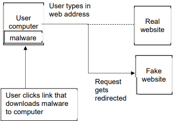

# Mark Schemes — Cyber Security
**5. The Internet & its Uses** · Cambridge (CIE) IGCSE computer-science (0478 & 0984)

## Exam Questions (18 questions)

### Q1
Examples of malware that the firewall can help protect the network from include:

Any **two **of the following:

- Virus **[1 mark]**
- Worm **[1 mark]**
- Trojan horse **[1 mark]**
- Spyware **[1 mark]**
- Adware **[1 mark]**
- Ransomware **[1 mark]**

### Q2
A firewall can help to protect a network by:

Any **five **of the following:

- Criteria can be set (for traffic) **[1 mark]**
- … such as a blacklist/whitelist (of IP addresses) **[1 mark]**
- It will examine traffic coming into the network **[1 mark]**
- It will check that the traffic meets the set criteria **[1 mark]**
- … and will reject it if it does not meet criteria **[1 mark]**
- Certain ports used by hackers can be blocked/closed **[1 mark]**

### Q3
The process of pharming can be drawn as:

- User clicks/opens attachment/link that triggers download **[1 mark]**
- Malicious software downloaded onto user's computer **[1 mark]**
- User enters website address **[1 mark]**
- User is redirected to fake website **[1 mark]**

### Q4
**Max two marks** for each solution.

**Anti-malware/virus (software) **

- Scans the computer system (for viruses) **[1 mark]**
- Has a record of known viruses **[1 mark]**
- Removes/quarantines any viruses that are found **[1 mark]**
- Checks data before it is downloaded **[1 mark]**
- … and stops download if virus found/warns user may contain virus **[1 mark]**

**Passwords **

- Making a password stronger **OR** by example **[1 mark]**
- Changing it regularly **[1 mark]**
- Lock out after set number of attempts **OR** stops brute force attacks **OR** makes it more difficult to guess **[1 mark]**

**Two-step verification **

- Extra data is sent to device, pre-set by user **[1 mark]**
- … making it more difficult for hacker to obtain it **[1 mark]**
- Data has to be entered into the same system **[1 mark]**
- … so if attempted from a remote location, it will not be accepted **[1 mark]**

### Q5
The process of SSL includes:

Any **six **of the following:

- SSL is a (security) protocol **[1 mark]**
- It encrypts any data that is sent **[1 mark]**
- It uses/sends digital certificates **[1 mark]**
- … which are sent to the (buyer’s/user’s) browser **OR** requested by the (buyer’s/user’s) browser **[1 mark]**
- … that contains the gallery’s public key  **[1 mark]**
- … that can be used to authenticate the gallery **[1 mark]**
- Once the certificate is authenticated, the transaction will begin **[1 mark]**

> **[exam-tip]**
> - An example six mark response could be:
> 
> *SSL is a security protocol that ensures a safe connection when you visit a website, like an art gallery. It works by encrypting any data that is sent, so even if someone intercepts it, they can’t read it. The website sends a digital certificate to your browser, which is like an electronic ID card that proves the website is real. This certificate includes the gallery’s public key, which your browser uses to confirm the website is trustworthy. Once the certificate is verified, the secure transaction can begin.*

### Q6
A brute-force attack is described as:

Any** three **of the following:

- Trial and error to guess a password **[1 mark]**
- Combinations are repeatedly entered **[1 mark]**
- … until correct password is found **[1 mark]**
- Can be carried out manually or automatically by software **[1 mark]**
Aims of carrying out a brute-force attack include:

Any **two **of the following:

- Steal/view/access data **[1 mark]**
- Delete data **[1 mark]**
- Change data **[1 mark]**
- Lock account **OR** Encrypt data **[1 mark]**
- Damage reputation of a business **[1 mark]**

### Q7
Examples of online security attacks that can be carried out include:

**One mark** for identifying the attack, **two marks** for the description

**Phishing ****[1 mark]**

- Email is sent to user to encourage them to click link **[1 mark]**
- … that takes user to fake website **[1 mark]**

**Pharming ****[1 mark]**

- Email is sent to user to encourage them to click link/download attachment **[1 mark]**
- … that triggers download of malicious code that will redirect user to fake website **[1 mark]**

**Virus/malware** **[1 mark]** *accept: Trojan horse*

- Email is sent to user to encourage them to click link/download attachment **[1 mark]**
- … that triggers download of virus/malware **[1 mark]**

**Denial of service/DoS** **[1 mark]**

- A very large number of emails are sent to a server/network at the same time **[1 mark]**
- … crashing the server/network **[1 mark]**

> **[exam-tip]**
> Keep phishing distinct from malware — phishing directs the user to a fake website to steal details, it does not install anything.
> 
> Use the recognised attack names rather than vaguer terms like social engineering.
Examples of how data can be damaged accidently include:

Any **six **of the following:

**Power surge/loss (damages hardware) ****[1 mark]**

- Use a UPS **[1 mark]**

**Water can be spilled on the device** **[1 mark]**

- Don’t have water near the device **[1 mark]**
- Keep device in a waterproof box when not is use **[1 mark]**

**Fire can destroy device** **[1 mark]**

- Use electrics safety **[1 mark]**
- Keep device in a fireproof box when not is use **[1 mark]**

**Data is accidentally deleted** **[1 mark]**

- Add verification method for data deletion **[1 mark]**
- Set access levels for data to limit who can delete the data **[1 mark]**

**Incorrect use of storage device** **[1 mark]**

- Making sure device is ejected before removing **[1 mark]**

**Physical damage to hardware OR hardware failure** **[1 mark]**

- Correct care and maintenance of hardware **[1 mark]**

**Software failure** **[1 mark]**

- Making sure it is always up to date **OR **enable automatic updates **[1 mark]**

> **[mark-scheme]**
> - **One **mark for identifying the problem
> - **One **mark for suggesting a suitable prevention

### Q8
A firewall can be used to limit the websites by:

- (The parent can) set criteria for the websites she is allowed to visit **[1 mark]**
- … such as a whitelist/blacklist of websites **[1 mark]**
- The firewall will examine the data/traffic incoming and outgoing from her computer **[1 mark]**
- If data is sent from a website that is not allowed, it will be blocked **[1 mark]**

### Q9
Examples of why a biometric password is more secure than a PIN include:

Any **two **of the following:

- A biometric password cannot be guessed **[1 mark]**
- It is very difficult to fake a biometric password **[1 mark]**
- A biometric password cannot be recorded by a keylogger/spyware **[1 mark]**
- A perpetrator cannot shoulder surf to see a biometric password **[1 mark]**
A firewall uses gathered data by:

Any **three **of the following:

- The traffic/data is compared to set criteria/rules/whitelist/blacklist **[1 mark]**
- If the traffic/data does/does not meet the criteria/rules/whitelist/blacklist it will be rejected/blocked **[1 mark]**
- … and an alert can be sent to warn Adele **[1 mark]**
- … this can help prevent hackers/malicious software (gaining access to the data) **[1 mark]**

### Q10
A DDoS attack is described as:

Any **four **of the following:

- multiple computers are used as bots **[1 mark]**
- designed to deny people access to a website **[1 mark]**
- a large number / numerous requests are sent (to a server) **[1 mark]**
- … all at the same time **[1 mark]**
- the server is unable to respond / struggles to respond to all the requests **[1 mark]**
- the server fails / times out as a result **[1 mark]**

### Q11
The aim of pharming is to:

- Obtain personal data/details **OR** by example **[1 mark]**

### Q12
Examples of malware that could be installed include:

Any **three **of the following:

- Virus **[1 mark]**
- Worm **[1 mark]**
- Trojan horse **[1 mark]**
- Spyware **[1 mark]**
- Adware **[1 mark]**
- Ransomware **[1 mark]**
Examples of security measures that could be used to help prevent a brute-force attack include:

Any **two **of the following:

- Two-step verification **OR **Two-factor authentication ** **by example **[1 mark]**
- Biometrics **[1 mark]**
- Firewall **OR** Proxy-server **[1 mark]**
- Strong/complex password **OR** by example **[1 mark]**
- Setting a limit for login attempts **[1 mark]**
- Drop-down boxes **[1 mark]**
- Request for partial entry of password **[1 mark]**

### Q13
Examples of security methods that keep data safe from online attacks include:

Any **two **of the following:

- Encryption **[1 mark] **
- Password **[1 mark]**
- Two-step / Two-factor authentication/verification **[1 mark]**
- Biometric device (accept: biometric passkey) **[1 mark]**
- Anti-malware **OR** Anti-virus **[1 mark]**
- Proxy-server**[1 mark]**

### Q14
|   | **Tick (✓)** |
|---|---|
| Firewalls can only be hardware‑based |   |
| Firewalls can only be software‑based |   |
| Firewalls can be hardware‑based or software‑based | **✓** |

### Q15
A biometric password uses:

Any **one **of the following:

- Biological data **[1 mark]**
- Characteristics/features that belong to a human **[1 mark]**
Encryption will keep the data more secure by:

- Making the data meaningless **[1 mark]**

### Q16
Any **three **of the following:

**Computer virus**

- Anti-malware/virus (software) **[1 mark]**
- Firewall **[1 mark]**

**Hacking**

- Firewall **[1 mark]**
- Passwords **[1 mark]**
- Biometrics **[1 mark]**
- Two-step verification **[1 mark]**

**Spyware**

- Anti-malware/spyware (software) **[1 mark]**
- Two-step verification **[1 mark]**
- Firewall **[1 mark]**

> **[mark-scheme]**
> - **One mark** per solution to a threat
> - Same solution **cannot **be used for multiple threats, e.g. Computer virus and hacking both firewall gets 1 mark

### Q17
A security device that can be used to help prevent a DDoS attack is:

Any **one **of the following:

- Firewall **[1 mark]**
- Proxy server **[1 mark]**
