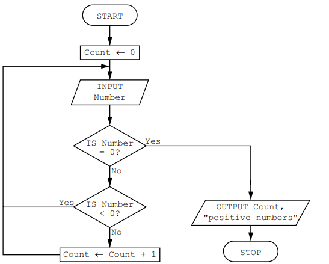
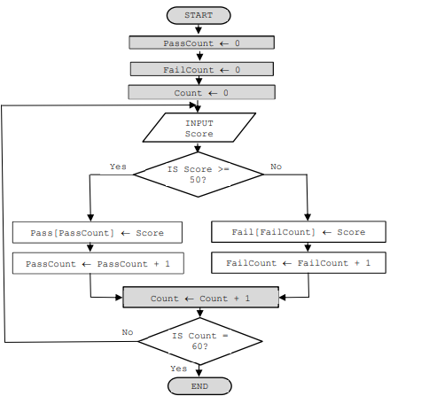

# Mark Schemes — Algorithms
**7. Algorithm Design & Problem-Solving** · Cambridge (CIE) IGCSE computer-science (0478 & 0984)

## Exam Questions (17 questions)

### Q1
**The pseudocode statement that would output the average is:**

`OUTPUT "The average of the numbers entered is ", ROUND(Total / Limit,1)`

- Correct use of `ROUND` with 2 arguments separated by comma, for example `ROUND(5, 2)` (in statement 13) … **[1 mark]**
- … `(Total / Limit, 1)` correct arguments **[1 mark]**

### Q2
- **Line 01 /** `DECLARE Loop : STRING `should be `DECLARE Loop : INTEGER `**[1 mark]**
- **Line 07 /** `IF Loop ← 1 TO Limit `should be `FOR Loop ← 1 TO Limit `**[1 mark]**
- **Line 09 /** `INPUT Loop `should be `INPUT Value `**[1 mark]**
- **Line 10 /** `Total ← Total * Value `should be `Total ← Total + Value `**[1 mark]**

### Q3
Changes to the algorithm would include:

Any **four** of the following:

- Initialise a new (counting) variable **[1 mark]**
- … `Count = 0` **OR** to count the acceptable numbers **[1 mark]**
- Insert a counting statement between lines 05 and 07 **[1 mark]**
- … `Count = Count + 1` **[1 mark]**
- Add a new output after the loop/after line 13 / at the end (of the program) **[1 mark]**
- … OUTPUT `Count` **[1 mark]**

### Q4
The following solutions **will not execute** because the arrays `Patient `and `Reading` have not been defined as per the question.

The provided solutions are just two of many possible solutions; as long as your code **effectively addresses the problem**, it is equally valid and can receive full marks.

**Pseudocode**

`//Declaration of variables and constants `
`CONSTANT TempHigh = 37.2 `
`CONSTANT TempLow = 31.6 `
`CONSTANT PulseHigh = 100.0 `
`CONSTANT PulseLow = 55.0`
`PROCEDURE CheckPatient(HospitalNumber :INTEGER) `
`IF HospitalNumber >=1 AND HospitalNumber <=1000 // check for valid hospital number `
`  THEN `
`   OUTPUT "Name of Patient ",Patient(HospitalNumber)`
` IF Reading[HospitalNumber,1] <= TempHigh AND `
`   Reading[HospitalNumber,1] >= TempLow AND `
`   Reading[HospitalNumber,2] <= PulseHigh AND `
`   Reading[HospitalNumber,2] >= PulseLow // check if all readings normal `
`    THEN `
`      OUTPUT "Normal readings" `
` ENDIF`
` IF (Reading[HospitalNumber,1] <= TempHigh AND `
`    Reading[HospitalNumber,1] >= TempLow) AND `
`    (Reading[HospitalNumber,2] > PulseHigh OR `
`     Reading[HospitalNumber,2] < PulseLow) // check if pulse out of range `
`      THEN `
`       OUTPUT "Warning Pulse" `
` ENDIF `
` IF (Reading[HospitalNumber,1] > TempHigh OR `
`    Reading[HospitalNumber,1] < TempLow) AND `
`   (Reading[HospitalNumber,2] <= PulseHigh AND `
`    Reading[HospitalNumber,2] >= PulseLow) // check if temp out of range `
`     THEN `
`      OUTPUT "Warning temperature" `
` ENDIF `
` IF (Reading[HospitalNumber,1] > TempHigh OR `
`    Reading[HospitalNumber,1] < TempLow) AND `
`   (Reading[HospitalNumber,2] > PulseHigh OR `
`    Reading[HospitalNumber,2] < PulseLow) // check if both out of range `
`     THEN `
`      OUTPUT "Severe warning, Pulse and temperature" `
` ENDIF `
`ELSE `
`OUTPUT "Hospital number not valid" `
`ENDIF `
`ENDPROCEDURE`

**Python**

> **[mark-scheme]**
> You **must **include the following in your solution to achieve a maximum score:
> 
> 1. **Techniques:**
> 
>   1. Procedure that takes the hospital number as a parameter (use of **procedures **and **parameters**)
>   2. Check if hospital number valid (**selection**, use of **1D array**)
>   3. Check temperature reading (**selection**, use of **2D array**)
>   4. Check pulse reading (**selection**, use of **2D array**)
>   5. Output appropriate messages for each selection (**output **with **appropriate messages**)
> 2. **Data Structures**: The names underlined must be used as given in the scenario
> 
>   1. **Arrays or lists:**` Patient, Readings `
>   2. **Variables: **`HospitalNumber `
>   3. **Constants: **`TempHigh, TempLow, PulseHigh, PulseLow `(could be variables)

> **[exam-tip]**
> - **All criteria** stated for the scenario have been covered by the use of **appropriate** programming techniques
> - The data structures used **store all the data that is required** by the scenario
> - **All** the data structures used have **meaningful names**
> - Solution** logically performs** **all the tasks **given in the scenario

### Q5
An example of the rewritten algorithm is:

`B ← FALSE `
`INPUT Num `
`Counter ← 1 `
`WHILE Counter <= 12 DO `
`     IF A[Counter] = Num `
`       THEN `
`         B ← TRUE `
`     ENDIF `
`     Counter ← Counter + 1 `
`ENDWHILE`

- initialising counter outside the loop **[1 mark]**
- updating counter inside loop **[1 mark]**
- suitable exit value at start of loop **[1 mark]**
- correct use of `WHILE … DO … ENDWHILE `**[1 mark]**

> **[mark-scheme]**
> - The whole algorithm must be rewritten for full marks

### Q6
A flowchart for the algorithm would be:

- correct pair of decisions (diamond) **[1 mark]**
- correct pair of processes (rectangle) **[1 mark]**
- correct pair of Input/Output **[1 mark]**
- complete flowlines **[1 mark]**
- working flowlines **[1 mark]**
- correct use of flowchart symbols **[1 mark]**
To count the negative numbers you would:

Any **two **of the following:

- Use another counter/variable and initialise to zero before looping **[1 mark]**
- Increment this counter/variable when the number is less than zero/count all numbers and subtract the positive numbers **[1 mark]**
- Output this counter/variable at the end **OR** Output both counters at the end **[1 mark]**

### Q7
The following solutions **will not execute** because the arrays `StudentName` and `StudentMark` have not been defined as per the question.

The provided solutions are just two of many possible solutions; as long as your code **effectively addresses the problem**, it is equally valid and can receive full marks.

**Pseudocode**

**Python**

> **[mark-scheme]**
> You **must **include the following in your solution to achieve a maximum score:
> 
> 1. **Techniques:**
> 
>   1. Calculate total mark for each student (**iteration** and **totalling**)
>   2. Calculate average mark for each student **rounded **to the nearest whole number
>   3. Selection of grade for each student (**selection**)
>   4. Output for each student name, total mark, average mark, grade awarded (**output with appropriate messages**)
>   5. Calculate, store and output the number of distinctions, merits, passes and fails for the whole class (**iteration**, **counting **and **output with appropriate messages**)
> 2. **Data structures:**
> Names underlined must be used as provided in the scenario
> 
>   1. **Arrays or lists**: `StudentName, StudentMark`<u> </u>(`TotalMark `and `AverageMark `may be seen but no requirement to store)
>   2. **Variables**: `ClassSize, SubjectNo, SubjectCounter, StudentCounter DistinctionNo, MeritNo, PassNo, FailNo` (could be an array or list)
>   3. **Constants**: `Distinction, Merit, Pass` (could be variables)

> **[exam-tip]**
> - **All criteria** stated for the scenario have been covered by the use of **appropriate** programming techniques
> - The data structures used **store all the data that is required** by the scenario
> - **All** the data structures used have **meaningful names**
> - Solution** logically performs** **all the tasks **given in the scenario

### Q8
An example of pseudocode statements could be:

`X ← "Programming is fun" `
`OUTPUT LENGTH(X) `
`Y ← 16 `
`Z ← 3 `
`OUTPUT SUBSTRING(X,Y,Z)`

- storing string in X **[1 mark]**
- calling the function length **[1 mark]**
- using the correct parameter X **[1 mark]**
- using the substring function **[1 mark]**
- correct parameters **[1 mark]**
- outputting length and substring return values **[1 mark]**

### Q9
Pseudocode statements to declare the variables P and Q are:

Any **one **of the following:

- `DECLARE P : STRING `**[1 mark]**
`P `$\leftarrow$` "The world" `
- `DECLARE Q : CHAR `**[1 mark]**
`Q `$\leftarrow$` 'W'`

### Q10
The algorithm represented by the flowchart is:

- (bubble) sort data in array **[1 mark]**
- … in ascending order **[1 mark]**

### Q11
The final output from the algorithm could be improved by:

- including a message to explain the value output / e. g. “The percentage of meals not served” **OR** outputting `Hot`, `Cold `and `Serve `**[1 mark]**
The process in the algorithm that is not required is:

- updating the `Serve `variable **OR** `Serve `$\leftarrow$ `Serve + 1` **[1 mark]**

### Q12
The purpose of the algorithm is to:

- check for/output 3-digit numbers **[1 mark]**
- … where the first and last digit are the same **[1 mark]**

### Q13
The completed flow chart is:

- Input box **[1 mark]**
- Correct check of Score **[1 mark]**
- Assign Score to Pass correctly **[1 mark]**
- Assign Score to Fail correctly **[1 mark]**
- Increment both array counters **[1 mark]**
- Correct check of number of scores **[1 mark]**
An example of a pseudocode routine is:

**Or **

- Appropriate conditional loop structure** [1 mark]**
- Correct identification of invalid input ** [1 mark]**
- Appropriate error message ** [1 mark]**
- Repeated input of score until correct ** [1 mark]**

### Q14
The purpose of the algorithm is to perform a:

- Linear search **[1 mark]**

### Q15
A description of this algorithm is:

Any **two **of the following:

- To output the type of test data **[1 mark]**
- … by performing a range check **[1 mark]**
- … by checking if numbers are within the range 50 and 100 (inclusive) (or not) **[1 mark]**

### Q16
A description of this algorithm includes:

Any **three **of the following:

- Marks input are** stored in the array** <u>Score[ ]</u> **[1 mark]**
- Marks are checked against a range of boundaries **OR** allow example **[1 mark]**
- … and a **matching grade** is assigned to each mark that has been input **[1 mark]**
- … then** stored in the array** <u>Grade[ ]</u> **[1 mark]**
- … at the same index as the mark input **[1 mark]**
- The algorithm finishes after 30 marks have been input **OR** allows 30 scores to be entered **[1 mark]**

### Q17
The algorithm represented by the flowchart is:

- bubble sort / sorting the names **[1 mark]**
- ascending order / A to Z / lowest to highest / alphabetical order **[1 mark]**
