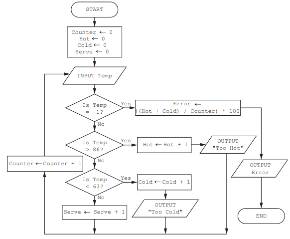
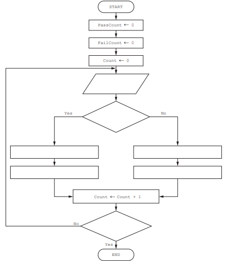
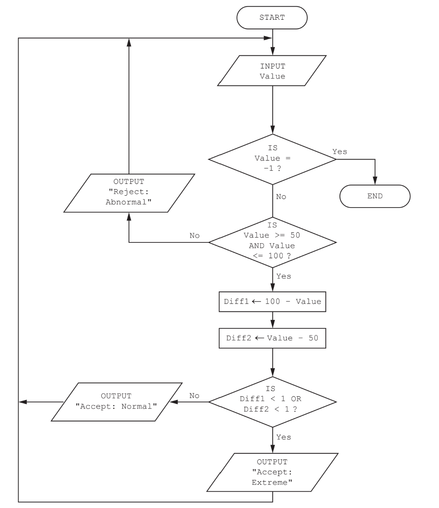
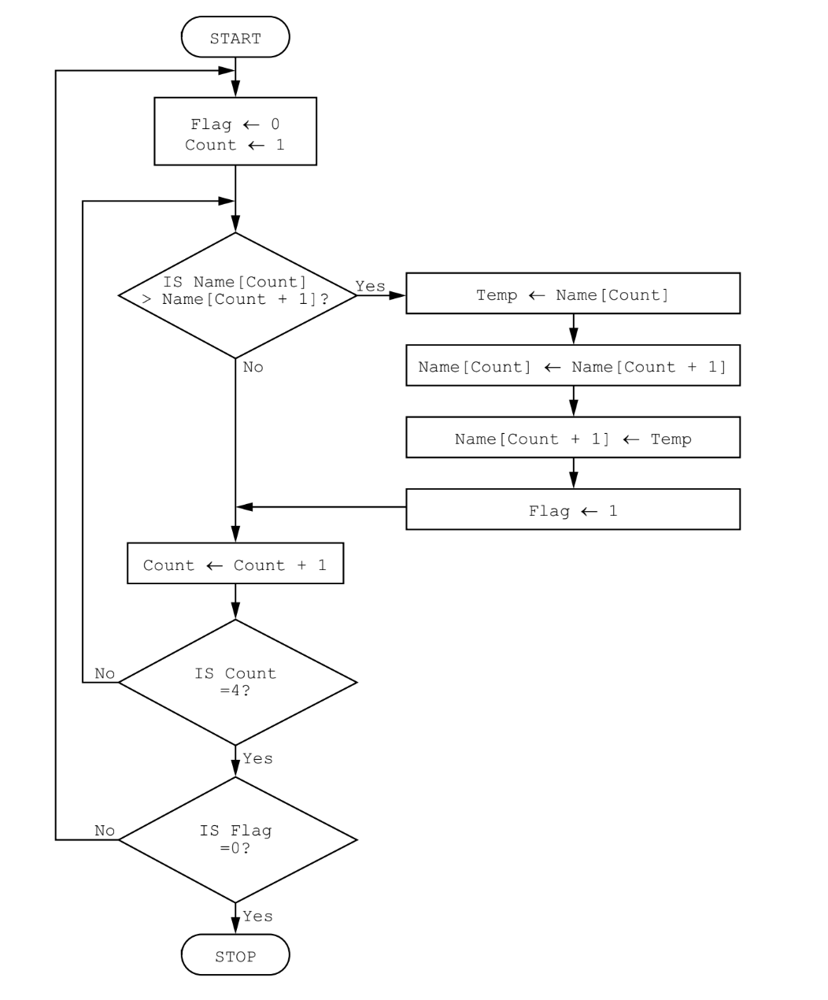

# Exam Questions — Algorithms
**7. Algorithm Design & Problem-Solving** · Cambridge (CIE) IGCSE computer-science (0478 & 0984)
> Source: [https://www.savemyexams.com/igcse/computer-science/cie/23/topic-questions/](https://www.savemyexams.com/igcse/computer-science/cie/23/topic-questions/) · 17 questions across 1 sets

## Exam Questions (17 questions)

### Q1 — easy — 2 marks

**Q1** [2 marks]

**Write **the pseudocode statement that would output the average calculated in line 13 of the algorithm rounded to **one **decimal place.

*Source: June 2024 0478/21 Q4B*

### Q2 — medium — 4 marks

**Q2** [4 marks]

This pseudocode algorithm is intended to allow, at random, between 1 and 20 values to be entered and totalled.

The total and average of the entered values are output at the end of the algorithm.

**Identify **the line numbers of four errors in the pseudocode and **suggest **corrections

*Source: June 2024 0478/21 Q4A*

### Q3 — hard — 4 marks

**Q3** [4 marks]

An algorithm has been written in pseudocode to allow some numbers to be input. All the positive numbers that are input are totalled and this total is output at the end. An input of 0 stops the algorithm.

**Describe how you could change** the corrected algorithm to record and output how many positive numbers have been included in the final total.

You **do not **need to rewrite the algorithm.

*Source: June 2023 0478/21 Q5B*

### Q4 — hard — 15 marks

**Q4** [15 marks]

The names of patients are stored in the one-dimensional (1D) array Patient[] of type string. A separate two-dimensional (2D) array Readings[] stores the latest data recorded about each patient. The array **already **contains the readings taken by a nurse for each patient:

- temperature measured to one decimal place
- pulse rate, a whole number.

Temperature readings should be in the range 31.6 to 37.2 inclusive. 
Pulse readings should be in the range 55.0 to 100.0 inclusive.

The hospital number given to the patient is used for the index on both arrays, this is a value between 1 and 1000 inclusive.

When the data for a patient is checked a warning is given if any of the readings are out of range. 
If both readings are out of range, then a severe warning is given.

**Write a procedure**, using pseudocode or program code, that meets the following requirements:

- takes the hospital number as a parameter
- checks if the number is valid
- outputs an error message and exits the procedure if the number is not valid
- if the hospital number is valid:

  - **output the patient’s name **
  - **output ‘Normal readings’ if both the readings are within range**
  - **output ‘Warning’ and the name of the reading e.g. ‘Pulse’ if one reading is out of range **
  - **output ‘Severe warning’ and the names of the two readings ‘Pulse and temperature’ if both readings are out of range **
  - **exits the procedure.**

You must use pseudocode or program code **and **add comments to explain how your code works.

You do **not **need to initialise the data in the arrays.

*Source: Specimen 2023 0478/02 2B Q13*

### Q5 — hard — 4 marks

**Q5** [4 marks]

**Rewrite this pseudocode** algorithm using a `WHILE … DO … ENDWHILE loop.`

`B ← FALSE `
`INPUT Num `
`FOR Counter ← 1 TO 12 `
`    IF A[Counter] = Num`
`       THEN `
`       B ← TRUE `
`    ENDIF `
`NEXT Counter`

*Source: Specimen 2023 0478/02 2B Q12A*

### Q6 — hard — 8 marks

**Q6** [6 marks]

**Draw a flowchart** for an algorithm to:

- allow numbers to be input
- ignore any numbers that are negative
- count how many numbers are positive
- output the count of positive numbers when zero is input and end the algorithm.

*Source: Specimen 2023 0478/02 2B Q5A*

**Q6** [2 marks]

**Extract:**

allow numbers to be input
ignore any numbers that are negative
count how many numbers are positive
output the count of positive numbers when zero is input and end the algorithm.

**Explain the changes** you will make to your algorithm to **also **count the negative numbers.

*Source: Specimen 2023 0478/02 2B Q5B*

### Q7 — hard — 15 marks

**Q7** [15 marks]

The one-dimensional (1D) array `StudentName[] `contains the names of students in a class. The two-dimensional (2D) array `StudentMark[] `contains the mark for each subject, for each student. The position of each student’s data in the two arrays is the same, for example, the student in position 10 in `StudentName[] `and `StudentMark[]` is the same.

The variable `ClassSize` contains the number of students in the class. The variable `SubjectNo` contains the number of subjects studied. All students study the same number of subjects.

The arrays and variables have already been set up and the data stored.

Students are awarded a grade based on their average mark.

| **Average mark** | **Grade awarded** |
|---|---|
| greater than or equal to 70 | distinction |
| greater than or equal to 55 and less than 70 | merit |
| greater than or equal to 40 and less than 55 | pass |
| less than 40 | fail |

**Write a program** that meets the following requirements:

- calculates the combined total mark for each student for all their subjects
- calculates the average mark for each student for all their subjects, rounded to the nearest whole number
- outputs for each student:

  - **name **
  - **combined total mark **
  - **average mark **
  - **grade awarded**
- calculates, stores and outputs the number of distinctions, merits, passes and fails for the whole class.

You must use **pseudocode or program code** and **add comments** to explain how your code works.

You **do not** need to initialise the data in the array.

*Source: Specimen 2023 0478/02 2A Q13*

### Q8 — hard — 6 marks

**Q8** [6 marks]

The variables X, Y and Z are used to store data in a program:

- X stores a string
- Y stores a position in the string (e.g. 2)
- Z stores the number of characters in the string.

The function `LENGTH(X) `finds the length of a string X.

The function `SUBSTRING(X,Y,Z)` finds a substring of X starting at position Y and` `Z characters long. The first character in X is in position 1.

**Write pseudocode statements** to:

- **store **the string "`Programming is fun`" in `X `
- **find the length** of the string and output it
- **extract the word** `fun `from the string and output it.

*Source: Specimen 2023 0478/02 2A Q12B*

### Q9 — medium — 1 marks

**Q9** [1 mark]

The variables P and Q are used to store data in a program. P stores a string. Q stores a character.

Give the value of Position after the algorithm has been executed with the data in the below question.

**Write pseudocode statements** to declare the variables P and Q, store "The world" in P and store 'W' in Q

*Source: June 2023 0478/22 Q11C*

### Q10 — medium — 2 marks

**Q10** [2 marks]

This flowchart represents an algorithm.

![Flowchart starts with F=0, C=1. If X[C] < X[C+1], swap elements X[C] and X[C+1], set F=1. Increment C. If C=5 and F=0, then STOP, otherwise repeat.](assets/002-flowchart-starts-with-f-0-c-1-if-x-c-x-c-1-swap-.png)

**Describe **what the algorithm represented by the flowchart is doing.

*Source: June 2023 0478/22 Q9B*

### Q11 — medium — 2 marks

**Q11** [1 mark]

This algorithm checks the temperature of hot food being served to customers.

**State how** the final output from the algorithm could be improved.

*Source: June 2022 0478/22 Q4B*

**Q11** [1 mark]

**Identify **the process in the algorithm that is **not **required.

*Source: June 2022 0478/22 Q4C*

### Q12 — medium — 2 marks

**Q12** [2 marks]

The pseudocode represents an algorithm.

The pre-defined function `DIV `gives the value of the result of integer division. For example, `Y = 9 DIV 4` gives the value `Y = 2`

The pre-defined function `MOD `gives the value of the remainder of integer division. For example, `R = 9 MOD 4` gives the value `R = 1`

`First ← 0 `
`Last ← 0 `
`INPUT Limit `
`FOR Counter ← 1 TO Limit `
`      INPUT Value `
`      IF Value >= 100 `
`         THEN `
`            IF Value < 1000 `
`               THEN `
`            First ← Value DIV 100 `
`            Last ← Value MOD 10 `
`                IF First = Last `
`                     THEN `
`                             OUTPUT Value `
`                ENDIF `
`              ENDIF `
`       ENDIF `
`NEXT Counter`

**Describe the purpose** of the algorithm.

*Source: June 2022 0478/21 Q5B*

### Q13 — medium — 10 marks

**Q13** [6 marks]

The flowchart shows an algorithm that should allow 60 test results to be entered into the variable `Score`.

Each test result is checked to see if it is 50 or more. If it is, the test result is assigned to the `Pass `array. Otherwise, it is assigned to the `Fail `array.

**Complete this flowchart**

*Source: June 2022 0478/21 Q4A*

**Q13** [4 marks]

**Write a pseudocode routine** that will check that each test result entered into the algorithm is between 0 and 100 inclusive.

*Source: June 2022 0478/21 Q4B*

### Q14 — medium — 1 marks

**Q14** [1 mark]

`B ← FALSE `

`INPUT Num `

`FOR Counter ← 1 TO 12 `

`              IF A[Counter] = Num `

`                 THEN `

`                   B ← TRUE `

`             ENDIF `

`NEXT Counter`

**Identify the purpose** of the algorithm.

*Source: Specimen 2023 0478/02 2B Q12B*

### Q15 — hard — 2 marks

**Q15** [2 marks]

**Describe **the purpose of the algorithm.

*Source: June 2021 Paper 21 Q5B*

### Q16 — medium — 3 marks

**Q16** [3 marks]

The **pseudocode **algorithm shown has been written by a teacher to enter marks for the students in her class and then to apply some simple processing.

`Count ← 0`
`   REPEAT`
`      INPUT Score[Count]`
`      IF Score[Count] >= 70`
`         THEN`
`           Grade[Count] ← "A"`
`         ELSE`
`           IF Score[Count] >= 60`
`             THEN`
`               Grade[Count] ← "B"`
`             ELSE`
`               IF Score[Count] >= 50`
`                 THEN`
`                   Grade[Count] ← "C"`
`                 ELSE`
`                   IF Score[Count] >= 40`
`                     THEN`
`                       Grade[Count] ← "D"`
`                     ELSE`
`                       IF Score[Count] >= 30`
`                         THEN`
`                           Grade[Count] ← "E"`
`                         ELSE`
`                           Grade[Count] ← "F"`
`                       ENDIF`
`                   ENDIF`
`               ENDIF`
`           ENDIF`
`       ENDIF`
`        Count ← Count + 1`
`   UNTIL Count = 30`

**Describe **what happens in this algorithm.

*Source: June 2021 Paper 21 Q4A*

### Q17 — medium — 2 marks

**Q17** [2 marks]

**Describe **what the algorithm represented by the flowchart in** Fig. 1** is doing.

*Fig.1*

*Source: Specimen 2023 Paper 2 Q7B*

