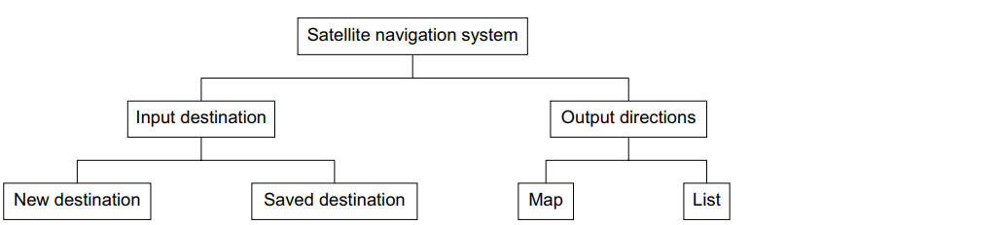

# Mark Schemes — Computer Sub-Systems
**7. Algorithm Design & Problem-Solving** · Cambridge (CIE) IGCSE computer-science (0478 & 0984)

## Exam Questions (3 questions)

### Q1
An example of a structure diagram could be:

- a hierarchical structure **[1 mark]**
- suitable names for the sub-systems **[1 mark]**
- identifiable inputs **[1 mark]**
- identifiable outputs **[1 mark]**

### Q2
Sub-systems of a computer are:

Any **three **of the following:

- Central Processing Unit (CPU) **[1 mark]**
- Memory **[1 mark]**
- Storage **[1 mark]**
- Input devices **[1 mark]**
- Output devices **[1 mark]**
The use of sub-systems can help by:

- Sub-systems can be isolated **OR **each sub-system can be examined separately **[1 mark]**
- … making it easier to identify and fix issues **[1 mark]**

### Q3
Examples of the component parts identified after decomposition include:

Any **three **of the following:

- inputs **OR** what is put into the system **[1 mark]**
- processes **OR** actions taken to achieve a result **[1 mark]**
- outputs **OR** what is taken out of the system **[1 mark]**
- storage **OR** what needs to be kept for future use **[1 mark]**
