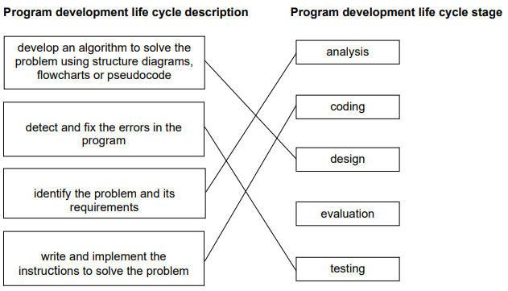

# Mark Schemes — Development Life Cycle
**7. Algorithm Design & Problem-Solving** · Cambridge (CIE) IGCSE computer-science (0478 & 0984)

## Exam Questions (3 questions)

### Q1
Designs of a solution to a problem can be presented as:

- Structure diagram / chart **[1 mark]**
- Flowchart **[1 mark]**
- Pseudocode **[1 mark]**

### Q2
**Final answer:** **The correct answer is A**

- **A **is correct as analysis is the first stage of the development life cycle **[1 mark]**
- **B **is incorrect as coding is the third stage of the development life cycle
- **C **is incorrect as design is the second stage of the development life cycle
- **D **is incorrect as testing is the fourth stage of the development life cycle

### Q3
**One **mark for each correct line.

