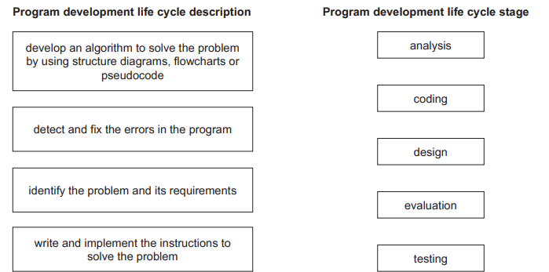

# Exam Questions — Development Life Cycle
**7. Algorithm Design & Problem-Solving** · Cambridge (CIE) IGCSE computer-science (0478 & 0984)
> Source: [https://www.savemyexams.com/igcse/computer-science/cie/23/topic-questions/](https://www.savemyexams.com/igcse/computer-science/cie/23/topic-questions/) · 3 questions across 1 sets

## Exam Questions (3 questions)

### Q1 — easy — 3 marks

**Q1** [3 marks]

**Identify three** different ways that the design of a solution to a problem can be presented.

*Source: June 2023 0478/22 Q3*

### Q2 — easy — 1 marks

**Q2** [1 mark]

**Tick (✓) one box **to identify the first stage of the program development life cycle.

*Source: June 2023 0478/22 Q1*

### Q3 — easy — 4 marks

**Q3** [4 marks]

**Four **descriptions of stages in the program development life cycle are shown.

**Draw one line** to link each description to its most appropriate program development life cycle stage.

**Not all** program development life cycle stages will be used.

