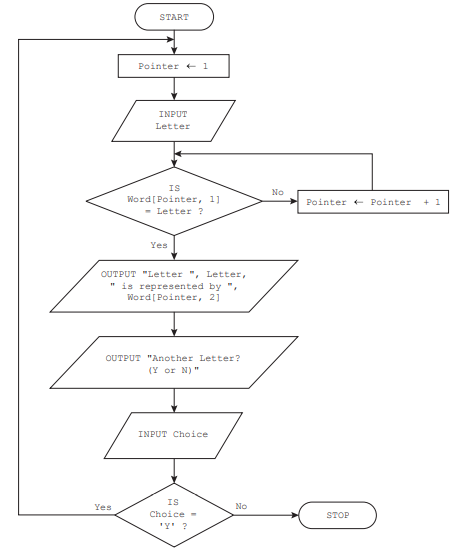

# Exam Questions — Standard Methods of a Solution
**7. Algorithm Design & Problem-Solving** · Cambridge (CIE) IGCSE computer-science (0478 & 0984)
> Source: [https://www.savemyexams.com/igcse/computer-science/cie/23/topic-questions/](https://www.savemyexams.com/igcse/computer-science/cie/23/topic-questions/) · 3 questions across 1 sets

## Exam Questions (3 questions)

### Q1 — medium — 3 marks

**Q1** [3 marks]

**Outline **the processes involved in the algorithm shown in the flowchart.

*Source: June 2024 0478/21 Q6B*

### Q2 — hard — 5 marks

**Q2** [2 marks]

**Describe** counting in the context of algorithms.

**Q2** [3 marks]

**Write pseudocode **to count the number of times a user inputs a positive number, stopping when the user inputs a negative number.

### Q3 — hard — 3 marks

**Q3** [1 mark]

The flowchart represents an algorithm.

**Identify** **the** **type** of algorithm used.

*Source: June 2023 0478/21 Q7B*

**Q3** [2 marks]

**Describe one problem** that could occur with this algorithm if an invalid character was input.

*Source: June 2023 0478/21 Q7C*

