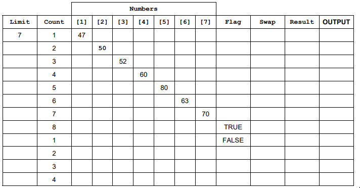
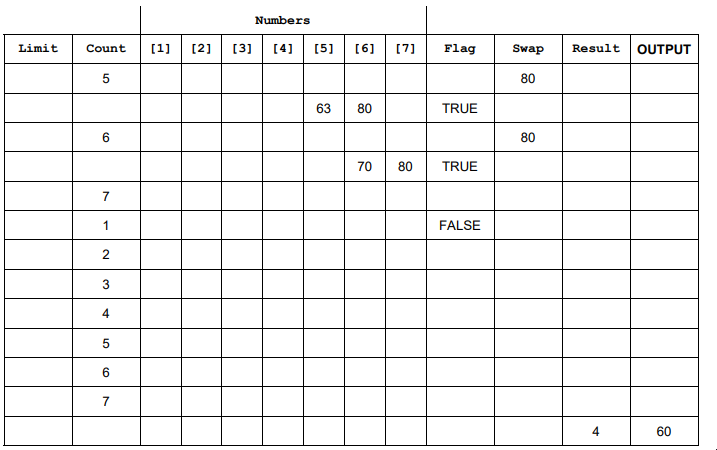

# Mark Schemes — Validation & Verification
**7. Algorithm Design & Problem-Solving** · Cambridge (CIE) IGCSE computer-science (0478 & 0984)

## Exam Questions (21 questions)

### Q1
The completed  trace table for the inputs is:

- Correct **Limit** column **[1 mark]**
- Correct **Count** column **[1 mark]**
- **Array** columns for **input stage ****[1 mark]**
- **Array** columns for **sort stage ****[1 mark]**
- Correct **Flag** column **[1 mark]**
- Correct **Swap** column **[1 mark]**
- Correct **Result** and **OUTPUT** columns **[1 mark]**

### Q2
The algorithm could be altered by:

Any **four **of the following:

- After line 09 / after the input **[1 mark]**
- Insert a **WHILE / pre-condition loop**…**[1 mark]**
- … to check if the value entered is between **1 and 500 inclusive ****[1 mark]**
- If the value is **not in range**, output an **error message ****[1 mark]**
- … and insert **another input statement** for re-input **[1 mark]**

**Or**

- Before line 08 / before the input message **[1 mark]**
- Start a **REPEAT / post-condition loop ****[1 mark]**
- After line 09 / after the input **[1 mark]**
- … close the REPEAT loop by checking if the value entered was between **1 and 500 inclusive ****[1 mark]**
- If it wasn’t, (the loop will repeat) for the number to be **re-input** / If it was, the program continues **[1 mark]**

### Q3
**Final answer:** **The correct answer is D**

- D is correct because checking if an email contains a specific character, like the ‘@’ symbol, is a way of making sure the email is in the correct **format**
- A is incorrect because a **range check** is used to ensure a value falls within a specified range, for example, between 14 and 16
- B is incorrect because a **visual check** is when a human manually checks the data by sight to confirm accuracy
- C is incorrect because a **presence check** is used to ensure that a required input has not been left blank

### Q4
| `F` | `C` | `X[1]` | `X[2] ` | `X[3]` | `X[4]` | `X[5]` | `T` |
|---|---|---|---|---|---|---|---|
|   |   | 10 | 1 | 5 | 7 | 11 |   |
| 0 | 1 |   |   |   |   |   | 10 |
| 1 | 2 | 1 | 10 |   |   |   | 10 |
| 1 | 3 |   | 5 | 10 |   |   | 10 |
| 1 | 4 |   |   | 7 | 10 |   |   |
|   | 5 |   |   |   |   |   |   |
| 0 | 1 |   |   |   |   |   |   |
|   | 2 |   |   |   |   |   |   |
|   | 3 |   |   |   |   |   |   |
|   | 4 |   |   |   |   |   |   |
|   | 5 |   |   |   |   |   |   |

- column F **[1 mark]**
- column C **[1 mark]**
- column T** [1 mark]**
- columns X[1] to X[5]** [2 marks] ****OR **columns X[1] to X[5] with one error **[1 mark]**

### Q5
**One **mark per correct column, max **four**

| `Pointer` | `Letter` | `Choice` | `OUTPUT` |
|---|---|---|---|
| 1 | F |   |   |
| 2 |   |   |   |
| 3 |   |   |   |
| 4 |   |   |   |
| 5 |   |   |   |
| 6 |   |   | Letter F is represented by Foxtrot |
|   |   | Y | Another Letter? (Y or N) |
|   |   |   |   |
| 1 | D |   |   |
| 2 |   |   |   |
| 3 |   |   |   |
| 4 |   |   | Letter D is represented by Delta |
|   |   |   | Another Letter? (Y or N) |
|   |   | N |   |

### Q6
**One mark** for each correct column

| `Counter` | `Hot` | `Cold` | `Serve` | `Temp` | `Error` | `OUTPUT` |
|---|---|---|---|---|---|---|
| 0 | 0 | 0 | 0 |   |   |   |
| 1 |   |   | 1 | 75 |   |   |
| 2 |   |   | 2 | 78 |   |   |
| 3 |   |   | 3 | 84 |   |   |
| 4 | 1 |   |   | 87 |   | Too Hot |
| 5 | 2 |   |   | 91 |   | Too Hot |
| 6 |   |   | 4 | 80 |   |   |
| 7 |   |   | 5 | 75 |   |   |
| 8 |   |   | 6 | 70 |   |   |
| 9 |   |   | 7 | 65 |   |   |
| 10 |   |   |   | 62 |   | Too Cold |
|   |   |   |   | -1 | 30 | 30 |
| **[1 mark]** | **[1 mark]** | **[1 mark]** | **[1 mark]** | **[1 mark]** | **[1 mark]** | **[1 mark]** |

### Q7
The two types of check on the data input are:

**Check**: validation **OR** length check ** [1 mark]**

- .. length check **OR** checks number of characters in **password **** [1 mark]**

**Check**: verification **OR **double entry ** [1 mark]**

- **… **double entry **OR** comparison that two inputs are the same ** [1 mark]**

### Q8
| `Counter` | `Value` | `First` | `Last` | `Limit` | `OUTPUT` |
|---|---|---|---|---|---|
|   |   | 0 | 0 | 8 |   |
| 1 | 66 |   |   |   |   |
| 2 | 606 | 6 | 6 |   | 606 |
| 3 | 6226 |   |   |   |   |
| 4 | 8448 |   |   |   |   |
| 5 | 642 | 6 | 2 |   |   |
| 6 | 747 | 7 | 7 |   | 747 |
| 7 | 77 |   |   |   |   |
| 8 | 121 | 1 | 1 |   | 121 |

- correct `Counter` and `Limit` columns **[1 mark]**
- correct `Value` column** [1 mark]**
- correct `First` column **[1 mark]**
- correct `Last` column** [1 mark]**
- correct `OUTPUT`** [1 mark]**

### Q9
| `Weight` | `Reject` | `TotalWeight` | `OUTPUT` |
|---|---|---|---|
|   | 0 | 0 |   |
| 13 |   | 13 |   |
| 17 |   | 30 |   |
| 26 | 1 |   |   |
| 25 |   | 55 |   |
| 5 |   | 60 |   |
| 10 |   | 70 |   |
| 15 |   | 85 |   |
| 35 | 2 |   |   |
| 20 |   | 105 |   |
|   |   | 85 | Weight of items 85 Number of items rejected 2 |

- Weight column **[1 mark]**
- Reject column** [1 mark]**
- TotalWeight column (0 to 1st 85)** [1 mark]**
- TotalWeight column (105, 85) **[1 mark]**
- Output must be exact**  [1 mark]**

### Q10
| `Flag` | `Count` | `Name[1]` | `Name[2]` | `Name[3]` | `Name[4]` | `Temp` |
|---|---|---|---|---|---|---|
|   |   | `Jamal` | `Amir` | `Eve` | `Tara` |   |
| `0` | `1` | `Amir` | `Jamal` | `Eve` | `Tara` | `Jamal` |
| `1` | `2` | `Amir` | `Eve` | `Jamal` | `Tara` | `Jamal` |
| `1` | `3` | `Amir` | `Eve` | `Jamal` | `Tara` | `Jamal` |
| `1` | `4` | `Amir` | `Eve` | `Jamal` | `Tara` | `Jamal` |
| `0` | `1` | `Amir` | `Eve` | `Jamal` | `Tara` | `Jamal` |
| `0` | `2` | `Amir` | `Eve` | `Jamal` | `Tara` | `Jamal` |
| `0` | `3` | `Amir` | `Eve` | `Jamal` | `Tara` | `Jamal` |
| `0` | `4` | `Amir` | `Eve` | `Jamal` | `Tara` | `Jamal` |

- Flag column** [1 mark] **
- Count column **[1 mark] **
- Temp column **[1 mark] **
- All correct Name columns **[2 marks] ****OR** two or three correct Name columns **[1 mark] **

> **[mark-scheme]**
> - Repeated values **do not** need to be written unless a value is rewritten

### Q11
The validation checks that a programmer would use include:

Any **three **of the following:

- Range check with acceptable values is (greater than) zero and less than 1000 **[1 mark]**
- Presence check to ensure the program will not continue until a value has been entered **[1 mark]**
- Type/character check to ensure that a number is entered **[1 mark]**
- Length check to ensure there are no more than 3 digits entered **[1 mark]**
A double entry check is needed to:

- verify the data / for verification / as a verification check **OR** to make sure that no changes are made to the data on entry **[1 mark]**

### Q12
Examples of suitable test data include:

**Normal **– 75 **[1 mark]**

- … the data lies within the required range and should be accepted **[1 mark]**

**Abnormal **– Sixty **[1 mark]**

- … this is the wrong data type and should be rejected **[1 mark]**

**Extreme **– 30 **OR** 200 **[1 mark]**

- … the lowest or highest value in the required range that should be accepted **[1 mark]**

> **[mark-scheme]**
> - Max three for either just test data **or **valid reasons

### Q13
Validation is described as:

- an automated check carried out by a computer **[1 mark]**
- … to make sure the data entered is sensible/acceptable/reasonable **[1 mark]**

### Q14
**Set 1 **

- any appropriate example e.g. “small” **[1 mark]**
- … must follow through from the password given e.g. abnormal data will be rejected **[1 mark]**

**Set 2**

- any different appropriate example e.g. “password” and “password” **[1 mark]**
- … must be different and follow through from the password given e.g. normal data will be accepted **[1 mark]**

### Q15
**Normal test data:**

- computerscience@savemyexams.com **[1 mark]**
- … this is a valid email address (containing the @ symbol) and should be accepted **[1 mark]**

**Erroneous test data:**

- computerscienceisgreat **[1 mark]**
- … this is just a string, and should be rejected (as an email address needs a single ’@’) **[1 mark]**

> **[mark-scheme]**
> - Any **valid **example and reason can be awarded marks

### Q16
Accept any two valid test data values with **different reasons**, for example:

Examples of acceptable answers include:

- **2**

- boundary value that should be accepted **[1 mark]**
- **A value greater than 2 (e.g. 3)**

- normal data that should be accepted **[1 mark]**
- **A value less than 2 (e.g. 1 or 1.5)**

- invalid/erroneous data that should be rejected (accept: abnormal data / outside the range that should be rejected) **[1 mark]**

Award marks for:

- a correct test value **[1 mark]**
- a correct and distinct reason linked to program behaviour **[1 mark]**

> **[exam-tip]**
> The boundary is the exact threshold (2) — a value like 1 is not a boundary, it is data that should be rejected.
> 
> Make each reason clearly state whether the value should be accepted or rejected and why.

### Q17
**Final answer:** **The correct answer is B**

- **B **is correct as a double entry check is a valid verification check on input data **[1 mark]**
- **A,C & D **are incorrect as they are error detection methods used during data transmission

### Q18
**Final answer:** **The correct answer is B**

- **B **is correct as 15 is above 10 and below 20 **[1 mark]**
- **A **is incorrect as 10 is not above 10 (11+)
- **C **is incorrect as 20 is not below 20 (<19)
- **D **is incorrect as 30 is not between 10 and 20

### Q19
**One** mark per correct column

| **Statement** | **Validation** | **Verification** | **Both** |
|---|---|---|---|
| Entering the data twice to check if both entries are the same. | ** ** | **✓** | ** ** |
| Automatically checking that only numeric data has been entered. | **✓** | ** ** | ** ** |
| Checking data entered into a computer system before it is stored or processed. | ** ** | ** ** | **✓** |
| Visually checking that no errors have been introduced during data entry. | ** ** | **✓** |   |

### Q20
Each value was chosen as:

***10.00***

- boundary / abnormal data **OR** the price should be rejected **OR** value is out of range **[1 mark]**

***9.99 ***

- boundary / extreme / normal data **OR** the price should be accepted **OR** value is within normal range **[1 mark]**

***ten***** **

- abnormal data **OR** input should be rejected **OR** value is wrong type **[1 mark]**

### Q21
**Validation check**

**One** mark for description:

- To test if the data entered is possible / reasonable / sensible **[1 mark]**
- A range check tests that data entered fits within specified values **[1 mark]**

**One **mark for example:

- Allow any correct validation check as an example (range, length, type, presence, format, etc.) **[1 mark]**

**Verification check**

**One** mark for description:

- To test if the data input is the same as the data that was intended to be input **[1 mark]**
- A double entry check expects each item of data to be entered twice and compares both entries to check they are the same **[1 mark]**

**One **mark for example:

- Allow any correct verification check as an example (visual, double entry, etc.) **[1 mark]**
