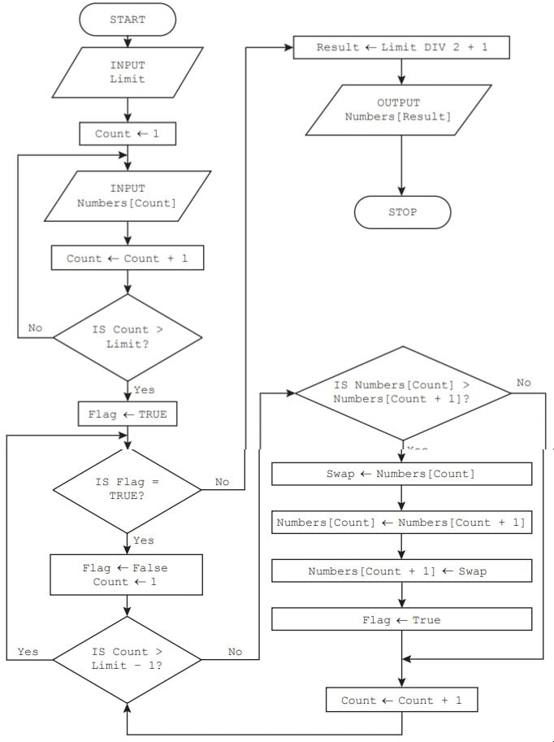
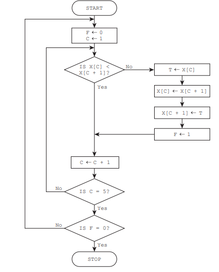
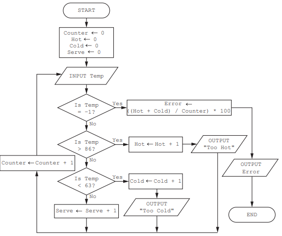
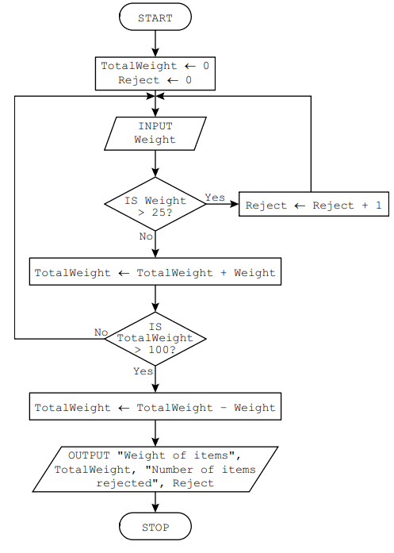
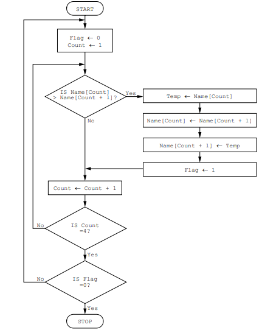

# Exam Questions — Validation & Verification
**7. Algorithm Design & Problem-Solving** · Cambridge (CIE) IGCSE computer-science (0478 & 0984)
> Source: [https://www.savemyexams.com/igcse/computer-science/cie/23/topic-questions/](https://www.savemyexams.com/igcse/computer-science/cie/23/topic-questions/) · 21 questions across 1 sets

## Exam Questions (21 questions)

### Q1 — hard — 7 marks

**Q1** [7 marks]

The flowchart represents an algorithm.

**Complete **the trace table for the input data:

7, 47, 50, 52, 60, 80, 63, 70

![A blank table with columns titled: Limit, Count, numbers [1] to [7], Flag, Swap, Result, and Output, intended for data entry or analysis.](assets/002-a-blank-table-with-columns-titled-limit-count-nu.png)

*Source: June 2024 0478/21 Q6A*

### Q2 — medium — 4 marks

**Q2** [4 marks]

This pseudocode algorithm is intended to allow, at random, between 1 and 20 values to be entered and totalled. The total and average of the entered values are output at the end of the algorithm.

**Explain **how you should alter the algorithm to make sure that all the numbers entered are between 1 and 500 inclusive.

If any numbers fall outside these limits, a replacement value is requested and entered.

You** do not** need to re-write the algorithm.

*Source: June 2024 0478/21 Q4C*

### Q3 — easy — 1 marks

**Q3** [1 mark]

**Tick** (**✓**) one box to complete this sentence.

A validation check to make sure that an email address contains an ‘@’ sign is a

*Source: June 2024 0478/21 Q1*

### Q4 — hard — 5 marks

**Q4** [5 marks]

This flowchart represents an algorithm.

The array `X[1:5]` used in the flowchart contains this data:

| `X[1]` | `X[2]` | `X[3]` | `X[4]` | `X[5]` |
|---|---|---|---|---|
| 10 | 1 | 5 | 7 | 11 |

**Complete the trace table** by using the data given in the array.

| `F` | `C` | `X[1]` | `X[2] ` | `X[3]` | `X[4]` | `X[5]` | `T` |
|---|---|---|---|---|---|---|---|
|   |   | 10 | 1 | 5 | 7 | 11 |   |
|   |   |   |   |   |   |   |   |
|   |   |   |   |   |   |   |   |
|   |   |   |   |   |   |   |   |
|   |   |   |   |   |   |   |   |
|   |   |   |   |   |   |   |   |
|   |   |   |   |   |   |   |   |
|   |   |   |   |   |   |   |   |
|   |   |   |   |   |   |   |   |
|   |   |   |   |   |   |   |   |

*Source: June 2023 0478/22 Q9A*

### Q5 — hard — 4 marks

**Q5** [4 marks]

The flowchart represents an algorithm.

![Flowchart starts at 'Start', initializes 'Pointer' to 1, inputs 'Letter', compares it with 'Word[Pointer, 1]', outputs a message, asks for another letter, loops or stops.](assets/006-flowchart-starts-at-start-initializes-pointer-to.png)

The table represents the two-dimensional (2D) array `Word[]` which stores the first half of the phonetic alphabet used for radio transmission. For example, `Word[10,1]` is ‘J’.

| `Index` | `1` | `2` |
|---|---|---|
| 1 | A | Alpha |
| 2 | B | Bravo |
| 3 | C | Charlie |
| 4 | D | Delta |
| 5 | E | Echo |
| 6 | F | Foxtrot |
| 7 | G | Golf |
| 8 | H | Hotel |
| 9 | I | India |
| 10 | J | Juliet |
| 11 | K | Kilo |
| 12 | L | Lima |
| 13 | M | Mike |

**Complete the trace table** for the algorithm by using the input data: F, Y, D, N

| `Pointer` | `Letter` | `Choice` | `OUTPUT` |
|---|---|---|---|
|   |   |   |   |
|   |   |   |   |
|   |   |   |   |
|   |   |   |   |
|   |   |   |   |
|   |   |   |   |
|   |   |   |   |
|   |   |   |   |
|   |   |   |   |
|   |   |   |   |

*Source: June 2023 0478/21 Q7A*

### Q6 — hard — 7 marks

**Q6** [7 marks]

This algorithm checks the temperature of hot food being served to customers.

**Complete the trace table** for the algorithm using this input data:

75, 78, 84, 87, 91, 80, 75, 70, 65, 62, –1, 20

| `Counter` | `Hot` | `Cold` | `Serve` | `Temp` | `Error` | `OUTPUT` |
|---|---|---|---|---|---|---|
|   |   |   |   |   |   |   |
|   |   |   |   |   |   |   |

*Source: June 2022 0478/22 Q4A*

### Q7 — hard — 4 marks

**Q7** [4 marks]

An algorithm allows a user to input their password and checks that there are at least eight characters in the password. Then, the user is asked to re-input the password to check that both inputs are the same. The user is allowed three attempts at inputting a password of the correct length and a matching pair of passwords.

The pre-defined function` LEN(X)` returns the number of characters in the string, `X`

`01 Attempt ← 0 `
`02 REPEAT `
`03    PassCheck ← TRUE `
`04    OUTPUT "Please enter your password " `
`05    INPUT Password `
`06    IF LEN(Password) < 8 `
`07      THEN `
`08        PassCheck ← TRUE `
`09      ELSE `
`10        OUTPUT "Please re-enter your password "`
`11        INPUT Password2 `
`12        IF Password <> Password `
`13          THEN `
`14          PassCheck ← FALSE `
`15        ENDIF `
`16     ENDIF `
`17     Attempt ← Attempt + 1 `
`18 UNTIL PassCheck OR Attempt <> 3 `
`19 IF PassCheck `
`20   THEN `
`21     OUTPUT "Password success" `
`22   ELSE `
`23     OUTPUT "Password fail" `
`24 ENDIF`

The algorithm includes two types of check on the data input.

**Identify and describe** each type of check.

*Source: June 2022 0478/22 Q2B*

### Q8 — hard — 6 marks

**Q8** [6 marks]

The pseudocode represents an algorithm.

The pre-defined function `DIV `gives the value of the result of integer division. For example, `Y = 9 DIV 4` gives the value `Y = 2`

The pre-defined function `MOD` gives the value of the remainder of integer division. For example, `R = 9 MOD 4` gives the value `R = 1`

`First ← 0 `
`Last ← 0 `
`INPUT Limit `
`FOR Counter ← 1 TO Limit `
`   INPUT Value `
`   IF Value >= 100 `
`     THEN `
`      IF Value < 1000 `
`       THEN `
`        First ← Value DIV 100 `
`        Last ← Value MOD 10 `
`         IF First = Last `
`          THEN `
`            OUTPUT Value `
`         ENDIF `
`      ENDIF `
`    ENDIF `
`NEXT Counter`

**Complete the trace table** for the algorithm using this input data:

8, 66, 606, 6226, 8448, 642, 747, 77, 121

| `Counter` | `Value` | `First` | `Last` | `Limit` | `OUTPUT` |
|---|---|---|---|---|---|
|   |   |   |   |   |   |
|   |   |   |   |   |   |
|   |   |   |   |   |   |
|   |   |   |   |   |   |
|   |   |   |   |   |   |
|   |   |   |   |   |   |
|   |   |   |   |   |   |
|   |   |   |   |   |   |
|   |   |   |   |   |   |

*Source: June 2022 21 Q5A*

### Q9 — hard — 5 marks

**Q9** [5 marks]

This flowchart inputs the weight of items, in kilograms, to be loaded on a trailer. Any item over 25 kilograms is rejected. The trailer can take up to 100 kilograms.

**Complete the trace table** for the input data:

13, 17, 26, 25, 5, 10, 15, 35, 20, 15

| `Weight` | `Reject` | `TotalWeight` | `OUTPUT` |
|---|---|---|---|
|   |   |   |   |
|   |   |   |   |
|   |   |   |   |
|   |   |   |   |
|   |   |   |   |
|   |   |   |   |
|   |   |   |   |
|   |   |   |   |
|   |   |   |   |
|   |   |   |   |
|   |   |   |   |
|   |   |   |   |

*Source: Specimen 2023 0478/02 2B Q8*

### Q10 — hard — 5 marks

**Q10** [5 marks]

This flowchart represents an algorithm.

The array Name[1:4] used in the flowchart contains the following data:

| `Name[1]` | `Name[2]` | `Name[3]` | `Name[4]` |
|---|---|---|---|
| `Jamal` | `Amir` | `Eve` | `Tara` |

**Complete the trace table** using the data given in the array

| `Flag` | `Count` | `Name[1]` | `Name[2]` | `Name[3]` | `Name[4]` | `Temp` |
|---|---|---|---|---|---|---|
|   |   | `Jamal` | `Amir` | `Eve` | `Tara` |   |
|   |   |   |   |   |   |   |
|   |   |   |   |   |   |   |
|   |   |   |   |   |   |   |
|   |   |   |   |   |   |   |
|   |   |   |   |   |   |   |
|   |   |   |   |   |   |   |
|   |   |   |   |   |   |   |
|   |   |   |   |   |   |   |
|   |   |   |   |   |   |   |
|   |   |   |   |   |   |   |

*Source: Specimen 2023 2A Q7A*

### Q11 — medium — 4 marks

**Q11** [3 marks]

A program needs to make sure the value input for a measurement meets the following rules:

- **the value is a positive number **
- **a value is always input **
- **the value is less than 1000**

**Describe **the validation checks that the programmer would need to use.

*Source: June 2023 0478/22 Q4A*

**Q11** [1 mark]

The program needs editing to include a **double entry check** for the value input

**State why **this check needs to be included.

*Source: June 2023 0478/22 Q4B*

### Q12 — medium — 6 marks

**Q12** [6 marks]

A validation check is used to make sure that any value that is input is an integer between 30 and 200 inclusive.

**Give one example of each type of test data** to check that the validation check is working as intended. Each example of test data must be different.

**Give a reason** for each of your choices of test data.

- **Normal test data **
- **Abnormal test data**
- **Extreme test data**

*Source: June 2023 0478/21 Q3B*

### Q13 — medium — 2 marks

**Q13** [2 marks]

**Describe **what is meant by data validation

*Source: June 2023 0478/21 Q3A*

### Q14 — medium — 4 marks

**Q14** [4 marks]

An algorithm allows a user to input their password and checks that there are at least eight characters in the password. Then, the user is asked to re-input the password to check that both inputs are the same. The user is allowed three attempts at inputting a password of the correct length and a matching pair of passwords.

The pre-defined function `LEN(X)` returns the number of characters in the string, `X`

`01    Attempt ← 0 `
`02    REPEAT `
`03    PassCheck ← TRUE `
`04    OUTPUT "Please enter your password " `
`05    INPUT Password `
`06     IF LEN(Password) < 8 `
`07           THEN `
`08               PassCheck ← TRUE `
`09           ELSE `
`10                OUTPUT "Please re-enter your password " `
`11                   INPUT Password2 `
`12                  IF Password <> Password `
`13                        THEN `
`14                              PassCheck ← FALSE `
`15                  ENDIF `
`16      ENDIF `
`17    Attempt ← Attempt + 1`
`18   UNTIL PassCheck OR Attempt <> 3 `
`19       IF PassCheck `
`20         THEN `
`21               OUTPUT "Password success" `
`22       ELSE `
`23              OUTPUT "Password fail" `
`24       ENDIF`

**Give two sets of test data** for this algorithm and a reason for choosing each set.

Each set of test data **and its reason **must be different.

*Source: June 2022 0478/22 Q2C*

### Q15 — medium — 4 marks

**Q15** [4 marks]

**Give one** piece of **normal **test data and one piece of **erroneous **test data that could be used to validate the input of an email address.

**State the reason** for your choice in each case.

*Source: June 2022 0478/21 Q3*

### Q16 — medium — 4 marks

**Q16** [4 marks]

**Extract:**

- Accept "abnormal data", "outside the range", or "outside the boundary" combined with "should be rejected" as the reason for a value less than 2.
- Do not accept calling a value less than 2 (e.g. 1) a "boundary value" \u2014 the boundary is 2.

A program checks if the weight of a baby is at least 2 kilograms.

**Give**, with reasons, two different values of test data that could be used for the baby’s weight.

Each reason **must **be different.

*Source: Specimen 2023 0478/02 2B Q3*

### Q17 — easy — 1 marks

**Q17** [1 mark]

Verification checks can be made on input data.

**Tick (✓) one box** to show which check is a verification check on input data.

*Source: Specimen 2023 0478/01 2B Q9*

### Q18 — easy — 1 marks

**Q18** [1 mark]

A range check is used to check that a value input is above 10 and below 20.

**Tick (✓) one box **to show which value would be accepted.

*Source: Specimen 2023 0478/01 2B Q1A*

### Q19 — easy — 4 marks

**Q19** [4 marks]

**Tick (✓) one box in each row **to identify if the statement is about **validation**, **verification** or** both.**

| **Statement** | **Validation** **(✓)** | **Verification** **(✓)** | **Both** **(✓)** |
|---|---|---|---|
| Entering the data twice to check if both entries are the same. |   |   |   |
| Automatically checking that only numeric data has been entered. |   |   |   |
| Checking data entered into a computer system before it is stored or processed. |   |   |   |
| Visually checking that no errors have been introduced during data entry. |   |   |   |

*Source: June 2021 Paper 21 Q2*

### Q20 — medium — 3 marks

**Q20** [3 marks]

A programmer has written an algorithm to check that prices are less than \$10.00

These values are used as test data:

10.00                9.99                  ten

- **State why** each value was chosen as test data.

  - **10.00**
  - **9.99**
  - **ten**

*Source: Specimen 2023 2A Q8*

### Q21 — medium — 4 marks

**Q21** [4 marks]

**Describe** the purpose of validation and verification checks during data entry.

Include an **example **for each.

*Source: Specimen 2023 Paper 1 Q2*

