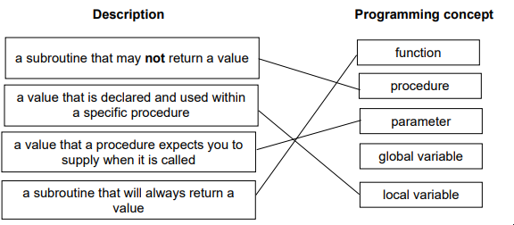
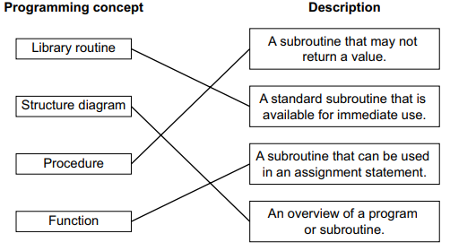
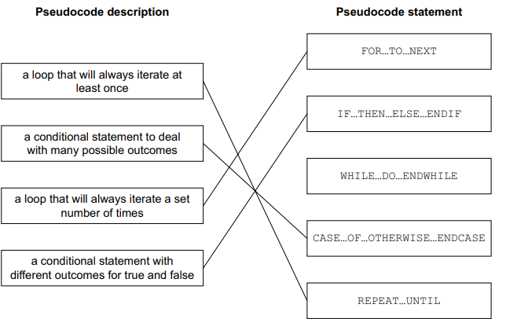

# Mark Schemes — Programming Concepts
**8. Programming** · Cambridge (CIE) IGCSE computer-science (0478 & 0984)

## Exam Questions (28 questions)

### Q1
- Correct input statements for both variables [1 mark]
- Correct outer IF statement with appropriate condition for grade validation [1 mark]
- Elements of nested CASE statement present – `CASE OF ... ENDCASE` within the IF block [1 mark]
- All four subject code branches correct with appropriate concatenation [1 mark]
- Correct use of `OTHERWISE` for invalid subject code and `ELSE` for invalid grade [1 mark]

### Q2
The correct pseudocode statement would be:

• `G ← SUBSTRING(Q,13,9)`

• `G ← SUBSTRING` **[1 mark]**

• `(Q,13,9)` **[1 mark]**

### Q3
- Correct input statement with appropriate variable **[1 mark]**
- Elements of selection statement present – `CASE OF ... ENDCASE `**[1 mark]**
- At least one correct branch in the case statement **[1 mark]**
- All branches from 1 to 4 correct **[1 mark]**
- Correct use of `OTHERWISE` with correct output **[1 mark]**

### Q4
**One **mark for a correct statement about each data type **[1 mark]**
**One **mark for a correct example of data for each data type **[1 mark]**

E.g.

- **Integer** – A whole number **[1 mark]** **:** 27  **[1 mark]**
- **Real** – A number that contains a fractional part  **[1 mark]** **:** 18.75  **[1 mark]**

### Q5
Examples of why procedures and functions make a program easier to maintain are:

Any **three **of the following:

- Procedures / functions divide the program into smaller manageable segments **[1 mark]**
- … making it more readable / easier to understand / easier to debug **[1 mark]**
- Procedures / functions with meaningful names help to provide documentation for the program / enable/help/provide abstraction **[1 mark]**
- Procedures and functions may be re-used (in the program / in other programs / as part of a library) / run from a single line **[1 mark]**
- Procedures and functions can reduce / eliminate (repeated) code **[1 mark]**

### Q6
**The correct pseudocode would be:**

`CALL Average(25, 50)`

- Correct key word – `CALL`** ****[1 mark]**
- Procedure name with correct parameters – `Average(25, 50)`** ****[1 mark]**

### Q7
- Each correct line **[1 mark]**

### Q8
The variables after each pseudocode statement are:

- `P = Computer Science `**[1 mark]**
- `Q = 16 ` **[1 mark]**
- `R = Science` **[1 mark]**
- `S = 7 ` **[1 mark]**
- `T = Sci ` **[1 mark]**

### Q9
The difference between a local and global variable is:

**Local**

- declared within a specific scope **OR** is only accessible within that block **[1 mark]**

**Global**

- declared at the outermost level of a program **OR **can be accessed and modified from any part of the program **[1 mark]**

### Q10
An example of an algorithm could be:

`REPEAT `
`     OUTPUT "Enter a digit " `
`     INPUT Number[Counter] `
`UNTIL Number[Counter] = Round(Number[Counter],0) AND ((Number[Counter] = -1) OR (Number[Counter] > 0 AND Number[Counter] < 10))`

**One mark** for place in algorithm (max one)

- around lines 05 and 06  **[1 mark]**
- line 07 **[1 mark]**
- (immediately) after the input of the number **[1 mark]**

**Three marks **pseudocode

Any **three **of the following:

- Use of `REPEAT … UNTIL `**OR** any working loop structure **[1 mark]**
- check for` >0 // >=0 `**[1 mark]**
- check for `<10 // >9 `**[1 mark]**
- check for whole number **[1 mark]**
- check for -1  [**1 mark]**
- check for length of digit <> 1 **[1 mark]**

### Q11
An example of an algorithm could be:

`REPEAT `
`    OUTPUT "Please enter measurement " `
`    INPUT Measurement `
`    OUTPUT "Please re-enter measurement " `
`    INPUT MeasurementCheck `
`UNTIL Measurement = MeasurementCheck`

Any **three **of the following:

- use of iteration **[1 mark]**
- use of two inputs **[1 mark]**
- to check that the two inputs are the same / different **[1 mark]**
- use of the given variable Measurement **[1 mark]**

### Q12
An example of the algorithm could be:

`Phrase `$\leftarrow$`"The beginning is the most important part" `
`OUTPUT LENGTH(Phrase) `
`OUTPUT UCASE(Phrase)`

Any **three **of the following:

- Storing string in Phrase **[1 mark]**
- Correct use of LENGTH function **[1 mark]**
- Correct use of UCASE function **[1 mark]**
- Correct outputs of LENGTH and UCASE **[1 mark]**

### Q13
An example algorithm could be:

`Count ← 0 `
`WHILE Count < 50 DO `
`    OUTPUT Name[Count] `
`    Count ← Count + 1 `
`ENDWHILE`

- Appropriate loop controls** ****[1 mark]**
- Read from array **[1 mark]**
- Output from array (the last two points can be in one statement, see example) **[1 mark]**

> **[mark-scheme]**
> - Reading and the output **MUST **be within the same loop

### Q14
An example algorithm could be:

`P `$\leftarrow$` UCASE(P) `
`Counter  `$\leftarrow$` 1 `
`Position  `$\leftarrow$` 0 `
`REPEAT `
`  IF SUBSTRING(P, Counter, 1) = Q `
`    THEN `
`      Position  `$\leftarrow$` Counter `
`  ENDIF `
`  Counter  `$\leftarrow$` Counter + 1 `
`UNTIL Position <> 0 OR Counter = LENGTH(P)`

Any **four **of the following:

- converting P to upper case **[1 mark]**
- finding the length of P **[1 mark]**
- using a loop to check for position of Q **[1 mark]**
- using the string operation substring **[1 mark]**
- storing the loop counter in Position if the value is found **[1 mark]**

### Q15
The output of the pseudocode statements is:

- 40 **[1 mark]**
- THE BEGINNING IS THE MOST IMPORTANT PART **[1 mark]**

### Q16
Examples of features that should be included are:

**Meaningful identifiers** ** [1 mark]**

- … to enable the programmer (or future programmers) to easily recognise the purpose of a variable / array / constant ** [1 mark]**
- … to enable easy tracking of a variable / constant / array through the program ** [1 mark]**

**Use of comments** ** [1 mark]**

- … to annotate each section of a program so that a programmer can find specific sections / so that the programmer knows the purpose of that section of code ** [1 mark]**

**Procedures and functions**** [1 mark]**

- … to make programs modular and easier to update / add functionality ** [1 mark]**

> **[mark-scheme]**
> - **One mark** for each correct feature, max two
> - **One mark** for each correct accompanying reason, max two

### Q17
The purpose of the library routines include:

**DIV**

Max **two **of the following:

- To perform integer division ** [1 mark]**
- Meaning only the whole number part of the answer is retained ** [1 mark]**
- Example of DIV For example DIV(9,4) = 2 ** [1 mark]**

**ROUND**

Max **two **of the following:

- To return a value rounded to a specified number of digits / decimal places ** [1 mark]**
- The result will either be rounded to the next highest or the next lowest value ** [1 mark]**
- … depending on whether the value of the preceding digit is >=5 or <5 ** [1 mark]**
- Example of ROUND for example, ROUND(4.56, 1) = 4.6 ** [1 mark]**

### Q18
The differences between a `WHILE … DO … ENDWHILE` and a `REPEAT … UNTIL` loop include:

Any **three **of the following:

- `WHILE `has criteria check at start **OR** pre-condition **[1 mark]**
- code inside `WHILE `may never run **[1 mark]**
- `REPEAT UNTIL` has criteria check at end **OR** post-condition **[1 mark]**
- `REPEAT UNTIL` will always run at least once **[1 mark]**

### Q19
The correct pseudocode statement would be:

- `F ← SUBSTRING(P,1,8)`

- `F ← SUBSTRING `**[1 mark]**
- `(P,1,8) `**[1 mark]**

### Q20
The correct pseudocode statements are:

- `DECLARE P : STRING `**[1 mark]**

  - `P `$\leftarrow$` "The world" `
- `DECLARE Q : CHAR `**[1 mark]**

  - `Q `$\leftarrow$` 'W'`

> **[mark-scheme]**
> - Each variable **must **be declared and stored for the mark

### Q21
The line number for the statements are:

**Totalling**

- `07` **[1 mark]**

**Count-controlled loop**

- `04/12 or 16/18` **[1 mark]**

**Post-condition loop**

- `02/20` **[1 mark]**

### Q22
| **Description** | **Data type** |   |   |   |   |
|---|---|---|---|---|---|
| **Boolean** | **Char** | **Integer** | **Real** | **String** |   |
| a single character from the keyboard |   | **✓** |   |   |   |
| multiplecharacters from the keyboard |   |   |   |   | **✓** |
| only one of two possible values | **✓** |   |   |   |   |
| only whole numbers |   |   | **✓** |   |   |
| any number |   |   |   | **✓** |   |

- five correct rows **[4 marks]**
- four correct rows **[3 marks]**
- three correct rows **[2 marks]**
- two correct rows **[1 mark]**

### Q23

- 1 correct **[1 mark] **
- 2 correct **[2 marks] **
- 3 or 4 correct **[3 marks] **

> **[mark-scheme]**
> - Each box **must **have only one connection

### Q24
The pseudocode statements to declare the variable are:

- `DECLARE X : STRING `**[1 mark]**
- `DECLARE Y : INTEGER `**[1 mark]**
- `DECLARE Z : INTEGER `**[1 mark]**

### Q25
| **Field** | **Data type** |
|---|---|
| `CatNo` | **Text** |
| `Title` | **Text** |
| `Genre1` | **Text** |
| `Streaming` | **Boolean / Text** |

- four correct answers** [2 marks]**

**OR**

- two or three correct answers **[1 mark]**

### Q26
**Final answer:** **The correct answer is C**

- **C **is correct as `inches `is passed into the function when the function is called **[1 mark]**
- **A **is incorrect  as `inches `is not the result of the function
- **B **is incorrect as `inches `is not a function call
- **D **is incorrect as a response is typically the value returned by the function

### Q27
**Final answer:** **The correct answer is B**

- **B **is correct as a function is a named section of a program that performs a task  **[1 mark]**
- **A **is incorrect  as a file is read/written to
- **C **is incorrect as a parameter is passed from a main to a sub program
- **D **is incorrect as a process generally refers to an action or series of actions

### Q28

