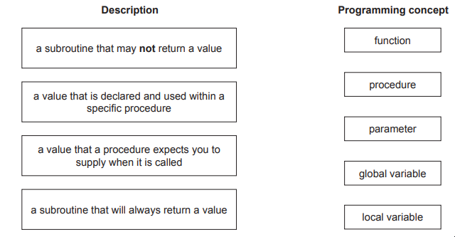
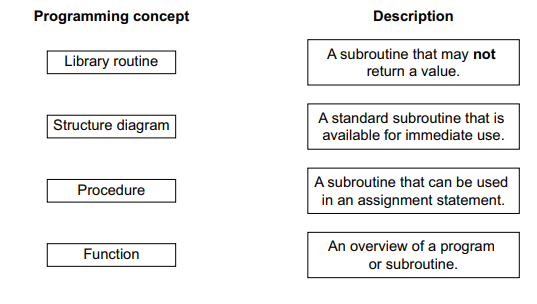
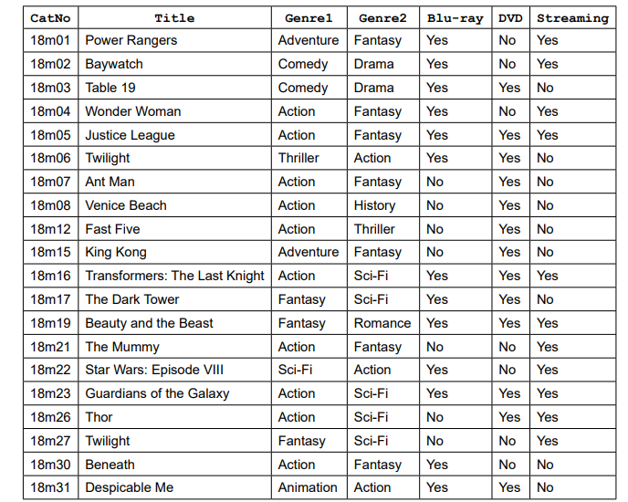
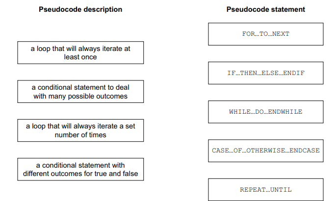

# Exam Questions — Programming Concepts
**8. Programming** · Cambridge (CIE) IGCSE computer-science (0478 & 0984)
> Source: [https://www.savemyexams.com/igcse/computer-science/cie/23/topic-questions/](https://www.savemyexams.com/igcse/computer-science/cie/23/topic-questions/) · 28 questions across 1 sets

## Exam Questions (28 questions)

### Q1 — medium — 5 marks

**Q1** [5 marks]

**Write** the pseudocode statements to perform this task:

- Accept the input of two whole numbers: a grade (1 to 5 inclusive) and a subject code (10, 20, 30, or 40)

- Use **nested selection statements** to:

○ If the grade is valid (1 to 5), use a **CASE** statement to check the subject code:

- If subject code is 10: output "Mathematics - Grade " followed by the grade
- If subject code is 20: output "Science - Grade " followed by the grade
- If subject code is 30: output "English - Grade " followed by the grade
- If subject code is 40: output "History - Grade " followed by the grade
- If subject code is invalid: output "INVALID SUBJECT"

○ If the grade is not valid (not 1 to 5 inclusive), output "INVALID GRADE"

### Q2 — medium — 2 marks

**Q2** [2 marks]

A function `LENGTH(X)` finds the length of a string X and a function `SUBSTRING(X,Y,Z)` finds a substring of X starting at position Y and Z characters long. The first character in the string is position 1.

`Q ← "Programming Languages"`

**Write a pseudocode statement** to extract the word Languages from Q and store it in the variable G.

### Q3 — medium — 5 marks

**Q3** [5 marks]

**Write **the pseudocode statements to perform this task:

• Accept the input of a whole number from 1 to 4 inclusive
• Use a **CASE **statement to:
 ○ output the number (1 to 4 inclusive) that was entered
 ○ output the word “ERROR” if a 1 to 4 inclusive number was not entered

*Source: June 2024 0478/21 Q5*

### Q4 — medium — 4 marks

**Q4** [4 marks]

**State **what is meant by the data types integer and real.

**Give **an example of each.

*Source: June 2024 0478/21 Q3*

### Q5 — medium — 3 marks

**Q5** [3 marks]

**Outline **the role of procedures and functions in creating a program that is easier to maintain.

*Source: June 2024 0478/21 Q2C*

### Q6 — easy — 2 marks

**Q6** [2 marks]

**Write **the pseudocode to use a procedure named `Average` that passes the values **25 **and **50 **to the procedure.

*Source: June 2024 0478/21 Q2B*

### Q7 — medium — 4 marks

**Q7** [4 marks]

Four descriptions of programming concepts and five programming concepts are shown.

**Draw one **line to link each description to the most appropriate programming concept.

**Not **all programming concepts will be used.

*Source: June 2024 0478/21 Q2A*

### Q8 — hard — 5 marks

**Q8** [5 marks]

A function `LENGTH(X)` finds the length of a string X and a function `SUBSTRING(X,Y,Z)` finds a substring of` X `starting at position `Y` and `Z` characters long. The first character in the string is position 1.

**Show the value of the variable** after each pseudocode statement has been executed.

`01 P ← "Computer Science" `

`02 Q ← LENGTH(P)`

`03 R ← SUBSTRING(P,10,7) `

`04 S ← LENGTH(R) `

`05 T ← SUBSTRING(R,1,3)`

### Q9 — easy — 2 marks

**Q9** [2 marks]

**Describe** the difference between a **local **variable and a **global **variable.

### Q10 — hard — 4 marks

**Q10** [4 marks]

An algorithm has been written in pseudocode to calculate a check digit for a four-digit number. The algorithm then outputs the five-digit number including the check digit. The algorithm stops when –1 is input as the fourth digit.

`01 Flag FALSE `
`02 REPEAT `
`03     Total 0 `
`04     FOR Counter 1 TO 4 `
`05         OUTPUT "Enter a digit ", Counter `
`06         INPUT Number[Counter] `
`07         Total Total + Number * Counter `
`08         IF Number[Counter] = 0 `
`09            THEN `
`equation``10              Flag `$\leftarrow$` TRUE `
`11         ENDIF `
`12      NEXT Counter `
`13      IF NOT Flag `
`14         THEN `
`15           Number[5] MOD(Total, 10) `
`16           FOR Counter 0 TO 5 `
`17             OUTPUT Number[Counter] `
`18           NEXT `
`19       ENDIF `
`20 UNTIL Flag`

The algorithm does not check that each input is a single digit. 
Identify the place in the algorithm where this check should occur.

**Write pseudocode for this check**. Your pseudocode must make sure that the input is a single digit and checks for –1

*Source: June 2023 0478/22 Q7C*

### Q11 — hard — 3 marks

**Q11** [3 marks]

A program needs to make sure the value input for a measurement meets the following rules:

- the value is a positive number
- a value is always input
- the value is less than 1000.

The program needs editing to include a double entry check for the value input.

The input value needs to be stored in the variable `Measurement `**Write pseudocode** to perform the **double entry check** until a successful input is made.

*Source: June 2023 0478/22 Q4B(II)*

### Q12 — hard — 3 marks

**Q12** [3 marks]

The function `LENGTH(Phrase)` calculates the length of a string `Phrase`

**Write the pseudocode statements** to:

- store the string "The beginning is the most important part" in Phrase.
- calculate and output the length of the string
- output the string in upper case.

*Source: June 2023 0478/21 Q8A*

### Q13 — hard — 3 marks

**Q13** [3 marks]

Using a single loop, **write an algorithm in pseudocode** to output 50 names that have been stored in the array, `Name[]`

*Source: specimen 2023 0478/02 2A Q1B*

### Q14 — medium — 4 marks

**Q14** [4 marks]

The variables P and Q are used to store data in a program. P stores a string. Q stores a character.

**Write a pseudocode algorithm** to:

- convert P to upper case
- find the position of Q in the string P (the first character in this string is in position 1)
- store the position of Q in the variable Position

*Source: June 2023 0478/22 Q11B*

### Q15 — medium — 2 marks

**Q15** [2 marks]

The function` LENGTH(Phrase)` calculates the length of a string `Phrase`

The string "*The beginning is the most important part" is stored in *`Phrase`

**State the output **of the pseudocode statements:

- `OUTPUT LENGTH(Phrase) `
- `OUTPUT UCASE(Phrase)`

*Source: June 2023 0478/21 Q8B*

### Q16 — medium — 4 marks

**Q16** [4 marks]

**State two features** that should be included to create a maintainable program.

**Give a reason** why each feature should be used.

*Source: June 2023 0478/21 Q6*

### Q17 — medium — 4 marks

**Q17** [4 marks]

**Explain the purpose** of the library routines **DIV **and **ROUND.**

*Source: June 2023 0478/21 Q4*

### Q18 — medium — 3 marks

**Q18** [3 marks]

**Explain the difference** between a `WHILE … DO … ENDWHILE` and a `REPEAT … UNTIL` loop

`B ← FALSE `
`INPUT Num `
`FOR Counter ← 1 TO 12 `
`              IF A[Counter] = Num `
`                   THEN `
`                       B ← TRUE `
`              ENDIF `
`NEXT Counter`

*Source: Specimen 2023 0478/02 2B Q12*

### Q19 — medium — 2 marks

**Q19** [2 marks]

A function `LENGTH(X)` finds the length of a string X and a function SUBSTRING(X,Y,Z) finds a substring of X starting at position Y and Z characters long. The first character in the string is position 1.

`P ← "Computer Science"`

**Write a pseudocode statement **to extract the word Computer from P and store it in the variable F.

*Source: Specimen 2023 0478/02 2B Q10B*

### Q20 — easy — 2 marks

**Q20** [2 marks]

The variables P and Q are used to store data in a program. P stores a string. Q stores a character.

**Write pseudocode statements** to declare the variables P and Q, store "The world" in P and store 'W' in Q

*Source: June 2023 0478/22 Q11A*

### Q21 — easy — 3 marks

**Q21** [3 marks]

An algorithm has been written in pseudocode to calculate a check digit for a four-digit number. The algorithm then outputs the five-digit number including the check digit. The algorithm stops when –1 is input as the fourth digit.

`01 Flag FALSE `
`02 REPEAT `
`03     Total 0 `
`04     FOR Counter 1 TO 4 `
`05       OUTPUT "Enter a digit ", Counter `
`06       INPUT Number[Counter] `
`07       Total Total + Number * Counter `
`08       IF Number[Counter] = 0 `
`09         THEN `
`10           Flag TRUE `
`11       ENDIF `
`12     NEXT Counter `
`13     IF NOT Flag `
`14       THEN `
`15         Number[5] MOD(Total, 10) `
`16         FOR Counter 0 TO 5 `
`17            OUTPUT Number[Counter] `
`18         NEXT `
`19     ENDIF `
`20 UNTIL Flag`

**Give **the line number(s)** **for the statements showing:

- **Totalling**
- **Count-controlled loop **
- **Post-condition loop **

*Source: June 2023 0478/22 Q7A*

### Q22 — easy — 4 marks

**Q22** [4 marks]

**Tick (✓) one box in each row** to identify the most appropriate data type for each description. Only one tick (✓) per column.

| **Description** | **Data type** |   |   |   |   |
|---|---|---|---|---|---|
| **Boolean** | **Char** | **Integer** | **Real** | **String** |   |
| a single character from the keyboard |   |   |   |   |   |
| multiplecharacters from the keyboard |   |   |   |   |   |
| only one of two possible values |   |   |   |   |   |
| only whole numbers |   |   |   |   |   |
| any number |   |   |   |   |   |

*Source: June 2022 0478/21 Q2*

### Q23 — easy — 3 marks

**Q23** [3 marks]

Four programming concepts and four descriptions are shown.

**Draw one line** to connect each programming concept to the most appropriate description

*Source: Specimen 2023 0478/02 2B Q2*

### Q24 — easy — 3 marks

**Q24** [3 marks]

The variables X, Y and Z are used to store data in a program:

- X stores a string
- Y stores a position in the string (e.g. 2)
- Z stores the number of characters in the string.

**Write pseudocode statements** to declare the variables X, Y and Z.

*Source: Specimen 2023 0478/02 2A Q12A*

### Q25 — easy — 2 marks

**Q25** [2 marks]

A database table, `2018MOV`, is used to keep a record of movie details

**Complete the table** to identify the most appropriate** data type** for each field based on the data shown in the database table, 2018MOV.

| **Field** | **Data type** |
|---|---|
| `CatNo` |   |
| `Title` |   |
| `Genre1` |   |
| `Streaming` |   |

*Source: Specimen 2023 0478/02 2A Q11C*

### Q26 — easy — 1 marks

**Q26** [1 mark]

A function is declared using pseudocode.

`FUNCTION ConvertToCm(Inches: REAL) `
`        RETURNS REAL RETURN Inches * 2.4 `
`ENDFUNCTION`

**Tick (✓) one box** which accurately describes the use of the variable Inches

*Source: Specimen 2023 0478/02 2A Q10*

### Q27 — easy — 1 marks

**Q27** [1 mark]

**Tick (✓) one box** to show the named section of a program that performs a specific task.

*Source: Specimen 2023 0478/02 2A Q3*

### Q28 — easy — 4 marks

**Q28** [4 marks]

Four pseudocode descriptions and five pseudocode statements are shown.

**Draw a line **to link each pseudocode description to the most appropriate pseudocode statement.

Some pseudocode statements will **not **be used

*Source: Specimen 2023 0478/02 2A Q1A*

