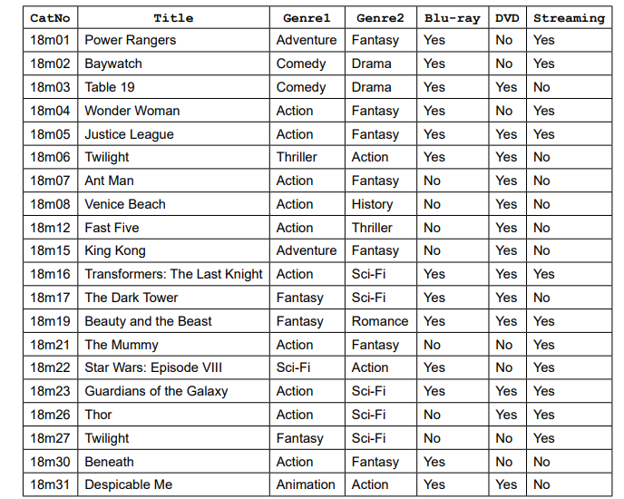

# Exam Questions — Databases
**9. Databases** · Cambridge (CIE) IGCSE computer-science (0478 & 0984)
> Source: [https://www.savemyexams.com/igcse/computer-science/cie/23/topic-questions/](https://www.savemyexams.com/igcse/computer-science/cie/23/topic-questions/) · 14 questions across 1 sets

## Exam Questions (14 questions)

### Q1 — easy — 1 marks

**Q1** [1 mark]

A database table called `SoftDrinks` stores details of the soft drinks sold by a small shop

| Field | Example data |
|---|---|
| `Name` | `Cola` |
| `Supplier` | `Cambridge Beverages` |
| `Container` | `Can` |
| `SizeCl` | `330` |
| `NumberInStock` | `30` |
| `ReorderLevel` | `15` |
| `Reordered` | `Yes` |

**State **whether any of the given fields would be suitable as a primary key and give a reason for your answer.

*Source: June 2024 0478/21 Q9A*

### Q2 — hard — 3 marks

**Q2** [3 marks]

Consider the following database table for an online shopping system:

| **OrderID** | **CustomerName** | **ProductCode** | **Quantity** | **PricePerUnit** | **TotalPrice** |
|---|---|---|---|---|---|
| 1001 | John Smith | PC12345 | 3 | 19.99 | 59.9 |

**Suggest** two different types of validation that could be applied to the `ProductCode` field.

**Explain why **they would be important.

### Q3 — hard — 6 marks

**Q3** [6 marks]

A school database is used to store information about students and their exam scores. The following fields have been identified:

- `StudentID`
- `FirstName`
- `LastName`
- `DateOfBirth`
- `ExamScore`
- `PassedExam`

**Describe **the most appropriate data type for each of the following fields and **justify **your choice.

- `StudentID`
- `ExamScore`
- `PassedExam`

### Q4 — hard — 6 marks

**Q4** [4 marks]

In a database for an online store, there are two tables: Customers and Orders.

1. **Customers Table:**

| **CustomerID** | **Name** | **Email** | **PhoneNumber** |
|---|---|---|---|
| C001 | Alice Brown | alice@example.com | 0123456789 |
| C002 | Bob Smith | bob@example.com | 0987654321 |

3. **Orders Table:**

| **OrderID** | **CustomerID** | **OrderDate** | **TotalAmount** |
|---|---|---|---|
| O001 | C001 | 2024-08-01 | 150.00 |
| O002 | C002 | 2024-08-02 | 200.00 |

**Identify **the primary key for each table and **explain why **it is suitable.

**Q4** [2 marks]

**Extract:**

In a database for an online store, there are two tables: Customers and Orders.

1. Customers Table:

| CustomerID | Name | Email | PhoneNumber |
| --- | --- | --- | --- |
| C001 | Alice Brown | alice@example.com | 0123456789 |
| C002 | Bob Smith | bob@example.com | 0987654321 |

2. Orders Table:

| OrderID | CustomerID | OrderDate | TotalAmount |
| --- | --- | --- | --- |
| O001 | C001 | 2024-08-01 | 150.00 |
| O002 | C002 | 2024-08-02 | 200.00 |

**Describe how **you would use the `CustomerID` field in the `Orders` table to link it to the `Customers` table.

### Q5 — medium — 4 marks

**Q5** [2 marks]

A database table contains the following fields:

- StudentID (integer)
- FirstName (text)
- LastName (text)
- DateOfBirth (date)
- Email (text)

**Identify which field** could benefit from a *format check* validation and **justify **your answer

**Q5** [2 marks]

**Extract:**

A database table contains the following fields:

- StudentID (integer)
- FirstName (text)
- LastName (text)
- DateOfBirth (date)
- Email (text)

**Identify which field** would require a *type check* validation and **justify **your answer.

### Q6 — easy — 2 marks

**Q6** [2 marks]

**Describe **what a *field* is in a database.

**Provide an example** of a field in a student database

### Q7 — medium — 2 marks

**Q7** [2 marks]

A database table, `PERFORMANCE`, is used to keep a record of the performances at a local theatre.

| `ShowNumber` | `Type` | `Title` | `Date` | `SoldOut` |
|---|---|---|---|---|
| SN091 | Comedy | An Evening at Home | 01 Sept | Yes |
| SN102 | Drama | Old Places | 02 Oct | No |
| SN113 | Jazz | Acoustic Evening | 03 Nov | No |
| SN124 | Classical | Mozart Evening | 04 Dec | Yes |
| SN021 | Classical | Bach Favourites | 01 Feb | Yes |
| SN032 | Jazz | 30 Years of Jazz | 02 Mar | Yes |
| SN043 | Comedy | Street Night | 03 Apr | No |
| SN054 | Comedy | Hoot | 04 May | No |

**Give two validation checks** that could be performed on the `ShowNumber` field

*Source: Specimen 2023 0478/02 2B Q11B*

### Q8 — easy — 3 marks

**Q8** [1 mark]

A music streaming service has a new database table named Songs to store details of songs available for streaming. The table contains the fields:

- `SongNumber `– the catalogue number, for example AG123
- `Title` – the title of the song
- `Author` – the name of the song writer(s)
- `Singer `– the name of the singer(s)
- `Genre` – the type of music, for example rock
- `Minutes` – the length of the song in minutes, for example 3.75
- `Recorded` – the date the song was recorded.

**Identify **the field** **that will be the most appropriate primary key for this table.

*Source: June 2023 0478/22 Q10A*

**Q8** [2 marks]

**Extract:**

- SongNumber – the catalogue number, for example AG123
- Title – the title of the song
- Author – the name of the song writer(s)
- Singer – the name of the singer(s)
- Genre – the type of music, for example rock
- Minutes – the length of the song in minutes, for example 3.75
- Recorded – the date the song was recorded.

**Complete the table** to identify the most appropriate data type for the fields in `Songs`

| **Field** | **Data type** |
|---|---|
| `SongNumber` |   |
| `Title` |   |
| `Recorded` |   |
| `Minutes` |   |

*Source: June 2023 0478/22 Q10B*

### Q9 — easy — 4 marks

**Q9** [2 marks]

A database table called `TVRange` shows the main features and prices of a range of televisions.

**Give the name of the field** that is most suitable to be the primary key.

**State the reason** for this choice.

*Source: June 2023 0478/21 Q10A*

**Q9** [2 marks]

The database uses the data types:

- **text **
- **character **
- **Boolean **
- **integer **
- **real **
- **date/time**

**Complete the table** to show the most appropriate data type for each field. Each data type must be different.

| **Field** | **Data type** |
|---|---|
| `TVCode` |   |
| `ScreenSize` |   |
| `SmartTV` |   |
| `Price\$` |   |

*Source: June 2023 0478/21 Q10B*

### Q10 — easy — 1 marks

**Q10** [1 mark]

A database table, NURSE, is used to keep a record of disposable items worn by veterinary nurses.

This is part of the table:

| ItemNumber | Description | SingleUse | Uses | StockLevel | ReorderLevel |
|---|---|---|---|---|---|
| DIG1 | Glove (pair) | Y | 1 | 500 | 800 |
| DIA1 | Apron | Y | 1 | 700 | 800 |
| DIM5 | Hair net | Y | 1 | 650 | 500 |
| DIA2 | Apron | N | 5 | 25 | 100 |
| DIS4 | Suit | N | 3 | 70 | 50 |
| DIV9 | Shoe cover (pair) | Y | 1 | 400 | 250 |

**Give a reason** why the field `SingleUse` is not required in the table `NURSE`.

*Source: June 2022 0478/22 Q5B*

### Q11 — easy — 2 marks

**Q11** [1 mark]

A computer game shop records its stock levels in a database table called GAMES. The fields used in the stock table are shown.

| Name | Description |
|---|---|
| GameID | primary key |
| GameName | the name of each game |
| AgeRestriction | the minimum age at which a person is allowed to play each game |
| GamePrice | the selling price for each game |
| NumberStock | the quantity of each game currently in stock |
| OnOrder | whether or not each game is on order from the suppliers |
| DateLastOrdered | the date the most recent order for each game was placed |
| GameDescription | a summary of the contents and purpose of each game |

**State the number of fields** that are in the table GAMES.

*Source: June 2022 21 Q6A*

**Q11** [1 mark]

**State one **important fact that must be true for a field to be a primary key.

*Source: June 2022 0478/21 Q6B*

### Q12 — easy — 2 marks

**Q12** [2 marks]

A database table, PERFORMANCE, is used to keep a record of the performances at a local theatre.

| **ShowNumber** | **Type** | **Title** | **Date** | **SoldOut** |
|---|---|---|---|---|
| SN091 | Comedy | An Evening at Home | 01 Sept | Yes |
| SN102 | Drama | Old Places | 02 Oct | No |
| SN113 | Jazz | Acoustic Evening | 03 Nov | No |
| SN124 | Classical | Mozart Evening | 04 Dec | Yes |
| SN021 | Classical | Bach Favourites | 01 Feb | Yes |
| SN032 | Jazz | 30 Years of Jazz | 02 Mar | Yes |
| SN043 | Comedy | Street Night | 03 Apr | No |
| SN054 | Comedy | Hoot | 04 May | No |

**State **the number of **fields** and **records **in the table.

*Source: Specimen 2023 0478/02 2B Q11A*

### Q13 — easy — 2 marks

**Q13** [1 mark]

**Give **the name of the field that would be used for the primary key.

*Source: Specimen 2023 0478/02 2A Q11B(I)*

**Q13** [1 mark]

**Extract:**

The name of the field that would be used for the primary key is:

- CatNo [1 mark]

**State **the reason for choosing this field for the primary key

*Source: specimen 2023 0478/02 2A Q11B(II)*

### Q14 — easy — 1 marks

**Q14** [1 mark]

A database table, 2018MOV, is used to keep a record of movie details.

**State **the number of records** **in the database table.

*Source: Specimen 2023 0478/02 2A Q11A*

